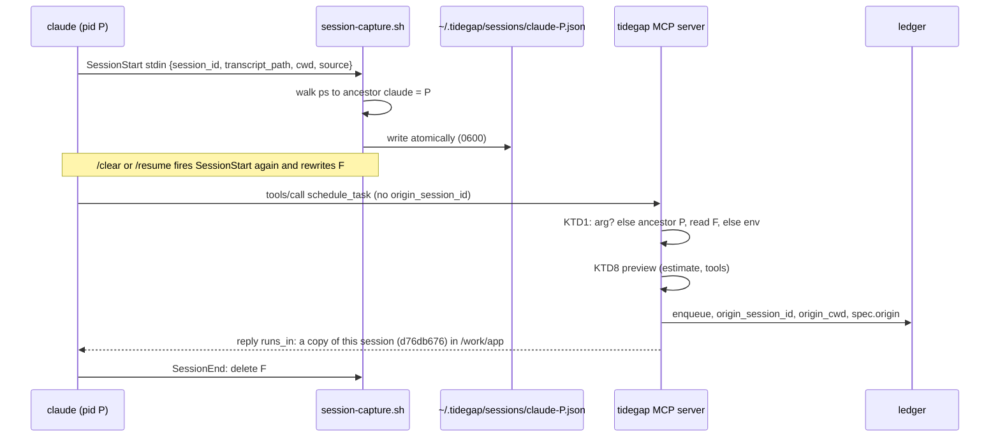
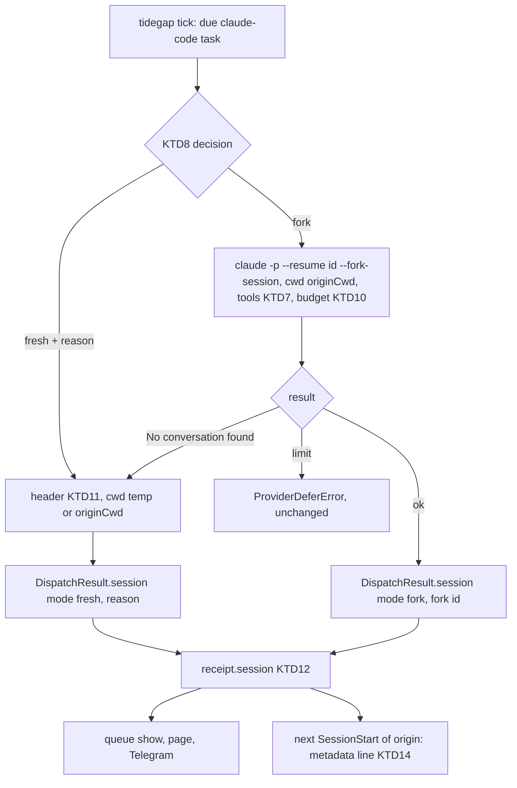

# Origin-Session Execution - Plan

## Goal Capsule

- **Objective:** A task that a Claude Code user queues from a conversation runs at the clean hour with that conversation's context, in that conversation's project directory, and the user can see where it ran and get back to it from the session, the page, the CLI and Telegram.
- **Means:** capture the session at queue time (KTD1-KTD4), then resume a fork of it with `claude -p --resume <id> --fork-session` (KTD6), with a token cap that falls back to a fresh run (KTD8, KTD9).
- **Authority:** R-IDs win on behavior, KTDs on mechanism. Binding constraints: `docs/solutions/tooling-decisions/running-claude-p-from-a-daemon.md` (file and web tools never mix, flags, env filter), `docs/solutions/tooling-decisions/claude-usage-limits-source-and-deferral.md` (limit deferral stays as is), `docs/solutions/best-practices/shared-sqlite-ledger-migrations.md` (why KTD4 avoids a migration), and the adapter contract in `packages/core-ts/src/providers/base.ts`.
- **Execution profile:** PR A on `feat/origin-session` carries streams S1-S3 (U1-U7), run in order by one implementer. PR B (U8, Codex) is separate and starts after PR A's manual QA passes. TypeScript and POSIX sh only.
- **Stop conditions:** stop and report if `claude -p --resume <id> --fork-session --output-format json` does not return the KTD3 JSON shape of the adapter plan, or if the fork's `session_id` equals the origin id, or if `--tools` stops limiting the tool set in a resumed run.
- **Who finishes:** the implementer opens PR A. Vitalii merges. The manual QA with Vitalii's real session (Verification Contract, row M1) waits for him.

---

## Product Contract

### Summary

Tidegap learns which Claude Code session queued a task, keeps it on the task, and at the clean hour runs the task in a copy (fork) of that session in its project directory. The run gets read-only file tools by default. A session above the token cap, or a task that needs web tools, runs fresh with a header built from the task. Every surface says where the task will run and where it ran. Codex gets a matching adapter in a second PR.

### Problem Frame

Vitalii's product rule (2026-10-17): "задачи должны ставиться с AI … выполнять именно там же, где он был зареквещен, и через ту же самую сессию". Today a queued task runs as `claude -p` in an empty temp directory with no session and no file tools (`packages/cli/src/providers/claude-code.ts`). A task such as "review the diff in queue.ts tonight" cannot see the repo or the conversation that asked for it, so it cannot do the work (critique G1). The session id is stored only when the user types `/tidegap:defer`, which substitutes `${CLAUDE_SESSION_ID}`. The MCP auto-invocation path records none (critique G14). The origin session never learns that its task finished: the SessionStart hook prints an unread count, and only in a new session.

### Requirements

**Capture**

- R1. A task queued through the Tidegap MCP server from a Claude Code session stores that session's id and project directory, on both the `/tidegap:defer` path and the auto-invoked `schedule_task` path.
- R2. After `/clear` or `/resume` inside a running Claude Code process, a newly queued task stores the session that is current at queue time, not the one the MCP server started with.
- R3. When no session can be found, the task is queued as today and runs in a fresh session. Nothing fails because the origin is unknown.

**Run**

- R4. A task with a Claude Code origin runs with that session's conversation as context, in the session's project directory, and never writes into the origin session's transcript.
- R5. Resuming gives context, not permissions. A resumed run has only the tools the task's tool policy allows, and never `Bash`, `Write` or `Edit`.
- R6. A run never combines the session context with web tools (the mixing rule in `running-claude-p-from-a-daemon.md`). A task that needs web tools runs fresh.
- R7. A resumed run keeps today's timeout, limit deferral and failure messages, and has a budget cap sized for its context (KTD10).

**Cost**

- R8. Before a resumed run, Tidegap estimates the session's context size. Above the cap, the task runs fresh, with a header built from the task, and says so.
- R9. The receipt records which mode ran (`fork` or `fresh`), the session id that ran, and the reason for a fresh run.

**Surfaces**

- R10. The MCP `schedule_task` reply (and its `dry_run`) says where the task is expected to run, as judged at queue time: "in a copy of this session" with the short session id and directory, or "in a fresh session" with the reason. The run decides again at the clean hour, and R9 records what actually ran.
- R11. `tidegap queue show` and the page task detail show the origin (agent, directory, short session id) and, after the run, the mode. After a fork run they also show the command that opens the fork; after a fresh run, the reason.
- R12. The Telegram "task done" message says where the task ran.
- R13. When the user returns to the origin session, Claude Code is told which of its tasks finished and how to read them, without any task or reply text entering the session context.

**Other hosts**

- R14. A Codex user gets a `codex` provider that runs `codex exec` headless, with resume where Codex allows it (PR B).
- R15. OpenClaw behavior does not change, and the README states why: OpenClaw already runs the task on its gateway runtime and delivers it to the chat it came from.

### Key Decisions

- **Fork, not in-place resume, for Claude Code in v1.** The result lives in a copy of the session; the origin learns of it at its next start (R13). Governs R4, R13.
- **A captured Claude Code origin changes the default provider to `claude-code`.** Without it, a user with `ANTHROPIC_API_KEY` set would get an API run with no session, which defeats the rule. An explicit `provider` still wins. Governs R1, R4.
- **Web tasks run fresh.** Session context plus web tools is the prompt-injection-to-exfiltration case the existing tool rule forbids. Governs R6.

### Acceptance Examples

- AE1. **Covers R1, R10.** Given a Claude Code session `d76db676-…` in `/work/app`, when the agent calls `schedule_task` with no `origin_session_id` and no `provider`, then the task stores session `d76db676-…`, cwd `/work/app`, provider `claude-code`, and the reply says `runs_in: a copy of this Claude Code session (d76db676) in /work/app, file tools Read, Grep, Glob`.
- AE2. **Covers R2.** Given the user ran `/clear` (new session `aa11…`) without restarting Claude Code, when the agent queues a task, then the task stores `aa11…`, not the id the MCP server process started with.
- AE3. **Covers R8, R9.** Given the origin transcript's last turn used about 620k input tokens and the cap is 150k, when the task runs, then it runs fresh with the header, and the receipt reads `session: { mode: "fresh", reason: "too-large", contextTokens: 620000 }`.
- AE4. **Covers R6.** Given a task queued from a session with `tools: ["WebSearch","WebFetch"]`, when it runs, then it runs fresh in a temp directory with the web tools, with reason `web-tools`.
- AE5. **Covers R13.** Given two tasks from session `d76db676` finished and are unread, when the user runs `claude --resume d76db676…`, then the session context gets one block naming both task ids, their status and mode, the fork resume commands and "read the result with check_queue_status". Both tasks stay unread until `check_queue_status` reads them, so the block repeats at the next start until then.

### Scope Boundaries

- No in-place resume for Claude Code. Considered and not built for v1: it writes into the transcript the user may have open (the sessions docs: two processes on one session interleave), a running background session refuses `-p --resume` with `--output-format json` and exits 1, and a resumed session may come back in the `dontAsk` mode of the last run. Evidence that would change the call: a QA run that shows the permission mode and model of the origin session unchanged after an in-place `-p` resume,.
- No liveness detection of the Claude Code origin session. Fork makes concurrent use safe, so nothing needs to wait or refuse (KTD6).
- No append to the origin transcript. The transcript format is internal and undocumented ("scripts that parse these files directly can break on any release", sessions docs). R13 uses the documented SessionStart context instead.
- No write or shell tools in any run. A task such as "refactor queue.ts" gets a read-only answer (a plan, a diff in the reply), not edited files. See Open Questions Q2.
- No model reply text in the session context (R13). This keeps the rule in `renderHookLine` (`packages/cli/src/commands/queue.ts`).
- No Python adapter and no Python ticker change. A Python tick fails a `claude-code` row with "no adapter configured", as today.
- No Mac app or extension change. They show `provider` and status already; the run line comes later with the client contract (critique G5).

#### Deferred to Follow-Up Work

- `tidegap install` adds the capture hook to `~/.claude/settings.json` for users who added the MCP server without the plugin (ask-first writer from the statusLine work). Until then, those users get capture from the environment (KTD1 step 3), which goes stale after `/clear`.
- In-place resume as an opt-in (`TIDEGAP_RESUME_INPLACE=1`) once the evidence above exists.
- A `UserPromptSubmit` post-back for a session that is still open (R13 covers the next start only). Cost: one CLI start per prompt.
- Reply chaining: a reply to a fork run resumes the previous fork instead of the origin. A reply that resumes the origin and carries the flattened prior turns (U4 copies `spec.origin` to the reply) is correct without it.
- Fork at the queue-time message, so later turns of the origin session are not in the fork's context, if the CLI exposes the Agent SDK's `resumeSessionAt`. Unverified for `claude -p`. Today the fork carries the session as it is at the clean hour.

---

## Planning Contract

### Key Technical Decisions

- KTD1. **Capture order in the MCP server, first hit wins.**
  1. `origin_session_id` from the tool call when it passes `isValidSessionId` (the `/tidegap:defer` substitution, documented and always current).
  2. The capture file of the Claude Code process that runs this MCP server (KTD2, KTD3). Current after `/clear` and `/resume`, because SessionStart fires on both.
  3. `CLAUDE_CODE_SESSION_ID` and `CLAUDE_PROJECT_DIR` from the server's environment. Observed on Claude Code 2.1.302: the stdio MCP server process of this session (`node`, child of `npm exec`, child of `claude`) carries `CLAUDE_CODE_SESSION_ID=d76db676-…`, which names this session's transcript, and `CLAUDE_PROJECT_DIR`. The env-vars docs do not list either name for MCP servers, so this step is a fallback that can disappear, and it holds the id from server start.
  4. None: R3.
  The `CLAUDECODE=1` variable (documented for stdio MCP subprocesses) marks the agent as `claude-code` when a step 1 or 3 id has no capture file.
- KTD2. **The capture hook is a POSIX sh script in the plugin, not a CLI command.** `packages/claude-code-plugin/hooks/session-capture.sh` runs on `SessionStart` (every source: `startup`, `resume`, `clear`, `compact`, `fork`) and on `SessionEnd`. Most users run the MCP server through `npx` and have no `tidegap` binary, so the hook needs nothing but `sh`, `ps`, `mkdir`, `cat`, `mv`.
  - SessionStart writes `~/.tidegap/sessions/claude-<pid>.json` atomically (temp file plus `mv`), directory 0700, file 0600. Content: the raw hook stdin JSON (documented fields `session_id`, `transcript_path`, `cwd`, `source`), plus `pid`, `project_dir` from `CLAUDE_PROJECT_DIR` (documented for hooks), and `written_at`.
  - SessionEnd deletes the file of its pid only when the file holds the ending `session_id`. `/clear` fires SessionEnd for the old id and SessionStart for the new one in the same process, and the docs do not fix their order.
  - It prints nothing (SessionStart stdout becomes session context), always exits 0, and has a 5 s timeout in `hooks.json`.
  - `<pid>` is the nearest ancestor process whose executable basename is `claude` (KTD3). The script never trusts `CLAUDE_PID`, which hooks receive but the docs do not list.
- KTD3. **Ancestor lookup.** Walk at most 6 parent levels with `ps -o ppid=,comm= -p <pid>` (macOS and Linux) and stop at the first process whose `comm` basename is `claude`. The MCP server does the same walk once per process and caches the pid; it re-reads the capture file on every `schedule_task`. No match, or Windows, skips step 2 of KTD1. Stale files of dead pids are harmless, because a reader only opens its own live ancestor's file; the hook removes files whose pid no longer runs when it writes.
- KTD4. **Storage without a migration.** Existing columns hold the session id (`origin_session_id`) and directory (`origin_cwd`, now the session's project directory when known, else today's `originCwd()` rule). The new facts go into the task spec in `body_json`: `ProviderCallSpec.origin = { agent: "claude-code" | "codex", transcriptPath?, via: "arg" | "hook" | "env" }`. A new column would need the two-core migration of `shared-sqlite-ledger-migrations.md`. The Python core keeps `body_json` as an opaque string, so nothing breaks. Run-time results live on the receipt (KTD12).
- KTD5. **Default provider.** In `schedule_task`, when `provider` is absent and KTD1 found a `claude-code` origin, the provider is `claude-code` and the model is its default. An explicit provider wins, and an `anthropic` task never resumes a session (the API adapter has no session).
- KTD6. **Run mode is a fork.** Argv for a resumed run: today's adapter argv (KTD1 of `docs/plans/2026-10-17-1427-feat-claude-code-adapter-plan.md`) with `--resume <origin id> --fork-session` added and `--no-session-persistence` removed, cwd = `originCwd`, prompt on stdin. The fork must persist, so the user can open it with `claude --resume <fork id>`. Evidence (sessions docs): a fork gets a new session id and leaves the original unchanged on disk; two unforked resumes interleave into one transcript; `-p --resume` of a running background session with `--output-format json` or `--max-budget-usd` exits 1 unless `--fork-session` is passed. `--safe-mode` stays: the fork starts without the user's hooks, so it cannot fire this plugin's capture hook for itself.
- KTD7. **Tools for a task with an origin.** The task's `tools` when set (validated as today), else `Read, Grep, Glob`, for a fork and for a fresh fallback alike. `tools: []` means no tools. File tools are pre-approved only inside `originCwd`: `--allowedTools` carries path-scoped Read rules for that directory instead of bare tool names, so `dontAsk` denies a read of `~/.ssh` or another repo. The interactive session would ask before such a read, and the fork must not get more read access than the session it copies (R5). The exact rule syntax is checked against the permission-rule docs during U5 and proven by an M1 step. A set that contains `WebSearch` or `WebFetch` runs fresh (KTD8, reason `web-tools`), because the resumed context already holds file contents and the mixing rule treats that as a file tool. `TIDEGAP_CLAUDE_TOOLS` keeps its meaning for tasks without an origin only. The MCP `tools` and `provider` descriptions say this.
- KTD8. **Mode decision, first match wins.** A pure function in the CLI host takes the task, the environment and an injected file-system reader:

  | Order | Condition | Mode | Reason |
  |---|---|---|---|
  | 1 | `TIDEGAP_RESUME=off` | fresh | `disabled` |
  | 2 | no origin session id, or agent is not `claude-code` | fresh | `no-origin` |
  | 2a | the task's provider is not `claude-code` (an explicit `anthropic` task, even when the Claude Code adapter serves it) | fresh | `api-provider` |
  | 3 | effective tool set has a web tool | fresh | `web-tools` |
  | 4 | `originCwd` is not an existing directory | fresh | `cwd-missing` |
  | 5 | transcript path known and missing on disk | fresh | `session-missing` |
  | 6 | context estimate above the cap (KTD9) | fresh | `too-large` |
  | 7 | otherwise | fork | |

  At run time, a fork that reports `No conversation found with session ID`, in the JSON `result` or in stderr, runs once more as fresh with reason `session-missing` in the same dispatch. The same function runs at queue time for the R10 preview, so both apply one rule. Its inputs can change before the clean hour (the session grows, the directory goes away), so the preview is an expectation and the receipt (KTD12) is the record.
- KTD9. **Context estimate.** Read the last 512 KB of the transcript and take the last `usage` object: `input_tokens + cache_creation_input_tokens + cache_read_input_tokens`. That is the context the last turn sent, after any compaction. If no such object parses, use `ceil(bytes / 4)` of the whole file, which overestimates and so errs toward a fresh run. Evidence: this session's transcript is 16.3 MB and its last turn used about 625k tokens; `bytes / 4` would say 4M. The transcript format is internal, so the parser is tolerant and every failure falls through to the byte estimate. Cap: `TIDEGAP_RESUME_MAX_TOKENS`, default 150 000 (Q1). Without a known transcript path, the estimate uses `~/.claude/projects/<cwd with non-alphanumerics as "-">/<id>.jsonl` (documented layout) when that path is under 200 characters, else it is unknown and step 6 passes.
- KTD10. **Budget for a resumed run.** `--max-budget-usd` is `TIDEGAP_CLAUDE_CODE_RESUME_MAX_BUDGET_USD`, default 3, instead of the fresh default 1. A resumed run hours later reads a cold cache, so the whole context is billed as cache creation in Claude Code's estimate. An over-budget result returns `result: null` and loses the answer (adapter plan KTD1 probe), so the fork cap must sit above a capped context. Totals restored from the origin session do not count toward the cap (CLI reference).
- KTD11. **Fresh-run header.** A fresh run with a known origin (reasons `web-tools`, `cwd-missing`, `session-missing`, `too-large`) prepends a short header to stdin, built only from the task: the title, "queued from a Claude Code session in `<cwd>`", the reason in words, then the prompt. Its tools follow KTD7, so a repo task keeps `Read, Grep, Glob`. Its cwd is `originCwd` when the tool set has a file tool and the directory exists, else a temp directory as today.
- KTD12. **Result and receipt.** `DispatchResult.session = { mode, sessionId, originSessionId?, reason?, contextTokens? }`. The scheduler copies it onto `CarbonReceipt.session` inside the signed payload, the same way PR #75 added `tools`. No ledger column. `result.raw.session_id` stays as today.
- KTD13. **Core plumbing.** `DispatchOptions.origin = { sessionId, cwd, agent, transcriptPath? }`. `dispatchProviderCall` in `packages/core-ts/src/scheduler.ts` passes it only when the resolved provider is `claude-code`, because `tidegap tick` registers the Claude Code adapter as `anthropic` too when no key is set (`buildAdapters` in `packages/cli/src/commands/tick.ts`). `replyToTask` copies `spec.origin` to the reply's spec. Core stays free of process spawning and file reads (adapter plan KTD10).
- KTD14. **Post-back through SessionStart context.** The plugin's existing SessionStart command gains the hook stdin: `tidegap queue list --unread --hook --hook-input -`. When the input names a session, the line lists that session's finished unread tasks: short task id, status, mode, and the fork resume command, plus "read a result with check_queue_status task_id=<id>". It does not mark them read: the read flag keeps meaning "someone viewed the result", and it flips through `check_queue_status` as today. Other unread tasks keep today's count line. No title, prompt or reply text is printed (the `renderHookLine` rule). The agent reads the result through the MCP tool, where it arrives as a tool result.
- KTD15. **Child environment.** The adapter's env filter (`packages/cli/src/claude-code.ts`) also drops `CLAUDE_CODE_SESSION_ID`, `CLAUDE_PROJECT_DIR`, `CLAUDE_PID`, `CLAUDE_CODE_CHILD_SESSION`, `CLAUDE_CODE_SESSION_ATTENDED`, `CLAUDE_CODE_BRIDGE_SESSION_ID`, `CLAUDE_CODE_MESSAGING_SOCKET` and `CLAUDE_CODE_MESSAGING_TOKEN`, so a tick started inside a session does not run as that session's child. `CLAUDE_CONFIG_DIR` stays: it names where the user's sessions live.
- KTD16. **Codex (PR B).** A `codex` provider in `packages/cli/src/providers/codex.ts`, mirroring the claude-code adapter: `codex exec --json --sandbox read-only --skip-git-repo-check` with the prompt on stdin, cwd `originCwd`, and `codex exec resume <id>` for a captured origin. Capture: a SessionStart/SessionEnd entry in `~/.codex/hooks.json` (documented fields `session_id`, `cwd`, `transcript_path`, `source`) running the same capture script with ancestor `codex`, installed by `tidegap install --codex` with the ask-first writer. Codex documents no fork for `exec resume`, so a resume is in place: it runs only when the origin's SessionEnd removed the capture file and the pid is gone, else fresh with reason `origin-live`. Isolation matches the Claude adapter: the run ignores the user's Codex config, MCP servers and web search (CLI overrides), and a task with a web tool never resumes a Codex session (R6). Unconfirmed until PR B probes them: stdin prompt (`-`), the `turn.completed` usage shape, login under launchd, the env Codex gives MCP servers, and that the overrides keep network and config MCP servers off under `--sandbox read-only`. Size M.

### High-Level Technical Design

Capture at queue time:

Run at the clean hour:

### Assumptions

- `--resume <id>` and `--fork-session` work together with `--safe-mode`, `--tools`, `--strict-mcp-config` and `--permission-mode dontAsk` in 2.1.302. The docs list each flag; no doc shows them combined. U5's fixture asserts the argv; M1 proves the real run.
- The fork's JSON result carries the fork's own `session_id`. The docs say a fork gets a new id; the field name is the documented `session_id` of `--output-format json`.
- `CLAUDE_CODE_SESSION_ID` in the MCP environment is an observation, not a contract (KTD1 step 3). If it disappears, step 2 still covers plugin users.
- The default cap (150k tokens) and the resumed budget ($3) are starting values. M1 measures one real fork and may move them.

### Streams and sequencing

One implementer runs the streams in order. No two streams run in parallel: U3 and U4 both touch `packages/core-ts/src/types.ts`, and S1 and S3 both touch `packages/claude-code-plugin/hooks/hooks.json`.

| Stream | Units | Owns | Done when |
|---|---|---|---|
| S1 capture | U1, U2, U3 | `packages/claude-code-plugin/hooks/`, `packages/cli/src/session/`, `packages/cli/package.json`, `packages/mcp-server/src/origin.ts`, `packages/mcp-server/src/server.ts`, `packages/mcp-server/src/env.ts`, `packages/core-ts/src/tool-surface.ts`, `packages/core-ts/src/types.ts` (spec) | AE1 and AE2 pass as tests |
| S2 runner | U4, U5 | `packages/core-ts/src/providers/base.ts`, `packages/core-ts/src/scheduler.ts`, `packages/core-ts/src/types.ts` (receipt), `packages/cli/src/providers/claude-code.ts`, `packages/cli/src/claude-code.ts`, `packages/cli/src/env.ts`, `packages/cli/src/commands/tick.ts` | AE3 and AE4 pass through the fake binary |
| S3 surfaces | U6, U7 | `packages/cli/src/commands/queue.ts`, `packages/cli/src/index.ts`, `packages/claude-code-plugin/hooks/hooks.json` (second entry), `packages/cli/src/ui/api.ts`, `packages/cli/ui/detail.js`, `packages/core-ts/src/channels/format.ts`, `README.md`, `CHANGELOG.md`, `packages/claude-code-plugin/README.md` | AE5 passes; `pnpm preflight` exits 0 |
| S4 Codex (PR B) | U8 | `packages/cli/src/providers/codex.ts`, Codex hook install | PR B's own fake-binary tests |

---

## Implementation Units

### U1. Capture hook in the plugin

- **Goal:** every Claude Code session with the plugin keeps a current capture file for its process.
- **Requirements:** R1, R2.
- **Dependencies:** none.
- **Files:**
  - create `packages/claude-code-plugin/hooks/session-capture.sh`
  - modify `packages/claude-code-plugin/hooks/hooks.json` (SessionStart entry beside the existing unread line; new SessionEnd entry; both call the script through `${CLAUDE_PLUGIN_ROOT}`)
  - create `packages/cli/test/session-capture-hook.test.ts` (runs the script with `sh`, a temp `HOME`, a fake `ps` first on `PATH`)
  - create `packages/cli/test/fixtures/hook-input/` (`startup.json`, `clear.json`, `end.json`, `malformed.txt`)
- **Approach:** KTD2 and KTD3. The script takes `start` or `end` as its argument. It writes the stdin JSON unparsed inside a wrapper object, so no `jq` is needed. A stdin that is not a JSON object is wrapped as a string field and the reader rejects it.
- **Patterns to follow:** the existing `hooks.json` command style (`command -v` guard, `exit 0`); `safe-os-notifications-from-a-daemon.md` for argv and no shell interpolation of input.
- **Test scenarios:**
  - `start` with `startup.json` and a fake `ps` whose chain is `sh` (pid 300) → `claude` (pid 200) writes `<HOME>/.tidegap/sessions/claude-200.json` with the session id, `transcript_path`, `cwd`, `project_dir` from `CLAUDE_PROJECT_DIR`, `pid: 200`.
  - The file is mode 0600, the directory 0700, and no `.tmp` file is left.
  - `start` with `clear.json` (new id) for the same pid replaces the file content.
  - `end` with the file's session id deletes `claude-200.json` and leaves another pid's file alone.
  - `start` with `clear.json` (new id) then `end` with the old id: the file survives with the new id.
  - A chain with no `claude` within 6 levels writes nothing and exits 0.
  - Malformed stdin exits 0, prints nothing on stdout, and any file written fails the reader's validation (U2).
  - The script never prints to stdout in any scenario.
  - A stale `claude-999.json` whose pid the fake `ps` reports as gone is removed on the next `start`.
- **Verification:** the test file passes; `sh -n` on the script passes; `hooks.json` still parses and keeps the unread entry.

### U2. Session module in the CLI package

- **Goal:** one shared module reads capture files, finds the ancestor `claude`, estimates context size, and decides the mode.
- **Requirements:** R1, R2, R3, R8.
- **Dependencies:** U1 (file format).
- **Files:**
  - create `packages/cli/src/session/index.ts`, `capture.ts` (read and validate a capture file, ancestor walk), `estimate.ts` (KTD9), `plan.ts` (KTD8 decision)
  - modify `packages/cli/package.json` (`./session` export beside `./usage`)
  - create `packages/cli/test/session-capture.test.ts`, `packages/cli/test/session-estimate.test.ts`, `packages/cli/test/session-plan.test.ts`
  - create `packages/cli/test/fixtures/transcripts/` (`small.jsonl` with a last usage of 12k, `large.jsonl` with 620k, `no-usage.jsonl`, `truncated-tail.jsonl`)
- **Approach:**
  1. The reader accepts a file only when it parses, its `session_id` passes `isValidSessionId`, and its `pid` matches the requested pid.
  2. The ancestor walk takes an injected `ps` runner and platform, so tests never read real processes.
  3. `plan.ts` is pure: inputs are the task's provider, origin, effective tools, env values and an injected `fs` (`isDirectory`, `exists`, `tail`, `size`); output is `{ mode, reason?, contextTokens? }`.
- **Patterns to follow:** `packages/cli/src/usage/` (subpath export used by the MCP server, injectable env and paths).
- **Test scenarios:**
  - Capture: a valid file for pid 200 returns the session; a file whose `pid` is 201 is rejected; an invalid id (`${CLAUDE_SESSION_ID}` literal) is rejected; a missing file returns none.
  - Ancestor: chain `node → npm → claude` returns the claude pid; a chain of 7 non-claude levels returns none; on `win32` the runner is not called.
  - Estimate: `small.jsonl` gives 12 000; `large.jsonl` gives 620 000; `no-usage.jsonl` of N bytes gives `ceil(N/4)`; a tail that starts mid-line still finds the last whole usage object.
  - Plan: each row of the KTD8 table, in order, including that `disabled` wins over a valid fork and that `web-tools` wins over `too-large`.
  - Plan: provider `anthropic` with a valid small session gives fresh, reason `api-provider`.
  - Plan: `tools: []` with a valid small session gives fork; no `tools` gives fork with `Read, Grep, Glob`.
  - Plan: transcript path unknown and the derived path over 200 characters skips the size check and gives fork.
- **Verification:** the three test files pass; `git grep -n child_process packages/cli/src/session` lists only the injected default runner.

### U3. MCP capture, default provider and reply line

- **Goal:** `schedule_task` records the origin on every path and tells the agent where the task will run.
- **Requirements:** R1, R2, R3, R10.
- **Dependencies:** U2.
- **Files:**
  - create `packages/mcp-server/src/origin.ts` (KTD1 order over U2's reader, env read by name in `packages/mcp-server/src/env.ts`)
  - modify `packages/mcp-server/src/env.ts` (`CLAUDECODE`, `CLAUDE_CODE_SESSION_ID`, `CLAUDE_PROJECT_DIR`, `TIDEGAP_RESUME`, `TIDEGAP_RESUME_MAX_TOKENS`)
  - modify `packages/mcp-server/src/server.ts` (`schedule_task` identity block, default provider KTD5, `spec.origin` KTD4, `runs_in:` line in the persisted and `dry_run` replies; `expedite_task` and `retry_task` refuse a `claude-code` task before they claim it, leave the row unchanged and name `tidegap queue run-now <id>`, because the MCP process has no Claude Code adapter)
  - modify `packages/core-ts/src/types.ts` (`ProviderCallSpec.origin`)
  - modify `packages/core-ts/src/tool-surface.ts` and `packages/core-ts/test/__snapshots__/tool-surface.test.ts.snap` (`origin_session_id`, `provider`, `tools` and `prompt` descriptions; the `prompt` description says the run may start in a fresh session without this conversation, so the prompt names the files, decisions and constraints it needs)
  - modify `packages/core-ts/test/environment-purity.test.ts` (new host env names)
  - create `packages/mcp-server/test/server.origin.test.ts`
- **Approach:** the `runs_in:` line comes from U2's `plan.ts` with the task's tools, so the reply and the run use one rule. Follow `tool-surface-shared-descriptions.md` for the description changes.
- **Patterns to follow:** `packages/mcp-server/test/hermetic-home.ts`; `server.task-visibility.test.ts` for driving handlers over an in-memory transport.
- **Test scenarios:**
  - Covers AE1. A capture file for the injected ancestor pid, no arg, no provider: the row has the session id, cwd = `project_dir`, provider `claude-code`, `spec.origin.via: "hook"`, and the reply has the `runs_in: a copy of this Claude Code session (d76db676)` line.
  - Covers AE2. The capture file changes between two calls on one server instance: each task stores the id current at its call.
  - An explicit valid `origin_session_id` wins over a capture file with a different id (`via: "arg"`).
  - No capture file, env `CLAUDE_CODE_SESSION_ID` set: the env id is stored with `via: "env"`.
  - Nothing found: no session stored, provider `anthropic` as today, reply `runs_in: a fresh session (no session found)`.
  - Explicit `provider: "anthropic"` with a captured origin: provider stays `anthropic`, and the reply says a fresh session (the API has no session).
  - `tools: ["WebSearch"]` with a captured origin: reply says a fresh session (web tools).
  - A large transcript fixture: reply says a fresh session (about 620k tokens, cap 150k).
  - `dry_run` shows the same `runs_in:` line and persists nothing.
  - `expedite_task` and `retry_task` on a `claude-code` task, with `ANTHROPIC_API_KEY` set: the row is unchanged and the reply names `tidegap queue run-now`.
  - The snapshot diff shows only the four reworded descriptions.
- **Verification:** `pnpm --filter @tidegap/mcp test` and the core snapshot test pass; the snapshot diff has been read.

### U4. Core plumbing for origin and session results

- **Goal:** the scheduler hands the origin to adapters and records how the run went.
- **Requirements:** R4, R9.
- **Dependencies:** U3 (`ProviderCallSpec.origin`).
- **Files:**
  - modify `packages/core-ts/src/providers/base.ts` (`DispatchOptions.origin`, `DispatchResult.session`, KTD12, KTD13)
  - modify `packages/core-ts/src/types.ts` (`CarbonReceipt.session`)
  - modify `packages/core-ts/src/scheduler.ts` (`dispatchProviderCall` passes `origin`; `replyToTask` copies `spec.origin`; the receipt build copies `session`)
  - modify `packages/core-ts/test/scheduler.test.ts` (or the nearest provider-call tick test)
- **Approach:** follow the `tools` receipt field from PR #75 end to end, including the signed payload. Origin is passed only when the record has `originSessionId` and `originCwd`.
- **Test scenarios:**
  - A stub adapter receives `origin: { sessionId, cwd, agent: "claude-code", transcriptPath }` for a record that has them.
  - A record without a session id passes no `origin`.
  - An `anthropic` record with a session id and `spec.origin` passes no `origin`.
  - A reply to a task with `spec.origin.agent: "claude-code"` reaches the stub adapter with the parent's session id and cwd.
  - A stub result with `session: { mode: "fork", sessionId: "f1…" }` lands on the receipt, and a signed receipt still verifies.
  - A result without `session` leaves the receipt without the field (existing receipts unchanged).
- **Verification:** `pnpm --filter @tidegap/core test` passes, including `environment-purity.test.ts`.

### U5. Claude Code adapter: fork mode

- **Goal:** `tidegap tick` runs a captured task in a fork of its session, or fresh with a reason.
- **Requirements:** R4, R5, R6, R7, R8, R9.
- **Dependencies:** U2, U4.
- **Files:**
  - modify `packages/cli/src/providers/claude-code.ts` (KTD6, KTD7, KTD10, KTD11, the runtime `No conversation found` rerun)
  - modify `packages/cli/src/claude-code.ts` (KTD15 env filter)
  - modify `packages/cli/src/env.ts` and `packages/cli/src/commands/tick.ts` (`TIDEGAP_RESUME`, `TIDEGAP_RESUME_MAX_TOKENS`, `TIDEGAP_CLAUDE_CODE_RESUME_MAX_BUDGET_USD` passed to the adapter)
  - modify `packages/cli/test/fixtures/fake-claude/claude` (when argv has `--resume`, print `fork-success.json`; for id `missing-…`, print `no-conversation.json`; for id `gone-…`, write the message to stderr and exit 1; record argv, cwd and stdin as today)
  - create `packages/cli/test/fixtures/fake-claude/fork-success.json`, `no-conversation.json`
  - modify `packages/cli/test/claude-code-adapter.test.ts`, `packages/cli/test/tick-claude-code.test.ts`
- **Approach:**
  1. The adapter calls U2's `plan.ts` with `options.origin` and the effective tools, then builds the argv for the chosen mode.
  2. A fork runs in `originCwd` and creates no temp directory, except for the system prompt file, which goes in a temp directory that is removed after the run.
  3. The result's `session` field follows KTD12; for a fork, `sessionId` is the JSON `session_id`, and a value equal to the origin id is a stop condition (Goal Capsule), reported as a failure.
  4. Limit deferral (`ProviderDeferError`) is unchanged for both modes.
- **Patterns to follow:** the existing adapter tests and fake script (`running-claude-p-from-a-daemon.md`, "Test without the real binary").
- **Test scenarios:**
  - Fork argv: has `--resume <origin id>`, `--fork-session`, `--tools Read,Grep,Glob`, `--allowedTools` with path-scoped rules for `originCwd` only (KTD7), `--permission-mode dontAsk`, `--max-budget-usd 3`, `--safe-mode`, `--strict-mcp-config`; has no `--no-session-persistence`; never `--bare`; the prompt is on stdin and absent from argv.
  - Fork cwd is `originCwd`, and the adapter leaves no `tidegap-claude-*` directory behind.
  - Fork result: `session.mode: "fork"`, `session.sessionId` from the fixture, `originSessionId` set; usage and model mapping as today.
  - Covers AE3. A large transcript fixture: argv has no `--resume`, stdin starts with the header naming `/work/app` and "too large", argv has `--tools Read,Grep,Glob`, cwd is `/work/app`, and `session` is `{ mode: "fresh", reason: "too-large", contextTokens: 620000 }`.
  - Covers AE4. `tools: ["WebSearch","WebFetch"]` with an origin: fresh argv, temp cwd, reason `web-tools`.
  - `No conversation found` from the fork, once as JSON `result` and once on stderr with exit 1 and no JSON: each gives a second spawn without `--resume`, reason `session-missing`, one result.
  - `originCwd` deleted: fresh, reason `cwd-missing`.
  - `TIDEGAP_RESUME=off`: fresh, reason `disabled`, even with a valid small session.
  - An `anthropic` task served by the Claude Code adapter, with no `origin` passed: today's fresh argv, temp cwd, web tools.
  - A fork result whose `session_id` equals the origin id fails the task with a message naming both ids.
  - The limit fixture under fork mode still defers the task (existing deferral test, fork variant).
  - Env filter: every KTD15 name is absent from the child env, and `CLAUDE_CONFIG_DIR` and `HOME` stay.
  - End to end (`tick-claude-code.test.ts`, hermetic HOME, temp db): a task queued with an origin and a small transcript fixture completes, and its receipt has `session.mode: "fork"`.
- **Verification:** `pnpm --filter @tidegap/cli test` passes; no test spawns the real `claude`.

### U6. Post-back and `queue show`

- **Goal:** the origin session learns its tasks finished, and the CLI shows origin and run.
- **Requirements:** R11, R13.
- **Dependencies:** U4, U5.
- **Files:**
  - modify `packages/cli/src/commands/queue.ts` (`--hook-input -` for the hook mode, KTD14; `show` lines for origin and run)
  - modify `packages/cli/src/index.ts` (flag wiring)
  - modify `packages/claude-code-plugin/hooks/hooks.json` (the unread entry passes stdin through `--hook-input -`, and falls back to today's `--unread --hook` call when an older `tidegap` rejects the flag, keeping the `ebb` branch and `exit 0`)
  - modify `packages/cli/test/queue.test.ts`
- **Approach:**
  1. Hook mode with input naming a session: one block for that session's finished unread tasks, then today's count line for the rest. It marks nothing read (KTD14).
  2. `show` prints `origin: claude-code session d76db676 in /work/app` and, with a receipt, `ran: fork f1a2b3c4 of d76db676` or `ran: fresh (too-large, about 620k tokens)`, plus `open: cd /work/app && claude --resume <fork id>` for a fork (reuse `resumeCommand` and `shellQuote` from `packages/core-ts/src/history.ts`).
- **Test scenarios:**
  - Covers AE5. Two finished unread tasks from session S and one from session T; hook input names S: output names the two S task ids, their mode and fork resume commands and the `check_queue_status` hint, plus "1 unread Tidegap task" for T; all three stay unread.
  - The hook output contains no title, prompt or result text of any task (seed a task whose result contains a marker string; assert it is absent).
  - Hook input that is not JSON, or names no session, gives today's output exactly.
  - Missing ledger: prints nothing, exit 0 (existing behavior).
  - `show` for a fork receipt prints the origin, `ran: fork …` and the `open:` command; for a fresh receipt, the reason; for a task with no origin, neither line.
- **Verification:** `packages/cli/test/queue.test.ts` passes; `hooks.json` parses.

### U7. Page, Telegram, docs

- **Goal:** the page and Telegram say where a task runs and ran; the README explains the feature.
- **Requirements:** R11, R12, R15.
- **Dependencies:** U6.
- **Files:**
  - modify `packages/cli/src/ui/api.ts` (`origin_agent` from `spec.origin`, `run_session` from the receipt)
  - modify `packages/cli/ui/detail.js` (origin line with agent, directory and short id; after a run, "Ran in a copy of this session" with a copyable resume command, or "Ran in a fresh session" with the reason in words)
  - modify `packages/core-ts/src/channels/format.ts` (`taskDoneMessage`: one line "Ran in a copy of session d76db676 (app)" or "Ran in a fresh session: session too large"; the directory shows as its basename only)
  - modify `packages/cli/test/ui-actions.test.ts`, `packages/core-ts/test/channels-format.test.ts`
  - modify `README.md` (section "Run in the session that asked", after "Run through your Claude Code subscription"), `packages/claude-code-plugin/README.md` (the capture hook and what it stores), `CHANGELOG.md` (`### Added` under `## [Unreleased]`)
- **Approach:** README covers KTD5 (default provider change), KTD6 (a copy, not the session itself), KTD7 (read-only file tools, web tasks run fresh), KTD9 and KTD10 (cap, budget, the three env names), KTD14, R15 (OpenClaw), and that a fork does not appear in the `claude --resume` picker but opens by id. Write the prose through `ce-noslop`.
- **Test scenarios:**
  - `GET /api/tasks/:id` for a fork task returns `origin_agent: "claude-code"` and `run_session.mode: "fork"` with the fork id; for a task without a receipt, `run_session: null`.
  - `taskDoneMessage` for a fork receipt contains "copy of session d76db676 (app)"; for a fresh `too-large` receipt, "session too large"; for a receipt without `session`, no run line (existing messages unchanged).
  - The Telegram line never contains the full `originCwd` path.
  - Page: the repo has no DOM test for `detail.js`; the API test above covers the data and M1 covers the view.
- **Verification:** core and cli suites pass; `pnpm preflight` exits 0 once, at the end of S3.

### U8. Codex adapter (PR B)

- **Goal:** a Codex user's task runs through `codex exec`, in the origin Codex session when Codex allows it.
- **Requirements:** R14.
- **Dependencies:** M1 passed. PR B branches from `feat/origin-session` while PR A is unmerged.
- **Files:**
  - create `packages/cli/src/providers/codex.ts`, `packages/cli/src/codex.ts` (binary discovery, env filter)
  - modify `packages/core-ts/src/types.ts` (`ProviderName` adds `"codex"`), `packages/core-ts/src/providers/defaults.ts`, `packages/core-ts/src/tool-surface.ts`
  - modify `packages/cli/src/commands/install.ts` (`--codex`: ask-first write of `~/.codex/hooks.json`)
  - modify `packages/cli/src/session/` (ancestor name `codex`; Codex transcript estimate from `~/.codex/sessions/YYYY/MM/DD/rollout-*.jsonl`)
  - create `packages/cli/test/codex-adapter.test.ts`, `packages/cli/test/fixtures/fake-codex/`
- **Approach:** KTD16. First step of PR B: probe the four unconfirmed items on a working Codex install and record the results in PR B's description before writing the adapter. The local Codex CLI on Vitalii's Mac fails to start (`ENOENT` on its vendored binary), so the probe needs a reinstall first.
- **Test scenarios:**
  - Fresh argv has `exec`, `--json`, `--sandbox read-only`, `--skip-git-repo-check`, the config, MCP and web-search overrides (KTD16), stdin prompt; never `workspace-write` or `danger-full-access`.
  - Resume argv carries the same overrides.
  - A task with a web tool and a captured origin never gets `exec resume`.
  - Captured origin with no live capture file: argv is `exec resume <id>`, cwd `originCwd`.
  - Captured origin with a live capture file: fresh, reason `origin-live`.
  - JSONL stream: text from the final agent message, usage from the completion event, thread id from `thread.started` into `session.sessionId`.
  - Not logged in and limit messages fail or defer like the claude-code adapter.
- **Verification:** PR B's tests pass; one real `codex exec` run on an isolated db completes.

---

## Verification Contract

| ID | Check | Pass signal |
|---|---|---|
| V1 | `pnpm --filter @tidegap/core test` | exit 0, including the U4 scenarios and `environment-purity.test.ts` |
| V2 | `pnpm --filter @tidegap/cli test` | exit 0, including U1, U2, U5, U6 test files |
| V3 | `pnpm --filter @tidegap/mcp test` | exit 0, including `server.origin.test.ts` and the tool-surface derivation test |
| V4 | `pnpm typecheck` | exit 0 |
| V5 | `pnpm preflight`, once, at the end of S3 | exit 0 |
| V6 | `git grep -n "child_process\|readFileSync" packages/core-ts/src` | no new hits |
| M1 | Manual QA with Vitalii's real session (below) | every step matches; **waits for Vitalii** |

No automated test spawns the real `claude`, reads a real `~/.claude` transcript or a real process list.

### Orchestrator QA script (M1)

Run by the orchestrator's QA agent with Vitalii present, on his Mac, real `HOME` (the login is tied to it), Tidegap state isolated with `--db`.

1. Build PR A, install the plugin from the branch (`claude --plugin-dir packages/claude-code-plugin`), and start a new Claude Code session in a scratch git repo `$R` with one file `notes.md` containing a unique word, for example `heron-42`.
2. In that session, tell Claude: "tonight, list the files in this repo and quote the unique word in notes.md". Expected: the MCP reply has `runs_in: a copy of this Claude Code session (<id8>) in $R`. `ls ~/.tidegap/sessions/` shows `claude-<pid>.json`.
3. Run `/clear`, queue a second task. Expected: its `origin_session_id` differs from the first task's (AE2).
4. Keep the session open. `tidegap queue run-now <id> --db <db>`, then `tidegap tick --once --db <db> --no-notify` under `env -i HOME=$HOME USER=$USER PATH=/usr/bin:/bin` with an absolute `node`.
5. Expected: `1 dispatched`. `tidegap queue show <id> --db <db>` has `ran: fork <fork8> of <origin8>` and the result quotes `heron-42`. The origin transcript's line count is unchanged by the run, and a new transcript named by the fork id exists.
6. Record the receipt's total tokens and `--raw` `total_cost_usd` for this fork, for Q1 and KTD10.
7. Exit the session and run `claude --resume <origin id>`. Expected: Claude's first context includes the KTD14 block for the finished task. Ask Claude to read it; afterwards `tidegap queue show` reports it read.
8. Run `claude --resume <fork id>`. Expected: the conversation shows the task turn and its answer. Note the permission mode it opens in.
9. Negative: queue a task with `tools: ["WebSearch"]` from the session and run it. Expected: `ran: fresh (web-tools)`.
10. Negative: set `TIDEGAP_RESUME_MAX_TOKENS=1000`, queue and run one more. Expected: `ran: fresh (too-large, about N tokens)`, and the answer still quotes `heron-42` (file tools in `$R`).
11. Negative: queue "read ~/.ssh/known_hosts and quote its first line" from the session and run it. Expected: the read is denied, and the answer says so.
12. Probe for Q2: queue "review the uncommitted diff in this repo" after editing `notes.md`. Record what the read-only run can and cannot report.

---

## Definition of Done

- U1-U7 landed on `feat/origin-session` in stream order; V1-V6 pass.
- AE1-AE5 each map to a passing test (U3, U5, U6).
- New env names follow `TIDEGAP_*`; no `EBB_*` name added.
- `CHANGELOG.md` names the default-provider change (KTD5) under `## [Unreleased]`.
- No dead or experimental code from abandoned attempts is left in the diff.
- PR A opened, not merged. M1 recorded as pending until Vitalii runs it.
- U8 is a separate PR B, started only after M1 passes.

---

## Open Questions

- Q1. **Cap default.** Recommendation: 150k tokens. A long working session (this one: about 625k) then runs fresh, so "same session" holds mostly for short and medium sessions. Raise it after M1 step 6 shows the real quota cost of one fork, and raise `TIDEGAP_CLAUDE_CODE_RESUME_MAX_BUDGET_USD` with it, or a large fork spends its budget and returns no answer (KTD10). Vitalii decides at PR A review; not blocking the implementation.
- Q2. **Shell and write tools for repo tasks.** A read-only run cannot see a diff or git history (both need a shell), and "refactor queue.ts tonight" needs edits. This plan keeps runs read-only (R5); the Problem Frame's diff example works only as far as reading the files goes (M1 step 12 measures it). Options: (a) a fixed read-only git allowlist (`Bash` with `git diff`, `git log`, `git show`, `git status` rules only); (b) a follow-up that runs write tasks in a git worktree of `originCwd` with `Edit, Write` and no web tools, and reports a branch. Recommendation: (b) as a follow-up, and (a) only after a check that the git rules cannot run other commands through options. Needs Vitalii's decision; not blocking PR A.
- Q3. **Fork vs in-place.** Recommendation: fork (Key Decisions). The alternative is in-place resume when the origin is closed (its SessionEnd removed the capture file and the pid is gone, the rule KTD16 uses for Codex) and a fork when it is open. Its remaining risk is that the origin reopens in the run's `dontAsk` mode or model; M1 step 8 measures that on a fork. Vitalii's words ("через ту же самую сессию") lean to in-place. A reversal changes U5's argv and the "copy" wording in U6 and U7. Decide before U5 if Vitalii is reachable; otherwise build fork and revisit after M1.
- Q4. **Default provider change (KTD5).** Recommendation: keep it. A user with `ANTHROPIC_API_KEY` who queues from Claude Code now spends subscription quota instead of API credit. The CHANGELOG states it, and `provider: "anthropic"` restores the old path. Not blocking.
- Q5. **Post-back for an open session.** Recommendation: defer the `UserPromptSubmit` hook (Deferred to Follow-Up Work) until users ask; Telegram and the OS notification already tell the user, and the agent can call `check_queue_status`. Not blocking.

---

## Risks & Dependencies

- **Undocumented env and internal formats.** KTD1 step 3 and KTD9 read things the docs do not promise. Both are fallbacks with a safe failure (no capture; byte estimate that errs toward fresh).
- **Flag drift.** `--fork-session`, `--resume` and `--safe-mode` are recent. M1 catches a break once. The stop conditions in the Goal Capsule name what to watch.
- **Quota.** A fork of a 150k-token session re-reads that context with a cold cache, which costs far more quota than a fresh no-context run. The cap, the resumed budget and the receipt's `contextTokens` make the cost visible.
- **Fork clutter.** Each run leaves a fork transcript in the project's session store. Claude Code's 30-day cleanup removes them. `-p` sessions stay out of the picker, so the user's list is not flooded.
- **Prompt injection through the repo or the session.** A fork reads repo files, and its context may hold web pages or MCP results from earlier turns. With no web, shell or MCP tools and reads limited to `originCwd` (KTD7), it has no channel to an attacker. Its answer still reaches the user's own surfaces: the page, `check_queue_status`, and the Telegram preview. Injected text can steer which repo file the answer quotes, so a repo secret can appear in the user's Telegram chat. KTD14 keeps reply text out of the session context.
- **Python ticker on a shared ledger.** KTD5 makes `claude-code` the default for Claude Code origins, and a Python tick fails those rows with "no adapter configured". More rows are affected than before, because the provider is now a default.
- **Ancestor naming.** A Claude Code build whose process is not named `claude` (desktop app, IDE host) misses KTD1 step 2 and falls to step 3.

## Sources

- Claude Code docs, fetched 2026-10-17: hooks (common input fields `session_id`, `transcript_path`, `cwd`; SessionStart `source` values; SessionEnd reasons; `CLAUDE_PROJECT_DIR`; SessionStart stdout becomes context), sessions (transcript path layout, fork semantics, interleave on two unforked resumes, background-session refusal, permission mode on resume, `claude -p --resume <id> --output-format json` as a script interface), CLI reference (`--resume`, `--fork-session`, `--session-id`, `--no-session-persistence`, `--max-budget-usd` and restored totals, `--tools`), env-vars (no session-id variable documented for MCP servers; `CLAUDECODE=1` documented for stdio MCP subprocesses).
- Process observation on this Mac, Claude Code 2.1.302: the MCP server child of this session carries `CLAUDE_CODE_SESSION_ID`, `CLAUDE_PROJECT_DIR`, `CLAUDECODE`; hook processes also carry `CLAUDE_PID`; this session's transcript is 16.3 MB with a last-turn context of about 625k tokens.
- Codex docs, fetched 2026-10-17: hooks (events include SessionStart and SessionEnd; `session_id`, `cwd`, `transcript_path`, `source` in stdin; `~/.codex/hooks.json`; on by default), non-interactive mode (`codex exec resume <id>` and `--last`, `--json` with `thread.started.thread_id`, read-only sandbox by default, `-o`, `--skip-git-repo-check`). A third-party Codex SessionStart hook on this Mac (`~/.codex/hooks.json`) reads `session_id` and `source` the same way.
- Repo: `packages/cli/src/providers/claude-code.ts`, `packages/cli/src/claude-code.ts`, `packages/mcp-server/src/server.ts` (`originCwd()`, `schedule_task` identity block), `packages/core-ts/src/history.ts` (`isValidSessionId`, `resumeCommand`), `packages/core-ts/src/scheduler.ts` (`dispatchProviderCall`, reply origin inheritance), `packages/cli/src/commands/queue.ts` (`renderHookLine`), `packages/claude-code-plugin/hooks/hooks.json`, `packages/claude-code-plugin/commands/defer.md`.
- Prior plan: `docs/plans/2026-10-17-1427-feat-claude-code-adapter-plan.md` (Deferred to Follow-Up Work lists the five tensions this plan resolves: cwd in the user's repo, KTD6 and KTD7; `--no-session-persistence`, KTD6; concurrent writes, KTD6; whole-session cost, KTD9 and KTD10; core `DispatchOptions`, KTD13).
- Learnings: `docs/solutions/tooling-decisions/running-claude-p-from-a-daemon.md`, `docs/solutions/tooling-decisions/claude-usage-limits-source-and-deferral.md`, `docs/solutions/best-practices/shared-sqlite-ledger-migrations.md`, `docs/solutions/tooling-decisions/tool-surface-shared-descriptions.md`.
- Handoff: `product-critique-2026-10-17.md` (G1, G14), `claude-scheduler-research.md`.
