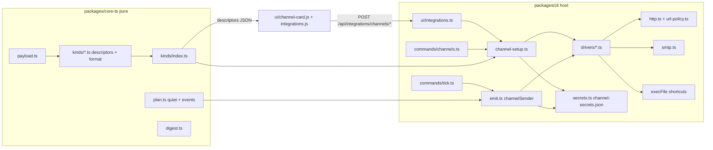
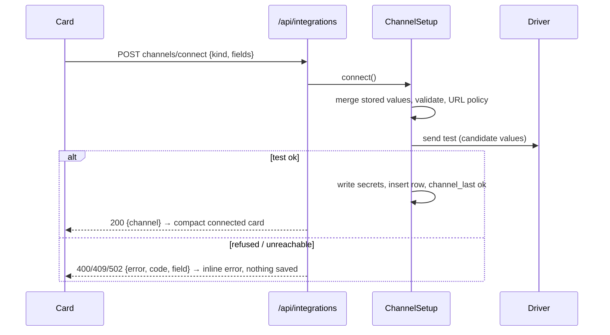
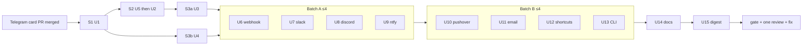

# Settings - Integrations - All notification channels - Plan

## Goal Capsule

- **Objective:** A Tidegap user connects any notification channel they already use (webhook, Slack, Discord, ntfy, Pushover, email, a macOS Shortcut, plus Teams, Google Chat, Matrix and Mattermost through the webhook) from Settings → Integrations in the page or the Mac app, with one Connect click, using only their own accounts and keys. Then they get the task events they picked on that channel.
- **Means:** one channel registry in `packages/core-ts` that describes each kind as data (fields, how-to steps, defaults) and formats messages as pure functions (KTD1, KTD2). Host drivers in `packages/cli` do every send (KTD3). One shared card component renders every kind from its field schema (KTD9). The Telegram setup module pattern carries over to all kinds (KTD6).
- **Authority:** owner decisions (Vitalii, 2026-10-19: "добавь все, что можно добавить в интеграции … Если это email — он сам вводит SMTP, с инструкцией, откуда их взять"; and the one-step card rule, R1–R4) → this plan's R-IDs → KTDs → units. `docs/solutions/best-practices/shared-setup-module-for-cli-and-local-settings-api.md`, `telegram-channel-security.md`, `loopback-web-ui-hardening.md` and `client-tokens-and-extension-origins.md` stay binding.
- **Stop conditions:**
  - Any design that needs a key, server, relay or account owned by Tidegap or its owner: stop and report.
  - Any path where a secret of a new channel kind reaches an API response, a log line, a task event, `process.env` or a child process: stop and report (R17; the Telegram token is out of this check).
  - The Telegram card PR (branch `feat/integrations-copy`: click-to-copy, `setMyDescription`/`setMyCommands`, avatar) is not merged when S1 starts: wait. This plan builds on its files.
  - A launchd-run `shortcuts run` hangs or shows a permission prompt in the owner-manual check (S13.8): ship the Shortcuts card hidden (`ready: false`) and move U12 to later. Do not work around TCC.
- **Execution profile:** one integration branch `feat/integrations-all-channels`, one PR at the end, one review pass. Foundation first and in order (S1 → S2 → S3a ∥ S3b), then channel batches of at most four streams, then docs and digest. Opus implements, Sonnet simplifies, Haiku runs gates and browser QA. The batch journal with budget and concurrency cap exists before the first dispatch. Never merge: the run ends at a green PR with the review done.

---

## Product Contract

### Summary

Settings → Integrations becomes a grid of channel cards. Each card shows up to four "where to get this" steps, the fields the channel needs, and one Connect button. Connect checks the fields, sends a test message, saves the settings, and marks the channel connected. A connected card is compact: what it sends to, the last delivery, an event selector, a quiet-at-night switch, and small Send test, Disconnect, Remove and Edit actions. The CLI does the same with `tidegap channels add <kind>`. A daily summary message is the last part.

### Problem Frame

Telegram is the only remote channel today (`ChannelKind = "os" | "telegram"` in `packages/core-ts/src/channels/types.ts`). Users who live in Slack, Discord, email or a phone push app get nothing when a task finishes while they are away. The owner will not run a relay, so every channel must work with the user's own webhook URL, app token or SMTP account. Most users will not edit `~/.config/tidegap/env` or read API docs, so the card must say where each value comes from and prove the connection works at once.

### Requirements

**Cards (page and Mac app)**

- R1. Each card is one step: the user fills the fields and presses Connect. Connect validates, sends a test message with the typed values, and only then saves the settings and marks the channel connected. Enter in any field submits. There is no separate Save or Test click before connecting.
- R2. Errors show inline under the field they concern (or under the button when no field is at fault), as one sentence with the fix ("Slack did not accept this URL. Create a new webhook in Slack and paste it again.").
- R3. A connected card shows: the target (for example `#alerts`, `ntfy.sh/tidegap-…`, `you@example.com`), the time and result of the last delivery, the event selector, the quiet switch, and the secondary actions Send test, Disconnect, Remove and Edit.
- R4. All cards share one component and one look; a kind supplies only data (fields, steps, defaults, docs anchor). Card states: not set up, connecting, connected, disconnected, error.
- R5. Each not-set-up card shows at most four "where to get this" steps with links to the provider's own pages.
- R6. Secret fields (webhook URLs, tokens, passwords, HMAC secrets, custom headers, the ntfy topic) are masked inputs with a show toggle; the ntfy topic is shown until the first Connect so the user can copy it into the app. After saving, the card shows only a hint (last 4 characters; for a URL, its host plus the last 4).
- R7. Disconnect stops sending and keeps the settings, so Connect on that card works with no typing. Remove deletes the settings and the secrets.
- R8. Edit reopens the form with the non-secret values filled in. A secret field left empty keeps the stored value.

**Events and quiet hours**

- R9. Each channel has its own event selection from: task finished, task failed, clean window starts, tasks cannot run, daily summary. Changes save at once. The Telegram card gets the same selector.
- R10. Each channel has a "Quiet at night" switch (22:00–09:00 local, the postpone presets' `tonight` start and `tomorrow_morning` start). Events in quiet hours are skipped for that channel; the daily summary is not.

**Channels**

- R11. Generic webhook: URL, body format (Tidegap JSON, plain `{"text"}`, Microsoft Teams card), optional signing secret (HMAC-SHA256 header), optional custom headers, retries on failure.
- R12. Slack (Incoming Webhook URL), Discord (webhook URL), ntfy (server, topic, optional access token), Pushover (user key, app token), Email via SMTP (provider preset, host, port, security, user, password, from, to), macOS Shortcuts (shortcut name; macOS only).
- R13. Teams, Google Chat, Matrix (hookshot) and Mattermost are covered by the webhook card: a "Works with" note and the matching body format. No separate cards.
- R14. Native notifications (OS toast, Mac app, browser extension) keep their own settings. The page shows a read-only "This computer" card saying where those settings live.

**Daily summary**

- R15. Once per local day at a chosen time (default 09:00), channels subscribed to "daily summary" get one message: tasks finished and failed since the last summary, their total emissions, and what is queued next.

**Access, secrets, CLI, docs**

- R16. Integrations routes keep the existing access rule: page token or `macos` client token, never an extension origin.
- R17. Secrets of the channel kinds this plan adds (stored in `channel-secrets.json`) never appear in an API response, log line, task event, `process.env` or child process environment. The Telegram bot token is the known exception: it stays in the env file (Deferred, Q2).
- R18. `tidegap channels add <kind>` exists for every kind, with flags that mirror the card's non-secret fields. Secrets come from a hidden prompt or stdin, never from argv. It uses the same code path as the card.
- R19. The website docs describe every channel with the same steps as the card. They are readable by agents through `llms-full.txt`.
- R20. Nothing depends on Tidegap-owned keys, servers or accounts. ntfy defaults to the public `https://ntfy.sh`, and the user can change it.

### Acceptance Examples

- AE1. Covers R1, R2. The user pastes a Discord webhook URL and presses Enter. The fake sink answers 404. Nothing is saved. The URL field shows "Discord does not know this webhook. Copy the URL again from Server Settings → Integrations → Webhooks." The card stays in the not-set-up state with the typed value still in the field.
- AE2. Covers R1, R3. The user fills the email card (Gmail preset, address, app password) and presses Connect. One test mail arrives. The card turns compact: "Sends to you@gmail.com · Last message 10:42 ✓".
- AE3. Covers R7. After Disconnect, a finished task sends nothing to Slack. Connect with empty fields sends a test message and resumes delivery.
- AE4. Covers R10. Quiet at night is on and a task fails at 23:10. Nothing goes to that channel. At 09:00 the daily summary (if subscribed) lists the failure.
- AE5. Covers R8. Edit on a connected ntfy card, change the priority, leave the token empty, press Connect. The test uses the stored token, and the token hint is unchanged.
- AE6. Covers R17. A task run by the tick spawns `claude -p`; its environment has no `TIDEGAP_` channel secret and no value from `channel-secrets.json`.

### Scope Boundaries

- One channel per kind in the page and the CLI (id = kind). The data model allows more; see Open Questions.
- Outlook.com and Hotmail personal accounts are not supported for email. Microsoft turned off password SMTP for them on 2024-09-16; they need OAuth. Microsoft 365 work accounts are listed as "may work if your admin allows SMTP AUTH".
- No OAuth flows (Slack app install, Gmail OAuth). They would need Tidegap-owned client ids (R20).
- Considered and not built:
  - A retry queue that survives the tick (send later after a failure). A failed send is a log line plus the card's last-delivery error; the next event goes out normally. Change the call if users report missed failures they needed.
  - Auto-disable after N failures. The card error is visible, and disabling hides the problem.
  - A per-channel send cap (mails per hour). Default email events are failed, not ready and daily summary, so volume stays low. Revisit if a provider blocks a user.
  - Reporting a stopped tick daemon without the Telegram listener. The tick cannot report its own stop. The listener's `checkTicker` reports it to every subscribed channel (U2), but only while the listener runs, which needs Telegram.
  - Sending jobs to different channels in parallel inside one tick. Worst case is 20 s per dead webhook; revisit if ticks overrun.
  - Self-signed TLS for SMTP (for example Proton Bridge). Security "none" is allowed only to a loopback host.
  - An MCP tool to add channels. Agents use the CLI with `--secrets-stdin`; a tool would pass secrets through model context.

### Deferred to Follow-Up Work

- Move the Telegram bot token from the env file into `channel-secrets.json`. Today `loadEnvFileIntoProcess` puts it into `process.env`. `claudeChildEnv` (`packages/cli/src/claude-code.ts`) already strips `TIDEGAP_*` from `claude -p`, so the remaining exposure is the legacy `TELEGRAM_BOT_TOKEN` key and non-Claude children (the page's `tick --daemon`, Shortcuts), which inherit the full env. See Open Questions.
- XOAUTH2 for SMTP, HTML mail, attachments (would justify `nodemailer`, KTD5).
- Matrix through the client-server API (access token plus room id), without hookshot.

### Open Questions

- Q1 (changes the build). Is one channel per kind enough for v1, or must the webhook card take several URLs (for example Teams and Mattermost at once)? Default: one per kind.
- Q2 (changes the build). Should the Telegram token move out of the env file in this batch (a new U-unit plus a migration in `telegram-setup.ts` and the listener), or stay deferred? Default: deferred.
- Q3 (small build change). On a day with nothing finished and nothing queued, skip the daily summary or send "Nothing ran"? Default: skip.

---

## Planning Contract

### Key Technical Decisions

- KTD1. **Registry as data plus pure formatters in `packages/core-ts/src/channels/kinds/<kind>.ts`.** Each file exports one `KindDescriptor`. A descriptor holds: kind, label, one-line description, platforms, fields (name, label, input type `text|password|url|select|number|textarea`, required, secret, default, placeholder, pattern, options, help), presets (email providers), steps (at most four, each text plus an optional link), default events, docs anchor, "works with" note, and a pure `format(payload, config) → DeliverySpec`. `DeliverySpec` is `{type: "http", method, url, headers, body}`, `{type: "smtp", subject, text}` or `{type: "shortcut", input}`. `kinds/index.ts` lists every kind; S1 creates all kind files: Telegram complete, webhook complete for the `tidegap` format (the reference kind the foundation tests run against), the rest stubs with `ready: false`. Channel streams then edit only their own file. The server sends descriptors (without `format`) to the page, so the page needs no per-kind code. Governs R4, R5, R11–R13.
- KTD2. **One payload model before formatting.** New `channels/payload.ts` turns a `ChannelEvent` into `NotificationPayload {event, level: info|success|warning|error, title, text, at, task?: {id, title, status, grams?}}`, reusing `eventMessage` text so every channel says what Telegram says (redaction and the 600-char preview included). Title and text are untrusted plain text (a result preview is agent output). Every `format()` for a receiver that renders markup escapes its link and mention syntax: Slack `&<>`; Discord embed markdown specials; Teams TextBlock `[ ] ( ) * _`; the webhook `text` format `&<>` and a zero-width space after `@` in `@channel`, `@all`, `@here`, `@everyone`, `@room`. Discord also sends `allowed_mentions: {parse: []}`. The Tidegap JSON format stays raw. The Tidegap JSON webhook body is `{"version": 1, "event", "level", "title", "text", "at", "task"}`; the version field lets receivers pin the shape. Governs R11, R12.
- KTD3. **Host drivers in `packages/cli/src/channels/drivers/<kind>.ts` do all side effects.** A driver turns a `DeliverySpec` plus secrets into a send through one of three transports: `http.ts` (fetch), `smtp.ts`, or `execFile` (Shortcuts). Core stays pure (coherence KTD10). `channelSender` in `emit.ts` dispatches by kind. Telegram keeps its own path.
- KTD4. **Secrets live in `~/.config/tidegap/channel-secrets.json`, never in the env file.** The file is JSON `{ "<channel id>": { "<field>": "<value>" } }`, mode 0600, directory 0700. It is written atomically like `setEnvFileKey` (resolve a symlink, write a temp file, fsync, rename) and read on every send. Reason: `loadEnvFileIntoProcess` copies every env-file key into `process.env`. `claudeChildEnv` strips `TIDEGAP_*` for `claude -p`, but other children (the page's `tick --daemon`, the Shortcuts `execFile`) inherit the full env, and a non-prefixed key would leak to all of them. JSON also takes passwords with `#`, quotes or spaces, which the line-based env parser does not. Non-secret fields stay in the ledger row's `config_json`. The `channels` table has no DDL change. Governs R6, R17.
- KTD5. **SMTP: a small client on `node:net` and `node:tls`, no dependency.** It supports EHLO, STARTTLS, implicit TLS, AUTH PLAIN and LOGIN, MAIL/RCPT/DATA with dot-stuffing, and QUIT. Messages are plain text, UTF-8, base64 body, RFC 2047 subject. TLS certificates are always verified. Cleartext AUTH is refused unless the host is loopback. Timeouts: 15 s to connect, 30 s in total. Reason: the CLI has one runtime dependency (`commander`), and the repo avoids dependencies (the env parser, `dependency-free-task-ui-patterns.md`). We send only plain text to fixed recipients, about 300 lines. `nodemailer` (MIT-0, no transitive dependencies, compatible with Apache-2.0) is the named fallback when XOAUTH2, HTML or attachments are wanted (Deferred). Governs R12.
- KTD6. **`ChannelSetup` in `packages/cli/src/channels/channel-setup.ts`: one module for the API and the CLI** (the Telegram pattern, solution item 1). Operations: `status()`, `connect(kind, fields, {events?, quiet?})`, `test(id)`, `disconnect(id)`, `remove(id)`, `settings(id, {events?, quiet?})`. Connect order:
  1. Merge stored values for every omitted or empty field: secrets from `channel-secrets.json`, non-secret fields from the row's `config_json` (R7, R8).
  2. Validate the merged set against the descriptor.
  3. Check the URL policy (KTD8).
  4. Send the test message with the candidate values.
  5. Only on success: write the secrets (KTD4), insert or replace the row (`enabled: true`), and write the last-delivery meta.

  On failure nothing is written. Errors are `ChannelSetupError {code, field?}` with a fixed sentence per code and kind; exception text never reaches the answer. Claim the per-id operation before the first await (solution item 7). Governs R1, R2, R7, R8, R18.
- KTD7. **API: new POST routes under the existing `integrations` route class.**

  | Route | Body | Answer |
  |---|---|---|
  | `GET /api/integrations` | none | 200 `{telegram, kinds: KindDescriptor[], channels: ChannelStatus[], os: {enabled}, digest: {at}}`. New keys are additive |
  | `POST /api/integrations/channels/connect` | `{kind, fields, events?, quiet?}` | 200 `{channel}`; 400 `{error, code: "invalid", field}`; 409 `{error, code: "test_failed", field?}`; 502 `{code: "unreachable"}`; 429 |
  | `POST /api/integrations/channels/<id>/test` | none | 200 `{sent: true}`; 409 not connected; 502; 429 |
  | `POST /api/integrations/channels/<id>/disconnect` | none | 200 `{channel}` |
  | `POST /api/integrations/channels/<id>/remove` | none | 200 `{removed: true}` |
  | `POST /api/integrations/channels/<id>/settings` | `{events?, quiet?}` | 200 `{channel}`; also accepts Telegram channel ids |

  `ChannelStatus` = `{id, kind, state: connected|disconnected|error, target, fields (non-secret), secrets: {<field>: hint}, events, quiet, last?: {at, ok, code?}}`. Rate limits (in memory, as KTD10 of the Telegram plan): connect 10 per minute, test 1 per 10 s per id, settings 30 per minute. Bodies go through `checkBody` (strict objects, 64 KiB). Governs R1–R3, R7–R9, R16.
- KTD8. **URL policy: allow the user's own network, block a short list.** Allowed: `http` and `https`, public, private and loopback hosts. Blocked: other schemes, userinfo in the URL, link-local `169.254.0.0/16` and `fe80::/10` (cloud metadata), and the `tidegap ui` server's own loopback port (from the UI lock file when a server runs, else the configured default port, so the CLI applies it too). Plain `http` to a non-private host is allowed, with a card warning that the message travels unencrypted. The check runs at connect time on the literal host and at send time on `dns.lookup` results. Redirects are never followed (`redirect: "manual"`; a 3xx is "The address redirects. Paste the final URL."). Reason: LAN receivers (Home Assistant, self-hosted ntfy or Gotify, n8n) are core use cases. Only the page and the Mac app can write a URL (R16), so no remote party can plant one. Slack and Discord also require their official hosts or a loopback URL (the test sinks). Pushover's fixed API base has a loopback-only override `TIDEGAP_PUSHOVER_API_BASE`, mirroring `TIDEGAP_TELEGRAM_API_BASE`. Governs R11, R12, R17.
- KTD9. **One card framework in `packages/cli/ui/channel-card.js`.** `cardModel(descriptor, status, ui)` is a pure view-model; `cardNodes(model)` renders through `h()`, text nodes only. Telegram moves onto the same shell: header, state pill, body slot (its pairing panel), action row, event selector, quiet switch. Its one-step Connect (save token, then pair) already exists in the Telegram card PR (commit c42fc1e); the handler moves into the shell unchanged. Polling keeps the generation counter (solution item 8), and a rebuild keeps half-typed password fields and focus. Governs R1–R5, R9, R10.
- KTD10. **Quiet hours and events in the pure planner.** `planNotifications(events, channels, now)` skips a job when `channel.config.quiet === "night"`, the local time is in [22:00, 09:00), and the event is not `digest`. The hours come from exported `TONIGHT_START_H` and `MORNING_START_H` in `postpone.ts`, so quiet hours and the presets cannot drift. `EventKind` gains `digest`. `listChannels` accepts every registry kind instead of `os | telegram`. Governs R9, R10.
- KTD11. **Delivery result in ledger meta `channel_last:<id>`** = `{at, ok, code?}`. `sendJobs`, `test` and `connect` write it. The card and `channels list` read it. No secret and no response body is stored, only a mapped code (`http_404`, `auth`, `timeout`, `tls`, `rate_limited`…). This is how a broken channel becomes visible (R3).
- KTD12. **Retries for HTTP kinds only.** Up to 3 attempts on a network error, a 5xx or a 429. Waits are 1 s and 3 s, or `Retry-After` (Discord's `retry_after` JSON) when it is at most 10 s. Each job has a 20 s cap. Every attempt carries the same `X-Tidegap-Delivery: <uuid>` so receivers can drop duplicates. No retry for SMTP (a duplicate mail after an unclear failure is worse) or for Shortcuts. Any other 4xx fails at once.
- KTD13. **Webhook signing.** With a secret set: `X-Tidegap-Timestamp: <unix s>` and `X-Tidegap-Signature: sha256=<hex HMAC-SHA256(secret, "<timestamp>.<body>")>`. The docs give a verification snippet and a 5-minute replay window. Custom headers: at most 10 `Name: value` lines. Names must be RFC 7230 tokens. Values must not contain CR or LF. `Host`, `Content-Length`, `Transfer-Encoding`, `Connection` and the `X-Tidegap-*` names are refused. The whole headers field is stored as a secret, because it often carries `Authorization`. Governs R11.
- KTD14. **Python parity: no change to `packages/core-py`.** The Python core runs tasks and writes the shared ledger, but sends no notifications and never reads `channels` (the DDL comment says "TS-only"). Formats live only in core-ts. The daily summary reads the ledger, so tasks finished by a Python host appear in it. Per-task messages for Python-run tasks stay out of scope, as today.
- KTD15. **Docs: one page `apps/web/content/docs/06-notifications.md` (id `notifications`) with an H3 section per kind,** anchors `{#notify-<kind>}`, placed before `06-telegram.md` (which stays, linked from the top). Reason: one page reads in one fetch and lands as one block in `llms-full.txt`. Agents find every channel under one heading, and the card links to `https://www.tidegap.com/docs#notify-<kind>`. `scripts/qa/docs-drift.mjs` checks that every ready descriptor's anchor exists and that its step links appear in its section.
- KTD16. **Shortcuts run from the tick** through `execFile("/usr/bin/shortcuts", ["run", name, "--input-path", <0600 temp file>])`. No shell. 20 s timeout, then SIGKILL (`macos-tcc-documents-daemon` lesson: a pending prompt hangs a launchd child). The name is 1–100 characters with no control characters. The card shows only on `darwin`. Tests point `TIDEGAP_SHORTCUTS_BIN` at a fake script. Governs R12.

### Card design note

- **Layout:** Integrations is a responsive grid: 1 column under 720 px, 2 columns from 720 px. Order: connected cards first, then Telegram, Email, Slack, Discord, ntfy, Pushover, Webhook, Shortcuts (macOS), and last the read-only "This computer" card. A not-set-up card is collapsed to title, one-line description and a "Set up" disclosure. Opening it is navigation, not a step. The open card shows the steps list, then the fields, then one full-width primary Connect.
- **States:**
  - not set up: steps, fields, Connect.
  - connecting: fields and Connect disabled, the label "Connecting…", `aria-busy`.
  - pairing (Telegram only): pill "Waiting for Telegram", the pairing panel (code, QR, copy chips, countdown) in the body slot, Cancel in place of Connect. Chips and the quiet switch stay hidden until paired.
  - connected: compact. The title row shows a green "Connected" pill and the target line. Under it: the last-delivery line, the event chips (a fieldset labeled "Send me"; checkbox chips that save on change), the "Quiet at night" switch, and the secondary actions.
  - disconnected: a grey pill, the target line, a primary Connect, and the secondary actions.
  - error (the last delivery failed, or Telegram's listener is not running): an amber pill, the error sentence with its fix, and the secondary actions. Telegram adds its Start listener action here.
- **One action rule:** Edit and Remove appear in every set-up state. Send test and Disconnect appear when the channel is enabled (connected, error). Remove asks to confirm in the existing `dialog.js`. Telegram's Edit is its existing "Change token".
- **Edit:** the form replaces the compact body in place. Non-secret values are filled in. Each secret field shows its hint as a label ("Stored, ends in abcd") and stays empty unless the user types a new value. The primary button stays "Connect", with a ghost Cancel; Esc also cancels. A failed Connect keeps the form open with the inline error, and the stored channel keeps sending with its old values. Success returns to the compact card.
- **Secret fields:** every secret input has a show/hide toggle. The ntfy topic is shown in clear text with a copy chip until the first Connect (the user must type it into the phone app), then it shows only as a hint. The headers field is a textarea masked with CSS `-webkit-text-security` and the same toggle.
- **Advanced fields:** a descriptor field may carry `advanced: true`. The card puts such fields under a collapsed "Server and addresses" disclosure. Email with a provider preset shows only the address (user; also the default from and to) and the password. "Other" opens the disclosure.
- **Errors:** field errors set `aria-invalid` and `aria-describedby` on the input, with the sentence right under it. Other errors go under the button. Focus moves to the first invalid field.
- **Success and order:** after Connect, Disconnect, Remove or an Edit save, the polite live region announces the result ("Connected to #alerts") and focus moves to the card heading. Cards keep their grid position until the next page load, so a card does not jump away from the pointer.
- **Look:** the action row wraps under 720 px, and buttons keep the `--touch` minimum height on touch devices. Existing tokens from `tokens.css` only. Brand names as text, no third-party logos. Monospace for targets and hints. The 390 px width and dark mode pass with no horizontal scroll (S2.25 extended).

### High-Level Technical Design

### Channel reference (fields, steps, format, failures)

| Kind | Fields (secret*) | Where to get it (≤4 steps on the card) | Message format | Test | Failure codes → sentence | Limits |
|---|---|---|---|---|---|---|
| webhook | url*, format `tidegap\|text\|teams`, secret*, headers* | Your receiver's URL. Teams: channel → Workflows → "Post to a channel when a webhook request is received" → copy URL. Google Chat: space → Apps & integrations → Webhooks → copy. Mattermost: Integrations → Incoming Webhooks. Matrix: hookshot generic webhook URL | KTD2 JSON; `text` = `{"text"}`; `teams` = Adaptive Card message | POST test payload, 2xx | 3xx redirect, 401/403 auth, 404 not found, 413 too big, 5xx, timeout, TLS | KTD12 |
| slack | url* (`https://hooks.slack.com/services/…`) | 1 api.slack.com/apps → Create New App → From scratch. 2 Incoming Webhooks → On. 3 Add New Webhook → pick a channel. 4 Copy the URL | `{text, blocks: [section mrkdwn]}`; `&<>` escaped | POST, body `ok` | `invalid_token`/403, `no_service`/404, `channel_is_archived`/410 | 1 msg/s; 429 + Retry-After |
| discord | url* (`discord.com/api/webhooks/…`) | 1 Server Settings → Integrations. 2 Webhooks → New Webhook, pick a channel. 3 Copy Webhook URL | `{username: "Tidegap", embeds: [{title, description ≤4096, color by level, timestamp}], allowed_mentions: {parse: []}}` | POST `?wait=true`, 200 | 401/404 unknown webhook, 400 invalid embed | 429 `retry_after` |
| ntfy | server (default `https://ntfy.sh`), topic*, token* (optional), priority override | 1 Install ntfy (App Store, Play, or ntfy.sh web). 2 Subscribe to the topic shown here (prefilled `tidegap-<12 random>`). 3 Press Connect. Self-hosted: change the server, add an access token | JSON publish to server root: `{topic, title, message, priority, tags}`; priority failed/not_ready 4, done 3, window/digest 2 | publish, 200 | 401/403 token, 429, 507 quota | ntfy.sh: daily cap for anonymous use, 429 |
| pushover | user_key* (30 chars), app_token* (30 chars) | 1 Log in at pushover.net, copy Your User Key. 2 Create an Application/API Token, name it Tidegap. 3 Copy the API token. (Pushover is a one-time purchase per platform after a 30-day trial) | form: `token, user, title, message ≤1024, priority` | POST `/1/messages.json`, `status: 1` | 400 `user`/`token` invalid, 429 monthly limit | 10,000/month per app |
| email | provider preset, host, port, security `tls\|starttls\|none(loopback)`, user, password*, from, to | Gmail: 2-Step Verification on → myaccount.google.com/apppasswords → create "Tidegap" → paste (spaces dropped). iCloud: account.apple.com → Sign-In and Security → App-Specific Passwords → Generate; user = full iCloud address. Fastmail: Settings → Privacy & Security → App passwords → New, SMTP access. Other: your provider's SMTP settings page | Subject `Tidegap: <title> finished`; plain text body | one mail | 535 auth ("use an app password"), connect refused/timeout, TLS, 550 recipient, 5.7.x policy | KTD5 timeouts, no retry |
| shortcuts | name | 1 Open Shortcuts → New Shortcut. 2 Add an action that uses "Shortcut Input" (Send Message, Add Reminder…). 3 Name it "Tidegap". 4 Type the name here | plain text input file | run once | exit ≠ 0 "not found", timeout | KTD16 |

Presets: Gmail `smtp.gmail.com:465 tls`, iCloud `smtp.mail.me.com:587 starttls`, Fastmail `smtp.fastmail.com:465 tls`, Microsoft 365 `smtp.office365.com:587 starttls` (note: work accounts only, if the admin allows SMTP AUTH), Other (blank).

### Assumptions

- The Telegram card PR merges first and is unchanged in shape: `copy.js`, `telegramCommands`, the avatar file, the one-step Telegram Connect (token, then pair) and the `ui-integrations*` tests exist on `main`.
- One channel per kind (Q1), Telegram token stays in the env file (Q2), an empty daily summary is skipped (Q3).
- Default events: chat and push kinds get finished, failed, not ready. Webhook gets everything except daily summary. Email gets failed, not ready, daily summary. Telegram rows keep their stored events.
- The daily summary time is one global setting (meta `digest_at`, default `09:00` = `MORNING_START_H`). A missed time (the machine was asleep) sends at the first tick later that day, never the next day.
- "Carbon saved" appears in the summary only if the ledger stores a per-task savings figure. Otherwise the summary shows emitted grams only (`claims-audit-method.md`: no claim the receipts do not support).

### System-Wide Impact

- **Ledger:** new meta keys `channel_last:<id>`, `digest_at`, `notified:digest`; new `kind` values in `channels`. No DDL change, so `shared-sqlite-ledger-migrations.md` does not apply. Older Tidegap versions skip unknown kinds in `listChannels` (they already do).
- **Files on disk:** new `~/.config/tidegap/channel-secrets.json` (0600). There is no `tidegap uninstall` command; the config docs list the file next to the env file for manual removal (U14).
- **Tick:** sends to more channels. The worst case per dead HTTP channel is 20 s (KTD12). SMTP is at most 30 s.
- **Auth boundary:** unchanged route class (R16); more routes in the `docs/spec/ui-client-api.md` matrix.
- **Agent parity:** the CLI covers every card action (R18). `channels list --json` gives agents the status without secrets.

### Risks & Dependencies

- Provider UIs change, so the steps go stale. Mitigation: steps live in one place per kind, docs-drift ties the docs to them, and each card links to the provider's own help.
- Microsoft keeps moving Teams webhooks (Office 365 connectors retired in 2026, Workflows accepts Adaptive Cards). Mitigation: the `teams` format is an Adaptive Card; the docs name the Workflows template.
- SMTP servers differ (multi-line replies, `AUTH` only after `STARTTLS`). Mitigation: the fake SMTP server covers both modes and multi-line EHLO; the owner does a manual Gmail and iCloud send (S13.7m).
- ntfy topics on the public server can be read by anyone who guesses them. Mitigation: the prefilled random 12-character topic, the topic stored as a secret, and a docs note.
- Shortcuts under launchd (stop condition in the Goal Capsule).

---

## Implementation Units

### Unit Index

| U | Title | Main files | Depends on |
|---|---|---|---|
| U1 | Core registry, payload, quiet | `core-ts/src/channels/{types,registry,payload,plan}.ts`, `kinds/*` stubs | Telegram card PR |
| U2 | Delivery layer | `cli/src/channels/{secrets,http,url-policy,emit}.ts`, `drivers/*` stubs, `commands/tick.ts` | U1, U5 |
| U3 | Setup module + API | `cli/src/channels/channel-setup.ts`, `ui/integrations.ts`, `ui/api.ts` | U2 |
| U4 | Card framework + Telegram on it | `cli/ui/{channel-card,integrations,api}.js`, `app.css`, `ui/server.ts` | U1 (contract KTD7) |
| U5 | Fake sinks + QA harness | `cli/test/fixtures/fake-sink.ts`, `scripts/qa/{env,gate,channels-flows}.mjs` | U1 |
| U6–U12 | One unit per kind | own `kinds/<kind>.ts`, `drivers/<kind>.ts`, tests, `scripts/qa/channels/<kind>.mjs` | U2, U3, U4 |
| U13 | CLI commands | `cli/src/commands/channels.ts`, `cli/src/index.ts` | U3 |
| U14 | Docs | `apps/web/content/docs/06-notifications.md`, spec, README, CHANGELOG | U6–U13 |
| U15 | Daily summary | `core-ts/src/channels/digest.ts`, `emit.ts`, `tick.ts`, `integrations.js` | U14 |

### U1. Core registry, payload model and quiet hours

- **Goal:** core-ts knows every kind as data and plans jobs with events and quiet hours.
- **Requirements:** R4, R9, R10, R13; KTD1, KTD2, KTD10, KTD14.
- **Dependencies:** the Telegram card PR merged.
- **Files:** `packages/core-ts/src/channels/types.ts`, `channels/registry.ts` (new: `KindDescriptor`, `DeliverySpec`, validation of field values against a descriptor), `channels/payload.ts` (new), `channels/plan.ts`, `channels/kinds/index.ts` (new), `channels/kinds/{telegram,webhook,slack,discord,ntfy,pushover,email,shortcuts}.ts` (new; Telegram complete, webhook complete for the `tidegap` format and `url` field, the rest stubs with `ready: false`), `channels/index.ts`, `src/postpone.ts` (export the hour constants), `src/storage/sqlite.ts` (`listChannels` kind check through the registry), `src/index.ts`, `packages/cli/src/channels/pair.ts` (new rows take the Telegram descriptor's default events, not `[...EVENT_KINDS]`); tests `packages/core-ts/test/channels-registry.test.ts` (new), `channels-payload.test.ts` (new), `channels-plan.test.ts`, `packages/cli/test/channels-pair.test.ts`.
- **Approach:**
  1. `ChannelKind` becomes the registry's kind union; `EventKind` gains `digest`; `EVENT_KINDS` keeps its order with `digest` last; `ChannelConfig.quiet?: "night" | "off"`.
  2. `validateFields(descriptor, input)` returns `{ok, values, secrets} | {ok: false, field, code}`: required, type, pattern, select options, number range, max lengths (URL 2048, text 256, headers 10 lines).
  3. `payloadFor(event, now)` wraps `eventMessage` (text) and adds level, title and task facts.
  4. `planNotifications(events, channels, now = new Date())`: KTD10.
- **Patterns to follow:** `channels/format.ts` (pure text, control-char stripping), `osChannel`.
- **Test scenarios:**
  - Every descriptor in `kinds/index.ts` has a unique kind, ≤4 steps, a docs anchor `notify-<kind>`, and default events that are a subset of `EVENT_KINDS`.
  - `validateFields` on a required field left empty → `{field, code: "required"}`; a select value outside the options → `invalid`; a 3,000-char URL → `too_long`.
  - Secret fields come back in `secrets`, never in `values`.
  - `payloadFor(task_failed)` → level `error`, text equals `eventMessage(...).text`. A redacted task has no result preview.
  - Quiet `night`, local 23:10, `task_done` → no job. Same at 09:00 → job. `digest` at 23:10 → job. Quiet `off` → job.
  - A channel row with kind `slack` round-trips through `insertChannel`/`listChannels`; an unknown kind `fax` is still skipped.
  - The existing `channels-plan` tests pass with the new `now` parameter defaulted.
  - A new Telegram pairing writes events without `digest`.
- **Verification:** core tests and typecheck pass; `pnpm gen:data:check` untouched.

### U5. Fake sinks and the channels QA area

- **Goal:** every HTTP kind and the email kind can be tested with no network.
- **Requirements:** supports R1, R11, R12.
- **Dependencies:** U1.
- **Files:** `packages/cli/test/fixtures/fake-sink.ts` (new; importable and runnable as a script like `fake-telegram.ts`), `scripts/qa/env.mjs` (`startFakeSink`, a generic `spawnFixture(path, port, args)`), `scripts/qa/channels-flows.mjs` (new runner: loads `scripts/qa/channels/*.mjs`, each exporting `{kind, cases}`), `scripts/qa/gate.mjs` (area `channels`), `scripts/qa/channels/.gitkeep`.
- **Approach:** the sink records method, path, headers and body per request. Each path can be scripted: a status sequence, a `Retry-After` value, a delay, a redirect. A `GET /_requests` endpoint lets the harness read the log. The sink port is `portBase + 60`. The runner prints `PASS` or the failing case ids plus the log path, like the other areas.
- **Test expectation:** none in this unit (fixtures). U2 and U6–U12 prove them.
- **Verification:** `node scripts/qa/gate.mjs channels` prints `PASS` with zero cases.

### U2. Delivery layer: secrets, HTTP transport, URL policy, emit

- **Goal:** the tick sends any ready kind with retries, quiet hours and a recorded result, and no secret leaks.
- **Requirements:** R10, R17; KTD3, KTD4, KTD8, KTD11, KTD12.
- **Dependencies:** U1, U5.
- **Files:** `packages/cli/src/channels/secrets.ts` (new), `channels/http.ts` (new), `channels/url-policy.ts` (new), `channels/drivers/index.ts` (new; maps kind → driver, stub drivers throw `not_ready`), `channels/drivers/webhook.ts` (the reference driver: `tidegap` format, no signing), `channels/drivers/{slack,discord,ntfy,pushover,email,shortcuts}.ts` (stubs), `channels/emit.ts`, `channels/serve.ts`, `commands/tick.ts`, tests `packages/cli/test/channel-secrets.test.ts`, `channel-http.test.ts`, `channel-url-policy.test.ts` (all new), `channels-emit.test.ts`, `tick-channels.test.ts`.
- **Approach:**
  1. `secrets.ts`: `readSecrets(id)`, `writeSecrets(id, map | undefined)`, path `~/.config/tidegap/channel-secrets.json`, atomic and 0600 as KTD4. A malformed file is treated as empty plus one log line; it is never overwritten silently, so the old file is kept as `.bak`.
  2. `http.ts`: `send(spec, {timeoutMs, retries, signal})` with KTD12, `redirect: "manual"`, and the response body read only to map a code (bounded at 4 KiB). Errors carry `{code, status?}`, never the URL or the body.
  3. `url-policy.ts`: KTD8. `checkUrl(url, {uiPort})` at connect; `checkResolved(host)` at send.
  4. `emit.ts`: `channelSender` dispatches non-Telegram kinds to `drivers[kind].send(channel, secrets, spec)`. `sendJobs` writes `channel_last:<id>` after each job. Log lines name the channel id, the kind and the code only.
  5. `tick.ts`: passes `now` to the planner and the UI port to the policy (KTD8).
  6. `serve.ts` `checkTicker`: plans the ticker-code `not_ready` event through `planNotifications` over every enabled channel (not only Telegram rows) and sends through the shared driver-aware `channelSender`, so daemon-down alerts reach every subscribed channel and respect quiet hours.
- **Patterns to follow:** `setEnvFileKey` atomic write; `TelegramClient` errors built from method and status only; `emit.ts` undo-unsent logic stays as is.
- **Test scenarios:**
  - Secrets write → file mode 0600, directory 0700. A second write keeps other ids. A symlinked file stays a symlink.
  - Covers AE6. After a tick with a webhook channel connected, `process.env` has no key or value from the secrets file; a spawned fake `claude` dumps its env, and no secret value is in it.
  - HTTP: sink answers 500, 500, 200 → three attempts with the same `X-Tidegap-Delivery`, result ok. Sink answers 429 with `Retry-After: 2` → a wait of about 2 s. `Retry-After: 60` → no wait beyond the cap; fails `rate_limited`.
  - HTTP: 404 → one attempt, code `http_404`. 302 → code `redirect`, the Location is not followed. A 25 s delay → code `timeout` within the 20 s cap.
  - URL policy: `http://169.254.169.254/` → blocked. `http://127.0.0.1:<uiPort>/` → blocked. `http://127.0.0.1:9999/` → allowed. `ftp://x` → blocked. `https://u:p@host/` → blocked. `http://example.com` → allowed with `warning: "cleartext"`.
  - A host that resolves to `169.254.169.254` at send time → blocked with code `blocked_address`.
  - Emit: a quiet channel at 23:10 gets no job; `channel_last:<id>` is unchanged for it.
  - Emit: a failing driver → one log line containing the id and code and no `hooks.slack.com/services` path (assert on every log line).
  - The listener's `checkTicker` with a stale tick and a connected webhook subscribed to `not_ready` → the sink gets one message; a quiet webhook at 23:10 gets none.
  - The existing Telegram emit, serve and tick tests pass unchanged.
- **Verification:** cli tests pass. A grep of the test logs for the fixture secret values finds nothing.

### U3. Channel setup module and API routes

- **Goal:** one module behind both the API and the CLI does connect, test, disconnect, remove and settings.
- **Requirements:** R1–R3, R7–R9, R16, R17; KTD6, KTD7.
- **Dependencies:** U2.
- **Files:** `packages/cli/src/channels/channel-setup.ts` (new), `packages/cli/src/ui/integrations.ts`, `packages/cli/src/ui/api.ts` (body kinds for the new routes), `docs/spec/ui-client-api.md` (integrations section and auth matrix rows), `docs/solutions/best-practices/telegram-channel-security.md` (cross-link to the secrets rule), tests `packages/cli/test/channel-setup.test.ts` (new), `ui-integrations.test.ts`.
- **Approach:** KTD6 order. `status()` builds `ChannelStatus` from rows, secrets (hints only), `channel_last` and descriptors, and filters kinds by `ready` and platform. `target` comes from a descriptor hook (Slack: "Slack webhook ··<last4>", ntfy: `server/topic` masked, email: `to`). Fixed sentences live per `(kind, code)` in the descriptor with a generic fallback. `settings()` validates events against `EVENT_KINDS` and quiet against `night|off`, and works for `telegram:*` ids. Routes and limits follow KTD7.
- **Patterns to follow:** `TelegramSetup` and `Integrations` (`packages/cli/src/ui/integrations.ts`): error code → status map, `limited()`, the `close()` contract.
- **Test scenarios:**
  - Covers AE1. Connect webhook, sink 404 → 409 `{code: "test_failed", field: "url"}`; no row, no secrets file entry.
  - Connect webhook, sink 200 → 200, row enabled, secrets written, `channel_last` ok, and the answer JSON has no secret value (assert on the serialized body).
  - Covers AE5. Connect again with the secret field empty → the stored secret is used (the sink sees the stored token) and the hint is unchanged.
  - Two connects for the same id at once → one test send; the second awaits the first (singleton claim).
  - Disconnect → row `enabled: false`, secrets kept, next emit sends nothing (covers AE3). Connect with `{}` fields → test sent, enabled.
  - Remove → row and secrets gone; `status()` shows not set up.
  - Settings with events `["task_failed","digest"]` and quiet `night` → stored; `["bogus"]` → 400 `invalid`.
  - Settings on a `telegram:*` id → stored on the Telegram row.
  - Rate limit: the second test within 10 s → 429 with `retry_after_s`.
  - Auth matrix: a page token and a `macos` token reach the new routes; an `extension` client token and an extension origin → 403 (extend the existing double-slash cases).
  - A ledger write failure → 500 with the fixed sentence, no exception text.
- **Verification:** `ui-integrations` and `channel-setup` tests pass; the spec lists every route.

### U4. Shared card framework and Telegram on it

- **Goal:** every card renders from a descriptor with one component; Telegram becomes one step.
- **Requirements:** R1–R5, R9, R10, R14; KTD9; Card design note.
- **Dependencies:** U1 (descriptor shape); KTD7 is the contract, so this unit runs in parallel with U3 (no shared files).
- **Files:** `packages/cli/ui/channel-card.js` (new), `packages/cli/ui/integrations.js`, `packages/cli/ui/api.js`, `packages/cli/ui/app.css`, `packages/cli/src/ui/server.ts` (`UI_MODULES` gains `channel-card.js`), tests `packages/cli/test/ui-channel-card.test.ts` (new), `ui-integrations-view.test.ts`, `scripts/qa/ui-flows.mjs` (cases S2.28–S2.31).
- **Approach:**
  1. `cardModel(descriptor, status, ui)` gives the state, the visible fields, the steps, the actions and the errors. It is pure and tested without a DOM.
  2. `cardNodes` builds a `<form>` so Enter submits. Connect disables the form, posts `channels/connect`, and redraws from the answer. Password inputs keep their typed value on a failed connect and are cleared on success. The page holds no secret after a success.
  3. Event chips and the quiet switch post `settings` on change, then announce "Saved" in the polite live region.
  4. The Telegram card uses the same shell. Its token field and Connect post `telegram/token`, then `telegram/pair`; an error from either shows inline. The pairing panel, QR and copy chips stay.
  5. "This computer" card: reads `os.enabled`, and says where the Mac app and extension settings are.
  6. The ntfy topic default `tidegap-<12 random chars>` is generated in the page with `crypto.getRandomValues`.
  7. The `ui-flows` case S2.29 loops over ready kinds, using each kind's fixture data from `scripts/qa/channels/<kind>.mjs` (`ui.fields`), so channel streams add UI coverage without editing `ui-flows.mjs`.
- **Patterns to follow:** `integrations.js` generation counter and focus keeping, `dom.js` `h()`, `copy.js`, `dialog.js` confirm.
- **Test scenarios:**
  - `cardModel` for each state (not set up, connecting, connected, disconnected, error) gives the action set in the design note.
  - A 409 answer with `field: "url"` → the URL input has `aria-invalid="true"` and the sentence; focus on it.
  - A secret field in edit mode shows the hint as placeholder and is not required.
  - The Telegram card in `not_configured` has one primary button labeled Connect and no Save token button.
  - S2.28 (pw): webhook card against the fake sink: type the URL, press Enter → connected compact card, the sink got one test request; Send test → second request; Disconnect → grey; Connect → green; Remove → confirm → not set up.
  - S2.29 (pw): each ready kind connects through its fixture; a bad value shows the inline error.
  - S2.30 (pw): uncheck "Task finished", turn on quiet, reload → both persist.
  - S2.31 (pw): Integrations at 390 px and in dark mode: no horizontal scroll, cards in one column.
- **Verification:** `ui-channel-card` and `ui-integrations-view` tests and typecheck pass. S2.28–S2.31 are written here and run first in the final integration `gate ui` (streams never run browser suites).

### U6. Generic webhook

- **Goal:** extend the foundation's reference webhook (`tidegap` format) with the `text` and `teams` formats, signing, custom headers and the "works with" note.
- **Requirements:** R11, R13; KTD2, KTD12, KTD13.
- **Dependencies:** U2, U3, U4.
- **Files:** `packages/core-ts/src/channels/kinds/webhook.ts`, `packages/core-ts/test/channels-kind-webhook.test.ts` (new), `packages/cli/src/channels/drivers/webhook.ts`, `packages/cli/test/channel-driver-webhook.test.ts` (new), `scripts/qa/channels/webhook.mjs` (new).
- **Approach:** the descriptor's "works with" note covers Teams (Workflows template), Google Chat, Mattermost and Matrix hookshot. The `teams` format is an Adaptive Card `message` with a TextBlock title and body. The signature follows KTD13.
- **Test scenarios:**
  - `tidegap` format body has `version: 1` and the payload fields; `text` format is exactly `{"text": …}`; `teams` validates as an Adaptive Card 1.4 envelope.
  - Title `[click](https://evil) @everyone @channel <users/all> <!channel>` → in the `text` and `teams` formats no live link or mention survives (KTD2); the `tidegap` format keeps the raw text.
  - With secret `s3cret` and a fixed clock → the signature equals HMAC-SHA256 over `"<ts>.<body>"` (a known vector in the test).
  - Header lines: `Authorization: Bearer x` accepted; `Host: evil` refused; `X-Bad\r\nInjected: 1` refused; 11 lines refused.
  - S13.1 (harness): connect via the API, a tick finishes a task, and the sink gets one signed POST that the harness verifies.
  - S13.2 (harness): the sink answers 503 twice → three requests, one delivery id.
- **Verification:** tests and `gate channels` pass.

### U7. Slack

- **Goal:** messages in a Slack channel through an Incoming Webhook.
- **Requirements:** R12.
- **Dependencies:** U2, U3, U4.
- **Files:** `packages/core-ts/src/channels/kinds/slack.ts`, `packages/core-ts/test/channels-kind-slack.test.ts`, `packages/cli/src/channels/drivers/slack.ts`, `packages/cli/test/channel-driver-slack.test.ts`, `scripts/qa/channels/slack.mjs`.
- **Approach:** URL must be `https://hooks.slack.com/services/…` or loopback (KTD8). Map Slack's plain-text error bodies (`invalid_token`, `no_service`, `channel_is_archived`, `invalid_payload`) to codes with sentences.
- **Test scenarios:**
  - A title with `<script>` and `&` → escaped as `&lt;script&gt;` and `&amp;` in `text` and the block.
  - `https://hooks.slack.com.evil.com/x` → invalid field `url`.
  - Sink answers 404 `no_service` → "Slack removed this webhook. Add a new one in your Slack app and paste it here."
  - S13.3 (harness): connect, event delivered, the block text matches the payload text.
- **Verification:** tests and `gate channels` pass.

### U8. Discord

- **Goal:** messages in a Discord channel through a channel webhook.
- **Requirements:** R12.
- **Dependencies:** U2, U3, U4.
- **Files:** `packages/core-ts/src/channels/kinds/discord.ts`, `packages/core-ts/test/channels-kind-discord.test.ts`, `packages/cli/src/channels/drivers/discord.ts`, `packages/cli/test/channel-driver-discord.test.ts`, `scripts/qa/channels/discord.mjs`.
- **Approach:** hosts `discord.com`, `discordapp.com`, `canary.discord.com`, `ptb.discord.com` with path `/api/webhooks/<id>/<token>`, or loopback. `allowed_mentions: {parse: []}` so a task title cannot ping `@everyone`. The test send uses `?wait=true`.
- **Test scenarios:**
  - A title containing `@everyone` → body has `allowed_mentions.parse` empty.
  - A title `[click](https://evil)` → the embed shows the brackets escaped, no masked link (KTD2).
  - A 5,000-char result preview → description cut at 4,096 with an ellipsis.
  - Sink 429 with JSON `{"retry_after": 1.5}` → one wait, then success.
  - Covers AE1. Sink 404 → the Discord sentence on field `url`.
  - S13.4 (harness): connect and deliver.
- **Verification:** tests and `gate channels` pass.

### U9. ntfy

- **Goal:** phone push through ntfy, on the public server or the user's own.
- **Requirements:** R12, R20.
- **Dependencies:** U2, U3, U4.
- **Files:** `packages/core-ts/src/channels/kinds/ntfy.ts`, `packages/core-ts/test/channels-kind-ntfy.test.ts`, `packages/cli/src/channels/drivers/ntfy.ts`, `packages/cli/test/channel-driver-ntfy.test.ts`, `scripts/qa/channels/ntfy.mjs`.
- **Approach:** JSON publish to the server root. Topic pattern `^[-_A-Za-z0-9]{1,64}$`. The optional token goes in a Bearer header. Priority and tags come from the level (table above). An optional priority override field `auto|1–5`.
- **Test scenarios:**
  - `task_failed` → priority 4, tags `["x"]`; `digest` → priority 2.
  - Topic `my topic` → invalid field `topic`.
  - With a token → `Authorization: Bearer <token>`; without → no header.
  - Sink 403 → "ntfy refused the access token. Create a new one in your ntfy account."
  - S13.5 (harness): server = sink URL, connect, deliver.
- **Verification:** tests and `gate channels` pass.

### U10. Pushover

- **Goal:** phone push through the user's own Pushover app token.
- **Requirements:** R12, R20.
- **Dependencies:** U2, U3, U4.
- **Files:** `packages/core-ts/src/channels/kinds/pushover.ts`, `packages/core-ts/test/channels-kind-pushover.test.ts`, `packages/cli/src/channels/drivers/pushover.ts`, `packages/cli/test/channel-driver-pushover.test.ts`, `scripts/qa/channels/pushover.mjs`.
- **Approach:** form-encoded POST to `https://api.pushover.net/1/messages.json` (override `TIDEGAP_PUSHOVER_API_BASE`, loopback only). Keys match `^[A-Za-z0-9]{30}$`. Map the `errors` array (`user identifier is invalid`, `application token is invalid`) to fields.
- **Test scenarios:**
  - A 2,000-char message → cut to 1,024.
  - Sink 400 with `{"status":0,"user":"invalid"}` → error on field `user_key`.
  - `TIDEGAP_PUSHOVER_API_BASE=https://example.com` → ignored with one log line; the public base is used.
  - S13.6 (harness): connect and deliver via the override.
- **Verification:** tests and `gate channels` pass.

### U11. Email via SMTP

- **Goal:** mail through the user's own SMTP account, with provider presets and app-password guidance.
- **Requirements:** R12, R5; KTD5.
- **Dependencies:** U2, U3, U4.
- **Files:** `packages/cli/src/channels/smtp.ts` (new), `packages/core-ts/src/channels/kinds/email.ts`, `packages/core-ts/test/channels-kind-email.test.ts`, `packages/cli/src/channels/drivers/email.ts`, `packages/cli/test/smtp.test.ts` (new), `packages/cli/test/channel-driver-email.test.ts`, `packages/cli/test/fixtures/fake-smtp.ts` (new; module and script), the test certificate (self-signed for `localhost`, made by `openssl` in a temp folder at test time, so no key sits in git), `scripts/qa/channels/email.mjs`.
- **Approach:**
  1. The client follows KTD5. Tests inject a CA through an options object that is not reachable from config.
  2. A preset fills host, port and security and swaps the card's steps.
  3. Gmail app passwords: spaces are removed before use.
  4. `from` defaults to `user`, `to` defaults to `from`.
  5. Addresses must match a plain `local@domain` pattern with no CR, LF, `<` or `>`.
  6. Header values are RFC 2047-encoded when not ASCII.
  7. `Message-ID` uses the from-domain.
- **Execution note:** write `smtp.test.ts` against `fake-smtp.ts` first; the reply parser is the risky part.
- **Test scenarios:**
  - Implicit TLS on the fake server with the test CA → EHLO, AUTH PLAIN, MAIL, RCPT, DATA, QUIT in order; the stored mail has the subject and a base64 UTF-8 body.
  - STARTTLS mode → AUTH is sent only after the TLS upgrade. The fake server offers AUTH only after STARTTLS.
  - Multi-line EHLO reply (`250-` lines) parsed. The server offers only `AUTH LOGIN` → LOGIN used.
  - Security `none` to `127.0.0.1` → allowed. Security `none` to `smtp.example.com` → invalid field `security`.
  - Fake answers 535 → error on field `password`: "The mail server refused the user name or password. Gmail, iCloud and Fastmail need an app password."
  - A body line starting with `.` is dot-stuffed.
  - A subject with `\r\nBcc: x` → CR and LF stripped before encoding.
  - Wrong CA (certificate not trusted) → code `tls`, sentence "The mail server's certificate is not trusted."
  - Connect timeout → code `timeout` within 15 s.
  - S13.7 (harness): connect with the fake SMTP (plain loopback), a failed task sends one mail.
  - S13.7m (owner-manual): one real Gmail and one iCloud test mail.
- **Verification:** tests and `gate channels` pass; S13.7m ticked by the owner.

### U12. macOS Shortcuts

- **Goal:** hand each message to a Shortcut the user picks.
- **Requirements:** R12; KTD16.
- **Dependencies:** U2, U3, U4.
- **Files:** `packages/core-ts/src/channels/kinds/shortcuts.ts`, `packages/core-ts/test/channels-kind-shortcuts.test.ts`, `packages/cli/src/channels/drivers/shortcuts.ts`, `packages/cli/test/channel-driver-shortcuts.test.ts`, `packages/cli/test/fixtures/fake-shortcuts/shortcuts` (new script that records its argv and input), `scripts/qa/channels/shortcuts.mjs`.
- **Approach:** descriptor `platforms: ["darwin"]`. The input file is written to a 0600 file in a private temp directory and deleted after the run. Exit code 1 with "couldn't find shortcut" on stderr → code `not_found`.
- **Test scenarios:**
  - The fake bin receives `run <name> --input-path <file>` and the file holds the message text.
  - A name with a newline → invalid field `name`. A name `--help` is passed as one argv item (no option injection: the name follows `run`).
  - The fake bin sleeps 30 s → killed at 20 s, code `timeout`, the temp file removed.
  - On `linux` the status omits the kind.
  - S13.8 (owner-manual): a real Shortcut runs from the launchd tick. This is the stop condition.
- **Verification:** tests pass; S13.8 decides `ready`.

### U13. CLI commands

- **Goal:** every card action from a terminal, with flags derived from the registry.
- **Requirements:** R18; KTD6.
- **Dependencies:** U3 (runs in a channel batch, touches no kind file).
- **Files:** `packages/cli/src/commands/channels.ts`, `packages/cli/src/commands/prompt-secret.ts` (new; hidden TTY input through `readline` with muted output), `packages/cli/src/index.ts`, tests `packages/cli/test/channels-cli.test.ts` (new), `scripts/qa/cli-flows.mjs` (case S13.10).
- **Approach:**
  1. `channels add <kind>` for non-Telegram kinds builds commander options from the descriptor's non-secret fields (`--url` is not one; secrets have no flag), plus `--events a,b`, `--quiet night|off` and `--secrets-stdin` (one JSON object on stdin). On a TTY, missing secrets are prompted for, hidden.
  2. `channels test <id>`, `channels disconnect <id>` (`ChannelSetup.disconnect`), `channels connect <id>` (`ChannelSetup.connect(kind, {})`: sends the test message, then enables), `channels set <id> [--events] [--quiet]`.
  3. `channels remove <id>` also deletes secrets.
  4. `channels list [--json]` adds kind, state and the last delivery.
  5. `channels add telegram` is unchanged.
  6. Exit codes: 0 success, 1 user or test failure, 2 usage.
- **Test scenarios:**
  - `channels add webhook --format text --secrets-stdin` with `{"url": "<sink>"}` → exit 0, prints "Connected webhook. Test message sent."
  - `channels add slack --url x` → usage error, exit 2, and no echo of the value.
  - `channels add email` with no TTY and no `--secrets-stdin` → exit 2 with the stdin hint.
  - `channels list --json` → no secret values, hints only.
  - `channels set webhook --events task_failed --quiet night` → stored.
  - `channels disconnect webhook` then `channels connect webhook` → the sink gets a test message, the row is enabled.
  - `channels add telegram` output snapshots unchanged (existing tests).
  - S13.10 (harness): the same as the first scenario, end to end.
- **Verification:** cli tests and `gate cli` pass.

### U14. Docs

- **Goal:** one Notifications page that matches the cards, plus CLI, API and changelog updates.
- **Requirements:** R19; KTD15.
- **Dependencies:** U6–U13 (descriptors final).
- **Files:** `apps/web/content/docs/06-notifications.md` (new), `apps/web/content/docs/06-telegram.md` (link up), `apps/web/content/docs/03-cli.md`, `apps/web/content/docs/08-config.md` (secrets file, `TIDEGAP_PUSHOVER_API_BASE`), `apps/web/src/lib/docs.generated.ts` and `apps/web/public/llms-full.txt` (regenerated), `README.md` (Channels section), `CHANGELOG.md`, `scripts/qa/docs-drift.mjs` (KTD15 check).
- **Approach:** page order: what a channel is, events and quiet hours, then one section per kind (steps, fields, format, limits, troubleshooting by error sentence), then the webhook payload and the signature check (a Node and a Python snippet), then security notes (where secrets live, the URL policy, the public ntfy topics warning, the Outlook limits). Written to `ce-noslop` and ASD-STE100 style like the current pages.
- **Test expectation:** the docs-drift check is the test: every ready descriptor anchor exists and its step links appear; `pnpm gen:docs:check` is clean.
- **Verification:** `gate docs` passes.
- **Status: done (PR "docs(channels): Notifications page — U14", merged after the U15 PR).** Results: the page is `06-notifications.md` (Telegram, Receipts, Config and FAQ moved to 07–10, references fixed). Steps, fields, presets and error sentences per kind are generated from `KIND_DESCRIPTORS` (`<!-- embed:channel-<kind> -->` in `scripts/build-docs.mjs`). `docs-drift` K13 checks the kind sections and their order against the registry, quoted error codes against the code, `tidegap channels` subcommands, and the quoted `--help` blocks against the CLI; a mutation run proved each part fails.

### U15. Daily summary

- **Goal:** one message per day with what ran, to the channels that asked for it.
- **Requirements:** R15, R10; Assumptions (time, missed day, savings line, empty day Q3).
- **Dependencies:** U14 (last stream; touches `emit.ts`, `tick.ts` and `integrations.js` after their owners are done).
- **Files:** `packages/core-ts/src/channels/digest.ts` (new, pure: rows → `NotificationPayload`), `packages/core-ts/test/channels-digest.test.ts` (new), `packages/cli/src/channels/emit.ts` (`digestEvent`), `packages/cli/src/commands/tick.ts`, `packages/cli/src/channels/channel-setup.ts` (`setDigestTime`), `packages/cli/src/ui/integrations.ts` (`POST /api/integrations/digest {at}`), `packages/cli/ui/integrations.js` (a "Daily summary at [time]" row on top), `packages/cli/src/commands/channels.ts` (`channels digest --at HH:MM`), `packages/cli/test/tick-digest.test.ts` (new), `apps/web/content/docs/06-notifications.md` (one section), regenerated docs outputs.
- **Approach:** the summary also lists the readiness problems still open at send time, so a "cannot run" problem that began in a channel's quiet hours reaches it (R10, AE4). The tick sends when at least one enabled channel subscribes to `digest`, the local time is at or after `digest_at`, and `notified:digest` is not today. The window starts at the last summary (max 48 h). It sets `notified:digest` and undoes that when every send fails (the existing `undoUnsent`). Telegram gets the same text.
- **Test scenarios:**
  - A `no_runner` problem that started at 23:00 and is still open → listed in the 09:00 summary.
  - Two done tasks and one failed in the window → one message listing counts, titles (at most 10, then "and N more") and total grams.
  - Covers AE4. A failure at 23:10 with quiet on → no per-task message; the 09:00 summary includes it.
  - A tick at 08:59 → nothing; at 09:01 → sent; a second tick at 09:30 → nothing.
  - The machine was asleep until 15:00 → sent at 15:00; asleep until the next day 10:00 → one summary covering at most 48 h, not two.
  - No channel subscribed → no ledger write.
  - Nothing ran and nothing queued → skipped (Q3 default).
  - Every send fails → `notified:digest` restored; the next tick retries.
  - A task finished by the Python core (a ledger row with no TS tick) appears in the summary.
  - S13.11 (harness): with a fake clock, the summary reaches the sink once.
- **Verification:** tests, `gate channels` and `gate docs` pass.
- **Status: done (PR "feat(channels): daily summary (digest) — U15").** Results: `core-ts/src/channels/digest.ts` (`digestDue`, `buildDigest`) and `foldIntoDigest` in `plan.ts`; the tick builds the summary in `emit.ts` (`digestEvent`) from `TaskStore.listFinishedSince` / `listEventsSince`. Meta `notified:digest` (last send) and `digest_at` (send time, default 09:00, `tidegap channels digest --at`). Decisions: an empty day (nothing done, failed or postponed, no open problem) sends nothing, even with queued work; on a channel that gets the summary, an alert the summary lists is folded into it (S2-review P3), and an alert it does not list still goes out. Not built: the UI time picker (`POST /api/integrations/digest`), the time is CLI-only. QA case S13.14 (not S13.11) uses the ledger as the clock override.

---

## Verification Contract

- Per stream: `pnpm -r typecheck`, the package `vitest run` for the changed test files, and `node scripts/qa/gate.mjs channels` (no browser). Streams never run `gate ui` (browser suites are not parallel-safe).
- Integration branch, after the last stream, once, by Haiku, nothing else running: `pnpm test`, `pnpm typecheck`, `pnpm gen:docs:check`, `pnpm gen:tests:check`, `node scripts/qa/gate.mjs all`, then `gate ui` alone. Failures are sorted into pass, flake (passes alone) and real. Only real failures go to Opus as a named fix brief.
- Secret leak check: the integration run greps every QA log and test output for the fixture secret values (sink tokens, SMTP password, HMAC secret). Zero hits.
- The QA matrix gains section S13 (S13.1–S13.11, S13.7m, S13.8) and S2.28–S2.31 in `docs/plans/2026-10-19-qa-matrix-checklist.md`.

## Definition of Done

- Every unit's verification holds, and the integration run is green.
- Each ready kind connects in one click in the page and the Mac app web view, and each has a CLI path and a docs section.
- The one review pass (`ce-code-review`, Opus) is done; blockers and majors are fixed and re-verified.
- No abandoned-attempt code, stub driver or `ready: false` kind is left, except Shortcuts when its stop condition fired (then the docs say "coming later").
- The PR is open and green; the run stops there (never-merge rule). `ce-compound` records the learnings after the PR opens.

## Streams, models and order

| Stream | Units | Implement | Simplify | Checks |
|---|---|---|---|---|
| S1 | U1 | Opus, medium | Sonnet | Haiku: core tests |
| S2 | U5, U2 | Opus, medium | Sonnet | Haiku: cli tests, `gate channels` |
| S3a ∥ S3b | U3 ∥ U4 | Opus, medium each | Sonnet each | Haiku |
| Batch A | U6, U7, U8, U9 | Opus, medium each | Sonnet each | Haiku: `gate channels` |
| Batch B | U10, U11, U12, U13 | Opus, medium (U11 high: SMTP parser) | Sonnet each | Haiku |
| S14 | U14 | Sonnet, medium | skipped (docs only) | Haiku: `gate docs` |
| S15 | U15 | Opus, medium | Sonnet | Haiku |
| Final | all | — | — | Haiku full gate and `gate ui`; Opus high `ce-code-review` once; Opus fix stream; Haiku re-check |

Parallel streams share no file: each kind owns its `kinds/<kind>.ts`, `drivers/<kind>.ts`, its tests and `scripts/qa/channels/<kind>.mjs`. The indexes, `emit.ts`, `channel-setup.ts`, `integrations.ts`, `ui-flows.mjs`, docs and `CHANGELOG.md` belong to the sequential streams. Each stream branch merges into `feat/integrations-all-channels` (Haiku; a conflict escalates to Opus). Briefs pass `-c core.editor=true`.

## Sources

- `docs/plans/2026-10-19-integrations-settings.md` (KTD1 route class, KTD2 POST-only, KTD4 env-file writer, KTD10 limits).
- `docs/solutions/best-practices/shared-setup-module-for-cli-and-local-settings-api.md` (items 1, 2, 7, 8).
- `packages/cli/src/commands/env-file.ts` `loadEnvFileIntoProcess` (why secrets leave the env file, KTD4).
- `packages/cli/src/channels/emit.ts` `channelSender`, `sendJobs`, `undoUnsent`; `packages/core-ts/src/channels/plan.ts`; `packages/core-ts/src/storage/sqlite.ts` `listChannels`.
- `packages/core-ts/src/postpone.ts` `TONIGHT_START_H`, `MORNING_START_H` (KTD10).
- Microsoft: Office 365 connectors in Teams retired, Workflows webhooks take Adaptive Cards (devblogs.microsoft.com/microsoft365dev, "Retirement of Office 365 connectors within Microsoft Teams", updated 2026-04-14).
- Outlook.com basic-auth SMTP removed 2024-09-16; app passwords refused (n8n docs, BlueMail help).
