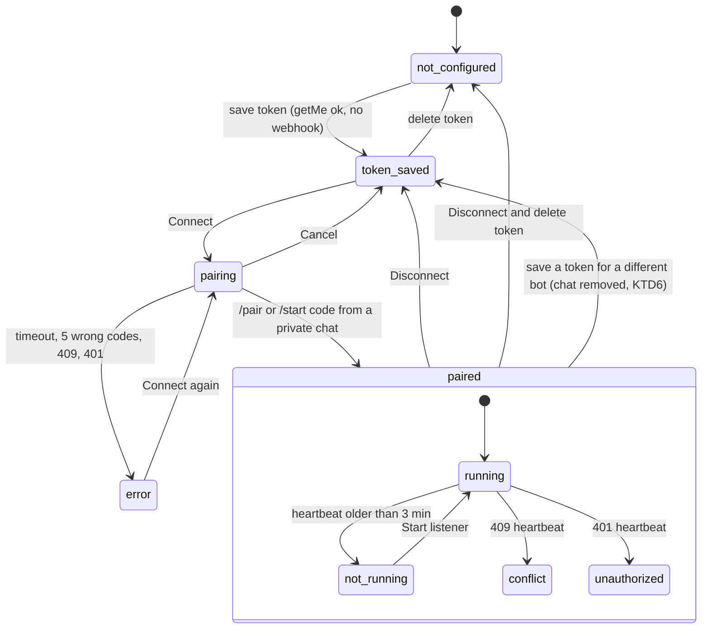
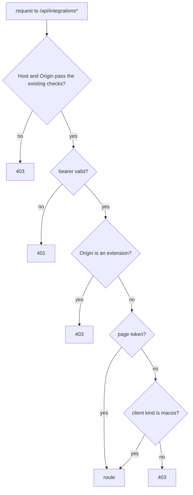
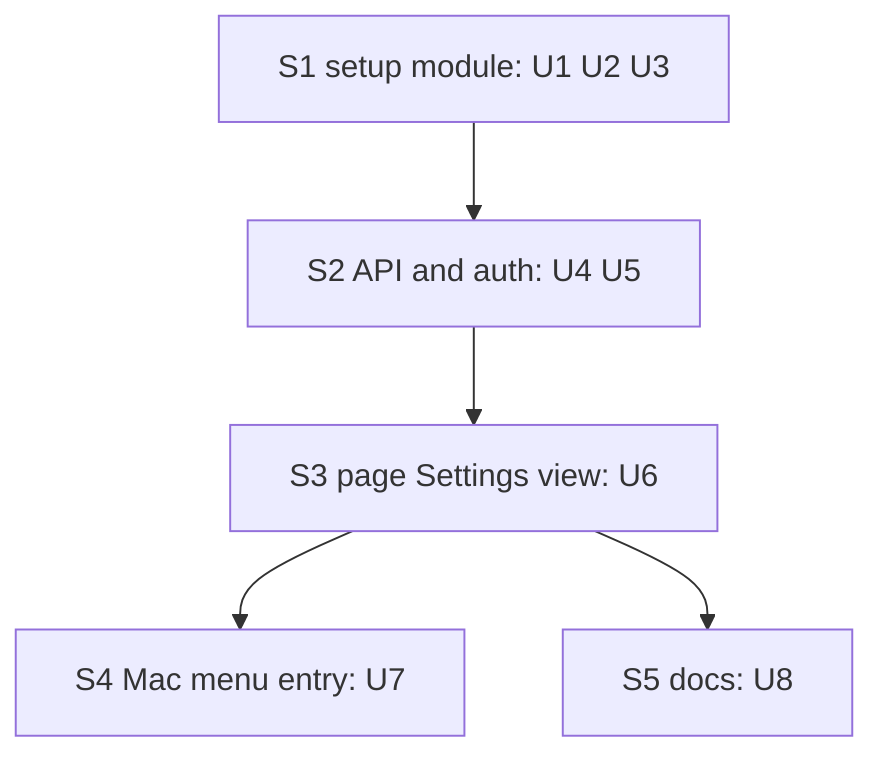

# Settings - Integrations - Telegram - Plan

## Goal Capsule

- **Objective:** A user who has never opened a terminal connects Telegram to Tidegap from Settings → Integrations in the page or the Mac app, gets task messages in the chat, and can test, see the state of, and disconnect the connection from the same screen.
- **Means:** one shared Telegram setup module in `packages/cli` that the CLI and new page-and-Mac-only API routes both call (KTD1, KTD3), a Settings view in the existing page, and the Mac app showing that page in its existing web view (KTD9).
- **Authority:** owner requirement (Vitalii, 2026-10-19: "Telegram: это должно быть в настройках, я сам подключу") → this plan's R-IDs → KTDs → units. `docs/solutions/best-practices/telegram-channel-security.md` and `loopback-web-ui-hardening.md` stay binding; nothing here weakens a rule in them.
- **Stop conditions:**
  - A design that makes the extension, a web page, or the MCP server able to read, set or use the bot token: stop and report.
  - Telegram answers `getMe` or `getUpdates` in a shape that the fake server in `packages/core-ts/test/fixtures/fake-telegram.ts` does not cover: stop and report before shipping U5.
  - The Mac web view cannot reach `#/settings` with the client token from `AppModel.pageURL`: stop and report (do not build a native form instead without a decision).
- **Execution profile:** one feature PR, five sequential streams (S1 → S2 → S3 → S4 ∥ S5). Opus implements; the never-merge rule applies.

---

## Product Contract

### Summary

Add a Settings view with an Integrations section to the local page that `tidegap ui` serves. Its Telegram card takes a bot token, starts pairing with a code, a `t.me` link and a QR code, shows live status until the chat is paired, and offers Send test message and Disconnect. The Mac app opens the same view from a new menu entry. The CLI keeps `tidegap channels …` unchanged in output and exit codes and shares the new code path; the bot-change offset reset (KTD6) is its one behavior change.

### Problem Frame

Telegram is CLI-only today: the user edits `~/.config/tidegap/env`, runs `tidegap channels add telegram`, and reads a code from the terminal. The coherence batch kept the Integrations page out of scope ("CLI-only channel management in v1", `docs/plans/2026-10-17-1533-feat-coherence-batch-plan.md` Scope Boundaries) so v1 could ship the channel itself. The owner now wants to connect Telegram himself from settings, and the Mac app audience includes people who never open a terminal. The parts that made the CLI path safe (env-file token parity, one poller, chat-id auth, no token in errors) must hold on the new path too.

### Requirements

**Telegram card (page and Mac app)**

- R1. Settings → Integrations shows one Telegram card in one of these states: not configured, token saved, pairing, paired, error. A paired card also shows the listener state: running, not running, conflict (another program polls the bot), token refused, or manual (Windows).
- R2. The token field is a password input. The token is saved to `~/.config/tidegap/env` and never returned by the API; the card shows only "Token set, ends in `abcd`" and the bot's `@username`.
- R3. The card guides a first-time user to create a bot: a link to `https://t.me/BotFather`, the `/newbot` step, and "paste the token here".
- R4. Connect shows the 6-digit code, the link `https://t.me/<bot_username>?start=<code>`, a QR code of that link, and the time left; the card refreshes on its own until the chat is paired, pairing fails or the code expires.
- R5. A paired card shows the chat label (`@username` or first name) and offers Send test message, Disconnect, and (when the listener is not running) Start listener.
- R6. Disconnect removes the paired chat and stops the listener; an option on the same dialog also deletes the token from the env file.
- R7. Every failure shows one plain sentence with the next step (examples: "Telegram refused this token. Copy it again from @BotFather." and "Another program reads this bot's messages. Create a new bot for Tidegap.").
- R8. The card links to the Telegram docs page.

**Access**

- R9. Only the page (page token) and the Mac app (a `macos` client token, no extension origin) can call the integrations routes. A caller with no valid token gets 401; a valid token that fails this rule gets 403, and the page hides the Settings entry for it.
- R10. The bot token never appears in an API response, a log line, an error body, a task event, or the page's memory after the save request returns.

**CLI and platforms**

- R11. `tidegap channels add telegram`, `list`, `remove` and `serve` keep their output and exit codes, and run through the same setup module as the API.
- R12. On Windows the card pairs the chat and then shows "Keep `tidegap channels serve` running" with a copy button instead of listener controls.
- R13. The Mac app has a menu entry "Integrations…" that opens the page window on Settings → Integrations.

**Docs**

- R14. The Telegram docs page leads with the Settings path; the CLI path stays as the alternative. README, `packages/cli/README.md`, `apps/macos/README.md`, `docs/spec/ui-client-api.md` and `llms-full.txt` match.

### Acceptance Examples

- AE1. Covers R2, R10. **Given** a saved token `123456:AA…wXyZ`, **when** the page calls `GET /api/integrations`, **then** the body holds `"token_hint": "wXyZ"` and no other part of the token.
- AE2. Covers R4. **Given** a saved token for bot `@tg_test_bot`, **when** the user presses Connect, **then** the card shows a 6-digit code, the link `https://t.me/tg_test_bot?start=<code>`, a QR code of that link and "10:00 left".
- AE3. Covers R1, R4. **Given** pairing is running, **when** the user's phone sends `/start <code>` through the link, **then** within one refresh the card shows "Paired with @user", and within a few seconds of the listener starting it shows the listener state "running".
- AE4. Covers R9. **Given** an extension with a valid client token, **when** it calls `GET /api/integrations`, **then** it gets 403; the same call with a `macos` client token and no `Origin` gets 200.
- AE5. Covers R1, R7. **Given** a paired chat, **when** another program starts polling the same bot, **then** within 3 minutes the card shows "conflict" with the new-bot advice.
- AE6. Covers R6. **Given** a paired chat, **when** the user disconnects with "Also delete the token", **then** the chat row is gone, the listener unit is unloaded and its file removed, and the env file has no `TIDEGAP_TELEGRAM_BOT_TOKEN` or `TELEGRAM_BOT_TOKEN` line while every other line is unchanged.

### Scope Boundaries

- Other integrations (Slack, Discord, webhooks), group chats, several paired chats: the Integrations section has one card. The API returns an object keyed by integration so a second card needs no shape change.
- Moving "Connected apps" (`#apps-btn`) into Settings: it stays where it is.
- An MCP tool for Telegram setup: agents do not handle the bot token.
- The browser extension and the Safari extension get no settings entry and no integrations access.
- A native SwiftUI settings form in the Mac app (KTD9), and a second Integrations entry in the Mac app's native Settings window: the menu entry is the only Mac entry point.
- Considered and not built: a cross-process pairing lock between the CLI and the page. Two pairings at once both get 409 from Telegram and both stop with a visible message (R7 copy names "another pairing" as one cause). Build a ledger lock if users report it.
- Considered and not built: a live `launchctl print` / `systemctl is-active` probe for the listener. The heartbeat (KTD7) answers the same question from the ledger and also catches a running listener that cannot poll. Add the probe if the heartbeat proves unreliable.
- Considered and not built: storing the token in the macOS Keychain. The listener under launchd and the Linux unit read the env file (`telegram-channel-security.md`, env-file parity); a second store would split the source of truth.

### Deferred to Follow-Up Work

- `docs/solutions/` learning for the env-file writer and the bot-id offset reset (ce-compound after the PR).
- Recording the in-UI connect in `tidegap status` output (today it prints the channel line from the ledger, which already covers a UI-paired chat).

---

## Planning Contract

### Key Technical Decisions

- KTD1. **New route class `integrations`, allowed for the page token and for a `macos` client token without an extension origin.** `server.ts` gets `isIntegrationsRoute(pathname)` with the same segment split as `isClientsRoute`. Rules, in order: extension origin → 403 (any token); page token → allowed; client token whose registry entry has `kind: "macos"` → allowed; any other client token → 403. Rationale: the Mac web view carries the `macos` client token (`AppModel.pageURL`), not the page token, so page-only would lock the Mac app out. The `macos` token sits in `~/Library/Application Support/Tidegap/client-token` (0600) under the same user as the env file, so allowing it adds no reach a local attacker lacks. The extension check uses the origin, not the token kind, so a `macos` token pasted into an extension still gets 403. Governs R9.
- KTD2. **POST-only routes with the existing body rules.** No PUT or DELETE: the server's hardening rule is "state changes only by POST", and `checkBody` already enforces JSON type, 64 KiB and strict objects. Routes:

  | Route | Body | Answer |
  |---|---|---|
  | `GET /api/integrations` | none | 200 `{"telegram": TelegramStatus}` |
  | `POST /api/integrations/telegram/token` | `{"token": "…"}` | 200 status; 400 bad format; 409 refused by Telegram or bot has a webhook; 429 |
  | `POST /api/integrations/telegram/pair` | none | 202 status with `pairing`; 409 no token; 200 with the running session when one is active; 429 |
  | `POST /api/integrations/telegram/pair/cancel` | none | 200 status |
  | `POST /api/integrations/telegram/test` | none | 200 `{"sent": true}`; 409 not paired; 502 Telegram error; 429 |
  | `POST /api/integrations/telegram/listener/start` | none | 200 status after a restart of the unit (unload, then load); 409 not paired or no unit on this platform; 429 |
  | `POST /api/integrations/telegram/disconnect` | `{"forget_token"?: boolean}` | 200 status |

  Error bodies stay one fixed sentence per case (R7); no exception text. Governs R2, R5, R6.
- KTD3. **One setup module in `packages/cli/src/channels/telegram-setup.ts`; the CLI and the API both call it.** It owns: read status, save token, start pairing, cancel pairing, send test, start listener, disconnect. It lives in `packages/cli`, not `core-ts`, because it writes files and drives launchd/systemd (coherence KTD10: side effects in the host). `pairTelegram` (`channels/pair.ts`) stays the one pairing loop; it gains an `onCode` callback with `{code, botUsername, expiresAt}` and an `AbortSignal`. The CLI's `onCode` prints today's three lines, so R11 output is unchanged. `createInstallListener` (`commands/channels.ts`) moves into the module so the API uses the same unit writer and loader. Its launcher comes from the installed tick daemon unit's `ProgramArguments` (the part before the subcommand) when that unit exists, else from `resolveLauncher`. `resolveLauncher` reads the calling process's own argv, so inside `tidegap ui` started by the Mac app with a command override it would write that override into the listener unit. Governs R11.
- KTD4. **The env file is the token's only store, written atomically.** New `setEnvFileKey(path, key, value | undefined)` in `commands/env-file.ts`:
  1. Resolve a symlinked env file to its target, so dotfile managers keep their link.
  2. Keep every other line byte for byte. Replace the first active `KEY=` line and drop later active duplicates. Else replace the template's commented `#KEY=` line. Else append.
  3. Write a temp file (0600) in the same directory, `fsync`, `rename`. Create the directory 0700 when missing.

  Removing the token removes both `TIDEGAP_TELEGRAM_BOT_TOKEN` and the legacy `TELEGRAM_BOT_TOKEN`, because `readTelegramEnv` falls back to the legacy key. The API reads the token from the file on each request, never from `process.env`: `loadEnvFileIntoProcess` never overwrites a key, so a long-running `tidegap ui` would keep a stale token. The tick's channel sender (`commands/tick.ts`) uses the same file-first reader on each tick, because a `tidegap tick --daemon` started by the page's Start dispatcher inherits the UI process env and would otherwise keep sending with the old token. The token must match `^\d{5,12}:[A-Za-z0-9_-]{30,50}$` before anything is written, which also blocks a newline that would add an env line. Governs R2, R10.
- KTD5. **Pairing from the page runs inside the `tidegap ui` process as one in-memory session.** `POST …/pair` starts `pairTelegram` in the background and returns at once. The session holds the code, bot username, expiry and an `AbortController`. The status carries the code while pairing, so a reload or a reopened Mac window continues. A second `POST …/pair` returns the running session. When the session ends, it records the outcome (paired, timed out, five wrong codes, 409, token refused) as the last result. Server `close()` aborts it, and `pairTelegram`'s existing `finally` reloads the listener when an earlier chat stays paired. Governs R4.
- KTD6. **A bot change resets the update offset.** Telegram update ids are per bot. A stored `telegram_update_offset` from an earlier bot that is higher than the new bot's ids would make `getUpdates` confirm and drop every new update. New meta key `telegram_bot_id` (from `getMe`, not secret). `pairTelegram` and the listener start compare it with `getMe().id`. When it differs, they clear the offset and store the new id. Saving a token through the API compares its `getMe().id` with `telegram_bot_id`:

  - a different bot removes the paired chat rows, clears the offset, unloads the listener and aborts a running pairing;
  - the same bot with a new token (after `/revoke` in @BotFather) keeps the rows and the offset and restarts the listener, which holds the token in memory;
  - the same token again changes nothing.

  This also fixes the CLI path, where a hand-edited token has the same bug today. Governs R2, R11.
- KTD7. **Listener health comes from a heartbeat in ledger meta.** The listener writes meta `telegram_listener` = `{"at": <iso>, "state": "ok" | "conflict" | "unauthorized" | "network", "conflict_at"?: <iso>}`:

  - once with `ok` right after its start-up `getMe` (the KTD6 check) succeeds, so a fresh pairing reads `running` within seconds, not after the first 50 s long poll;
  - after each poll cycle, only when the state changes or 60 s have passed since the last write, so idle polling does not churn the ledger;
  - `conflict_at` is set on every 409 and kept across later `ok` writes, because two pollers take turns and the latest state alone would flicker.

  `saveToken` with a different bot, `startPairing` and `disconnect` delete the key, so a stale `unauthorized` from an old token does not outlive it. The status reads, first match wins:

  - no listener unit on this platform → `manual`;
  - heartbeat `unauthorized` younger than 11 minutes (the listener sleeps 10) → `unauthorized`;
  - `conflict_at` younger than 3 minutes → `conflict`;
  - heartbeat `network` younger than 3 minutes → `not_running`, with the sentence "The listener cannot reach Telegram. Check the internet connection.";
  - any heartbeat younger than 3 minutes → `running`;
  - else → `not_running`.

  The bot username comes from `getMe`, cached in memory per token digest for 10 minutes, so a status poll does not call Telegram. Python's `_TaskStore` never reads these meta keys, so `packages/core-py` needs no change. Governs R1.
- KTD8. **The page gets a `#/settings` view and a QR code drawn from a vendored encoder.** A "Settings" header button appears only when `GET /api/integrations` answers 200, the same probe pattern as `initClients`. New modules `ui/integrations.js` (card view-model and rendering) and `ui/qr.js` (vendored Nayuki QR Code generator, MIT, header kept) join `UI_MODULES`. The QR is SVG `rect` elements built with `createElementNS`, so the CSP needs no change. It draws black modules on a white plate with a 4-module quiet zone in both themes (fixed colors, not theme tokens, so phone scanners read it in dark mode), at least 192 px, with `role="img"` and an `aria-label` naming the link. Settings is a view without a tab: the header button gets `aria-current="page"` on `#/settings`, the tabs stay visible and lead back, and the nav-marking loop in `app.js` skips views that have no tab. The existing `ui-server.test.ts` guard "no module loads anything remote" gets a named allow-list (`https://t.me/`, `https://www.tidegap.com/docs`, the vendored header URL in `qr.js`); every other `https?://` literal stays forbidden. Polling: every 2 s while pairing, 30 s otherwise, and none while the view is hidden. QR rationale: a non-technical user often has Telegram only on the phone, and scanning beats typing a code. Governs R1, R3, R4, R8.
- KTD9. **The Mac app shows the web page; it gets no native form.** The app already renders the full page in `WebPageWindow` (`WKWebView`, non-persistent store, client token in the fragment). A new `AppModel.showWindow(view:)` loads `#token=<t>&view=settings`. `app.js` `boot()` accepts that optional `&view=` (allow-list `agenda|timeline|journal|settings`) and replaces the hash with `#/settings`. `WebPage.updateNSView` reloads only when the URL changes, so a repeated "Integrations…" on an open window would do nothing. `AppModel` therefore keeps a one-shot requested view with a request counter, and `WebPage` applies each request to a loaded page by setting `location.hash = '#/settings'` through `evaluateJavaScript`; the page's own hash routing does the rest. The `t.me` links already leave the web view for the default browser through the `WebPage.Coordinator` policy. Governs R13.
- KTD10. **Rate limits in server memory, per route:** token save 5 per minute, pair start 3 per 10 minutes, test 1 per 10 s, listener start 3 per minute. Over the limit → 429 with `retry_after_s`. The wrong-code limit (5) stays in `pairTelegram`. Governs R9.

### High-Level Technical Design

Card states and transitions (R1):



Pairing from the page (KTD3, KTD5, KTD6):

```mermaid
sequenceDiagram
  participant P as Page or Mac web view
  participant S as tidegap ui server
  participant M as telegram-setup module
  participant T as Telegram Bot API
  participant L as Listener unit
  P->>S: POST /api/integrations/telegram/pair
  S->>M: startPairing()
  M->>T: getMe, getWebhookInfo
  M->>M: bot id differs from meta? clear offset
  M->>L: unload (one poller)
  M-->>S: onCode {code, bot, expiresAt}
  S-->>P: 202 status with pairing
  loop every 2 s
    P->>S: GET /api/integrations
  end
  M->>T: getUpdates (long poll)
  T-->>M: /start <code> from a private chat
  M->>M: insert channel row, move offset
  M->>L: write unit, load
  L->>T: getUpdates; heartbeat meta "ok"
  P->>S: GET /api/integrations
  S-->>P: paired, listener running
```

Auth for an integrations route (KTD1):



Stream order:



### Assumptions

- The owner approves the `macos` client token reaching the integrations routes (KTD1). The alternative, page token only, leaves the Mac app without the screen.
- A vendored MIT file in `packages/cli/ui/` is acceptable under the repo's Apache-2.0 license with its header kept. If not, U6 drops the QR and keeps the code and link (R4 then loses its QR clause).
- One feature PR carries all five streams, as PR #81 did for the coherence batch.
- PR #93 (`docs/telegram-channel`) merges before S5 starts. If it is still open, S5 stacks on it.

### System-Wide Impact

- **Auth boundary:** a third route class joins page-only and agent-facing in `server.ts` and in the `docs/spec/ui-client-api.md` matrix.
- **Ledger:** two new meta keys (`telegram_bot_id`, `telegram_listener`); no table or column change, so `shared-sqlite-ledger-migrations.md` and Python parity are not involved. `pnpm gen:data:check` is untouched (no data tables change).
- **Processes:** `tidegap ui` now may run a 10-minute `getUpdates` loop and load or unload the listener unit. On macOS this happens from the Mac app's child server, in the user's `gui/<uid>` domain.
- **CLI:** `channels add` gains the bot-id offset reset (KTD6) with no output change. The tick's channel sender reads the token from the env file on each tick (KTD4).

### Risks & Dependencies

| Risk | Mitigation |
|---|---|
| The listener unit written from the UI server points at a transient launcher (for example the Mac app's repo-build command) | The launcher comes from the installed tick daemon unit when it exists (KTD3); U2 test runs the module with a process argv that differs from the installed unit's and asserts the written unit uses the installed one |
| `tidegap ui` stops mid-pairing (Mac app quit) | `close()` aborts the session; `pairTelegram`'s `finally` reloads the listener for an earlier chat; the next page load shows the last result "stopped" |
| A token change leaves the old listener running with the old token | Token change unloads the listener (KTD6); pairing loads it with the new file |
| Heartbeat writes wake the SSE `data_version` poll | One write per 60 s at most; `TaskEvents` emits only on task fingerprint changes |
| Two pairings at once (CLI and page) | Both get 409 and say so (Scope Boundaries) |

---

## Implementation Units

### U1. Atomic env-file key writer

- **Goal:** set or remove one key in `~/.config/tidegap/env` without touching other lines.
- **Requirements:** R2, R6, R10.
- **Dependencies:** none.
- **Files:** `packages/cli/src/commands/env-file.ts`, `packages/cli/test/env-file.test.ts`.
- **Approach:** KTD4. Export `setEnvFileKey` and `isTelegramBotToken` (the format check). `ensureEnvFile` stays as is.
- **Patterns to follow:** atomic write and 0600 in `packages/cli/src/ui/clients.ts` (registry save).
- **Test scenarios:**
  - File with the template and other keys → set token → the commented `#TIDEGAP_TELEGRAM_BOT_TOKEN=` line becomes active, every other line is byte-identical.
  - File with an active token line → set a new token → one line changes.
  - Two active token lines → set → one active line remains.
  - No file → set → file created 0600, directory 0700.
  - Symlinked env file → set → the link remains and the target changes.
  - Remove → both `TIDEGAP_TELEGRAM_BOT_TOKEN` and `TELEGRAM_BOT_TOKEN` active lines are gone, comments stay.
  - `isTelegramBotToken` rejects a value with `\n`, a space, an empty part, and a 200-character value.
- **Verification:** env-file tests pass; the file mode after every write is 0600.

### U2. Telegram setup module and pairing refactor

- **Goal:** one module that the CLI and the API call for every Telegram setup action.
- **Requirements:** R1, R2, R4, R5, R6, R11, R12.
- **Dependencies:** U1.
- **Files:** `packages/cli/src/channels/telegram-setup.ts` (new), `packages/cli/src/channels/pair.ts`, `packages/cli/src/commands/channels.ts`, `packages/cli/src/commands/tick.ts`, `packages/cli/test/telegram-setup.test.ts` (new), `packages/cli/test/channels-pair.test.ts`, `packages/cli/test/channels-unit.test.ts`, `packages/cli/test/tick-channels.test.ts`.
- **Approach:**
  1. `pairTelegram` gains `onCode` and `signal` (KTD3) and the bot-id check (KTD6). The `out` lines move into the CLI's `onCode`.
  2. Move `createInstallListener` and `envFileToken` into `telegram-setup.ts`; `commands/channels.ts` imports them. The launcher source follows KTD3.
  3. Status builder: token hint (last 4), bot username (cached `getMe`, KTD7), chat label from the channel row, pairing session, last result, listener state (KTD7; `channelsUnitPath` null → `manual`).
  4. `saveToken`: format check, `getMe`, `getWebhookInfo` (webhook → refuse), then U1 write, then the bot-id comparison and its cleanup or restart (KTD6), then the heartbeat key reset (KTD7).
  5. `startPairing` / `cancelPairing` (KTD5), `sendTest` (plain text "Test message from Tidegap. Notifications work."), `startListener` (a restart: the hook's `unload`, then `load`, so a loaded but stalled unit restarts too), `disconnect` (remove telegram rows, unload, optional token removal through U1).
  6. `runChannelsAdd` and `runChannelsRemove` call the module; their output stays the same.
  7. `commands/tick.ts`: the channel sender reads the token through the file-first reader on each tick (KTD4).
- **Patterns to follow:** injected `exec`, `fetch` and `installListener` as in `commands/channels.ts` and `channels-pair.test.ts`; errors built from method and status only (`TelegramClient`).
- **Test scenarios:**
  - Covers AE2. Fake server bot `tg_test_bot`, token saved → `startPairing` → `onCode` gets a 6-digit code and an expiry 10 minutes ahead; status shows `pairing` with the deep link.
  - Fake server delivers `/start <code>` from a private chat → status `paired`, label `@user`, the hook got `unload` then `load`.
  - Stored offset 9_000_000 and `telegram_bot_id` 1; fake `getMe` id 42 → pairing clears the offset and stores 42 before the first `getUpdates`.
  - Same bot id → offset kept.
  - `saveToken` with a token the fake answers 401 for → refused, env file unchanged.
  - `saveToken` when the fake reports a webhook URL → refused with the dedicated-bot sentence.
  - `saveToken` with a token for a different bot (fake `getMe` id changes) while paired → channel rows removed, offset cleared, hook `unload`, running session aborted, `telegram_listener` key deleted.
  - `saveToken` with a new token for the same bot (same `getMe` id) while paired → rows and offset kept, hook `unload` then `load`.
  - `startListener` with the unit loaded and unchanged (fake exec `launchctl print` exits 0) → `bootout` and `bootstrap` both run.
  - `cancelPairing` → session ends, status `token_saved`, hook `load` only when an earlier chat stays paired.
  - `disconnect({forgetToken: true})` → rows gone, hook `unload`, env file without both token keys (Covers AE6).
  - `sendTest` with no paired chat → refused; with a chat → one `sendMessage` to that chat id without `parse_mode`.
  - Platform `win32` → status listener `manual`; `startListener` refused.
  - An installed tick daemon unit with launcher `/usr/local/bin/tidegap` and a module process argv of `node /repo/packages/cli/dist/index.js` → the written listener unit runs `/usr/local/bin/tidegap channels serve`.
  - No tick daemon unit → the listener unit uses `resolveLauncher`.
  - Two `runTickOnce` calls in one process with the env-file token changed between them → the second `sendMessage` goes out with the new token (fake server sees the new token path).
  - CLI `channels add telegram` against the fake server prints the same three code lines and exits 0 (existing `channels-pair.test.ts` expectations stay green).
  - No status, error string or captured log line contains the token (assert on every output in this file).
- **Verification:** `channels-*` and `telegram-setup` tests pass with no real network; CLI output snapshots unchanged.

### U3. Listener heartbeat

- **Goal:** the listener reports its health in ledger meta.
- **Requirements:** R1.
- **Dependencies:** U2 (bot-id check in the listener start uses the same helper).
- **Files:** `packages/cli/src/channels/serve.ts`, `packages/cli/src/channels/listener.ts`, `packages/cli/test/channels-serve.test.ts`.
- **Approach:** KTD6 bot-id check in `runListener` before the first poll, then the start-up `ok` heartbeat; KTD7 writes in `ChannelListener.run` after each poll cycle, with `conflict_at`.
- **Patterns to follow:** `OFFSET_META_KEY` handling in `serve.ts`.
- **Test scenarios:**
  - Listener start with a working token → heartbeat `ok` exists before the first `getUpdates` returns.
  - One successful cycle → meta `telegram_listener` state `ok` with the fake clock time.
  - Covers AE5. Fake answers 409, then a success → state `ok` with `conflict_at` kept; the status builder reports `conflict`.
  - Fake fails with a network error → state `network`; the status builder reports `not_running` with the connection sentence.
  - Fake answers 401 → state `unauthorized` written before the 10-minute sleep.
  - Two successful cycles 20 s apart → one write; a cycle 61 s later → a second write.
- **Verification:** serve tests pass; no new log line contains the token.

### U4. Integrations route class and auth

- **Goal:** the server admits integrations calls only from the page and the Mac app.
- **Requirements:** R9.
- **Dependencies:** none in code (can start with S2 after S1 lands).
- **Files:** `packages/cli/src/ui/server.ts`, `packages/cli/test/ui-server.test.ts`.
- **Approach:** KTD1. `clients.verify(bearer)` already returns the entry with `kind`. Add `isIntegrationsRoute` next to `isClientsRoute` and check it before dispatch.
- **Patterns to follow:** `isClientsRoute` and its double-slash tests (`client-tokens-and-extension-origins.md`).
- **Test scenarios:**
  - Covers AE4. Extension origin plus an `extension` client token → 403 on `GET /api/integrations`.
  - Extension origin plus a `macos` client token → 403.
  - No origin plus a `macos` client token → 200.
  - Loopback origin plus the page token → 200.
  - No origin plus an `extension` client token → 403.
  - `/api//integrations`, `/api/integrations//telegram/pair`, `/api///integrations` with an `extension` client token → 403.
  - Foreign origin plus the page token → 403 (existing rule still holds).
- **Verification:** the auth matrix tests pass; existing `ui-server` tests unchanged.

### U5. Integrations API handlers

- **Goal:** the routes in KTD2 call the setup module.
- **Requirements:** R1, R2, R4, R5, R6, R7, R10, R12.
- **Dependencies:** U2, U3, U4.
- **Files:** `packages/cli/src/ui/integrations.ts` (new), `packages/cli/src/ui/api.ts`, `packages/cli/src/ui/server.ts`, `packages/cli/src/commands/ui.ts`, `packages/cli/test/ui-integrations.test.ts` (new), `docs/spec/ui-client-api.md`, `docs/solutions/best-practices/telegram-channel-security.md`.
- **Approach:**
  1. `ApiContext` gains an optional `integrations` object (env-file path, `installListener`, `fetch`, platform), built in `commands/ui.ts`; absent → the routes answer 404, so existing server tests need no setup.
  2. `postBodyKind` gets the new routes (token and disconnect `json`, the rest `none`).
  3. KTD10 limiter in `integrations.ts`.
  4. `startUiServer`'s `close()` aborts a running pairing.
  5. Spec doc: a "Routes for the page and the Mac app" section and a new matrix row; extension 403 named.
  6. `telegram-channel-security.md`: one line pointing at KTD1 (who may call the integrations routes) and KTD6 (bot change and offset).
- **Patterns to follow:** `api.ts` handler shape (`{status, body}`), fixed error bodies, `ui-actions.test.ts` server setup with `hermetic-home.ts`.
- **Test scenarios:**
  - Covers AE1. Token saved → `GET /api/integrations` body has `token_hint` and no other part of the token; the raw response text does not contain the token.
  - `POST …/token` with `text/plain` → 415; with `{"token": "x", "extra": 1}` → 400; with a bad format → 400 and the env file is untouched.
  - Covers AE3. Full flow against the fake server: save token → pair (202, code present) → fake delivers `/start <code>` → `GET` shows `paired` → `POST …/test` → fake received one `sendMessage` → disconnect → `GET` shows `token_saved`.
  - Second `POST …/pair` during a session → 200 with the same code.
  - Pair with no token → 409 with the R7 sentence.
  - Fake returns 409 on `getUpdates` during pairing → status `error` with the "another program or another pairing" sentence.
  - `POST …/test` twice within 10 s → second answer 429 with `retry_after_s`.
  - Six token saves in a minute → sixth 429.
  - `GET` with a `telegram_listener` heartbeat 4 minutes old → listener `not_running`; `POST …/listener/start` → hook `load` called.
  - Server `close()` during pairing → the pairing promise settles and the hook reloads an earlier chat's listener.
  - No `task_events` row is written by any integrations route.
- **Verification:** `ui-integrations` tests pass against the fake server; spec doc lists every route in KTD2.

### U6. Page Settings view with the Telegram card

- **Goal:** the user connects Telegram from the page.
- **Requirements:** R1, R2, R3, R4, R5, R6, R7, R8, R12.
- **Dependencies:** U5.
- **Files:** `packages/cli/ui/integrations.js` (new), `packages/cli/ui/qr.js` (new, vendored), `packages/cli/ui/app.js`, `packages/cli/ui/api.js`, `packages/cli/ui/index.html`, `packages/cli/ui/app.css`, `packages/cli/src/ui/server.ts` (`UI_MODULES`), `packages/cli/test/ui-server.test.ts` (remote-literal allow-list, KTD8), `packages/cli/test/ui-integrations-view.test.ts` (new), `packages/cli/test/ui-qr.test.ts` (new).
- **Approach:**
  1. `index.html`: a hidden "Settings" button in `.top-end`; `app.js`: route `#/settings`, the probe (KTD8), and the `boot()` fragment change (KTD9).
  2. `integrations.js` exports a pure `telegramCard(status, now)` view-model (title, state line, fields, buttons, error sentence) and a renderer that only creates text nodes.
  3. Token input: `type="password"`, `autocomplete="off"`, a visible label, `aria-describedby` on the BotFather steps and any error sentence; the field is cleared after the save request returns, whatever the result. Token saved and error states offer "Change token" and "Remove token"; on a paired card "Change token" opens a dialog that says a different bot removes the paired chat (KTD6).
  4. Pairing panel: the code in large digits, "Open in Telegram" link (`target="_blank"`), the QR, a countdown, Cancel.
  5. Disconnect opens a dialog through `openDialog` (`dialog.js`) with an "Also delete the token" checkbox; `confirmDialog` has no field for it.
  6. Rendering: the countdown updates its text node in place; the card is rebuilt only on a state change, and focus returns to the control with the same action. State changes and success go to one `role="status"` region, errors to `role="alert"`; the countdown is not live.
  7. Action states: each button disables with "Saving…" / "Sending…" while its request runs (the `startDispatcher` disable-in-finally pattern); a sent test shows the toast "Test message sent. Check Telegram."; 429 shows "Wait N seconds and try again."; the view shows "Loading…" before the first GET and keeps the last card with "Could not reach Tidegap. Retrying…" when a poll fails.
  8. Layout: one column capped near 560 px; under 720 px the QR sits below the code and the Settings button becomes an icon button.
  9. Copy uses the plain sentences of R7; the docs link goes to `https://www.tidegap.com/docs#telegram-setup` (the anchor PR #93 adds).
- **Patterns to follow:** `ui/clients.js` (probe, dialog, token box), `dependency-free-task-ui-patterns.md` (text nodes, token in memory, look up renderers by own key).
- **Test scenarios:**
  - `telegramCard` for each state in R1 returns the expected state line and buttons: not configured → token form and the BotFather steps; token saved → Connect and "ends in wXyZ"; pairing → code, link, countdown "9:59 left" at 1 s in; paired + running → label, Send test, Disconnect; paired + not_running → adds Start listener; paired + manual → the `tidegap channels serve` line and no listener button; error → the sentence and Connect again.
  - A status with a chat label `` renders as text (no element created).
  - `qr.js` encodes `https://t.me/tg_test_bot?start=123456` into a symbol of the expected version with the three finder patterns at the corners.
  - The `boot()` fragment parser accepts `#token=abc&view=settings` and maps any view outside the KTD9 allow-list, `../x` included, to `agenda`.
  - A countdown tick while focus is on Cancel keeps focus on Cancel.
  - The remote-literal guard passes with the three allow-listed prefixes and fails on any other `https://` literal in a UI module.
- **Verification:** view and QR tests pass; manual run of `node packages/cli/dist/index.js ui` with the fake server shows every state (screenshots to the session scratchpad, not the repo).

### U7. Mac app menu entry

- **Goal:** the Mac app opens Settings → Integrations.
- **Requirements:** R13.
- **Dependencies:** U6.
- **Files:** `apps/macos/Tidegap/MenuBarView.swift`, `apps/macos/Tidegap/AppModel.swift`, `apps/macos/Tidegap/WebPageWindow.swift`, `apps/macos/TidegapKit/Sources/TidegapKit/Format.swift` (page URL helper, if it fits there), `apps/macos/TidegapKit/Tests/TidegapKitTests/FormatTests.swift`, `apps/macos/README.md`.
- **Approach:** KTD9. Menu: "Integrations…" between "Open Tidegap window" and "Settings…". The URL builder adds `&view=settings` to the fragment for a window that is not open yet; an open window gets the requested view through `WebPage` (KTD9).
- **Patterns to follow:** `AppModel.pageURL` and `showWindow()`; TidegapKit tests for pure helpers.
- **Test scenarios:**
  - URL helper with port 47821, token `tgc_x` and view `settings` → `http://127.0.0.1:47821/#token=tgc_x&view=settings`.
  - URL helper with no view → today's URL, byte-identical.
- **Verification:** `swift test --package-path apps/macos/TidegapKit` passes; `xcodebuild` Release build succeeds; the manual checklist in the Verification Contract passes.

### U8. Docs

- **Goal:** the docs lead with the Settings path.
- **Requirements:** R14.
- **Dependencies:** U6 (final copy), PR #93.
- **Files:** `apps/web/content/docs/06-telegram.md`, `apps/web/src/lib/docs.generated.ts` and `apps/web/public/llms-full.txt` (regenerated), `apps/web/public/llms.txt`, `README.md` (Telegram section), `packages/cli/README.md`, `apps/macos/README.md` (if U7 did not finish it).
- **Approach:**
  1. `06-telegram.md` "Set up": steps in the page and the Mac app first (BotFather, paste token, Connect, open the link or scan the QR), then "From the terminal" with today's steps.
  2. Remove "There is no settings screen yet".
  3. Add the states and what to do for each (conflict, token refused, listener not running, Windows).
  4. README mirrors it in fewer lines.
  5. `llms.txt`: one line naming Telegram setup from Settings, next to the clients sentence.
  6. Regenerate with `pnpm gen:docs`.
- **Patterns to follow:** the `<!-- source: … -->` comment at the top of each docs page; `markdown-docs-generator-hardening.md`.
- **Test expectation:** none -- docs only; `pnpm gen:docs:check` and `docs-lockstep.test.ts` guard drift.
- **Verification:** `gen:docs:check` clean; every `tidegap …` command in the page resolves (lockstep test).

---

## Verification Contract

| Gate | Command | Applies to |
|---|---|---|
| Stream tests | `pnpm --filter @tidegap/cli exec vitest run env-file channels telegram-setup ui-server ui-integrations ui-qr` | S1, S2, S3 |
| Typecheck | `pnpm typecheck` | S1, S2, S3 |
| Mac | `swift test --package-path apps/macos/TidegapKit` and `xcodebuild -project apps/macos/Tidegap.xcodeproj -scheme Tidegap -configuration Release build` | S4 |
| Docs | `pnpm gen:docs:check` | S5 |
| Full gate, once on the integrated branch | `pnpm preflight` | after S5, Haiku runs it |

Test lists are vitest name filters; the stream runs only its own files plus the gate rows above. No real Telegram network in any automated test: every Telegram call goes to `startFakeTelegram` through `TIDEGAP_TELEGRAM_API_BASE` (loopback only).

Manual checklist on Vitalii's Mac (needs a real bot from @BotFather, after the PR is green):

1. Mac app → "Integrations…" opens the window on Settings → Integrations. Switch to Agenda in the page, press "Integrations…" again → Settings again.
2. Paste the token → "Token set, ends in …" and the bot's `@username`.
3. Connect → code, link and QR; scan the QR with the phone → the card shows "Paired with @…" within a few seconds.
4. Send test message → it arrives.
5. Queue a short task through Claude Code → the done message arrives with a Result button.
6. `launchctl print gui/$(id -u)/com.tidegap.channels` shows the unit running; the card shows "running".
7. `launchctl bootout gui/$(id -u)/com.tidegap.channels` → within 3 minutes the card shows "not running"; Start listener → "running".
8. Disconnect with "Also delete the token" → the env file has no token line; other lines unchanged.
9. The Safari extension popup has no settings entry; the page in Chrome with the extension installed still works.
10. `grep -r "<token>" ~/.tidegap/logs` finds nothing.

## Definition of Done

- R1-R14 each have a passing test or a checked manual step above.
- `pnpm preflight` passes once on the integrated branch.
- `docs/spec/ui-client-api.md` lists the integrations routes and the matrix row; `telegram-channel-security.md` gains one line pointing at KTD1 and KTD6.
- No code from abandoned approaches remains in the diff.
- The PR is green and reviewed with `ce-code-review`; it is not merged by an agent.

Streams for ce-work:

| Stream | Units | Files (primary) | Depends on | Size |
|---|---|---|---|---|
| S1 setup module | U1, U2, U3 | `cli/src/commands/env-file.ts`, `cli/src/channels/{telegram-setup,pair,serve,listener}.ts`, `cli/src/commands/{channels,tick}.ts`, their tests | none | M (about 500 lines with tests) |
| S2 API and auth | U4, U5 | `cli/src/ui/{server,api,integrations}.ts`, `cli/src/commands/ui.ts`, `docs/spec/ui-client-api.md`, `telegram-channel-security.md`, tests | S1 | M (about 450 lines) |
| S3 page view | U6 | `cli/ui/{integrations,qr,app,api}.js`, `index.html`, `app.css`, `UI_MODULES`, `ui-server.test.ts` guard, tests | S2 | M (about 400 lines plus the vendored QR file) |
| S4 Mac | U7 | `apps/macos/Tidegap/{MenuBarView,AppModel,WebPageWindow}.swift`, TidegapKit helper and test, `apps/macos/README.md` | S3 | S (about 80 lines) |
| S5 docs | U8 | `apps/web/content/docs/06-telegram.md`, generated docs, `llms.txt`, READMEs | S3, PR #93 | S |

S4 and S5 share no file and can run at the same time. Simplify runs for S1-S4 and is skipped for S5 (docs only).
