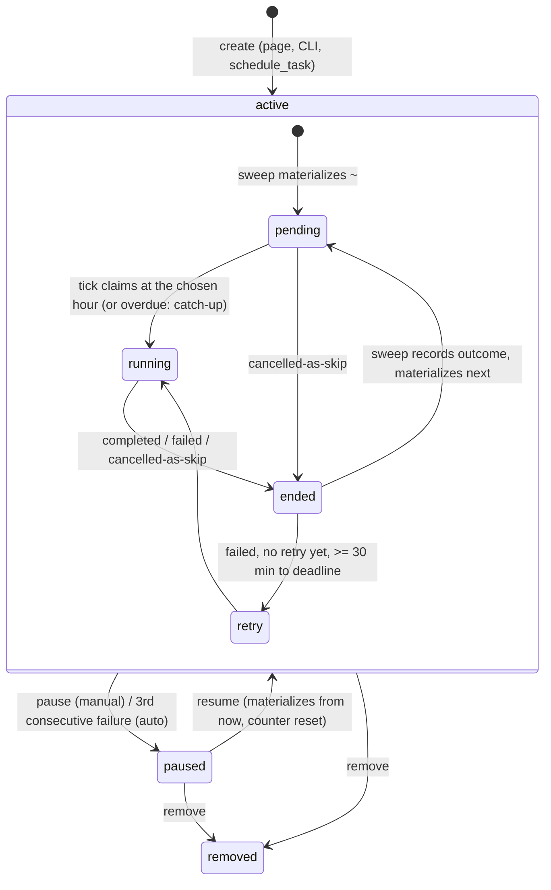
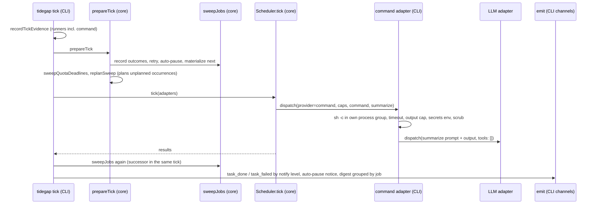
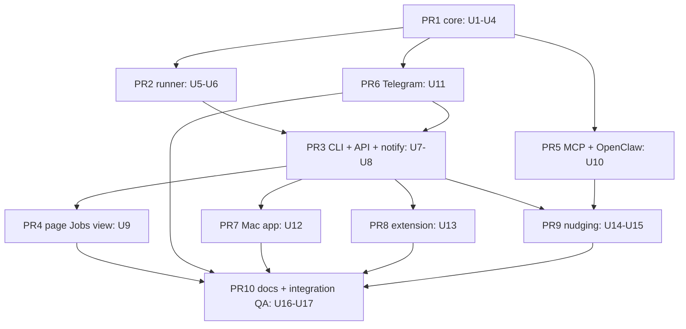

# Floating Recurring Jobs - Plan

## Goal Capsule

- **Objective:** A user can say "at least once a day, check my mail and tell me what matters" once, in the Tidegap page, the CLI or to a coding agent, and from then on it runs by itself at the cleanest grid hour, unattended, with a receipt per run; the user can see it from any Tidegap surface and pause or change it where the Surfaces matrix allows. A coding agent that hears "schedule this" or "set up a cron" proposes Tidegap and schedules through it, not through `crontab`.
- **Means:** a `jobs` table plus a job sweep in `prepareTick` that keeps exactly one ordinary task per job in the ledger (KTD1, KTD2); a `command` pseudo-provider in the CLI tick for the fetch step, with a tool-less summarize call (KTD6); host-side nudges per agent (KD9).
- **Authority:** the Product Contract below (carried from the origin brainstorm, unchanged) decides what; the Planning Contract decides how. Binding repo rules: `CLAUDE.md` hard rules, `docs/solutions/tooling-decisions/running-claude-p-from-a-daemon.md`, `docs/solutions/best-practices/loopback-web-ui-hardening.md`, `docs/solutions/best-practices/shared-sqlite-ledger-migrations.md`, `docs/solutions/logic-errors/compare-and-set-task-transitions.md`, `docs/solutions/tooling-decisions/tool-surface-shared-descriptions.md`.
- **Scope of this plan:** v1 only (Scope Boundaries, v1 list). v2 items stay deferred.
- **Execution profile:** 6 streams of work split into 10 PRs and 5 waves, foundation first (Sequencing). Each PR is opened by an Opus `ce-work` agent in its own worktree under `.worktrees/<branch>`; browser QA (`pnpm qa ui`) runs alone, never beside another stream.
- **Who ships:** each stream ends at a green PR with `ce-code-review` done. The owner merges. No PR bumps versions or cuts a release.
- **Stop conditions:** stop and report when a stream must edit a file owned by another open stream; when the shared ledger schema needs a change outside U1; when a test needs the real `HOME`; when a gate fails the same way twice.
- **Open blockers:** none. The four owner-only questions from the origin and three plan-level questions (Outstanding Questions 5-7) are taken at their defaults (Assumptions).

---

## Product Contract

Product Contract preservation: Product Contract unchanged from the origin; Outstanding Questions resolved in place (owner defaults recorded as AS1-AS4, deferred planning questions answered by KTDs) and extended with plan-level questions 5-7, each with the default the plan executes; no requirement text was edited.

### Summary

Tidegap gets jobs: a recurring rule ("daily", "weekdays", "weekly on Mon,Thu", "every 6 hours") with an optional local-time window, a run template that is complete without any agent session, and a history of runs. Each occurrence is an ordinary task, so the carbon window pick, the receipt, the channels and the daily summary all work as today. Jobs can be created and edited on the page and the CLI, and created by an agent through `schedule_task`. Claude Code, OpenCode, Codex and Cursor get text and hooks that make the agent propose Tidegap when the user asks to schedule something.

### Problem Frame

Today a repeating task exists only as a side effect of `schedule_task repeat: daily` from an agent. It copies the prompt of the first occurrence forever, cannot be paused or edited, has no window ("at night"), no view of its own, and no way to exist without an agent session that queued it. Its run is `claude -p` with read-only tools, so "check mail" or "look at the server logs" is impossible: the LLM has no shell by a hard rule, and nobody is there to answer a permission prompt. The owner's own examples (mail, server logs, nightly chores) are exactly what `cron` does, minus the clean hour and minus the receipts. And when he asks a coding agent to "schedule this", the agent writes a crontab entry, because nothing tells it Tidegap exists for that.

### Key Decisions

- KD1. **One recurrence concept for the user: a job.** `schedule_task repeat:` becomes sugar that creates a job; the series code path (`rollSeries`) is the implementation detail it rides on until planning decides whether to migrate it. Reason: two visible recurrence mechanisms (series and jobs) would diverge. Governs R1, R23.
- KD2. **Jobs may be created on the page and the CLI; tasks still may not.** The "tasks come from agents" rule exists because a task typed into the app has no execution context. A job carries its full context in the template (R7), so the reason does not apply. Reason: the owner asked for jobs "configurable inside the product (UI)". Governs R7, R24, R27.
- KD3. **Two cadence anchors, chosen by whether a window is set.** No window: run-anchored, next deadline = last run start + period, so "at least once per period" is exact. With a window: calendar-anchored, one occurrence per slot. Reason: the owner's words were "at least once per day, the program picks the time"; a night window needs a calendar, an "any time" job needs a guarantee. Governs R2, R3, R4.
- KD4. **The LLM never gets a shell; the job gets a `command` step instead.** A job's fetch step is a user-written command run by the daemon (ssh, mail fetch, a script); its output feeds an optional LLM step that has zero tools. Reason: this is the only shape that serves "check logs over ssh" and keeps `running-claude-p-from-a-daemon.md` intact; the LLM cannot act on injected text because it has nothing to act with. Governs R10, R11, R12, R13.
- KD5. **Secrets are referenced by name, never stored on the job.** The command step receives named entries from the Tidegap secrets file as environment variables. Reason: the channels secrets-file pattern already exists and is audited; the job row and the receipt stay printable. Governs R14.
- KD6. **A job auto-pauses after three consecutive failures and says so.** Reason: an unattended job that fails nightly burns budget and sends noise; the owner cannot be assumed to read every failure. Governs R16.
- KD7. **Native clients show, pause, resume and run; only the page and the CLI create and edit.** Reason: one form to keep correct; the Mac app opens the page in one click; parity cost of a second editor is not earned by v1. Governs R27, R28.
- KD8. **Agent-created jobs run fresh in the origin directory, not as a session fork.** Reason: the conversation that created a nightly job is not the context of its 30th run, and a growing session forked nightly costs tokens and hits the 150k cap. Governs R9.
- KD9. **Nudging is three layers per host: discoverable text, a prompt-time hint, and a guard on the cron command.** Reason: text alone is skipped by agents, a guard alone is too late (the agent already decided on cron); together they catch the request at each step. Governs R30-R36.
- KD10. **Agents create prompt jobs only; command jobs are authored by the user.** Reason: an agent writing a shell command that runs unattended forever is the risk the whole safety model avoids. Governs R23, R24.

### Actors

- A1. The owner (user) on the page, the CLI, the Mac app, the extension or Telegram.
- A2. A coding agent (Claude Code, OpenCode, Codex, Cursor, OpenClaw) that hears a scheduling request and calls Tidegap tools.
- A3. The tick daemon (launchd or systemd), which materializes occurrences, picks the hour, runs the steps and emits results.
- A4. The LLM runner (`claude -p` on the subscription login, or an API provider).

### Requirements

**Job model**

- R1. A job has an id, a title, a status (`active` or `paused`), a cadence, an optional window, a timezone, a run template, a notify level, caps, and a history of occurrences; one job is the only recurrence object the user sees.
- R2. Cadence vocabulary is `every N hours` (N from 2 to 168), `daily`, `weekdays`, and `weekly` on one or more weekdays; no cron expressions.
- R3. A window is an optional local-time span (for example `00:00-08:00`, which may cross midnight) in the job's timezone; it applies to `daily`, `weekdays` and `weekly`. Without a window the job may run at any time in its period.
- R4. The next occurrence's deadline follows KD3: without a window, `last run start + period`, with the earliest start at `last run start + period / 2`; with a window, the next calendar slot's end, with the earliest start at that slot's start. The page states the resulting guarantee in words ("runs every day between 00:00 and 08:00" or "runs at least every 24 h, never sooner than 12 h after the last run").
- R5. Exactly one pending occurrence exists per active job at any time; it is materialized when the job is created, resumed, edited, or when the previous occurrence ends. An occurrence is an ordinary task with the job's id on it, so it gets the existing window pick, receipt, events and channels.
- R6. Catch-up: when the daemon finds a job whose pending occurrence's deadline passed while the machine was off or asleep, it runs that occurrence once as soon as it can and re-anchors from that run; several missed slots give one run, never a burst.
- R7. The run template is complete without any live agent session: runner kind (`prompt` or `command`), prompt text, provider and model, working directory, tool policy, caps, and secret names; a job created from the page runs exactly like a job created by an agent.
- R8. Pause cancels the pending occurrence as a skip and stops materializing; resume materializes a new occurrence from now, never a backlog. Run now creates an occurrence that runs on the next tick and counts as the last run for anchoring. Remove ends the job and cancels its pending occurrence; history stays in the ledger.
- R9. A job created by an agent stores the origin directory and runs fresh in it with the existing read-only tool policy; it does not fork the origin session.

**Runners and safety**

- R10. `prompt` jobs run through the existing providers with the existing tool rules (`claude-code` allowlist `WebSearch, WebFetch, Read, Grep, Glob`, never mixed with file tools; API providers with no tools). Nothing in this plan loosens those rules.
- R11. `command` jobs run a user-written shell command (one string, POSIX `sh -c`) from the daemon in the job's working directory, with the daemon's filtered environment plus the secret names in R14, a timeout, an output cap, and an own process group that is killed as a group on timeout.
- R12. A `command` job may have a second step: an LLM prompt that receives the command's output as text and has no tools of any kind; its answer is the occurrence result. Without the second step the command's output is the result.
- R13. Caps live on the job and apply to every occurrence: LLM time limit (default 10 min), command time limit (default 5 min), LLM budget in USD for API and `claude-code` runs (default the adapter's current 1 USD), output cap 10 MB. The receipt records which cap stopped a run.
- R14. A job lists secret names; at run time the daemon reads those entries from the Tidegap secrets file and passes them to the command step as environment variables. The job row, the page, the CLI, logs and receipts never show a value; the result text is redacted for any value that appears in it.
- R15. A failed occurrence retries once after 30 minutes if time remains before its deadline; otherwise the job moves on to its next occurrence.
- R16. After three consecutive failed occurrences the job pauses itself, and a `task_failed`-class event says the job is paused and why; a resume clears the counter.
- R17. A job never has two occurrences running at once; if the previous occurrence is still running when the next window opens, the next waits.

**Carbon selection**

- R18. An occurrence's hour is chosen with the existing window pick (`selectWindow`), restricted to `[earliest start, deadline]` from R4; a flat or missing forecast behaves as today (equal-band random pick, or the earliest hour when no forecast covers the window).
- R19. An occurrence whose window starts beyond the forecast horizon stays unplanned until coverage exists, as a series successor does today.
- R20. Batch routing keeps its existing rule: an API-provider occurrence with more than 24 h left and no future earliest-start may go to the provider's Batch API; `claude-code` and `command` jobs never batch. The page shows "via Batch" when that happens.

**Results and notifications**

- R21. A job's notify level is `every run`, `failures only` or `summary only`; the default is `every run`. Results go through the existing channel events, so quiet hours and the daily summary fold rule apply unchanged.
- R22. The daily summary groups a job's occurrence under the job title (one line per job: last result, next run), not as an anonymous task.

**Surfaces**

- R23. MCP and OpenClaw `schedule_task` accept `repeat` with the R2 vocabulary plus an optional `window`, and create a prompt job (KD1, KD10); the reply names the job, its guarantee in words, and the time of the first run. `cancel_task series: true` ends the job. `check_queue_status` lists active jobs with next run and last result.
- R24. The CLI gets `tidegap jobs` with `list`, `show`, `add`, `edit`, `pause`, `resume`, `run`, `remove` and `history`; `add` and `edit` take flags and a JSON file, and `command` jobs can be created here.
- R25. The page gets a Jobs view beside Agenda, Timeline and Journal: a list (title, cadence and window in words, next run, last result, status) and a create/edit form (sketch below). The Agenda keeps showing occurrences as rows with the repeat badge.
- R26. The client API (`docs/spec/ui-client-api.md`) gains job routes for the page and the clients: list, get, create, update, pause, resume, run now, remove, and history; `GET /api/summary` gains a `jobs` count and the next job run.
- R27. The Mac app and the extension show the job list with next run and last result, and offer pause, resume and run now; "Edit" opens the page's form.
- R28. Telegram gains `/jobs` (list) and reacts to a job result like a task result; pause and resume from Telegram are not in scope.
- R29. Receipts and `tidegap verify` work per occurrence unchanged; `tidegap jobs history <id>` lists occurrences with their receipt ids.

**Agent-side nudging**

- R30. Trigger phrases, used by every host's text and hook: "schedule this", "every day", "every night", "every morning", "daily", "weekly", "every N hours", "once a day", "at least once a", "recurring", "cron", "crontab", "launchd", "launchctl", "systemd timer", "set up a job", and the Russian "каждый день", "каждую ночь", "по расписанию", "крон", "раз в день".
- R31. On a trigger, the agent proposes Tidegap in one line, asks one question that confirms cadence, window and what the job needs (read-only files, web, or a user-written command), then calls `schedule_task` with `repeat` for a prompt job, or shows the `tidegap jobs add` command for a command job. It never writes a crontab, launchd plist or systemd timer unless the user says "cron anyway", and then it says it is doing so.
- R32. Claude Code: the plugin skill description carries the R30 phrases; a `UserPromptSubmit` hook matches the prompt against R30 with a shell regex and injects a short context line that names Tidegap and the R31 steps; a `PreToolUse` hook on `Bash` with `crontab`, `launchctl load|bootstrap`, or `systemctl --user enable` returns `ask` with a reason that names Tidegap.
- R33. OpenCode: a skill (`~/.config/opencode/skills/tidegap/SKILL.md`) with the same description, an `opencode.json` MCP entry, and a `permission.shell` entry that asks on `crontab`; a plugin that injects the hint at prompt time is deferred (Scope Boundaries).
- R34. Codex: an `AGENTS.md` block and a `config.toml` MCP entry; Cursor: `.cursor/rules/tidegap.mdc` with a description and `mcp.json`; Gemini CLI: the same block for `GEMINI.md` and `settings.json`.
- R35. The site's install box gains a tab "Make your agent prefer Tidegap over cron" with a copyable, generic `AGENTS.md` block of at most 12 lines and the per-host snippets of R32-R34; the Tidegap docs page for jobs links it.
- R36. `tidegap install` prints the same block after installing the daemon, and `tidegap jobs` with no arguments prints the one-line way to get it.

### Key Flows

- F1. Create a job on the page
  - **Trigger:** A1 opens Jobs and presses New job.
  - **Steps:** fills title, cadence, window, runner, prompt or command, secret names, caps, notify level; the form shows the guarantee in words and the first planned run; Save stores the job and materializes the first occurrence (R5); the Agenda shows it.
  - **Covered by:** R1-R5, R7, R25, R26.
- F2. Nightly run of a `command` job
  - **Trigger:** A3 ticks; the pending occurrence's hour has arrived.
  - **Steps:** the daemon reads secret names from the secrets file (R14), runs the command in its own process group with the timeout (R11), feeds the output to the tool-less LLM step (R12), writes the receipt, emits `task_done` per the notify level (R21), materializes the next occurrence (R5), and the morning summary lists it under the job title (R22).
  - **Covered by:** R5, R11-R14, R21, R22.
- F3. An agent hears "schedule this"
  - **Trigger:** A1 types "every night check the deploy logs and tell me if anything broke" in Claude Code.
  - **Steps:** the prompt hook injects the hint (R32); the agent proposes Tidegap, asks the one confirming question (R31); because the job needs ssh, the agent shows `tidegap jobs add --command 'ssh deploy tail -n 500 /var/log/app.log' --summarize "..." --daily --window 00:00-08:00` for the user to run (KD10); if the job only needs read-only files or web, the agent calls `schedule_task` with `repeat: daily` and `window` (R23).
  - **Covered by:** R23, R24, R30-R32.
- F4. Machine asleep through the window
  - **Trigger:** the laptop is closed from 22:00 to 10:00; the window was 00:00-08:00.
  - **Steps:** the first tick after wake finds the deadline passed (R6), runs the occurrence once, re-anchors the next slot to the next night, and the daily summary says "ran late at 10:03".
  - **Covered by:** R6, R22.
- F5. Three failures in a row
  - **Trigger:** the ssh host is down for three nights.
  - **Steps:** each occurrence retries once (R15) and fails; after the third, the job pauses itself and the channel event says "job 'deploy logs' paused after 3 failures: ssh: connect timed out" (R16); the page shows the job as Paused with the reason; Resume clears the counter.
  - **Covered by:** R15, R16.

### Acceptance Examples

- AE1. **Covers R4.** Given a `daily` job with no window whose last run started at 03:10, when the next occurrence is materialized, then its earliest start is 15:10 the same day and its deadline is 03:10 the next day.
- AE2. **Covers R4.** Given a `weekdays` job with window `00:00-08:00` in `Europe/Berlin` whose last run was Friday 02:00, when the next occurrence is materialized, then it is Monday with earliest start Monday 00:00 and deadline Monday 08:00, both Berlin wall time.
- AE3. **Covers R3, R4.** Given a window `22:00-06:00`, when the slot for a day is computed, then it starts at 22:00 that day and ends at 06:00 the next day.
- AE4. **Covers R6.** Given a `daily` job whose pending occurrence's deadline passed 14 hours ago and whose next two slots also passed, when the daemon ticks, then exactly one occurrence runs now and the next pending occurrence is anchored from that run.
- AE5. **Covers R8.** Given a paused job, when the user presses Resume at 14:00, then one pending occurrence is materialized with earliest start 14:00 and no occurrence for the missed period.
- AE6. **Covers R10, R12.** Given a `command` job with a summarize step, when the LLM step runs, then the `claude -p` invocation has `--tools ""` and no `--allowedTools`, and the receipt records `tools: []`.
- AE7. **Covers R14.** Given a job with secret names `IMAP_PASSWORD`, when the occurrence runs, then the command's environment has `IMAP_PASSWORD` set from the secrets file, `tidegap jobs show` prints only the name, and a result containing the value shows `[redacted]`.
- AE8. **Covers R16.** Given two consecutive failed occurrences, when the third fails, then the job's status is `paused`, the reason is stored, and one failure event names the job and the reason.
- AE9. **Covers R17.** Given an occurrence still running when the next window opens, when the daemon ticks, then no second occurrence is dispatched until the first ends.
- AE10. **Covers R20.** Given a `weekly` job on provider `anthropic` with a 7-day window and no future earliest start, when the daemon ticks, then the occurrence may be submitted to the Batch API; given the same job on `claude-code`, then it never is.
- AE11. **Covers R23.** Given a Claude Code session calls `schedule_task` with `repeat: "daily"` and `window: "00:00-08:00"`, when the call returns, then the reply names the job id, says "runs every day between 00:00 and 08:00", and gives the first run's planned hour; the job's working directory is the session's project directory.
- AE12. **Covers R23, KD10.** Given an agent calls `schedule_task` with a `command` field, when the call is validated, then it is rejected with a message that names `tidegap jobs add`.
- AE13. **Covers R32.** Given the prompt "set up a cron that runs the tests every night", when the `UserPromptSubmit` hook runs, then it exits 0 within 100 ms and its context line names Tidegap and the three R31 steps; given the prompt "fix the typo in README", then it emits nothing.
- AE14. **Covers R32.** Given Claude runs `Bash` with `crontab -e`, when the `PreToolUse` hook runs, then the decision is `ask` and the reason names Tidegap; given `crontab -l`, then the decision is `allow`.
- AE15. **Covers R21, R22.** Given a job at notify level `every run` and a channel that receives the daily summary, when an occurrence finishes at 03:00 inside quiet hours, then the result arrives once, inside the 09:00 summary, under the job's title.

### UI sketch

Jobs view (page, fourth tab):

```
 Agenda   Timeline   Journal   Jobs                              [ New job ]

 ┌──────────────────────────────────────────────────────────────────────────┐
 │ ● Mail triage                                                 active     │
 │   every day, 00:00-08:00 · next Fri 02:00 (FR 41 g) · last: ok, 03:12   │
 │   "3 messages need a reply; invoice from Hetzner due Monday"            │
 │   [ Pause ] [ Run now ] [ Edit ] [ History ]                            │
 ├──────────────────────────────────────────────────────────────────────────┤
 │ ● Deploy logs                                                 active     │
 │   every day, any time · at least every 24 h · next ~Thu 22:00           │
 │   last: ok, Wed 21:40 · command + summary                                │
 ├──────────────────────────────────────────────────────────────────────────┤
 │ ○ Weekly dependency audit                                     paused     │
 │   weekly Mon · paused after 3 failures: ssh: connect timed out          │
 │   [ Resume ] [ Edit ] [ History ] [ Remove ]                            │
 └──────────────────────────────────────────────────────────────────────────┘
```

Create/edit form (drawer, same component the task drawer uses):

```
 New job                                                          [ × ]

 Title        [ Mail triage                          ]

 Cadence      (•) daily  ( ) weekdays  ( ) weekly  [Mon][Tue][Wed][Thu][Fri][Sat][Sun]
              ( ) every [ 6 ] hours
 Window       [x] only between [ 00:00 ] and [ 08:00 ]   Timezone [ Europe/Berlin ▾ ]
              → runs every day between 00:00 and 08:00, at the cleanest hour

 Runner       (•) command + summary   ( ) prompt only
 Command      [ himalaya envelope list --page-size 50 --output json ]
 Secrets      [ IMAP_PASSWORD ] [+]        (names from the Tidegap secrets file)
 Directory    [ ~                                    ]
 Summary      [ Read the JSON. Say which messages need a reply today and why. ]
   Provider   [ claude-code ▾ ]  Model [ default ▾ ]   (no tools in this step)

 Caps         command [ 5 ] min · LLM [ 10 ] min · budget [ 1.00 ] USD
 Notify       (•) every run  ( ) failures only  ( ) summary only

 First run    Fri 02:00, FR 41 g CO2/kWh (cleanest hour in the window)

                                                     [ Cancel ]  [ Save ]
```

For `prompt only`: the Command, Secrets and Summary rows are replaced by Prompt, Tools (`none` / `read-only files` / `web`), Directory.

### Surfaces matrix

| Surface | See jobs | Create | Edit | Pause / resume | Run now | Remove | History | Nudge |
|---|---|---|---|---|---|---|---|---|
| Page (`tidegap ui`) | yes | yes (prompt and command) | yes | yes | yes | yes | yes | - |
| CLI `tidegap jobs` | yes | yes (prompt and command) | yes | yes | yes | yes | yes | prints the snippet |
| MCP `schedule_task` / `check_queue_status` / `cancel_task` | list | prompt jobs only | no | no (v2) | no (v2) | end via `cancel_task series` | no | tool descriptions |
| OpenClaw plugin | list | prompt jobs only | no | no | no | end via `cancel_task series` | no | tool descriptions |
| Mac app | yes | no (opens page) | no (opens page) | yes | yes | no | last result | - |
| Extension | yes | no (opens page) | no (opens page) | yes | yes | no | last result | - |
| Telegram | `/jobs` | no | no | no | no | no | result messages | - |
| Claude Code plugin | - | via MCP | - | - | - | - | - | skill text, prompt hook, Bash guard |
| OpenCode | - | via MCP | - | - | - | - | - | skill, MCP config, shell permission |
| Codex, Cursor, Gemini | - | via MCP | - | - | - | - | - | AGENTS.md / rules block, MCP config |
| Site install box | - | - | - | - | - | - | - | generic block + per-host snippets |

### Scope Boundaries

**v1 (ship first, in this order)**

1. Job model, cadence, window, timezone, anchoring, catch-up, pause, resume, run now, remove, history; occurrences as tasks (R1-R9, R17-R20).
2. `command` runner with the tool-less summarize step, secret names, caps, retry, auto-pause (R10-R16).
3. CLI `tidegap jobs` and the client API routes (R24, R26); page Jobs view and form (R25); summary grouping and notify level (R21, R22, R29).
4. `schedule_task repeat` + `window` on MCP and OpenClaw (R23); Mac app and extension list and pause/run (R27); Telegram `/jobs` (R28).
5. Nudging: Claude Code plugin skill text and two hooks (R32); OpenCode skill and config snippets (R33); Codex, Cursor, Gemini blocks (R34); site tab and `tidegap install` print (R35, R36).

**Deferred for later (v2)**

- Per-job MCP servers for the LLM step (a mail MCP, an ssh MCP) with an explicit per-job grant and a warning when a write-capable server meets an untrusted-input server.
- Per-job channel choice (today channels subscribe globally).
- macOS Keychain references for secrets, in addition to the secrets file.
- "Skip if missed" catch-up policy as a per-job toggle; end date and occurrence count.
- MCP tools `pause_job`, `resume_job`, `run_job_now`; an OpenCode plugin that injects the hint at prompt time (`experimental.chat.system.transform`) and asks on `crontab` (`tool.execute.before`).
- Full job editor in the Mac app and the extension.
- Python core parity for materializing occurrences (today it stores series columns and does not roll).
- Migrating pre-existing series rows to jobs; retiring `rollSeries` once no live series remain.
- Import from an existing crontab ("paste your crontab, get jobs").
- Pause and resume from Telegram.

**Non-goals (outside this feature)**

- Cron expressions as the job model: a job floats; a user who needs an exact minute uses a one-hour window.
- `Bash`, `Write` or `Edit` for the LLM step in any job.
- Jobs that run on another machine, or a central job server.
- Job chains, dependencies between jobs, or passing one job's output to another.
- Interactive jobs that wait for a human answer mid-run.

### Dependencies / Assumptions

- The daemon is installed and ticking (`tidegap install`); readiness already warns when it is not. A job cannot run otherwise, and the Jobs view shows the readiness warning at the top when the daemon is missing.
- On macOS the daemon's `node` has Files & Folders access when a job's directory or `~/.claude/skills` points under `~/Documents` (`running-claude-p-from-a-daemon.md`); the Jobs form shows the hint once when a chosen directory is under `~/Documents`, `~/Desktop` or `~/Downloads`.
- A `command` job that uses ssh relies on the user's `~/.ssh/config` and a key the daemon can read without an agent socket (launchd gives no `SSH_AUTH_SOCK`); the docs page for jobs says so.
- The LLM step uses the subscription login as today; a usage-limit deferral moves the occurrence as it moves a task.
- The 72-hour forecast horizon and the existing replan sweep are enough for daily and weekly windows; longer `every N hours` values (up to 168) stay unplanned until coverage, as series successors do today.

### Risks

| Risk | Mitigation in this plan |
|---|---|
| launchd TCC prompt hangs `claude -p` silently | R13 time cap; the form hint and the existing first-line Files & Folders hint on timeout; a `command`-only job needs no `claude` start |
| Cost runaway from a job that fails or loops nightly | R13 per-occurrence budget, R15 one retry, R16 auto-pause after three failures, R17 no overlap; the usage pill already shows spend |
| Duplicate runs around sleep or two ticks after wake | R5 exactly one pending occurrence; the existing compare-and-set on `running`; R6 one catch-up run; `sleep-gap-is-not-a-dead-daemon.md` keeps readiness quiet |
| DST and clock changes | windows are computed in the job's timezone wall time; a non-existent local hour (spring forward) clamps to the next valid minute, a repeated hour (fall back) is one slot; tests follow `time-of-day-bugs-and-fake-time-sweeps.md` |
| Prompt injection through command output (mail bodies, logs) | R12 tool-less LLM step; the only exit is the result text on the user's own channels |
| A secret leaks through the result or a log line | R14 redaction of known values; the secrets file is 0600 with the atomic lock; names only in the row |
| A stale origin directory (repo moved or deleted) | the occurrence fails with the path in the reason; R16 pauses the job after three |
| Hook latency or noise in Claude Code | R32 hooks are shell regex, exit 0 in milliseconds, emit nothing on no match; the Bash guard uses `ask`, never `deny` |
| Forecast missing or feed down | R18 falls back to the existing behaviour; receipts mark `gridSource: mock` as today |


### Outstanding Questions

**Owner-only questions** — taken at the origin's defaults because the owner was unavailable; recorded as AS1-AS4 under Assumptions. Each is a one-line change if he answers otherwise.

1. Default notify level: `every run` (AS1).
2. Agents never create `command` jobs; they show the `tidegap jobs add` line (AS2, KD10).
3. `every N hours` keeps N >= 2 (AS3).
4. "Every night" with no window given: the agent asks; "night" means `22:00-08:00` (AS4).

**Plan-level questions for the owner** — found in planning and review; each has a default the plan executes, and none blocks work.

5. R4 defines run-anchoring for jobs without a window, but `weekdays` and `weekly` on days have no single period. Default: a weekday restriction without a window is calendar-anchored on whole local days (AS5).
6. R13 says the receipt records which cap stopped a run; receipts are signed and verified in both cores. Default: the occurrence records it (task error text and event details) and the receipt shape stays (KTD7, AS6). The alternative adds a `stopped_by` receipt field and new signing vectors in both cores.
7. R27 says Edit in the Mac app and the extension opens the page's form, but both clients open the page with a client token, and job authoring can run shell commands. Default: a `macos` client token may author jobs, as it already may edit integrations and their secrets; extension tokens never may, and the extension's Edit line tells the user to use the page or the Mac app (KTD13, AS15).

**Deferred to Planning** — all resolved in the Planning Contract: materializer (KTD1, KTD2), table shape (KTD3), API JSON (U7), command step placement (KTD6), summarize spelling (KTD7), hook packaging (KTD14), docs-drift claims (U16).

### Sources / Research

- Existing repeat series: `packages/core-ts/src/scheduler.ts` (`rollSeries`, `nextPeriod`, `isBatchCandidate`, `cancelTask` series, `validateRepeat`), `packages/core-ts/src/quota.ts` (`prepareTick`, `replanSweep`, zone-offset helpers), `packages/core-ts/src/select-window.ts`, `docs/solutions/logic-errors/repeat-series-and-replies.md`, CHANGELOG 0.17.0 "Repeating tasks".
- Ledger: `packages/core-ts/src/storage/sqlite.ts` (`SCHEMA`, `ensureColumns`, `INSERT_COLUMNS`, `transitionIf`, `insertIfAbsent`, `claimScheduled`), `packages/core-py/src/tidegap/scheduler.py` (`_SCHEMA`, `_VISIBILITY_COLUMNS`, tick body check), `docs/solutions/best-practices/shared-sqlite-ledger-migrations.md`.
- Dispatch: `Scheduler.tick` and `dispatchProviderCall` in `packages/core-ts/src/scheduler.ts` (sequential dispatch, `retryWithBackoff`, `deferTask`); `packages/core-ts/src/providers/base.ts` (`ProviderAdapter`, `DispatchOptions.tools`); `packages/cli/src/commands/tick.ts` (`tickBody`, `buildAdapters`, `recordTickEvidence`, tick file lock); `packages/core-ts/src/routing.ts` (`costUsd`, `data/prices.json`).
- Runner rules: `packages/cli/src/providers/claude-code.ts` (`baseArgs`: `tools: []` already gives `--tools ""` and no `--allowedTools`), `packages/cli/src/claude-code.ts` (`claudeChildEnv`), `packages/cli/src/channels/drivers/child.ts` (`runChild` settle logic), `docs/solutions/best-practices/channels-url-policy-and-child-process-rules.md`, `docs/solutions/developer-experience/deterministic-process-kill-tests.md`.
- Secrets and redaction: `packages/cli/src/channels/secrets.ts`, `packages/cli/src/atomic-file.ts`, `packages/core-ts/src/redact.ts`, `docs/solutions/best-practices/channels-one-step-connect-secrets-file-and-atomic-lock.md`.
- UI and API: `packages/cli/src/ui/api.ts` (`handleApi`, `postBodyKind`, `onlyKeys`, `seriesInfo`), `packages/cli/src/ui/server.ts` (static map, scope helpers), `packages/cli/src/ui/events.ts`, `packages/cli/ui/{app.js,index.html,views.js,row.js,detail.js,dialog.js,channel-card.js}`, `docs/spec/ui-client-api.md`, `docs/solutions/best-practices/dependency-free-task-ui-patterns.md`, `docs/solutions/best-practices/loopback-web-ui-hardening.md`.
- Channels: `packages/core-ts/src/channels/{digest.ts,types.ts,commands.ts,format.ts}`, `packages/cli/src/channels/{emit.ts,serve.ts}`, `docs/solutions/logic-errors/daily-summary-fold-rule-and-partial-failure.md`, `docs/solutions/best-practices/telegram-channel-security.md`.
- Readiness and sleep: `packages/core-ts/src/readiness.ts`, `packages/cli/src/readiness.ts`, `docs/solutions/logic-errors/readiness-model-will-queued-tasks-run.md`, `docs/solutions/logic-errors/sleep-gap-is-not-a-dead-daemon.md`.
- Tool surface and hosts: `packages/core-ts/src/tool-surface.ts`, `packages/mcp-server/src/{server.ts,origin.ts}`, `packages/openclaw-plugin/src/index.ts`, `docs/solutions/tooling-decisions/tool-surface-shared-descriptions.md`.
- Clients: `apps/macos/TidegapKit/Sources/TidegapKit/{APIClient.swift,Models.swift}`, `apps/macos/Tidegap/{AppModel.swift,StatusItemController.swift}`, `apps/extension/src/{lib/api.js,popup/model.js,popup/popup.js}`, `apps/extension/test/fake-server.js`.
- Agent side: `packages/claude-code-plugin/{hooks/hooks.json,hooks/session-capture.sh,skills/tidegap/SKILL.md,commands/defer.md}`, `apps/web/src/components/install-box.tsx`, `apps/web/src/lib/hosts.ts`, `apps/web/public/install.md`, `scripts/check-agent-files.mjs`, `docs/solutions/best-practices/tabbed-install-box-agent-readable.md`. Host formats: Claude Code hooks (https://code.claude.com/docs/en/hooks), OpenCode (https://opencode.ai/docs/skills/, https://opencode.ai/docs/permissions/, https://opencode.ai/docs/mcp-servers/), Codex (https://learn.chatgpt.com/docs/agent-configuration/agents-md, https://learn.chatgpt.com/docs/extend/mcp?surface=cli), Cursor (https://cursor.com/docs/context/rules, https://cursor.com/docs/context/mcp), Gemini CLI (https://geminicli.com/docs/cli/gemini-md/, https://geminicli.com/docs/tools/mcp-server/).
- Docs and QA: `scripts/build-docs.mjs`, `scripts/qa/docs-drift.mjs`, `scripts/qa/{gate.mjs,env.mjs,cli-flows.mjs,ui-flows.mjs,mcp-tools.mjs,telegram-flows.mjs}`, `docs/solutions/best-practices/generated-docs-embed-and-drift-rule-with-vacuous-pass-guards.md`, `docs/solutions/logic-errors/time-of-day-bugs-and-fake-time-sweeps.md`.
- macOS TCC: `docs/solutions/tooling-decisions/running-claude-p-from-a-daemon.md` (Files & Folders section). A pending Documents prompt blocks any `open()` under `~/Documents` in a launchd-started process with no error; only a real launchd run shows it.

---

## Planning Contract

### Key Technical Decisions

- KTD1. **Jobs get their own table and their own materializer; `rollSeries` is not reused.** A job occurrence is an ordinary task row with `job_id` set, `repeat = 'none'` and no `series_id`, so `rollSeries` returns early on it (`isRepeating` is false) and nothing rolls twice. Reason: series roll from the previous deadline (calendar only), copy a body that is redacted at the end, and have no pause, window or failure state; bending them to KD3 would change shipped behaviour. Governs R1, R5, R23.
- KTD2. **One job sweep, `sweepJobs(scheduler, now)`, owns every job transition the daemon makes.** It runs inside `prepareTick` (so every ticker gets it, like `replanSweep`) and once more after `Scheduler.tick` in `packages/cli/src/commands/tick.ts` (so a finished occurrence gets its successor in the same tick). For each non-removed job it reads the job's tracked occurrence and acts: terminal occurrence -> record the outcome (KTD9), then materialize the next; no live occurrence on an active job -> materialize; live occurrence -> nothing (R17), except a `running` occurrence whose `dispatched` event is older than `caps.commandTimeoutMs + caps.llmTimeoutMs + 5 min`: the sweep fails it by CAS from `running` with "interrupted: the tick stopped during the run" and it enters KTD9 like any failure (a tick that dies mid-run would otherwise stop the job for good). Reason: there are about ten terminal paths in `scheduler.ts`; reading outcomes in one sweep avoids hooking each of them. It never throws and returns messages plus a `JobSweepResult`.
- KTD3. **Ledger shape: a `jobs` table created by `SCHEMA` (`IF NOT EXISTS`) and a nullable `tasks.job_id` column added by `ensureColumns`.** Cadence, window and status are columns (queried and validated); the run template and caps are JSON columns (read whole, never filtered). Every job write goes through a compare-and-set on `revision` (`docs/solutions/logic-errors/compare-and-set-task-transitions.md`). `job_id` is insert-only, kept out of `upsert`, `TRANSITION_COLUMNS` and `updateIfPending`. Shape: see Data shapes.
- KTD4. **Occurrence ids are derived and inserted once.** Id `<job_id>~<seq>` (a retry is `<job_id>~<seq>r`); the sweep takes `next_seq` from the job row, writes the task with `insertIfAbsent`, then advances the job with a CAS on `revision` (`pending_task_id = id`, `next_seq + 1`). A crash between the two writes leaves an orphan row with the job's id that the next sweep adopts (lookup by `job_id` and status), so R5 holds without a transaction across two tables. Pause, edit and remove write the job row first, then cancel the tracked occurrence; the sweep re-reads the job after its insert and cancels its own insert if the job left `active` (the stop-flag-first rule).
- KTD5. **Cadence math is a pure module with an explicit anchor, computed in the job's IANA zone.** `nextOccurrence(job, lastRunStart, now)` returns `{ earliest, deadline, anchor }`. Run-anchored when the job has no window and no weekday restriction (`daily`, `every N hours`); calendar-anchored otherwise, where a weekday restriction without a window uses the whole local day as the slot (AS5). `weekly` always has at least one day (R2); `schedule_task repeat: weekly` without `days` takes the weekday of the call in the job's zone. A run-anchored result whose deadline is not after now falls back to the no-last-run rule (earliest = now, deadline = now + period), so an overdue edit or skip never produces a past deadline. Catch-up (R6) falls out of "one live occurrence": an overdue occurrence is simply due on the next tick, and the successor is computed from that run's start; a calendar successor is the first slot whose start is after the last run start. Zone math reuses and exports the offset helpers in `packages/core-ts/src/quota.ts` (`zoneOffsetMs` and its local-to-UTC two-guess step); a non-existent local time moves forward to the next valid minute, a repeated hour uses its first instant. Vectors live in a JSON fixture so the Python port can read them in v2 (`docs/solutions/best-practices/cross-language-select-window-parity.md`).
- KTD6. **The `command` runner is a pseudo-provider adapter named `command`, built only by the CLI tick.** `ProviderName` gains `"command"`; the occurrence body stays `type: "provider_call"` with `provider: "command"` and extra JSON fields `command`, `summarize`, `caps` (extras already ride in the body without a migration). `Scheduler.tick` leaves a `command` row untouched (no claim, no failure) when its adapters have no `command` entry, so the OpenClaw ticker, the UI server and the Python port never fail it. The adapter runs the shell step, then, when `summarize` is set, calls the summarize provider's adapter from the same adapter map with `tools: []`. Reason: routing, receipts, events, readiness (`tick_runners`), deferral and Batch exclusion (`isBatchCandidate` only accepts `anthropic`/`openai`) all work with no new dispatch path. `retryWithBackoff` wraps the whole `adapter.dispatch`, so every error that leaves the `command` adapter carries the non-retryable marker, except `ProviderDeferError`; the adapter retries its own summarize call with the exported `retryWithBackoff`. A command therefore runs once per dispatch. `enqueueProviderCall` keeps rejecting `provider: "command"`; only the job sweep writes such rows, and the adapter refuses a row whose `job_id` is missing or whose job is not a `command` job.
- KTD7. **Receipt shape does not change.** The receipt records the summarize call (`provider`, `model`, `tools: []`) or, for a command-only run, provider `command` with zero tokens. Which cap stopped a run, and the step list (`command`, `prompt`), go into the task `error` text and the `completed`/`failed` event `details` (`stopped_by`, `steps`). Reason: receipts are signed and verified (`tidegap verify`); a shape change would touch signing vectors in both cores for no user gain. This narrows R13's "the receipt records which cap" to "the occurrence records it" (AS6).
- KTD8. **Per-call caps and the working directory reach adapters through `DispatchOptions`.** `DispatchOptions` gains `timeoutMs`, `maxBudgetUsd` and `cwd`. `claude-code` maps the first two to its timeout and `--max-budget-usd`; with `cwd` and no origin session it runs fresh in that directory (scoped file-tool rules for `files`), never `--resume` or `--fork-session` (R9, KD8). `dispatchProviderCall` passes the job template's `cwd` for rows with `job_id` and never sets `origin` for them. API adapters set `maxTokens = (maxBudgetUsd - estimated input cost) / output price` through `costUsd` and `data/prices.json`, and fail before sending with `stopped_by: budget` when the input alone exceeds the budget (a model missing from the price table keeps the adapter default and logs one line). `command` uses `caps.commandTimeoutMs` and `caps.outputCapBytes`; the summarize step receives at most the last `caps.summarizeInputCapBytes` (default 200 KB) of the scrubbed output, with a truncation line, so it stays under the model context and the claude-code stdin limit.
- KTD9. **Outcome policy (R15, R16) lives in the sweep, in core.** Completed -> `consecutive_failures = 0`, `last_outcome = ok`. Failed -> if no retry was used for this slot and `deadline - now >= 30 min`, insert the retry occurrence (`notBefore = now + 30 min`, same deadline, `retry_used = 1`); otherwise `consecutive_failures + 1`, and at 3 the job moves to `paused` with `pause_reason = "auto: <first error line>"` and `pause_notified_at = NULL`. Cancelled as a skip (from the Agenda or a plain `cancel_task`) -> `last_outcome = skipped`, counter unchanged, and the successor is anchored on the skipped occurrence: calendar jobs take the first slot starting at or after the skipped deadline; run-anchored jobs count from the skipped deadline. Cancels with reason `paused`, `edited` or `removed` keep the normal anchor. A usage-limit deferral never reaches a terminal state, so it never counts. `last_run_started_at` comes from the occurrence's `dispatched` event time.
- KTD10. **Notify level and the auto-pause notice are applied where channel events are built** (`packages/cli/src/channels/emit.ts`). `failures` drops `task_done` for the job's occurrences; `summary` drops both `task_done` and `task_failed`. An auto-paused job with `pause_notified_at` NULL produces one `task_failed` event titled `job '<title>' paused after 3 failures: <reason>` whatever the level (AS7), and the emitter then sets `pause_notified_at` with a CAS, so the notice is sent once even if another ticker did the pause.
- KTD11. **Digest groups by job and folds every grouped occurrence.** `DigestInput` gains `jobs: JobDigestLine[]` (title, runs, ok, failed, last result, next run, covered task ids). A job line counts as one printed item toward `DIGEST_LIST_MAX`; its `coveredTaskIds` go into `covers.taskIds` only when the line is printed (`docs/solutions/logic-errors/daily-summary-fold-rule-and-partial-failure.md`). Non-job and series tasks stay in the flat sections.
- KTD12. **Job secrets live in a separate file, `~/.config/tidegap/job-secrets.json`** (0600, directory 0700, written with `withFileLock` and `writeFileAtomic` from `packages/cli/src/atomic-file.ts`), format `{ "<NAME>": "<value>" }`, names matching `^[A-Z][A-Z0-9_]{0,63}$`. Values are set only from stdin (`tidegap jobs secrets set NAME`), never argv, never over HTTP. Reason: the channel secrets file is keyed by channel id; a separate file keeps channel tokens out of any job's reach (AS8). Scrubbing replaces every exact value of the job's named secrets (length >= 4) with `[redacted]`, then `redactPrompt` adds the vendor key shapes. It applies to stdout, the stderr tail and every error string before any of them reaches the task `error`, `pause_reason`, event details, the summarize step or a channel. Exact-value scrubbing cannot catch transformed forms (base64, URL-encoding); the docs say so.
- KTD13. **API scope: job authoring is page or `macos` only, never an extension.** `POST /api/jobs`, `POST /api/jobs/<id>/update`, `POST /api/jobs/<id>/remove`, `GET /api/jobs/secrets` and `POST /api/jobs/preview` accept the page token or a `macos` client token, the class `isIntegrationsRoute` already uses for integrations and their secrets; an extension origin or token gets 403 (AS15, Outstanding Question 7). `GET /api/jobs`, `GET /api/jobs/<id>`, `GET /api/jobs/<id>/history` and `POST /api/jobs/<id>/pause|resume|run-now` follow the existing client-token rule (page, `macos` and extension tokens). `actions` flags in every job answer are computed for the caller's token class. The UI server only writes the ledger; the daemon runs everything (write, never dispatch).
- KTD14. **Claude Code hooks ship as two POSIX `sh` scripts in `packages/claude-code-plugin/hooks/`** (`prompt-hint.sh`, `cron-guard.sh`), registered in `hooks/hooks.json` like `session-capture.sh`. They read the hook JSON from stdin with `grep`/`sed` only (no `jq`, no `node`), exit 0 always, print nothing on no match, and finish well under 100 ms. The guard emits `permissionDecision: "ask"`, never `deny`. It also asks before `tidegap jobs add|edit` with `--command` or `--file` and before `tidegap jobs secrets set`, so an agent cannot author a command job through Bash (KD10).
- KTD15. **The agent block has one source.** `packages/core-ts/src/agent-snippet.ts` exports the generic `AGENTS.md` block (at most 12 lines, R35) and the per-host snippets. `tidegap jobs snippet [--host ...]` and `tidegap install` render from it. The site keeps a static copy (`apps/web/src/lib/agent-snippet.ts`, the site does not import the core at runtime) and a `docs-drift` rule compares it with the built module, the way `scripts/build-docs.mjs` reads `dist/tool-surface.js`. Reason: four copies of the same text drift.
- KTD16. **`schedule_task` sugar.** `repeat` values become `none | daily | weekdays | weekly | every_n_hours | quota_reset`, with new optional params `every_hours` (2-168), `days` (weekday list, `weekly` only), `window` (`HH:MM-HH:MM`) and `time_zone` (IANA, default the system zone). Every value except `none` and `quota_reset` creates a prompt job; `quota_reset` keeps the series path because jobs have no quota-reset cadence. The existing `tools` parameter carries into the prompt template, so the R31 answer (files or web) reaches the job. A `command` argument is rejected with a sentence naming `tidegap jobs add` (AE12). `repeat` widens to both hosts (OpenClaw gains it).

### Data shapes

Directional shapes; the implementer may rename fields to fit local conventions but keeps the columns, states and semantics.

```sql
CREATE TABLE IF NOT EXISTS jobs (
  job_id               TEXT PRIMARY KEY,          -- 'job-' + 8 hex
  title                TEXT NOT NULL,
  status               TEXT NOT NULL,             -- 'active' | 'paused' | 'removed'
  cadence              TEXT NOT NULL,             -- 'daily' | 'weekdays' | 'weekly' | 'hours'
  cadence_hours        INTEGER,                   -- 2..168, only for 'hours'
  cadence_days         TEXT,                      -- 'mon,thu', required for 'weekly'
  window_start         TEXT,                      -- 'HH:MM' local; both or neither
  window_end           TEXT,
  time_zone            TEXT NOT NULL,             -- IANA
  runner               TEXT NOT NULL,             -- 'prompt' | 'command'
  template_json        TEXT NOT NULL,             -- JobTemplate
  caps_json            TEXT NOT NULL,             -- JobCaps
  notify               TEXT NOT NULL DEFAULT 'every_run', -- 'every_run' | 'failures' | 'summary'
  origin_host          TEXT,                      -- 'page' | 'cli' | 'mcp' | 'openclaw'
  origin_cwd           TEXT,
  created_by           TEXT,                      -- actor
  created_at           TEXT NOT NULL,
  updated_at           TEXT NOT NULL,
  revision             INTEGER NOT NULL DEFAULT 1, -- CAS guard
  next_seq             INTEGER NOT NULL DEFAULT 1,
  pending_task_id      TEXT,                      -- the one live occurrence
  last_task_id         TEXT,
  last_run_started_at  TEXT,
  last_outcome         TEXT,                      -- 'ok' | 'failed' | 'skipped'
  consecutive_failures INTEGER NOT NULL DEFAULT 0,
  retry_used           INTEGER NOT NULL DEFAULT 0,
  pause_reason         TEXT,                      -- 'manual' or 'auto: <first error line>'
  paused_at            TEXT,
  pause_notified_at    TEXT
);
CREATE INDEX IF NOT EXISTS jobs_status_idx ON jobs(status);
-- ensureColumns: ALTER TABLE tasks ADD COLUMN job_id TEXT; CREATE INDEX IF NOT EXISTS tasks_job_idx ON tasks(job_id);
```

```ts
type Weekday = "mon" | "tue" | "wed" | "thu" | "fri" | "sat" | "sun";
type JobCadence =
  | { kind: "daily" } | { kind: "weekdays" }
  | { kind: "weekly"; days: Weekday[] }        // at least one day (R2)
  | { kind: "hours"; every: number };            // 2..168
interface JobWindow { start: string; end: string } // "HH:MM", end may be <= start (crosses midnight)
type JobTools = "none" | "files" | "web";          // files = Read,Grep,Glob; web = WebSearch,WebFetch
type JobTemplate =
  | { runner: "prompt"; prompt: string; provider: ProviderName; model?: string; cwd?: string; tools: JobTools }
  | { runner: "command"; command: string; cwd?: string; secrets: string[];
      summarize?: { prompt: string; provider: ProviderName; model?: string } };
interface JobCaps { commandTimeoutMs: number; llmTimeoutMs: number; maxBudgetUsd: number; outputCapBytes: number; summarizeInputCapBytes: number }
  // defaults 300_000, 600_000, 1, 10 * 1024 * 1024, 200 * 1024
type JobNotify = "every_run" | "failures" | "summary";
type JobStatus = "active" | "paused" | "removed";
interface JobRecord {
  jobId: string; title: string; status: JobStatus; cadence: JobCadence; window?: JobWindow; timeZone: string;
  template: JobTemplate; caps: JobCaps; notify: JobNotify;
  originHost?: string; originCwd?: string; createdBy?: string; createdAt: string; updatedAt: string;
  revision: number; nextSeq: number; pendingTaskId?: string; lastTaskId?: string; lastRunStartedAt?: string;
  lastOutcome?: "ok" | "failed" | "skipped"; consecutiveFailures: number; retryUsed: boolean;
  pauseReason?: string; pausedAt?: string; pauseNotifiedAt?: string;
}
interface Occurrence { earliest: string; deadline: string; anchor: "run" | "calendar" }
// TaskRecord gains jobId?: string (insert-only). ProviderName gains "command".
// ProviderCallSpec gains optional command?: { run: string; cwd?: string; secrets: string[] },
//   summarize?: { provider: ProviderName; model?: string }, caps?: JobCaps.
// DispatchOptions gains timeoutMs?: number, maxBudgetUsd?: number, cwd?: string, command?: ProviderCallSpec["command"].
```

Prompt-job occurrence body: `{ type: "provider_call", provider, model, prompt, tools, caps }`; the row carries `job_id` and `origin_cwd = template.cwd`, and no `origin_session_id`. Command-job occurrence body: `{ type: "provider_call", provider: "command", model: summarize?.model ?? "none", prompt: summarize?.prompt ?? "", command, summarize, caps }`; the summarize prompt receives the command output appended as a fenced block after the user's text.

### High-Level Technical Design

Job and occurrence lifecycle:



One daemon tick:



Stream dependencies (PR numbers in Sequencing):



### Series coexistence map (no migration in v1)

| Place | Today | v1 |
|---|---|---|
| `RepeatRule` (`packages/core-ts/src/types.ts`), `REPEAT_RULES`/`validateRepeat` (`scheduler.ts`) | `none, daily, weekly, quota_reset` | Unchanged. Job cadence is a separate type; the core never maps one to the other. |
| `Scheduler.rollSeries` | rolls rows with `repeat != none` and a `series_id` at every terminal end | Unchanged. Job occurrences carry `repeat = 'none'`, no `series_id`; a U3 test asserts a finished occurrence creates no `~n+1` series row. Existing series rows keep rolling until stopped. |
| `cancelTask(id, { series: true })` | writes `repeat = none`, cancels pending occurrences | Unchanged in core. MCP/OpenClaw `cancel_task series: true` on a task with `job_id` calls `removeJob` instead (U10). A plain cancel of a job occurrence is a skip; the sweep materializes the next (KTD9). |
| `sweepQuotaDeadlines` | re-resolves `deadline_kind = quota_reset` rows | Untouched: job occurrences are `absolute`. |
| `replanSweep` | plans unplanned `scheduled` rows with `not_before` | Plans job occurrences too (wanted, R19). Job rows keep the invariant `scheduledFor != notBefore` (earliest + 1 min). |
| `isBatchCandidate` | `anthropic`/`openai`, deadline > 24 h, no future `notBefore` | Unchanged; covers R20. `command` and `claude-code` never batch. |
| MCP `schedule_task repeat` (`tool-surface.ts`, `server.ts` identity build) | `daily`/`weekly` start a series | `daily`, `weekdays`, `weekly`, `every_n_hours` create a job; `quota_reset` still starts a series (KTD16). |
| `/tidegap:defer --repeat` (`packages/claude-code-plugin/commands/defer.md`) | `none, daily, weekly`; `--by quota-reset --repeat weekly` -> `quota_reset` | Values follow KTD16 and become jobs; the quota-reset form still maps to the series (U14). |
| `check_queue_status` formatter (`server.ts`), OpenClaw `cancel_task` | prints `series_id`, `repeat` | Adds a jobs block and `job_id` lines (U10). |
| `GET /api/series/<id>`, `seriesInfo`, `row.js` repeat badge, `detail.js` series line | series display | Unchanged. Task items gain `job_id`, `job_title`; rows of job occurrences show a job badge that links to `#/jobs/<id>` (U7, U9). |
| `packages/core-py` | stores `series_id`, `repeat`, never rolls | Also stores `job_id`, never materializes (U4). |
| Docs, CHANGELOG 0.17.0 "Repeating tasks" | describe series | The jobs page says `repeat` now creates a job and older series run on until stopped (U16). |

v2 (deferred, unchanged from origin): migrate live series rows to jobs and retire `rollSeries`.

### Python parity (v1)

`packages/core-py` does not materialize, sweep or run jobs in v1 (origin Deferred list). It must still open, read and write a ledger that the TS core has migrated, with `pytest` and `ruff` green:

- Add `job_id` to the preserved-column list (`_VISIBILITY_COLUMNS` or its equivalent) so a Python-created ledger has the column and a Python write never drops or overwrites it (named-column `upsert` already leaves unknown columns alone; this makes it explicit and tested).
- Do not create, read or write the `jobs` table. `SELECT *` plus named-key `_row_to_record` already ignores unknown tables and columns.
- The Python tick and batch sweep must skip, not fail, a row whose body has `provider == "command"`: check the raw body before `ProviderCallSpec.from_dict`, leave the row `scheduled`, record nothing. Today a non-supported provider fails the row.
- `ProviderCallSpec.from_dict` must tolerate the extra keys `command`, `summarize`, `caps` (no strict-key rejection).
- No new task event kind is introduced (KTD9 uses `created`, `completed`, `failed`, `cancelled` with new `details` keys), so `test_task_events.py::test_ddl_matches_the_ts_core` stays as is.

### Assumptions

Inferred by planning (headless run, not confirmed by the owner):

- AS1. Notify default is `every run` (owner question 1).
- AS2. Agents never create `command` jobs (owner question 2, KD10).
- AS3. `every N hours` has N from 2 to 168 (owner question 3).
- AS4. "Every night" without a window: the agent asks; "night" maps to `22:00-08:00` (owner question 4).
- AS5. `weekdays` and `weekly` (always with days) without a window are calendar-anchored on whole local days (Outstanding Question 5).
- AS6. The cap that stopped a run is recorded on the occurrence (error text, event details), not in the signed receipt (KTD7, Outstanding Question 6).
- AS7. The auto-pause notice is sent whatever the notify level (KTD10).
- AS8. Job secret values are set from the CLI only; the page lists names (KTD12).
- AS9. The first occurrence of a `schedule_task` job uses the call's `deadline` when given (earliest = now); otherwise the cadence rule from now.
- AS10. Run now on a job with a pending occurrence expedites that occurrence (existing run-now CAS), which is R8's "occurrence that runs on the next tick" without a second pending row (R5); with no pending occurrence it materializes one due now; with a running occurrence it is refused with 409 "an occurrence is already running".
- AS11. Remove sets `status = removed` and keeps the row so history keeps its title; removed jobs are hidden from lists.
- AS12. The Mac app shows jobs as a "Jobs" submenu of the status item (the app has no native task list).
- AS13. A job's `cwd` defaults to `~` on the page and the CLI, and to the origin directory for agent jobs (R9).
- AS14. Each stream PR leaves `CHANGELOG.md` alone; PR10 writes one `[Unreleased]` entry for the feature, so parallel PRs share no hand-written file.
- AS15. A `macos` client token may author jobs; extension tokens never may (KTD13, Outstanding Question 7).

### Sequencing

| Wave | PRs (parallel within a wave) | Depends on | Why safe in parallel |
|---|---|---|---|
| W1 | PR1 core (U1-U4) | main | foundation, alone |
| W2 | PR2 runner (U5-U6), PR5 MCP + OpenClaw (U10), PR6 Telegram (U11) | PR1 | disjoint files: PR2 owns `packages/core-ts/src/{providers/*.ts,scheduler.ts,readiness.ts,redact.ts}`, `packages/cli/src/{providers/command.ts,providers/claude-code.ts,jobs/*,commands/tick.ts}`, `scripts/qa/env.mjs`; PR5 owns `tool-surface.ts`, `packages/mcp-server`, `packages/openclaw-plugin`; PR6 owns `packages/core-ts/src/channels/{commands.ts,format.ts}` |
| W3 | PR3 CLI + API + notify (U7-U8) | PR2, PR6 | alone (needs the secrets module, the `command` adapter, and PR6's `channels/format.ts` change) |
| W4 | PR4 page view (U9), PR7 Mac app (U12), PR8 extension (U13), PR9 nudging (U14-U15) | PR3 (PR9 also PR5) | disjoint: `packages/cli/ui/*` + `ui/server.ts` static map; `apps/macos`; `apps/extension`; `packages/claude-code-plugin`, `packages/core-ts/src/agent-snippet.ts`, `packages/cli/src/{index.ts,commands/install.ts,commands/jobs-snippet.ts}`, `apps/web` install box |
| W5 | PR10 docs (U16) and integration QA (U17) | all | alone; runs the browser suite and the full gate |

Shared generated files (README test-count block, `apps/web/src/lib/tests.generated.ts`, `apps/web/src/lib/docs.generated.ts`, `apps/web/public/llms-full.txt`) change in several PRs. On conflict: take main's version, run the generator, commit (`docs/solutions/workflow-issues/generated-test-counts-merge-conflict.md`). `pnpm qa ui` never runs inside W4; a Haiku job runs it alone after the W4 agents stop, before PR4's review.

---

## Implementation Units

| U-ID | Title | Key files | PR | Depends on |
|---|---|---|---|---|
| U1 | Ledger schema, types, migration (TS) | `packages/core-ts/src/{types.ts,storage/sqlite.ts}` | PR1 | - |
| U2 | Cadence, window and anchor math | `packages/core-ts/src/job-cadence.ts`, `quota.ts` exports | PR1 | U1 |
| U3 | Job store, sweep, actions, outcome policy | `packages/core-ts/src/{jobs.ts,quota.ts,scheduler.ts,index.ts}` | PR1 | U1, U2 |
| U4 | Python ledger parity | `packages/core-py/src/tidegap/scheduler.py` | PR1 | U1 |
| U5 | Job secrets file and output scrubbing | `packages/cli/src/jobs/secrets.ts`, `packages/core-ts/src/redact.ts` | PR2 | U1 |
| U6 | `command` adapter, summarize step, caps, readiness | `packages/cli/src/{providers/command.ts,jobs/run-shell.ts,commands/tick.ts}`, `packages/core-ts/src/providers/base.ts` | PR2 | U3, U5 |
| U7 | CLI `tidegap jobs`, client API routes, spec, SSE | `packages/cli/src/{commands/jobs.ts,index.ts,ui/api.ts,ui/jobs-api.ts,ui/server.ts,ui/events.ts}`, `docs/spec/ui-client-api.md` | PR3 | U3, U5, U6 |
| U8 | Notify level, auto-pause notice, digest grouping | `packages/cli/src/channels/emit.ts`, `packages/core-ts/src/channels/digest.ts` | PR3 | U3 |
| U9 | Page Jobs view and job form | `packages/cli/ui/{jobs.js,job-form.js,app.js,index.html,row.js,app.css}`, `packages/cli/src/ui/server.ts` | PR4 | U7 |
| U10 | `schedule_task` repeat/window on MCP and OpenClaw | `packages/core-ts/src/tool-surface.ts`, `packages/mcp-server/src/server.ts`, `packages/openclaw-plugin/src/index.ts` | PR5 | U3 |
| U11 | Telegram `/jobs` | `packages/core-ts/src/channels/{commands.ts,format.ts}` | PR6 | U3 |
| U12 | Mac app jobs submenu | `apps/macos/TidegapKit/Sources/TidegapKit/{Models.swift,APIClient.swift,Format.swift}`, `apps/macos/Tidegap/{AppModel.swift,StatusItemController.swift}` | PR7 | U7 |
| U13 | Extension jobs section | `apps/extension/src/{lib/api.js,popup/model.js,popup/popup.js}` | PR8 | U7 |
| U14 | Claude Code plugin: skill text, prompt hook, Bash guard | `packages/claude-code-plugin/{hooks/*,skills/tidegap/SKILL.md,commands/defer.md}` | PR9 | U10 |
| U15 | Agent snippets, `tidegap jobs snippet`, install print, site tab | `packages/core-ts/src/agent-snippet.ts`, `packages/cli/src/commands/{install.ts,jobs-snippet.ts}`, `apps/web/src/components/install-box.tsx` | PR9 | U7, U10 |
| U16 | Docs page, READMEs, drift rules, CHANGELOG | `apps/web/content/docs/11-jobs.md`, `scripts/qa/docs-drift.mjs`, `CHANGELOG.md` | PR10 | all |
| U17 | Integration QA on the merged branch | `scripts/qa/*` (run only) | PR10 | all |

### U1. Ledger schema, types, migration (TS)

- **Goal:** the ledger can hold jobs and link tasks to them, on new and old ledgers, with two processes opening the file at once.
- **Requirements:** R1, R5, R7, R29; KTD3, KTD6.
- **Dependencies:** none.
- **Files:**
  - Modify: `packages/core-ts/src/types.ts` (`JobRecord` and friends per Data shapes, `TaskRecord.jobId`, `ProviderName` + `"command"`, `ProviderCallSpec` optional `command`, `summarize`, `caps`).
  - Modify: `packages/core-ts/src/storage/sqlite.ts` (`jobs` table in `SCHEMA`; `job_id` + `tasks_job_idx` in `ensureColumns`; `INSERT_COLUMNS`, row mapping, `TaskListFilter.jobId`; job row read/write methods: `insertJob`, `getJob`, `listJobs({ status })`, `updateJobIf(next, expectedRevision)`).
  - Test: `packages/core-ts/test/jobs-store.test.ts`.
- **Approach:**
  1. Add the table to `SCHEMA` and the column through `addColumn` (pragma check, swallow "duplicate column name"); no backfill (NULL means "not a job occurrence").
  2. Keep `job_id` out of `upsert`'s UPDATE list, `TRANSITION_COLUMNS` and `updateIfPending`.
  3. `updateJobIf` is `UPDATE jobs SET ..., revision = revision + 1 WHERE job_id = ? AND revision = ?`; it returns false on a miss.
  4. JSON columns are parsed on read; a malformed `template_json` reads the job as `paused` with reason `corrupt template` rather than throwing.
- **Patterns to follow:** `channels` table (TS-only table), `ensureColumns`/`addColumn`, `test/storage.test.ts` migration tests.
- **Test scenarios:**
  - A v0.19-shaped ledger seeded with raw SQL opens; `jobs` exists, `tasks.job_id` and `tasks_job_idx` exist; a second open adds nothing.
  - Two stores open the same new file in sequence; the second sees the first's job row.
  - Injected `db.exec` that throws "duplicate column name" on the ALTER is treated as another process migrating first.
  - `upsert` of a stale in-memory task without `jobId` does not clear a stored `job_id`.
  - `updateJobIf` with a stale revision returns false and changes nothing.
  - `listTasks({ jobId })` returns only that job's occurrences in order.
- **Verification:** `pnpm --filter @tidegap/core test` passes; existing `storage.test.ts`, `series.test.ts` unchanged and green.

### U2. Cadence, window and anchor math

- **Goal:** given a job, its last run start and now, compute the next occurrence's `[earliest, deadline]` and the guarantee sentence, correctly across zones and DST.
- **Requirements:** R2, R3, R4, R6, R8 (resume and run-now anchors); KD3; KTD5; AE1-AE5.
- **Dependencies:** U1 (types).
- **Files:**
  - Create: `packages/core-ts/src/job-cadence.ts` (`parseCadence`, `parseWindow`, `validateJobSchedule`, `nextOccurrence`, `guaranteeText`).
  - Modify: `packages/core-ts/src/quota.ts` (export the zone-offset and local-to-UTC helpers it already has; no behaviour change).
  - Create: `packages/core-ts/test/fixtures/job-cadence-vectors.json`.
  - Test: `packages/core-ts/test/job-cadence.test.ts`.
- **Approach:**
  1. Validation rules: `hours` 2-168 (AS3); a window only with `daily`, `weekdays`, `weekly`; `start == end` is rejected; `days` only with `weekly`; IANA zone checked with `isValidTimeZone`.
  2. Run-anchored (no window, no day restriction): `deadline = lastRunStart + period`, `earliest = lastRunStart + period / 2`; with no last run (new or resumed job): `earliest = now`, `deadline = now + period`.
  3. A skip passes the skipped occurrence's deadline as the anchor (KTD9); the function takes an explicit `anchor` input rather than reading job state.
  4. Calendar-anchored: slots are `[day + window_start, day(+1 if end <= start) + window_end]` in local wall time on allowed days (whole day when no window); the next slot is the first one whose start is after `lastRunStart` and whose end is after `now`; when `now` is inside it, `earliest = now`.
  5. Floor and compare in UTC; never infer anchors from equal timestamps (`docs/solutions/logic-errors/time-of-day-bugs-and-fake-time-sweeps.md`).
  6. `guaranteeText` renders the R4 sentences, for example "runs every day between 00:00 and 08:00" and "runs at least every 24 h, never sooner than 12 h after the last run".
- **Execution note:** write the vector fixture first, then the module; run the hour-by-hour sweep from the time-of-day learning (every HH:30 over 2026-10-24..26 and 2026-10-31..11-02 under `TZ=UTC`, `Europe/Kyiv`, `America/Los_Angeles`, `Asia/Kolkata`) once on a throwaway copy before the PR.
- **Test scenarios:**
  - Covers AE1. `daily`, no window, last run 03:10 -> earliest 15:10 same day, deadline 03:10 next day.
  - Covers AE2. `weekdays`, window `00:00-08:00`, `Europe/Berlin`, last run Friday 02:00 -> Monday 00:00 to 08:00 Berlin.
  - Covers AE3. Window `22:00-06:00` -> slot starts 22:00 that day, ends 06:00 next day.
  - Covers AE4. `daily` with window, last run three slots ago, now 10:00 after the window -> next slot is tomorrow's; one occurrence, not three.
  - Covers AE5. Resume at 14:00 on a run-anchored job -> earliest 14:00.
  - `weekly` days `mon,thu`, last run Monday 01:00, window `00:00-04:00` -> Thursday 00:00-04:00.
  - `weekly` without days -> validation error "pick at least one day" (R2).
  - Skip of tonight's calendar slot (`daily`, window `00:00-08:00`) -> next slot is tomorrow's, not tonight's again.
  - Run-anchored job whose last run is two periods old (overdue edit or skip) -> deadline after now (floor rule, KTD5).
  - `every 6 hours` with a window -> validation error naming the rule.
  - Spring-forward: window `02:00-03:00` in `Europe/Berlin` on 2027-03-28 -> start moves to 03:00, slot is not empty-crashing; fall-back 2026-10-25 window `02:00-02:30` -> one slot using the first 02:00.
  - `Asia/Kolkata` (+05:30) window boundaries land on :30 UTC.
  - Catch-up run at 23:00 for yesterday's slot, window `00:00-08:00` -> next slot starts 00:00 tomorrow (start after the last run).
- **Verification:** vectors pass in vitest under `TZ=UTC` and `TZ=America/Los_Angeles`; sweep run reported in the PR body (zones, instants, failures = 0).

### U3. Job store, sweep, actions, outcome policy

- **Goal:** jobs can be created, edited, paused, resumed, run now, removed and listed through the core, and the sweep keeps exactly one live occurrence per active job with retry and auto-pause.
- **Requirements:** R1, R5-R9, R15-R19, R29; KTD1, KTD2, KTD4, KTD6 (tick skip), KTD9; AE4, AE5, AE8, AE9.
- **Dependencies:** U1, U2.
- **Files:**
  - Create: `packages/core-ts/src/jobs.ts` (`createJob`, `updateJob`, `pauseJob`, `resumeJob`, `runJobNow`, `removeJob`, `getJob`, `listJobs`, `jobHistory`, `sweepJobs`, `JobActionError`, `JobInput` validation, defaults for caps and notify).
  - Modify: `packages/core-ts/src/quota.ts` (`prepareTick` calls `sweepJobs` before `replanSweep`).
  - Modify: `packages/core-ts/src/scheduler.ts` (due sweep and batch sweep skip `provider: "command"` rows when the adapter map has no `command`; `enqueueProviderCall` keeps rejecting `provider: "command"`; `taskActions` reports `reply: false` for job occurrences of `command` jobs; a `materializeOccurrence` helper described in step 0).
  - Modify: `packages/core-ts/src/index.ts` (exports).
  - Test: `packages/core-ts/test/jobs.test.ts`, `packages/core-ts/test/jobs-sweep.test.ts`.
- **Approach:**
  0. `materializeOccurrence` builds the row itself and does not call `enqueueProviderCall`: `notBefore = earliest`, `scheduledFor = earliest + 1 min`, `deadline` = the slot deadline with no `NOT_BEFORE_SPAN_MS` widening, `jobId`, `repeat: "none"`, `origin_cwd = template.cwd`, actor `system`, `created` event details `{ job_id, seq, anchor }`. It inserts with `insertIfAbsent`, then plans through the private `scheduleProviderCall`, which runs `selectWindow` on forecast hours inside `[earliest, deadline]` (R18) or leaves the row unplanned when the forecast does not cover it (R19).
  1. `createJob(store, scheduler, input, actor)` validates (U2), inserts the row, then materializes the first occurrence (AS9 for agent input with a `deadline`).
  2. `pauseJob`: CAS `active -> paused` (`pause_reason = manual`), then cancel the tracked pending occurrence (actor = caller, event details `{ job_id, reason: "paused" }`); a running occurrence finishes and its successor is not made.
  3. `resumeJob`: CAS `paused -> active`, counter and `retry_used` reset, `pause_notified_at` cleared, materialize from now (R8, AE5).
  4. `runJobNow`: pending occurrence -> existing run-now CAS (expedited event); running -> `JobActionError("an occurrence is already running")`; paused -> refused with "job is paused"; none -> materialize with `earliest = deadline = now` then expedite. The run counts as the last run when it dispatches (KTD9).
  5. `updateJob`: CAS on revision; cancel the pending occurrence (skip, reason `edited`) and materialize from the new rule; a running occurrence keeps its old template.
  6. `removeJob`: CAS to `removed`, cancel pending; rows and history stay (AS11).
  7. `sweepJobs` follows KTD2 and KTD9; it adopts an orphan occurrence (status pending, matching `job_id`, not tracked) instead of inserting a second one (KTD4).
  8. `jobHistory(jobId, limit)` lists occurrences newest first with status, times, receipt id, carbon, first error line.
  9. Refusals throw `JobActionError` with one-line rule sentences (mapped to 409 by U7).
- **Patterns to follow:** `series.test.ts` (fake adapters, temp ledgers, fake `Date`), `cancelTask` retry-once on CAS miss, `replanSweep` (never throws, returns messages), `docs/solutions/logic-errors/run-now-clears-not-before-without-audit.md`.
- **Test scenarios:**
  - Create `daily` job -> one `scheduled` task `<job>~1` with `job_id`, `repeat = none`, no `series_id`.
  - Sweep twice with no change -> still exactly one live occurrence (idempotent).
  - Occurrence completes -> after the sweep, `<job>~2` exists, `last_outcome = ok`, no series successor row.
  - Covers AE4. Pending occurrence overdue by 14 h -> the tick dispatches it once; the sweep then materializes one successor anchored to that run.
  - Covers AE9. Occurrence `running` while its next window opens -> the sweep materializes nothing until it ends.
  - Fail once with 5 h left -> retry `<job>~1r` with `notBefore = now + 30 min`; fail again -> counter 1, next slot materialized.
  - Fail with 10 min left -> no retry, counter + 1.
  - Covers AE8. Three consecutive failed slots -> `status = paused`, `pause_reason` starts with `auto:` and holds the first error line, `pause_notified_at` NULL, no new occurrence.
  - Usage-limit deferral (adapter throws `ProviderDeferError`) -> occurrence back to `scheduled`, counter unchanged.
  - Skip (cancel the pending occurrence) -> successor materialized, counter unchanged.
  - Pause crossing a sweep: a sweep that inserted after the pause write cancels its own insert (simulate with an injected store hook).
  - Covers AE5. Resume at 14:00 -> one occurrence, earliest 14:00, no backfill.
  - Run now with a pending occurrence -> that row is expedited (no second row); with a running one -> `JobActionError`.
  - Edit cadence -> pending occurrence cancelled with reason `edited`, new one follows the new rule.
  - Remove -> status `removed`, pending cancelled, `jobHistory` still returns the rows.
  - A `command` occurrence ticked by a scheduler without a `command` adapter stays `scheduled` with no `failed` event.
  - A one-hour window (`02:00-03:00`) occurrence keeps a one-hour span; a retry at 07:45 in a `00:00-08:00` slot keeps the 08:00 deadline.
  - A command-only occurrence (empty prompt) inserts and plans.
  - Planned hour lies inside `[earliest, deadline]` under a flat forecast and under the mock curve (R18).
  - Skip of `<job>~2` -> the successor's deadline is later than the skipped one.
  - A `running` occurrence whose `dispatched` event is older than the caps sum + 5 min -> failed with "interrupted: the tick stopped during the run", retry or successor appears.
  - `enqueueProviderCall` with `provider: "command"` -> rejected; reply on a command-job occurrence -> refused.
  - `prepareTick` on a ledger with jobs and quota tasks runs both sweeps; a throwing job sweep is logged and the quota sweep still runs.
- **Verification:** `pnpm --filter @tidegap/core test` green; `series.test.ts` untouched and green.

### U4. Python ledger parity

- **Goal:** the Python core opens, reads and writes a TS-migrated ledger with jobs and never fails a `command` occurrence.
- **Requirements:** CLAUDE.md parity rule; Python parity section above.
- **Dependencies:** U1 (column name and body shape).
- **Files:**
  - Modify: `packages/core-py/src/tidegap/scheduler.py` (`job_id` in the preserved column list; skip `provider == "command"` rows in the due and batch paths before `from_dict`).
  - Modify: `packages/core-py/src/tidegap/types.py` only if `from_dict` rejects unknown keys.
  - Test: `packages/core-py/tests/test_jobs_ledger.py`.
- **Approach:** follow the Python parity section; no `jobs` table code.
- **Patterns to follow:** `tests/test_task_visibility.py` (seed an old schema, assert migration), `_ensure_task_visibility_columns`.
- **Test scenarios:**
  - A ledger seeded with the TS `jobs` table and a task with `job_id` opens; the task reads back; a status change by Python keeps `job_id`.
  - A Python-created ledger has the `job_id` column after open.
  - A due `scheduled` task with body `provider: "command"` is still `scheduled` after a Python tick, with no `failed` event.
  - A body with extra `command`, `summarize`, `caps` keys parses for a normal provider.
- **Verification:** `cd packages/core-py && .venv/bin/python -m pytest` and `.venv/bin/ruff check .` pass (a fresh worktree needs its own venv: `docs/solutions/developer-experience/worktree-environment-setup.md`).

### U5. Job secrets file and output scrubbing

- **Goal:** a job can name secrets that reach only its command's environment, and no value ever appears in the ledger, a log, an API answer or a channel message.
- **Requirements:** R14; KD5; KTD12; AE7.
- **Dependencies:** U1.
- **Files:**
  - Create: `packages/cli/src/jobs/secrets.ts` (`jobSecretsPath(home)`, `readJobSecrets(names, path)`, `listJobSecretNames(path)`, `setJobSecret(name, value, path)`, `removeJobSecret(name, path)`).
  - Modify: `packages/core-ts/src/redact.ts` (`scrubValues(text, values)`: exact-value replacement with `[redacted]`, values shorter than 4 characters ignored, longest first; no regex built from the value).
  - Modify: `scripts/qa/env.mjs` (`PROOF_FILES` gains `.config/tidegap/job-secrets.json` so QA proves the real file is untouched).
  - Test: `packages/cli/test/job-secrets.test.ts`, `packages/core-ts/test/redact.test.ts` (extend).
- **Approach:** copy the file discipline of `packages/cli/src/channels/secrets.ts` (malformed file reads empty, kept as `.bak`, one log line with no value; 0600 file in 0700 directory; `withFileLock` + `writeFileAtomic`). A name missing from the file fails the occurrence before the command starts with "secret IMAP_PASSWORD is not set; run: tidegap jobs secrets set IMAP_PASSWORD".
- **Test scenarios:**
  - Set, list (names only), read two of three names, remove.
  - File mode 0600 and directory 0700 after the first write.
  - Malformed file -> empty read, `.bak` written, log line contains no value.
  - Invalid name `imap-pass` refused.
  - `scrubValues("token=abcd1234", ["abcd1234"])` -> `token=[redacted]`; a value containing regex metacharacters is scrubbed literally; a 3-character value is left alone.
- **Verification:** `pnpm --filter @tidegap/cli test` and `pnpm --filter @tidegap/core test` green; the fixture secret value has 0 hits in test output.

### U6. `command` adapter, summarize step, caps, readiness

- **Goal:** the daemon runs a command job's shell step safely and feeds its output to a tool-less LLM step, inside the job's caps, and readiness knows a `command` runner exists.
- **Requirements:** R10-R13, R17 (in-process), R20; KD4; KTD6-KTD8; AE6, AE7, AE10.
- **Dependencies:** U3, U5.
- **Files:**
  - Create: `packages/cli/src/jobs/run-shell.ts` (`runShell({ command, cwd, env, timeoutMs, outputCapBytes })` -> `{ code, signal, stdout, stderrTail, timedOut, truncated }`).
  - Create: `packages/cli/src/providers/command.ts` (`CommandAdapter implements ProviderAdapter`, constructed with the adapter map for the summarize step and a secrets reader).
  - Modify: `packages/core-ts/src/providers/base.ts` (`DispatchOptions.timeoutMs`, `maxBudgetUsd`, `command`; a `NonRetryableError` marker or flag honoured by `retryWithBackoff`).
  - Modify: `packages/core-ts/src/scheduler.ts` (`dispatchProviderCall` passes `caps`, `command`, `summarize` and, for job rows, `cwd` into `DispatchOptions`; adds `stopped_by` and `steps` to the terminal event details; exports `retryWithBackoff` and the non-retryable marker).
  - Modify: `packages/cli/src/providers/claude-code.ts` (per-call `timeoutMs` and `maxBudgetUsd` override the constructor values).
  - Modify: API adapters in `packages/core-ts/src/providers/*.ts` (map `maxBudgetUsd` to a `maxTokens` ceiling through `costUsd`, KTD8).
  - Modify: `packages/cli/src/commands/tick.ts` (register `command` in `buildAdapters` and in `recordTickEvidence` runners; call `sweepJobs` after `scheduler.tick`, KTD2).
  - Modify: `packages/core-ts/src/readiness.ts` (count pending `command` occurrences; a `command` runner is always present when the CLI ticks; a summarize step needs its provider's runner).
  - Create: `packages/cli/test/fixtures/fake-job/job.sh` (flags: print N bytes, sleep, exit code, echo an env var, spawn a background child).
  - Test: `packages/cli/test/jobs-runner.test.ts`, `packages/cli/test/jobs-tick.test.ts`, `packages/core-ts/test/readiness.test.ts` (extend).
- **Approach:**
  1. `runShell` spawns `/bin/sh -c <command>` with `detached: true` in `cwd` (`~` expanded; a missing directory fails with the path in the message), stdin closed, env = an allowlist (`PATH`, `HOME`, `USER`, `LOGNAME`, `SHELL`, `LANG`, `LC_*`, `TMPDIR`, `TZ`) plus the named secrets only; provider keys loaded from the env file never reach the command (`docs/solutions/best-practices/channels-url-policy-and-child-process-rules.md`, minimal env). This is a deliberate exception to "no shell" in `channels-url-policy-and-child-process-rules.md`: the command string is user-authored on the page or CLI only (KTD13, AS2); the job docs state the trust model.
  2. Timeout sends SIGTERM to `-pid`, SIGKILL 5 s later; the run ends at exit with 250 ms grace for pipes (the `runChild` settle logic); stdout and stderr together are capped at `outputCapBytes`, the rest dropped with `truncated: true`.
  3. Failure text: exit 127 adds "command not found under the daemon's PATH; use an absolute path"; a timeout with empty stderr on macOS adds the Files & Folders hint when `cwd` or the command path is under `~/Documents`, `~/Desktop` or `~/Downloads`.
  4. Scrubbing (KTD12) covers stdout, the stderr tail and every failure string built in step 3 before any of them is returned, stored or sent on.
  5. With `summarize`: call the summarize provider's adapter, wrapped in the exported `retryWithBackoff`, with the user's prompt plus the last `caps.summarizeInputCapBytes` of the output in a fenced block, `tools: []`, `timeoutMs = caps.llmTimeoutMs`, `maxBudgetUsd = caps.maxBudgetUsd`; a missing adapter fails with "summarize provider <p> is not configured". Without it: result text is the scrubbed output, usage zero (KTD7).
  6. Every error leaving the adapter is non-retryable except `ProviderDeferError`, which propagates so the occurrence defers (no failure counted; the command runs again on the deferred dispatch, which the docs state).
  7. Prompt jobs: `dispatchProviderCall` passes `cwd` for rows with `job_id`; `claude-code` runs fresh there (KTD8).
  8. A tick that finds the lock held by a live tick writes `last_tick_at` before it returns `TICK_BUSY_MESSAGE`, so a long job run does not read as a dead daemon.
  9. The adapter refuses a row with no `job_id` or whose job is not a `command` job (KTD6).
- **Execution note:** write the kill test first, following `docs/solutions/developer-experience/deterministic-process-kill-tests.md` (2000 ms slack, real pid > 1, poll `isAlive` every 50 ms up to 5 s).
- **Test scenarios:**
  - Happy path: `echo ok` -> result `ok`, receipt provider `command`, zero tokens.
  - Covers AE6. Summarize with the fake `claude` fixture -> argv has `--tools ""`, no `--allowedTools`; receipt `tools: []`.
  - Covers AE7. Secret `IMAP_PASSWORD` set -> the child sees it; the output containing it is stored as `[redacted]`; the secret value has 0 hits in the ledger file and test output.
  - Timeout: `sleep 30` with a 2 s cap -> SIGTERM then SIGKILL, background child also gone, error "stopped: command time limit 0 min 2 s", event `stopped_by: command_timeout`.
  - Output cap: 11 MB of output with a 10 MB cap -> truncated result, `stopped_by` not set, `truncated` noted in details.
  - Exit 127 -> the PATH hint.
  - Missing secret -> fails before spawn, names the CLI command.
  - Missing `cwd` -> fails with the path.
  - Summarize step throws a retryable network error -> retried inside the adapter; spawn count 1.
  - `env` as the command with `OPENAI_API_KEY` and `GEMINI_API_KEY` in the env file -> neither name appears in the output.
  - A command that prints the secret to stderr and exits 1 -> 0 hits for the value in the ledger, the error text and test output.
  - 1 MB of output with a summarize step -> the summarize prompt carries the last 200 KB and a truncation line.
  - A `files` prompt job reads a fixture file in its `cwd`; the fake `claude` argv shows that cwd and no `--resume` or `--fork-session`.
  - API summarize with an input estimate above the budget -> fails before sending, `stopped_by: budget`.
  - A busy tick (lock held) leaves readiness `recent: true` while a 15-minute fake run holds the lock.
  - Covers AE10. `isBatchCandidate` is false for a `command` occurrence with a 7-day deadline; true for an `anthropic` prompt occurrence with the same window.
  - `tidegap tick --once` with a finished occurrence -> the successor exists after the same tick.
  - Readiness: a pending command occurrence whose summarize provider has no runner -> `no_runner` problem names the provider.
- **Verification:** `pnpm --filter @tidegap/cli test`, `pnpm --filter @tidegap/core test` green; one run under `env -i HOME=<sandbox> PATH=/usr/bin:/bin` reproduces launchd's environment for `jobs-tick.test.ts`.

### U7. CLI `tidegap jobs`, client API routes, spec, SSE

- **Goal:** the owner can create and manage jobs from the CLI, and every client (page, Mac app, extension) has a documented HTTP contract for jobs.
- **Requirements:** R7, R8, R24, R26, R29, R36 (no-argument hint); KD2, KD7; KTD13; AE7.
- **Dependencies:** U3, U5, U6.
- **Files:**
  - Create: `packages/cli/src/commands/jobs.ts` (`runJobsList|Show|Add|Edit|Pause|Resume|Run|Remove|History`, `runJobsSecrets*`, flag and JSON-file parsing into `JobInput`).
  - Modify: `packages/cli/src/index.ts` (register the `jobs` group, copy the `queue` group; header comment line).
  - Create: `packages/cli/src/ui/jobs-api.ts` (handlers and `jobView(record, tokenClass)`).
  - Modify: `packages/cli/src/ui/api.ts` (`ApiContext.jobs`, routes in `handleApi`, `postBodyKind` entries, task items gain `job_id`, `job_title`; `/api/summary` gains `jobs` and `next_job_run`).
  - Modify: `packages/cli/src/ui/server.ts` (scope helpers for the page-only job routes, normalised segment split).
  - Modify: `packages/cli/src/ui/events.ts` (a jobs fingerprint; SSE emits `{ "jobs": true }` when any job row changes).
  - Modify: `packages/cli/src/commands/ui.ts` (wire `jobs` into the context).
  - Modify: `docs/spec/ui-client-api.md` (Job object, routes, scope matrix rows, errors, compatibility line "available from the release after 0.19.0; older servers answer 404").
  - Modify: `scripts/qa/cli-flows.mjs` (new section `S20` jobs; pick the next free section number).
  - Test: `packages/cli/test/jobs-cli.test.ts`, `packages/cli/test/ui-jobs-api.test.ts`.
- **CLI usage text** (help output; `--db <path>` and `--json` on every leaf as in `queue`):

```text
Usage: tidegap jobs [command]

Recurring jobs: run a prompt or a command at the cleanest hour, on a cadence.
With no command: lists jobs and prints "Make your agent prefer Tidegap over cron: tidegap jobs snippet".

Commands:
  list [--all]                      list active and paused jobs (--all adds removed)
  show <job-id>                     show one job, its guarantee, next and last run
  add [options]                     create a job
  edit <job-id> [options]           change a job (only the flags given)
  pause <job-id>                    stop running; cancels the pending run
  resume <job-id>                   start again from now; no backlog
  run <job-id>                      run the next occurrence now
  remove <job-id>                   end the job; history stays
  history <job-id> [--limit N]      past runs with receipt ids
  secrets list|set <NAME>|remove <NAME>
                                    names for command jobs; set reads the value from stdin
  snippet [--host <name>]           print the block that makes an agent prefer Tidegap over cron (U15)

Options for add and edit:
  --title <text>                    required for add
  --daily | --weekdays | --weekly <mon,thu> | --every <N>h   cadence (N from 2 to 168)
  --window <HH:MM-HH:MM>            only between these local times (daily, weekdays, weekly)
  --tz <IANA zone>                  default: this machine's zone
  --prompt <text>                   prompt job
  --tools none|files|web            prompt job tools (default none; files and web never together)
  --command <shell>                 command job, run with /bin/sh -c by the daemon
  --summarize <prompt>              command job: LLM step over the output, no tools
  --secret <NAME>                   command job: pass a secret as an env var (repeatable)
  --provider <name> --model <id>    LLM step (default: claude-code, default model)
  --cwd <dir>                       working directory (default ~)
  --notify every|failures|summary   default every
  --command-timeout <5m> --llm-timeout <10m> --budget <1.00>
  --file <job.json>                 read the job from JSON (flags override fields)
```

  Exit codes follow `channels`: 0 ok, 1 refused or failed (one line on stderr), 2 usage.

- **API routes** (all JSON, errors `{ "error": "<one line>" }`; 400 invalid input, 403 scope, 404 unknown id, 409 core refusal, 413, 415):

| Route | Token | Body | Answer |
|---|---|---|---|
| `GET /api/jobs[?status=active,paused]` | page, client | - | `{ "jobs": [Job] }` |
| `GET /api/jobs/<id>` | page, client | - | `Job` plus `"recent": [Run]` (5) |
| `GET /api/jobs/<id>/history?limit=20&before=<task_id>` | page, client | - | `{ "runs": [Run], "next_before": "<task_id>" \| null }` |
| `POST /api/jobs` | page, `macos` | `JobInput` | 201 `Job` |
| `POST /api/jobs/<id>/update` | page, `macos` | partial `JobInput` + `"revision"` | `Job`; 409 on a stale revision |
| `POST /api/jobs/<id>/pause` | page, client | `{}` | `Job` |
| `POST /api/jobs/<id>/resume` | page, client | `{}` | `Job` |
| `POST /api/jobs/<id>/run-now` | page, client | `{}` | `Job` |
| `POST /api/jobs/<id>/remove` | page, `macos` | `{}` | `{ "job_id": "...", "status": "removed" }` |
| `POST /api/jobs/preview` | page, `macos` | `JobInput` (schedule fields) | `{ "guarantee", "first_run": { "earliest", "deadline", "planned_at", "intensity_g_per_kwh" } }` |
| `GET /api/jobs/secrets` | page, `macos` | - | `{ "names": ["IMAP_PASSWORD"] }` |

```json
{
  "job_id": "job-3f9a1c2e", "title": "Mail triage", "status": "active", "revision": 4,
  "cadence": { "kind": "daily" }, "window": { "start": "00:00", "end": "08:00" }, "time_zone": "Europe/Berlin",
  "guarantee": "runs every day between 00:00 and 08:00",
  "runner": "command",
  "command": "himalaya envelope list --page-size 50 --output json",
  "prompt": "Read the JSON. Say which messages need a reply today and why.",
  "provider": "claude-code", "model": null, "tools": "none", "cwd": "~", "secrets": ["IMAP_PASSWORD"], "missing_secrets": [],
  "caps": { "command_timeout_s": 300, "llm_timeout_s": 600, "max_budget_usd": 1.0, "output_cap_bytes": 10485760 },
  "notify": "every_run",
  "next_run": { "task_id": "job-3f9a1c2e~4", "earliest": "2026-10-23T22:00:00Z", "deadline": "2026-10-24T06:00:00Z",
                "scheduled_for": "2026-10-24T01:00:00Z", "intensity_g_per_kwh": 41, "via_batch": false },
  "last_run": { "task_id": "job-3f9a1c2e~3", "outcome": "ok", "started_at": "2026-10-23T01:12:00Z",
                "completed_at": "2026-10-23T01:13:05Z", "preview": "3 messages need a reply; invoice from Hetzner due Monday" },
  "consecutive_failures": 0, "pause_reason": null, "origin_host": "page",
  "actions": { "edit": true, "pause": true, "resume": false, "run_now": true, "remove": true }
}
```

  `Run`: `{ "task_id", "status", "scheduled_for", "started_at", "completed_at", "receipt_id", "carbon_g", "via_batch", "error", "preview" }`. `preview` is at most 300 characters, already scrubbed. `JobInput` uses the same snake_case keys as `Job` minus server fields; unknown keys are 400 (`onlyKeys`). `/api/summary` adds `"jobs": { "active": 2, "paused": 1 }` and `"next_job_run": { "job_id", "title", "at" } | null`. `actions.edit` and `actions.remove` are false for extension tokens. `missing_secrets` lists secret names the job uses that the secrets file lacks (names only).
- **Approach:** handlers call U3 functions with actor `page`, `cli` or `client:<name>`; `JobActionError` -> 409 with its sentence; anything else -> 500 fixed text. The UI server never runs a command or a provider (write, never dispatch). `tidegap jobs secrets set` reads one line from stdin (or the hidden prompt from `prompt-secret.ts` on a TTY) and prints only the name.
- **Patterns to follow:** `queue` command group and `commands/queue.ts`; `series` and `tasks/<id>/<action>` routes in `api.ts`; `isTaskCreateRoute` scope helper; `docs/solutions/best-practices/loopback-web-ui-hardening.md`.
- **Test scenarios:**
  - `jobs add --title t --daily --window 00:00-08:00 --prompt p` -> exit 0, `jobs show --json` has the guarantee sentence and a `next_run`.
  - `jobs add --every 1h ...` -> exit 2 with the cadence rule.
  - `jobs add --command 'echo x' --secret IMAP_PASSWORD` with the secret unset -> created, `show` warns "secret IMAP_PASSWORD is not set".
  - Covers AE7. `jobs show` prints the secret name only; the stored value has 0 hits in stdout.
  - `jobs pause|resume|run|remove` happy paths and the 409 sentences (paused job run -> "job is paused").
  - `jobs` with no arguments prints the list and the snippet hint line.
  - `jobs history <id>` lists runs with receipt ids.
  - API: page token and `macos` token create; an extension origin or token gets 403 on create, `update`, `remove`, `preview` and `secrets`, and 200 on `pause`.
  - `GET` on `/api/jobs/<id>/pause` -> 405; `/api//jobs` handled by the normalised split; text/plain body -> 415; unknown key -> 400.
  - `actions` for an extension token have `edit: false`, `remove: false`; for a `macos` token they match the page.
  - `missing_secrets` names an unset secret; history paging with `before` returns the next page and `next_before: null` at the end.
  - SSE: pausing a job from another store emits `{ "jobs": true }` within one poll.
  - `/api/summary` has `jobs` counts and `next_job_run`.
- **QA:** `pnpm qa cli` gains section S20: add a prompt job and a command job in the sandbox `HOME`, `tidegap tick --once` with the fake `claude`, check the run and the successor, pause, resume, remove, and the secrets-log check (fixture secret value: 0 hits in output and QA log).
- **Verification:** unit tests green; `pnpm qa cli` green with S20; spec diff reviewed for every route above.

### U8. Notify level, auto-pause notice, digest grouping

- **Goal:** job results reach channels at the job's notify level, an auto-paused job says so once, and the daily summary shows one line per job.
- **Requirements:** R16 (notice), R21, R22; KTD10, KTD11; AE8 (event), AE15.
- **Dependencies:** U3.
- **Files:**
  - Modify: `packages/cli/src/channels/emit.ts` (filter `task_done`/`task_failed` by the job's `notify`; build the auto-pause `task_failed` event and set `pause_notified_at` by CAS; pass job lines to the digest).
  - Modify: `packages/core-ts/src/channels/digest.ts` (`DigestInput.jobs`, a "Jobs" section before Done, job lines counted toward `DIGEST_LIST_MAX`, covered ids folded only when printed).
  - Modify: `packages/core-ts/src/channels/format.ts` (task messages for job occurrences use the job title: "Mail triage: <result>").
  - Test: `packages/cli/test/channels-emit.test.ts` (extend), `packages/cli/test/tick-digest.test.ts` (extend), `packages/core-ts/test/channels-digest.test.ts` (extend).
- **Approach:** digest line format `Mail triage: ok 03:12, "3 messages need a reply..." - next Fri 02:00` and, for several runs, `Deploy logs: 4 runs, 1 failed; last ok 21:40 - next ~Thu 22:00`; a late run reads `ran late at 10:03` (F4). Tests write `digest_at` and the last send time into the ledger, never fake the process clock (fold-rule learning).
- **Test scenarios:**
  - `failures` level -> no `task_done`, `task_failed` sent.
  - `summary` level -> neither alert, the digest lists the job.
  - Covers AE8. Auto-paused job -> one `task_failed` titled `job 'deploy logs' paused after 3 failures: ssh: connect timed out`; a second emit sends nothing.
  - Covers AE15. `every_run` job finishing 03:00 inside quiet hours on a channel with the summary -> no separate alert; the 09:00 summary has it under the job title.
  - 11 jobs plus tasks -> 10 printed lines, "and N more", the 11th job's runs keep their own alerts.
  - Summary fails on channel A, reaches B -> A gets the job alerts on their own.
  - Series occurrences still appear in the flat Done section.
- **Verification:** `pnpm --filter @tidegap/cli test` and `pnpm --filter @tidegap/core test` green.

### U9. Page Jobs view and job form

- **Goal:** the owner sees, creates, edits, pauses, resumes, runs and removes jobs on the page.
- **Requirements:** R4 (guarantee text), R7, R8, R25, R27 ("Edit" target); KD2; F1, F5; origin UI sketch.
- **Dependencies:** U7.
- **Files:**
  - Create: `packages/cli/ui/jobs.js` (list view, `jobsModel(jobs, readiness)` pure, render with `h()` only).
  - Create: `packages/cli/ui/job-form.js` (`jobFormModel(job?, secrets)` pure, validation messages, the drawer form, preview call debounced on schedule-field change).
  - Modify: `packages/cli/ui/app.js` (`VIEWS.jobs`, `parseRoute` for `#/jobs`, `#/jobs/new`, `#/jobs/<id>`, `#/jobs/<id>/history`; nav-active loop), `packages/cli/ui/index.html` (fourth tab), `packages/cli/ui/api.js` (job calls), `packages/cli/ui/row.js` (job badge on occurrence rows linking to `#/jobs/<id>`), `packages/cli/ui/app.css`.
  - Modify: `packages/cli/src/ui/server.ts` (add `jobs.js`, `job-form.js` to the static file map).
  - Modify: `scripts/qa/ui-flows.mjs` (jobs section).
  - Test: `packages/cli/test/ui-jobs.test.ts`, `packages/cli/test/ui-job-form.test.ts` (model tests with `fixtures/fake-dom.ts`), `packages/cli/test/ui-server.test.ts` (static list; banned-API grep already covers new files).
- **UI states** (plain ASCII; layout follows the origin sketch):

```text
LOADING                                  EMPTY
 Agenda  Timeline  Journal  [Jobs]        Agenda  Timeline  Journal  [Jobs]      [ New job ]
 [##########          ]                   No jobs yet.
 [######              ]                   A job runs a prompt or a command at the cleanest hour, every day or week.
                                          [ New job ]   Or ask your agent: "check my mail every morning".

DAEMON MISSING (banner above any state)
 ! The tick daemon is not running, so jobs will not run. Run: tidegap install

LIST
 Agenda  Timeline  Journal  [Jobs]                                   [ New job ]
 +----------------------------------------------------------------------------+
 | * Mail triage                                                     active   |
 |   every day, 00:00-08:00 - next Fri 02:00 (FR 41 g) - last: ok, 03:12      |
 |   "3 messages need a reply; invoice from Hetzner due Monday"               |
 |   [ Pause ] [ Run now ] [ Edit ] [ History ]                               |
 +----------------------------------------------------------------------------+
 | * Deploy logs                                         active - running      |
 |   at least every 24 h - started 21:40                                      |
 |   [ Pause ] [ Edit ] [ History ]            (Run now hidden while running) |
 +----------------------------------------------------------------------------+
 | o Weekly dependency audit                                       paused     |
 |   weekly Mon - paused after 3 failures: ssh: connect timed out             |
 |   [ Resume ] [ Edit ] [ History ] [ Remove ]                               |
 +----------------------------------------------------------------------------+

FORM (drawer, #/jobs/new or #/jobs/<id>)
 New job                                                                  [ x ]
 Title     [ Mail triage                    ]
 Cadence   (*) daily ( ) weekdays ( ) weekly [Mon][Thu]  ( ) every [ 6 ] hours
 Window    [x] only between [00:00] and [08:00]   Timezone [ Europe/Berlin v ]
           -> runs every day between 00:00 and 08:00, at the cleanest hour
 Runner    (*) command + summary  ( ) prompt only
 Command   [ himalaya envelope list --page-size 50 --output json ]
 Secrets   [ IMAP_PASSWORD v ] [+]   (set values with: tidegap jobs secrets set NAME)
 Directory [ ~ ]
 Summary   [ Read the JSON. Say which messages need a reply today and why. ]
 Provider  [ claude-code v ]  Model [ default v ]   (no tools in this step)
 Caps      command [5] min - LLM [10] min - budget [1.00] USD
 Notify    (*) every run ( ) failures only ( ) summary only
 First run Fri 02:00, FR 41 g CO2/kWh
                                                        [ Cancel ] [ Save ]

FORM: prompt only        -> Command, Secrets, Summary rows become Prompt, Tools (none | read-only files | web), Directory
FORM: invalid            -> field message under the row, e.g. "A window needs daily, weekdays or weekly"; Save disabled
FORM: saving             -> Save shows "Saving...", all inputs disabled; 409 -> server sentence in the drawer, values kept
FORM: directory hint     -> once, when Directory is under ~/Documents, ~/Desktop or ~/Downloads:
                            "The daemon needs Files & Folders access for this folder (System Settings > Privacy)."
FORM: no forecast        -> First run "between 00:00 and 08:00; the hour is picked when the forecast covers it"
FORM: preview loading    -> First run "Checking..."; Save disabled until a preview succeeds
FORM: preview error      -> the server sentence under the schedule rows; Save disabled
FORM: no secrets yet     -> Secrets row reads "No secrets yet. Run: tidegap jobs secrets set NAME"
FORM: missing secret     -> warning under Secrets: "IMAP_PASSWORD is not set; run: tidegap jobs secrets set IMAP_PASSWORD"
FORM: stale revision     -> 409 shows "This job changed while you edited it." [ Reload ] re-fetches the job and keeps typed values
FORM: dirty + close      -> Esc, [x] or a route change asks "Discard changes?" (confirmDialog)
FORM: saved              -> drawer closes, route #/jobs, toast "Job saved. First run Fri 02:00"
FORM: edit footer        -> [ Remove ] on the left (confirmDialog), so an active job can be removed

ROW STATES (one status line each; buttons come from the server `actions` flags)
 ok                 last: ok, 03:12 - next Fri 02:00 (FR 41 g)
 failing, active    last: failed 02:00 (1 of 3) - retry 02:30
 retrying           retry planned 02:30, before 08:00
 running            running since 21:40
 overdue            waiting to run - the machine was off or asleep
 unplanned          next: between 00:00 and 08:00, hour picked when the forecast covers it
 deferred           waiting for the usage limit to reset at 14:00
 via Batch          next: by Mon 09:00 via Batch
 paused (manual)    paused
 paused (auto)      paused after 3 failures: <reason>
 "~" before a time means "at the latest": run-anchored jobs show their deadline, not a planned hour.
 Times show in the job's zone; the zone abbreviation is added when it differs from the viewer's.

HISTORY (#/jobs/<id>/history, same drawer)
 Mail triage - history
 Thu 03:12  ok      41 g   receipt r-...   "3 messages need a reply..."
 Wed 10:03  ok      55 g   ran late (machine asleep)
 Tue 02:00  failed         "ssh: connect timed out"  (retried 02:30, failed)
 [ Show older ]                       (loading: skeleton rows; empty: "No runs yet. The first run is planned Fri 02:00."; error: errorCard)
 receipt ids have a copy button that copies "tidegap verify <id>"
```

- **Approach:** optimistic `state.perform` for pause, resume and run now with rollback and the server sentence on 400/409; one press one action (ignore `e.repeat`, disable in flight); Remove asks with `confirmDialog`; `Object.hasOwn(VIEWS, name)` for the hash lookup; keyed re-render by `job_id`; refresh on SSE `jobs` and on `hello`, except that an open form is never rebuilt by a refresh (its state lives in `jobFormModel`; it shares only the drawer shell). The job badge on an Agenda row routes to `#/jobs/<id>`, which closes any open task drawer first. The form uses the `channel-card.js` model-versus-DOM split; the preview call is the only server call before Save.
- **Patterns to follow:** `packages/cli/ui/channel-card.js`, `integrations.js`, `detail.js` drawer, `views.js` (`emptyState`, `errorCard`, `skeletonRows`), `docs/solutions/best-practices/dependency-free-task-ui-patterns.md`.
- **Test scenarios:**
  - `jobsModel` orders active before paused, then by next run; running job hides Run now.
  - Paused-by-failure job shows the reason line and Resume.
  - Daemon readiness problem -> banner model present.
  - `jobFormModel`: window with `every 6 hours` -> error; `weekly` with no day -> error "pick at least one day"; command runner without command -> error; secrets offered only from the names list.
  - Edit prefill round-trips every field of a `Job` into a `JobInput` with `revision`.
  - Directory under `~/Documents` -> hint flag true once.
  - Each row state in the table maps from a `Job` fixture to its status line.
  - A refresh while the form is dirty keeps typed values; closing a dirty form asks first.
  - A 409 stale revision sets the reload state; Reload keeps typed values.
  - Static map serves `jobs.js` and `job-form.js`; banned-API grep stays green.
- **QA:** `pnpm qa ui` jobs section (run alone): create a prompt job from the page, see it in Jobs and its occurrence in Agenda with the job badge, pause, resume, run now, open history, remove; screenshots to the session scratchpad.
- **Verification:** unit tests green; `pnpm qa ui` green when run alone.

### U10. `schedule_task` repeat/window on MCP and OpenClaw

- **Goal:** an agent creates a prompt job with one `schedule_task` call, sees jobs in `check_queue_status`, and ends one with `cancel_task series: true`.
- **Requirements:** R23; KD1, KD8, KD10; KTD16; AE11, AE12.
- **Dependencies:** U3.
- **Files:**
  - Modify: `packages/core-ts/src/tool-surface.ts` (`repeat` values and hosts, new params `every_hours`, `days`, `window`, `time_zone`; `schedule_task`, `cancel_task`, `check_queue_status` descriptions for both hosts).
  - Modify: `packages/core-ts/test/__snapshots__/tool-surface.test.ts.snap` (regenerated, diff read).
  - Modify: `packages/mcp-server/src/server.ts` (`schedule_task` handler: job branch; `check_queue_status`: jobs block; `cancel_task`: `removeJob` for a task with `job_id` and `series: true`).
  - Modify: `packages/openclaw-plugin/src/index.ts` (same three handlers; camelCase params).
  - Modify: `scripts/qa/mcp-tools.mjs` (jobs steps).
  - Modify: `apps/web/src/lib/docs.generated.ts`, `apps/web/public/llms-full.txt` (regenerated by `pnpm gen:docs`, tool tables).
  - Test: `packages/mcp-server/test/server.jobs.test.ts`, `packages/openclaw-plugin/test/plugin.test.ts` (extend), `packages/core-ts/test/tool-surface.test.ts` (budgets, annotations).
- **Approach:**
  1. Descriptions follow the TDQS template and stay within budget (900 for `schedule_task`, 600 for the others); shorten other sentences rather than raise a budget. Side effects stated: `repeat` other than `none` creates a job that runs unattended in the session's project directory with the read-only tool policy.
  2. Annotations do not change: `schedule_task` writes (not read-only, not idempotent), no network, `openWorldHint: false`.
  3. The job's `cwd` comes from `resolveOrigin(...).cwd` (`packages/mcp-server/src/origin.ts`); tools from the existing `claudeTools` resolution, stored on the template; no session fork (KD8).
  4. Reply text (MCP) names `job_id`, the guarantee sentence and the first planned hour, for example: `Job job-3f9a1c2e created: runs every day between 00:00 and 08:00. First run planned Fri 02:00 (FR 41 g). End it with cancel_task series=true on any of its runs.`
  5. `command` (or any shell-like key) in the arguments -> rejected: `schedule_task cannot create command jobs. Ask the user to run: tidegap jobs add --command '<cmd>' ...` (AE12; the zod schema is strict, so the handler message is the reason text).
  6. `check_queue_status` gains a `jobs:` block: one line per active or paused job with title, guarantee, next run, last result.
- **Test scenarios:**
  - Covers AE11. `repeat: "daily", window: "00:00-08:00"` from a session with a captured project dir -> reply has job id, "runs every day between 00:00 and 08:00", a planned hour; job `cwd` equals the project dir.
  - Covers AE12. A call with `command` -> rejected with the sentence naming `tidegap jobs add`.
  - `repeat: "every_n_hours"` without `every_hours` -> rejected; `every_hours: 1` -> rejected (AS3).
  - `repeat: "quota_reset"` still creates a series (existing tests unchanged).
  - `cancel_task series: true` on `<job>~2` -> job `removed`; plain `cancel_task` -> skip, job stays active.
  - `check_queue_status` lists the job with next run.
  - OpenClaw: same three behaviours with camelCase params.
  - Snapshot diff shows only the intended text and params; every description within budget.
- **QA:** `pnpm qa mcp` with new steps: create a daily job, list it, end it.
- **Verification:** `pnpm --filter @tidegap/mcp test`, `pnpm --filter @vitalini/tidegap test`, `pnpm --filter @tidegap/core test`, `pnpm gen:docs:check` green.

### U11. Telegram `/jobs`

- **Goal:** the paired chat can list jobs; job results arrive like task results.
- **Requirements:** R28.
- **Dependencies:** U3.
- **Files:**
  - Modify: `packages/core-ts/src/channels/commands.ts` (`kind: "jobs"` in `ChannelCommand`, `parseCommand` and `runCommand` cases, `CommandContext.listJobs`, `commandContextFor`).
  - Modify: `packages/core-ts/src/channels/format.ts` (`HELP_TEXT` line `/jobs - list recurring jobs`, `jobsMessage`).
  - Modify: `scripts/qa/telegram-flows.mjs` (a `/jobs` step).
  - Test: `packages/core-ts/test/channels-commands.test.ts` (extend).
- **Approach:** read-only (no pause or resume from Telegram in v1). Output:

```text
Jobs (2 active, 1 paused)
Mail triage - every day 00:00-08:00 - next Fri 02:00 - last ok 03:12
Deploy logs - at least every 24 h - next ~Thu 22:00 - last failed 21:40 (1 of 3)
Weekly dependency audit - paused after 3 failures: ssh: connect timed out
Manage jobs in the Tidegap page or the Mac app.
```

  At most 10 jobs, then "and N more" (the digest's cap); times in the job's zone.

  Only the paired chat gets an answer (`docs/solutions/best-practices/telegram-channel-security.md`); previews stay within the existing 600-character limit.
- **Test scenarios:**
  - `/jobs` with two active and one paused -> the text above shape, counts right.
  - 12 jobs -> 10 lines and "and 2 more".
  - `/jobs` with none -> "No jobs. Create one on the page: tidegap ui".
  - `/jobs@botname` parses; an unpaired chat gets nothing.
  - `telegramCommands()` includes `/jobs` in the menu.
- **QA:** `pnpm qa telegram` with the fake Telegram server: `/jobs` answer.
- **Verification:** `pnpm --filter @tidegap/core test` green; `pnpm qa telegram` green.

### U12. Mac app jobs submenu

- **Goal:** the Mac app shows jobs with next run and last result and offers pause, resume and run now; Edit opens the page form.
- **Requirements:** R27; KD7; AS12.
- **Dependencies:** U7.
- **Files:**
  - Modify: `apps/macos/TidegapKit/Sources/TidegapKit/Models.swift` (`Job`, `JobRun`, `JobActions`; every new field optional so a 0.19 server still decodes).
  - Modify: `apps/macos/TidegapKit/Sources/TidegapKit/APIClient.swift` (`jobs()`, `pauseJob`, `resumeJob`, `runJobNow`), `apps/macos/TidegapKit/Sources/TidegapKit/Format.swift` (`pageURL` view values `jobs/new`, `jobs/<id>`).
  - Modify: `apps/macos/Tidegap/AppModel.swift` (poll jobs with the summary), `apps/macos/Tidegap/StatusItemController.swift` ("Jobs" submenu).
  - Test: `apps/macos/TidegapKit/Tests/TidegapKitTests/{APIClientTests.swift,ModelsTests.swift}`.
- **UI states:**

```text
Tidegap (status item)
  Open Tidegap
  Jobs                >  Mail triage                       >  Run now
  Integrations...        next Fri 02:00 - last ok 03:12       Pause
  ...                    Deploy logs                       >  Pause          (Run now hidden while running)
                         running since 21:40                  Edit on page...
                         Weekly audit                      >  Resume
                         paused after 3 failures              Edit on page...
                         ---------------------
                         New job on page...
Jobs with none:          No jobs - New job on page...
Server older than jobs:  Jobs submenu hidden (404)
Action fails:            one-line NSAlert with the server sentence (409) or "Tidegap is not reachable"
Long titles:             truncated in the middle at 40 characters
Edit/New on page:        opens the page at #/jobs/<id> or #/jobs/new with the macos token (KTD13)
```

- **Test scenarios:**
  - `jobs()` decodes the U7 `Job` JSON; missing optional fields decode.
  - 404 from an older server -> empty result flagged unsupported, no error alert.
  - `pauseJob` sends no body to `/api/jobs/<id>/pause` with the bearer token.
  - `JobActions` drives which items show (running hides Run now).
- **Verification:** `cd apps/macos/TidegapKit && swift test` reports "Test run with N tests ... passed"; the app builds in Xcode; a manual check of the installed app on macOS.

### U13. Extension jobs section

- **Goal:** the extension popup lists jobs with next run and last result and offers pause, resume and run now.
- **Requirements:** R27; KD7.
- **Dependencies:** U7.
- **Files:**
  - Modify: `apps/extension/src/lib/api.js` (`jobs`, `pauseJob`, `resumeJob`, `runJobNow`), `apps/extension/src/popup/model.js` (`jobRows`), `apps/extension/src/popup/popup.js`, `apps/extension/src/popup/popup.html`, `apps/extension/src/popup/popup.css`.
  - Modify: `apps/extension/test/fake-server.js` (job routes).
  - Test: `apps/extension/test/popup.test.js`, `apps/extension/test/api.test.js` (extend).
- **UI states:**

```text
Tidegap                                   [Open]
Next: Summarize PR - Fri 02:00
-- Jobs ------------------------------------
Mail triage
  next Fri 02:00 - last ok 03:12
  [Run now] [Pause]
Weekly audit
  paused after 3 failures
  [Resume]
Create or edit jobs in the Tidegap page or the Mac app.
(no jobs or 404: section hidden; occurrences of jobs are not repeated in the queue list above)
(Run now asks with the same confirm box as a task's Run now; buttons disable while a request is in flight)
```

- **Test scenarios:**
  - Popup model builds job rows from the fake server; buttons follow `actions`.
  - A task with `job_id` is left out of the queue rows.
  - Run now opens the confirm box before posting.
  - Pause posts to the job route and refreshes; a 409 shows the server sentence.
  - 404 from an older server hides the section.
- **Verification:** `node --test` in `apps/extension` green; `pnpm --filter` build and lint for the extension pass.

### U14. Claude Code plugin: skill text, prompt hook, Bash guard

- **Goal:** inside Claude Code, a scheduling request leads the agent to Tidegap, and a cron install asks the user first.
- **Requirements:** R30, R31, R32; KD9, KD10; KTD14; AE13, AE14; AS4.
- **Dependencies:** U10 (the `repeat` values the text names exist).
- **Files:**
  - Create: `packages/claude-code-plugin/hooks/prompt-hint.sh`, `packages/claude-code-plugin/hooks/cron-guard.sh`.
  - Modify: `packages/claude-code-plugin/hooks/hooks.json` (`UserPromptSubmit` -> `prompt-hint.sh`; `PreToolUse` matcher `Bash` -> `cron-guard.sh`; timeouts 5 s; commands end with `exit 0` like the existing entries).
  - Modify: `packages/claude-code-plugin/skills/tidegap/SKILL.md` (description carries the R30 phrases; a "Recurring work" section with the R31 steps and the "cron anyway" rule).
  - Modify: `packages/claude-code-plugin/commands/defer.md` (`--repeat` values per KTD16; `--window`; quota-reset form unchanged).
  - Create: `scripts/plugin-hooks.test.mjs` (node `--test`; pipes sample hook JSON into the scripts; kept outside the plugin so the packed plugin stays markdown plus hook scripts).
  - Modify: root `package.json` `preflight` (add the file to its `node --test` list).
- **Approach:**
  1. `prompt-hint.sh`: extract the `prompt` string from stdin JSON with `sed`, lowercase it, match R30 with one `grep -Eiq` (Cyrillic phrases included; the script sets `LC_ALL=C.UTF-8` or falls back to byte matching); on a match print `{"hookSpecificOutput":{"hookEventName":"UserPromptSubmit","additionalContext":"<hint>"}}`; on no match print nothing.
  2. Hint text: `Tidegap can run this on a schedule at the cleanest grid hour. Propose it in one line, ask one question (cadence, window, and whether it needs read-only files, web, or a shell command), then call schedule_task with repeat for a prompt job, or show "tidegap jobs add --command ..." for a command job. Do not write a crontab, launchd plist or systemd timer unless the user says "cron anyway".`
  3. `cron-guard.sh`: extract `tool_input.command`; ask when it matches `crontab` with `-e`, `-r`, a file argument or `-` (stdin); `launchctl (load|bootstrap)`; `systemctl --user enable`; `tidegap jobs add|edit` with `--command` or `--file`; `tidegap jobs secrets set` (KTD14). The reason for the `tidegap jobs` cases says command jobs are authored by the user. `crontab -l` and anything else pass with no output. Ask output: `{"hookSpecificOutput":{"hookEventName":"PreToolUse","permissionDecision":"ask","permissionDecisionReason":"This installs a system scheduler entry. Tidegap can run it at the cleanest hour with receipts: tidegap jobs add ... Continue with cron?"}}`.
  4. Scripts are POSIX `sh`, no `jq`, no network, no file writes.
- **Test scenarios:**
  - Covers AE13. Prompt "set up a cron that runs the tests every night" -> exit 0, `additionalContext` names Tidegap and the three steps, run time under 100 ms (median of 5 runs).
  - Covers AE13. Prompt "fix the typo in README" -> exit 0, empty stdout.
  - Prompt "каждый день проверяй почту" -> hint.
  - Covers AE14. `crontab -e` -> `ask` with a reason naming Tidegap; `crontab -l` -> no output, so the guard does not ask and the normal permission flow applies (AE14's "allow").
  - `tidegap jobs add --command 'x' --daily` -> `ask`; `tidegap jobs secrets set X` -> `ask`; `tidegap jobs list` -> no output.
  - `echo "0 3 * * * x" | crontab -` -> `ask`; `launchctl bootstrap gui/501 x.plist` -> `ask`; `systemctl --user enable x.timer` -> `ask`; `systemctl --user status x` -> no output.
  - Malformed JSON on stdin -> exit 0, no output.
  - `hooks.json` parses and every command path exists in the package.
- **Verification:** hook test green; `node scripts/qa/docs-drift.mjs` green (S7.3 checks tool and argument names in `commands/*.md`).

### U15. Agent snippets, `tidegap jobs snippet`, install print, site tab

- **Goal:** every supported agent host has a short block that makes it prefer Tidegap over cron, reachable from the CLI, the installer and the site.
- **Requirements:** R33, R34, R35, R36; KD9; KTD15.
- **Dependencies:** U7 (`tidegap jobs` exists), U10.
- **Files:**
  - Create: `packages/core-ts/src/agent-snippet.ts` (`AGENTS_BLOCK`, `hostSnippet(host)` for `generic`, `claude-code`, `opencode`, `codex`, `cursor`, `gemini`), export in `packages/core-ts/src/index.ts`.
  - Create: `packages/cli/src/commands/jobs-snippet.ts`; modify `packages/cli/src/index.ts` (`jobs snippet [--host <name>]`).
  - Modify: `packages/cli/src/commands/install.ts` (append the generic block and the `tidegap jobs snippet --host <name>` line to all three `nextSteps` variants; skipped on `--dry-run` like `statusBlock`).
  - Create: `apps/web/src/lib/agent-snippet.ts` (static copy); modify `apps/web/src/components/install-box.tsx` (new tab "Make your agent prefer Tidegap over cron", server-rendered, hidden when inactive), `apps/web/public/install.md` and `apps/web/public/llms.txt` if the tab uses an `installHeading`.
  - Modify: `scripts/check-agent-files.mjs` and its test (tab-panel count), `scripts/qa/docs-drift.mjs` (rule: site copy equals `dist/agent-snippet.js` output, with a vacuous-pass guard).
  - Test: `packages/core-ts/test/agent-snippet.test.ts`, `packages/cli/test/install.test.ts` (extend), `packages/cli/test/jobs-cli.test.ts` (snippet), `apps/web/src/components/install-box.test.tsx` (extend).
- **Generic block** (the 12-line ceiling of R35; final wording in U15; the first line is a level-2 Markdown heading in the shipped block):

```text
Scheduling (Tidegap)
When the user asks to run something on a schedule ("every day", "every night", "weekly",
"every N hours", "cron", "crontab", "launchd", "systemd timer"), use Tidegap, not cron:
1. Propose Tidegap in one line.
2. Ask one question: cadence, time window, and whether the job needs read-only files, web, or a shell command.
3. Prompt job: call schedule_task with repeat (daily | weekdays | weekly | every_n_hours) and window.
4. Shell command job: show "tidegap jobs add --command '<cmd>' --summarize '<what to report>' --daily --window 00:00-08:00"
   for the user to run. Never create it yourself.
Write a crontab, launchd plist or systemd timer only when the user says "cron anyway", and say so.
```

  Host snippets: Claude Code -> "the plugin already does this" plus the block for `CLAUDE.md`; OpenCode -> `~/.config/opencode/skills/tidegap/SKILL.md` (name + description with R30 phrases + the block), the `opencode.json` `mcp.tidegap` entry (`type: local`, `command: ["tidegap-mcp"]`), and `permission.shell` `ask` for both `crontab` and `crontab *`; Codex -> block for `~/.codex/AGENTS.md` and `[mcp_servers.tidegap]` in `config.toml`; Cursor -> `.cursor/rules/tidegap.mdc` (description, `alwaysApply: false`) and `mcpServers.tidegap` in `.cursor/mcp.json`; Gemini CLI -> block for `GEMINI.md` and `mcpServers` in `settings.json`. The MCP binary name follows `packages/mcp-server/package.json` `bin`.
- **Test scenarios:**
  - `AGENTS_BLOCK` has at most 12 lines and names `schedule_task` and `tidegap jobs add`.
  - Each host snippet parses as its format (JSON for `opencode.json`, `mcp.json`, `settings.json`; TOML table header for Codex; YAML frontmatter for the skill and `.mdc`).
  - `tidegap jobs snippet --host opencode` prints the OpenCode set; an unknown host -> exit 2 with the host list.
  - `tidegap install --dry-run` does not print the block; a real install's `nextSteps` ends with it (macOS, Linux, fallback).
  - Install box renders the new tab panel server-side and hidden; the full command strings appear in the markup.
  - Drift rule fails when the site copy is edited (mutation check) and when the module output is empty.
- **Verification:** `pnpm --filter @tidegap/core test`, `pnpm --filter @tidegap/cli test`, `pnpm --filter ./apps/web test`, `node scripts/check-agent-files.test.mjs` (or its `node --test` entry) and `node scripts/qa/docs-drift.mjs` green.

### U16. Docs page, READMEs, drift rules, CHANGELOG

- **Goal:** the docs tell a user how jobs work, what the guarantees and limits are, and how to make an agent prefer Tidegap; drift rules keep the claims true.
- **Requirements:** R35 (docs link), Dependencies/Assumptions of the origin (daemon, TCC, ssh-agent), KTD15; AS14.
- **Dependencies:** U1-U15 merged.
- **Files:**
  - Create: `apps/web/content/docs/11-jobs.md` (frontmatter `id: jobs`, `label: Jobs`; sections: what a job is, cadence and windows with the guarantee sentences, command jobs and the `/bin/sh -c` trust model, secrets (`tidegap jobs secrets set`, names only), caps and auto-pause, catch-up after sleep, notify levels and the daily summary, agents and `schedule_task repeat`, existing series, macOS Files & Folders for `~/Documents`, ssh keys without `SSH_AUTH_SOCK` under launchd, exit 127 and absolute paths; the limits of exact-value scrubbing; that a command runs as the user and can read any file the user can, secrets files included; that a usage-limit deferral of the summarize step runs the command again). If the label order matters, rename `10-faq.md` -> `11-faq.md` and use `10-jobs.md` instead.
  - Modify: `apps/web/content/docs/03-cli.md` (one table row per `tidegap jobs` leaf; the K11/S7.4 rules check flags), `apps/web/content/docs/04-tools.md` (embed already regenerates), `apps/web/content/docs/05-apps.md` (Jobs view, Mac submenu, extension section), `apps/web/content/docs/07-telegram.md` (`/jobs`).
  - Modify: `packages/cli/README.md`, `packages/mcp-server/README.md`, `packages/openclaw-plugin/README.md`, `packages/claude-code-plugin/README.md`, root `README.md` (one line each where they list capabilities).
  - Modify: `scripts/qa/docs-drift.mjs` (rule: every `repeat` value and job param named in the docs exists in `TOOL_SURFACE`; every guarantee sentence in the docs is produced by `guaranteeText` for some vector; each with a vacuous-pass guard), `scripts/check-agent-files.mjs` (`DOCS_CATEGORIES` gains `Jobs`).
  - Modify: `CHANGELOG.md` (`[Unreleased]`: `### Added` jobs, `### Changed` `schedule_task repeat` creates a job, `### Docs` jobs page).
  - Regenerate: `pnpm gen:docs`, `pnpm gen:tests`.
- **Test scenarios:**
  - Mutation check: change a `repeat` value in the docs page -> the new drift rule fails; empty the page -> the guard fails.
  - `check-agent-files` passes with the new category.
- **Verification:** the gate below passes; public-repo hygiene grep (`grep -rnE "/Users/|token" apps/web/content/docs packages/*/README.md`) finds nothing new.

### U17. Integration QA on the merged branch

- **Goal:** prove the whole feature on `main` after PR1-PR9 merged, with nothing else running.
- **Requirements:** all; F1-F5.
- **Dependencies:** PR1-PR9 merged; runs as the last step of PR10 or right after it.
- **Files:** none changed (run only). Evidence to the session scratchpad.
- **Approach (Haiku job, sequential):**
  1. `pnpm preflight`.
  2. `pnpm qa all --prefix jobs` (`ui` runs last and alone); re-run each failed spec alone once; report pass / flake / real buckets.
  3. Real launchd run on macOS: copy the merged branch's built CLI (`packages/cli/dist` with its dependency closure) to a scratch directory outside `~/Documents`; a one-shot plist with a unique label (never the daemon's label), `HOME` set to the sandbox, runs `tidegap tick --once` from that copy against the sandbox ledger with one command job whose `cwd` is under the sandbox `HOME` (`launchctl bootstrap`, then `bootout`, not `submit`). The real `~/.tidegap` is never read, run or changed. Proof = the occurrence completed and the successor exists. A second job with `cwd` under `~/Documents` is not run (it can hang on the TCC prompt); the docs carry the hint instead.
- **Test expectation:** none beyond the runs above (this unit adds no code).
- **Verification:** the three buckets reported; the real bucket is empty, or each real failure goes to Opus as a fix brief naming the test.

---

## Verification Contract

**Gate (every PR, from the worktree root):**

```bash
pnpm build && pnpm typecheck && pnpm gen:tests:check && pnpm gen:docs:check && node scripts/qa/docs-drift.mjs
```

A new worktree runs `pnpm build` before typecheck and tests, and creates its own Python venv for PR1 (`docs/solutions/developer-experience/worktree-environment-setup.md`). Logs are read with `grep -nE "✘|Error|expected" <log> | head -40`, never whole. One re-run, then report.

| PR | Units | Unit tests | QA area (sandbox `HOME`) | Acceptance proof the agent returns |
|---|---|---|---|---|
| PR1 | U1-U4 | `pnpm --filter @tidegap/core test`; `cd packages/core-py && .venv/bin/python -m pytest && .venv/bin/ruff check .` | `pnpm qa cli` (regression only) | gate `PASS`; test counts for `jobs-store`, `job-cadence`, `jobs`, `jobs-sweep`, `test_jobs_ledger`; DST sweep summary (zones x instants, 0 failures); `series.test.ts` unchanged and green |
| PR2 | U5-U6 | `pnpm --filter @tidegap/cli test`; `pnpm --filter @tidegap/core test` | `pnpm qa cli` (regression) | gate `PASS`; kill-test and AE6/AE7 test names passing; `env -i` run output; fixture secret value hit count = 0 in test output |
| PR3 | U7-U8 | `pnpm --filter @tidegap/cli test`; `pnpm --filter @tidegap/core test` | `pnpm qa cli` with S20; `pnpm qa channels` | gate `PASS`; QA run id for S20; scope-matrix test names (403 for extension create, 201 for `macos`); AE15 and AE8 test names |
| PR4 | U9 | `pnpm --filter @tidegap/cli test` | `pnpm qa ui` alone (Haiku, after W4 agents stop) | gate `PASS`; `qa ui` run id and screenshot paths in the scratchpad |
| PR5 | U10 | `pnpm --filter @tidegap/mcp test`; `pnpm --filter @vitalini/tidegap test`; `pnpm --filter @tidegap/core test` | `pnpm qa mcp` | gate `PASS`; snapshot diff summary; description lengths per tool and host; AE11/AE12 test names |
| PR6 | U11 | `pnpm --filter @tidegap/core test` | `pnpm qa telegram` | gate `PASS`; `qa telegram` run id |
| PR7 | U12 | `cd apps/macos/TidegapKit && swift test` | - | gate `PASS`; the "Test run with N tests ... passed" line; Xcode build result |
| PR8 | U13 | `node --test` in `apps/extension`; extension build and lint | - | gate `PASS`; test summary line |
| PR9 | U14-U15 | hook test; `pnpm --filter @tidegap/core test`; `pnpm --filter @tidegap/cli test`; `pnpm --filter ./apps/web test` | `pnpm qa docs`; `pnpm qa release` (plugin pack) | gate `PASS`; AE13 timing (median ms); AE14 decisions table; drift-rule mutation result |
| PR10 | U16-U17 | all of the above via `pnpm preflight` | `pnpm qa all --prefix jobs` (U17) | `preflight` `PASS`; QA buckets pass / flake / real; launchd run proof; hygiene grep result |

Every PR body states: what changed, the units and R-IDs covered, the gate output line, and "no version bump, no CHANGELOG change" (PR1-PR9) per AS14.

---

## Definition of Done

- Every unit's test scenarios exist as tests and pass; every AE (AE1-AE15) is covered by at least one named test.
- `rollSeries`, `RepeatRule` and `GET /api/series/<id>` behave as before: existing series tests pass unchanged.
- No test reads or writes the real `~/.tidegap`, `~/.claude` or `~/.config/tidegap` (QA proof files compared, including `job-secrets.json`).
- No secret value appears in any committed file, test output, QA log, API answer or channel message.
- No generated file was hand-edited; `pnpm gen:tests:check` and `pnpm gen:docs:check` pass on every PR.
- Commits follow Conventional Commits (`feat(core): ...`, `feat(cli): ...`, `feat(ui): ...`, `feat(mcp): ...`, `feat(macos): ...`, `feat(extension): ...`, `feat(plugin): ...`, `docs: ...`), run with `git -c core.editor=true -c sequence.editor=true`; review fixes folded into their commits.
- No PR bumps a version or cuts a release; `pnpm check:versions` passes.
- Each PR is green with `ce-code-review` done; the owner merges.
- Abandoned-attempt code and unused helpers are removed from each diff.
- After PR10: `ce-compound` writes the learnings this work produced (job materialization and outcome sweep, Claude Code hooks for scheduling intents).

---

## Scope notes: considered and not built

- A per-job lock file or pid file for running commands: not built. The tick file lock plus one live occurrence per job already prevent overlap (R17), and pid files need the vetting rules of `docs/solutions/best-practices/vetting-a-process-by-pid-before-signalling.md`. Would change if commands moved out of the tick process.
- Parallel dispatch so a long command does not delay other due tasks in the same tick: not built. Dispatch is sequential today and a command is capped at 5 min by default; a measured delay complaint would change this.
- A program-ownership check (`checkProgram`) on the command string: not built. A `sh -c` string has no single program to check; authorship is page or CLI only (KTD13) and the docs state the trust model.
- Receipt fields for steps and caps: not built (KTD7). Would change if `tidegap verify` users need them in the signed record.
