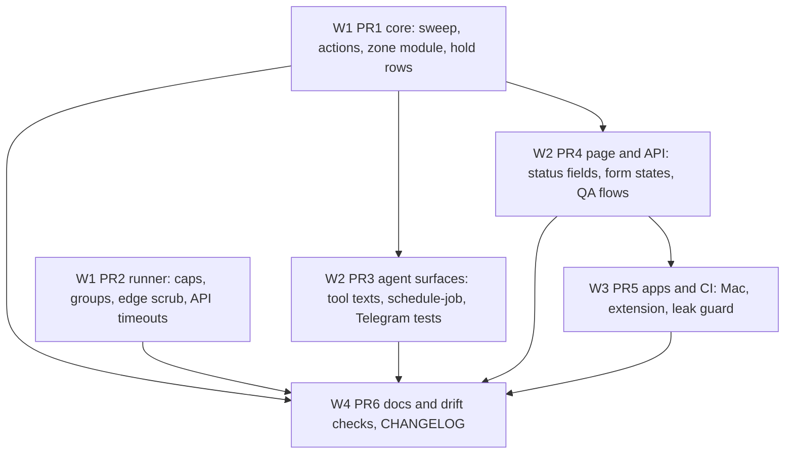
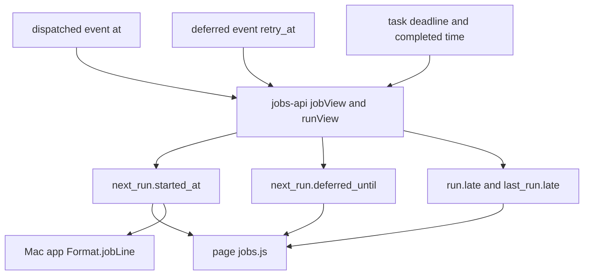

# Jobs Follow-ups - Plan

## Goal Capsule

- **Objective:** A user who runs recurring jobs gets correct runs and true status on every surface. A job never runs a replaced or removed template, a create never leaves a hidden second job, a CLI tick with no LLM adapter and the Python ticker hold rows they cannot serve instead of failing them, every surface says why a run did not start, and every limit the docs state matches the code.
- **Means:** six fix PRs grouped by area, with disjoint file sets, core first (KTD1, Sequencing).
- **Authority:** the Product Contract below decides what; the Planning Contract decides how. The v1 plan `docs/plans/2026-10-23-0925-feat-floating-recurring-jobs-plan.md` stays in force (its KTD1-KTD16 and AS1-AS15); this plan changes none of them. Binding repo rules: `CLAUDE.md` hard rules, `docs/solutions/logic-errors/floating-jobs-occurrence-sweep.md`, `docs/solutions/logic-errors/compare-and-set-task-transitions.md`, `docs/solutions/logic-errors/sleep-gap-is-not-a-dead-daemon.md`, `docs/solutions/best-practices/loopback-web-ui-hardening.md`, `docs/solutions/best-practices/dependency-free-task-ui-patterns.md`, `docs/solutions/best-practices/generated-docs-embed-and-drift-rule-with-vacuous-pass-guards.md`, `docs/solutions/developer-experience/deterministic-process-kill-tests.md`, `docs/solutions/tooling-decisions/tool-surface-shared-descriptions.md`.
- **Scope of this plan:** 93 residual items collected and ranked (Appendix). 57 are kept, 21 are cut with a reason (Scope Boundaries), 15 are already fixed on `main`. B2 counts as kept: its code part is cut, its docs caveat is kept (R24).
- **Execution profile:** 6 PRs in 4 waves (Sequencing). Each PR is opened by an Opus `ce-work` agent in its own worktree under `.worktrees/<branch>`. `pnpm qa ui` runs only in PR4, alone, after the PR3 agent stops.
- **Who ships:** each PR ends green with `ce-code-review` done. The owner merges. No PR bumps a version, cuts a release or publishes.
- **Stop conditions:** stop and report when a PR must edit a file that another PR owns (Sequencing table); when a fix needs a ledger schema change (none is planned); when a test needs the real `HOME`; when a gate fails the same way twice; when evidence shows a Key Decision cannot work.
- **Open blockers:** none. Inferred defaults are listed under Assumptions.

---

## Product Contract

### Summary

Fix the residual findings that the reviews of the jobs program (PRs #148-#160) left open. Close the core correctness gaps first: stale templates after an edit, duplicate jobs after a failed create, rows failed by hosts that cannot run them, and wrong run-now reasons. Then fix the command runner caps, the agent tool texts, the page and API status lines, the extension and Mac app status, and the docs drift checks. Cut the items that cost more than they return.

### Problem Frame

The jobs program shipped in 13 PRs. Each review left residual findings in PR bodies, in two review reports and in the owner's handoff list. The 93 entries overlap, some are already fixed, and they are spread over five sources. A few are real correctness gaps that a job owner can hit. Most are text, test and drift gaps. Without one ranked list, the gaps are fixed at random or forgotten.

### Key Decisions

- KD1. **Extension badge: option A.** The popup says "No other tasks queued." when the badge counts more tasks than the list shows, because the list hides job runs. No new `/api/summary` field. (session-settled: user-directed — chosen over option B, a new summary field that excludes job runs: option A changes no API contract.) Governs R20.
- KD2. **Agents create prompt jobs only.** No unit adds an agent path to command jobs. (session-settled: user-directed — chosen over agent-authored command jobs: the shell trust model, v1 KD10.) Governs R14, R15.
- KD3. **No release or publish steps in this batch.** (session-settled: user-directed — chosen over shipping the fixes as a release: a release is asked for each time.) Governs R24.

### Requirements

Item IDs in brackets refer to the Appendix.

**Core job correctness**

- R1. An occurrence that the sweep inserted from a template that an edit then replaced never runs. The first run after the edit uses the edited template. [A2]
- R2. A create that reports failure leaves no job behind. A retry yields exactly one job. [A5]
- R3. A paused or removed job never runs an occurrence that a sweep inserted while the action landed, also after the sweep used up its retries. A pause never cancels a run that a tick already claimed. [A3, A4]
- R4. Run now on a job that the same sweep has just auto-paused answers with the pause reason, not "no occurrence to run". [A17]
- R5. When two writers edit one job, the writer with the stale revision gets the stale-revision conflict from core, not only from the page route. [A15]
- R6. A host that cannot read the sleep counter never fails a run as interrupted when the run's dispatch carried a sleep reading. [A14]
- R7. The CLI tick with zero LLM adapters on a machine with command jobs, and the Python ticker meeting a `claude-code` row, leave the due row scheduled instead of failing it. A CLI tick with some LLM adapters still fails a row it has no adapter for, with its existing warning. [A12, A1]
- R8. The zone code has no import cycle. [A6]
- R9. The job sweep reads only live rows, so its cost does not grow with a job's history. [A10]

**Command runner**

- R10. A command stops when its tick process stops on SIGTERM, SIGINT or a normal exit. A tick ended by SIGKILL or a crash runs no handler; the docs say so (R24). [B3]
- R11. A command that fills the stdout cap and then fails still reports its stderr tail. [B6]
- R12. A vendor-shaped key that an output cut splits is scrubbed. [B5]
- R13. The LLM time cap holds for API providers, and the `llm_timeout` label comes from the adapter, not from the error text. [B9, B8]

**Agent surfaces**

- R14. The tool texts match the behavior: the `tools` default for jobs, `cancel_task series=true` on a finished run, the `check_queue_status` pointer to `tidegap_usage`, and the run id in the jobs block of `check_queue_status`. [C2, C3, C4, C5]
- R15. MCP and OpenClaw share one list of options that a job refuses and one system-zone helper, and `schedule-job.ts` has its own unit tests. [C6]

**Page and API**

- R16. The page shows "running since HH:MM" for a running job, "deferred until HH:MM" for a job whose run waits for a usage limit, and "ran late" for a run that finished after its deadline. The Mac app shows "running since HH:MM". [D8, D9]
- R17. A job form whose job was removed elsewhere turns read-only with a notice. A read-only token never sees an editable form. [D12, D17]
- R18. A late answer never overwrites a newer jobs list or a newer form state. [D13]
- R19. Key `4` opens Jobs. Back during the Discard dialog is kept. History labels queued, planned and Batch runs differently. A job id made of dots never reaches `/api/`. [D10, D18, D19, D20]

**Apps**

- R20. The extension popup says "No other tasks queued." when the badge count is larger than the listed tasks. [E6]
- R21. The Mac menu shows a Batch-submitted run as "in a provider batch, by HH:MM", the page's wording, and hides Run now for it. A recreated page window does not open an old job view again. [E3, E4]

**Docs and checks**

- R22. The jobs docs page states every limit that the code enforces (caps, retry delay, auto-pause count, scrub minimum, 60 job writes and 20 previews per minute). A drift rule fails when one of them changes in code only. [E9, E10, D6]
- R23. The drift checks fail on a missing guarantee sentence for any cadence kind, on a missing docs category heading and on a different "every night" window. They do not fail on harmless table edits. [E11, E12, C16, E8]
- R24. The docs state the honest limits: background and `setsid` children, a tick ended by SIGKILL or a crash, URL-encoded secrets, the estimated budget ceiling, the default region of job runs. `CHANGELOG.md` `[Unreleased]` lists the user-visible fixes, the two rate limits, the refused `region`/`budget`/`output` options and the mixed-version note. [B1, B2, B13, B10, C14, C1, D23, A1]

**Test gaps**

- R25. Each test gap that the Appendix keeps exists as a test or a QA step. [A11, C9, D14, D16, D22]

### Scope Boundaries

**Considered and not built** (one line on why, and what would change the call):

| Item | Why cut | What would change it |
|---|---|---|
| A7 quota resets use the job DST rule | changes shipped quota-reset results on two days a year for a reset set inside a DST gap or repeated hour; the one-hour shift only moves a deferral | a DST bug report on a quota reset |
| A8 unused `index.ts` exports | `@tidegap/core` is published; removing exports breaks outside users for no gain | a major version |
| A9 provider list copies | adding a provider is rare and each copy fails loudly (core refuses an unknown provider at save) | a sixth provider |
| B2 code part only (its docs caveat is kept, R24): `setsid` / double-fork escape | not possible on macOS without root; a descendant walk catches only part; docs caveat instead (R24) | a launchd job per command |
| B4 compare row command with the job template | the only writers of `command` rows are the sweep and the user's own ledger file; no privilege gain; R1 already rejects a stale template at adopt | a new write path for `bodyJson` |
| B7 one process-group kill helper | three call sites with different fallbacks; merging risks the channel driver for no user gain | a fourth copy |
| B12 CodeQL alert #19 | intended `sh -c` feature; dismissal is an owner action in the Security tab, not code | none |
| C7 Intl formatters in `zoneTimeLabel` | negligible cost on a 10-line list | a measured slow `/jobs` |
| C8 Telegram `cadenceText` copy of the cadence wording | styles differ on purpose and both are pinned by tests | a new cadence kind |
| C12 per-host snippets on the site | the compact install box is the site direction; the tab names `tidegap jobs snippet --host` | owner asks for a host picker |
| C13 deep link to the Agent rules tab | one extra click; the docs link the install box | owner asks |
| D2 rate limit on pause/resume/run-now | loopback only; each action is bounded by its state CAS | a report of abuse |
| D3 one helper for redacted previews | all call sites use `redactPrompt`; only the clip length differs on purpose | a new redaction rule outside `redactPrompt` |
| D11 new job defaults to prompt-only | product choice: no shell trust note on a first job | owner asks for command first |
| D15 shared drawer shell and time helpers | no defect; the job helpers use the job zone, the task helpers the viewer zone; a shared drawer rewrites the task drawer | a third drawer |
| D21 optimistic-op mechanism and error ladder | no defect; tests pin the 400/409/429 sentences | a change to those sentences |
| E1 Mac `next_job_run` not shown | the Jobs submenu already shows the next run per job | owner asks for a tooltip |
| E5 tests for the Mac app target | the app has no test target; adding one or a TidegapKit wrapper only for this is out of proportion; U10 keeps a manual check | a second app-only defect |
| E13 Ctrl-C in `build-test-count` leaves a temp dir | the temp-dir leak guard reports it on the next run | repeated leaks |
| X4 MCP `dry_run` preview for a job | rejected in #149 | owner asks |
| X6, X7 manual app checks | owner rows, not code (Swift and extension labels, the installed Mac app against a live server) | none |

**Deferred to Follow-Up Work:**

- Per-job grid region (C14 feature part): a template field, form control, CLI flag and occurrence body field. Needs its own plan. This batch only documents that job runs use the default region.

**Outside this batch:** the non-jobs sections of the handoff list (channels, region, site and Mac app follow-ups from earlier programs).

### Sources / Research

- Residual sources: the owner's handoff list ("Jobs program" section), the Follow-ups and Open decision sections of PR bodies #148-#161, and the code-review reports of #158 and #159.
- Every item was checked against `main` at 80d5db9; the Appendix records the verdict.
- Learnings applied: `docs/solutions/logic-errors/floating-jobs-occurrence-sweep.md` (sweep, adopt and stop-flag-first rules), `docs/solutions/logic-errors/sleep-gap-is-not-a-dead-daemon.md` (R6), `docs/solutions/best-practices/channels-url-policy-and-child-process-rules.md` (the shell exception, R10), `docs/solutions/best-practices/claims-audit-method.md` (numeric claims, R22).

---

## Planning Contract

### Key Technical Decisions

- KTD1. **Six PRs by area, files disjoint, core first.** PR1 core, PR2 runner, PR3 agent surfaces, PR4 page and API, PR5 apps and CI, PR6 docs and drift checks. Each file belongs to one PR (Sequencing). Reason: parallel streams that share a file cost a merge fix each time.
- KTD2. **The sweep's adopt step checks the template.** Before it adopts a live row, the sweep compares the row's run fields (runner, provider, model, prompt or command, summarize provider and model, caps, tools, cwd, secret names) with the body `occurrenceBody` gives for the current job. A mismatch cancels the row with reason `edited` and materializes a fresh one. Job occurrences carry no routing candidates, so routing never rewrites their provider or model. Raw `bodyJson` is not compared (field order and extras differ). Governs R1.
- KTD3. **`createJob` is all or nothing.** When the first sweep throws after the job row was inserted, `createJob` marks the job `removed` by CAS, cancels every pending row with that job id (reason `removed`), and rethrows. Chosen over returning the job and leaving the daemon to materialize, because the first deadline of an agent job (v1 AS9) would be lost and the caller would see success with no run. Governs R2.
- KTD4. **Every occurrence cancel in the job code is pending-only.** `cancelTask` gains an expected-status option (`queued`, `scheduled`). `cancelOccurrence` in `jobs.ts` always passes it, so pause, edit, remove, the sweep's inactive and duplicate cancels, the KTD2 `edited` cancel and the spent-retry cleanup all leave a row a tick claimed to run to its end (the v1 rule). When the sweep's CAS retries run out, it cancels the row it inserted in that pass if the job is no longer active. Governs R3.
- KTD5. **Run now re-checks the job after its own sweep.** If the sweep paused the job, run now throws the same "job is paused" refusal, with the auto-pause reason when there is one. Governs R4.
- KTD6. **`updateJob` takes an optional expected revision,** checked inside the CAS callback. A miss throws `JobActionError` with a new code `stale_revision`. The page route maps it to 409 with `code: "stale_revision"` (the body the page form already keys on), passes `body.revision` and drops its own pre-check. Only callers that pass a revision can get the new code, and the page route is the only one in this batch; the CLI `jobs edit` sends none (AS5). Governs R5.
- KTD7. **No sleep reading, a longer wall-clock bound.** In the sweep's interrupted check, a host whose `sleepNow` is absent or `null` (no counter, or a failed read) does not fail a run whose `dispatched` event carries a sleep reading until the wall age passes the occurrence's deadline plus the caps limit. Before that, a host that can read the counter decides. A run with no sleep reading keeps the v1 rule. So a dead CLI tick still frees the job on an OpenClaw-only ledger (`docs/solutions/logic-errors/sleep-gap-is-not-a-dead-daemon.md`: a failed read must never hide a dead daemon). Governs R6.
- KTD8. **Hold rows a host cannot serve.** `Scheduler.tick` gains an option to leave rows without an adapter `scheduled`. The CLI tick sets it only when it has zero LLM adapters; with some keys it keeps failing loudly, as its warning already says. The Python ticker holds `claude-code` rows the way it holds `command` rows. Governs R7.
- KTD9. **One zone module.** A new import-free `packages/core-ts/src/zone-time.ts` holds `isValidTimeZone`, `zoneOffsetMs`, `localToUtcMs` and `systemTimeZone` (with the `UTC` fallback). `quota.ts`, `job-cadence.ts` and `jobs.ts` import it, which ends the cycle. Quota conversion keeps its shipped behavior (AS2). `index.ts` keeps every current export name and adds `systemTimeZone` for PR3. Governs R8.
- KTD10. **Live-only sweep reads.** `TaskStore.list` gains a status-list filter; the sweep asks for live statuses only. Job history uses SQL order and limit. The `tasks_job_idx` index exists, so no schema change. Governs R9.
- KTD11. **Command groups die with the tick.** `run-shell.ts` tracks live process groups. On SIGTERM and SIGINT it sends TERM, waits the existing grace, then sends KILL to each. On `exit` it sends KILL at once, because exit listeners run synchronously and cannot wait. It must not remove the default signal exit of `tick --once`: when its handler is the only listener, it re-raises the signal. A tick ended by SIGKILL or a crash runs no handler; the docs say so (R24). Governs R10.
- KTD12. **The stderr tail has its own budget.** stderr keeps a rolling 4 KiB tail whatever the stdout cap has used. Governs R11.
- KTD13. **Edge scrub for vendor shapes.** At a cut end, a trailing token that starts with a known vendor prefix is dropped. The prefix list is one constant in `redact.ts` next to `DEFAULT_REDACTION_PATTERNS` and holds every prefix those patterns match (`sk-`, `ghp_`, `gho_`, `ghu_`, `ghs_`, `ghr_`, `github_pat_`, `AKIA`, `AIza`, `xox`, `Bearer `, `eyJ`, and any other the patterns add). At a cut start, a leading partial token of 16 or more token characters is dropped. The step runs inside the already-exported `scrubCutEdges`, so PR2 adds no `index.ts` export. Over-redaction of part of a word at a cut is accepted. Governs R12.
- KTD14. **API adapters honor `timeoutMs`.** Anthropic, OpenAI, Gemini and Ollama pass a per-request timeout or abort signal. Every adapter, `claude-code` included, sets `stopped_by: "llm_timeout"` in the error details on timeout, and the command adapter drops its `/timed out/` text match. Governs R13.
- KTD15. **Additive status fields in the client API.** `Job.next_run` gains `started_at` (from the occurrence's `dispatched` event) and `deferred_until` (the `retry_at` of the newest `deferred` event, while it is in the future and no later `dispatched` exists). `Run` and `last_run` gain `late` (finished after the deadline, the digest rule). `jobs-api.ts` computes them with its existing `startedAt` event helper. The spec adds them and states that clients ignore unknown keys. "ran late" names no cause. Telegram keeps "running now", because it reads the ledger without the event context. Governs R16.
- KTD16. **Read-only form states.** A job with status `removed` or `actions.edit` false opens read-only: a `role="status"` notice above the fields, fields, Save and Remove disabled, Close focused and working, typed text kept. Notice text: removed -> "This job was removed. Changes can no longer be saved."; edit not allowed -> "This token can only read jobs." The form shows a loading shell until the author probe answers; a probe error shows "Could not check your access. Close and open the job again." and no fields. Governs R17.
- KTD17. **Every local writer bumps the list sequence.** `upsertJob`, `jobAction` and `removeJob` bump the `loadJobs` sequence; `onJobFormEvent` keeps its own counter. Governs R18.
- KTD18. **Docs drift reads the constants from built code.** The rule reads `DEFAULT_JOB_CAPS`, `JOB_AUTO_PAUSE_FAILURES`, `SCRUB_MIN_LENGTH` and the retry delay (PR1 exports it) from the core build, and the job write and preview limits from the CLI build (PR4 exports the write limit next to the preview limit). Each check has a vacuous-pass guard. Governs R22.
- KTD19. **K15 checks shapes, not counts.** K15 requires one quoted guarantee sentence per cadence kind (daily with a window, weekdays, weekly, every N hours). The parameter-row match tolerates a trailing space, and the `repeat` values come from the row's leading list only. The "every night" window is read from the built tool texts and must appear verbatim in the jobs page, `defer.md`, the skill and the agent block. `check-agent-files` matches `^## <label>$` per category. Governs R23.
- KTD20. **Extension empty text from a pure helper.** A model helper takes the summary's active count and the listed row count, and returns "No other tasks queued." when the count is larger, else the current text. (session-settled: user-directed — chosen over a new summary field: option A changes no API contract.) Governs R20.
- KTD21. **Mac fixes without a new type or test target.** `isRunning` counts `submitted`, and `Format.jobLine` gets a submitted case, "in a provider batch, by HH:MM" from the run's deadline; "running since HH:MM" is for `running` only. The page-view request becomes one-shot in `AppModel`: the page coordinator reports back after it set the hash (in `didFinish` for a fresh load, or right after a direct hash set), and only then does the model clear the request; it also clears it when the connection leaves connected. The coordinator's "no view asked for" branch must tell a request cleared after apply from one cleared by Open Tidegap (`showWindow`), so a job view still waiting on the load is not dropped. The app part is verified by a manual check (E5 cut). Governs R21.

### High-Level Technical Design

Wave and dependency order of the six PRs:



Where the new status fields come from (KTD15):



### Assumptions

Inferred by planning (headless run, not confirmed by the owner):

- AS1. The owner keeps the two unrequested v1 rules: 60 job writes per minute, and the auto-pause notice replaces the failure alert of that run. This batch documents them (R22). [D6]
- AS2. Quota-reset conversion keeps its shipped DST behavior; the two converters may still differ by one hour inside a gap or repeated hour (A7 cut, KTD9).
- AS3. No export is removed from `@tidegap/core` (A8 cut).
- AS4. Tickers of mixed versions on one ledger get a docs and CHANGELOG note, not a ledger version gate. [A1]
- AS5. The CLI `jobs edit` keeps last-writer-wins (it holds no revision); the page and any client that holds a revision sends it.
- AS6. PR1-PR5 leave `CHANGELOG.md` alone; PR6 writes all `[Unreleased]` lines for the batch (v1 AS14 pattern).

### Sequencing

| Wave | PRs (parallel within a wave) | Depends on | Files owned (disjoint) |
|---|---|---|---|
| W1 | PR1 core (U1-U3) | main | `packages/core-ts/src/{jobs.ts,scheduler.ts,quota.ts,job-cadence.ts,zone-time.ts,index.ts,storage/sqlite.ts}`, `packages/cli/src/commands/tick.ts`, `packages/core-py/src/tidegap/scheduler.py`, and their tests |
| W1 | PR2 runner (U4) | main | `packages/cli/src/{jobs/run-shell.ts,providers/command.ts,providers/claude-code.ts}`, `packages/core-ts/src/{redact.ts,providers/anthropic.ts,providers/openai.ts,providers/gemini.ts,providers/ollama.ts}`, and their tests |
| W2 | PR3 agent surfaces (U5-U6) | PR1 | `packages/core-ts/src/{tool-surface.ts,schedule-job.ts}`, `packages/mcp-server/src/server.ts`, `packages/openclaw-plugin/src/index.ts`, `packages/core-ts/test/channels-commands.test.ts`, `packages/cli/test/channels-serve.test.ts`, and their tests |
| W2 | PR4 page and API (U7-U9) | PR1 | `packages/cli/src/ui/{jobs-api.ts,server.ts}`, `docs/spec/ui-client-api.md`, `packages/cli/ui/{jobs.js,job-form.js,app.js,keys.js,dialog.js,app.css}`, `scripts/qa/{ui-flows.mjs,cli-flows.mjs}`, `scripts/ui-seed.mjs`, and their tests |
| W3 | PR5 apps and CI (U10-U12) | PR4 | `apps/macos/**`, `apps/extension/src/popup/{model.js,popup.js}` and tests, `.github/workflows/macos.yml`, `scripts/test/tmp-leak-guard.mjs` and test |
| W4 | PR6 docs and drift (U13-U14) | PR1-PR5 | `scripts/qa/docs-drift.mjs`, `scripts/check-agent-files.mjs` and test, `apps/web/content/docs/10-jobs.md`, `packages/cli/README.md`, `CHANGELOG.md` |

Only PR1 edits `packages/core-ts/src/index.ts`. PR2 and PR3 use exports that exist on `main` or that PR1 adds (`systemTimeZone`, the retry delay).

Ranking (Appendix, Rank column): P1 is E6 (PR5). P2 are A1, A2, A5, A12, A14, A17 (PR1), B3, B5, B6, B9 (PR2), D8, D9, D12 (PR4), E3, E4 (PR5). The other 41 kept items are P3. If the batch must shrink, drop P3 items first; every P1 and P2 item stays.

Shared generated files (README test-count block, `apps/web/src/lib/tests.generated.ts`, `apps/web/src/lib/docs.generated.ts`, `apps/web/public/llms-full.txt`) change in several PRs. On conflict: take main's version, run the generator, commit (`docs/solutions/workflow-issues/generated-test-counts-merge-conflict.md`). `pnpm qa ui` runs only for PR4, alone, after the PR3 agent stops.

Branches: `fix/jobs-core`, `fix/jobs-runner`, `fix/jobs-agent-surfaces`, `fix/jobs-page`, `fix/jobs-apps`, `docs/jobs-follow-ups`.

---

## Implementation Units

| U-ID | Title | Key files | PR | Depends on |
|---|---|---|---|---|
| U1 | Sweep and job action correctness | `packages/core-ts/src/{jobs.ts,scheduler.ts,storage/sqlite.ts}` | PR1 | - |
| U2 | Zone module and DST vectors | `packages/core-ts/src/{zone-time.ts,quota.ts,job-cadence.ts}` | PR1 | - |
| U3 | Hold rows a host cannot serve | `packages/core-ts/src/scheduler.ts`, `packages/cli/src/commands/tick.ts`, `packages/core-py/src/tidegap/scheduler.py` | PR1 | U1 |
| U4 | Command runner caps, groups, scrub, timeouts | `packages/cli/src/jobs/run-shell.ts`, `packages/cli/src/providers/command.ts`, `packages/core-ts/src/redact.ts` | PR2 | - |
| U5 | Agent tool texts and job tool helpers | `packages/core-ts/src/{tool-surface.ts,schedule-job.ts}`, `packages/mcp-server/src/server.ts` | PR3 | U2 |
| U6 | Telegram `/jobs` tests | `packages/core-ts/test/channels-commands.test.ts`, `packages/cli/test/channels-serve.test.ts` | PR3 | U1 |
| U7 | Job API status fields and revision | `packages/cli/src/ui/jobs-api.ts`, `docs/spec/ui-client-api.md` | PR4 | U1 |
| U8 | Page job list and form fixes | `packages/cli/ui/{jobs.js,job-form.js,app.js,keys.js}` | PR4 | U7 |
| U9 | QA flows and seed script | `scripts/qa/{ui-flows.mjs,cli-flows.mjs}`, `scripts/ui-seed.mjs` | PR4 | U8 |
| U10 | Mac app status and page view | `apps/macos/TidegapKit/Sources/TidegapKit/*`, `apps/macos/Tidegap/*` | PR5 | U7 |
| U11 | Extension empty text | `apps/extension/src/popup/{model.js,popup.js}` | PR5 | - |
| U12 | Leak guard and macOS CI paths | `scripts/test/tmp-leak-guard.mjs`, `.github/workflows/macos.yml` | PR5 | - |
| U13 | Drift checks | `scripts/qa/docs-drift.mjs`, `scripts/check-agent-files.mjs` | PR6 | U1, U7 |
| U14 | Docs text, README, CHANGELOG | `apps/web/content/docs/10-jobs.md`, `packages/cli/README.md`, `CHANGELOG.md` | PR6 | U1-U12 |

### U1. Sweep and job action correctness

- **Goal:** the sweep and the job actions never run a stale, removed or duplicate occurrence, and run now gives the true reason.
- **Requirements:** R1, R2, R3, R4, R5, R6, R9, R25 (A11 core gaps, C9 corrupt-template resume).
- **Dependencies:** none.
- **Files:**
  - Modify: `packages/core-ts/src/jobs.ts`, `packages/core-ts/src/scheduler.ts` (`cancelTask` expected-status option), `packages/core-ts/src/storage/sqlite.ts` (status-list filter), `packages/core-ts/src/index.ts` (export the retry delay for KTD18).
  - Test: `packages/core-ts/test/jobs-sweep.test.ts`, `packages/core-ts/test/jobs.test.ts`, `packages/core-ts/test/jobs-store.test.ts`.
- **Approach:**
  1. Adopt check (KTD2), then all-or-nothing create (KTD3).
  2. Pending-only cancel for job actions and the cleanup after spent retries (KTD4).
  3. Run-now re-check (KTD5) and expected revision (KTD6).
  4. Interrupted check without a sleep reading (KTD7).
  5. Live-only reads and SQL-limited history (KTD10).
- **Patterns to follow:** the pause-race test at the existing stop-flag-first case in `jobs-sweep.test.ts`; the CAS helpers in `docs/solutions/logic-errors/compare-and-set-task-transitions.md`.
- **Test scenarios:**
  - An edit lands while the sweep awaits the forecast after its insert (patch `insertIfAbsent` to call `updateJob`) -> the inserted row is cancelled with reason `edited`, and the live row carries the new prompt.
  - The same race with an edit that changes only the model -> the inserted row is cancelled with reason `edited`, and the live row carries the new model.
  - An edit that changes only the title during the same race -> the inserted row is adopted.
  - `insertIfAbsent` throws once during `createJob` -> `createJob` rejects, `listJobs` shows no active job, and a second `createJob` yields exactly one live job.
  - `updateJobIf` throws after a successful insert during `createJob` -> `createJob` rejects, the inserted row is `cancelled`, and a retry yields exactly one live occurrence.
  - Pause while a tick holds the row as `running` -> the row finishes `completed` and no successor is made.
  - The sweep's duplicate cancel meets a row a tick claimed between its read and its cancel -> the row stays `running`.
  - `updateJobIf` misses three times and the job turns `removed` during the third -> the row inserted in that pass is cancelled.
  - The third slot fails, no sweep runs, then `runJobNow` -> it throws the "job is paused" refusal with the auto-pause reason.
  - `updateJob` with the current expected revision, or with none -> applied.
  - A `dispatched` event with a sleep reading, `sweepJobs` called without `sleepNow` (and again with `sleepNow: null`), wall age past the caps but before deadline plus caps -> the row stays `running`.
  - The same case with wall age past deadline plus caps -> the row fails as interrupted.
  - The same case with `sleepNow` and no sleep in between -> the row fails as interrupted at the caps limit (unchanged v1 behavior).
  - `updateJob` with a stale expected revision -> `JobActionError` with code `stale_revision`.
  - A job with 200 finished rows -> the sweep asks the store for live statuses only, and history returns the newest 20.
  - A corrupt template row among two jobs -> the sweep skips it and still sweeps the other job.
  - `resumeJob` on a corrupt-template job -> refused.
  - `createJob` input checks: bad `originHost`, past `deadline`, unknown or non-positive cap, bad `notify`, empty `title`, bad `tools` -> each refused with its sentence.
- **Verification:** the scenarios pass; the existing `jobs-sweep`, `jobs` and `series` tests pass unchanged.

### U2. Zone module and DST vectors

- **Goal:** no import cycle between quota and job code, and DST vectors for the job cadence math.
- **Requirements:** R8, R25 (A11 vector gaps).
- **Dependencies:** none (same PR as U1; `index.ts` is edited once in that PR).
- **Files:**
  - Create: `packages/core-ts/src/zone-time.ts`.
  - Modify: `packages/core-ts/src/quota.ts`, `packages/core-ts/src/job-cadence.ts`, `packages/core-ts/src/jobs.ts` (its `systemTimeZone` moves to the zone module), `packages/core-ts/src/index.ts` (keep current exports, add `systemTimeZone`).
  - Test: `packages/core-ts/test/quota.test.ts`, `packages/core-ts/test/job-cadence.test.ts`, `packages/core-ts/test/fixtures/job-cadence-vectors.json`.
- **Approach:** move the helpers (KTD9) and keep the old export names from `index.ts`. Quota conversion code stays as it is (AS2).
- **Test scenarios:**
  - The existing quota tests pass unchanged.
  - New vectors: a negative-offset zone (America/New_York) across spring and fall, a `weekly` job across a DST end, a `weekdays` job across a DST start.
  - `systemTimeZone` with an empty resolved zone -> `UTC`.
- **Verification:** the cycle is gone (no import from `jobs.ts` into the zone module chain); all vector tests pass.

### U3. Hold rows a host cannot serve

- **Goal:** queued work waits instead of failing on a host that cannot run it.
- **Requirements:** R7.
- **Dependencies:** U1 (same file `scheduler.ts`, same PR).
- **Files:**
  - Modify: `packages/core-ts/src/scheduler.ts` (hold option), `packages/cli/src/commands/tick.ts`, `packages/core-py/src/tidegap/scheduler.py`.
  - Test: `packages/cli/test/jobs-tick.test.ts`, `packages/core-py/tests/test_jobs_ledger.py`.
- **Approach:** KTD8. The CLI computes its LLM adapter count before it adds `command`, as today, and passes the hold option when the count is zero. Python widens its held-row check from `command` to the runners only TS serves.
- **Test scenarios:**
  - A command job exists, no LLM key, no `claude`, and a due `anthropic` task -> the task stays `scheduled` with no `failed` event; the command occurrence still runs.
  - The same with an Anthropic key and a due `openai` task -> the task fails with the existing "no adapter" message (unchanged).
  - Python ticker with a due `claude-code` job occurrence -> the row stays `scheduled` (clone of the existing `command` case).
- **Verification:** the scenarios pass; `pytest` and `ruff` pass in `packages/core-py`.

### U4. Command runner caps, groups, scrub, timeouts

- **Goal:** the caps the docs promise hold for every run.
- **Requirements:** R10, R11, R12, R13.
- **Dependencies:** none (W1, beside PR1; no `index.ts` edit).
- **Files:**
  - Modify: `packages/cli/src/jobs/run-shell.ts`, `packages/cli/src/providers/command.ts`, `packages/cli/src/providers/claude-code.ts`, `packages/core-ts/src/redact.ts`, `packages/core-ts/src/providers/anthropic.ts`, `packages/core-ts/src/providers/openai.ts`, `packages/core-ts/src/providers/gemini.ts`, `packages/core-ts/src/providers/ollama.ts`.
  - Test: `packages/cli/test/jobs-runner.test.ts`, `packages/cli/test/tick-claude-code.test.ts`, `packages/core-ts/test/redact.test.ts`, `packages/core-ts/test/providers.test.ts`, `packages/core-ts/test/providers-gemini-ollama.test.ts`.
- **Approach:** KTD11, KTD12, KTD13, KTD14, in that order.
- **Execution note:** kill tests poll for the process to be gone, never sleep a fixed time (`docs/solutions/developer-experience/deterministic-process-kill-tests.md`).
- **Test scenarios:**
  - A child node process calls `runShell` with a long command, then gets SIGTERM -> the command's group is gone and the child exits with the signal.
  - The same child exits normally while a command that traps TERM still runs -> the group is gone (KILL on exit).
  - A command prints past the stdout cap, then writes "fatal: auth" to stderr and exits 1 -> the error carries "fatal: auth".
  - For each prefix in the vendor prefix constant: a key cut one character short of its full-pattern length at the output end -> the fragment is `[redacted]`.
  - A stderr tail that starts with 20 token characters of a key -> the leading token is dropped.
  - A short ordinary word at a cut edge -> kept.
  - A fake Anthropic client that never resolves, `timeoutMs` 50 -> rejects within the bound with `stopped_by: "llm_timeout"`; the same for OpenAI, Gemini and Ollama.
  - A model error whose text contains "timed out" but is not a timeout -> no `llm_timeout` label.
- **Verification:** the scenarios pass; the existing runner, scrub and kill tests pass.

### U5. Agent tool texts and job tool helpers

- **Goal:** agents read tool texts that match behavior, and both hosts refuse the same job options.
- **Requirements:** R14, R15, R25.
- **Dependencies:** U2 merged (`systemTimeZone` in the zone module).
- **Files:**
  - Modify: `packages/core-ts/src/tool-surface.ts`, `packages/core-ts/src/schedule-job.ts`, `packages/mcp-server/src/server.ts`, `packages/openclaw-plugin/src/index.ts`.
  - Create: `packages/core-ts/test/schedule-job.test.ts`.
  - Test: `packages/core-ts/test/tool-surface.test.ts` and its snapshot, `packages/mcp-server/test/server.jobs.test.ts`, `packages/openclaw-plugin/test/tool-surface-derivation.test.ts`.
- **Approach:**
  1. Texts: the `tools` param says a job stores its tools at creation and ignores `TIDEGAP_CLAUDE_TOOLS`; `cancel_task` says `series=true` still ends the job or series of a finished task; `check_queue_status` adds "or for limits (use tidegap_usage)". Stay inside the per-tool length cap (`docs/solutions/tooling-decisions/tool-surface-shared-descriptions.md`).
  2. `check_queue_status` job lines append `run=<id>` when a next run exists.
  3. Keep one private refused-option list in `schedule-job.ts`. The already-exported `jobUnsupportedRefusal` applies it to the call's arguments; MCP and OpenClaw drop their inline lists. `schedule-job.ts` uses the `systemTimeZone` that PR1 exports and the existing weekday list. PR3 makes no `index.ts` edit.
- **Test scenarios:**
  - `schedule-job.ts`: each `repeat` value maps to its cadence; `weekly` with no `days` takes the weekday of the call in the job zone; a bad day name, a bad zone and a `command` argument are refused with their sentences.
  - MCP and OpenClaw refuse `region` on a job with the same sentence.
  - `check_queue_status` with a job that has a pending run -> the line holds `run=<that id>`.
  - Snapshot: only the three texts changed; every text is under its cap.
- **Verification:** the scenarios pass; `pnpm qa mcp` passes.

### U6. Telegram `/jobs` tests

- **Goal:** the `/jobs` edge cases are pinned by tests.
- **Requirements:** R4, R25 (C9).
- **Dependencies:** U1 merged.
- **Files:**
  - Test: `packages/core-ts/test/channels-commands.test.ts`, `packages/cli/test/channels-serve.test.ts`.
- **Approach:** tests only, no source change. If a test exposes a defect, fix it in this PR only when the fix stays in `packages/core-ts/src/channels/`; otherwise stop and report.
- **Test scenarios:**
  - `/jobs` with jobs in America/Los_Angeles on 2026-11-01, a next run at local midnight, and an invalid stored zone -> labels use the job zone, the midnight run reads as the next day, the invalid zone falls back to the system zone.
  - `/jobs`, then `/cancel 1` and `/run 1` -> they refer to the task list, not the jobs list, and say so.
  - `/jobs run <n>` after a third failure and before a sweep -> the reply carries the paused wording (R4).
  - `/jobs pause 1` from an unpaired chat -> no reply and no state change.
- **Verification:** the scenarios pass; `pnpm qa telegram` passes.

### U7. Job API status fields and revision

- **Goal:** clients can say since when a job runs, until when it waits, and whether a run was late.
- **Requirements:** R5, R16, R22.
- **Dependencies:** U1 merged.
- **Files:**
  - Modify: `packages/cli/src/ui/jobs-api.ts` (fields, revision pass-through, remove unused `DEFAULT_CAPS_VIEW`, export the write limit beside `JOB_PREVIEWS_PER_MINUTE`), `packages/cli/src/ui/server.ts` (import the write limit), `docs/spec/ui-client-api.md`.
  - Test: `packages/cli/test/ui-jobs-api.test.ts`.
- **Approach:** KTD15 for the fields, KTD6 for the revision (map the core `stale_revision` code to 409 with `code: "stale_revision"` in the route's refusal mapping). Update the spec's `Job` example, the `next_run` bullet, the `Run` list and one sentence that clients ignore unknown keys.
- **Test scenarios:**
  - A running occurrence with a `dispatched` event at 21:40 -> `next_run.started_at` is that instant; a scheduled one -> `null`.
  - A pending occurrence with a `deferred` event whose `retry_at` is in the future -> `deferred_until` is that time; past `retry_at` or a later `dispatched` -> `null`.
  - A run completed after its deadline -> `late: true`; before -> `false`; `last_run` matches.
  - Update with a stale revision -> 409 with `code: "stale_revision"` (unchanged answer, now from core).
  - Write and preview limits keep their numbers (60 and 20 per minute).
- **Verification:** the scenarios pass; the spec matches the answer shape.

### U8. Page job list and form fixes

- **Goal:** the Jobs view shows true status and never edits a dead or stale job.
- **Requirements:** R16, R17, R18, R19, R25 (D14, D22).
- **Dependencies:** U7.
- **Files:**
  - Modify: `packages/cli/ui/jobs.js`, `packages/cli/ui/job-form.js`, `packages/cli/ui/app.js` (export the route parser), `packages/cli/ui/keys.js`, `packages/cli/ui/dialog.js`, `packages/cli/ui/app.css` (tone classes if a new label needs one).
  - Test: `packages/cli/test/ui-jobs.test.ts`, `packages/cli/test/ui-job-form-controller.test.ts`, `packages/cli/test/ui-jobs-actions.test.ts`, `packages/cli/test/ui-job-form.test.ts`.
- **Approach:**
  1. Status lines, in the job zone (KTD15). The next part of a row takes the first that applies: running ("running since HH:MM", or "running now" without `started_at`) > submitted ("in a provider batch, by HH:MM", unchanged) > `deferred_until` set ("deferred until HH:MM") > overdue > retry planned > via Batch > next. "ran late" is appended to the last part ("last: ok, 21:40, ran late") for completed and failed runs, and to the outcome word of a History row.
  2. Read-only form states (KTD16).
  3. Sequence guards (KTD17).
  4. Key `4`, help text "1 2 3 4"; Discard navigates only if the address is still the one it set; history words `queued`, `planned`, `in a provider batch`; the route parser treats a dot-only id as unknown.
- **Patterns to follow:** `docs/solutions/best-practices/dependency-free-task-ui-patterns.md` (text-only `h()`, `Object.hasOwn`), the existing `loadJobs` sequence guard.
- **Test scenarios:**
  - `jobTime` on 2026-10-25 Europe/Kyiv and 2026-11-01 America/Los_Angeles -> correct day words and times.
  - A row with `started_at` -> "running since 21:40"; with `deferred_until` -> "deferred until 07:00"; a late completed run -> "last: ok, 21:40, ran late".
  - A row with `deferred_until` 07:00 and a `scheduled_for` already in the past -> "deferred until 07:00", not the overdue line.
  - The open form gets a job event with status `removed` -> the removed notice shows, fields, Save and Remove are disabled, typed text is kept, Close is focused and works.
  - The author probe answers 403 -> no editable form is ever rendered; it answers 500 -> the "Could not check your access" line and no fields.
  - Two `api.job` answers resolve out of order on a clean form -> the newer one wins.
  - `loadJobs` starts, `jobAction` finishes, then the old list answers -> the action's row stays.
  - Key `4` -> Jobs view.
  - Back pressed while the Discard dialog is open, then Discard -> the address stays where Back put it.
  - Route parser: `#/jobs/.`, `#/jobs/..`, `#/jobs/..%2F` -> unknown id; `#/jobs/a~1` -> job route.
  - Preview debounce with fake timers: two edits inside 500 ms -> one preview call; an older answer after a newer one -> dropped.
  - `renderJobs` with a paused row and the daemon banner -> Resume button and banner in the DOM.
  - `/api//jobs/preview` and `/api/jobs//preview` -> same scope and limit as the plain path (in `ui-jobs-api.test.ts`).
- **Verification:** the scenarios pass.

### U9. QA flows and seed script

- **Goal:** the negative page paths run in a real browser, and the QA scripts clean up after a failure.
- **Requirements:** R25 (D16, D22, D5, E14).
- **Dependencies:** U8.
- **Files:**
  - Modify: `scripts/qa/ui-flows.mjs`, `scripts/qa/cli-flows.mjs`, `scripts/ui-seed.mjs`.
- **Approach:**
  1. New steps after S15.8: a 409 then Reload with the form open (a CLI `jobs edit` bumps the revision); Discard on a dirty Esc; a refused row action (run now on a running job); the page opened at `#token=...&view=jobs/<id>` with a `macos` token.
  2. S15.5 checks the queued run on the server after Run now, not only the toast.
  3. S20 removes its jobs and secret in `finally`.
  4. `ui-seed.mjs --serve` registers its exit cleanup right after it creates the temp dir.
- **Test expectation:** the QA steps are the tests; `pnpm qa ui` and `pnpm qa cli` run them.
- **Verification:** `pnpm qa ui` (alone) and `pnpm qa cli` pass with the new steps.

### U10. Mac app status and page view

- **Goal:** the Mac menu tells the truth about Batch runs and run start, and the page window opens where the user asked last.
- **Requirements:** R16, R21.
- **Dependencies:** U7 merged.
- **Files:**
  - Modify: `apps/macos/TidegapKit/Sources/TidegapKit/Models.swift` (`isRunning`, `startedAt`), `apps/macos/TidegapKit/Sources/TidegapKit/Format.swift` (running and submitted lines), `apps/macos/Tidegap/AppModel.swift`, `apps/macos/Tidegap/WebPageWindow.swift`.
  - Test: `apps/macos/TidegapKit/Tests/TidegapKitTests/FormatTests.swift`, `apps/macos/TidegapKit/Tests/TidegapKitTests/ModelsTests.swift`.
- **Approach:** KTD21.
- **Test scenarios:**
  - A job whose next run is `submitted` with a deadline at 06:00 -> `isRunning` true, line "in a provider batch, by 06:00", no Run now.
  - A running run with `started_at` 21:40 -> "running since 21:40"; an old server without the key -> "running now".
  - Manual (app, no test target): Edit on page from the Jobs submenu opens the job form on a fresh window; after a reconnect the window opens the Agenda, not the old job form; Open Tidegap opens the Agenda.
- **Verification:** `swift test` reports "Test run with N tests ... passed"; the Xcode app target builds; the manual steps pass against a sandbox server.

### U11. Extension empty text

- **Goal:** the popup count and text agree.
- **Requirements:** R20.
- **Dependencies:** none.
- **Files:**
  - Modify: `apps/extension/src/popup/model.js`, `apps/extension/src/popup/popup.js`.
  - Test: `apps/extension/test/popup.test.js`, `apps/extension/test/popup-ui.test.js`.
- **Approach:** KTD20; `popup.html` keeps its default text.
- **Test scenarios:**
  - Active 1, listed 0 -> "No other tasks queued."
  - Active 0, listed 0 -> the current "No tasks queued. Ask your agent to schedule one."
  - Active 3, listed 3 -> list shown, empty text hidden.
  - Rendered popup with one job run queued and no other task -> the new text is in the DOM.
- **Verification:** `node --test` in `apps/extension`, the extension build and lint pass.

### U12. Leak guard and macOS CI paths

- **Goal:** the leak guard sees our own lock files, and the macOS job runs when the guard changes.
- **Requirements:** R25 (E15, E16).
- **Dependencies:** none.
- **Files:**
  - Modify: `scripts/test/tmp-leak-guard.mjs`, `.github/workflows/macos.yml` (add `scripts/test/**` to both path lists).
  - Test: `scripts/test/tmp-leak-guard.test.mjs`.
- **Approach:** narrow the `.lock` ignore to the names Swift and Xcode create (confirm the names from a local `swift test` run's TMPDIR); count every other `tidegap*.lock`.
- **Test scenarios:**
  - A Swift build lock name -> ignored.
  - `tidegap-x.lock` -> counted.
- **Verification:** the guard test passes; the macOS workflow runs on this PR.

### U13. Drift checks

- **Goal:** the docs cannot drift from the code on limits, guarantee shapes, the night window or category headings.
- **Requirements:** R22, R23.
- **Dependencies:** U1 and U7 merged (exported constants).
- **Files:**
  - Modify: `scripts/qa/docs-drift.mjs` (K15 or a new rule), `scripts/check-agent-files.mjs` (export a missing-categories helper).
  - Test: `scripts/check-agent-files.test.mjs`.
- **Approach:** KTD18 and KTD19. Every new check gets a vacuous-pass guard (`docs/solutions/best-practices/generated-docs-embed-and-drift-rule-with-vacuous-pass-guards.md`).
- **Test scenarios:**
  - Mutation: change "5 minutes" to "6 minutes" on the jobs page -> the rule fails; restore -> pass. The same for the 1 USD, 10 MiB, 200 KiB, 30-minute, three-slot, 4-character, 60 and 20 per-minute claims.
  - Delete the every-N-hours guarantee sentence -> K15 fails.
  - Add a trailing space after the `repeat` row's closing pipe, or a backticked cross-reference in that row -> K15 passes.
  - Change the night window in `defer.md` only -> the rule fails.
  - `missingCategories` with a body that says "Jobs page" but has no `## Jobs` -> reports `Jobs`.
- **Verification:** `node scripts/qa/docs-drift.mjs` passes on the final tree; each mutation fails as listed (proof in the PR body).

### U14. Docs text, README, CHANGELOG

- **Goal:** the docs state every enforced limit and every honest caveat, and the CHANGELOG lists the batch.
- **Requirements:** R22, R24.
- **Dependencies:** U1-U12 merged or final (CHANGELOG lines describe them).
- **Files:**
  - Modify: `apps/web/content/docs/10-jobs.md`, `packages/cli/README.md` (Jobs in the `tidegap ui` view list), `CHANGELOG.md` (`[Unreleased]` only).
  - Regenerate: `pnpm gen:docs`, `pnpm gen:tests`.
- **Approach:**
  1. Jobs page: the 60 job writes and 20 previews per minute; "the summarize budget is an estimated ceiling"; a background child keeps running after a normal exit, a child that leaves the process group with `setsid` is not stopped at the cap, and a tick ended by SIGKILL or a crash leaves its running command alive until the command ends; "base64 or URL-encoded"; job runs use the default region; mixed-version note (upgrade every ticker that shares the ledger before you add command jobs).
  2. CHANGELOG `[Unreleased]`: one `### Fixed` line per PR1-PR5 user-visible fix, the two rate limits, the refused `region`/`budget`/`output` options for repeating defers, the new client API fields.
- **Test expectation:** none beyond U13's drift rules and `pnpm gen:docs:check`.
- **Verification:** the gate passes; the public-repo hygiene grep finds nothing new (`docs/solutions/workflow-issues/public-repo-hygiene.md`).

---

## Verification Contract

**Gate (every PR, from the worktree root):**

```bash
pnpm build && pnpm typecheck && pnpm gen:tests:check && pnpm gen:docs:check && node scripts/qa/docs-drift.mjs
```

A new worktree runs `pnpm build` before typecheck and tests. PR1 creates its own Python venv (`docs/solutions/developer-experience/worktree-environment-setup.md`). Logs are read with `grep -nE "✘|Error|expected" <log> | head -40`, never whole. One re-run, then report.

| PR | Units | Unit tests | QA area (sandbox `HOME`) | Proof the agent returns |
|---|---|---|---|---|
| PR1 | U1-U3 | `pnpm --filter @tidegap/core test`; `pnpm --filter @tidegap/cli test`; `cd packages/core-py && .venv/bin/python -m pytest && .venv/bin/ruff check .` | `pnpm qa cli` (regression) | gate `PASS`; new test names passing; DST vector count with 0 failures |
| PR2 | U4 | `pnpm --filter @tidegap/cli test`; `pnpm --filter @tidegap/core test` | `pnpm qa cli` (regression) | gate `PASS`; kill-test and edge-scrub test names passing |
| PR3 | U5-U6 | `pnpm --filter @tidegap/core test`; `pnpm --filter @tidegap/mcp test`; `pnpm --filter @vitalini/tidegap test`; `pnpm --filter @tidegap/cli test` | `pnpm qa mcp`; `pnpm qa telegram` | gate `PASS`; snapshot diff summary with text lengths; QA run ids |
| PR4 | U7-U9 | `pnpm --filter @tidegap/cli test` | `pnpm qa cli`; `pnpm qa ui` alone, after the PR3 agent stops | gate `PASS`; `qa ui` run id; screenshots in the session scratchpad |
| PR5 | U10-U12 | `cd apps/macos/TidegapKit && swift test`; `node --test` in `apps/extension`; extension build and lint; `node --test scripts/test/tmp-leak-guard.test.mjs` | - (U10 manual steps against a sandbox server) | gate `PASS`; the "Test run with N tests ... passed" line; Xcode build result; manual step results |
| PR6 | U13-U14 | `node --test scripts/check-agent-files.test.mjs`; `pnpm --filter ./apps/web test` | `pnpm qa docs` | gate `PASS`; drift mutation results (fail, then pass after restore); hygiene grep result |

Every PR body states what changed, the units and R-IDs covered, the item IDs closed (Appendix), the gate output line, and "no version bump" (PR1-PR6) and "no CHANGELOG change" (PR1-PR5).

---

## Definition of Done

- Every unit's test scenarios exist as tests or QA steps and pass.
- Every kept Appendix item is closed by a named unit; every cut item keeps its line in Scope Boundaries.
- Existing jobs, series, scheduler and channel tests pass unchanged, except where a scenario above states a new answer.
- No test reads or writes the real `~/.tidegap`, `~/.claude` or `~/.config/tidegap`.
- No secret value appears in any committed file, test output, QA log or API answer.
- No generated file is hand-edited; `pnpm gen:tests:check` and `pnpm gen:docs:check` pass on every PR.
- `docs/spec/ui-client-api.md` matches the API answer after PR4.
- Commits follow Conventional Commits (`fix(core): ...`, `fix(cli): ...`, `fix(mcp): ...`, `fix(ui): ...`, `fix(macos): ...`, `fix(extension): ...`, `docs: ...`), run with `git -c core.editor=true -c sequence.editor=true`; review fixes are folded into their commits.
- No PR bumps a version, cuts a release or publishes; `pnpm check:versions` passes.
- Each PR is green with `ce-code-review` done; the owner merges.
- Abandoned-attempt code and unused helpers are removed from each diff.
- After PR6: `ce-compound` records the learnings this batch produced.

---

## Appendix

### Residual items

Sources: **HL** = the owner's handoff list, "Jobs program" section (with the PR review it came from); **#N** = the Follow-ups or Open decision section of PR #N; **R158**, **R159** = the code-review reports of #158 and #159; **Brief** = the batch request. Verdicts are for `main` at 80d5db9. Rank, by user-visible value and risk: **P1** user-visible wrong state or text that most users with jobs meet; **P2** a correctness edge a job owner can hit (wrong run, lost run, wrong reason, broken cap); **P3** text, test, drift or maintainability. Decision: a unit, **cut** (Scope Boundaries) or **fixed** (closed on `main`, nothing to do).

| ID | Source | Item | Verdict | Rank | Decision |
|---|---|---|---|---|---|
| A1 | HL (#148) | Old binaries and the Python ticker fail `command` / `claude-code` job rows they cannot run | partial: Python fails `claude-code` rows | P2 | U3, U14 note |
| A2 | HL (#148) | Edit vs sweep: stale template adopted | open | P2 | U1 |
| A3 | HL (#148) | Pause vs a row a tick already claimed | partial | P3 | U1 |
| A4 | HL (#148) | Removed job orphan after 3 missed writes | open | P3 | U1 |
| A5 | HL (#148) | Sweep error after `createJob`: retry duplicates the job | open | P2 | U1 |
| A6 | HL (#148) | Import cycle quota -> jobs -> job-cadence -> quota | open | P3 | U2 |
| A7 | HL (#148) | Two local-to-UTC converters differ on DST gap | open | P3 | cut |
| A8 | HL (#148) | Unused `index.ts` exports | partial | P3 | cut |
| A9 | HL (#148) | Third copy of the LLM provider list | open | P3 | cut |
| A10 | HL (#148) | Sweep reads whole history per tick | open | P3 | U1 |
| A11 | HL (#148) | Test gaps: negative-offset zone, weekly/weekdays DST, corrupt row in sweep, `updateJob` `window: null`, `createJob` input checks | partial (`window: null` covered by CLI and UI tests) | P3 | U1, U2 |
| A12 | HL (#150) | Pending prompt task fails on a machine with command jobs and no LLM adapter | open | P2 | U3 |
| A13 | HL (#150) | Sleep-reading check written 3 times | fixed (shared `sleepReadNeeded`) | - | fixed |
| A14 | HL (#150), #150 | OpenClaw ticker uses wall-clock age for interrupted runs | open | P2 | U1 |
| A15 | HL (#152), Brief | Core `updateJob` has no expected revision | open | P3 | U1, U7 |
| A16 | HL (#148) | PR1 residuals: sweep after tick, awake-time interrupt, readiness counts command rows | fixed | - | fixed |
| A17 | HL (#151), Brief | `/jobs run` right after a third failure gives "no occurrence to run" | open (core `runJobNow`) | P2 | U1, U6 |
| B1 | HL (#150) | Background children after a normal exit are not killed | not a bug (by design); docs line | P3 | U14 |
| B2 | HL (#150), Brief | `setsid` / `nohup` children escape the group | partial (`nohup` stays in the group) | P3 | code cut; U14 caveat |
| B3 | HL (#150) | Tick killed mid-run orphans its command group | open | P2 | U4 |
| B4 | HL (#150) | Adapter runs the row's command without comparing it to the template | open | P3 | cut |
| B5 | HL (#150), Brief | Vendor key shapes cut at an edge are not scrubbed | partial (named values handled) | P2 | U4 |
| B6 | HL (#150) | stdout and stderr share one cap | open | P2 | U4 |
| B7 | HL (#150) | Process-group kill in 3 places | open | P3 | cut |
| B8 | HL (#150) | `llm_timeout` detected by `/timed out/` | open | P3 | U4 |
| B9 | HL (#150) | API summarize steps ignore `llmTimeoutMs` | open | P2 | U4 |
| B10 | HL (#150) | 1 USD cap is soft for expensive-output models | partial (estimate by design) | P3 | U14 wording |
| B11 | HL (#151) | `pauseReason` may carry an unscrubbed command error line | fixed (scrubbed at source) | - | fixed |
| B12 | HL | CodeQL alert #19 on `run-shell.ts` | open (alert still open) | P3 | cut (owner action) |
| B13 | #150, Brief | Exact-value scrubbing misses encoded forms; trust model and Files & Folders docs | mostly fixed; URL-encoding not named | P3 | U14 |
| C1 | HL (#149) | `/tidegap:defer --repeat` with `--region`/`--budget`/`--output` now refused | fixed in `defer.md`; CHANGELOG silent | P3 | U14 |
| C2 | HL (#149), Brief | Job default tools ignore `TIDEGAP_CLAUDE_TOOLS` although the text says it overrides | open | P3 | U5 |
| C3 | HL (#149) | `check_queue_status` jobs block shows no run id | open | P3 | U5 |
| C4 | HL (#149), Brief | `cancel_task` text vs `series=true` ending the job | open | P3 | U5 |
| C5 | HL (#149), Brief | `check_queue_status` lost its `tidegap_usage` sibling clause | open | P3 | U5 |
| C6 | HL (#149) | Long `scheduleJob`, per-host refused-option lists, duplicate weekday list and `systemTimeZone`, no `schedule-job.ts` test | open | P3 | U5 |
| C7 | HL (#151) | `zoneTimeLabel` builds several Intl formatters per label | open | P3 | cut |
| C8 | HL (#151) | `cadenceText` duplicates the cadence wording | open | P3 | cut |
| C9 | HL (#151), #151, Brief | Missing `/jobs` tests: DST, midnight, invalid zone; numbers vs `/cancel` and `/run`; corrupt-template resume; unpaired chat | open | P3 | U6, U1 |
| C10 | HL (#148), #151 | QA step S5.15 should use `tidegap jobs add` | fixed | - | fixed |
| C11 | HL (#155) | `schedule_task` "every night" window | fixed (22:00-08:00) | - | fixed |
| C12 | HL (#155) | Site tab shows the generic block only | partial (product choice) | P3 | cut |
| C13 | HL | Jobs docs have no anchor to the Agent rules tab | open | P3 | cut |
| C14 | #149 | Job runs use the default region | open (feature) | P3 | deferred; U14 sentence |
| C15 | #151 | Job titles in results and the digest Jobs section | fixed | - | fixed |
| C16 | R159 | "every night" claim not drift-checked | partial | P3 | U13 |
| D1 | HL (#152) | Preview route needs its own limit | fixed (20 per minute) | - | fixed |
| D2 | HL (#152) | Pause/resume/run-now routes have no rate limit | open | P3 | cut |
| D3 | HL (#152) | Redacted preview logic in 3 places | open | P3 | cut |
| D4 | HL (#152) | Unused `DEFAULT_CAPS_VIEW` | open | P3 | U7 |
| D5 | HL (#152) | QA step S20 has no try/finally | open | P3 | U9 |
| D6 | HL (#152) | Owner to confirm the 60/min write limit and the auto-pause notice that replaces the failure alert | partial (shipped, not on the docs page) | P3 | AS1, U14 |
| D7 | HL (#154), #154, #157 | `LINK_VIEWS` lacks the jobs views | fixed | - | fixed |
| D8 | HL (#154, #158), #154, #158, Brief | "running now" instead of "running since" | open | P2 | U7, U8, U10 |
| D9 | HL (#158), #158 | "deferred until" and "ran late" lines need fields | open | P2 | U7, U8 |
| D10 | HL (#158), #158 | No key `4` for Jobs | open | P3 | U8 |
| D11 | HL (#158) | New job defaults to prompt-only | not a bug (product choice) | P3 | cut |
| D12 | #158, R158, Brief | Job removed elsewhere stays an editable form | open | P2 | U8 |
| D13 | #158, R158, Brief | No sequence guard on form events; local list writes do not bump the sequence | open | P3 | U8 |
| D14 | #158, R158, Brief | No DST-end `jobTime` test; no double-slash preview route test | open | P3 | U8 |
| D15 | #158, R158, Brief | Duplicate drawer shell and time helpers | open | P3 | cut |
| D16 | #158, R158 | QA negative paths: 409 + Reload, refused action, Discard, Mac deep link | open | P3 | U9 |
| D17 | R158 | Read-only token sees an editable form for a frame | open | P3 | U8 |
| D18 | R158 | Back during the Discard dialog is overwritten | open | P3 | U8 |
| D19 | R158 | History shows queued, scheduled and submitted runs all as "planned" | open | P3 | U8 |
| D20 | R158 | Dot-only job ids in the hash reach `/api/` | open | P3 | U8 |
| D21 | R158 | Second optimistic-op mechanism; double `instanceof` error ladder | open | P3 | cut |
| D22 | R158 | Test gaps: route parser, preview debounce, S15.5 run now, paused row and banner render | partial | P3 | U8, U9 |
| D23 | #158, R158 | CHANGELOG lacks the limits; `packages/cli/README.md` view list lacks Jobs | partial | P3 | U14 |
| E1 | HL (#154) | Mac `next_job_run` decoded but not shown | open | P3 | cut |
| E2 | HL (#154) | `apps/macos/README.md` lacks Jobs | fixed | - | fixed |
| E3 | HL (#154), Brief | Swift `Job.isRunning` ignores `submitted` | open | P2 | U10 |
| E4 | HL (#154) | Page window reopens the last job view when recreated | open | P2 | U10 |
| E5 | HL (#154) | No tests for the app's job loading and actions | open | P3 | cut |
| E6 | #157, Brief | Extension badge counts hidden job runs (option A decided) | open | P1 | U11 |
| E7 | #157 | Extension README line for Jobs | fixed | - | fixed |
| E8 | R159 | K15 fails on harmless `repeat` row edits | open | P3 | U13 |
| E9 | R159, Brief | Numeric limits on the docs page have no drift rule | open | P3 | U13 |
| E10 | Brief | The 60 writes per minute limit is missing from the docs page | open | P3 | U14 |
| E11 | R159, Brief | K15 needs only 3 guarantee sentences | open | P3 | U13 |
| E12 | R159, Brief | `check-agent-files` matches the Jobs category as a substring | open | P3 | U13 |
| E13 | HL (#153) | Ctrl-C in `build-test-count` can leave a temp dir | open | P3 | cut |
| E14 | HL (#153) | `ui-seed --serve` registers cleanup after seeding | open | P3 | U9 |
| E15 | HL (#153) | Leak guard ignores every `*.lock` | open | P3 | U12 |
| E16 | HL (#153) | `macos.yml` paths filter lacks `scripts/test/**` | open | P3 | U12 |
| E17 | HL (#153) | Re-run the TMPDIR purge | fixed (one intended QA log dir left) | - | fixed |
| X1 | HL (#148) | Docs: Telegram `/jobs` got pause/resume/run; R28 and the surfaces matrix said list-only | fixed in #159 | - | fixed |
| X2 | HL | Plan U16 named `11-jobs.md`; shipped as `10-jobs.md` | fixed in #159 | - | fixed |
| X3 | HL | Dependabot alerts on `main` | fixed in #161 | - | fixed |
| X4 | #149 | MCP `dry_run` preview for a job | rejected in #149 | - | cut |
| X5 | R159 | Secret name rule omitted the leading letter | fixed in #159 | - | fixed |
| X6 | R159 | Swift and extension labels checked by grep, not by running the apps | owner row | - | cut |
| X7 | HL (#154) | Manual check of the installed Mac app against a live server with jobs | owner row | - | cut |

Counts: 93 collected; 57 kept; 21 cut; 15 already fixed.
