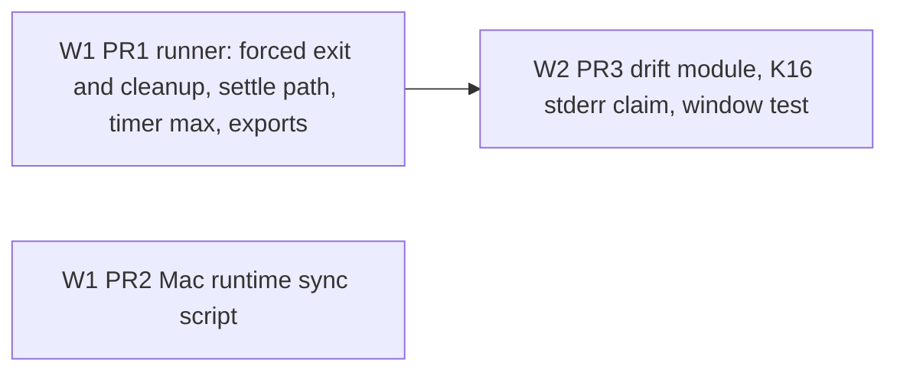
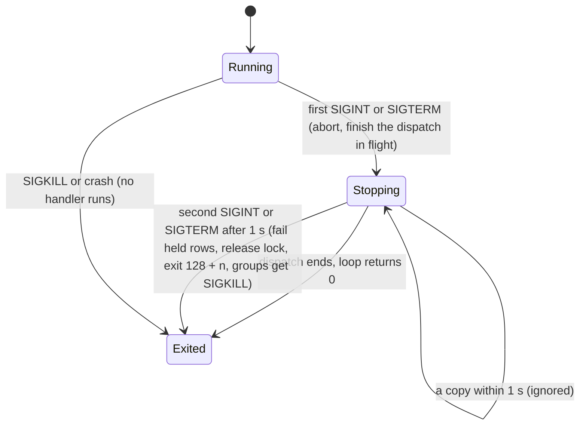

# Jobs Runner and Tooling Leftovers - Plan

## Goal Capsule

- **Objective:** A person who runs the tick can always stop it, and a stop signal is never lost. A time limit of any length holds. The jobs docs cannot drift from the runner limits. The owner refreshes the installed Mac runtime from a repo build with one command.
- **Means:** three PRs with disjoint files: the runner first, the Mac runtime script beside it, the drift and test gaps after the runner (KTD1, Sequencing).
- **Authority:** the Product Contract below decides what; the Planning Contract decides how. Plans `docs/plans/2026-10-23-0925-feat-floating-recurring-jobs-plan.md` and `docs/plans/2026-10-27-1747-fix-jobs-follow-ups-plan.md` stay in force; this plan changes none of their decisions. Binding repo rules: `CLAUDE.md` hard rules, `docs/solutions/best-practices/channels-url-policy-and-child-process-rules.md`, `docs/solutions/developer-experience/deterministic-process-kill-tests.md`, `docs/solutions/best-practices/generated-docs-embed-and-drift-rule-with-vacuous-pass-guards.md`, `docs/solutions/workflow-issues/public-repo-hygiene.md`.
- **Scope of this plan:** 9 candidate items, each checked against `main` at `fb42a1f` (Appendix). 6 are kept; item 1 only in part. 3 are cut, plus the test-isolation part of item 1, each with a reason (Scope Boundaries).
- **Execution profile:** 3 PRs in 2 waves (Sequencing). Each PR is opened by an Opus `ce-work` agent in its own worktree under `.worktrees/<branch>`. At most 2 run at once. No PR runs `pnpm qa ui`.
- **Who ships:** each PR ends green with `ce-code-review` done. The owner merges. No PR bumps a version, cuts a release or publishes.
- **Stop conditions:** stop and report when a PR must edit a file that another PR owns (Sequencing table). Also stop when a test or a check needs the real `HOME` or the real `~/.tidegap`, when a gate fails the same way twice, or when evidence shows a Key Decision cannot work.
- **Open blockers:** none. Inferred defaults are listed under Assumptions.

---

## Product Contract

### Summary

Close the runner gaps left by PRs #163, #170 and #175: a forced stop for the daemon that leaves no stuck row and no orphan process, a stop signal that is lost when the last command settles, and timers that fire at once when a time limit is very long. Add the missing tests and the missing drift rule for the runner limits. Add a script that syncs a repo build into the Mac runtime and restarts the listener.

### Problem Frame

The jobs follow-ups batch (PRs #164-#175) left a list of residual items. Some are real gaps. A daemon in a long LLM call ignores Ctrl-C after the first one, so the only way out is SIGKILL. A `tick --once` can lose a SIGTERM that lands as its last command ends, and then it goes on to its next rows. A `claude-code` job with a time limit over about 24.8 days times out at once. Others are test and drift gaps that let a docs claim or a scrub bound change unnoticed. The owner updates the installed Mac runtime by hand with rsync, which is easy to get wrong. Several list items turned out to be already safe or not fixable now; they are cut below so nobody picks them up again.

### Key Decisions

- KD1. **A second stop signal forces the daemon to exit.** The first SIGINT or SIGTERM keeps its current meaning (finish the dispatch in flight, start nothing new). Chosen over keeping the second signal ignored: the user asked to stop twice, and launchd's own stop already ends in SIGKILL. A copy that arrives within 1 s of the first does not count, because `npm exec` and `npx` forward the terminal's SIGINT to a child that already got it. Governs R1.
- KD2. **The runtime sync never stops a tick in flight.** The listener is restarted; the tick is only started, never killed. Governs R8.
- KD3. **A forced exit stops `claude -p` too.** The first stop still lets a running `claude -p` finish. A forced exit kills its group, because the run's time limit lives in the daemon and dies with it: the orphan would run with no limit, and a `claude` blocked on a privacy prompt would never end. Chosen over leaving the group running. Governs R9.

### Requirements

Item numbers in brackets refer to the candidate list (Appendix).

**Runner stop**

- R1. A second SIGINT or SIGTERM to `tidegap tick --daemon`, at least 1 s after the first, ends the process at once with exit code 128 + the signal number, also while a provider call is in flight. [1]
- R9. A forced exit leaves nothing behind. The rows the tick holds in flight fail as interrupted, the tick lock is released, and every process group the tick started (command jobs and `claude -p` runs) gets SIGKILL. [1]
- R2. A stop signal that reaches the tick while its last command run settles is acted on: an alone `tick --once` still dies by the signal, and a daemon still stops. [1]
- R3. The branch where `spawn` throws at once is covered by a test, like the async spawn failure is. [1]

**Time limits**

- R4. No timer in the command runner or the `claude-code` adapter fires early because its delay is above the `setTimeout` maximum. One exported constant owns that maximum. [2]

**Tests and drift checks**

- R5. A test pins the 8 KiB trailing window of the vendor-key cut scrub. [3]
- R6. Docs drift fails when the jobs page states a stderr tail size other than the runner's. [4]
- R7. The K15, K16 and K17 drift checks have unit tests for their pass and failure paths, and CI runs them. [6]

**Mac runtime**

- R8. One command builds the repo, syncs the runtime code into `~/.tidegap/runtime/cli`, restarts the channels listener and prints the synced commit. It refuses when that directory is missing and reads or writes nothing else under `~/.tidegap`. [8]

### Scope Boundaries

**Considered and not built** (why, and what would change the call):

| Item | Why cut | What would change it |
|---|---|---|
| [1] runner stop state lasts for the process (test isolation) | The persistence is the production rule: a run that starts after a stop is stopped at once. Signal tests already run in a child process, and `deterministic-process-kill-tests.md` states the rule. A reset hook would be test-only API. | An in-process stop test that cannot move to a child process |
| [5] shared `isLate` helper | The Mac app and the extension read `late` from the API and compute nothing. The only second copy is the digest line in `packages/cli/src/channels/emit.ts`: the same rule, in the same package. No defect. | A third copy, or a change to the rule |
| [7] guard against process-group id reuse | No portable API pins a process group. While any member lives, the kernel does not reuse the id. A wrong kill needs an empty group, PID wrap and a new group leader with that id, all inside the 5 s grace. U2 adds a one-line note to the `run-shell.ts` header. | A reported misdirected kill, or group handles on both macOS and Linux |
| [9] Dependabot alert #38 (`deepmerge` 4.3.1, GHSA-gcqx-w48m-w2h4, low) | No patched release exists: 4.3.1 is the latest version and is inside the vulnerable range. The only path is `addons-linter` (dev dependency of the private `apps/extension`, lint time only); its latest release, 10.15.0, still pins 4.3.1. An override has no version to point at. Dismissal ("no fix available", dev only) is an owner action in the Security tab. | A `deepmerge` release above 4.3.1, or an `addons-linter` release without it |
| A forced exit waits up to 1 s so a running command job records its own result | R9 already fails the row as interrupted and kills the group. Only the command's captured output is lost, and the user abandoned that run. | A need for the output of an abandoned run |
| Sync the tree that `pnpm deploy` builds instead of four paths | A whole-tree `rsync --delete` would remove packages the runtime holds outside that tree, such as the optional provider SDKs (`@anthropic-ai/sdk`, `openai` are optional peers). | A runtime that holds only what `pnpm deploy` installs |
| Sync script refuses a symlinked target | A target that links back into the repo makes rsync sync a directory onto itself, which changes nothing. | A target layout that links elsewhere |

### Sources / Research

- Candidate list: the follow-up list of the jobs batch, including the residual of the #175 review.
- Code checked on `main` at `fb42a1f`: `packages/cli/src/jobs/run-shell.ts` (listener lifecycle, `STDERR_TAIL_BYTES`, `MAX_TIMER_MS`), `packages/cli/src/commands/tick.ts` (`runTick` daemon branch), `packages/cli/src/providers/claude-code.ts` (`run`, unclamped timer), `packages/core-ts/src/providers/timeout.ts` (second `MAX_TIMER_MS`), `packages/core-ts/src/jobs.ts` (`validCaps`: caps are only checked to be positive), `packages/core-ts/src/redact.ts` (`TRAILING_WINDOW`), `scripts/qa/docs-drift.mjs` (K15-K17), `apps/web/content/docs/10-jobs.md` ("errors keep their last 4 KiB"), `apps/macos/scripts/install.sh` (runtime path), `packages/cli/src/platform/macos.ts` (`busy`: a bootout would SIGTERM an in-flight `tick --once`).
- Dependabot alert #38 and `pnpm why deepmerge -r`: `apps/extension` dev dependency `addons-linter` 10.14.0 -> `deepmerge` 4.3.1.
- Learnings applied: `deterministic-process-kill-tests.md` (two loop turns before a listener comes off, child-process stop tests, the in-process daemon harness), `channels-url-policy-and-child-process-rules.md` (command groups stop with the tick), `generated-docs-embed-and-drift-rule-with-vacuous-pass-guards.md` (its Known gaps name items 4 and 6), `running-claude-p-from-a-daemon.md` (its TCC section: the reason the runtime lives outside `~/Documents`).

---

## Planning Contract

### Key Technical Decisions

- KTD1. **Three PRs by area, files disjoint.** PR1 runner, PR2 Mac runtime sync, PR3 drift and test gaps. Each file belongs to one PR (Sequencing). PR3 waits for PR1 because K16 reads the constant PR1 exports. Reason: parallel streams that share a file cost a merge fix each time.
- KTD2. **The daemon's own listener forces the exit, after a cleanup.** In `runTick`'s daemon branch, the signal listener aborts on its first call, as today. It ignores a later call that comes less than 1 s after the first. On a later call after that, it runs the cleanup that the in-flight `runTickOnce` registered, writes one line to stderr, and exits with 128 + the signal number. The exit goes through a function that `TickCommandOptions` can replace; tests replace it, and the default is `process.exit`. The cleanup is synchronous (the ledger store is synchronous). It fails the rows the scheduler holds in `running` (KTD12) and releases the tick lock, which `process.exit` would otherwise leave for `TICK_LOCK_STALE_MS` (60 s). The `exit` listeners of the runner and of the `claude-code` adapter (KTD13) then send SIGKILL to their live groups. Governs R1, R9.
- KTD3. **Listeners come off two loop turns late on every path but the re-raise.** `untrackGroup` and the not-alone branch of `settleStop` use the existing two-turn removal (`unhookIfIdleLater`) instead of removing at once. The alone re-raise in `settleStop` keeps its immediate `unhook()`, because the raised signal must reach the default action and not this listener. Reason: Node catches a signal at once but calls the listener in a later poll phase, so removing the last listener first drops the signal (#175). Governs R2.
- KTD4. **The spawn-throw test uses input that Node rejects before it spawns.** A command or env value with a NUL byte makes `spawn` throw `ERR_INVALID_ARG_VALUE` at once. The implementer confirms the throw is synchronous on Node 20, 22 and 24 before relying on it. Governs R3.
- KTD5. **One timer maximum, in core.** `packages/core-ts/src/providers/timeout.ts` exports `MAX_TIMER_MS`, and `packages/core-ts/src/index.ts` re-exports it. `run-shell.ts` drops its own copy, and `claude-code.ts` clamps its run timer with it; both import it from `@tidegap/core`. The clamp is at the timer, not at caps validation: a validation bound would refuse jobs that are already saved. Error texts keep the requested limit. Python needs no change: the bound is a Node timer limit. Governs R4.
- KTD6. **`STDERR_TAIL_BYTES` becomes a module export of `run-shell.ts`.** It is not added to the CLI package entry. K16 imports `packages/cli/dist/jobs/run-shell.js` the way it imports `packages/cli/dist/ui/jobs-api.js`; that module has no side effects at import. Governs R6.
- KTD7. **The window test pins both sides of the bound, with 8 KiB written in the test.** A key shape that fills the window exactly at a cut end is redacted. One whose prefix sits one character before the window is not, which states the bound. The constant is not imported, so a changed window fails the test. No timing assertion: a time bound would flake under load. Governs R5.
- KTD8. **K15-K17 move into a module without side effects.** `scripts/qa/docs-drift-jobs.mjs` exports pure functions that take page texts and code values and return the list of problems. `docs-drift.mjs` still reads the files and the built modules, then calls them. The test file sits beside the module, `scripts/qa/docs-drift-jobs.test.mjs` (`node:test`), because every script test in this repo sits beside its script (`scripts/qa/env.test.mjs`, `scripts/test/tmp-leak-guard.test.mjs`). The request named `scripts/test/`; beside the module is the convention it asked to follow. CI runs it in the existing `node --test` step of `.github/workflows/ci.yml`. Governs R7.
- KTD9. **The sync script is POSIX `sh`, like `install.sh`, and syncs four paths.** `packages/cli/dist/` and `packages/cli/ui/` go to `cli/dist/` and `cli/ui/`. `packages/core-ts/dist/` and `packages/core-ts/package.json` go to `cli/node_modules/@tidegap/core/`. Directories sync with `rsync -a --delete`. The CLI `package.json` is not copied: it names `@tidegap/core` as `workspace:*`, so the runtime keeps its installed copy. The build is `pnpm --filter @tidegap/core --filter @tidegap/cli build`. The user id comes from `id -u`, because `$UID` is not POSIX. Governs R8.
- KTD10. **The script checks before it builds, and refuses on drift.** It refuses, with nothing written, when `~/.tidegap/runtime/cli` or its `node_modules/@tidegap/core` is missing. It also refuses when the repo's `packages/cli/package.json` or `packages/core-ts/package.json` differs from the runtime copy in `dependencies`, `optionalDependencies` or `peerDependencies`, because only first-party code is synced. `devDependencies` and the `@tidegap/core` entry (`workspace:*` in the repo) are ignored; any other `@tidegap/*` entry counts, since the sync does not copy that package. Those two `package.json` files inside the target are the only things it reads under `~/.tidegap`. Governs R8.
- KTD11. **Restart the listener, start the tick.** `launchctl kickstart -k gui/<uid>/com.tidegap.channels` loads the new code into the KeepAlive listener. `com.tidegap.tick` gets `kickstart` without `-k`: `-k` would SIGTERM an in-flight `tick --once` (the reason `loadLaunchAgent` checks `busy`), and a one-shot tick loads the new code on its next run anyway. A unit that `launchctl print` does not find is reported as not loaded and skipped. A failed `kickstart` of the tick (for example, one already running) is reported, not fatal. When a unit's `launchctl print` output does not name the runtime path, the script warns that the unit runs another `tidegap`. The script prints the commit (`git rev-parse --short HEAD`, plus `-dirty` when `packages/cli` or `packages/core-ts` has uncommitted changes). It also prints one line on the page server: it still runs the old API code but serves the new page files from `cli/ui` on each request, so quit and reopen the Mac app to get a server on the new build. A sync does not change the version, so the app does not replace the server by itself. Governs R8.
- KTD12. **The scheduler fails only the rows it moved to `running` itself.** `Scheduler` keeps the ids of the rows it moves to `running` during a tick and drops each one when its dispatch settles. A new method fails each one still held, by compare-and-set from `running`, with `JOB_INTERRUPTED_ERROR` ("interrupted: the tick stopped during the run"), the text the job sweep already writes. Rows another process holds, and rows stranded by an earlier crash, are not touched; the job sweep keeps its own interrupted check for those. No Python change: the Python ticker has no daemon signal path. Governs R9.
- KTD13. **The `claude-code` adapter sends SIGKILL to its live groups on `exit`.** While a run is live, the adapter holds an `exit` listener that sends SIGKILL to the run's group, the way `run-shell.ts` `onExit` does, and removes it when the run settles. A signal's default action runs no `exit` listener, so `tick --once` keeps today's behavior: its first signal ends it and the group runs on (documented). Governs R9.

### High-Level Technical Design

PR waves and dependency (KTD1):



The daemon's stop states (KTD2):



The lost signal on the settle path, and the fix (KTD3):

```mermaid
sequenceDiagram
  participant OS
  participant Loop as Node event loop
  participant Run as runShell
  OS->>Loop: SIGTERM caught, listener call queued
  Run->>Run: last run settles (finish, untrackGroup)
  Note over Run: today: listener removed now, the queued call is dropped
  Note over Run: fix: removal waits two loop turns
  Loop->>Run: poll phase calls onStopSignal
  Run->>OS: alone: unhook, raise the signal again (default exit)
```

### Assumptions

Inferred by planning (headless run, not confirmed by the owner):

- AS1. The forced-exit code is 128 + the signal number (130 for SIGINT, 143 for SIGTERM), the shell convention.
- AS2. "package.json" in the requested sync list means the core package's `package.json` (KTD9). The runtime's own CLI `package.json`, and so `tidegap --version`, stays as installed.
- AS3. The runtime layout is `~/.tidegap/runtime/cli` with the core package at `node_modules/@tidegap/core`, as `apps/macos/scripts/install.sh` and the request state. The plan does not inspect the owner's real runtime.
- AS4. The sync script link goes into `docs/solutions/best-practices/vetting-a-process-by-pid-before-signalling.md`, not `running-claude-p-from-a-daemon.md`. No solutions doc describes the runtime layout. The vetting doc covers runtime updates and the app's server replacement, which the script's restart hint depends on. PR1 also owns the `running-claude-p` doc.
- AS5. Only PR1 adds `CHANGELOG.md` lines: its changes are user-visible. PR2 is owner tooling and PR3 is tests and checks.
- AS6. KD3 changes the documented rule that a tick stop never reaches `claude -p`, for the forced exit only. The owner can drop it; R1 and the rest of R9 stand without it.
- AS7. The 1 s gap in KD1 is long enough to swallow a forwarded copy of one Ctrl-C and short enough for a deliberate second press.

### Sequencing

| Wave | PR | Branch | Depends on | Files owned (disjoint) |
|---|---|---|---|---|
| W1 | PR1 runner (U1-U4, U8, U9) | `fix/jobs-runner-leftovers` | `main` | `packages/core-ts/src/scheduler.ts`, `packages/core-ts/test/scheduler.test.ts`, `packages/cli/src/commands/tick.ts`, `packages/cli/src/jobs/run-shell.ts`, `packages/cli/src/providers/claude-code.ts`, `packages/core-ts/src/providers/timeout.ts`, `packages/core-ts/src/index.ts`, `packages/cli/test/jobs-tick.test.ts`, `packages/cli/test/jobs-runner.test.ts`, `packages/cli/test/claude-code-adapter.test.ts`, `packages/core-ts/test/providers.test.ts`, `apps/web/content/docs/10-jobs.md`, `docs/solutions/tooling-decisions/running-claude-p-from-a-daemon.md`, `CHANGELOG.md` |
| W1 | PR2 Mac runtime sync (U5) | `feat/macos-sync-runtime` | `main` | `apps/macos/scripts/sync-runtime.sh` (new), `apps/macos/scripts/sync-runtime.test.mjs` (new), `.github/workflows/macos.yml`, `apps/macos/README.md`, `docs/solutions/best-practices/vetting-a-process-by-pid-before-signalling.md` |
| W2 | PR3 drift and test gaps (U6-U7) | `test/jobs-drift-and-scrub` | PR1 on `main` | `scripts/qa/docs-drift.mjs`, `scripts/qa/docs-drift-jobs.mjs` (new), `scripts/qa/docs-drift-jobs.test.mjs` (new), `.github/workflows/ci.yml`, `packages/core-ts/test/redact.test.ts`, `docs/solutions/best-practices/generated-docs-embed-and-drift-rule-with-vacuous-pass-guards.md` |

- PR1 and PR2 run in parallel (2 agents, the cap). PR3 starts from `main` after PR1 is merged; it is not stacked on PR1's branch unless the owner asks.
- Generated files: PR1 changes the README test-count block, `apps/web/src/lib/tests.generated.ts`, `apps/web/src/lib/docs.generated.ts` and `apps/web/public/llms-full.txt`. PR3 changes the test-count pair. PR2 changes none: its test is not counted. On a conflict: take main's version, run the generator, commit (`docs/solutions/workflow-issues/generated-test-counts-merge-conflict.md`).
- Python parity: PR1 adds one export (KTD5) and one scheduler method (KTD12) to core-ts. Neither has a Python counterpart: the bound is a Node timer limit, and the Python ticker has no daemon signal path. The PR body says so. No PR changes `packages/core-py`.

---

## Implementation Units

### U1. The daemon exits on a second stop signal

- **Goal:** a second SIGINT or SIGTERM ends `tidegap tick --daemon` at once and leaves no stuck row or lock.
- **Requirements:** R1, R9, KD1.
- **Dependencies:** U8 (the scheduler method the cleanup calls), U9 (the adapter's `exit` listener).
- **Files:** `packages/cli/src/commands/tick.ts`, `packages/cli/test/jobs-tick.test.ts`.
- **Approach:**
  1. Add the exit option to `TickCommandOptions`, with a "(tests)" doc line like the other seams.
  2. In `runTickOnce`, register a cleanup for the daemon while the tick runs, and clear it in the existing `finally`. The cleanup calls the U8 method and releases the tick lock.
  3. In the daemon branch of `runTick`, give the listener the KTD2 behavior: abort on the first call, ignore a copy within 1 s, run the cleanup, write the stderr line and exit on a later call.
  4. Leave `tick --once` alone: it has no listener of its own, so its first signal already ends it.
- **Patterns to follow:** the in-process daemon harness in `packages/cli/test/jobs-tick.test.ts` ("tidegap tick --daemon and a stop signal"), which calls only the listeners added since the start. The fake `claude` binary under `claudeLookup.path`, as in `packages/cli/test/tick-claude-code.test.ts`.
- **Test scenarios:**
  - For SIGTERM and SIGINT: a due prompt task on provider `claude-code` whose fake binary stalls. The first stop leaves the daemon running and calls no exit function. A second stop more than 1 s later calls the exit function once, with 143 (SIGTERM) or 130 (SIGINT), and stderr has the one line.
  - Two SIGINTs back to back (a forwarded copy) leave the daemon running and call no exit function.
  - After the forced exit, the task's row is `failed` with the interrupted error, not `running`, and the tick lock file is gone.
  - A first stop with nothing in flight still ends the daemon with 0 and calls no exit function (the current test keeps passing).
  - The harness passes a fake exit function in every daemon test, so its `afterEach` stop can never end the test worker.
  - The fake dispatch ends inside the test, by a short `llmTimeoutMs` or by killing its group, so no process outlives the test.
- **Verification:** both signal cases and the copy case pass. The existing daemon tests pass unchanged apart from the harness's fake exit.

### U2. A stop signal is not lost when the last run settles

- **Goal:** the runner's listeners stay long enough for a queued stop signal to reach them, and the spawn-throw branch is tested.
- **Requirements:** R2, R3.
- **Dependencies:** none.
- **Files:** `packages/cli/src/jobs/run-shell.ts`, `packages/cli/test/jobs-runner.test.ts`.
- **Approach:**
  1. Apply KTD3 in `untrackGroup` and in the not-alone branch of `settleStop`. Keep the immediate `unhook()` before the re-raise.
  2. Update the header comment for the settle-path rule. Add the one-line process-group reuse note (Scope Boundaries, item 7).
  3. Add the spawn-throw test (KTD4).
  4. Give the describe block that holds the listener-count tests an `afterEach` that waits two `setImmediate` turns, so no test starts while an earlier run's listeners are still on.
- **Patterns to follow:** the #175 test "a failed spawn rejects and its listeners come off two loop turns later" in `packages/cli/test/jobs-runner.test.ts`; `deterministic-process-kill-tests.md`, section "The pid file is not proof that the parent is ready".
- **Test scenarios:**
  - A run that settles: right after it resolves, the SIGTERM, SIGINT and `exit` listener counts are still one higher. Two `setImmediate` turns later they are back to the counts from before the run. This replaces the current "leaves no listener behind" check.
  - A spawn that throws at once (KTD4): `runShell` rejects with `ERR_INVALID_ARG_VALUE`, the SIGTERM listener is still there, and two turns later the counts are back.
  - The child-process stop tests ("the tick exits with the signal", "a tick that would go on after the stop", the not-alone case) still pass for SIGTERM and SIGINT.
- **Execution note:** run `jobs-runner.test.ts` and `jobs-tick.test.ts` ten times under CPU load before the PR. The daemon harness calls every SIGTERM listener added since its start, and a runner listener that now stays two more turns could set the runner's stop state for later tests in that worker. If it does, the harness waits two turns after the daemon exits, or calls only the daemon's listener.
- **Verification:** the new tests pass, and the listener-count tests pass ten runs in a row under load.

### U3. One timer maximum, and the stderr tail size exported

- **Goal:** a very long time limit never fires a timer at once, and the stderr tail size can be read by the drift check.
- **Requirements:** R4, R6 (the export part).
- **Dependencies:** none.
- **Files:** `packages/core-ts/src/providers/timeout.ts`, `packages/core-ts/src/index.ts`, `packages/cli/src/jobs/run-shell.ts`, `packages/cli/src/providers/claude-code.ts`, `packages/core-ts/test/providers.test.ts`, `packages/cli/test/claude-code-adapter.test.ts`, `packages/cli/test/jobs-runner.test.ts`.
- **Approach:**
  1. Export the constant and use it at every timer (KTD5).
  2. Export `STDERR_TAIL_BYTES` (KTD6).
  3. In `claude-code.ts`, clamp the run timer. The 5 s kill timer is constant and needs no clamp.
- **Patterns to follow:** `withLlmTimeout` in `packages/core-ts/src/providers/timeout.ts` (clamp the delay, keep the requested value in the message).
- **Test scenarios:**
  - `claude-code` adapter with `timeoutMs` = 2^31 and a fake binary that answers after a short delay: the dispatch succeeds. Without the clamp it times out at once with "timed out".
  - `runShell` with `timeoutMs` = 2^31 and a short command: `timedOut` is false and the exit code is 0.
  - `withLlmTimeout` with a limit above the maximum: the SDK request gets `timeout` equal to `MAX_TIMER_MS`, and a call that answers at once resolves.
  - `@tidegap/core` exports `MAX_TIMER_MS` = 2^31 - 1.
- **Verification:** a search of `packages/cli/src` and `packages/core-ts/src` finds one `2 ** 31 - 1`. The three timeout tests pass.

### U4. Runner docs and CHANGELOG

- **Goal:** the docs and the CHANGELOG state the new stop behavior and the fixes.
- **Requirements:** R1, R2, R4, R9.
- **Dependencies:** U1, U2, U3, U8, U9.
- **Files:** `apps/web/content/docs/10-jobs.md`, `docs/solutions/tooling-decisions/running-claude-p-from-a-daemon.md`, `CHANGELOG.md`.
- **Approach:**
  1. In `10-jobs.md`, extend the stop bullet: a second SIGINT or SIGTERM ends `tick --daemon` at once; the run in flight fails as interrupted, and its command or `claude -p` process group is killed.
  2. In `running-claude-p-from-a-daemon.md`, rewrite the "A tick stop does not reach a running `claude -p`" bullet. The first stop still lets the run finish. A forced exit kills the group, because its time limit lives in the daemon. `tick --once` ends on its first signal, and the detached `claude` group runs on with no time limit until it ends.
  3. In `CHANGELOG.md` `[Unreleased]`, amend the existing "`tidegap tick --daemon` stops on a stop signal" bullet under Fixed with the second-signal exit and what it cleans up. Add one Fixed bullet for the lost signal at settle and one for the very long `claude-code` time limit.
- **Test expectation:** none: docs only. `pnpm gen:docs` regenerates `docs.generated.ts` and `llms-full.txt`, and the drift script stays green.
- **Verification:** `pnpm gen:docs:check` and `node scripts/qa/docs-drift.mjs` pass. The CHANGELOG lines sit under `[Unreleased]` only.

### U5. Mac runtime sync script

- **Goal:** the owner updates the installed runtime from a repo build with one command.
- **Requirements:** R8, KD2.
- **Dependencies:** none.
- **Files:** `apps/macos/scripts/sync-runtime.sh` (new), `apps/macos/scripts/sync-runtime.test.mjs` (new), `.github/workflows/macos.yml`, `apps/macos/README.md`, `docs/solutions/best-practices/vetting-a-process-by-pid-before-signalling.md`.
- **Approach:**
  1. Write the script in this order: resolve the repo from the script's folder, run the KTD10 checks, build, sync the KTD9 paths, restart and start the units (KTD11), print the commit and the server hint.
  2. Add the test file and a `node --test scripts/sync-runtime.test.mjs` step to `macos.yml`. That path is relative to `apps/macos`, the working directory of its jobs. The workflow already runs on `apps/macos/**` changes.
  3. Add one paragraph to `apps/macos/README.md`, section "Use a repo build of the CLI". Add one line to the vetting doc that points at the script and says why the app keeps the old server after a sync.
- **Patterns to follow:** `apps/macos/scripts/install.sh` (POSIX `sh`, `set -eu`, `here=` resolution, the runtime path, echo lines that say what was chosen). `scripts/plugin-hooks.test.mjs` (`node:test` driving a shell script with a minimal env).
- **Test scenarios:** each runs the script with `HOME` set to a fresh temp dir and `PATH` holding stubs that record their arguments.
  - No `~/.tidegap/runtime/cli`: exit 1, the message names the missing path, nothing is created under the temp `HOME`, and the `pnpm` and `launchctl` stubs were not called.
  - `runtime/cli` exists but `node_modules/@tidegap/core` does not: the same refusal.
  - The runtime `package.json` names a different version of a third-party dependency, optional dependency or peer dependency: exit 1, the message names the package, and no build ran.
  - The repo adds an `@tidegap/*` dependency other than `@tidegap/core`: the same refusal.
  - Only a `devDependencies` entry differs: the check passes and the `pnpm` stub is called.
  - The script holds no absolute local path and no owner name (public repo hygiene).
- **Execution note:** the happy path (build, rsync, kickstart) is checked by hand once, in a temp `HOME` with a fake runtime layout and a `launchctl` stub. It needs a real build, so this worktree gets `pnpm install`. Record in the PR body that an extra file in the target `dist/` was deleted, that the stub saw `kickstart -k .../com.tidegap.channels` and `kickstart .../com.tidegap.tick`, and that a stub failing the tick's `kickstart` still ends with the commit line and exit 0. Never run the script against the real `HOME`; the owner runs it for real.
- **Verification:** the test file passes. `sh -n` accepts the script. The manual happy-path record is in the PR body.

### U6. Testable drift checks and the stderr tail claim

- **Goal:** K15-K17 have unit tests, and K16 checks the stderr tail size.
- **Requirements:** R6, R7.
- **Dependencies:** U3 merged (PR1 on `main`).
- **Files:** `scripts/qa/docs-drift-jobs.mjs` (new), `scripts/qa/docs-drift-jobs.test.mjs` (new), `scripts/qa/docs-drift.mjs`, `.github/workflows/ci.yml`, `docs/solutions/best-practices/generated-docs-embed-and-drift-rule-with-vacuous-pass-guards.md`.
- **Approach:**
  1. Move the K15, K16 and K17 bodies into the new module without changing what they check (KTD8). `docs-drift.mjs` keeps its `track` calls, file reads and built-module imports.
  2. Add the K16 claim for the stderr tail: `STDERR_TAIL_BYTES / 1024` against the jobs page sentence "errors keep their last 4 KiB" (KTD6). Its pattern must not match the summarize sentence "the last 200 KiB)", and the summarize pattern must not match it.
  3. Add the test file to the `node --test` line in `ci.yml`.
  4. In the solutions doc, remove the two closed items from "Known gaps" and name the test file.
- **Patterns to follow:** `scripts/check-agent-files.mjs` with `scripts/check-agent-files.test.mjs` (pure exports, small string fixtures). The mutation list in the solutions doc (#159, #172) is the source for failure cases.
- **Test scenarios:**
  - K15: a fixture page and fake tool surface that agree pass. A `monthly` row, `weekly` missing from the tools list, `repeat: quota_resets`, a `2 to 336` range and a missing every-N-hours guarantee sentence each give a problem that names the part. A trailing space after the row pipe and a backticked cross-reference in the `repeat` row still pass.
  - K16: every claim present and equal passes. A changed number gives "docs N vs code M". A deleted claim gives "does not state". A missing or non-positive code value gives "code has no ...". Number words ("four") parse. The stderr claim reads "errors keep their last 4 KiB" as 4, and a fixture with 8 against a code value of 4 KiB fails.
  - K17: one window everywhere passes. A different window in one source fails and names it. A `--daily --window` copy-paste command with a different window fails. A source with no night window fails. Tool text without the "every night" sentence fails.
  - Integration: `node scripts/qa/docs-drift.mjs` on the real repo passes. A local edit of "4 KiB" to "8 KiB" on the jobs page makes K16 fail; revert it.
- **Verification:** the test file passes in CI. The gate passes. The manual mutation is recorded in the PR body.

### U7. Pin the vendor-key scrub window

- **Goal:** a change to the 8 KiB trailing window fails a test.
- **Requirements:** R5.
- **Dependencies:** none (lands in PR3 for grouping).
- **Files:** `packages/core-ts/test/redact.test.ts`.
- **Approach:** add tests to the "scrubCutEdges: vendor key shapes at a cut" block that follow KTD7. No source change.
- **Patterns to follow:** the existing `it.each(VENDOR_KEY_PREFIXES ...)` cases in the same file.
- **Test scenarios:**
  - After 1 MiB of plain text and a space, an `sk-` token of exactly 8 KiB (prefix included) at a cut end becomes `[redacted]`. The text before it stays.
  - An `sk-` token whose prefix sits one character before the last 8 KiB, with no other prefix in the window, is left as it is at a cut end.
  - The same exact-window case for one prefix with a word boundary (`ghp_`), so the lookbehind at the window start is covered.
- **Verification:** the new tests pass. Changing `TRAILING_WINDOW` locally to 4 KiB or 16 KiB makes at least one of them fail; revert it.

### U8. The scheduler fails the rows it holds in flight

- **Goal:** a forced exit can close the rows this tick moved to `running`.
- **Requirements:** R9.
- **Dependencies:** none.
- **Files:** `packages/core-ts/src/scheduler.ts`, `packages/core-ts/test/scheduler.test.ts`.
- **Approach:** track the ids and add the method as KTD12 states. The method is synchronous and safe to call twice.
- **Patterns to follow:** the compare-and-set writes in `scheduler.ts` (`writeIf` with an expected status) and `docs/solutions/logic-errors/compare-and-set-task-transitions.md`.
- **Test scenarios:**
  - A tick whose adapter never answers: the method fails that row with `JOB_INTERRUPTED_ERROR`, and the tick's other rows keep their status.
  - A row whose dispatch settled before the call is not changed.
  - A row another writer moved out of `running` first is not changed (the compare-and-set misses).
  - A `running` row this scheduler never dispatched (a stranded row from an earlier crash) is not changed.
  - A second call does nothing.
- **Verification:** the scenarios pass, and `pnpm --filter @tidegap/core test` stays green.

### U9. A forced exit kills a running `claude -p` group

- **Goal:** no `claude -p` run outlives a forced exit without a time limit.
- **Requirements:** R9, KD3.
- **Dependencies:** none.
- **Files:** `packages/cli/src/providers/claude-code.ts`, `packages/cli/test/claude-code-adapter.test.ts`.
- **Approach:** add the `exit` listener in `run` as KTD13 states. Its removal goes in the same place as the timer cleanup.
- **Patterns to follow:** `onExit` in `packages/cli/src/jobs/run-shell.ts`. The group-kill test in `claude-code-adapter.test.ts` that uses the fake binary's `group` mode, with `isAlive` polled every 50 ms for up to 5 s (`deterministic-process-kill-tests.md`).
- **Test scenarios:**
  - A run whose fake binary stalls and starts a child: calling the `exit` listeners the run added sends SIGKILL, and the binary and its child are gone within 5 s.
  - A run that settles leaves no `exit` listener behind.
  - Two runs at once: one `exit` call kills both groups.
- **Verification:** the scenarios pass, and the existing timeout and group tests in the file still pass.

---

## Verification Contract

Run from the PR's worktree. Each PR runs the gate once, at the end:

```
pnpm build && pnpm typecheck && pnpm gen:tests:check && pnpm gen:docs:check && node scripts/qa/docs-drift.mjs
```

| PR | Package tests | Other checks |
|---|---|---|
| PR1 | `pnpm --filter @tidegap/core test`, `pnpm --filter @tidegap/cli test` | `pnpm gen:tests` and `pnpm gen:docs` before the gate. `jobs-runner.test.ts` and `jobs-tick.test.ts` ten times under load (U2). |
| PR2 | `node --test apps/macos/scripts/sync-runtime.test.mjs` | `sh -n apps/macos/scripts/sync-runtime.sh`. The manual happy path in a temp `HOME` (U5). |
| PR3 | `pnpm --filter @tidegap/core test`, `node --test scripts/qa/docs-drift-jobs.test.mjs` | `pnpm gen:tests` before the gate. The manual K16 mutation (U6) and window mutation (U7). |

- Logs are read with `grep -nE "✘|Error|expected" <log> | head -40`, never whole.
- No PR runs `pnpm qa ui` or a browser suite.
- Tests and manual checks use a temp `HOME` (`scripts/qa/env.mjs` for QA flows). Nothing reads or writes the real `~/.tidegap`, `~/.claude` or `~/.config/tidegap`.

## Definition of Done

**Every PR:**

- CI is green and `ce-code-review` is done with its blockers fixed. The PR is not merged by the agent; the owner merges.
- Commits follow Conventional Commits (PR1 `fix(cli): ...`, PR2 `feat(macos): ...`, PR3 `test(qa): ...` and `test(core): ...`). Review fixes are folded into the commit they belong to (`docs/solutions/developer-experience/folding-review-fixes-into-commits.md`).
- No version bump, no release, no publish (`pnpm check:versions` passes).
- No session-attribution trailer and no session link in any commit message or PR body.
- No local path, owner name, account or token name in committed files.
- Generated files come from their generators, never hand edits.
- No code from abandoned attempts is left in the diff.

**Per unit:**

| Unit | Done when |
|---|---|
| U1 | A second signal ends the daemon with 130 or 143 and leaves a failed row and no lock, proven by the U1 tests for both signals |
| U2 | The listener-count tests and the spawn-throw test pass ten runs in a row under load |
| U3 | One `2 ** 31 - 1` in the source, and the three timeout tests pass |
| U4 | The docs and three CHANGELOG lines are in, and `gen:docs:check` and docs drift pass |
| U5 | The refusal tests pass in `macos.yml`, and the manual happy path is recorded |
| U6 | The K15-K17 tests run in CI, and K16 fails on a changed stderr tail size |
| U7 | The window tests fail when the window changes |
| U8 | Only the rows this scheduler holds fail, proven by the U8 tests |
| U9 | A forced exit leaves no `claude` process, proven by the U9 tests |

---

## Appendix

Candidate list, with the verdict on `main` at `fb42a1f`:

| # | Item | Verdict | Where |
|---|---|---|---|
| 1 | Second signal during an LLM dispatch ignored; stop state lasts for the worker; settle-path dropped signal (review-175); spawn-throw branch untested | Kept in part: R1, R2, R3, R9. Stop-state persistence cut. | U1, U2, U8, U9 |
| 2 | `MAX_TIMER_MS` defined twice; unclamped timer in `claude-code.ts` | Kept. The second copy is in `packages/core-ts/src/providers/timeout.ts`, not in `claude-code.ts`. | U3 |
| 3 | No test pins the 8 KiB cut-edge window | Kept. `TRAILING_WINDOW` in `packages/core-ts/src/redact.ts`. | U7 |
| 4 | `STDERR_TAIL_BYTES` not exported; K16 cannot check it | Kept | U3, U6 |
| 5 | `isLate` duplicated in the Mac app and the extension | Cut: the clients compute nothing | Scope Boundaries |
| 6 | K15-K17 helpers have no unit tests | Kept | U6 |
| 7 | Process-group id reuse after the leader exits | Cut: no portable guard; header note only | Scope Boundaries, U2 |
| 8 | `apps/macos/scripts/sync-runtime.sh` | Kept | U5 |
| 9 | Dependabot alert #38 | Cut: no patched release | Scope Boundaries |
