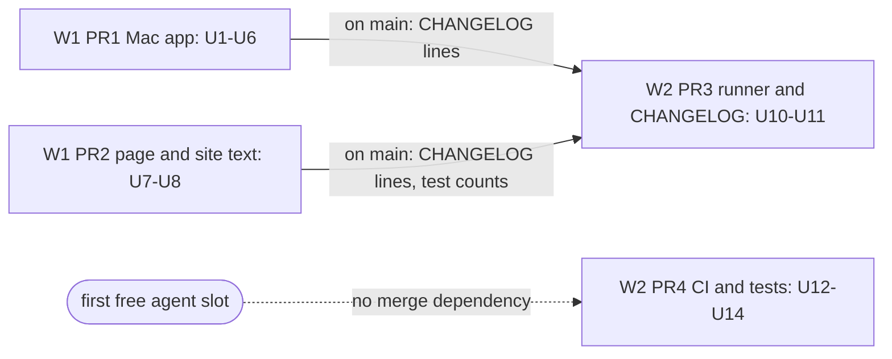
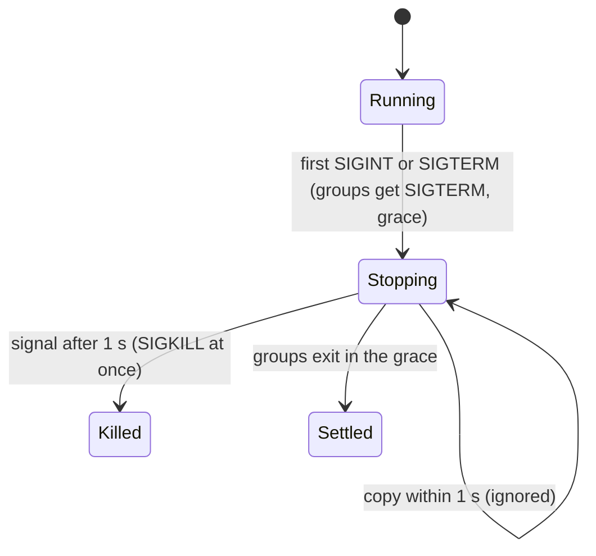

# Visible Polish and Leftovers (Batch 22) - Plan

## Goal Capsule

- **Objective:** A Mac user whose server does not start sees why. Quitting the app with Quit or SIGTERM leaves no server behind. The app's windows take the standard edit keys. The site states the tool count the code has. The region search works with an input method. One Ctrl-C under `npm exec` does not take a job command's grace away. CI catches time-zone bugs and drift-rule regressions that it misses today.
- **Means:** four PRs with disjoint files, ordered by surface: the Mac app, then the page and site text, then the runner, then CI and tests (KTD1, Sequencing).
- **Authority:** the Product Contract below decides what; the Planning Contract decides how. Plans `docs/plans/2026-10-27-1747-fix-jobs-follow-ups-plan.md` and `docs/plans/2026-10-27-2300-fix-jobs-runner-leftovers-plan.md` stay in force; this plan reopens none of their cuts. Binding repo rules: `CLAUDE.md` (hard rules, generated files, git conventions), `docs/spec/ui-client-api.md`, `docs/solutions/best-practices/vetting-a-process-by-pid-before-signalling.md`, `docs/solutions/developer-experience/deterministic-process-kill-tests.md`, `docs/solutions/best-practices/generated-docs-embed-and-drift-rule-with-vacuous-pass-guards.md`, `docs/solutions/workflow-issues/public-repo-hygiene.md`.
- **Scope of this plan:** 40 triage rows, each checked against `main` at `44f9b68` (Appendix). `main` is now `d743e86`; #180 changed only solutions docs. 10 rows are kept, most only in part, plus one #171 follow-up; they give R1-R9 and R11-R15. The rest are cut as shipped, owner-bound, cut by an earlier plan, or deferred (Scope Boundaries).
- **Execution profile:** 4 PRs in 2 waves, at most 2 agents at once. Each PR is opened by an Opus `ce-work` agent in its own worktree under `.worktrees/<branch>`. No stream runs `pnpm qa ui`. A separate agent runs it once on `main` after the last merge, with nothing else running.
- **Who ships:** each PR ends green with `ce-code-review` done. Agents do not merge. No PR bumps a version, cuts a release or publishes.
- **Stop conditions:** stop and report in these cases:
  - A PR must edit a file that another PR owns (Sequencing table).
  - A test or check needs the real `HOME`, `~/.tidegap`, `~/.claude` or `~/.config/tidegap`.
  - A gate fails the same way twice.
  - A unit test fails under a new CI time zone because of product code (AS4).
  - Evidence shows a Key Technical Decision cannot work.
- **Open blockers:** none. Inferred defaults are listed under Assumptions.

---

## Product Contract

### Summary

Close the leftovers the triage still found open on `main`. On the Mac app: a launch failure gets its cause, SIGTERM ends the app like Quit, a timed-out start reaps its child, a cancelled page load keeps the pending view, and the edit keys work. On the web: correct the stale tool count on `/architecture` and widen the drift rule that missed it, and fix input-method typing in the region search. In the runner: the 1 s duplicate-signal rule in `runShell`. In tooling: the MCP and CLI tests in the time-zone CI job, a deterministic adapter timeout test, and failing-path tests for the K15 guards.

### Problem Frame

The triage list for this batch was built from the backlog without reading the code. Most of its user-visible items shipped in #163-#179 or earlier: the page Jobs lines and key `4`, the jobs deep links, the site caption contrast, the voiced demo video, the MCP tool counts in the docs, the night window and the core-py README date. The real gaps are narrower. A failed `tidegap ui` start reads only "could not start tidegap ui". `killall Tidegap` leaves the server and its `ui.json` behind. A start that times out does not wait for its child, a gap the vetting doc lists under open follow-ups. `/architecture` still says "4 tools" because K5 does not read the public site files. In the runner, one Ctrl-C under `npm exec` reaches `runShell` twice and skips the SIGTERM grace. The solutions doc records this as open. Outside UTC, CI runs only the core tests; the MCP and CLI tests, which format digest, Telegram and page times, run in UTC alone.

### Requirements

Item numbers in brackets refer to the triage rows (Appendix).

**Mac app**

- R1. When `tidegap ui` cannot start, the tooltip, the page window and Settings name the cause: the spawn error, the start time limit, or an exit during start with the server's last output line. The generic "could not start tidegap ui" line goes away. [1]
- R2. SIGTERM to the app ends it the way Quit does: the server the app started gets SIGTERM and removes its own `ui.json`. [2]
- R3. A start that reaches its time limit stops its child and waits for it to exit (SIGTERM, then SIGKILL after the grace) before it reports the failure. [5]
- R4. A page load that a newer load cancels (a port change) does not drop the pending view request. [#171 follow-up]
- R5. Cmd-C, Cmd-V, Cmd-X, Cmd-A, Cmd-Z and Cmd-W work in the app's windows (Settings, the page window). [3]
- R6. `TidegapKit` keeps no unused `Format` helpers, and no type that only they use. [3]

**Site and page**

- R7. `/architecture` states the MCP tool count that `toolsForHost("mcp")` returns. [10]
- R8. Docs drift rule K5 also reads the tool counts in `apps/web/public/install.md`, `apps/web/public/llms.txt` and `apps/web/public/architecture.html`, as each of them phrases the count. [10]
- R9. Typing in Settings > Grid region search with an input method (IME) composes text normally; the list filters when the composition ends. [28]

**Runner**

- R11. A second stop signal that reaches `runShell` within 1 s of the first is ignored, so a running command keeps its SIGTERM grace. A later signal still sends SIGKILL at once. [17]
- R12. `CHANGELOG.md` `[Unreleased]` lists this batch's user-visible changes: R1-R3, R7, R9, R11, and R5 when the batch changed the keys.

**Tooling and tests**

- R13. CI runs the core, MCP and CLI unit tests under `TZ=Asia/Kolkata` and `TZ=Pacific/Kiritimati`. [21]
- R14. The `claude-code` adapter timeout test asserts a real child pid and polls until it is gone. [23]
- R15. Each K15 guard in `scripts/qa/docs-drift-jobs.mjs` has a test that triggers it. The "Known gaps" line of the drift-rule solutions doc states only true gaps. [31]

### Scope Boundaries

**Considered and not built** (why, and what would change the call):

| Item | Why cut | What would change it |
|---|---|---|
| [5] Re-check `tidegap --version` when it is nil on a cold start | By design: the vetting doc keeps the server and re-checks within 5 minutes; a stricter first attach only moves the wait | A report of a wrong server kept past the next check |
| [1] Detect an old CLI behind a stored token | Not verified in this pass. `needsUpdate` is raised at token minting only; the R1 change does not depend on it | A report from a user on a CLI older than 0.19 with a stored token |
| R2 for SIGINT and SIGHUP | A Finder- or launchd-started app gets SIGTERM; SIGINT is a terminal-only case | A report from a terminal-run app |
| R2 for SIGKILL (Force Quit) and crashes | No handler runs; the next launch's server vetting decides about the server left behind (`vetting-a-process-by-pid-before-signalling.md`) | None: no process can act on its own SIGKILL |
| [16] Per-row `try`/`catch` in `failHeldRuns` | The tick awaits one dispatch at a time, so the scheduler holds at most one row; a per-row guard protects no other row, and the tick lock is already released in a `finally` (`compare-and-set-task-transitions.md` records this) | A tick that dispatches rows in parallel |
| [28] Cancel an in-flight region Save | The controls are off while saving; a late answer only redraws a closed card | A second write path in the card |
| [31] Drift check for the `claude-code` adapter's stderr tail | No docs page states that tail (20 lines, 2000 characters); there is nothing to drift | A docs sentence that states it |
| [24] `realpath` for the tick lock path | Two spellings of one ledger need a manual `--db`; the app and launchd use the default path; compare-and-set already stops a double dispatch; a new lock name could let an old and a new daemon both run during an upgrade | A report of two ticks on one ledger |
| Shared `isAlive`/`goneWithin` test helper | It would touch `packages/cli/test/jobs-runner.test.ts`, which PR3 owns (KTD1, Sequencing) | A third copy |

**Deferred to Follow-Up Work** (not verified here; each needs its own check first):

- [25] Channels: per-id generation counter and `keepWith` on multi-tenant hosts. `writeSecrets` already holds a lock and writes atomically. Security-adjacent: first in the next batch.
- [26] Channels: backoff on a failing digest fetch; the K13 known-code list.
- [29] The page's dispatcher pill uses wall-clock age.
- [27] Region refactors (`closestRegions` minors, `hostRegionInputs()`, `detectRegion` copy, UK->GB alias helper). No user-visible change.
- [18] Python ticker parity (`not_before`, `repeat`, quota sweep). The caveat is documented (#172). The port is large and needs its own plan.
- [38] Multi-model `claude-code` cost per model. Schema change in both cores; needs its own plan.

**Needs the owner** (not code): [15] the Batch double-submit after a forced exit (KTD12 of the runner plan; #178 left it as written). [36] Source maps in the OpenClaw plugin tarball (core, CLI and MCP already exclude them, d04964d). [39] UA zone (ENTSO-E token). CodeQL alert #22 (`js/shell-command-injection-from-environment` on `packages/cli/src/jobs/run-shell.ts`, the intended `sh -c`, same as #19): dismissal in the Security tab. Dependabot #38 (`deepmerge`, no fix exists). Manual Mac checks for U2 and U5 (Definition of Done).

### Sources / Research

- Code read on `main` at `44f9b68`:
  - Mac launcher and connection: `apps/macos/TidegapKit/Sources/TidegapKit/Connection.swift` (`attach` maps every launch error but `tidegapNotFound` to one offline text), `apps/macos/TidegapKit/Sources/TidegapKit/ServerLauncher.swift` (`start` calls `stop()` on timeout, and `stop()` does not wait; `retireChild` waits), `apps/macos/Tidegap/TidegapApp.swift` (no signal source, no main menu built), `apps/macos/Tidegap/WebPageWindow.swift` (`dropPending` on every load failure), `apps/macos/TidegapKit/Sources/TidegapKit/Format.swift` (`rowTime`, `laterItem` and `done` are called only from tests).
  - Web: `apps/web/public/architecture.html` ("4 tools — forecast · recommend · schedule · status"), `scripts/qa/docs-drift.mjs` (K5 reads `DOCS`, `apps/web/src` and the MCP server source, not `apps/web/public`), `packages/cli/ui/region-card.js` (`draw` rebuilds the search input on every `input` event).
  - Runner: `packages/core-ts/src/scheduler.ts` (`holding` awaits one dispatch at a time, so `failHeldRuns` sees at most one row), `packages/cli/src/jobs/run-shell.ts` (`onStopSignal` sends SIGKILL on any second signal), `packages/cli/src/commands/tick.ts` (`FORCED_STOP_GAP_MS`).
  - Tooling: `.github/workflows/ci.yml` (a `tz` job runs only `@tidegap/core` tests under `Asia/Kolkata` and `Pacific/Kiritimati`), `packages/cli/test/claude-code-adapter.test.ts` ("times out, kills the child and cleans up" reads the pid once), `scripts/qa/docs-drift-jobs.mjs` and its test.
- PR bodies: #167 (MCP and Telegram follow-ups), #169 (page Jobs items closed), #171 (Mac follow-ups: the cancelled-load note), #178 (Batch double-submit left as KTD12 states), #179 (drift module tests).
- Learnings applied:
  - `vetting-a-process-by-pid-before-signalling.md`: the retire sequence, and the timed-out start under Open follow-ups.
  - `channels-url-policy-and-child-process-rules.md`: the `npm exec` copy, "the fix would be the same 1 s rule in the runner".
  - `deterministic-process-kill-tests.md`: stop tests run in a child process; poll for exit, never a fixed wait.
  - `time-of-day-bugs-and-fake-time-sweeps.md`: half-hour zones break local-time flooring.
  - `generated-docs-embed-and-drift-rule-with-vacuous-pass-guards.md`: one guard per claim; mutation-check each.
- Open alerts on `main`: code scanning #22 only; Dependabot #38 only. The triage's grid.ts ReDoS alerts are closed.

---

## Planning Contract

### Key Technical Decisions

- KTD1. **Four PRs by surface; each file has one owner.** PR1 Mac app, PR2 page and site text, PR3 runner, PR4 CI and tests. `CHANGELOG.md` belongs to PR3: PR1 and PR2 put their proposed entry lines in their PR bodies, and PR3 writes all the batch's entries. The README test-count block and `apps/web/src/lib/tests.generated.ts` are the one shared exception (generated). PR2 and PR3 change them, and PR3 starts after PR2 is on `main`. Reason: parallel branches that share a file each need a merge fix.
- KTD2. **The launch cause is decided in `TidegapKit`.** `LaunchError` gets a case for a child that exits before it writes `ui.json`. Today that path breaks out of the wait loop and is reported as a timeout. The new case carries the last non-empty line the child wrote. The runner owns the server log, which it truncates at each spawn, so it supplies that line; a runner without a log gives none. `ConnectionController.attach` maps each case to its own `.offline` text: the spawn error, the time limit in seconds, or the exit with that line. `Format.detail` already shows the `.offline` text in all three places. `apps/macos/README.md` names the server log. Governs R1.
- KTD3. **SIGTERM goes through `NSApp.terminate`.** A new `TidegapKit` helper sets the signal to `SIG_IGN` and keeps a `DispatchSource` signal source, which calls a closure on the main queue. The app installs it for SIGTERM in `applicationDidFinishLaunching` and calls `NSApp.terminate(nil)`. That reaches the existing `applicationWillTerminate` -> `model.shutdown()` path. No second shutdown path. Governs R2.
- KTD4. **A timed-out start uses the existing retire sequence.** The timeout branch of `ServerLauncher.start()` calls `retireChild()` instead of `stop()`. The port wait inside it applies only when `ui.json` names the child. The failure now reports up to 2 x `killGrace` (6 s) later. Governs R3.
- KTD5. **A cancelled load is recognised in `TidegapKit`.** A pure predicate (domain `NSURLErrorDomain`, code `NSURLErrorCancelled`) sits in the package, so it can be tested. Both `WebPageWindow` failure callbacks return early on it. Governs R4.
- KTD6. **The edit keys come from menu items added only when missing.** In `applicationDidFinishLaunching`, if `NSApp.mainMenu` has no item whose action is `copy:`, the app adds an Edit menu (Undo, Redo, Cut, Copy, Paste, Select All). If it has no item for `performClose:`, it adds a Window menu with Close (Cmd-W). Whatever SwiftUI already builds stays; the menu bar never shows (`LSUIElement`), only the key equivalents act. Governs R5.
- KTD7. **K5 reads three public files, strictly, and two more phrasings.** `install.md`, `llms.txt` and `architecture.html` join K5's file list. The pattern also reads "N new tools" (`install.md` says "twelve new tools", which today's pattern skips) and "tools (N)" headings (`llms.txt`). In these three files a count must equal `toolsForHost("mcp")`: none of them states an OpenClaw count, and today's tolerance (either host's count on any line) would pass a stale 12 once both hosts gain a tool. The other files keep that tolerance. `llms-full.txt` is skipped: it is generated from files K5 already reads. Governs R7, R8.
- KTD8. **No redraw while an IME composes.** The card sets a composing flag on `compositionstart` and clears it on `compositionend`. While it is set, the search's `input` events and `draw()` do nothing, so neither typing nor a late load answer replaces the input mid-composition. `compositionend` passes the final value to `on.query`, which draws the latest model. The focus and caret restore stay as they are. Governs R9.
- KTD10. **One stop-gap constant, owned by the runner.** `FORCED_STOP_GAP_MS` moves from `tick.ts` to `run-shell.ts` as an export, and `tick.ts` imports it. `runShell` records when its first stop came. In `onStopSignal`, a signal within the gap returns at once; a later one sends SIGKILL, as today. The stop state still lasts for the process (cut by the runner plan). Governs R11.
- KTD11. **Extend the existing `tz` job; add no new job.** The `tz` job in `ci.yml` (node 22, matrix `Asia/Kolkata` and `Pacific/Kiritimati`) builds and tests only `@tidegap/core`. It gains the `@tidegap/mcp` and `@tidegap/cli` builds and their test steps, and its name stops saying "core". The zones stay: a half-hour offset and the date line are what UTC misses. The extension and web tests stay out: they format no ledger times. Governs R13.
- KTD12. **The adapter test reuses its own poll.** The file's `goneWithin5s` moves to file scope. The timeout test gets the slack the grandchild test already has (a 2000 ms time limit), asserts `pid > 1`, then polls. The helper stays in this file only. Governs R14.
- KTD13. **K15 guard tests are table-driven mutations.** Each case mutates a fixture page, or the fake core, for one guard, and asserts the full problem list with `assert.deepEqual`, as the existing K15 tests do. The list contains that guard's own message; guards that fail together (a missing anchor, an empty enum) show up in it too. Fake-core cases cover: no `schedule_task`, `repeat` with no values, `every_hours` without integer bounds, `every_hours` bounds that differ from `MIN_EVERY_HOURS`/`MAX_EVERY_HOURS`, `days` with no values, and a `guaranteeText` that throws. Governs R15.

### High-Level Technical Design

PR waves and the merge dependency (KTD1):

The Mac app's launch paths after PR1 (KTD2-KTD4):

```mermaid
stateDiagram-v2
  [*] --> Spawning
  Spawning --> Offline_spawn: spawn throws (cause: the error)
  Spawning --> Waiting
  Waiting --> Connected: ui.json names the child
  Waiting --> Offline_exit: child exits before ui.json (cause: exited during start, its last output line)
  Waiting --> Retiring_timeout: time limit reached
  Retiring_timeout --> Offline_timeout: SIGTERM, grace, SIGKILL, port free; cause: time limit
  Connected --> Quitting: Quit or SIGTERM (NSApp.terminate)
  Quitting --> [*]: child gets SIGTERM, removes ui.json
```

`runShell` stop signals after PR3 (KTD10):

### Assumptions

Inferred by planning (headless run, not confirmed by the owner):

- AS1. Cmd-C/V/W may not work today: the code builds no main menu, and only a run shows whether SwiftUI adds one. U5's first step answers it; KTD6 adds nothing that SwiftUI already built. The owner's manual check confirms the keys either way.
- AS2. The cancelled-load case happens only after a port change. #171 saw it in review, not in use. U4 is cheap insurance, not a reported bug.
- AS3. PR3 writes the CHANGELOG lines from the "CHANGELOG lines" sections in the PR1 and PR2 bodies, and adds its own (KTD1).
- AS4. A test that fails under a zone is fixed in PR4 only when the fault and the fix are in that test file. A fault in product code is reported with the test, the zone and the first error line. PR4 then leaves out only that package's step for that zone, never the existing core step.
- AS5. `packages/cli/test/fixtures/fake-dom.ts` already dispatches any event type to its listeners, so the composition tests need no fixture change.

### Sequencing

| Wave | PR | Branch | Starts | Files owned (disjoint) |
|---|---|---|---|---|
| W1 | PR1 Mac app (U1-U6) | `fix/macos-launcher-polish` | from `main` | `apps/macos/TidegapKit/Sources/TidegapKit/Connection.swift`, `apps/macos/TidegapKit/Sources/TidegapKit/ServerLauncher.swift`, `apps/macos/TidegapKit/Sources/TidegapKit/Format.swift`, `apps/macos/TidegapKit/Sources/TidegapKit/Models.swift`, `apps/macos/TidegapKit/Sources/TidegapKit/TerminationSignals.swift` (new), `apps/macos/TidegapKit/Sources/TidegapKit/PageLoad.swift` (new), `apps/macos/TidegapKit/Tests/TidegapKitTests/ConnectionTests.swift`, `apps/macos/TidegapKit/Tests/TidegapKitTests/ServerLauncherTests.swift`, `apps/macos/TidegapKit/Tests/TidegapKitTests/FormatTests.swift`, `apps/macos/TidegapKit/Tests/TidegapKitTests/Fakes.swift`, `apps/macos/TidegapKit/Tests/TidegapKitTests/TerminationSignalsTests.swift` (new), `apps/macos/TidegapKit/Tests/TidegapKitTests/PageLoadTests.swift` (new), `apps/macos/Tidegap/TidegapApp.swift`, `apps/macos/Tidegap/WebPageWindow.swift`, `apps/macos/README.md`, `docs/solutions/best-practices/vetting-a-process-by-pid-before-signalling.md` |
| W1 | PR2 page and site text (U7-U8) | `fix/web-text-and-region-search` | from `main` | `apps/web/public/architecture.html`, `scripts/qa/docs-drift.mjs`, `packages/cli/ui/region-card.js`, `packages/cli/test/ui-region-card-live.test.ts` |
| W2 | PR4 CI and tests (U12-U14) | `test/tz-ci-and-drift-guards` | from `main` when a W1 agent finishes | `.github/workflows/ci.yml`, `packages/cli/test/claude-code-adapter.test.ts`, `scripts/qa/docs-drift-jobs.test.mjs`, `docs/solutions/best-practices/generated-docs-embed-and-drift-rule-with-vacuous-pass-guards.md` |
| W2 | PR3 runner and CHANGELOG (U10-U11) | `fix/runner-stop-leftovers` | from `main` after PR1 and PR2 are on `main` | `packages/cli/src/jobs/run-shell.ts`, `packages/cli/src/commands/tick.ts`, `packages/cli/test/jobs-runner.test.ts`, `docs/solutions/best-practices/channels-url-policy-and-child-process-rules.md`, `docs/solutions/logic-errors/compare-and-set-task-transitions.md`, `CHANGELOG.md` |

- Parallelism: PR1 and PR2 run together (cap 2). PR4 takes the first free slot. PR3 waits for PR1 and PR2 on `main` (KTD1). PR3 and PR4 may run together.
- Generated files: PR2 and PR3 add counted vitest tests, so each changes the README test-count block and `apps/web/src/lib/tests.generated.ts`. Swift and `node --test` script tests are not counted, so PR1 and PR4 change neither. No PR edits `apps/web/content/docs`, so `docs.generated.ts` and `llms-full.txt` do not change. On a conflict in a generated file: take `main`'s version, run the generator, commit (`docs/solutions/workflow-issues/generated-test-counts-merge-conflict.md`).
- Python parity: no PR changes core-ts logic (U10 is CLI-only and has no Python counterpart), so no PR changes `packages/core-py`. PR3's body says so.
- UI client API: no PR changes a route, a field or a status code, so `docs/spec/ui-client-api.md` stays as it is. A PR that finds it must change the API updates that spec in the same PR.

---

## Implementation Units

### U1. A failed launch says why

**Goal:** the three connection surfaces name the reason `tidegap ui` did not start.

**Requirements:** R1

**Dependencies:** none

**Files:**
- Modify: `apps/macos/TidegapKit/Sources/TidegapKit/ServerLauncher.swift` (new `LaunchError` case; the wait loop throws it when the child exits; the runner gives the log's last line)
- Modify: `apps/macos/TidegapKit/Sources/TidegapKit/Connection.swift` (`attach` maps each `LaunchError`)
- Modify: `apps/macos/README.md` (where the server log lives, under "How it connects")
- Test: `apps/macos/TidegapKit/Tests/TidegapKitTests/ConnectionTests.swift`, `apps/macos/TidegapKit/Tests/TidegapKitTests/ServerLauncherTests.swift`, `apps/macos/TidegapKit/Tests/TidegapKitTests/Fakes.swift` (a spawn that throws; a child that exits at spawn, with or without an output line)

**Approach:**
- Follow KTD2. Keep `tidegapNotFound` and `needsUpdate` as they are.
- Keep each text to one sentence a user can act on. For a spawn error, quote its localized description; `spawnFailed` today carries the debug form (`String(describing:)`).
- The README line names the log `AppModel` writes: `~/Library/Logs/Tidegap/tidegap-ui.log`, or `<dir>/Library/Logs/Tidegap/tidegap-ui.log` with the `-home <dir>` launch argument.

**Patterns to follow:** the existing `.tidegapNotFound` mapping and its tests in `ConnectionTests`; the fake runner in `apps/macos/TidegapKit/Tests/TidegapKitTests/Fakes.swift`.

**Test scenarios:**
- A spawn that throws "permission denied" -> state `.offline` whose text contains that message.
- A child that never writes `ui.json` -> `.offline` naming the time limit in seconds.
- A child that writes "Error: listen EADDRINUSE" and exits before `ui.json` -> the new `LaunchError` case, and `.offline` says it exited during start and quotes that line, not that it timed out.
- A child that exits with no output -> `.offline` says it exited during start, with no quoted line.
- `tidegapNotFound` still maps to `.tidegapNotFound` (control).

**Verification:** no code path sets `.offline("could not start tidegap ui")`; `swift test` passes.

---

### U2. SIGTERM ends the app like Quit

**Goal:** `killall Tidegap` leaves no server and no `ui.json`.

**Requirements:** R2

**Dependencies:** none

**Files:**
- Create: `apps/macos/TidegapKit/Sources/TidegapKit/TerminationSignals.swift`
- Modify: `apps/macos/Tidegap/TidegapApp.swift`
- Modify: `apps/macos/README.md` ("How it connects" step 3: the child stops on quit or SIGTERM)
- Test: `apps/macos/TidegapKit/Tests/TidegapKitTests/TerminationSignalsTests.swift`

**Approach:**
- Follow KTD3. The helper takes the signal numbers, a queue and a closure, and keeps its sources alive while it lives.
- The app keeps the helper on `AppDelegate`.

**Execution note:** tests use SIGUSR1 or SIGUSR2, so no test touches the real termination path. Their default action also ends the process, so `TerminationSignalsTests` is a `.serialized` suite and raises a signal only while a helper is installed. Swift Testing runs tests in parallel, and signal handling is process-wide.

**Test scenarios:**
- Installed for SIGUSR1, `raise(SIGUSR1)` -> the closure runs once on the given queue, and the process lives on.
- Two raises, the second after the first closure call -> the closure runs twice. A dispatch source merges raises that arrive before its handler runs.
- After the helper is cancelled -> the signal's action is the default again, and the test does not raise it.

**Verification:** `swift test` passes; `apps/macos/scripts/build.sh` builds the app. Owner check: start the app, run `killall Tidegap`, and confirm that no `tidegap ui` process and no `ui.json` remain.

---

### U3. A timed-out start reaps its child

**Goal:** the next spawn never meets the old child on the port.

**Requirements:** R3

**Dependencies:** U1 (same function)

**Files:**
- Modify: `apps/macos/TidegapKit/Sources/TidegapKit/ServerLauncher.swift`
- Modify: `docs/solutions/best-practices/vetting-a-process-by-pid-before-signalling.md` (move the timed-out start from "Open follow-ups" to the rules, and name the test)
- Test: `apps/macos/TidegapKit/Tests/TidegapKitTests/ServerLauncherTests.swift`, `apps/macos/TidegapKit/Tests/TidegapKitTests/Fakes.swift` (the runner can spawn a child that ignores SIGTERM: the child exists only inside `spawn`)

**Approach:** follow KTD4. The child that exits early (U1) needs no retire step, since it is already gone.

**Patterns to follow:** the "Restarting on the default port" tests and `FakePorts` in `ConnectionTests`; the short `startTimeout` and `killGrace` values the launcher tests already inject; `FakeProcess.exitsOnTerm`, set through the new runner option. The existing `startTimesOutWhenNoDiscoveryAppears` test stays and gains the wait.

**Test scenarios:**
- A child that ignores SIGTERM and never writes `ui.json` -> `terminate()`, then `kill()` after the grace, and only then the `startTimedOut` error.
- A child that exits on SIGTERM -> no `kill()`, and the error follows its exit.
- A start after a timed-out one -> it spawns only once the old child no longer runs.

**Verification:** the open follow-up is gone from the vetting doc; `swift test` passes.

---

### U4. A cancelled page load keeps the view request

**Goal:** a view request (for example a job deep link) survives a reload caused by a port change.

**Requirements:** R4

**Dependencies:** none

**Files:**
- Create: `apps/macos/TidegapKit/Sources/TidegapKit/PageLoad.swift`
- Modify: `apps/macos/Tidegap/WebPageWindow.swift`
- Test: `apps/macos/TidegapKit/Tests/TidegapKitTests/PageLoadTests.swift`

**Approach:** follow KTD5. `didFail` and `didFailProvisionalNavigation` return before `dropPending()` for a cancelled load.

**Test scenarios:**
- `NSError(domain: NSURLErrorDomain, code: NSURLErrorCancelled)` -> cancelled.
- `NSURLErrorTimedOut`, and the cancelled code in another domain -> not cancelled.
- A `URLError(.cancelled)` bridged to `Error` -> cancelled.

**Verification:** `swift test` passes; `apps/macos/scripts/build.sh` builds the app.

---

### U5. Edit and Close keys in the app's windows

**Goal:** a user can copy, paste and undo in Settings, and close any window with Cmd-W.

**Requirements:** R5

**Dependencies:** U2 (same file)

**Files:**
- Modify: `apps/macos/Tidegap/TidegapApp.swift`

**Approach:**
1. First check what SwiftUI already builds. Build the app, launch it with `-home <scratch dir>` (never the real home), and log the action of each `NSApp.mainMenu` item once, with temporary code that is removed before commit. Quit the app. If the app cannot start in the agent's session, go to step 3: KTD6 is safe either way.
2. If `copy:` and `performClose:` are already there, U5 adds no code; the PR1 body says the keys already work, and U11 writes no line for R5.
3. Otherwise, follow KTD6 with the standard selectors and a `nil` target, so the responder chain routes them, once at launch after the status item exists.

**Test expectation:** none. The app target has no test target, and the "E5" cut in the jobs follow-ups plan stands. The proof is the step 1 menu log, the build and the owner's manual check.

**Verification:** `apps/macos/scripts/build.sh` builds the app. Owner check: in Settings > tidegap > Command, Cmd-A, Cmd-C, Cmd-V and Cmd-Z work. Cmd-W closes Settings and the page window. Cmd-C copies text selected in the page window.

---

### U6. Drop the unused Format helpers

**Goal:** `TidegapKit` carries no dead code from the pre-page menu.

**Requirements:** R6

**Dependencies:** none

**Files:**
- Modify: `apps/macos/TidegapKit/Sources/TidegapKit/Format.swift` (remove `rowTime`, `laterItem`, `done`)
- Modify: `apps/macos/TidegapKit/Sources/TidegapKit/Models.swift` (remove the `TaskAction` enum, which only `done` and its own test use)
- Modify: `apps/macos/TidegapKit/Tests/TidegapKitTests/FormatTests.swift` (remove their tests)

**Approach:** remove the three functions and the `TaskAction` enum. The decoded types stay: `TaskItem`, `TaskActions` and `LaterOption` are part of the API decoding. Before deleting, grep `apps/macos` to confirm each removed symbol has no caller outside `FormatTests`.

**Test expectation:** none. This is a deletion; the remaining `FormatTests` and the app build prove that nothing used them.

**Verification:** `swift test` and `apps/macos/scripts/build.sh` pass.

---

### U7. The architecture page and K5

**Goal:** `/architecture` shows the real MCP tool count, and K5 fails if a public site file drifts again.

**Requirements:** R7, R8

**Dependencies:** none

**Files:**
- Modify: `apps/web/public/architecture.html` (the MCP server box: the count from `toolsForHost("mcp")`, today 12, and tool names that exist)
- Modify: `scripts/qa/docs-drift.mjs` (K5 file list and pattern, KTD7; update the K5 header comment)

**Approach:**
- Keep the SVG text within its box width: the line sits in a 480-wide rect at font size 10.
- If the pattern change flags a line that is not a tool count, narrow the pattern. Do not exempt the file.

**Test expectation:** none as a unit test. K5 lives in `docs-drift.mjs`, which the gate runs. Prove the rule with mutations instead.

**Verification:**
- Before the HTML fix, K5 fails on `architecture.html`. After it, the gate passes.
- Mutations: "twelve" -> "eleven" in `install.md`, "(12)" -> "(11)" in `llms.txt`, and 12 -> 11 in `architecture.html`. Each fails K5, which proves the MCP-only rule for these files (11 is the OpenClaw count); revert all three. The PR body lists the results.

---

### U8. Region search with an input method

**Goal:** composing text in the region search is not interrupted after each keystroke.

**Requirements:** R9

**Dependencies:** none

**Files:**
- Modify: `packages/cli/ui/region-card.js`
- Test: `packages/cli/test/ui-region-card-live.test.ts`

**Approach:** follow KTD8. A fake-DOM `dispatch` may pass no event object, so the listeners must not assume one.

**Patterns to follow:** the live-card tests' mounted card and `dispatch` with an event object (AS5).

**Test scenarios:**
- `compositionstart`, then an `input` event -> the search element is the same node afterwards, and the list is not filtered.
- A `compositionend` after it -> the list filters by the composed value.
- A load answer that arrives during a composition -> no rebuild until `compositionend`, then one draw with the loaded data and the composed query.
- A plain `input` event (no composition) -> filters at once, as today (control).

**Verification:** `pnpm --filter @tidegap/cli test` passes; `pnpm gen:tests` has been run.

---

### U10. `runShell` ignores a signal copy within 1 s

**Goal:** under `npm exec`, one Ctrl-C gives a running command its SIGTERM grace.

**Requirements:** R11

**Dependencies:** none

**Files:**
- Modify: `packages/cli/src/jobs/run-shell.ts` (export the gap constant; the gap check in `onStopSignal`)
- Modify: `packages/cli/src/commands/tick.ts` (import the constant; delete its own copy)
- Modify: `docs/solutions/best-practices/channels-url-policy-and-child-process-rules.md` (turn the "Open (#178 review)" bullet into a rule)
- Test: `packages/cli/test/jobs-runner.test.ts`

**Approach:** follow KTD10. Keep the listener lifecycle as #175 and #178 left it (two-turn removal, re-raise when alone).

**Execution note:** start with a failing test. Run a command that traps SIGTERM, send two SIGINTs to the tick child within 1 s, and observe the SIGKILL. Then fix.

**Patterns to follow:** `deterministic-process-kill-tests.md` (child-process stop tests; poll for exit). The stub's fixed `killGraceMs` (500 ms) is shorter than the gaps here: the stub gains an optional grace field in its config (default 500 ms). Its `listen` option adds a SIGTERM listener only, so the 1.5 s case sends SIGTERM.

**Test scenarios:**
- Two SIGINTs to a lone `tick --once` child 0.2 s apart, with a 5 s grace in the stub config, while a command runs that on SIGTERM writes a line, waits 0.5 s, writes a second line and exits -> both lines are in its log (it was not killed at once), and the tick then exits by the signal.
- Two signals 1.5 s apart -> the second sends SIGKILL to the group at once. Run it in the child harness (`startTick`) with a real wait, the `listen` shape so the tick stays alive, a 5 s grace, and a command that traps SIGTERM. Send the second signal after the command logs its SIGTERM; the group is gone well inside the remaining grace. Not in-process: the stop state would last for the rest of the test worker.
- The daemon still treats a copy within 1 s as ignored and a later one as a forced exit (existing `jobs-tick.test.ts` tests, run unchanged).

**Verification:** `pnpm --filter @tidegap/cli test` passes; `tick.ts` has no gap constant of its own; the solutions doc no longer lists the copy as open.

---

### U11. CHANGELOG and the cut record

**Goal:** the release notes cover the batch's user-visible changes, and the learnings record the `failHeldRuns` cut.

**Requirements:** R12

**Dependencies:** PR1 and PR2 on `main`; U10

**Files:**
- Modify: `CHANGELOG.md` (`[Unreleased]` only)
- Modify: `docs/solutions/logic-errors/compare-and-set-task-transitions.md` (the "Open (#178 review): one failed write" bullet becomes a decision: not built, because the scheduler holds at most one row)

**Approach:**
- Use the entry lines from the PR1 and PR2 bodies (AS3), plus one Fixed line for U10.
- Fixed lines: R1-R3, R9 and R11, and R5 only when the PR1 body says U5 added the menu items. One Docs line: R7.
- Write no line for R4, R6, R8 or R13-R15. They are internal, or tests and checks.

**Test expectation:** none (changelog text).

**Verification:** only `[Unreleased]` changed; each line names what the user sees.

---

### U12. Unit tests in two more time zones

**Goal:** CI catches an MCP or CLI bug that shows only in a half-hour or +14 zone.

**Requirements:** R13

**Dependencies:** none

**Files:**
- Modify: `.github/workflows/ci.yml`

**Approach:**
- Follow KTD11. Take the MCP and CLI build steps from the main job, and wrap the new test steps in the leak-guard snapshot and check steps, as the main job does.
- Before pushing, run the MCP and CLI suites locally under each zone. Follow AS4 for any failure.

**Test expectation:** none (CI config). The proof is the PR's own CI run, with both `tz` legs green.

**Verification:** both `tz` legs of the PR's CI run show the core, MCP and CLI test steps passing, or a reported product failure (AS4).

---

### U13. The adapter timeout test waits for a real exit

**Goal:** the test fails only when the child really survives.

**Requirements:** R14

**Dependencies:** none

**Files:**
- Modify: `packages/cli/test/claude-code-adapter.test.ts`

**Approach:** follow KTD12. The test name and its other assertions stay.

**Test scenarios:**
- "times out, kills the child and cleans up": a real pid (> 1) is logged, it is gone within the poll, and the scratch directory is removed.

**Verification:** the file passes 10 runs in a row under the load of the parallel CLI suite. The test count is unchanged.

---

### U14. Each K15 guard has a failing-path test

**Goal:** a K15 guard that stops firing breaks a test.

**Requirements:** R15

**Dependencies:** none

**Files:**
- Modify: `scripts/qa/docs-drift-jobs.test.mjs`
- Modify: `docs/solutions/best-practices/generated-docs-embed-and-drift-rule-with-vacuous-pass-guards.md` (the test coverage line and "Known gaps")

**Approach:**
- Follow KTD13. Cover every uncovered guard, not only the five the triage named: each one stops a vacuous pass on a public docs page, and a case is one mutation of a pure function.
- The "Known gaps" line changes: every match of a claim must agree, so only a reworded statement that the claim's pattern does not match goes unchecked. The en-dash window gap stays.

**Patterns to follow:** the existing `edit()` mutation helper and fixture pages in `docs-drift-jobs.test.mjs`.

**Test scenarios:** one case per guard of `jobsSurfaceProblems` that has no failing test today; each asserts the full problem list (KTD13):
- Fewer than 5 parameter rows, and the `{#jobs-agents}` anchor missing.
- A documented parameter that `schedule_task` does not have.
- A must-have parameter (`repeat`, `every_hours`, `days`, `window`, `time_zone`) missing from the tool, or missing from the page.
- The `repeat` row values differing from the enum.
- A cadence table under 3 rows, and the `{#jobs-cadence}` anchor missing.
- No `` `repeat: <value>` `` mention on either page.
- The `every_hours` row or the cadence table without the range.
- The `days` row naming neither end weekday.
- A page that quotes no "daily with a window", "weekdays" or "weekly" sentence.
- Fake-core cases from KTD13.

**Verification:** each new case fails when its guard line is commented out (spot-check three, listed in the PR body). `node --test scripts/qa/docs-drift-jobs.test.mjs` passes.

---

## Verification Contract

Every PR:

- The gate, from the repo root: `pnpm build && pnpm typecheck && pnpm gen:tests:check && pnpm gen:docs:check && node scripts/qa/docs-drift.mjs` -> `PASS`. Read a failing log with `grep -nE "✘|Error|expected" <log> | head -40`.
- `pnpm check:versions` passes, and no `package.json` version changes.
- Docs drift K15-K17 keep passing unchanged: no PR edits the jobs page limits, the guarantee sentences or the night window those rules read. A PR that must change one changes the code and the docs in the same commit.
- Generated files are never hand-edited: the README test-count block and `apps/web/src/lib/tests.generated.ts` come from `pnpm gen:tests`; `apps/web/src/lib/docs.generated.ts` and `apps/web/public/llms-full.txt` from `pnpm gen:docs`.
- `CHANGELOG.md`: user-visible changes only, under `[Unreleased]` only, written by PR3 (KTD1).
- Commits follow Conventional Commits; git runs with `git -c core.editor=true -c sequence.editor=true`; messages come from a file passed with `-F`. No `Claude-Session` trailer and no session link in any commit or PR body (repo rule). Before push, `git log origin/main..HEAD --format=%B` and the PR body give no match for `Claude-Session|claude.ai/code`.
- Public-repo hygiene: no local paths, owner names, account or token names, or scratch notes in committed files.
- Tests use an isolated `HOME` (`scripts/qa/env.mjs`), never the real one.

Per PR:

| PR | Package checks | Notes |
|---|---|---|
| PR1 | `cd apps/macos/TidegapKit && swift test` (trust "Test run with N tests ... passed"); `apps/macos/scripts/build.sh` | Owner manual rows for U2 and U5 go in the PR body |
| PR2 | `pnpm --filter @tidegap/cli test`; `pnpm gen:tests` committed; K5 mutations from U7 | No `pnpm qa ui` in the stream |
| PR3 | `pnpm --filter @tidegap/cli test`; `pnpm gen:tests` committed | Python parity note in the PR body |
| PR4 | `pnpm --filter @tidegap/mcp test` and `pnpm --filter @tidegap/cli test` under each `TZ` of the job; `node --test scripts/qa/docs-drift-jobs.test.mjs` | Both `tz` CI legs green |

After the last merge: one agent, alone, runs `pnpm qa ui` on `main` (PR2 changes the page). One `ce-code-review` per PR at its end; no interim reviews.

---

## Definition of Done

- Every requirement in the Product Contract is met by its unit, or reported under a stop condition.
- Each PR touches only the files in its Sequencing row, plus the generated test-count pair when it adds counted tests.
- The gate and the PR's package checks pass on the final commit, and CI is green.
- `ce-code-review` ran on each PR, and its findings are fixed and folded into their commits (`docs/solutions/developer-experience/folding-review-fixes-into-commits.md`).
- `CHANGELOG.md` is changed only by PR3, and only under `[Unreleased]`.
- The PR bodies of PR1 and PR2 carry a "CHANGELOG lines" section, and PR3 uses them.
- The vetting doc, the child-process rules doc and the drift-rule doc no longer list the gaps this batch closes; the compare-and-set doc records the `failHeldRuns` cut.
- No abandoned-attempt code, debug output or temporary files remain in any diff.
- Owner rows, listed in the PR1 body and not done by agents: `killall Tidegap` leaves no server (U2), and the edit and close keys work (U5).
- `pnpm qa ui` passed once on `main` after the last merge.

---

## Appendix

### Triage verdicts

Verdicts are for `main` at `44f9b68`. **Kept** = a unit of this plan. **Shipped** = closed on `main`. **Cut** = a decision, with its reason. **Owner** = needs the owner. **Deferred** = not verified, for a later batch.

| # | Item | Verdict | Evidence or reason | Unit |
|---|---|---|---|---|
| 1 | Mac app: cause when the CLI is missing or too old | Kept in part | `tidegapNotFound` and `needsUpdate` already show their causes; a failed launch does not | U1 |
| 2 | Mac app: SIGTERM leaves the child and `ui.json` | Kept | Quit is covered; no signal handler | U2 |
| 3 | Mac app: dead code, `launchAtLogin.refresh()`, Cmd keys | Kept in part | `Connection.tasks` does not exist; `showSettings` already refreshes; three `Format` helpers are dead; no main menu built | U5, U6 |
| 4 | Mac app Jobs: `submitted`, `next_job_run`, page reopens last job | Shipped / cut | #171 (E3, E4); E1 cut by the jobs follow-ups plan | - |
| 5 | Mac launcher: timeout without wait; nil `--version` | Kept in part | Timeout open (vetting doc follow-up); nil version kept by design | U3 |
| 6 | Page Jobs: running since, ran late, key `4` | Shipped | #169: `jobs.js` lines, `keys.js` key 4 | - |
| 7 | Page links: jobs views in `LINK_VIEWS` | Shipped | `api.js` `LINK_VIEWS` and `LINK_JOB_VIEW` (D7) | - |
| 8 | Site caption contrast | Shipped | e98f715: `--color-fg-dim` #7a8291, 4.6:1 on the darkest panel | - |
| 9 | Site: demo video `muted` and "No sound." | Shipped | 9b43f16: voiced video with a captions track | - |
| 10 | MCP tool count drift | Kept in part | `install.md` "twelve", `llms.txt` "12", `hosts.ts` "eleven" (OpenClaw: 11) are right; `architecture.html` says "4 tools" and K5 does not read it | U7 |
| 11 | `tool-surface.ts` night window | Shipped | "every night" is `22:00-08:00`; K17 checks it | - |
| 12 | `status` ready without `claude` | Cut | By design: `no_runner` only when tasks for that provider are queued (`readiness-model-will-queued-tasks-run.md`) | - |
| 13 | core-py README past date | Shipped | The `defer` snippet uses `now() + timedelta`; the remaining dates are sample output | - |
| 14 | Second signal ignored in a daemon dispatch | Shipped | #178, 8a86749 | - |
| 15 | Batch submit twice after a forced exit | Owner | KTD12 of the runner plan; #178 left it; a fix needs provider-side idempotency, not trivially safe | - |
| 16 | `failHeldRuns` per-row try/catch | Cut | Safe, but protects nothing: the scheduler holds at most one row (Scope Boundaries) | - |
| 17 | `runShell` copy under `npm exec` sends SIGKILL | Kept | Open in the child-process rules doc | U10 |
| 18 | Python ticker parity; old binaries | Deferred | Caveat documented (#172); a large port | - |
| 19 | core-py `TaskStore.connect` leak | Shipped | d04964d | - |
| 20 | CodeQL ReDoS in `grid.ts` | Shipped | Alerts #1-#3 are fixed; only #22 (intended `sh -c`) is open, which is owner work | - |
| 21 | `grid.test.ts` under `Asia/Kolkata`; CI TZ | Kept in part | `grid.test.ts` already loops over zones; the CI `tz` job (f661cf0) runs core only | U12 |
| 22 | `ui-usage.test.ts` reset regex | Shipped | d4ac78c accepts a weekday | - |
| 23 | Adapter kill tests: poll for exit | Kept in part | Only the timeout test still reads once | U13 |
| 24 | Tick lock: `realpath`, event loop, SIGTERM | Cut / shipped | `realpath` cut (Scope Boundaries); the forced exit releases the lock (#178) | - |
| 25 | Channels: secrets lock, generation counter, `keepWith` | Shipped in part / deferred | `writeSecrets` uses `withFileLock` and `writeFileAtomic`; the rest is not verified | - |
| 26 | Channels: digest backoff, K13 list | Deferred | Not verified | - |
| 27 | Region refactors | Deferred | No user-visible change | - |
| 28 | Region card: IME, in-flight Save, tests | Kept in part | Load, Retry and 429 tests exist; IME open; Save cut (Scope Boundaries) | U8 |
| 29 | Sleep counter: pill age, duplicated check | Shipped in part / deferred | `sleepReadNeeded` is shared; the pill is not verified | - |
| 30 | `sync-runtime.sh`; install default | Shipped | #177; `install.sh` prefers the runtime | - |
| 31 | K15/K16 guard tests; stderr tail claim | Kept, wider | 14 K15 guard conditions have no failing test (the triage said 5); the adapter tail has no docs claim | U14 |
| 32 | Jobs core minors | Shipped / cut | A6 b7674ed; A10, A11 in #164; A7 cut by the jobs follow-ups plan | - |
| 33 | Telegram `/jobs` reason, formatters, tests | Shipped / cut | #167 (A17, C9); C7 cut by the jobs follow-ups plan | - |
| 34 | MCP job tools: `TIDEGAP_CLAUDE_TOOLS`, run id, `scheduleJob` | Shipped | #167 (C2, C3, C6) | - |
| 35 | Dependabot; anthropic 2.x | Shipped / owner | #173 (`extra_body`, supersedes #165); #38 has no fix | - |
| 36 | `.map` files in tarballs | Shipped in part / owner | d04964d excludes them for core, CLI, MCP; the OpenClaw plugin is the owner's call | - |
| 37 | Windows TODO markers; `ebb` alias line | Cut | No TODO comments, only the documented unsupported-Windows note; the alias line on Windows is accepted (`renaming-a-published-multi-package-project.md`) | - |
| 38 | Multi-model runs billed for one model | Deferred | Schema change in both cores | - |
| 39 | Kyiv/UA zone | Owner | ENTSO-E token | - |
| 40 | Cuts from earlier plans | Cut | Stand as decided | - |
| - | #171 follow-up: cancelled page load | Kept | `WebPageWindow` drops the request on every failure | U4 |
