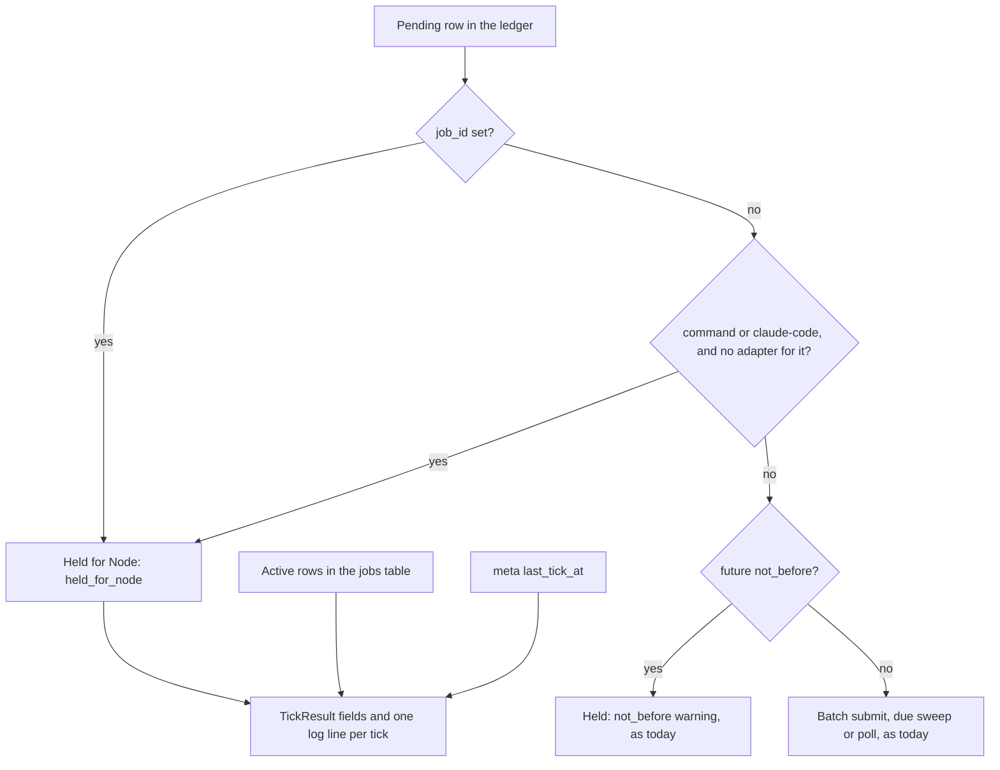
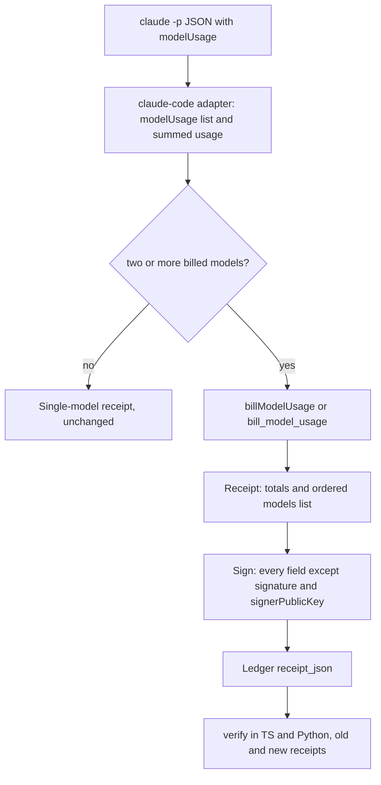

# Jobs Parity Exception and Per-Model Receipts (Batch 24) - Plan

## Goal Capsule

- **Objective:** A user who shares a ledger between the Python package and the Node daemon is told, on every Python tick, which tasks the Python side leaves for the Node daemon, and no job run happens without its limits. A user who runs a multi-model `claude -p` task gets a signed receipt that bills every model it used, and every receipt signed before this change still verifies the same way.
- **Means:** two PRs that run in parallel. PR A (`fix/core-py-jobs-parity-exception`) makes the Python ticker hold and report job rows (KTD1-KTD4). PR B (`feat/receipts-per-model-billing`) bills each model and adds an optional `models` list inside the signed payload (KTD5-KTD10).
- **Authority:** the Product Contract decides what; the Planning Contract decides how. Binding repo rules: `CLAUDE.md` (parity, generated files, hard rules, git conventions), `docs/solutions/best-practices/cross-language-select-window-parity.md`, `docs/solutions/best-practices/generated-docs-embed-and-drift-rule-with-vacuous-pass-guards.md`, `docs/solutions/workflow-issues/generated-test-counts-merge-conflict.md`, `docs/solutions/developer-experience/worktree-environment-setup.md`, `docs/solutions/workflow-issues/public-repo-hygiene.md`. Plan `docs/plans/2026-10-28-0424-refactor-channels-and-region-leftovers-plan.md` (batch 23) stays in force. Its open PR #188 shares three places with this batch: `scripts/qa/docs-drift.mjs` (U4 adds a separate block), the first line of `### Fixed` in `CHANGELOG.md`, and the README test-count block (Sequencing).
- **Execution profile:** 2 Opus `ce-work` agents at once, one per PR, each in its own worktree under `.worktrees/<branch>` from `main`, each with its own Python venv. No stream runs `pnpm qa ui`. One `ce-code-review` per PR at its end.
- **Who ships:** each PR ends green with the review done. Agents do not merge. No PR bumps a version, cuts a release or publishes.
- **Stop conditions:** stop and report in these cases:
  - A PR must edit a file or a function that the other PR owns (Sequencing).
  - An existing signing vector changes its canonical bytes or its signature (R11).
  - A test or check needs the real `HOME`, `~/.tidegap`, `~/.claude` or `~/.config/tidegap`.
  - A gate fails the same way twice.
  - Evidence shows a Key Technical Decision cannot work.
- **Open blockers:** none. Inferred defaults are listed under Assumptions.

---

## Product Contract

### Summary

PR A: the Python ticker stops running rows that belong to jobs, holds them for the Node daemon, and says so in `TickResult` and in one log line per tick. The docs state the exception where a reader looks, and a drift rule checks the claim that code can check. PR B: a `claude -p` run that used several models is billed model by model. The receipt keeps its total fields and gains an optional `models` list inside the signature. Both cores bill the same way and read old and new receipts.

### Problem Frame

The Python package (`tidegap` on PyPI) shares the SQLite ledger with the Node core. It has no jobs code. Today its tick does this with job rows (`packages/core-py/src/tidegap/scheduler.py`, `Scheduler._tick`):

- It never reads the `jobs` table. If only the Python ticker runs, no job ever gets a run, and nothing says so.
- It holds `command` and `claude-code` rows without an adapter (`_held_ts_only_rows`), but silently: no log line, no entry in `TickResult`.
- It runs a due prompt-job run on `anthropic`, `openai`, `gemini` or `ollama` when the caller passes that adapter. The due sweep has no `job_id` check, and `ProviderCallSpec.from_dict` drops the run's `caps` and `tools`. So the run ignores its time limit, its budget cap and its tool set, and its outcome waits for a Node sweep. A run with a deadline over 24 h can also go to a Batch API.
- It runs a `claude-code` job run when an adapter serves that provider (`test_tick_runs_a_claude_code_occurrence_when_an_adapter_serves_it`).
- `expedite_task` and `retry_task` refuse `command` rows only.

There is no Python CLI (`pyproject.toml` has no entry point). The tick's only outward signals are `TickResult` and the `tidegap.scheduler` logger. The docs are partly wrong: `apps/web/content/docs/10-jobs.md` says "The Python ticker holds every `command` and `claude-code` row, job or not", which skips the adapter case and says nothing of prompt-job runs. `CLAUDE.md` says the Python twin "must stay in parity" with no exception. `packages/core-py/README.md` does not mention `tick()` or jobs. The FAQ and the install page make no claim about Python and jobs.

Receipts: `reportedRun` in `packages/cli/src/providers/claude-code.ts` (the brief named `packages/core-ts`; the adapter lives in the CLI host) picks the `modelUsage` entry with the most output tokens and bills only that model's tokens. A run where a helper model fetched web pages or a subagent worked under-reports its carbon. `CHANGELOG.md` lists this under Known issues. The Python ledger reader has a second gap: `_row_to_record` reads `data["task_id"]`, but the Node core writes `receipt_json` in camelCase (`taskId`). Any Python read of a completed Node-run row with a receipt raises `KeyError`, so `get_carbon_budget_status` fails on a shared ledger, and `_check_carbon_budget` swallows the error and never alerts.

### Requirements

**Jobs parity exception (PR A)**

- R1. The Python ticker never claims, dispatches, batch-submits or polls a row that has a `job_id`. The row stays as it is for the Node daemon, whatever adapters the caller passes.
- R2. Python `expedite_task` and `retry_task` refuse a row that has a `job_id`. The error names the Node commands (`tidegap queue run-now <id>`, `tidegap jobs run <job id>`). The row does not change.
- R3. Every Python tick reports in `TickResult` what it leaves for the Node daemon: the ids of pending job rows, the ids of `command` and `claude-code` rows it has no adapter for, the count of active jobs in the ledger, and the time of the last Node tick.
- R4. When R3 finds a row or an active job, the tick logs one line. The line names the counts, the last Node tick and the fix (`tidegap install`, then `tidegap status`). Its level follows AS3.
- R5. The exception is documented where a reader looks: the parity sentence in `CLAUDE.md`, `packages/core-py/README.md`, the `{#jobs-versions}` section of `apps/web/content/docs/10-jobs.md`, and the `### Python` section of `README.md`.
- R6. Docs drift checks the jobs page's Python claim against the code: the providers it names are `_TS_ONLY_PROVIDERS`, and the `TickResult` field it names exists.
- R7. `CHANGELOG.md` gets one `### Fixed` entry under `[Unreleased]`.

**Per-model billing (PR B)**

- R8. When an adapter reports two or more models with tokens, the receipt bills each model's tokens with that model's energy coefficients at the dispatch intensity, and sums them.
- R9. A multi-model receipt keeps today's total fields, now as totals: `actualCarbonGCo2` is the sum, `totalTokens` is the sum, `model` is the model with the most output tokens, `energySource` and `energyResolution` are the weakest across the models (AS5). `estimatedCarbonGCo2` and `deltaPct` keep their meaning.
- R10. The receipt gains an optional `models` list, one entry per billed model, inside the signed payload (KTD5). A single-model run has no `models` field, so its receipt is the same as today.
- R11. Every receipt signed before this change verifies with the same outcome in both cores. A new receipt verifies `valid` in both cores, and also in verifiers already released.
- R12. Both ledgers read old and new receipts. The Python ledger reads receipts in either key rendering and keeps `models`, `tools` and `session`.
- R13. Both cores compute the same numbers for the same input, proven by one shared fixture.
- R14. The `claude-code` adapter reports per-model usage from `modelUsage`. Input counts fresh input plus cache writes; cache reads are not counted (today's rule). Its `usage` is the sum over the models.
- R16. The receipts page and the README's Claude Code receipt paragraph describe the breakdown. `CHANGELOG.md` gets a `### Fixed` entry, and the Known issues line about multi-model billing goes.

### Key Decisions

- **Jobs stay Node-only; the Python ticker flags what it leaves.** (session-settled: user-directed — chosen over porting the jobs sweep and runners to Python: reliability over features, owner decision 2026-10-28.) Governs R1-R6.
- **Bill each model with its own factor and sum; keep the total fields; add an optional breakdown.** (session-settled: user-directed — chosen over keeping dominant-model billing listed as a known issue: a receipt must state what the run used, owner decision 2026-10-28.) Governs R8-R12.
- **Both items ship correctly or not at all; no silent partial behaviour.** (session-settled: user-directed — chosen over shipping parts behind known gaps: owner decision 2026-10-28.) Governs R3, R4, R11, R12.

### Acceptance Examples

- AE1. Covers R1, R3. Given a ledger with a due `anthropic` job run and a Python tick with an `anthropic` adapter, when the tick runs, the adapter is not called, the row stays `scheduled`, and `TickResult.held_for_node` lists the row.
- AE2. Covers R8-R10, R14. Given the fixture `packages/cli/test/fixtures/fake-claude/two-models.json` (opus: 30 input, 4000 cache writes, 900 output; haiku: 400 input, 100 cache writes, 120 output), the receipt has `model` = `claude-opus-5-5`, `totalTokens` = 5550, and `models` = opus (4030 in, 900 out), then haiku (500 in, 120 out), each with its own grams.
- AE3. Covers R11. Given each of the six vectors in `packages/core-ts/test/fixtures/cross-lang-receipt-vectors.json`, its canonical bytes and signature are unchanged, and it verifies with the same outcome in both cores.

### Scope Boundaries

- Python stays without a `claude-code` adapter, a `command` runner and a jobs sweep (Key Decisions).
- Single-model receipts, Batch receipts and closure-task receipts do not change.
- No receipt `version` field and no signed-field allow-list. Optional fields already verify in every released verifier (KTD5).
- Considered, not built: a configurable log level for the R4 line. Python `logging` already lets a caller filter the logger. Evidence that would change this: a user who must silence the line but keep other warnings.

#### Deferred to Follow-Up Work

- The Node side reads Python-written (snake_case) receipts without crashing, but `tidegap stats`, the page and the CLI show their carbon as empty. A display defect, not on this batch's path.
- Per-model lines in `tidegap verify`, `tidegap queue show`, MCP `check_queue_status`, the `tidegap ui` task drawer, OpenClaw and Telegram. The full receipt JSON already carries the list (`tidegap queue show <id> --json`, `GET /api/tasks/<id>`); the lines are presentation the owner did not ask for in this batch.
- The receipt schema section of `packages/core-py/README.md` lists 7 of the receipt's 22 fields. Refresh it separately; PR B leaves that file to PR A.
- Python writes no `last_tick_at` or `tick_runners`, so `tidegap status` cannot see a Python ticker.

### Sources / Research

- Python tick: `packages/core-py/src/tidegap/scheduler.py` (`Scheduler._tick`, `_held_by_not_before`, `_held_ts_only_rows`, `_TS_ONLY_PROVIDERS`, `_collect_batch_submit_candidates`, `_collect_submitted_candidates`, `expedite_task`, `retry_task`, the `job_id` note in `_VISIBILITY_COLUMNS`). Tests: `packages/core-py/tests/test_jobs_ledger.py`, the `not_before` warning test in `packages/core-py/tests/test_tick.py`.
- Node jobs: `packages/core-ts/src/jobs.ts` (`occurrenceBody` puts `caps` and `tools` in the body; `materialize`; `interrupted`), `packages/core-ts/src/storage/sqlite.ts` (the `jobs` table: `status` is `active`, `paused` or `removed`; the `meta` table and `last_tick_at`), `packages/core-ts/src/readiness.ts` (`tidegap install` and `tidegap tick --once` fixes).
- Signing: `packages/core-ts/src/sign.ts` and `packages/core-py/src/tidegap/sign.py`. `SIGNATURE_FIELDS` / `_SIGNATURE_FIELDS` exclude only `signature` and `signerPublicKey`; keys are normalized snake to camel recursively; null and undefined values are dropped. Precedent: `routing` (v0.14), `tools` and `session` (v0.19) were added inside the payload with a shared vector each.
- Receipt build: `packages/core-ts/src/scheduler.ts` (sync provider-call dispatch: `gramsForIntensity`, `resolveModelEnergy`, `maybeSign`), `packages/core-py/src/tidegap/scheduler.py` (`_dispatch_provider_call`, `_round_half_up`). Energy: `packages/core-ts/src/energy.ts`, `packages/core-py/src/tidegap/energy.py`, fixture `packages/core-ts/test/fixtures/model-energy-vectors.json`.
- Adapter: `packages/cli/src/providers/claude-code.ts` (`reportedRun`, `sumInput`, `toResult`), tests `packages/cli/test/claude-code-adapter.test.ts`, fixtures `packages/cli/test/fixtures/fake-claude/`, QA step S9.2 in `scripts/qa/cli-flows.mjs`.
- Ledger readers: `packages/core-ts/src/storage/sqlite.ts` (`rowToRecord`, `safeStringify`: camelCase JSON), `packages/core-py/src/tidegap/scheduler.py` (`_row_to_record`, `_upsert_in_tx`: snake_case `to_dict()`).
- Drift rules: `scripts/qa/docs-drift.mjs`, `scripts/qa/docs-drift-jobs.mjs`, `scripts/qa/docs-drift-jobs.test.mjs`.

---

## Planning Contract

### Key Technical Decisions

**PR A**

- KTD1. **Job rows are identified by a ledger query, not a new `TaskRecord` field.** A new `_TaskStore` read returns the ids of rows with `job_id` set and status `queued`, `scheduled` or `submitted` (AS4). In-memory rows cannot be job rows: only the Node sweep creates them. The tick adds these ids to its held set, which the due sweep and the batch-submit sweep already skip, and the poll sweep skips them too. The atomic claims also refuse job rows: `_TaskStore.claim_scheduled` and `claim_submitted` match only rows with `job_id` NULL, so a job row that a Node sweep inserts after the held query is never claimed; a lost claim on such a row counts as held. Reason: PR B edits `TaskRecord` reading in `_row_to_record`; a query and a claim predicate keep PR A out of that function.
- KTD2. **`TickResult` gains `held_for_node: list[str]`, `active_jobs: int` and `node_last_tick_at: str | None`, all in `to_dict()`.** With a store connected, `held_for_node` comes from ledger reads only: the KTD1 query plus scheduled `command` and `claude-code` rows that have no adapter. In-memory rows count only when there is no store, because an in-memory copy of a held row stays `scheduled` after the Node daemon finishes it. The dispatch hold set does not change. `active_jobs` counts `jobs` rows with status `active`; a ledger without the `jobs` table gives 0, and the tick never creates that table. `node_last_tick_at` is the `meta` value `last_tick_at`, which only Node tickers write. Reason: there is no Python CLI and no exit code, so `TickResult` is the result a caller can branch on. These fields are Python-only, part of the documented exception.
- KTD3. **One log line per tick, after the sweeps.** It names the job-run count, the `command`/`claude-code` count, the active-job count, the last Node tick (or "none recorded") and the fix. A row in `held_for_node` is not also counted in the `not_before` warning. The line never prints prompts or bodies. Level: AS3.
- KTD4. **K18 parses the Python source as text.** It reads `_TS_ONLY_PROVIDERS = frozenset({...})` from `packages/core-py/src/tidegap/scheduler.py` and the `TickResult` fields from `packages/core-py/src/tidegap/types.py`, then checks the `{#jobs-versions}` section names exactly those providers and an existing field. One guard per claim; each guard fails when its regex finds nothing (the vacuous-pass rule). The rule is a pure function in `scripts/qa/docs-drift-jobs.mjs` with tests in `scripts/qa/docs-drift-jobs.test.mjs`. Reason: the provider set is the one Python claim on the page that code can check; the "never runs job rows" claim is proven by pytest, not drift.

**PR B**

- KTD5. **The breakdown goes inside the signed payload.** Signature coverage is a deny-list in both cores: every field except `signature` and `signerPublicKey` is signed, nested keys included. Null and undefined fields drop out of the canonical form. Three things follow:
  - An absent `models` leaves the canonical bytes of every old receipt unchanged, so old receipts verify as before (R11).
  - A new receipt verifies in every released verifier from v0.12 on (the first with today's canonical form), TS and Python, because they sign and check whatever fields are present.
  - Keeping it outside would mean adding `models` to the deny-list in both cores. Every released verifier would then include the field in its canonical form and report each new multi-model receipt as `tampered`. The per-model numbers that explain the signed total would also stay unattested.
  This follows the `routing`, `tools` and `session` precedent. Constraints that keep it byte-identical across cores: KTD6 and KTD8.
- KTD6. **`models` is an array of objects, ordered.** Entry fields: `model`, `inputTokens`, `outputTokens`, `carbonGCo2` (absent when the receipt-side intensity fetch failed), `energySource`, `energyResolution`. The model id is a value, never a key, so key normalization cannot change it. Order: output tokens descending, then model id ascending (AS8); `models[0].model` equals the top-level `model`. Present only with two or more billed entries; an entry with zero input and zero output is not billed (AS9). Field name: AS7.
- KTD7. **One billing function per core, one shared fixture.** `billModelUsage` in `packages/core-ts/src/energy.ts` and `bill_model_usage` in `packages/core-py/src/tidegap/energy.py` take the dispatch intensity (or none) and the per-model usage. They return the unrounded total grams, the ordered entries, the dominant model, the token total and the weakest tiers. Entries with a non-finite or negative count are dropped before billing, because `canonicalize` throws on a non-finite number and the dispatch would then complete without a receipt. Fixture: `packages/core-ts/test/fixtures/model-usage-billing-vectors.json`, read by both suites (`cross-language-select-window-parity.md`).
- KTD8. **Rounding.** `actualCarbonGCo2` is the unrounded sum rounded to 0.1 g, as today. Each entry's `carbonGCo2` is rounded to 0.01 g (AS6). Both use round-half-up (`Math.round` in TS, `_round_half_up` in Python).
- KTD9. **Adapter contract: `DispatchResult.modelUsage` (TS) and `DispatchResult.model_usage` (Python).** A list of `{model, inputTokens, outputTokens}`. The core bills per model only from this list (one source, as the K4 fix intended). With fewer than two billed entries it takes today's path through `usage` and `model`. The `claude-code` adapter fills the list from `modelUsage` (an absent count is 0 in the list). Its `usage` sums each count over the entries that report it; a count no entry reports stays undefined, so single-model results do not change. Its `model` is the first entry in KTD6 order.
- KTD10. **The Python reader accepts both renderings and keeps keys it does not model.** `_row_to_record` reads each `CarbonReceipt` field from its snake key, else from its camel key (the existing `_snake_to_camel` in `packages/core-py/src/tidegap/sign.py`). `CarbonReceipt` gains `models` (camelCase inside, like `routing`) and a stored-only map of the receipt keys it does not model, such as `tools`, `session` and any field a later Node release adds. `to_dict()` and `to_camel_dict()` write that map back at the top level unchanged and write nothing when it is empty, so a Node receipt read by Python still verifies and a Python-produced receipt keeps its canonical bytes. Python writes keep today's snake_case `to_dict()` form. Reason: R12 requires the Python ledger to accept new receipts, and new receipts are Node-written; today it cannot read any Node receipt, and a fixed field list would drop the next new field.

### High-Level Technical Design

Python tick, per pending row (PR A):

Multi-model receipt (PR B):

### Assumptions

Inferred defaults, not confirmed by the owner. Each is cheap to flip during review.

- AS1. A `command` or `claude-code` row without a `job_id` keeps today's rule: held unless an adapter serves it. Only rows with a `job_id` are held whatever the adapters.
- AS2. Python `cancel_task` on a job row stays allowed. Stopping work is safe; the Node sweep records the cancel.
- AS3. The R4 line is always a warning. Reason: a recent Node tick does not prove the held rows will run (the daemon may have no runner for their provider), and only `tidegap status` judges that. A caller who runs both tickers can filter the `tidegap.scheduler` logger; `TickResult` carries the facts. Alternative: info when a Node tick ran in the last hour.
- AS4. "Pending" job rows are `queued`, `scheduled` and `submitted`. `running` rows are being run by a Node ticker and are not listed.
- AS5. Top-level `energySource` and `energyResolution` of a multi-model receipt are the weakest across the entries (`measured` > `estimated` > `fallback`; `exact` > `normalized` > `family-fallback` > `default`), because they describe the confidence of the summed grams. Alternative: the dominant model's tiers.
- AS6. Entry grams are rounded to 0.01 g so a small helper model does not show 0; the total stays at 0.1 g. The entries may not add up exactly to the total; the receipts page says so.
- AS7. The field is named `models`.
- AS8. Ties on output tokens order by model id. Today the first `modelUsage` key wins a tie.
- AS9. "Billed model" means an entry with input or output above 0. One billed entry takes the single-model path.
- AS10. PR B fixes the Python camelCase read (KTD10), a defect older than this item, because R12 cannot hold without it.

### Sequencing

Both PRs start from `main` and run at once (cap 2).

| PR | Branch | Units | Files owned |
|---|---|---|---|
| A | `fix/core-py-jobs-parity-exception` | U1-U4 | `packages/core-py/tests/test_jobs_ledger.py`, `packages/core-py/tests/test_tick.py`, `packages/core-py/README.md`, `CLAUDE.md`, `apps/web/content/docs/10-jobs.md`, `scripts/qa/docs-drift.mjs`, `scripts/qa/docs-drift-jobs.mjs`, `scripts/qa/docs-drift-jobs.test.mjs` |
| B | `feat/receipts-per-model-billing` | U5-U9, U11 | `packages/core-ts/src/types.ts`, `packages/core-ts/src/providers/base.ts`, `packages/core-ts/src/energy.ts`, `packages/core-ts/src/scheduler.ts`, `packages/core-ts/src/index.ts`, `packages/core-ts/test/fixtures/model-usage-billing-vectors.json` (new), `packages/core-ts/test/fixtures/cross-lang-receipt-vectors.json`, `packages/core-ts/test/receipt-models.test.ts` (new), `packages/core-py/src/tidegap/energy.py`, `packages/core-py/src/tidegap/providers/base.py`, `packages/core-py/tests/test_model_usage_billing.py` (new), `packages/core-py/tests/test_receipt_models.py` (new), `packages/cli/src/providers/claude-code.ts`, `packages/cli/test/claude-code-adapter.test.ts`, `packages/cli/test/tick-claude-code.test.ts`, `packages/cli/test/fixtures/fake-claude/`, `scripts/qa/cli-flows.mjs`, `apps/web/content/docs/08-receipts.md` |

Conflict call-out on the "disjoint files" directive: the two items cannot be file-disjoint. Both change Python behaviour that lives in the same two files, and both need CHANGELOG and README lines. They are disjoint by function and by hunk, so git merges them without a conflict:

| Shared file | PR A owns | PR B owns |
|---|---|---|
| `packages/core-py/src/tidegap/scheduler.py` | `_TS_ONLY_PROVIDERS` and its helpers, new `_TaskStore` reads placed after `future_not_before_ids`, `_TaskStore.claim_scheduled`, `_TaskStore.claim_submitted`, `tick`, `_tick`, `_held_by_not_before`, `_held_ts_only_rows`, `_collect_submitted_candidates`, `expedite_task`, `retry_task` | `_row_to_record` (the receipt block only), the receipt build in `_dispatch_provider_call` |
| `packages/core-py/src/tidegap/types.py` | `TickResult` | `CarbonReceipt` |
| `CHANGELOG.md` | one entry appended at the end of `### Fixed` | one entry inserted first in `### Fixed`; the Known issues line removed |
| `README.md` | the `### Python` section | the "**Carbon receipt.**" paragraph of the Claude Code section |

- The second PR to merge updates from `main` (merge `origin/main`, as the generated-file recipe does), runs pytest and the gate again, and reports a conflict instead of resolving it by hand when one appears outside the generated files. Exception: a `CHANGELOG.md` conflict limited to neighbouring `### Fixed` entries (this batch's or batch 23's) is resolved by keeping both entries; it is not a stop condition.
- Generated files: both PRs add counted tests and edit docs pages, so both change the README test-count block, `apps/web/src/lib/tests.generated.ts`, `apps/web/src/lib/docs.generated.ts` and `apps/web/public/llms-full.txt`. On a conflict: take `main`'s version, run the generator, commit (`generated-test-counts-merge-conflict.md`). Never hand-edit them.
- Python parity: PR A changes only Python (the exception); PR B changes both cores in step (R13). Each PR body says so.
- UI client API: neither PR changes a route or a field. `GET /api/tasks/<id>` returns the receipt as stored, so `models` appears there with no code change. `docs/spec/ui-client-api.md` does not enumerate receipt fields and stays as it is.
- Batch 23 (PR #188) changes the K13 block of `scripts/qa/docs-drift.mjs`, adds the first `### Fixed` line and regenerates the README test-count block. U4 adds a K18 block after K17 and one header-comment entry; if batch 23 lands first, merge `origin/main` and apply the rules above.

---

## Implementation Units

### U1. The Python tick holds job rows and reports what it leaves

- **Goal:** R1, R3 and R4: no job row runs from Python, and every tick says what it left for the Node daemon.
- **Requirements:** R1, R3, R4; KTD1-KTD3; AS1, AS3, AS4.
- **Dependencies:** none.
- **Files:** `packages/core-py/src/tidegap/scheduler.py`, `packages/core-py/src/tidegap/types.py` (`TickResult` only), `packages/core-py/tests/test_jobs_ledger.py`, `packages/core-py/tests/test_tick.py` (only if an existing `not_before` test needs a change).
- **Approach:**
  1. Add `_TaskStore` reads: pending job-row ids (KTD1), the active-job count (0 when the `jobs` table is missing, never creating it), and one `meta` value.
  2. Add `job_id` IS NULL to the `claim_scheduled` and `claim_submitted` updates (KTD1).
  3. In `_tick`, build the Node-held set once from the job-row ids and `_held_ts_only_rows`, add it to `held`, and pass it to the poll sweep so a `submitted` job row is not claimed.
  4. Make `_held_by_not_before` count only rows not in the Node-held set.
  5. After the sweeps, fill the `TickResult` fields from ledger reads (KTD2) and log the KTD3 line as a warning (AS3).
  6. Update the `_tick` docstring and the `_VISIBILITY_COLUMNS` `job_id` comment to the new rule.
- **Patterns to follow:** `_held_by_not_before` (one warning per tick), `future_not_before_ids` (store read with a fail-soft fallback), the `caplog` test in `packages/core-py/tests/test_tick.py`, the ledger helpers in `test_jobs_ledger.py` (`_insert_task`, `TS_JOBS_TABLE`).
- **Test scenarios:**
  - Covers AE1. A due `anthropic` job run with an `anthropic` adapter: the adapter is not called, the row stays `scheduled`, `held_for_node` lists it, no `failed` or `dispatched` event.
  - A due `claude-code` job run with a `claude-code` adapter: held and listed. This replaces `test_tick_runs_a_claude_code_occurrence_when_an_adapter_serves_it`.
  - A due `claude-code` row without `job_id` and with an adapter: it runs, as today (AS1).
  - A due `claude-code` row without `job_id` and without an adapter: held and listed in `held_for_node`.
  - The existing `command` and `claude-code` job-run tests also assert their id in `held_for_node`.
  - A job run with a deadline over 24 h and a batch-capable `anthropic` adapter: not submitted.
  - A `submitted` job run: not polled; the adapter's retrieve is not called; status stays `submitted`.
  - A TS `jobs` table with one `active` and one `paused` job: `active_jobs` is 1. A Python-created ledger: `active_jobs` is 0 and the `jobs` table still does not exist after the tick.
  - A `meta` row `last_tick_at`: reported in `node_last_tick_at`; no row: `None`.
  - Log: one WARNING per tick that names the counts, the last Node tick (or none recorded) and `tidegap install`; with a `last_tick_at` 10 minutes old it is still a WARNING and names that time; a tick with nothing held and no active job logs nothing.
  - Stale memory: a tick holds a `claude-code` job row; the test marks the row `completed` in the ledger; a second tick on the same `Scheduler` reports an empty `held_for_node` and logs nothing.
  - Claim race: a job row inserted into the ledger after the held query (for example from a fake batch adapter's submit call) is not claimed by the due sweep and stays `scheduled`.
  - A job run with a future `not_before`: in `held_for_node`, not counted in the `not_before` warning.
  - `TickResult.to_dict()` has the three new keys; on an empty ledger they are `[]`, `0` and `None`.
- **Verification:** pytest and ruff green; AE1 holds; no test needs a real `HOME`.

### U2. Expedite and retry refuse job rows

- **Goal:** R2: a Python caller cannot run a job row early or again outside the Node daemon.
- **Requirements:** R2; KTD1; AS2.
- **Dependencies:** U1 (the store read).
- **Files:** `packages/core-py/src/tidegap/scheduler.py` (`expedite_task`, `retry_task`), `packages/core-py/tests/test_jobs_ledger.py`.
- **Approach:** before the existing `command` check, ask the store whether the row has a `job_id`; refuse with a `RuntimeError` that names `tidegap queue run-now <id>` and `tidegap jobs run <job id>`. `cancel_task` does not change.
- **Patterns to follow:** the `runs a shell command` refusals and `test_expedite_and_retry_refuse_a_command_occurrence`.
- **Test scenarios:**
  - `expedite_task` on a scheduled `anthropic` job run raises with both commands in the message; the row and its events do not change.
  - `retry_task` on a failed `anthropic` job run raises the same way; the row stays `failed`.
  - `cancel_task` on a scheduled job run still cancels it (AS2).
  - `expedite_task` on a non-job `anthropic` row still works as today.
- **Verification:** pytest green.

### U3. Document the exception and add the CHANGELOG entry

- **Goal:** R5 and R7: a reader of any likely page learns that jobs run only on the Node daemon and what the Python ticker reports.
- **Requirements:** R5, R7.
- **Dependencies:** U1, U2 (the docs name their field and behaviour).
- **Files:** `CLAUDE.md`, `packages/core-py/README.md`, `apps/web/content/docs/10-jobs.md`, `README.md` (`### Python` only), `CHANGELOG.md`.
- **Approach:**
  1. `CLAUDE.md`: one clause on the parity sentence: jobs are Node-only; the Python tick holds every job row and each `command` or `claude-code` row it has no adapter for, and reports them (link to the core-py README section).
  2. `packages/core-py/README.md`: add `await scheduler.tick(adapters)` to the Methods list, and a short "Jobs run on the Node daemon" section: what is held, the `TickResult` fields, the log line, the fix.
  3. `10-jobs.md` `{#jobs-versions}`: replace the Python sentence with the R1-R3 rule. State the job-row rule with no provider list: every job row is held, whatever its provider. Name the non-job providers (`command`, `claude-code`) in backticks and `TickResult.held_for_node` in the form K18 parses (U4).
  4. `README.md` `### Python`: one sentence that the package is a library and that jobs run on the Node daemon, pointing to the jobs page section "Mixed versions and the Python ticker".
  5. `CHANGELOG.md`: append one `### Fixed` entry at the end of the list (Sequencing).
  6. Run `pnpm gen:docs` and `pnpm gen:tests` (with the worktree venv) and commit their output.
- **Patterns to follow:** existing `{#jobs-versions}` wording; plain short sentences; no local paths or names (`public-repo-hygiene.md`).
- **Test expectation:** none -- docs only; K18 (U4), K15-K17 and `pnpm gen:docs:check` check them.
- **Verification:** the gate prints `PASS`; K15-K17 still pass on the edited page; the FAQ and the install page are unchanged.

### U4. Drift rule K18 for the Python ticker claim

- **Goal:** R6: the page's Python claim cannot drift from the code without the gate failing.
- **Requirements:** R6; KTD4.
- **Dependencies:** U1 (the field exists), U3 (the sentence exists).
- **Files:** `scripts/qa/docs-drift-jobs.mjs`, `scripts/qa/docs-drift-jobs.test.mjs`, `scripts/qa/docs-drift.mjs` (a K18 `track` block after K17 and the header comment).
- **Approach:** a pure function takes the jobs page text and the two Python source texts and returns the problem list. `docs-drift.mjs` reads the three files and calls it.
- **Patterns to follow:** `jobLimitProblems` and its tests: one regex per claim, a guard per claim, mutations compared with the full problem list.
- **Test scenarios:**
  - Pass: the real-shaped fixture page and source give no problems.
  - The page names one provider fewer than `_TS_ONLY_PROVIDERS`: one problem naming the missing provider.
  - The source adds a provider the page does not name: one problem.
  - The page names a `TickResult` field that the source lacks: one problem.
  - The `{#jobs-versions}` section or the Python sentence is missing: one problem each, never a pass.
  - The `_TS_ONLY_PROVIDERS` line or the `TickResult` class is missing from the source: one problem each.
- **Verification:** `node --test scripts/qa/docs-drift-jobs.test.mjs` green; `node scripts/qa/docs-drift.mjs` prints `PASS`; deleting the provider list from a scratch copy of the page makes K18 fail.

### U5. Shared per-model billing in both cores

- **Goal:** R8, R9 and R13: one billing rule, the same numbers in TS and Python.
- **Requirements:** R8, R9, R13; KTD6-KTD8; AS5, AS6, AS8, AS9.
- **Dependencies:** none.
- **Files:** `packages/core-ts/src/energy.ts`, `packages/core-py/src/tidegap/energy.py`, `packages/core-ts/test/fixtures/model-usage-billing-vectors.json` (new), `packages/core-ts/test/receipt-models.test.ts` (new), `packages/core-py/tests/test_model_usage_billing.py` (new).
- **Approach:** add `billModelUsage` / `bill_model_usage` next to `gramsForIntensity` / `grams_for_intensity`, built on the existing estimators. Do not export them from the package entry points (`index.ts`, `__init__.py`): the scheduler is their only caller, and the tests import the energy modules directly. The fixture holds inputs and expected outputs; both suites load it by path.
- **Patterns to follow:** `packages/core-ts/test/energy-parity.test.ts` and `packages/core-py/tests/test_energy_parity.py` (fixture under core-ts, Python reaches it with `parents[2]`).
- **Test scenarios (vectors, run in both suites):**
  - Two known models: per-entry grams, the summed total, `model`, `totalTokens`, exact tiers.
  - Three models with one unknown id: weakest tiers are `fallback` and `default`.
  - A tie on output tokens: order by model id.
  - An entry with zero input and zero output: dropped; with one billed entry left, the result says single-model.
  - No intensity: entries without grams; tiers and tokens still set.
  - An entry with a non-finite or negative count: dropped, no throw.
  - A value at a 0.005 g rounding boundary: rounds up in both cores.
- **Verification:** both suites pass on the same fixture; changing one expected value fails both.

### U6. The `models` field and its signature compatibility

- **Goal:** R10 and R11: the field exists in both cores and keeps every old receipt's verification unchanged.
- **Requirements:** R10, R11; KTD5, KTD6, KTD10.
- **Dependencies:** U5 (entry shape).
- **Files:** `packages/core-ts/src/types.ts` (`CarbonReceipt.models`, the entry type), `packages/core-ts/src/index.ts` (type export of the entry type only), `packages/core-py/src/tidegap/types.py` (`CarbonReceipt`: `models`, the map of unmapped keys, `to_dict`, `to_camel_dict`), `packages/core-ts/test/fixtures/cross-lang-receipt-vectors.json`, `packages/core-ts/test/receipt-models.test.ts`, `packages/core-py/tests/test_receipt_models.py`.
- **Approach:**
  1. Add the optional field with a doc comment that says it is inside the signed payload, like `routing`. In Python, add the map of unmapped keys (KTD10); `to_dict()` stops being a bare `asdict` so the map is flattened and an empty map writes nothing.
  2. Add one vector: a v0.20 multi-model `claude-code` receipt with `models`, `tools` and `session`. Sign it with the fixture's existing throwaway key (no new key material); the description is unique in its first 48 characters.
  3. Leave the six existing vectors byte-identical.
- **Execution note:** write the vector and the tamper tests first, and confirm the existing vectors pass unchanged before touching dispatch code.
- **Test scenarios:**
  - Covers AE3. All existing vectors keep their canonical bytes and signatures in both suites (the parametrized vector tests already do this; nothing in them changes).
  - The new vector: canonical bytes equal `expectedCanonical`, signature verifies `valid` in TS and in Python.
  - Changing one entry's `carbonGCo2`, swapping the order of two entries, or deleting `models` from the signed new receipt: `tampered` in both cores.
  - A Python `CarbonReceipt` built with `models` and unmapped keys `tools` and `session`, signed from `to_dict()`, verifies in TS from its snake rendering.
  - A Python receipt with no `models` and an empty map signs to the same canonical bytes as before (existing `test_sign.py` cases stay green).
- **Verification:** vector suites green in both cores; no existing vector file entry changed in the diff.

### U7. The core bills a multi-model dispatch

- **Goal:** R8-R10 at dispatch: the sync provider-call path writes a per-model receipt when the adapter reports several models.
- **Requirements:** R8, R9, R10; KTD7-KTD9.
- **Dependencies:** U5, U6.
- **Files:** `packages/core-ts/src/providers/base.ts` (`DispatchResult.modelUsage`, the usage type), `packages/core-ts/src/scheduler.ts` (sync provider-call receipt build only), `packages/core-ts/src/index.ts` (type export of the usage type only), `packages/core-py/src/tidegap/providers/base.py` (`DispatchResult.model_usage`, the usage type), `packages/core-py/src/tidegap/scheduler.py` (receipt build in `_dispatch_provider_call` only), `packages/core-ts/test/receipt-models.test.ts`, `packages/core-py/tests/test_receipt_models.py`.
- **Approach:** at the receipt build, call the U5 function when the result carries the list. With two or more billed entries, take `actualCarbonGCo2`, `totalTokens`, `model`, the tiers and `models` from it; otherwise keep today's code path untouched. `deltaPct` uses the new total. Batch and closure receipt builds do not change.
- **Patterns to follow:** the existing receipt build blocks; the `_ClaudeCodeAdapter` stand-in in `test_jobs_ledger.py` for a Python fake adapter. Python tick and dispatch tests insert rows with `job_id` NULL: PR A holds every job row whatever adapters are passed, so a test on a job row would fail once both PRs are on `main`.
- **Test scenarios (both cores):**
  - A fake adapter returns two models: the receipt has the U5 numbers, ordered `models`, the dominant `model`, and verifies `valid`.
  - A fake adapter returns one model in the list: the receipt has no `models` and equals the receipt built from `usage` alone.
  - A fake adapter returns no list: the receipt is unchanged from today (the existing core tick tests stay green).
  - The receipt-side intensity fetch fails: `actualCarbonGCo2` falls back to the estimate as today, entries carry no grams, the receipt still signs.
  - TS: a completed record with `models` round-trips through `TaskStore` unchanged.
- **Verification:** `pnpm --filter @tidegap/core test` and pytest green.

### U8. The Python ledger reads both receipt renderings

- **Goal:** R12: Python reads every receipt in a shared ledger and keeps the new fields.
- **Requirements:** R12; KTD10; AS10.
- **Dependencies:** U6.
- **Files:** `packages/core-py/src/tidegap/scheduler.py` (`_row_to_record`, receipt block only), `packages/core-py/tests/test_receipt_models.py`.
- **Approach:** read each `CarbonReceipt` field from its snake key, else its camel key, including `models`; keep every other key in the map of unmapped keys (KTD10). Writes do not change.
- **Test scenarios:**
  - A row whose `receipt_json` is an old Node receipt (camelCase, no `models`): `load` returns it with every field set; no `KeyError`.
  - A row with the U6 vector's signed receipt (camelCase): `load` keeps `models`, `tools` and `session`; `verify_receipt(receipt.to_camel_dict())` is `valid`.
  - A signed Node receipt with an extra top-level key that no core models yet: after `load`, `verify_receipt(receipt.to_camel_dict())` is still `valid`.
  - A row written by Python (snake_case) with `models`: round-trips unchanged.
  - `get_carbon_budget_status` over a ledger holding one Node receipt and one Python receipt counts both; before the fix it raised.
  - `list_all` over a mixed ledger returns every row.
- **Verification:** pytest green; the budget regression test fails on `main` and passes on the branch.

### U9. The `claude-code` adapter reports per-model usage

- **Goal:** R14: the adapter hands the core what each model used.
- **Requirements:** R14; KTD9; AS8.
- **Dependencies:** U7 (the `DispatchResult` field).
- **Files:** `packages/cli/src/providers/claude-code.ts` (`reportedRun`, `toResult`), `packages/cli/test/claude-code-adapter.test.ts`, `packages/cli/test/tick-claude-code.test.ts`, `scripts/qa/cli-flows.mjs` (step S9.2), and any other CLI or QA test that asserts receipt numbers from the `success` fixture.
- **Approach:** turn `reportedRun` into a list builder with the KTD9 rules, keep `sumInput`, and set `model`, `usage` and `modelUsage` from it. The no-`modelUsage` and empty-`modelUsage` fallbacks stay as they are.
- **Test scenarios:**
  - Covers AE2. The `two-models` fixture: `model` opus, `usage` 4530 in, 1020 out, 5550 total, `modelUsage` opus then haiku with their own counts.
  - The `single-model`, `no-model-usage` and `empty-usage` fixtures: results unchanged from today.
  - The default `success` fixture already reports two models with tokens (haiku: 3 input, 2048 cache writes, 5 output; sonnet-5: 40 input, 1 output), so it becomes a two-model result: `model` claude-haiku-5-5, `usage` 2091 in, 6 out, 2097 total, `modelUsage` haiku then sonnet-5. Update the 2051/5/2056 assertion in `claude-code-adapter.test.ts`, the `totalTokens` 2056 assertion in `tick-claude-code.test.ts` (to 2097, plus two `receipt.models` entries), and any other assertion of those numbers.
  - A `modelUsage` entry without `outputTokens`: the list has 0 for it; `usage.outputTokens` sums the entries that report it.
  - A `modelUsage` entry with a non-number count: dropped from the list.
  - S9.2: `totalTokens` equals the sum over all models, and `receipt.models` lists both models with their own counts.
  - End to end: a tick with the fake `claude` binary on `two-models` writes a receipt with `models`, and `tidegap verify <id>` exits 0.
- **Verification:** `pnpm --filter @tidegap/cli test` green; `pnpm qa cli` passes S9.2.

### U11. Receipt docs and CHANGELOG

- **Goal:** R16: the docs state what a multi-model receipt contains.
- **Requirements:** R16.
- **Dependencies:** U5-U9.
- **Files:** `apps/web/content/docs/08-receipts.md`, `README.md` ("**Carbon receipt.**" paragraph only), `CHANGELOG.md`.
- **Approach:**
  1. `08-receipts.md`: a "Runs that use several models" section (`{#receipt-models}`): what an entry holds, how the totals are made (R9), rounding (AS6), that the list is signed, that older receipts verify as before, and that `tidegap queue show <id> --json` shows the list.
  2. `README.md`: one sentence in the Claude Code receipt paragraph.
  3. `CHANGELOG.md`: insert the `### Fixed` entry first in that list, remove the Known issues line about multi-model billing.
  4. Run `pnpm gen:docs` and `pnpm gen:tests` (with the worktree venv) and commit their output.
- **Test expectation:** none -- docs only; `pnpm gen:docs:check` and the drift checks cover them.
- **Verification:** the gate prints `PASS`.

---

## Verification Contract

Every PR:

- Before any test in a new worktree: build the Python venv inside it (`docs/solutions/developer-experience/worktree-environment-setup.md`) and run `pnpm install` and `pnpm build` there. `pnpm gen:tests` needs that venv, or the Python count stays stale.
- The gate, from the repo root: `pnpm build && pnpm typecheck && pnpm gen:tests:check && pnpm gen:docs:check && node scripts/qa/docs-drift.mjs` prints `PASS`. Read a failing log with `grep -nE "✘|Error|expected" <log> | head -40`.
- `pnpm check:versions` passes, and no version field changes.
- `cd packages/core-py && .venv/bin/python -m pytest` and `.venv/bin/ruff check .` pass.
- `pnpm --filter @tidegap/core test` and `pnpm --filter @tidegap/cli test` pass.
- Generated files come only from `pnpm gen:tests` and `pnpm gen:docs`.
- `CHANGELOG.md` changes only under `[Unreleased]`, at the positions in Sequencing.
- No `pnpm qa ui` in either stream.
- Commits follow Conventional Commits; git runs with `git -c core.editor=true -c sequence.editor=true`; each message comes from a uniquely named file passed with `-F`; review fixes fold into their commits (`folding-review-fixes-into-commits.md`). No `Claude-Session` trailer and no session link in any commit or PR body: `git log origin/main..HEAD --format=%B` and the PR body give no match for `Claude-Session|claude.ai/code`.
- Public-repo hygiene: no local paths, owner names, account or token names, or scratch notes in committed files.
- Tests use an isolated `HOME`, never the real one.

Per PR:

| PR | Extra checks | PR body |
|---|---|---|
| A | `node --test scripts/qa/docs-drift-jobs.test.mjs`; the K18 mutation from U4 | Python parity exception stated; Node core unchanged |
| B | `pnpm qa cli` (S9.2; no browser); the six old vectors unchanged in the diff | Both cores changed in step; signature decision (KTD5) in two lines |

---

## Definition of Done

- Every requirement R1-R14 and R16 is met by its unit, or reported under a stop condition.
- Each PR touches only its Sequencing files and its rows of the shared-file table, plus the generated files.
- The gate and the per-PR checks pass on the final commit, and CI is green.
- AE1-AE3 hold as tests.
- `ce-code-review` ran once per PR, and its findings are fixed and folded into their commits.
- The CHANGELOG Known issues line about multi-model billing is gone; each PR added one `### Fixed` entry.
- No abandoned-attempt code, debug output or temporary files remain in either diff.
- Neither PR is merged by an agent.
