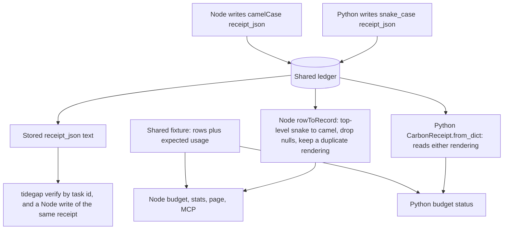

# Reliability Residuals (Batch 25) - Plan

## Goal Capsule

- **Objective:** A user who shares one ledger between the Python package and the Node daemon gets the same carbon budget from both. A Batch task is never billed twice because the daemon was stopped, and a job's Batch result is not dropped because a tick died while polling it. A receipt bills a token count that the run did not report by one rule, whatever the number of models. A user who types with an input method (IME) can save a grid region with one click. The gate fails only on real defects, not on the two known test races.
- **Means:** three PRs that run in parallel and share no hand-edited file (Sequencing). PR A (`fix/ledger-and-batch-reliability`) fixes the shared-ledger read, the closed Python scheduler and the forced stop of Batch rows (KTD1-KTD5). PR B (`fix/receipts-unreported-counts`) sets one billing rule for unreported token counts (KTD6, KTD7). PR C (`fix/region-ime-drift-and-test-races`) fixes the region card, the K5 badge check, stale `ebb` command names and the two test races, then writes the batch CHANGELOG once PR A and PR B are merged (KTD8-KTD12).
- **Authority:** the Product Contract decides what; the Planning Contract decides how. Binding repo rules: `CLAUDE.md` (parity, generated files, hard rules, git conventions), `docs/solutions/best-practices/cross-language-select-window-parity.md` (one fixture, two suites), `docs/solutions/developer-experience/deterministic-process-kill-tests.md`, `docs/solutions/logic-errors/time-of-day-bugs-and-fake-time-sweeps.md`, `docs/solutions/best-practices/signed-receipt-two-renderings-of-one-field.md`, `docs/solutions/workflow-issues/generated-test-counts-merge-conflict.md`, `docs/solutions/developer-experience/worktree-environment-setup.md`, `docs/solutions/workflow-issues/public-repo-hygiene.md`. Plan `docs/plans/2026-10-28-0441-fix-reliability-parity-and-receipts-plan.md` (batch 24) stays in force; this plan closes its residuals.
- **Execution profile:** 3 Opus `ce-work` agents at once, one per PR, each in its own worktree under `.worktrees/<branch>` from `main` (`b36f2f2`), each with its own Python venv. No stream runs `pnpm qa ui` or any other browser suite; the batch's one `pnpm qa ui` run is part of U12, when nothing else runs. One `ce-code-review` per PR at its end. PR C opens as a draft after U7-U11; U12 follows once PR A and PR B are merged, and PR C's review runs after U12 (KTD12).
- **Who ships:** each PR ends green with its review done and the diff reviewed. Agents do not merge. No PR bumps a version, cuts a release or publishes.
- **Stop conditions:** stop and report in these cases:
  - A PR must edit a hand-edited file that another PR owns (Sequencing).
  - An existing signing vector in `packages/core-ts/test/fixtures/cross-lang-receipt-vectors.json` changes its canonical bytes or its signature.
  - A test or check needs the real `HOME`, `~/.tidegap`, `~/.claude` or `~/.config/tidegap`.
  - A gate fails the same way twice.
  - Evidence shows a Key Technical Decision cannot work.
  - A test race recurs after its fix (U10, U11): record the run and stop; do not retry in a loop.
- **Open blockers:** none. Inferred defaults are listed under Assumptions.
- **Status (2026-10-30):** done. PR A merged as #195, PR B as #194 and PR C as #196, each after one `ce-code-review` pass with its findings folded in and CI green. Learnings: rule 7 of `docs/solutions/best-practices/signed-receipt-additive-fields.md`, `docs/solutions/logic-errors/multi-model-receipt-billing.md`, `docs/solutions/logic-errors/compare-and-set-task-transitions.md` (external id as evidence; the Python re-read), `docs/solutions/best-practices/parity-twin-holds-what-it-cannot-run.md` (a closed twin refuses work), `docs/solutions/best-practices/dependency-free-task-ui-patterns.md`, `docs/solutions/developer-experience/deterministic-process-kill-tests.md`, the K5 section of `docs/solutions/best-practices/generated-docs-embed-and-drift-rule-with-vacuous-pass-guards.md`, and `docs/solutions/workflow-issues/review-fan-out-cost-and-bounded-agent-waits.md`.
- **Residuals (open, not fixed):**
  - PR B: a `null` cache-write part makes the whole input of a `modelUsage` entry unreported, while the top-level `usage` path counts it as 0. A receipt can say `energySource: "measured"` while part of its tokens are the typical count. On the single-model path, a negative or non-finite count is billed as given.
  - PR A: the read copy of a Python receipt signed by v0.11 or older, exported as JSON (the UI task detail), verifies `tampered` with `tidegap verify --file`; only `tidegap verify <task-id>` reads the stored bytes. A plain (non-job) Batch row that a killed tick left `running` stays `running`, and its result is never polled. The Python actions read the row from the ledger but still write with an unconditional `upsert`: a Node write between the read and the write is overwritten, and `expedite_task` can run a row that Node claimed in that gap.
  - PR C: a Save pressed while a composition is still open shows no "Saving…", and a second press sends a second request. The manual IME check in Safari and the Mac app stays an owner row.
  - The items under Deferred to Follow-Up Work stand.

---

## Product Contract

### Summary

PR A: the Node core reads receipts that the Python core wrote, so budget, stats and the page count them. A Python scheduler closed by `shutdown()` refuses to tick, expedite or retry until `connect()` reopens it, so no stale in-memory row runs. A forced daemon stop sends a Batch row that was being polled back to `submitted`, and fails a row that was being submitted with an error that blocks every retry path. The job sweep sends a job's Batch row that a killed tick left `running` back to `submitted` instead of failing it. PR B: a token count that a model did not report is billed at that model's typical count on every path; the receipt shows only the counts the run reported. PR C: a click that commits an IME composition is no longer lost; K5 checks the README tool badge; learnings name current commands; two test races get deterministic waits; the CHANGELOG records the batch.

### Problem Frame

Each item below was checked against `main` at `b36f2f2`. Line numbers are as of that commit.

- **Node undercounts a shared ledger (PE1).** `rowToRecord` in `packages/core-ts/src/storage/sqlite.ts:1126` parses `receipt_json` as stored. The Python core stores receipts in snake_case (`CarbonReceipt.to_dict`, `packages/core-py/src/tidegap/types.py:313`). `receiptRanAtMs` (`packages/core-ts/src/budget.ts:130`) reads `ranAt`, finds nothing and skips the row; `receiptCarbonG` (`budget.ts:91`) reads `actualCarbonGCo2`. So Node `getCarbonBudgetStatus`, `tidegap stats` and the page undercount every Python-run task. The #191 review reproduced it: 2 Node rows plus 1 Python row give 3 tasks in Python and 2 in Node. The Python side already reads both renderings (`CarbonReceipt.from_dict`, `types.py:290`, batch 24).
- **A closed Python scheduler can run a stale row (#190 residual).** The Python `TaskRecord` (`types.py:378`) has no `job_id`. The due sweep hydrates every due row into memory before it checks the held set (`packages/core-py/src/tidegap/scheduler.py:2052`). After `shutdown()` (`scheduler.py:1581`) sets `_connected = False`, `_held_for_node` (`scheduler.py:2332`) and `_refuse_job_run` (`scheduler.py:2406`) skip the ledger. `tick()` then dispatches the hydrated job row from memory, and `expedite_task` (via `_lookup_record`, `scheduler.py:3075`) does not refuse it. The same holds for a plain row: `_claim_for_dispatch` (`scheduler.py:3087`) falls back to an in-memory status check, the provider gets the call, and the ledger row stays `scheduled` for the Node daemon to run again. Recorded as open in `docs/solutions/best-practices/parity-twin-holds-what-it-cannot-run.md:52`.
- **A forced stop can run a Batch row twice (#178 residual).** `failHeldRuns` (`packages/core-ts/src/scheduler.ts:1920`) fails every held row with `JOB_INTERRUPTED_ERROR`, whatever the row was doing. Two cases, recorded as open in `docs/solutions/logic-errors/compare-and-set-task-transitions.md:49`:
  - A row held by `pollBatch` (`scheduler.ts:918`) has a live batch at the provider. It fails; `retryTask` (`scheduler.ts:1712`) clears `batchId` and dispatches again. The first batch still runs, bills, and its result is lost.
  - A row held by `submitBatch` (`scheduler.ts:827`, `2724`) may have been accepted by the provider before the stop. It fails with no `batchId`. `retryTask` runs it again. A job run is worse: the job sweep retries a failed run by itself (`packages/core-ts/src/jobs.ts:462`) when the deadline leaves time, and a Batch job run has a deadline over 24 h ahead.
  - The installed tick is `tidegap tick --once` under launchd or systemd (`packages/cli/src/platform/macos.ts:139`, `linux.ts:144`). It has no stop handler, so `failHeldRuns` never runs there. A tick stopped during a Batch poll leaves the row `running` with its `batchId`; for a job run, the sweep's `interrupted()` (`jobs.ts:609`) later fails it, and the paid result waiting at the provider is dropped.
- **Two rules for an unreported token count (#191 residual).** The single-model path bills a missing count at the typical count (`estimateEnergyKwh`, `packages/core-ts/src/energy.ts:274`). The multi-model path bills it as 0: the `claude-code` adapter writes `r.input ?? 0` and `r.output ?? 0` into `modelUsage` (`packages/cli/src/providers/claude-code.ts:267`). A `modelUsage` entry with a non-number count is dropped with all its tokens (`claude-code.ts:253`, and `billModelUsage` at `energy.ts:336`). Both under-bill a model that ran.
- **IME commit loses a click (#182 residual).** In `packages/cli/ui/region-card.js`, `compositionend` (line 194) and the blur fallback (line 198) call `on.query`, which calls `draw`. `draw` (line 294) rebuilds every card node with `replaceChildren`. A pointer press on the select or on Save blurs the search, the composition ends, the form is rebuilt, and the click lands on a detached node.
- **K5 skips the README badge (#182 residual).** K5 (`scripts/qa/docs-drift.mjs:79`) matches `TOOL_COUNT_RE` (line 75), which needs whitespace before `tools`. The README badge `MCP-12%20tools` (`README.md:186`) never matches, so a stale badge passes the gate.
- **Stale command names in learnings (#192 residual).** `ebb tick`, `ebb ui`, `ebb verify`, `ebb receipts list` and "`ebb` commands" appear in seven learning files (U3, U9 list them). The rename to `tidegap` (0.18) kept old names only for history and compatibility; these lines are current guidance.
- **Two test races.** `packages/cli/test/jobs-runner.test.ts:348` asserts `readPid(first) > 1`. The harness waits only for the pid file to exist (`jobs-runner.test.ts:248`), but `echo $$ > file` creates the file before it writes the pid, so `readPid` (line 81) can read `""` and return 0. The TZ leg is incidental. The Swift test `loopbackPortProbeSeesAListener` (`apps/macos/TidegapKit/Tests/TidegapKitTests/ServerLauncherTests.swift:305`) closes a listener on a kernel-picked ephemeral port and then expects the port to be free. Swift Testing runs suites in parallel, and `APIClientTests` opens a real loopback connection that takes a local ephemeral port, so another socket can take the freed port first. The cause is not confirmed; that is the one path found.

### Requirements

**Shared ledger (PR A)**

- R1. The Node core reads a receipt in either key rendering. Budget status, stats, the page, MCP and `tidegap verify` see a Python-written receipt with the same values as a Node-written one.
- R2. A Python-written signed receipt read by the Node core still verifies `valid`. A receipt that carries two renderings of one field still verifies `tampered`.
- R3. Both cores compute the same budget usage over one mixed ledger, proven by one shared fixture.

**Closed Python scheduler (PR A)**

- R4. No Python call dispatches a row from a stale in-memory copy after `shutdown()`: neither a job row nor a plain row.
- R5. A ledger-backed Python scheduler closed by `shutdown()` refuses `tick()`, `expedite_task()` and `retry_task()` with an error that names `connect()`, until `connect()` reopens it. A scheduler without a ledger is not affected.

**Batch rows after a forced stop (PR A)**

- R6. A forced stop of `tidegap tick --daemon` returns a row whose Batch poll was in flight to `submitted`, with its `batchId`. The next tick polls it again. The job sweep does the same for a job's Batch row that a tick with no stop handler left `running`.
- R7. A forced stop fails a row whose Batch submit was in flight with a distinct error. The error says that the provider may have accepted the batch and names where to check.
- R8. A row failed with that error is not run again by any path: Node `retryTask` (MCP `retry_task`, OpenClaw) and Python `retry_task` refuse it with that reason, and the job sweep records the failure without a retry.
- R9. A row held for a provider call keeps today's rule: it fails as interrupted.
- R10. The jobs page states the three outcomes of a forced stop, and what happens to a row whose tick was killed with no handler.

**Unreported token counts (PR B)**

- R11. A token count that a model did not report is billed at that model's typical count, on the single-model and the multi-model path. An absent count and a count that is not a non-negative finite number are both unreported.
- R12. A receipt shows only reported counts. A `models` entry omits a count its model did not report, and `totalTokens` sums reported counts.
- R13. Both cores bill the same way, proven by the shared billing fixture.
- R14. The receipts page states the rule.

**Surfaces, checks and docs (PR C)**

- R15. A press on the enabled region select or on an enabled Save that ends an IME composition takes effect. A press on a Save that is disabled when pressed does nothing, as on any disabled button.
- R16. Docs drift fails when the README MCP tool badge differs from the MCP tool count, and fails when the badge is missing.
- R17. Learnings name current commands (`tidegap tick`, `tidegap ui`, ...). History, rename notes and compatibility text keep the old names.
- R18. `jobs-runner.test.ts` reads a pid only after the pid line is complete.
- R19. The Swift port-probe test cannot be failed by another socket that takes a freed ephemeral port.
- R20. `CHANGELOG.md` gets one `### Fixed` entry per user-visible fix of this batch, under `[Unreleased]`.

### Key Decisions

- **Fix correctly or cut; no silent partial path.** (session-settled: user-directed — chosen over shipping partial fixes behind known gaps: owner decision 2026-10-28, restated in the batch 25 brief.) Governs R6-R8, R11, R12. It is why R8 blocks every retry path instead of only warning, and why R11 replaces the 0-billing rule instead of documenting it.
- **Jobs stay Node-only.** (session-settled: user-directed — chosen over porting the jobs sweep to Python: owner decision 2026-10-28, batch 24.) Governs R4, R5. The Python fix refuses work on a closed scheduler; it never runs a job row.

### Acceptance Examples

- AE1. Covers R1, R3. Given a ledger with two Node receipts and one Python receipt inside today's window, when each core reads the daily budget status at the same instant, both report 3 tasks and the same grams.
- AE2. Covers R4, R5. Given a ledger-backed Python scheduler that hydrated a due `anthropic` job row and a due plain `anthropic` row, when `shutdown()` runs and then `tick({"anthropic": adapter})`, the call raises the closed-scheduler error, the adapter is not called, and both rows stay `scheduled` in the ledger; after `connect()`, the tick holds the job row and runs the plain row once.
- AE3. Covers R6. Given a forced stop while `pollBatch` waits on the provider, when `failHeldRuns` runs, the row is `submitted` with its `batchId`; the next tick polls it once and completes it; the adapter's sync dispatch is never called.
- AE4. Covers R7, R8. Given a forced stop while `submitBatch` waits on the provider, when `failHeldRuns` runs, the row is `failed` with the Batch-submit error; `retryTask` throws that reason; for a job run, the next sweep creates no retry run.
- AE5. Covers R11-R13. Given a run where model A reports input 300 and no output, and model B reports input 50 and output 40, the bill charges A with 300 input and 500 output tokens; entry A has `inputTokens` 300 and no `outputTokens`; `totalTokens` is 390; both cores produce the same numbers.

### Scope Boundaries

Dropped from the brief after checking the code:

- **Per-row try/catch in `failHeldRuns`.** Not reproducible. The tick awaits one dispatch at a time (`scheduler.ts:816`, `827`, `891`, `918`), so `held` has at most one row and no later row can be skipped. A throw does not block the exit: `tickInFlight` releases the lock in a `finally` (`packages/cli/src/commands/tick.ts:513`), and the forced-stop handler exits in its own `finally` (`tick.ts:722`). This was a recorded decision in #185 (`compare-and-set-task-transitions.md:50`). U3 rewrites that line so it stays true after the phase change.
- **`npm exec` stop path sends SIGKILL with no grace.** Already fixed in #185 (`6921b127`, "runShell ignores a duplicated stop signal within 1 s"): `FORCED_STOP_GAP_MS` in `packages/cli/src/jobs/run-shell.ts:59` and `tick.ts:718`, with tests at `jobs-runner.test.ts:375` and `:407`.
- **Stored-error cap after the runner (K16 half of item 8).** Not reproducible. The command provider puts the whole 4 KiB stderr tail into the error (`packages/cli/src/providers/command.ts:149`), the scheduler stores the error text unchanged, and `sqlite.ts` writes it with no cap. The page's claim "errors keep their last 4 KiB" (`10-jobs.md:46`) holds. The shorter views (the journal's first 6 lines, `packages/cli/ui/journal.js:189`; the job history's first line, `jobs.ts:907`) are display and the page does not claim otherwise.

Considered, not built:

- A provider-side lookup of a batch whose submit was interrupted. Anthropic's batch list carries no request ids, so a match is possible only after the batch ends. R8 blocks the retry instead. Evidence that would change this: a provider API that tags a batch with a caller id at create time on both providers.
- Narrowing the retry of a Batch create on HTTP 5xx (`isRetryable`, `scheduler.ts:3394`; Python `_is_retryable`, `scheduler.py:289`). A 5xx on create is not known to create a batch. Evidence that would change this: a provider document or an incident where a 5xx create left a batch.
- A new `retry_task` tool description. The job-run refusal is not in the text either; the error carries the reason. Evidence that would change this: an agent that retries the refused row in a loop.
- Stored bytes for receipt exports. `tidegap queue show --json`, `GET /api/tasks/<id>` and MCP show the normalized receipt (KTD1). A Python receipt signed by v0.11 or older then verifies only through `tidegap verify <id>`, which reads the stored bytes. Evidence that would change this: a user who verifies an exported v0.11 receipt.

#### Deferred to Follow-Up Work

- The tie-break on equal output tokens compares model ids by UTF-16 code units in TS and by code points in Python (#191 residual, ids outside the Basic Multilingual Plane only).
- A docs-drift rule for the hand-written facts in `08-receipts.md` `{#receipt-models}` (#191 residual).
- The `MCP%20hosts-12` README badge has no drift check (same shape as R16).
- Five K15 guards without a failing test (#179 residual).
- Manual IME check in Safari and the Mac app page window with a Japanese or Chinese IME (owner row from #182). The PR C body lists it as an owner check.
- A non-job row that a tick with no stop handler left `running` stays `running` until cancelled; no sweep frees it (older than this batch).
- The Python `TaskRecord` has no `job_id` field (TS has `jobId`). R4 and R5 do not need it.
- `tidegap verify --file` rejects a receipt file in snake_case keys (it checks `taskId`); older than this batch.

### Sources / Research

- Ledger readers: `packages/core-ts/src/storage/sqlite.ts` (`rowToRecord`, `safeStringify`), `packages/core-ts/src/budget.ts` (`receiptCarbonG`, `receiptRanAtMs`, `carbonBudgetUsage`), `packages/core-ts/src/sign.ts` (`snakeToCamelKey`, `normalizeReceiptKeys`, `duplicateRendering`, `SIGNATURE_FIELDS_ANY_RENDERING`), `packages/core-py/src/tidegap/types.py` (`CarbonReceipt.from_dict`, `to_dict`). Existing Python mixed-ledger test: `test_budget_status_and_list_all_read_a_mixed_ledger` in `packages/core-py/tests/test_receipt_models.py`.
- Python scheduler: `packages/core-py/src/tidegap/scheduler.py` (`shutdown`, `_tick`, `_held_for_node`, `_report_held_for_node`, `_held_ts_only_rows`, `_ts_only_ids`, `_refuse_job_run`, `_lookup_record`, `_row_to_record`, `_upsert_in_tx`, `_VISIBILITY_COLUMNS`, `retry_task`). Tests: `packages/core-py/tests/test_jobs_ledger.py`, `packages/core-py/tests/test_batch.py`.
- Forced stop: `packages/core-ts/src/scheduler.ts` (`holding`, `failHeldRuns`, `submitBatch`, `pollBatch`, `retryTask`, `retryWithBackoff`), `packages/core-ts/src/jobs.ts` (`JOB_INTERRUPTED_ERROR`, the successor decision, `interrupted`, `failedAfterCommand`), `packages/cli/src/commands/tick.ts` (`tickInFlight`, `onSignal`). Tests: the "Scheduler.failHeldRuns: a forced tick stop (KTD12)" block in `packages/core-ts/test/scheduler.test.ts`, `packages/core-ts/test/jobs-sweep.test.ts`, `packages/core-ts/test/batch.test.ts`. Learning: `docs/solutions/logic-errors/compare-and-set-task-transitions.md`.
- Billing: `packages/core-ts/src/energy.ts` (`estimateEnergyKwh`, `billModelUsage`, `isCount`), `packages/core-py/src/tidegap/energy.py` (`bill_model_usage`), `packages/core-ts/src/providers/base.ts` (`ModelUsage`), `packages/core-ts/src/types.ts` (`ReceiptModelEntry`), `packages/core-py/src/tidegap/providers/base.py`, fixture `packages/core-ts/test/fixtures/model-usage-billing-vectors.json`, adapter `packages/cli/src/providers/claude-code.ts` (`reportedRun`, `sumInput`, `isCount`, `hasTokens`), fixture `packages/cli/test/fixtures/fake-claude/partial-counts.json`. Learning: `docs/solutions/logic-errors/multi-model-receipt-billing.md`.
- Region card: `packages/cli/ui/region-card.js` (`form`, `handlers`, `draw`), tests `packages/cli/test/ui-region-card-live.test.ts` (fake DOM) and `packages/cli/test/ui-region-card.test.ts`. Learning: `docs/solutions/best-practices/dependency-free-task-ui-patterns.md` (IME section).
- Drift: `scripts/qa/docs-drift.mjs` (K5, and K6's badge pattern `tests-(\d+)(?:%20|-)` as the model).
- Races: `packages/cli/test/jobs-runner.test.ts` (`readPid`, `startTick`, the `TICK` stub, the "command group dies with the tick" block), `apps/macos/TidegapKit/Sources/TidegapKit/ServerLauncher.swift` (`loopbackPortIsFree`), `apps/macos/TidegapKit/Tests/TidegapKitTests/APIClientTests.swift` (real loopback request).

---

## Planning Contract

### Key Technical Decisions

**PR A**

- KTD1. **Node reads a normalized receipt and keeps the stored bytes.** After parsing `receipt_json`, `rowToRecord` gives readers a copy whose top-level snake_case keys are renamed to camelCase (the `snakeToCamelKey` rule in `sign.ts`) and whose top-level `null` values are dropped. Two guards:
  - A snake key whose camel twin is already present is kept as stored, so verification still sees both renderings and reports `tampered` (R2).
  - Nested values are not touched: Python already stores `routing` and `models` in camelCase.
  The store keeps the stored `receipt_json` text for that copy. Two paths use the stored bytes, not the copy:
  - Verification. `legacyRawCanonical` in `sign.ts` checks a Python receipt signed by v0.11 or older against its original snake_case keys, so a renamed copy would verify `tampered`. A `TaskStore` read returns the stored receipt, and `tidegap verify <id>` (`packages/cli/src/commands/verify.ts`) verifies it and renders the normalized copy.
  - Write-back. When a record whose receipt is that same copy (same object) is written again, `recordToRow` writes the stored text, so a Node write never rewrites a Python receipt. A new receipt object is written as it is.
  Every Node reader goes through `rowToRecord`, so one change covers budget, stats, the page and MCP, and existing Python rows need no migration. Rejected: Python writes camelCase. That fixes only new rows and changes Python's stored form, which its signing tests pin.
- KTD2. **Parity proof is one shared fixture.** `packages/core-ts/test/fixtures/mixed-ledger-receipts.json` holds receipt rows in both renderings with their `ranAt`, one instant, and the expected daily and weekly usage (grams and task count). A Node test and a Python test load the rows into a fresh ledger and compare budget status with the expected values (R3). Signed-receipt checks generate their keys at test time; the fixture holds no key material.
- KTD3. **A closed Python scheduler refuses work until it reconnects.** `shutdown()` on a scheduler with a ledger marks it closed; `connect()` clears the mark. While it is set, `tick()`, `expedite_task()` and `retry_task()` raise a `RuntimeError` that names `shutdown()` and `connect()`, before any sweep or lookup. A scheduler without a ledger (`_store is None`) is never marked. This covers job rows and plain rows alike, and reopening through `connect()` keeps working. Rejected: a read-only `TaskRecord.job_id` and an in-memory hold. It holds only job rows, so a plain row still runs twice (once from Python memory, once from the Node daemon).
- KTD4. **`holding` records what the held row is doing.** Three phases: provider call, Batch submit, Batch poll. `failHeldRuns` acts by phase:
  - Provider call: failed with `JOB_INTERRUPTED_ERROR`, as today (R9).
  - Batch poll: compare-and-set from `running` back to `submitted`, keeping `batchId` and leaving `completedAt` and `error` unset (R6). It is not counted in the returned failed ids.
  - Batch submit: failed with a new constant, `BATCH_SUBMIT_INTERRUPTED_ERROR` (R7), with `phase: "batch_submit"` in the failed event's details.
  When `submitBatch` falls back to a provider call for a routed candidate, the phase changes to provider call before that call starts: the submit already failed, so no batch exists. Each write keeps the compare-and-set from `running`, so a row another writer finished first keeps its status.
  A tick killed with no handler (`tick --once` under a service manager, or SIGKILL) runs none of this. For a job run, the sweep's `interrupted()` applies the poll rule: a `running` row with a `batchId` goes back to `submitted` (compare-and-set from `running`) instead of failing. Other `running` rows fail as today. A Batch submit that died has no `dispatched` event, so the sweep counts from its deadline, and the job does not retry a run past its deadline.
- KTD5. **The error text is the marker, shared by both cores.** The constant lives in `packages/core-ts/src/jobs.ts` beside `JOB_INTERRUPTED_ERROR`, so `jobs.ts` keeps importing `scheduler.ts` as a type only. Node `retryTask` and Python `retry_task` refuse a failed row whose `error` equals `BATCH_SUBMIT_INTERRUPTED_ERROR` before any other refusal (the job-run refusal says the job retries the run, which R8 rules out), with a message that names the risk and says to check the provider's batch list, then enqueue the task again if no batch exists. The job sweep treats such a run like `failedAfterCommand`: no retry run; the failure counts toward auto-pause. The text is stored in a column both cores already read, and Python never writes it. `packages/core-ts/test/fixtures/interrupted-batch-submit.json` holds the text and one failed row; the TS test asserts the constant equals it, and the Python test refuses `retry_task` on that row (R8, parity). Rejected: allow retry with a warning. An MCP or OpenClaw caller does not read the old error, so the double bill would be silent (Key Decisions).

**PR B**

- KTD6. **An unreported count is billed at the typical count.** This is the rule `estimateEnergyKwh` already applies (`inputTokens ?? TYPICAL_INPUT_TOKENS`, `energy.ts:274`), so the single-model path does not change. `billModelUsage` and `bill_model_usage` pass an unreported count as undefined/`None` to the per-model estimate instead of filtering the entry. Rejected: bill 0 on both paths. It under-reports carbon and changes every single-model receipt with a missing count since v0.10. Rejected: keep both rules and document them (Key Decisions).
- KTD7. **Entry rules under KTD6, in both cores and the adapter.**
  - `ModelUsage.inputTokens` / `outputTokens` (TS) and the Python `model_usage` counts become optional. `ReceiptModelEntry` counts become optional; an entry omits a count its model did not report (R12).
  - An entry is not billed only when it reports both counts and both are 0.
  - Order: reported output tokens descending, an unreported output counting as 0, then model id ascending. `models[0].model` stays the top-level `model`.
  - `totalTokens` sums the reported counts.
  - The `claude-code` adapter keeps an entry with an absent or invalid count and passes that count as unreported (today it drops the entry or writes 0). Its `usage` sums reported counts, as today. Its list keeps today's billed-first rule: an entry that reports both counts as 0 sorts after every other entry, so the adapter's `model` is never a model that billed nothing.
  - The shared vector "a bad count is dropped" changes to "a bad count is unreported and billed at the typical count". New vectors: absent input, absent output, both absent, both reported 0.

**PR C**

- KTD8. **The region form survives a draw.** `draw` keeps the form element and its search, select and Save nodes while the card stays in the ready state. It patches their state (`disabled`, `value` of the select, the select's option list, the Save label and `disabled`, the no-match line, `aria-describedby`) and rebuilds only the nodes outside the form. The submit and change handlers read the card's current model, not a model captured when the form was built. A switch between loading, error and ready still rebuilds everything. The patch runs in the `compositionend` or blur handler, during the press that ended the composition and before its click, so the press acts on the updated form: Save saves the target the form then shows. Rejected: defer the draw after `compositionend`. A pointer held down past the delay still lands on a replaced node, and a native select popup outlives the pointer.
- KTD9. **K5 reads the README badge as a strict claim.** A second pattern, `MCP-(\d+)%20tools`, runs on `README.md` only and must equal `toolsForHost("mcp").length`. A guard fails when `README.md` has no such badge (the vacuous-pass rule, `docs/solutions/best-practices/generated-docs-embed-and-drift-rule-with-vacuous-pass-guards.md`).
- KTD10. **The tick harness waits for a complete pid line.** One helper polls until the file holds digits and a newline, then returns the pid; it returns 0 after its bound. `startTick` and the `TICK` stub's `exit` mode use it instead of `existsSync`. Keep the existing rule "assert the pid is real (> 1) before using it". Writers stay as they are (`echo $$ > file`), so every test that already writes a pid is covered by the reader.
- KTD11. **The Swift probe test listens below the ephemeral range.** The test reads `net.inet.ip.portrange.first` with `sysctlbyname` and binds the first port that takes a listener in the band from that value minus 1000 up to that value minus 1, never below 1024 and skipping 47821. With the default 49152 the band is 48152-49151. The kernel never gives a port below that value to an outgoing connection, so no parallel test or other process can take it between `close` and the probe. The "taken while listening" half stays as it is.
- KTD12. **One PR owns `CHANGELOG.md`, and it waits for the others.** PR C opens as a draft after U7-U11. After PR A and PR B are merged, U12 updates PR C from `main`, writes every `### Fixed` entry of the batch from what merged, regenerates, and runs the batch's one `pnpm qa ui` while nothing else runs. PR C's review follows, and PR C merges last. So no two PRs edit the file, and the entries describe code on `main`. If PR A or PR B hits a stop condition, U12 covers the merged PRs only, and the stopped PR adds its own entry when it resumes, after PR C merged.

### High-Level Technical Design

A held row at a forced stop (PR A, KTD4, KTD5):

```mermaid
stateDiagram-v2
  [*] --> running: tick claims the row
  running --> failed_interrupted: forced stop, phase provider call
  running --> submitted: forced stop, phase Batch poll (batchId kept)
  running --> failed_batch_submit: forced stop, phase Batch submit
  submitted --> running: next tick polls
  running --> submitted: job sweep frees a job's Batch row a killed tick left running
  failed_interrupted --> scheduled: retryTask, or the job sweep retry
  failed_batch_submit --> failed_batch_submit: retryTask and retry_task refuse; the job sweep does not retry
```

A receipt read from a shared ledger (PR A, KTD1, KTD2):

### Assumptions

Inferred defaults, not confirmed by the owner. Each is cheap to flip during review.

- AS1. A row refused by R8 stays refused. The user checks the provider's batch list and enqueues the task again; there is no override flag.
- AS2. A Batch poll returned to `submitted` (KTD4) writes a task event only if an existing event kind fits; otherwise none. `ce-work` checks `impliedEventKind` and the event kinds in `packages/core-ts/src/storage/sqlite.ts`.
- AS3. `tidegap tick --daemon`'s forced-stop line keeps its text; the returned failed ids no longer include a row sent back to `submitted`.
- AS4. KTD1 drops only top-level `null` values. A `null` inside `routing` or `models` stays.
- AS5. KTD7 orders by reported output only. When the dominant model's output is unreported, `model` names another model. Rare: `claude -p` has always reported output for each model in the fixtures.
- AS6. The closed-scheduler refusal (KTD3) is a `RuntimeError`, as the other Python refusals are; no new error class.
- AS7. The K5 badge check covers `MCP-<n>%20tools` only; the hosts badge is deferred.
- AS8. U9 also renames the `ebb-ui` tags in the two learning files that carry them to `tidegap-ui`; no file reads these tags.

### Sequencing

All three PRs start from `main` (`b36f2f2`) and run at once (cap 3). U12 waits for PR A and PR B to merge.

| PR | Branch | Units | Files owned |
|---|---|---|---|
| A | `fix/ledger-and-batch-reliability` | U1-U3 | `packages/core-ts/src/storage/sqlite.ts`, `packages/core-ts/src/scheduler.ts`, `packages/core-ts/src/jobs.ts`, `packages/core-ts/test/mixed-ledger-receipts.test.ts` (new), `packages/core-ts/test/fixtures/mixed-ledger-receipts.json` (new), `packages/core-ts/test/fixtures/interrupted-batch-submit.json` (new), `packages/core-ts/test/scheduler.test.ts`, `packages/core-ts/test/jobs-sweep.test.ts`, `packages/cli/src/commands/verify.ts`, `packages/cli/test/verify.test.ts`, `packages/core-py/src/tidegap/scheduler.py`, `packages/core-py/tests/test_mixed_ledger_receipts.py` (new), `packages/core-py/tests/test_jobs_ledger.py`, `packages/core-py/tests/test_batch.py`, `packages/core-py/README.md`, `apps/web/content/docs/10-jobs.md`, `docs/solutions/best-practices/parity-twin-holds-what-it-cannot-run.md`, `docs/solutions/logic-errors/compare-and-set-task-transitions.md` |
| B | `fix/receipts-unreported-counts` | U4-U6 | `packages/core-ts/src/energy.ts`, `packages/core-ts/src/providers/base.ts`, `packages/core-ts/src/types.ts`, `packages/core-ts/test/fixtures/model-usage-billing-vectors.json`, `packages/core-ts/test/receipt-models.test.ts`, `packages/core-py/src/tidegap/energy.py`, `packages/core-py/src/tidegap/providers/base.py`, `packages/core-py/tests/test_model_usage_billing.py`, `packages/cli/src/providers/claude-code.ts`, `packages/cli/test/claude-code-adapter.test.ts`, `apps/web/content/docs/08-receipts.md`, `docs/solutions/logic-errors/multi-model-receipt-billing.md` |
| C | `fix/region-ime-drift-and-test-races` | U7-U12 | `packages/cli/ui/region-card.js`, `packages/cli/test/ui-region-card-live.test.ts`, `packages/cli/test/ui-region-card.test.ts`, `packages/cli/test/fixtures/fake-dom.ts`, `scripts/qa/ui-flows.mjs`, `scripts/qa/docs-drift.mjs`, `packages/cli/test/jobs-runner.test.ts`, `apps/macos/TidegapKit/Tests/TidegapKitTests/ServerLauncherTests.swift`, `docs/solutions/best-practices/claims-audit-method.md`, `docs/solutions/best-practices/dependency-free-task-ui-patterns.md`, `docs/solutions/best-practices/loopback-web-ui-hardening.md`, `docs/solutions/best-practices/safe-os-notifications-from-a-daemon.md`, `docs/solutions/logic-errors/cli-tick-scheduler-missing-grid-feed.md`, `docs/solutions/logic-errors/quota-reset-deadlines.md`, `CHANGELOG.md` |

- No hand-edited file appears in two rows. A PR that finds it must edit a file from another row stops (Goal Capsule).
- No PR edits `packages/core-py/src/tidegap/types.py`. The `CarbonReceipt.models` docstring lists the entry fields without saying each is always present, so it stays true after PR B.
- PR A does not edit `packages/core-ts/src/types.ts` (PR B owns it). The new error constant lives in `jobs.ts` (KTD5); no export from `packages/core-ts/src/index.ts` is needed.
- Generated files are the one shared set, and nobody edits them by hand: the README test-count block, `apps/web/src/lib/tests.generated.ts`, `apps/web/src/lib/docs.generated.ts`, `apps/web/public/llms-full.txt`. Each PR runs `pnpm gen:tests` and `pnpm gen:docs`. The second and third PR to merge update from `main`; on a conflict in a generated file they take `main`'s version, run the generator and commit (`generated-test-counts-merge-conflict.md`).
- Parity: PR A changes the Node reader (Python already reads both renderings) and proves both with one fixture (KTD2); it adds a closed state to the Python scheduler (KTD3), a Python-only path: no Node host ticks a scheduler after `shutdown()`; the forced stop exists only in the Node daemon, and both cores refuse the retry through one fixture (KTD5). PR B changes both cores in step through the shared billing vectors (KTD7). PR C changes no core. Each PR body states its parity line.
- UI client API: no route or field changes. `GET /api/tasks/<id>` returns the receipt that `rowToRecord` builds, so a Python receipt now arrives camelCased (KTD1); `docs/spec/ui-client-api.md` does not enumerate receipt keys and stays as it is.

---

## Implementation Units

### U1. The Node core reads Python-written receipts

- **Goal:** R1-R3: one ledger, one budget, whichever core wrote the rows.
- **Requirements:** R1, R2, R3; KTD1, KTD2; AS4.
- **Dependencies:** none.
- **Files:** `packages/core-ts/src/storage/sqlite.ts` (`rowToRecord`, `recordToRow`, a stored-receipt read on `TaskStore`), `packages/cli/src/commands/verify.ts` (`loadReceipt` for a task id), `packages/core-ts/test/mixed-ledger-receipts.test.ts` (new), `packages/cli/test/verify.test.ts`, `packages/core-ts/test/fixtures/mixed-ledger-receipts.json` (new), `packages/core-py/tests/test_mixed_ledger_receipts.py` (new).
- **Approach:**
  1. Add a small module-private normalizer next to `rowToRecord`, applied to the parsed receipt object only, and keep the stored text for the copy it returns (KTD1).
  2. Make `recordToRow` write the stored text for that same copy, and add the stored-receipt read that `verify.ts` uses.
  3. Write the fixture: rows with `ranAt`/`ran_at` inside and outside the window, one with only an estimate, one Python row with `null` fields, and the expected daily and weekly usage at one instant. Keep the instant inside one UTC quarter hour, away from its edges (`time-of-day-bugs-and-fake-time-sweeps.md`).
  4. Python reads the fixture by path (`parents[2]`, as `test_energy_parity.py` does).
- **Patterns to follow:** `packages/core-ts/test/energy-parity.test.ts` with `packages/core-py/tests/test_energy_parity.py`; raw `INSERT` of a row in `packages/core-py/tests/test_receipt_models.py` (`test_an_old_node_receipt_reads_with_every_field`).
- **Test scenarios:**
  - Covers AE1. TS "budget status over the shared mixed-ledger fixture matches the expected usage": grams and task count equal the fixture for the daily and the weekly window.
  - Python `test_budget_status_over_the_shared_mixed_ledger_fixture`: the same rows give the same numbers.
  - TS "a Python-rendered signed receipt verifies valid after the read": sign a receipt with a key made in the test, store it with snake_case top-level keys, load it through `TaskStore`, `verifyReceipt` is `valid`.
  - TS "a receipt with two renderings of one field stays tampered after the read".
  - TS "null top-level fields of a Python receipt are absent after the read": `deltaPct` is `undefined`, not `null`.
  - TS "a Node receipt reads unchanged": deep-equal to what was written.
  - TS "a Node write of a record read from a Python row keeps the stored receipt bytes": read a Python row, write the record back through the store, `receipt_json` is byte-equal to the original.
  - CLI `verify.test.ts` "a Python v0.11 snake-signed receipt in the ledger verifies valid by task id": build it as the `sign.test.ts` raw-rendering fallback case does (key made at test time), store it, `runVerify({ taskId })` exits 0.
- **Verification:** both suites pass on the same fixture; changing one expected value fails both.

### U2. A closed Python scheduler refuses work until it reconnects

- **Goal:** R4, R5: no Python call runs a stale in-memory row after `shutdown()`.
- **Requirements:** R4, R5; KTD3; AS6; Key Decisions (jobs stay Node-only).
- **Dependencies:** none.
- **Files:** `packages/core-py/src/tidegap/scheduler.py` (`shutdown`, `connect`, `tick`, `expedite_task`, `retry_task`), `packages/core-py/tests/test_jobs_ledger.py`, `packages/core-py/README.md` (`shutdown()` in the Methods list), `docs/solutions/best-practices/parity-twin-holds-what-it-cannot-run.md` (the open line 52 becomes the fix).
- **Approach:**
  1. Add the closed mark: set in `shutdown()` only when a ledger exists, cleared in `connect()`.
  2. Check it first in `tick()`, `expedite_task()` and `retry_task()` (KTD3).
  3. One README line under `shutdown()`: a ledger-backed scheduler refuses these calls until `connect()`.
  4. Run the whole pytest suite: a test that ticks a closed ledger-backed scheduler without `connect()` is a misuse to fix in the test, not in the code.
- **Patterns to follow:** `_insert_task` and `TS_JOBS_TABLE` helpers in `test_jobs_ledger.py`; `test_sqlite_list_all_after_shutdown` in `packages/core-py/tests/test_scheduler.py` (reopen with a second scheduler).
- **Test scenarios:**
  - Covers AE2. `test_a_closed_scheduler_refuses_tick_and_runs_nothing`: load a due `anthropic` job row and a due plain row into memory through a public read, `shutdown()`, `tick()` raises the closed error, the adapter is not called, both rows stay `scheduled`.
  - `test_connect_reopens_a_closed_scheduler`: after `connect()`, the tick holds the job row and runs the plain row once.
  - `test_expedite_and_retry_on_a_closed_scheduler_raise`: both raise the closed error; the rows do not change.
  - `test_a_scheduler_without_a_ledger_ticks_after_shutdown`: no error; behavior as today.
- **Verification:** pytest and ruff green; AE2 holds.

### U3. A forced stop never runs a Batch row twice

- **Goal:** R6-R10: the forced stop keeps a live batch and blocks every retry of an unknown submit.
- **Requirements:** R6-R10; KTD4, KTD5; AS1-AS3; Key Decisions (fix correctly or cut).
- **Dependencies:** none (U2 edits other functions of `scheduler.py`, including `retry_task`; same PR, run U3 after U2 to keep one branch linear).
- **Files:** `packages/core-ts/src/scheduler.ts` (`holding` and its callers, `failHeldRuns`, `submitBatch` phase change, `retryTask`), `packages/core-ts/src/jobs.ts` (the new constant, the successor decision, `interrupted`), `packages/core-ts/test/scheduler.test.ts`, `packages/core-ts/test/jobs-sweep.test.ts`, `packages/core-ts/test/fixtures/interrupted-batch-submit.json` (new), `packages/core-py/src/tidegap/scheduler.py` (`retry_task`, the matching constant), `packages/core-py/tests/test_batch.py`, `apps/web/content/docs/10-jobs.md` (the forced-stop bullet, line 47), `docs/solutions/logic-errors/compare-and-set-task-transitions.md` (lines 45-50 to the new rule; `ebb` at lines 23 and 33 to `tidegap`).
- **Approach:**
  1. Give `holding` a phase argument and store it with the record; let `submitBatch` switch the phase before its routed provider-call fallback.
  2. Rewrite `failHeldRuns` per KTD4. Keep it synchronous and keep the second call a no-op.
  3. Add the refusal to `retryTask` before the `jobId` check, and to Python `retry_task` before `_refuse_job_run` (KTD5).
  4. In `jobs.ts`, define the constant, exclude a run failed with it from `successor = "retry"` next to `failedAfterCommand`, and apply the poll rule in `interrupted()` (KTD4).
  5. Update the 10-jobs bullet: the three outcomes, that a Batch submit stopped this way is not retried, and that the job sweep frees a job's row a killed tick left `running` (a Batch row back to `submitted`, other rows failed as interrupted). Keep the limits in that paragraph unchanged so K15-K18 still pass.
- **Execution note:** write the three `failHeldRuns` phase tests first; confirm the existing five tests in that block pass unchanged before the rewrite.
- **Patterns to follow:** `stallingAdapter` in the `failHeldRuns` block (extend it with a stalling `dispatchBatch` and `retrieveBatch`); the job-sweep retry tests in `jobs-sweep.test.ts`; `test_batch_failed_then_retry_dispatches_sync` in `test_batch.py`.
- **Test scenarios:**
  - Covers AE3. TS "a Batch poll in flight goes back to submitted with its batch id": after `failHeldRuns`, status `submitted`, same `batchId`, not in the returned ids; the next tick polls once and completes; sync `dispatch` never called.
  - Covers AE4. TS "a Batch submit in flight fails with the Batch-submit error": status `failed`, error equals the constant, failed event has `phase: "batch_submit"`.
  - TS "retryTask refuses a row failed during a Batch submit": throws a message that names the provider's batch list; the row is unchanged. The same for a job-run row: the Batch-submit reason, not the job-run hint.
  - TS "a routed submit that fell back to a provider call fails as interrupted": error equals `JOB_INTERRUPTED_ERROR`.
  - TS "a provider call in flight still fails as interrupted" (R9; the existing test).
  - TS "a poll whose row another writer completed first keeps completed".
  - TS "the Batch-submit error equals the shared fixture text".
  - TS jobs sweep "a job run failed during a Batch submit is not retried and counts toward auto-pause".
  - TS jobs sweep "a job's Batch row a killed tick left running goes back to submitted": a `running` row with a `batchId` past the interrupt limit is `submitted` after the sweep, with its `batchId`; the next tick polls it.
  - TS jobs sweep "a running row without a batch id still fails as interrupted" (the existing test).
  - Python `test_retry_task_refuses_a_row_stopped_during_a_batch_submit`: the fixture row in a ledger, once without and once with a `job_id`; `retry_task` raises the Batch-submit reason; no adapter call; status stays `failed`.
- **Verification:** `pnpm --filter @tidegap/core test` and pytest green; AE3 and AE4 hold; K15-K18 pass on the edited page.

### U4. One rule for unreported counts in both cores

- **Goal:** R11-R13: the same bill for the same run, in TS and Python, on every path.
- **Requirements:** R11, R12, R13; KTD6, KTD7; AS5.
- **Dependencies:** none.
- **Files:** `packages/core-ts/src/energy.ts` (`billModelUsage`, `isCount`), `packages/core-ts/src/providers/base.ts` (`ModelUsage`), `packages/core-ts/src/types.ts` (`ReceiptModelEntry`), `packages/core-py/src/tidegap/energy.py` (`bill_model_usage`), `packages/core-py/src/tidegap/providers/base.py` (model usage type), `packages/core-ts/test/fixtures/model-usage-billing-vectors.json`, `packages/core-ts/test/receipt-models.test.ts`, `packages/core-py/tests/test_model_usage_billing.py`.
- **Approach:**
  1. Turn an invalid count into unreported before billing; keep `canonicalize` safe (no non-finite number reaches a receipt).
  2. Bill each entry through the existing per-model estimate with the unreported count left out (KTD6).
  3. Build entries and totals per KTD7.
  4. Update the vectors; the scheduler receipt builds in both cores stay unchanged.
- **Patterns to follow:** the existing vector loop in both suites; the rounding-boundary vector.
- **Test scenarios (vectors, both suites):**
  - Covers AE5. Absent output on one model: that model billed with 500 output tokens; its entry has no `outputTokens`; `totalTokens` sums reported counts.
  - Absent input on one model: billed with 500 input tokens.
  - Both counts absent on a known model: billed at the typical call; both counts absent on an unknown model: the legacy flat estimate.
  - A non-number, a negative and a non-finite count: unreported, no throw.
  - Both reported 0: not billed; with one billed entry left, the result is single-model.
  - Order with an unreported output: it counts as 0 for the order.
  - TS "a multi-model receipt with an unreported count signs and verifies valid".
- **Verification:** both suites pass on the same fixture; changing one expected value fails both; the cross-language signing vectors are unchanged.

### U5. The claude-code adapter passes unreported counts

- **Goal:** R11, R12 at the source: the adapter keeps every model it saw.
- **Requirements:** R11, R12; KTD7.
- **Dependencies:** U4 (optional counts in `ModelUsage`).
- **Files:** `packages/cli/src/providers/claude-code.ts` (`reportedRun`), `packages/cli/test/claude-code-adapter.test.ts`.
- **Approach:** keep an entry with an absent or invalid count, pass that count as undefined, and sort per KTD7 (entries that report both counts as 0 last). The no-`modelUsage` and empty-`modelUsage` fallbacks stay as they are. Update the `reportedRun` doc comment.
- **Test scenarios:**
  - The `partial-counts` fixture (haiku: input 30, no output; sonnet-5: 250 in, 40 out; opus: input `"many"`, output 7): three entries in order sonnet-5, opus, haiku; haiku has no `outputTokens`; opus has no `inputTokens`; `usage` 280 in, 47 out; `model` is sonnet-5.
  - The `zero-tokens` fixture (haiku: 0 in, 0 out; sonnet-5: 500 in, 0 out; opus: input -3000, output 60): order opus, sonnet-5, haiku; opus has no `inputTokens`; `model` is opus; `usage` 500 in, 60 out.
  - The `two-models`, `single-model`, `no-model-usage`, `empty-usage` and `success` fixtures: results unchanged.
- **Verification:** `pnpm --filter @tidegap/cli test` green; `pnpm qa cli` passes S9.2.

### U6. The receipts page states the rule

- **Goal:** R14: a reader learns how an unreported count is billed.
- **Requirements:** R14.
- **Dependencies:** U4, U5.
- **Files:** `apps/web/content/docs/08-receipts.md` (`{#receipt-models}` list and the typical-call footnote), `docs/solutions/logic-errors/multi-model-receipt-billing.md` (the two "Open edges" bullets this PR closes).
- **Approach:** one bullet in `{#receipt-models}`: a count a model did not report is billed at the typical count and left out of the entry and of `totalTokens`. One clause in the footnote that the single-model path uses the same rule. Run `pnpm gen:docs` and `pnpm gen:tests` with the worktree venv.
- **Test expectation:** none -- docs only; `pnpm gen:docs:check` and docs drift cover them.
- **Verification:** the gate prints `PASS`.

### U7. A press that ends an IME composition takes effect

- **Goal:** R15: an enabled Save and the select work on the first press that ends an IME composition.
- **Requirements:** R15; KTD8.
- **Dependencies:** none.
- **Files:** `packages/cli/ui/region-card.js` (`regionNodes`, `form`, `draw`), `packages/cli/test/ui-region-card-live.test.ts`, `packages/cli/test/ui-region-card.test.ts` (only if `regionNodes` changes its contract), `packages/cli/test/fixtures/fake-dom.ts` (`removeAttribute` and any other DOM call the patch path needs), `scripts/qa/ui-flows.mjs` (one S14 step), `docs/solutions/best-practices/dependency-free-task-ui-patterns.md` (its IME paragraph to the new rule).
- **Approach:**
  1. Split the card into the nodes above the form and the persistent form; `draw` rebuilds the first and patches the second (KTD8). Keep the composing flag and the blur fallback.
  2. In the fake-DOM tests, prove a held node is still in the card by walking the card tree from its root (`walk`); the fake `contains` and `querySelector` do not model the tree.
  3. Add S14.3 to `ui-flows.mjs`: in real Chromium, choose another zone so Save is enabled, start a composition in the search through the DevTools protocol (`Input.imeSetComposition`), then press Save with the mouse; the region is saved in that one press. It runs only in U12's `pnpm qa ui`.
- **Patterns to follow:** the five composition tests at `ui-region-card-live.test.ts:158-215`; `FakeElement` from `packages/cli/test/fixtures/fake-dom.ts`.
- **Test scenarios:**
  - "a Save press that ends a composition saves": hold the enabled Save node, `compositionstart`, input, `blur`, `compositionend`; the held node is still in the card tree; its click calls `api.setRegion` with the zone the form shows.
  - "a select change that ends a composition chooses the zone": the held select is still in the card tree; its change sets the choice.
  - "the select's options follow the query without replacing the select".
  - "loading, error and ready still rebuild the card" (Retry works from error).
  - The first four composition tests (`ui-region-card-live.test.ts:158-208`) stay green unchanged. The plain-typing control test changes: it asserts that the search node is kept (`toBe(el)`) and that the options filter at once.
  - The 429 Save test still finds Save enabled after the error, now on the same node.
- **Verification:** `pnpm --filter @tidegap/cli test` green; S14.3 passes in U12's `pnpm qa ui` run. The manual Safari and Mac app IME check stays an owner row in the PR C body.

### U8. K5 reads the README badge

- **Goal:** R16: a stale MCP tool badge fails the gate.
- **Requirements:** R16; KTD9; AS7.
- **Dependencies:** none.
- **Files:** `scripts/qa/docs-drift.mjs` (K5 block and its header comment).
- **Approach:** add the badge pattern and its guard inside K5, so S11.7 still aggregates it.
- **Test expectation:** none -- the check is the test; verified by mutation below.
- **Verification:** `node scripts/qa/docs-drift.mjs` prints `PASS`; in a scratch copy, `MCP-12%20tools` to `MCP-13%20tools` makes K5 fail and name `README.md:186`; removing the badge makes K5 fail with the missing-badge message. Revert both.

### U9. Learnings name current commands

- **Goal:** R17: an agent that follows a learning runs a command that exists.
- **Requirements:** R17; AS8.
- **Dependencies:** none.
- **Files:** `docs/solutions/logic-errors/quota-reset-deadlines.md` (line 26), `docs/solutions/logic-errors/cli-tick-scheduler-missing-grid-feed.md` (lines 10, 11, 22, 26, 27), `docs/solutions/best-practices/safe-os-notifications-from-a-daemon.md` (23), `docs/solutions/best-practices/loopback-web-ui-hardening.md` (2, 13, 19, 37), `docs/solutions/best-practices/dependency-free-task-ui-patterns.md` (2, 11, 16, 32), `docs/solutions/best-practices/claims-audit-method.md` (35). `compare-and-set-task-transitions.md` is edited by PR A's U3, so it is not listed here.
- **Approach:** replace the command name only; keep the sentence. Keep history and rename text as it is: `docs/solutions/workflow-issues/renaming-a-published-multi-package-project.md`, `docs/solutions/tooling-decisions/mcp-registry-metadata-and-package-readmes.md:19`, `docs/solutions/tooling-decisions/rendered-repo-images-and-brand-name.md:36`, `docs/solutions/tooling-decisions/version-lockstep-check.md:21`, `docs/solutions/tooling-decisions/tool-surface-shared-descriptions.md:71`.
- **Test expectation:** none -- docs only.
- **Verification:** after U3 and U9 are both on `main`, `git grep -nw ebb -- docs/solutions` prints only lines in the five kept files and `dependency-free-task-ui-patterns.md:63` (the `~/.ebb-ai` folder that `scripts/ui-seed.mjs` still refuses, compatibility text).

### U10. The tick harness reads a complete pid

- **Goal:** R18: `jobs-runner.test.ts` fails only when the runner is wrong.
- **Requirements:** R18; KTD10.
- **Dependencies:** none.
- **Files:** `packages/cli/test/jobs-runner.test.ts`.
- **Approach:** add the helper next to `readPid`; use it in `startTick` and in the stub's `exit` check; give it the bound the start wait has today, raised so a slow start under the leak gate fits inside the test timeout.
- **Execution note:** prove the race with a test of the helper, not with a loop of the file (`deterministic-process-kill-tests.md`, "A loop of the test file did not find it").
- **Test scenarios:**
  - "the pid wait returns 0 for an empty pid file and the pid once the line is complete": create the file empty, start the wait, write `1234\n` 200 ms later; the wait returns 1234.
  - "a pid file without its newline is not complete yet".
  - The "command group dies with the tick" block passes unchanged otherwise.
- **Verification:** `pnpm --filter @tidegap/cli test` green; the file passes once under `TZ=Pacific/Kiritimati` and once under `TZ=Asia/Kolkata` (the CI legs).

### U11. The Swift port probe listens below the ephemeral range

- **Goal:** R19: `loopbackPortProbeSeesAListener` fails only when the probe is wrong.
- **Requirements:** R19; KTD11.
- **Dependencies:** none.
- **Files:** `apps/macos/TidegapKit/Tests/TidegapKitTests/ServerLauncherTests.swift`.
- **Approach:** read the range start, pick the port as KTD11 says, keep `SO_REUSEADDR` on the listener, keep both expectations. A comment states why the port is below the ephemeral range.
- **Test scenarios:**
  - `loopbackPortProbeSeesAListener`: taken while listening, free after close, on a port below `net.inet.ip.portrange.first`.
  - The test requires that the picked port is in the KTD11 band (below that value, not below 1024, not 47821).
- **Verification:** `cd apps/macos/TidegapKit && swift test` reports `Test run with N tests ... passed`; the macOS workflow passes.

### U12. The batch CHANGELOG and the one browser run

- **Goal:** R20, and the real-browser proof for R15: one place lists what this batch fixed, checked against `main` with all three PRs in it.
- **Requirements:** R15, R20; KTD12.
- **Dependencies:** PR A and PR B merged; U7-U11 committed on PR C.
- **Files:** `CHANGELOG.md`.
- **Approach:**
  1. Update PR C from `main`.
  2. Add `### Fixed` entries under `[Unreleased]`, one per user-visible fix that merged: shared-ledger budget (U1), closed Python scheduler (U2), forced stop and Batch rows (U3), unreported token counts (U4-U6), region card IME press (U7), K5 badge check (U8). U9-U11 are internal and get no entry.
  3. Run `pnpm gen:tests` and `pnpm gen:docs`; commit their output if it changed.
  4. Run `pnpm qa ui` once, with nothing else running (a Haiku job): it includes S14.3. Then run `ce-code-review` on PR C and mark it ready.
- **Test expectation:** none -- changelog only; S14.3 is the browser check of U7.
- **Verification:** the CHANGELOG diff touches only `[Unreleased]`; the gate prints `PASS`; `pnpm qa ui` passes, read as pass, flake (passes alone) or real (fails alone); only a real failure goes to a fix brief.

---

## Verification Contract

Every PR:

- Before any test in a new worktree: build the Python venv inside it (`docs/solutions/developer-experience/worktree-environment-setup.md`), then `pnpm install` and `pnpm build` there. `pnpm gen:tests` needs that venv, or the Python count stays stale.
- The gate, from the repo root: `pnpm build && pnpm typecheck && pnpm gen:tests:check && pnpm gen:docs:check && node scripts/qa/docs-drift.mjs` prints `PASS`. Read a failing log with `grep -nE "✘|Error|expected" <log> | head -40`.
- `pnpm check:versions` passes, and no version field changes.
- `cd packages/core-py && .venv/bin/python -m pytest` and `.venv/bin/ruff check .` pass.
- `pnpm --filter @tidegap/core test` and `pnpm --filter @tidegap/cli test` pass.
- CI's script tests pass: `node --test scripts/qa/docs-drift-jobs.test.mjs scripts/qa/docs-drift-channels.test.mjs`.
- Generated files come only from `pnpm gen:tests` and `pnpm gen:docs`.
- No `pnpm qa ui` and no other browser suite in any stream; the one exception is U12's single run, with nothing else running.
- Commits follow Conventional Commits; git runs with `git -c core.editor=true -c sequence.editor=true`; each message comes from a uniquely named file passed with `-F`; review fixes fold into their commits (`folding-review-fixes-into-commits.md`). No `Claude-Session` trailer and no session link: `git log origin/main..HEAD --format=%B` and the PR body contain neither.
- Public-repo hygiene: no local paths, owner names, account or token names, or scratch notes in committed files. Run the grep in `docs/solutions/workflow-issues/public-repo-hygiene.md` over the changed files and read each hit.
- Tests use an isolated `HOME`, never the real one.

Per PR:

| PR | Extra checks | PR body |
|---|---|---|
| A | The touched core-ts test files pass once under `TZ=Pacific/Kiritimati` and once under `TZ=Asia/Kolkata`; `test_mixed_ledger_receipts.py`, `test_jobs_ledger.py`, `test_batch.py` pass; `verify.test.ts` passes; K15-K18 pass on the edited jobs page | Parity line: Node reader fixed, Python already reads both renderings, one fixture proves both; the Python closed state is a Python-only path; forced stop is Node-only, retry refusal shared by fixture |
| B | `pnpm qa cli` passes (S9.2; no browser); the cross-language signing vectors are unchanged in the diff | Parity line: both cores changed in step through the billing vectors; the single-model rule did not change |
| C | `cd apps/macos/TidegapKit && swift test` passes; `jobs-runner.test.ts` passes under both CI time zones; the K5 mutations in U8 fail and are reverted; the `ebb` grep in U9; U12's `pnpm qa ui` passes | No core change; CHANGELOG written after A and B merged; owner row: manual IME check in Safari and the Mac app |

---

## Definition of Done

- Every requirement R1-R20 is met by its unit, or reported under a stop condition.
- Each PR touches only its Sequencing files plus the generated files.
- AE1-AE5 hold as tests.
- The gate, `pnpm check:versions` and the per-PR checks pass on each final commit, and CI is green.
- `ce-code-review` ran once per PR, and its findings are fixed and folded into their commits.
- In `compare-and-set-task-transitions.md`, line 49 (the open Batch-row note) describes the fix and line 50 (the per-row try/catch note) stays true after the phase change; the open line 52 in `parity-twin-holds-what-it-cannot-run.md` describes the fix; the two closed "Open edges" in `multi-model-receipt-billing.md` are gone.
- No abandoned-attempt code, debug output or temporary files remain in any diff.
- No PR is merged by an agent.
