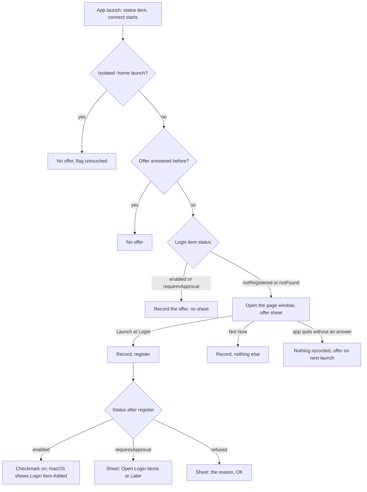

# macOS Launch at Login (Batch 26) - Plan

## Goal Capsule

- **Objective:** After a restart, the Tidegap menu bar app runs when the user logs in, like the tick and channels daemons do, once the user has said yes. The app asks once. The user can change the choice in the right-click menu or in Settings. A needed approval or a failure is always shown, never silent.
- **Means:** one PR (`feat/macos-launch-at-login`). It extends the launch-at-login code that #107 shipped (KTD1, KTD2), adds a one-time offer as a sheet on the page window (KTD3, KTD4), and makes a login launch survive a slow login shell (KTD6).
- **Authority:** the Product Contract decides what; the Planning Contract decides how. Binding repo rules: `CLAUDE.md` (gate, generated files, hard rules, git conventions), `docs/solutions/best-practices/vetting-a-process-by-pid-before-signalling.md` (SIGTERM quits like Quit; an open modal alert holds both), `docs/solutions/best-practices/loopback-web-ui-hardening.md`, `docs/solutions/workflow-issues/public-repo-hygiene.md`, `docs/solutions/developer-experience/worktree-environment-setup.md`, `docs/solutions/developer-experience/folding-review-fixes-into-commits.md`, `docs/solutions/workflow-issues/generated-test-counts-merge-conflict.md`. Plan `docs/plans/2026-10-17-0647-feat-native-clients-plan.md` stays in force: macOS 14 minimum, not sandboxed, ad-hoc signed, installed to `~/Applications`.
- **Execution profile:** one Opus `ce-work` agent in its own worktree `.worktrees/feat/macos-launch-at-login`, from `main` (`7c79ddaf` or later). Swift tests and `scripts/build.sh` run in that worktree only. No `pnpm qa ui` and no other browser suite. Simplify runs (the PR changes app code). One `ce-code-review` at the end. U5's install step on the owner's Mac runs after the review, as a separate orchestrator step.
- **Who ships:** the PR ends green, with its review done and the diff reviewed. Agents do not merge. The PR does not bump a version, cut a release or publish.
- **Stop conditions:** stop and report in these cases:
  - A test needs the real login items, the real `com.tidegap.mac` defaults domain, the real `HOME`, `~/.tidegap`, `~/.claude` or `~/.config/tidegap`.
  - The PR must edit `apps/macos/TidegapKit/Tests/TidegapKitTests/ServerLauncherTests.swift` while PR #196 is open (#196 owns that file).
  - U5 finds that the offer sheet holds Quit, that `register()` succeeds but the status never reads enabled, or that a reinstall through `install.sh` drops the registration.
  - A gate fails the same way twice.
  - Evidence shows a Key Technical Decision cannot work.
- **Open decisions:** two, each with a recommended default that this plan follows. The orchestrator confirms or flips them before `ce-work` starts.
  - D1. A command that `install.sh` passed for one run only is absent at a login launch. Recommended: document it (U4, U5), no code. Alternative: save that command to the stored defaults when launch at login turns on. That changes the documented "for that run only" contract of `install.sh` (`apps/macos/README.md:45`).
  - D2. U6 (the login-shell retry) is in this PR. Recommended: keep it. It is small, it is on the login-launch path, and its tests go in a new file. Alternative: a follow-up PR.

---

## Product Contract

### Summary

The Mac app already has a "Launch at login" option (#107): a toggle in Settings > App and an item in the right-click menu, off by default. This PR makes the option reach the user and makes every path visible. On a launch where the option is off and the user never answered, the app opens its page window and asks once: "Launch at Login" or "Not Now". A click on the menu item never fails silently: an approval need opens System Settings, and a refused call shows its reason. Settings follows the system state when the user returns from System Settings. A login-shell query that fails at startup no longer leaves the app unable to start its server until it restarts. The docs say how it works and that `install.sh` does not register the app.

### Problem Frame

Each item was checked against `main` at `7c79ddaf`. Line numbers are as of that commit.

- **The owner's report.** After a restart the launchd daemons ran (`com.tidegap.tick` and `com.tidegap.channels`, both `RunAtLoad` in `packages/cli/src/platform/macos.ts:166`, `:208`), but the app did not start.
- **Most likely cause: the option was off.** Not confirmed; this plan does not read the owner's login items (U5 does). The option is off by default (`LaunchAtLogin`, `apps/macos/TidegapKit/Sources/TidegapKit/LaunchAtLogin.swift:39-46`). It sits only in the right-click menu (`apps/macos/Tidegap/StatusItemController.swift:15`, `:78-79`) and in Settings > App (`apps/macos/Tidegap/SettingsView.swift:24-35`). A left click opens the window, so the menu is easy to miss. Nothing offers the option. The owner check S3.15 in `docs/plans/2026-10-19-qa-matrix-checklist.md:140` is still open.
- **What already exists (#107, PR `feat/mac-launch-at-login`).**
  - `LoginItemStatus` with `enabled`, `notRegistered`, `requiresApproval`, `notFound` (`LaunchAtLogin.swift:6-12`).
  - The `LoginItemService` protocol (`:16-20`) and the `SMAppService.mainApp` adapter `MainAppLoginItem` (`:23-37`). Its status mapping (`:26-33`) is inline and has no test.
  - The `@Observable` `LaunchAtLogin` model with `refresh()` and `set(_:)` (`:41-79`). A failed call reverts and sets `message`. `requiresApproval` sets `approvalHint` (`:44`).
  - Five tests on `FakeLoginItem` (`apps/macos/TidegapKit/Tests/TidegapKitTests/LaunchAtLoginTests.swift:5-75`).
  - The menu item reads the live state each time the menu opens (`StatusItemController.swift:91-97`). Settings reads it on open (`:218-224`, `SettingsView.swift:51`).
- **A menu click can fail silently.** `toggleLaunchAtLogin` (`StatusItemController.swift:198`) calls `set(!isOn)` and shows nothing. When `register()` is refused, or the item needs approval, `LaunchAtLogin.message` holds the reason, but only Settings shows it. The menu has no path to System Settings.
- **Settings goes stale after an approval.** It refreshes on open only. A user who approves in System Settings and comes back to an open Settings window sees the old state. `SettingsView.swift:33` calls `SMAppService.openSystemSettingsLoginItems()` directly, outside the testable service.
- **The main menu is not a place for the item.** The app is `LSUIElement` (`apps/macos/Tidegap/Info.plist:29-30`): its main menu never shows. The Edit and Window menus from #183 exist only for their key equivalents (`apps/macos/Tidegap/TidegapApp.swift:42-66`). The right-click menu is the app's only visible menu, and it already has the item.
- **Platform facts.**
  - Deployment target: `MACOSX_DEPLOYMENT_TARGET = 14.0` (`apps/macos/Config/Base.xcconfig:19`, `LSMinimumSystemVersion` from it) and `.macOS(.v14)` (`apps/macos/TidegapKit/Package.swift:6`). `SMAppService` needs macOS 13. No availability check, no fallback and no bump are needed.
  - Not sandboxed: `Tidegap.entitlements` is an empty dict (`apps/macos/Tidegap/Tidegap.entitlements:4-5`), `ENABLE_APP_SANDBOX = NO`. `SMAppService.mainApp` does not need the sandbox.
  - Ad-hoc signed, no team, no hardened runtime, no notarization (`Base.xcconfig:12-17`). Bundle id `com.tidegap.mac` (`Base.xcconfig:7`). `register()` registers the calling app at its current bundle path. Not known: whether the registration survives when `install.sh` deletes the bundle and copies a new ad-hoc build to the same path (`apps/macos/scripts/install.sh:83-85`). U5 checks it.
- **A modal alert at launch would hold Quit and logout.** The app turns SIGTERM into `NSApp.terminate` (`TidegapApp.swift:25-27`). An open modal alert (`runModal`) holds both Quit and SIGTERM (`vetting-a-process-by-pid-before-signalling.md`, "SIGTERM quits like Quit"). An unanswered launch-time `runModal` alert would make `install.sh` escalate to SIGKILL (`install.sh:69-81`), which leaves an orphan `tidegap ui`. It could also hold a logout or a restart, which is the event this feature serves.
- **No race with the launchd daemons.** Only `tidegap ui` writes `ui.json` (`packages/cli/src/commands/ui.ts:144`, `writeDiscovery` in `packages/cli/src/ui/discovery.ts:31`) and binds the UI port. The tick and the channels listener do neither. At a login launch the app finds no live `ui.json` and starts its own server (`ConnectionController.attach`, `apps/macos/TidegapKit/Sources/TidegapKit/Connection.swift:222-245`), as on a manual launch. The ledger is shared with the tick at any time of day, not only at login. A failed attach is retried by the 60 s poll (`Connection.swift:146-168`).
- **A failed login-shell query is cached for the app's lifetime.** `shellInfo()` (`apps/macos/TidegapKit/Sources/TidegapKit/ServerLauncher.swift:121-127`) stores the first answer, also a failed one. `queryLoginShell` runs `zsh -ilc` with a 10 s limit and returns no PATH on a timeout (`:360-368`, the 10 s limit at `:363`). At login the machine is busy, and a shell startup file that touches a privacy-protected folder waits for a permission prompt. After a failure, `findExecutable` (`:152`) searches only the fixed folders, so a `node` from a version manager is not found. The app then shows "tidegap not found" until it restarts, although the 60 s poll attaches again.
- **A login launch gets no launch arguments.** `install.sh` passes its chosen `-tidegapCommand` for that run only (`apps/macos/README.md:45`). A login launch uses the stored command or the app's own lookup, the same as a launch from Finder (D1).

### Requirements

**The offer**

- R1. On a launch where launch at login is off and the user has not answered the offer, the app offers it once. Two answers: "Launch at Login" and "Not Now". After either answer, the app never offers again.
- R2. A launch that finds the option on (`enabled`) or turned off in System Settings (`requiresApproval`) records the offer as answered and shows nothing. An existing install sees the offer once, on its next launch, unless one of these holds.
- R3. The offer never holds Quit, SIGTERM, `install.sh` or a logout. An offer that ends without an answer (the app quit) is shown again on the next launch.
- R4. A launch with `-home` (an isolated run) never shows the offer and never writes its flag.

**The menu item and Settings**

- R5. The right-click menu item shows a checkmark only when the system reports the item `enabled`. It reads the state each time the menu opens (as today).
- R6. A click on the menu item never fails silently. In `requiresApproval` it opens System Settings > Login Items and calls nothing else. A refused call shows its reason in an alert. A call that ends in `requiresApproval` shows the approval hint with an "Open Login Items" button.
- R7. Settings > App shows the same state, and updates when the app becomes active again (after a visit to System Settings).

**State reading and tests**

- R8. Each `SMAppService.Status` maps to one `LoginItemStatus`. A value unknown to this build maps to `notRegistered`.
- R9. No test registers, unregisters or opens System Settings for real, and no test reads or writes a real defaults domain. Tests use a fake service and an in-memory flag.

**Login launch**

- R10. A login-shell query that fails is asked again on a later connect attempt, at most once per 60 s. A successful answer stays cached for the app's lifetime, as today.

**Docs**

- R11. The Mac docs page, the app README and the CHANGELOG describe the offer, the menu and Settings paths, and the approval path. The README says that `install.sh` does not register login launch, that a login launch gets no launch arguments (D1), and to turn the option off before an uninstall.

### Key Decisions

- **User control, asked once.** (session-settled: user-directed — chosen over registering at every launch: the owner asked for a checkbox and a one-time offer.) Governs R1, R2. Apple DTS gives the same advice for `SMAppService.mainApp`: the user decides, and the app does not overwrite the user's choice. It is why a launch never calls `register()` without a click.
- **No silent partial path.** (session-settled: user-directed — chosen over a silent menu toggle: owner decision 2026-10-28, restated in the batch 26 brief.) Governs R3, R6, R7, R10.

### Acceptance Examples

- AE1. Covers R1. Given the flag unset and status `notRegistered`, when the launch checks the offer, it is due. When the user picks "Launch at Login", `register()` runs once, the flag is set, and the outcome is `enabled`. On the next launch the offer is not due.
- AE2. Covers R2. Given the flag unset and status `enabled`, the offer is not due, the flag is set, and no service call other than the status read runs.
- AE3. Covers R2. Given the flag unset and status `requiresApproval`, the offer is not due and the flag is set.
- AE4. Covers R1, R6. Given the offer is due and `register()` throws "Operation not permitted", when the user picks "Launch at Login", the flag is set and the outcome is "Could not turn launch at login on: Operation not permitted".
- AE5. Covers R6. Given status `requiresApproval`, a menu click opens System Settings once and calls neither `register()` nor `unregister()`.
- AE6. Covers R4. Given an isolated launch and the flag unset, the offer is not due and the flag is never written.
- AE7. Covers R10. Given a stored command `node <file>`, a first login-shell query with no PATH and a second one with a PATH that holds `node`: the first resolve returns nil; a resolve 10 s later does not query again; a resolve 61 s after the failure queries again and returns the `node` path.

### Scope Boundaries

Considered, not built:

- Register at every launch when the stored choice is on. It overrides a user who removed the app in System Settings. Evidence that would change this: U5 shows that a reinstall through `install.sh` drops the registration.
- `install.sh` registers login launch. `SMAppService.mainApp` registers the calling app, so a script cannot do it for the app, and doing it on install would bypass the user's choice. `install.sh` gets comment lines only (U5).
- A main-menu item. The main menu never shows (`LSUIElement`); the right-click menu has the item.
- A way to tell a login launch from a manual one. There is no public API for an `SMAppService.mainApp` launch. The offer rules (R2) make it unnecessary: a login launch reads `enabled`.
- Save a one-run `-tidegapCommand` for login launches (D1, alternative).

#### Deferred to Follow-Up Work

- Developer ID signing and notarization (ad-hoc stays, as in the native-clients plan).
- The menu's other alerts (job actions, `StatusItemController.swift:184-194`) stay app-modal and hold Quit while open. They are user-initiated and answered at once.
- The README Uninstall block sends a plain Quit and does not wait (`vetting-a-process-by-pid-before-signalling.md`, Open follow-ups). U4 adds only the launch-at-login line.

### Sources / Research

- App: `apps/macos/Tidegap/TidegapApp.swift` (`applicationDidFinishLaunching`, `addMissingEditMenus`), `apps/macos/Tidegap/StatusItemController.swift` (`buildMenu`, `showMenu`, `toggleLaunchAtLogin`, `perform`, `showWindow`, `showSettings`, `makeWindow`), `apps/macos/Tidegap/SettingsView.swift`, `apps/macos/Tidegap/AppModel.swift` (`launchAtLogin` at `:35`, `SettingsKey` at `:249-254`, `AppPaths.homeOverride` and `-home` at `:258-283`), `apps/macos/Tidegap/Info.plist`, `apps/macos/Tidegap/Tidegap.entitlements`, `apps/macos/Config/Base.xcconfig`. The Xcode project uses synchronized folders (`objectVersion = 77`), so a new file under `apps/macos/Tidegap/` needs no project-file edit.
- Kit: `apps/macos/TidegapKit/Sources/TidegapKit/LaunchAtLogin.swift`, `ServerLauncher.swift` (`shellInfo`, `resolveCommand`, `findExecutable`, `environment(for:)`, `queryLoginShell`), `Connection.swift` (`refreshOnce`, `attach`). Tests: `LaunchAtLoginTests.swift` (`FakeLoginItem`, the `@MainActor @Suite` pattern), `ServerLauncherTests.swift` (the `loginShell` injection at `:18`), `Fakes.swift` (`tempDir()`).
- Scripts: `apps/macos/scripts/install.sh`, `apps/macos/scripts/build.sh`, `apps/macos/scripts/sync-runtime.sh` (restarts the launchd units only; no change).
- CI: `.github/workflows/macos.yml`, job `build-test` ("swift test + xcodebuild"): `swift test`, the temp-leak guard, `sync-runtime.test.mjs`, `scripts/build.sh`.
- Docs: `apps/web/content/docs/05-apps.md:51` (`{#mac}`), `apps/macos/README.md` (`:8` menu list, `:45` one-run command, `:67-69` Launch at login, `:106-113` Uninstall), `CHANGELOG.md:45` (the unreleased "Mac app: Launch at login" bullet).
- Apple: `SMAppService` (`mainApp`, `status`, `register()`, `unregister()`, `openSystemSettingsLoginItems()`), macOS 13 and later. Apple Developer Forums thread 760186 (DTS: leave the login item under the user's control).

---

## Planning Contract

### Key Technical Decisions

- KTD1. **Extend #107; do not replace it.** `LoginItemService`, `MainAppLoginItem` and `LaunchAtLogin` stay. Three changes:
  - The status mapping moves to `LoginItemStatus.init(_ status: SMAppService.Status)`; an unknown value maps to `notRegistered` (R8). `MainAppLoginItem.status` uses it.
  - `openSystemSettings()` joins the protocol. `MainAppLoginItem` calls `SMAppService.openSystemSettingsLoginItems()`; `LaunchAtLogin.openSystemSettings()` passes it on. No view or controller calls `SMAppService` directly; `SettingsView.swift` drops `import ServiceManagement`.
  - No availability checks: the target is macOS 14.
- KTD2. **The status decides the menu item.** Kit owns the rules, so tests cover them:

  | Status | Checkmark | Title | Click |
  |---|---|---|---|
  | `enabled` | on | Launch at login | `unregister()` |
  | `notRegistered` | off | Launch at login | `register()` |
  | `notFound` | off | Launch at login | `register()` |
  | `requiresApproval` | off | Launch at login (needs approval) | opens System Settings > Login Items |

  `LaunchAtLogin` gains `menuTitle` and `menuClick() -> String?`. `menuClick()` refreshes first, acts by the table, and returns the line to show, or nil when there is nothing to show. A `register()` that ends in `requiresApproval` returns `approvalHint`. A refused call returns the existing "Could not turn launch at login …" line. In `requiresApproval` the click never calls `register()`: the system refuses it in that state (`refusedRegisterInApprovalStateKeepsHint`). The title stays "Launch at login", as shipped and documented.
- KTD3. **The offer is a Kit decision with injected flag storage.** New `LaunchAtLoginOffer` in `LaunchAtLogin.swift`, `@MainActor`, built from the `LaunchAtLogin` model, `isolated: Bool`, `isAnswered: () -> Bool` and `markAnswered: () -> Void` (the `EventDeriver` cursor pattern in `AppModel.swift:50-52`).
  - `isDue()`: `isolated` → false, nothing written. `isAnswered()` → false. Otherwise it refreshes the model: `enabled` or `requiresApproval` → `markAnswered()`, false. `notRegistered` or `notFound` → true.
  - `answer(_ choice: OfferChoice) -> OfferOutcome`, with `OfferChoice` `.launchAtLogin` or `.notNow`. It calls `markAnswered()` first. `.notNow` → `.declined`. `.launchAtLogin` → `set(true)`, then `.enabled`, `.needsApproval` or `.failed(message)` by the new state.
  - The app wires the closures to `UserDefaults.standard` (the app's own `com.tidegap.mac` domain) under a new `SettingsKey.launchAtLoginOffered = "launchAtLoginOffered"`, and passes `isolated: model.paths.homeOverride != nil`. Tests use a local `Bool`; no test touches `UserDefaults` (R9).
- KTD4. **The offer is a sheet on the page window, never app-modal.** In `applicationDidFinishLaunching`, after `model.start()` and the `--show-window` check, when `isDue()` is true, the app opens the page window (`model.showWindow()`) and begins an `NSAlert` sheet on it (`beginSheetModal(for:completionHandler:)`). A sheet leaves the run loop in its default mode, so Quit, SIGTERM, `install.sh` and logout proceed (R3). `runModal` would hold them (Problem Frame).
  - The message asks "Open Tidegap at login?". The informative text says the menu bar item and notifications then come back after a restart, and that the choice can change later in the right-click menu or in Settings. Final copy is `ce-work`'s.
  - Buttons: "Launch at Login" (first, default, Return) and "Not Now" (Escape). Only these two responses call `answer`. Any other end of the sheet records nothing, so the next launch offers again.
  - Follow-up sheet on the same window: `.needsApproval` → `approvalHint` with "Open Login Items" (calls `openSystemSettings()`) and "Later". `.failed(line)` → the line with "OK". `.enabled` and `.declined` show nothing more; macOS shows its own "Login Item Added" notice.
  - `StatusItemController` owns the windows, so the sheet code lives there (`offerLaunchAtLogin(_ offer:)`), next to `showWindow()`.
- KTD5. **Menu alerts follow the existing pattern.** When `menuClick()` returns a line, the controller shows it the way `perform` does (`StatusItemController.swift:184-194`: `NSApp.activate`, `runModal`). In `requiresApproval` the alert adds "Open Login Items". This alert answers a click, so it is not left open; only the launch-time offer needs a sheet (KTD4).
- KTD6. **A failed login-shell query is asked again, at most once per 60 s.** `shellInfo()` caches an answer only when it has a PATH. After a failure it keeps the failed answer and its time, and queries again only when 60 s have passed. `ServerLauncher.init` gains `now: @escaping () -> Date = Date.init` for tests. `resolveCommand` and `environment(for:)` keep calling `shellInfo()`. A failed query then costs at most one extra `zsh -ilc` (10 s limit) per minute, during a connect attempt, not on the main thread's run loop. The tests that pass a `(nil, nil)` shell with an absolute command (`ServerLauncherTests.swift:146`) keep passing.
- KTD7. **`install.sh` does not register login launch.** In-app only (Scope Boundaries). The script gets two header comment lines: it never registers login launch (the app offers it), and a login launch passes no arguments, so a one-run `-tidegapCommand` is absent then (D1).

### High-Level Technical Design

The launch-time offer (KTD3, KTD4):

The menu item and Settings read the same `LaunchAtLogin` model (KTD2). The menu refreshes when it opens; Settings refreshes on open and when the app becomes active.

### Assumptions

Inferred defaults, not confirmed by the owner. Each is cheap to flip during review.

- AS1. A window-modal sheet does not hold Quit, SIGTERM or logout. U5 checks Quit with the sheet open; a failure is a stop condition.
- AS2. `SMAppService.Status(rawValue:)` accepts an unknown raw value, as imported `NS_ENUM` types do. If it does not, the mapping test drops the unknown case and the `@unknown default` stays.
- AS3. `notFound` at launch is offered, like `notRegistered`. A user who removed the app in System Settings may read either value, so that user may see the offer once.
- AS4. The approval hint keeps "General > Login Items". Newer macOS names the pane "Login Items & Extensions"; "Login Items" still finds it.
- AS5. The offer appears wherever the app runs from, also from a build folder. A registration then names that bundle path.
- AS6. The flag is a plain `Bool` in the app's defaults domain. `defaults delete com.tidegap.mac` (the README Uninstall block) clears it, so a reinstall after an uninstall offers again.

### Sequencing

One PR, one agent, units in order: U1, then U2 and U3 (both need U1), then U6, U4, U5. U6 does not depend on U1-U3.

| PR | Branch | Units | Files |
|---|---|---|---|
| this | `feat/macos-launch-at-login` | U1-U6 | `apps/macos/TidegapKit/Sources/TidegapKit/LaunchAtLogin.swift`, `apps/macos/TidegapKit/Tests/TidegapKitTests/LaunchAtLoginTests.swift`, `apps/macos/TidegapKit/Tests/TidegapKitTests/LaunchAtLoginOfferTests.swift` (new), `apps/macos/TidegapKit/Sources/TidegapKit/ServerLauncher.swift`, `apps/macos/TidegapKit/Tests/TidegapKitTests/LoginShellRetryTests.swift` (new), `apps/macos/Tidegap/StatusItemController.swift`, `apps/macos/Tidegap/SettingsView.swift`, `apps/macos/Tidegap/TidegapApp.swift`, `apps/macos/Tidegap/AppModel.swift`, `apps/macos/scripts/install.sh` (comments only), `apps/macos/README.md`, `apps/web/content/docs/05-apps.md`, `CHANGELOG.md` |

- PR #196 (`fix/region-ime-drift-and-test-races`) is open and edits `ServerLauncherTests.swift` and `CHANGELOG.md`. This PR does not edit `ServerLauncherTests.swift`: U6's tests go in a new file. U4 updates the branch from `main` before its `CHANGELOG.md` commit; on a conflict it keeps both sides' bullets.
- Generated files: U4's docs change regenerates `apps/web/src/lib/docs.generated.ts` and `apps/web/public/llms-full.txt` (`pnpm gen:docs`). Swift tests are not in the README test counts, so `pnpm gen:tests` should not change anything; run it and commit only what changes. On a conflict in a generated file, take `main`'s version, run the generator and commit (`generated-test-counts-merge-conflict.md`).
- Parity: no core change. No UI API route or field changes; `docs/spec/ui-client-api.md` stays as it is.

---

## Implementation Units

### U1. Login item service: tested mapping, System Settings, menu rules

- **Goal:** R5, R6, R8, R9 in Kit: every status rule is testable on a fake.
- **Requirements:** R5, R6, R8, R9; KTD1, KTD2; AS2.
- **Dependencies:** none.
- **Files:** `apps/macos/TidegapKit/Sources/TidegapKit/LaunchAtLogin.swift`, `apps/macos/TidegapKit/Tests/TidegapKitTests/LaunchAtLoginTests.swift`.
- **Approach:**
  1. Add `LoginItemStatus.init(_ status: SMAppService.Status)` and use it in `MainAppLoginItem.status`.
  2. Add `openSystemSettings()` to `LoginItemService` and `MainAppLoginItem`; add the pass-through on `LaunchAtLogin`. `FakeLoginItem` records `"openSettings"`.
  3. Add `menuTitle` and `menuClick() -> String?` per the KTD2 table.
- **Patterns to follow:** the existing `LaunchAtLoginTests` (`@MainActor @Suite`, `FakeLoginItem`, the `Denied` error).
- **Test scenarios:**
  - `statusMapsEverySystemValue`: the four `SMAppService.Status` cases map one to one; an unknown raw value maps to `notRegistered` (AS2). The only use of `SMAppService` in the tests.
  - `openSystemSettingsGoesThroughTheService`: the fake records `["openSettings"]`.
  - `menuTitlePerStatus`: "Launch at login" for three statuses, "Launch at login (needs approval)" for `requiresApproval`.
  - Covers AE5. `menuClickInApprovalOpensSystemSettingsOnly`: calls are `["openSettings"]`, the result is nil.
  - `menuClickRegistersAndUnregisters`: `notRegistered` and `notFound` → `register`; `enabled` → `unregister`; the result is nil.
  - `menuClickRefusedReturnsTheReason`: "Could not turn launch at login on: Operation not permitted".
  - `menuClickThatEndsInApprovalReturnsTheHint`: a fake whose `register()` leaves `requiresApproval` → `approvalHint`.
  - The five existing tests pass unchanged.
- **Verification:** `swift test` passes; `grep -n "SMAppService" apps/macos/TidegapKit/Tests` prints only the mapping test.

### U2. The menu item and Settings act on every status

- **Goal:** R5-R7: a click always has a visible result, and Settings follows System Settings.
- **Requirements:** R5, R6, R7; KTD2, KTD5.
- **Dependencies:** U1.
- **Files:** `apps/macos/Tidegap/StatusItemController.swift`, `apps/macos/Tidegap/SettingsView.swift`.
- **Approach:**
  1. `showMenu()` (`StatusItemController.swift:91-97`) sets the item's title from `menuTitle` and its state from `isOn`, after the refresh it already does.
  2. `toggleLaunchAtLogin()` (`:198`) calls `menuClick()`. A returned line is shown as in `perform` (`:184-194`). When the status is then `requiresApproval`, the alert has "Open Login Items" (calls `openSystemSettings()`) and "OK".
  3. `SettingsView`: the "Open Login Items" button calls `launchAtLogin.openSystemSettings()`; remove `import ServiceManagement`. Refresh on `NSApplication.didBecomeActiveNotification`, in addition to `onAppear` and `showSettings()`.
- **Test expectation:** none in the app target (it has no test target). The logic is in U1's Kit tests; the app build (`scripts/build.sh`) and U5 check the wiring.
- **Verification:** `scripts/build.sh` succeeds; `grep -n "SMAppService" apps/macos/Tidegap` prints nothing.

### U3. The one-time offer at launch

- **Goal:** R1-R4: the app asks once, as a sheet, and never in an isolated run.
- **Requirements:** R1, R2, R3, R4, R9; KTD3, KTD4; AS1, AS3, AS5, AS6.
- **Dependencies:** U1.
- **Files:** `apps/macos/TidegapKit/Sources/TidegapKit/LaunchAtLogin.swift` (`LaunchAtLoginOffer`, `OfferChoice`, `OfferOutcome`), `apps/macos/TidegapKit/Tests/TidegapKitTests/LaunchAtLoginOfferTests.swift` (new), `apps/macos/Tidegap/AppModel.swift` (`SettingsKey.launchAtLoginOffered`), `apps/macos/Tidegap/TidegapApp.swift` (`applicationDidFinishLaunching`), `apps/macos/Tidegap/StatusItemController.swift` (`offerLaunchAtLogin(_:)`).
- **Approach:**
  1. Write `LaunchAtLoginOffer` per KTD3.
  2. In `applicationDidFinishLaunching` (`TidegapApp.swift:22-35`), after `model.start()` and the `--show-window` line, build the offer with the `UserDefaults.standard` closures and `isolated: model.paths.homeOverride != nil`. When `isDue()` is true, call `statusItem.offerLaunchAtLogin(offer)`.
  3. `offerLaunchAtLogin` shows the page window, begins the sheet, maps the two button responses to `answer(_:)`, and shows the follow-up sheet per KTD4.
- **Patterns to follow:** `LaunchAtLoginTests` for the fake; the `EventDeriver` cursor closures in `AppModel.swift:50-52` for the flag.
- **Test scenarios** (each on `FakeLoginItem` and a local `Bool` flag):
  - Covers AE1. `offerIsDueOnceAndLaunchAtLoginRegisters`: due; `answer(.launchAtLogin)` → `.enabled`, calls `["register"]`, flag set; a second `isDue()` is false.
  - `notNowRecordsTheAnswerAndCallsNothing`: `.declined`, no `register`, flag set.
  - Covers AE2. `enabledAtLaunchRecordsTheOfferWithoutAsking`.
  - Covers AE3. `requiresApprovalAtLaunchRecordsTheOfferWithoutAsking`.
  - `notFoundAtLaunchIsOffered` (AS3).
  - Covers AE4. `refusedRegisterReturnsTheReasonAndStillRecords`.
  - `registerThatEndsInApprovalReturnsNeedsApproval`.
  - Covers AE6. `isolatedLaunchNeverOffersNorWrites`: `markAnswered` is never called, even when the status is `enabled`.
  - `answeredFlagStopsTheOffer`: with the flag set, `isDue()` returns false and does not call `markAnswered`, whatever the status.
- **Verification:** `swift test` passes; `grep -n "UserDefaults" apps/macos/TidegapKit/Tests` prints nothing; `scripts/build.sh` succeeds.

### U4. Docs and CHANGELOG

- **Goal:** R11: the docs match the app.
- **Requirements:** R11; D1.
- **Dependencies:** U1-U3 and U6 committed.
- **Files:** `apps/web/content/docs/05-apps.md`, `apps/macos/README.md`, `CHANGELOG.md`, and the generated `apps/web/src/lib/docs.generated.ts`, `apps/web/public/llms-full.txt`.
- **Approach:**
  1. `05-apps.md:51` (`{#mac}`): one sentence. On first launch the app offers to start at login, once; the right-click menu and Settings > App turn it on or off.
  2. `apps/macos/README.md`:
     - `:67-69` "Launch at login": off until the user turns it on; the one-time offer and its two answers; the menu item (checkmark, "(needs approval)" opens System Settings); Settings and its refresh; the launchd tick and channels start at login on their own, and this option is only for the app; `install.sh` never registers it; a login launch gets no launch arguments, so store the command in Settings when `install.sh` chose it for one run (D1).
     - `:106-113` Uninstall: first line, turn off **Launch at login** in the right-click menu.
  3. `CHANGELOG.md`: update from `main` first (PR #196). Under `[Unreleased]`, extend the unreleased "Mac app: Launch at login" bullet (`:45`, `### Added`) with the offer, the menu paths and the Settings refresh. Add one `### Fixed` bullet for U6: the app no longer stays at "tidegap not found" after a slow login shell at startup.
  4. Run `pnpm gen:docs` and `pnpm gen:tests`; commit what changed.
- **Test expectation:** none -- docs only; the gate checks the generated files.
- **Verification:** the gate prints `PASS`; the CHANGELOG diff touches only `[Unreleased]`.

### U5. `install.sh` note and the install step on the owner's Mac

- **Goal:** KTD7 in the script, and proof on a real Mac that the owner's report is fixed.
- **Requirements:** R1-R3, R5, R6; KTD7; AS1; D1.
- **Dependencies:** U1-U4; the PR's review is done and CI is green.
- **Files:** `apps/macos/scripts/install.sh` (header comment lines 1-11 only; no behavior change).
- **Approach (in the PR):** add the two comment lines from KTD7. `sh -n apps/macos/scripts/install.sh` passes, and the diff of the script is comments only.
- **Install step (orchestrator, after the review; not part of `ce-work`):** a Haiku agent runs the install and takes the screenshots into the session's scratch folder; the owner clicks. Steps:
  1. Agent: run `apps/macos/scripts/install.sh` from the PR worktree, with no `-home`. The app opens its page window with the offer sheet (if the option was already on, there is no sheet: record that, skip to step 4).
  2. Agent, with the sheet open: send Quit (`tell application id "com.tidegap.mac" to quit`, ignoring responses). `pgrep -x Tidegap` is empty within 5 s. A held Quit is a stop condition (AS1). Then open the app again (`open ~/Applications/Tidegap.app`); the sheet is back.
  3. Owner: click **Launch at Login**. If a second sheet says the item needs approval, click **Open Login Items** and turn Tidegap on under System Settings > General > Login Items (Login Items & Extensions on newer macOS). A sheet with a reason is a finding; report its text.
  4. Agent: right-click the menu bar item; "Launch at login" has a checkmark (screenshot). Settings > App shows the toggle on.
  5. Agent: run `install.sh` again. No sheet appears, and the checkmark is still on. A lost checkmark is a stop condition (the reinstall dropped the registration).
  6. Owner: restart the Mac and log in. The Tidegap menu bar item appears with no click, and its tooltip shows a connected state, not "tidegap not found". This closes S3.15 in `docs/plans/2026-10-19-qa-matrix-checklist.md`.
- **Test expectation:** none -- comments in the script; the install step is a manual check.
- **Verification:** steps 1-6 hold, with screenshots for steps 1, 2 and 4.

### U6. A login launch survives a slow login shell

- **Goal:** R10: a failed shell query at startup does not leave the app unable to find `node` until it restarts.
- **Requirements:** R10; KTD6; D2.
- **Dependencies:** none.
- **Files:** `apps/macos/TidegapKit/Sources/TidegapKit/ServerLauncher.swift` (`shellInfo`, `init`), `apps/macos/TidegapKit/Tests/TidegapKitTests/LoginShellRetryTests.swift` (new).
- **Approach:** keep the cached answer only when it has a PATH; otherwise keep the failure and its time from `now()`, and query again after 60 s. Update the doc comment at `:121` ("captured once").
- **Patterns to follow:** `ServerLauncherTests.swift:10-30` (the launcher built with `loginShell`, `isExecutable` and `baseEnvironment` fakes); do not edit that file (Sequencing).
- **Test scenarios** (a counting `loginShell` fake and a settable clock):
  - Covers AE7. `aFailedLoginShellQueryIsAskedAgainAfter60s`.
  - `aFailedQueryIsNotRepeatedWithin60s`: two resolves 10 s apart run one query.
  - `aSuccessfulQueryIsCached`: two resolves 120 s apart run one query.
- **Verification:** `swift test` passes; the tests in `ServerLauncherTests.swift` and `ConnectionTests.swift` pass unchanged.

---

## Verification Contract

- Before the first change, in the new worktree: `cd apps/macos/TidegapKit && swift test` on `main`, and record N, the test count from the line `Test run with N tests in M suites passed`.
- After the last change: `swift test` reports `Test run with N' tests in M' suites passed`, where N' is N plus the new tests (about 19: U1 7, U3 9, U6 3), and no test fails. The XCTest line "Executed 0 tests" is a false alarm; trust the Swift Testing line.
- `apps/macos/scripts/build.sh` succeeds once (xcodebuild Release, ad-hoc signed, `codesign --verify` passes).
- CI: the macOS workflow job "swift test + xcodebuild" (`build-test` in `.github/workflows/macos.yml`) and the CI workflow (node 20, 22, 24) are green. The temp-leak guard in the macOS job passes: the new tests create no temp folders.
- The gate, from the repo root of the worktree, after `pnpm install` and the Python venv (`worktree-environment-setup.md`): `pnpm build && pnpm typecheck && pnpm gen:tests:check && pnpm gen:docs:check && node scripts/qa/docs-drift.mjs` prints `PASS`. Read a failing log with `grep -nE "✘|Error|expected" <log> | head -40`.
- `pnpm check:versions` passes, and no version field changes.
- Test isolation (R9): `grep -n "UserDefaults" apps/macos/TidegapKit/Tests` prints nothing; `grep -n "SMAppService" apps/macos/TidegapKit/Tests` prints only the mapping test; `grep -n "SMAppService" apps/macos/Tidegap` prints nothing.
- No `pnpm qa ui` and no browser suite. Do not build or test in the PR #196 worktree.
- Commits follow Conventional Commits (`feat(macos): …`, `fix(macos): …`, `docs(macos): …`); git runs with `git -c core.editor=true -c sequence.editor=true`; each message comes from a uniquely named file passed with `-F`; review fixes fold into their commits. No `Claude-Session` trailer and no session link in commits or the PR body.
- Public-repo hygiene: run the grep in `docs/solutions/workflow-issues/public-repo-hygiene.md` over the changed files and read each hit.
- The PR body states: no core change; deployment target 14.0, so no fallback; `install.sh` unchanged except comments; the owner install step (U5) is pending, with what the owner must click.

---

## Definition of Done

- R1-R11 are met by their units, or reported under a stop condition.
- AE1-AE7 hold as Swift tests.
- The PR touches only the Sequencing files plus generated files.
- `swift test`, `scripts/build.sh`, the gate and `pnpm check:versions` pass on the final commit; CI is green.
- `ce-code-review` ran once, and its findings are fixed and folded into their commits.
- No abandoned-attempt code, debug output or temporary files remain in the diff.
- The PR is not merged by an agent.
- U5's install step is done by the orchestrator and the owner after the review; its result is reported on the PR.
