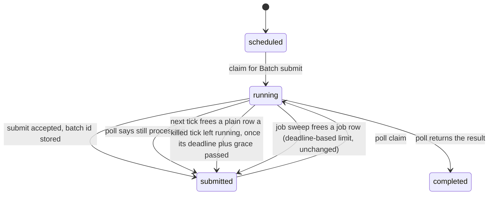
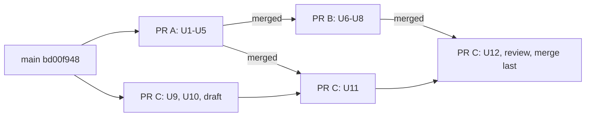

# Receipt Honesty and Reliability Residuals (Batch 27) - Plan

## Goal Capsule

- **Objective:** A signed receipt says when its carbon rests on a token count that the run did not report, and one rule bills such a count on every path. A Python process that shares the ledger with the Node daemon never overwrites a newer row and never runs a task twice. A paid Batch result is never stranded by a killed tick. A type error in a test file fails the gate. The region card and the Mac app always show what they are doing and retry by themselves where they can.
- **Means:** three PRs (Sequencing).
  - PR A `fix/receipt-token-counts`: the signed token-count marker and the count rules (KTD1-KTD5).
  - PR B `fix/python-cas-and-stranded-polls`: compare-and-set for every Python write, and the stranded Batch poll (KTD6-KTD9). It starts after PR A merges.
  - PR C `fix/ui-mac-and-test-typecheck`: the region card, the Mac app, tests in `pnpm typecheck`, and the batch CHANGELOG (KTD10-KTD14). It merges last.
- **Authority:** the Product Contract decides what; the Planning Contract decides how. Binding repo rules:
  - `CLAUDE.md` (gate, parity, generated files, hard rules, git conventions).
  - `docs/solutions/best-practices/signed-receipt-additive-fields.md` (a new receipt field: signed, optional, a shared vector per shape, old vectors untouched).
  - `docs/solutions/logic-errors/multi-model-receipt-billing.md` (billing rules and the shared billing fixture).
  - `docs/solutions/logic-errors/compare-and-set-task-transitions.md` (the Node transitions that Python mirrors).
  - `docs/solutions/best-practices/cross-language-select-window-parity.md` (one fixture, two suites).
  - `docs/solutions/best-practices/dependency-free-task-ui-patterns.md` (region card, IME).
  - `docs/solutions/best-practices/launch-at-login-in-a-menu-bar-app.md` (Mac app login item).
  - `docs/solutions/workflow-issues/generated-test-counts-merge-conflict.md`, `docs/solutions/developer-experience/worktree-environment-setup.md`, `docs/solutions/developer-experience/folding-review-fixes-into-commits.md`, `docs/solutions/workflow-issues/review-fan-out-cost-and-bounded-agent-waits.md`, `docs/solutions/workflow-issues/public-repo-hygiene.md`.
  - Plans `docs/plans/2026-10-28-1750-fix-reliability-residuals-plan.md` (batch 25) and `docs/plans/2026-10-30-1642-feat-macos-launch-at-login-plan.md` (batch 26) stay in force; this plan closes their residuals.
- **Execution profile:** at most two Opus `ce-work` agents at once, each in its own worktree under `.worktrees/<branch>` with its own Python venv.
  - Wave 1: PR A (U1-U5) and PR C's first part (U9, U10), from `main` (`bd00f948`). PR C opens as a draft after U10.
  - Wave 2, after PR A merges: PR B (U6-U8) from the new `main`, and PR C's U11 after PR C is updated from `main`.
  - Wave 3, after PR B merges: PR C's U12 (CHANGELOG and the batch's one `pnpm qa ui` run, with nothing else running).
  - No stream runs `pnpm qa ui` or another browser suite outside U12. Simplify runs on every PR (each changes application code). One `ce-code-review` per PR at its end, with at most three reviewers.
- **Who ships:** each PR ends green, with its review done and the diff reviewed. Agents do not merge. No PR bumps a version, cuts a release or publishes.
- **Stop conditions:** stop and report in these cases:
  - A PR must edit a hand-edited file that another open PR owns (Sequencing). This includes PR B finding that an existing TypeScript test file listed under U11 must change.
  - A line of `packages/core-ts/test/fixtures/cross-lang-receipt-vectors.json` is changed or removed, or an existing signing vector changes its canonical bytes or its signature.
  - A test or check needs the real `HOME`, `~/.tidegap`, `~/.claude`, `~/.config/tidegap`, the real login items or the real `com.tidegap.mac` defaults domain.
  - A gate fails the same way twice.
  - Evidence shows a Key Technical Decision cannot work.
  - U11 needs a source change in `packages/core-ts/src/scheduler.ts` or `packages/core-py/src/tidegap/scheduler.py` while PR B is open.
- **Open decisions:** six, each with a recommended default that this plan follows. The orchestrator confirms or flips them before `ce-work` starts.
  - D1 (R5). An input with a part that is not a count. Recommended: leave the input out of the receipt, bill the larger of the reported parts and the typical count, and mark the receipt `partial` (KTD3). Alternative: sign the sum of the reported parts as the input and mark it `partial`. That is simpler, but it bills a cache-heavy `claude -p` run at its few fresh-input tokens.
  - D2 (R11). A plain Batch row left `running` by a killed tick. Recommended: the job rows' rule for plain rows too. The tick sends the row back to `submitted` once its deadline plus a 5-minute grace has passed (KTD9). A row past its deadline has a finished batch, so the step rarely meets a live poll in another process. The cost: a stranded result is polled after the task's deadline. Alternatives: free the row at the next tick with no age limit, which recovers within a minute but cannot tell a stranded row from a live poll in another process (the losing poller reports the task failed, and a channel sends a second "done" message); or one new rule that moves job rows too (changes the documented jobs rule at `apps/web/content/docs/10-jobs.md:48`).
  - D3 (R7). Exported Python receipts signed by v0.11 or older. Recommended: document it and add a hint to `tidegap verify --file` (KTD5). Alternative: export the stored bytes, which changes the receipt shape that the page, MCP and `queue show --json` readers get.
  - D4 (R8). The Python compare-and-set scope. Recommended: every write to an existing row, the four actions and the dispatch writes (KTD7). Alternative: the four actions only; the success path then still keeps only `cancelled`, and a cancel during a failing call still becomes `failed`.
  - D5 (R13). Which no-token states the Mac app retries. Recommended: "tidegap not found" and "needs update" (KTD11). Alternative: "tidegap not found" only.
  - D6 (R15). How tests enter the type check. Recommended: each package's `typecheck` script also checks its tests, and PR C fixes all current errors (KTD13). Alternative: a separate `typecheck:tests` script, wired into CI, `preflight` and the gate text.

---

## Product Contract

### Summary

PR A adds one signed, optional receipt field, `tokenCounts`. It says `partial` when some token count behind the grams was not reported in full, and `typical` when none was. A receipt that reports every count is byte-identical to today's. The single-model path in both cores now treats a negative, non-finite or out-of-range count as unreported, as the multi-model path does. The `claude-code` adapter bills an input with a bad part at the larger of its reported parts and the typical count. `tidegap verify`, `queue show`, MCP and the page show the field. The receipts page states the rules and how to verify an exported v0.11 Python receipt.

PR B makes every Python write to an existing task row compare-and-set on the statuses the Node core uses, proven by one shared fixture. A plain Batch row that a killed tick left `running` goes back to `submitted` once its deadline has passed, in both cores, and its paid result is polled.

PR C keeps the region card's Save honest while an IME composition is open. The Mac app retries "tidegap not found" from its poll and keeps a launch-at-login failure line when the app becomes active. `pnpm typecheck` checks test files in every package. The CHANGELOG records the batch.

### Problem Frame

Each item was checked against `main` at `bd00f948`. Line numbers are as of that commit.

- **A receipt can claim more certainty than it has (item 1).** `energySource` and `energyResolution` describe the energy coefficients only (`packages/core-ts/src/types.ts:224-240`). A count that the provider did not report is billed at the typical 500 tokens (`estimateEnergyKwh`, `packages/core-ts/src/energy.ts:274-275`; `bill_model_usage`, `packages/core-py/src/tidegap/energy.py:297`). Nothing signed says so. The only trace is a count missing from a `models` entry, and a single-model receipt has no entries. The sync builders set `energySource` from the coefficients (`packages/core-ts/src/scheduler.ts:2640`, `packages/core-py/src/tidegap/scheduler.py:3613`), and so do the Batch builders (`scheduler.ts:2971`, `scheduler.py:3947`). This holds since v0.10 on the single-model path and since v0.20 on the multi-model path. Recorded as an open edge in `docs/solutions/logic-errors/multi-model-receipt-billing.md`.
- **A `null` cache-write part hides a reported input (item 2).** In `reportedRun` (`packages/cli/src/providers/claude-code.ts:254-290`), an input part that is not a count makes the whole input of a `modelUsage` entry unreported (`:257-260`). An entry with fresh input 90000 and a `null` cache-write part is billed at 500. The top-level `usage` path does the opposite: `sumInput` (`:226-228`) counts the `null` part as 0 (`:283-288`), and the receipt signs the partial sum as a full count.
- **Python writes without compare-and-set (item 3).** `_TaskStore.upsert` (`scheduler.py:1011`, `_upsert_in_tx` `:1025`) sets `status` with no status condition. Only the claims are compare-and-set (`claim_scheduled` `:1207`, `claim_submitted` `:1242`). The #195 re-read in `_lookup_record` shrank the window but did not close it. Each user action checks the status it read and then upserts: `cancel_task` (`:2548`, write `:2601`), `expedite_task` (`:2618`, write `:2678`), `update_deadline` (`:2693`, write `:2733`), `retry_task` (`:2744`, write `:2795`). A Node claim in that gap is overwritten, and `expedite_task` can then run the row a second time. The dispatch writes have the same gap: `_fail` (`:2915`) checks the cached status, the provider-call success path keeps only `cancelled`, and the failure path writes `failed` over a concurrent cancel. In total `scheduler.py` has 24 `upsert` calls; two are inserts (`:1791`, `:1929`).
- **The single-model path bills any number (item 4).** TS reads `typeof usage.inputTokens === "number"` (`scheduler.ts:2583-2584`, Batch `:2937-2940`), so a negative count bills negative energy, and `NaN` makes `canonicalize` throw: the task completes with no receipt. Python passes the attributes through unchecked (`scheduler.py:3541-3542`, Batch `:3897-3901`). The Python count check `_is_count` (`energy.py:281-288`) raises `OverflowError` on an integer beyond the range of a double (checked: `math.isfinite(10**400)`).
- **Test files are outside `pnpm typecheck` (item 5).** Each package's `typecheck` runs its build `tsconfig.json`, which includes `src` only and excludes `test` (`packages/cli/tsconfig.json`, `packages/core-ts/tsconfig.json`, `packages/mcp-server/tsconfig.json`). The OpenClaw plugin (`packages/openclaw-plugin`) has no `typecheck` script. CI runs `pnpm typecheck` (`.github/workflows/ci.yml:45`), and so do the gate and `preflight`. A scratch config that adds `test/` to each package found 136 type errors in 39 test files: 21 in `@tidegap/core`, 94 in `@tidegap/cli` (32 of them are imports of the plain-JS UI modules), 16 in `@tidegap/mcp` and 5 in the OpenClaw plugin. One is the reported error at `packages/cli/test/readiness.test.ts:185`.
- **Save during an open composition (item 6).** `draw` returns while `c.composing` is set (`packages/cli/ui/region-card.js:333-334`). Safari and the Mac app do not focus a clicked button, so a Save press can arrive with the composition still open. `save()` (`:282-284`) sets `pending` and calls `draw`, which does nothing: Save shows no "Saving…" and stays enabled. The submit handler checks the model of the last patch (`:221-224`), which still has `canSave`, so a second press sends a second request.
- **Plain Batch rows stranded `running` (item 8).** A tick killed during a Batch poll leaves the row `running` with its batch id. For a job row, the job sweep sends it back to `submitted` (`interrupted`, `packages/core-ts/src/jobs.ts:631-668`). For a plain row nothing does: the poll sweep claims only `submitted` rows (`scheduler.ts:898-925`, `scheduler.py:2121-2150`), so the paid result is never polled and the row stays `running` until a person cancels it. Recorded as open in `compare-and-set-task-transitions.md`.
- **Exported old Python receipts verify `tampered` (item 9).** Readers get a renamed camelCase copy (`rowToRecord`, signed-receipt-additive-fields rule 7). A Python receipt signed by v0.11 or older verifies only against its original snake_case keys (`legacyRawCanonical`, `packages/core-ts/src/sign.ts:288`). `tidegap verify <task-id>` reads the stored bytes (`packages/cli/src/commands/verify.ts:102-111`); `verify --file` on an exported copy reports `tampered` (`:89-101`) with no hint why.
- **The Mac app waits for a click (item 10).** With no stored token, `refreshOnce` connects only when the state is not `lacksToken` (`apps/macos/TidegapKit/Sources/TidegapKit/Connection.swift:146-149`). `lacksToken` includes `.tidegapNotFound` and `.needsUpdate` (`:24-27`). A user who installs or updates `tidegap` after the app showed "tidegap not found" must click **Apply and retry**. Separately, Settings calls `LaunchAtLogin.refresh()` when the app becomes active (`apps/macos/Tidegap/SettingsView.swift:53-55`), and `refresh()` resets `message` (`LaunchAtLogin.swift:69-73`): the reason for a failed toggle disappears when the user comes back from System Settings.

### Requirements

**Receipt token counts (PR A)**

- R1. A provider-call receipt whose grams rest on a count that was not reported in full carries a signed `tokenCounts`: `partial` when at least one count or input part was reported, `typical` when none was. The field is absent when every count was reported in full.
- R2. A receipt that reports every count keeps today's canonical bytes. Every existing signing vector stays byte-identical, and a released verifier verifies a receipt that carries the field.
- R3. Both cores produce the same field and the same canonical bytes, proven by new shared signing vectors.
- R4. On the single-model path (sync and Batch, both cores), a count that is absent, not a number, negative, not finite, or beyond the range of a double is unreported. It is billed at the typical count, left out of the receipt, and never makes the receipt build fail.
- R5. An input made of parts, one of which is not a count, is not reported in full. The receipt leaves it out, and the bill uses the larger of the sum of its reported parts and the typical input count. The `claude-code` adapter applies this on the `modelUsage` path and the top-level `usage` path alike.
- R6. `tidegap verify`, `tidegap queue show`, the MCP task view and the page's task detail show the field in words.
- R7. The receipts page states R1, R4 and R5, and that an exported Python receipt signed by v0.11 or older verifies only from the ledger. `tidegap verify --file` that reports `tampered` names `tidegap verify <task-id>`.

**Python writes and stranded polls (PR B)**

- R8. Every Python write to an existing task row is compare-and-set on the statuses the matching Node transition accepts. A miss writes nothing and refreshes the cached row. The action then reports what happened: a refusal, or the refreshed row for a cancel.
- R9. A Python write computed after a forecast await also requires the row's timing columns to be unchanged since the read, as the Node core does.
- R10. Both cores accept the same statuses per action, proven by one shared fixture.
- R11. A plain `running` row that has a batch id, and whose deadline plus a 5-minute grace has passed, goes back to `submitted` at the head of the next Batch-poll sweep, in both cores, and is polled in that sweep. Job rows keep the job sweep's rule.

**Surfaces and the gate (PR C)**

- R12. A Save press on the region card while a composition is open shows "Saving…" and disables Save until the request settles. A second press sends no second request.
- R13. The Mac app with no stored token retries from its 60 s poll when the state is "tidegap not found" or "needs update". "Revoked" still waits for **Reconnect**.
- R14. A failure line under "Launch at login" stays until the system state changes or the user toggles again. The app becoming active does not clear it.
- R15. `pnpm typecheck` checks every TypeScript package's test files, in the gate, in CI and in `preflight`, and passes.
- R16. `CHANGELOG.md` gets one `### Fixed` entry per user-visible fix of this batch, under `[Unreleased]`.

### Key Decisions

- **Fix correctly or cut; no silent partial path.** (session-settled: user-directed — chosen over shipping partial fixes behind known gaps: the owner's standing preference, restated in the batch 27 brief.) Governs R1, R5, R8, R11. It is why the receipt gets a signed marker instead of a docs note, why every Python write becomes compare-and-set, and why a stranded poll is recovered instead of documented.
- **Jobs stay Node-only.** (session-settled: user-directed — chosen over porting the jobs sweep to Python: owner decision 2026-10-28, batch 24.) Governs R11: the Python step never writes a job row.

### Acceptance Examples

- AE1. Covers R1, R3, R4. Given a single-model run that reports output 120 and no input, when either core builds the receipt, the input is billed at 500, the receipt has `tokenCounts: "partial"` and no `totalTokens`, and both cores produce the same canonical bytes.
- AE2. Covers R1, R5. Given a run where sonnet reports fresh input 90000, a `null` cache-write part and output 400, and haiku reports input 300, cache writes 0 and output 60, when the receipt is built, sonnet's input is billed at 90000, sonnet's entry has no `inputTokens`, and the receipt says `partial`. With sonnet's fresh input at 4 instead, its input is billed at 500.
- AE3. Covers R4. Given a single-model run that reports input -3000 and output 50, when either core builds the receipt, the input is billed at 500, the output at 50, the receipt says `partial`, and a receipt is written.
- AE4. Covers R8, R10. Given a Python scheduler that read a row as `scheduled`, when Node claims the row (`running`) before the Python write, `expedite_task` raises the "just claimed by another process" error, the adapter is not called, and the row stays `running`.
- AE5. Covers R8. Given a Python `cancel_task` that read a row as `scheduled`, when Node completes the row before the Python write, the cancel misses, reads the row again, and returns it `completed` with its receipt.
- AE6. Covers R11. Given a plain row `running` with a batch id whose deadline passed more than 5 minutes ago, when the next tick runs, the row goes to `submitted`, is polled once and completes with one receipt. The same row with its deadline still ahead stays `running`. A job row in the same state is left to the job sweep, and a plain `running` row with no batch id stays `running`.
- AE7. Covers R12. Given an open composition in the region search, when Save is pressed twice, one request is sent, and Save shows "Saving…" and is disabled until it settles.

### Scope Boundaries

Dropped from the brief after checking the code:

- **Item 7, stale `ebb` command names in learnings.** Already fixed. `docs/solutions/logic-errors/quota-reset-deadlines.md` has no `ebb` since `1adc50b3` (#196). `git grep -nw ebb -- docs/solutions` lists only history, compatibility notes and kept ids. The one hit in current guidance, `dependency-free-task-ui-patterns.md:63-64`, names `~/.ebb-ai` as a path the seed script refuses, and `scripts/ui-seed.mjs:48-49` still refuses it.

Considered, not built:

- A `tokenCounts` on each `models` entry. An absent count already marks the entry, and the top-level field says where to look. Evidence that would change this: a consumer that must tell entries apart without reading their counts.
- A new `energySource` value for estimated counts. That field ranks coefficients (`measured` > `estimated` > `fallback`), and every reader compares it. Mixing in a second meaning breaks the rank.
- Exporting the stored receipt bytes (D3). The page, MCP and `queue show --json` read camelCase keys, and only Python receipts signed by v0.11 or older differ. Evidence that would change this: a user who verifies an exported v0.11 receipt.
- `verify --file` that renames keys back to snake_case for the legacy check. It widens what verifies `valid` on the signing surface of both cores, for v0.11 Python receipts only.
- Freeing a stranded poll at the next tick, with no age limit (D2). A tick cannot tell a stranded row from a poll that is live in another process (the OpenClaw gateway, the Python core). Compare-and-set keeps one completion, but the losing poller reports the task `failed` ("result dropped", `scheduler.ts:2994-2998`), and `tickResultEvents` (`packages/cli/src/channels/emit.ts:277-288`) then sends a second "done" message. Evidence that would change this: a stored claim time on a Batch poll, which would let a short limit tell the two apart.
- Python events for `expedited` and `rescheduled`, which the Node core writes. Python keeps writing terminal events only; it is not a compare-and-set gap.

#### Deferred to Follow-Up Work

- A Batch row whose `submitted` write failed after the provider accepted the batch is `running` with no batch id; a plain row stays `running` (`compare-and-set-task-transitions.md`, "Open (batch 25)").
- On the single-model path, TS takes the provider's `totalTokens` and Python sums input and output (`scheduler.py:3553-3558`). The source of the total differs between the cores; this plan applies the count rule to both and does not unify them.
- The tie-break on equal output tokens compares model ids by UTF-16 code units in TS and by code points in Python (#191 residual).
- A docs-drift rule for the hand-written facts in `08-receipts.md` `{#receipt-models}` (#191 residual).
- A stored receipt is kept on write-back only for the same receipt object; a cloned receipt is written back in camelCase. No current path clones (#195 residual).
- #196: the manual IME check in Safari and the Mac app page window (owner row); a process could take the Swift probe's port between close and probe.
- #198: `NSApp.activate(ignoringOtherApps:)` is deprecated on macOS 14; the owner install step for launch at login is pending.
- #201: a child that a shell startup file starts is not killed with the shell; SIGKILL on a zsh blocked by a privacy prompt is untested; the UI keeps a lookup miss for 25 s, not 30 s.
- Python test files have no type check (ruff only).

### Sources / Research

- Receipts and billing: `packages/core-ts/src/energy.ts` (`estimateEnergyKwh`, `billModelUsage`, `isCount`, `reported`), `packages/core-py/src/tidegap/energy.py` (`estimate_energy_kwh`, `_is_count`, `_reported`, `bill_model_usage`), `packages/core-ts/src/providers/base.ts` (`ModelUsage`, `DispatchResult.usage`), `packages/core-py/src/tidegap/providers/base.py` (`ModelUsage`), `packages/core-ts/src/types.ts` (`CarbonReceipt`, `ReceiptModelEntry`), `packages/core-py/src/tidegap/types.py` (`CarbonReceipt`, `from_dict`, `to_dict`, `extra_fields`). Fixtures: `packages/core-ts/test/fixtures/model-usage-billing-vectors.json` (15 vectors), `packages/core-ts/test/fixtures/cross-lang-receipt-vectors.json` (8 vectors), read by `packages/core-ts/test/receipt-models.test.ts`, `packages/core-ts/test/sign-vectors.test.ts`, `packages/core-py/tests/test_model_usage_billing.py`, `packages/core-py/tests/test_receipt_models.py`, `packages/core-py/tests/test_sign_vectors.py`.
- Adapter: `packages/cli/src/providers/claude-code.ts` (`reportedRun`, `sumInput`, `isCount`, `billsNothing`); tests `packages/cli/test/claude-code-adapter.test.ts` with the fake `claude` and its JSON fixtures in `packages/cli/test/fixtures/fake-claude/` (`partial-counts.json` is the model).
- Receipt display: `packages/cli/src/commands/verify.ts` (`renderHuman`, `loadReceipt`), `packages/cli/src/commands/queue.ts:415`, `packages/mcp-server/src/server.ts:1599`, `packages/cli/ui/detail.js:319-334`.
- Node transitions: `packages/core-ts/src/storage/sqlite.ts:575` (`transitionIf`, `TIMING_GUARD_COLUMNS`), `packages/core-ts/src/scheduler.ts` (`writeIf` `:1112`, `PENDING_STATUSES` and `UNFINISHED_STATUSES` `:113-114`, and the compare-and-set write of each Node twin: `cancelTask` `:1325`, `runNow` `:1360`, `moveTask` (reschedule) `:1408`, `expediteTask` `:1620`, `retryTask` `:1762`, `failTask` `:2073`, closure `dispatch` `:2092`, the post-forecast write in `persist` `:2359`, Batch submit and poll writes `:2854-2994`).
- Python scheduler: `packages/core-py/src/tidegap/scheduler.py` (`_TaskStore` `:886`, `upsert` `:1011`, claims `:1207`, `:1242`, actions `:2548-2800`, `_fail` `:2915`, `_dispatch` `:2933`, `_claim_for_dispatch` `:3139`, `_schedule_provider_call` `:3167`, `_dispatch_provider_call` `:3353`, `_submit_batch` `:3668`, `_poll_batch` `:3765`, `_tick` `:1958`). Tests: `packages/core-py/tests/test_batch.py` (`test_expedite_and_retry_check_the_ledger_row_not_a_cached_copy`), `packages/core-py/tests/test_jobs_ledger.py` (`_insert_task`).
- Stranded polls: `packages/core-ts/src/jobs.ts:631` (`interrupted`, the job rule), `packages/core-ts/src/scheduler.ts:898` (poll sweep), `packages/core-py/src/tidegap/scheduler.py:2121` (poll sweep); the `failHeldRuns` block in `packages/core-ts/test/scheduler.test.ts` (`stallingAdapter`) is the model for a held poll.
- Region card: `packages/cli/ui/region-card.js` (`regionForm`, `save`, `handlers`, `draw`); tests `packages/cli/test/ui-region-card-live.test.ts` (fake DOM).
- Mac app: `apps/macos/TidegapKit/Sources/TidegapKit/Connection.swift` (`ConnectionState.lacksToken`, `refreshOnce`), `apps/macos/Tidegap/AppModel.swift:132-140` (the 60 s poll), `apps/macos/TidegapKit/Sources/TidegapKit/ServerLauncher.swift:65`, `:145-147` (a failed login-shell lookup is cached for 60 s), `apps/macos/TidegapKit/Sources/TidegapKit/LaunchAtLogin.swift` (`refresh`, `set`, `message`); tests `apps/macos/TidegapKit/Tests/TidegapKitTests/ConnectionTests.swift`, `LaunchAtLoginTests.swift`, `Fakes.swift`.
- Type check: `tsconfig.base.json` (strict, `noUncheckedIndexedAccess`), each package's `tsconfig.json` and `package.json` `typecheck` script, root `package.json` (`typecheck`, `preflight`), `.github/workflows/ci.yml:31-45` (build order, then `pnpm typecheck`).

---

## Planning Contract

### Key Technical Decisions

**PR A**

- KTD1. **One signed top-level field, `tokenCounts`, with two values.** `"partial"`: at least one count behind the grams was not reported in full, and at least one count or input part was reported. `"typical"`: no count and no input part was reported. Absent: every count was reported in full. The field is computed over the counts the bill used: the two counts of a single-model run, or every count of every billed entry. Only provider-call receipts carry it. A closure (`defer`) receipt has no counts, and its `energyResolution: "default"` already says that it uses the flat estimate. Python stores it as `token_counts`, and `from_dict` reads either rendering. The field is optional and written only when it applies, so a fully reported receipt keeps its canonical bytes (signed-receipt-additive-fields rules 1 and 4). Rejected: a boolean, which cannot tell "nothing reported" from "one count missing".
- KTD2. **One count rule on every path.** A count is a number that is finite and not negative. In Python, an integer that does not convert to a finite double is not a count: `_is_count` returns false instead of raising, because JSON gives the TS core `Infinity` for the same value. The single-model path (sync and Batch, both cores) applies the rule to input, output and `totalTokens`. An unreported count is billed at the typical count, as `estimateEnergyKwh` already does for an absent count, and left out of the receipt. A pure helper in each energy module turns a run's raw counts into the counts to bill, the counts to show, the total and the marker, so each receipt builder calls one function.
- KTD3. **An input reported in part is billed at the larger of its parts and the typical count (D1).** `ModelUsage` and `DispatchResult.usage` gain an optional `partialInputTokens` (Python `partial_input_tokens`). An adapter sets it only when `inputTokens` is unreported because one input part was not a count, and its value is the sum of the parts that were counts. The bill charges that input at max(`partialInputTokens`, typical input count); the receipt leaves the input out; the marker is `partial`. The field is adapter-to-core input only, never on a receipt, so it adds nothing to the signed surface. No Python adapter sets it; Python accepts it so the shared billing vectors prove parity. Rejected: today's rule, which bills 500 when 90000 were reported. Rejected: signing the sum of the parts as the input. It signs a count known to be incomplete.
- KTD4. **The adapter uses one input rule on both paths.** `reportedRun` applies KTD3 to each `modelUsage` entry and to the top-level `usage`. Today the top-level path counts a `null` part as 0 (`claude-code.ts:283-288`). An output that is not a count stays unreported, as today. The adapter's `usage` keeps summing reported counts over billed entries. It carries a `partialInputTokens` only when the run takes the single-model path and that one entry has one.
- KTD5. **Exports keep the normalized copy; `verify --file` points to the ledger (D3).** When `tidegap verify --file` reports `tampered`, the human output adds one line: a receipt exported from the ledger verifies with `tidegap verify <task-id>`, which checks the stored bytes. The JSON payload does not change. No signing code changes.

**PR B**

- KTD6. **A compare-and-set primitive in the Python store.** `_TaskStore.transition_if(record, expected, unchanged_since=None)` updates the columns that `_upsert_in_tx` updates today, with `WHERE task_id = ? AND status IN (...)`. With `unchanged_since`, it also requires the timing columns to equal that earlier read (`IS`, so NULL matches NULL), as `TIMING_GUARD_COLUMNS` does in TS. A hit writes the terminal event in the same transaction, as `upsert` does today; a miss writes nothing. `Scheduler._write_if` calls it, reloads the cached row from the ledger on a miss, and returns false. `upsert` stays only for the two inserts (`enqueue`, `enqueue_provider_call`). It mirrors `transitionIf` and `writeIf`.
- KTD7. **Each Python write accepts the statuses of its Node twin (D4).** The table in High-Level Technical Design is the contract. A cancel retries once on a miss and then returns the row as the ledger now holds it, as `cancelTask` does. `expedite_task` and `retry_task` raise the existing "just claimed by another process" error on a miss. `update_deadline` raises a refusal that names the status it found. A closure `_dispatch` whose write to `running` misses rejects the awaiter, as `dispatch` does. A result write after a call, a submit or a poll that misses drops the result with a warning; the row keeps what another writer stored. This replaces the success path's re-read for `cancelled`.
- KTD8. **One shared fixture proves the status sets.** `packages/core-ts/test/fixtures/task-transition-guards.json` lists, per action, the statuses it accepts, and a set of race cases: the status read, the status in the ledger at write time, and the expected outcome. The Node test drives its public actions for each listed status. The Python test does the same, and runs each race case with a stale read: `_lookup_record` returns the read status while the ledger holds the other one.
- KTD9. **The tick frees a stranded plain poll after its deadline (D2).** At the head of the Batch-poll sweep, each core sends every `running` row that has a batch id, has `job_id` null, is not held by this tick, and whose deadline plus a 5-minute grace has passed, back to `submitted`. The write is compare-and-set from `running` and writes no event, as `failHeldRuns` does. The sweep then claims and polls the row like any `submitted` row. Why the deadline:
  - The batch id proves a live batch (`compare-and-set-task-transitions.md`, "The external id is the evidence").
  - A row goes to a Batch API only when its deadline is more than 24 h away (`isBatchCandidate`, `scheduler.ts:978`), and the providers end every batch within 24 h. So a row past its deadline has a finished batch and is polled at most once more. The step then rarely meets a live poll in another process, and if it does, compare-and-set still lands one completion.
  - It is the job sweep's rule for a job's Batch row (`interrupted`, `jobs.ts:631-668`, which counts a Batch row from its deadline). One rule then covers every Batch row.
  The grace is wall-clock time: a provider ends a batch whether or not this machine slept. The shared fixture holds the grace, and each core asserts that its constant equals it. Job rows keep the job sweep (`10-jobs.md:48`). The Python step never touches a job row (Key Decisions).

**PR C**

- KTD10. **Save tracks its own request.** `save()` returns at once while a save of this card is in flight. The form gets a method that updates only Save (label, `disabled`) and `aria-busy`. `save()` calls it when the request starts and when it settles, so the state shows while a composition is open. The full draw still waits for `compositionend` or blur (`region-card.js:333-334`).
- KTD11. **The poll retries the no-token states that the user fixes outside the app (D5).** A new `ConnectionState` property says whether the poll may connect: true for `.tidegapNotFound` and `.needsUpdate`, false for `.revoked`. `refreshOnce` uses it instead of `lacksToken`, which keeps its badge role. `ServerLauncher.shellInfo` changes too. Today a login-shell answer that has a `PATH` but no `tidegap` is kept for the app's lifetime (`ServerLauncher.swift:145-158`), so a `tidegap` installed later through a version manager is never found. Such an answer keeps serving its `PATH` to `environment(for:)`, but counts as a failed lookup for `loginShellRetryInterval`. The retry then asks the login shell again at most once a minute.
- KTD12. **A failure line outlives a refresh, not a new toggle.** `LaunchAtLogin` records the status at the moment it sets a failure line. `refresh()` keeps that line while the status still equals the recorded one, and clears it when the status changes. `set(_:)` clears the line before it calls the service, so a new toggle shows only its own outcome: `menuClick()` (`LaunchAtLogin.swift:105-113`) calls `refresh()` and then `set`, and must not return the line of an earlier toggle (the reason the learning gives for leaving this open, `launch-at-login-in-a-menu-bar-app.md:94`). The approval hint keeps today's rule. `SettingsView` does not change.
- KTD13. **Each package's `typecheck` also checks its tests (D6).** Each TypeScript package (`@tidegap/core`, `@tidegap/cli`, `@tidegap/mcp` and the OpenClaw plugin in `packages/openclaw-plugin`) gets a `tsconfig.test.json`: it extends the package's `tsconfig.json`, sets `noEmit`, sets `rootDir` to the package root, and includes `src` and `test`. The build config's `rootDir: ./src` would reject every test file with TS6059, `noEmit` or not, so the override is required. In `@tidegap/cli` it also sets `allowJs` without `checkJs`, so the tests' imports of the plain-JS UI modules resolve. The `typecheck` script runs the build config and then the test config. The OpenClaw plugin gains a `typecheck` script. So the gate, CI and `preflight` cover tests with no workflow edit. Fixes go into the tests. A `@ts-expect-error` needs a reason comment; `@ts-nocheck` and new `any` casts are not used. Rejected: a separate `typecheck:tests` script, which three places (CI, `preflight`, the gate text) must each call.
- KTD14. **One PR owns `CHANGELOG.md`, and it writes last.** PR C writes every `### Fixed` entry of the batch in U12, after PR A and PR B merge, from the code on `main` (the batch 25 KTD12 pattern). If PR A or PR B stops, U12 covers the merged PRs, and the stopped PR adds its own entry when it resumes.

### High-Level Technical Design

How a count becomes a bill and a receipt (PR A, KTD1-KTD3):

| What the run reported for one count | Billed at | Shown on the receipt | Effect on `tokenCounts` |
|---|---|---|---|
| A count (finite, not negative) | the count | the count | none |
| Absent, not a number, negative, not finite, out of range | the typical count | left out | `partial`, or `typical` when nothing at all was reported |
| An input with a part that is not a count | max(sum of reported parts, typical input count) | left out | `partial` |

Python write guards after PR B (KTD7). Each row is one Python write and the statuses it accepts:

| Python write | Node twin | Accepted statuses | On a miss |
|---|---|---|---|
| `cancel_task` | `cancelTask` | the status read (any unfinished) | read again, retry once, return the row |
| `expedite_task` (to `scheduled`) | `expediteTask`, `runNow` | `queued`, `scheduled` | raise "just claimed" |
| `update_deadline` (to `queued`) | reschedule | `queued`, `scheduled` | raise a refusal |
| `retry_task` (to `queued`) | `retryTask` | `failed` | raise "just claimed" |
| `_schedule`, `_schedule_provider_call` (to `scheduled`) | the post-forecast write | `queued`, `scheduled`, timing unchanged | skip |
| `_dispatch` (closure, to `running`) | `dispatch` | `queued`, `scheduled` | reject the awaiter |
| completed, failed after a call; Batch `submitted`, poll writes | `writeIf(..., ["running"])` | `running` | drop the late result |
| `_fail` in the budget check of `_schedule_provider_call` (`scheduler.py:3240`) | `failTask(..., onlyIfPending)` (`scheduler.ts:2310`) | `queued`, `scheduled` | none |
| every other `_fail` | `failTask` | `queued`, `scheduled`, `submitted`, `running` | none |

A Batch row's path after PR B (KTD9):

PR order (Sequencing):

### Assumptions

Inferred defaults, not confirmed by the owner. Each is cheap to flip during review.

- AS1. The field is `tokenCounts` (Python `token_counts`), with the values `partial` and `typical`. The adapter input is `partialInputTokens` (Python `partial_input_tokens`).
- AS2. The display text is: `partial (a token count was not reported; billed at the typical count)` and `typical (no token count reported; billed as a typical call)`. The page uses the same words.
- AS3. On the single-model path, TS keeps the provider's `totalTokens` when it is a count, and Python keeps its input-plus-output rule when both are reported. The source of the total is not unified (Deferred).
- AS4. The stranded-poll step and the Python compare-and-set writes add no new event kinds.
- AS5. The 136 type errors were counted with a scratch config. `allowJs` in the real `@tidegap/cli` config may change the count by a few.
- AS6. The Mac app README gets one line: after "tidegap not found", the app looks again every minute.
- AS7. No user docs page changes for the stranded poll or the Python compare-and-set. The CHANGELOG states both.

### Sequencing

| PR | Branch | Units | Files owned |
|---|---|---|---|
| A | `fix/receipt-token-counts` | U1-U5 | `packages/core-ts/src/energy.ts`, `packages/core-ts/src/providers/base.ts`, `packages/core-ts/src/types.ts`, `packages/core-ts/src/scheduler.ts`, `packages/core-ts/src/index.ts` (only if a new type is exported), `packages/core-ts/test/fixtures/model-usage-billing-vectors.json`, `packages/core-ts/test/fixtures/cross-lang-receipt-vectors.json`, `packages/core-ts/test/receipt-models.test.ts`, `packages/core-ts/test/sign-vectors.test.ts` (only if the vector loop needs it), `packages/core-py/src/tidegap/energy.py`, `packages/core-py/src/tidegap/providers/base.py`, `packages/core-py/src/tidegap/types.py`, `packages/core-py/src/tidegap/scheduler.py`, `packages/core-py/src/tidegap/__init__.py` (only if a new type is exported), `packages/core-py/tests/test_model_usage_billing.py`, `packages/core-py/tests/test_receipt_models.py`, `packages/core-py/tests/test_sign_vectors.py` (only if the vector loop needs it), `packages/cli/src/providers/claude-code.ts`, `packages/cli/test/claude-code-adapter.test.ts`, `packages/cli/test/fixtures/fake-claude/partial-input.json` (new), `packages/cli/test/fixtures/fake-claude/partial-usage.json` (new), `packages/cli/src/commands/verify.ts`, `packages/cli/test/verify.test.ts`, `packages/cli/src/commands/queue.ts`, `packages/cli/test/queue.test.ts`, `packages/cli/ui/detail.js`, `packages/cli/test/ui-receipt-tokens.test.ts` (new), `packages/mcp-server/src/server.ts`, `packages/mcp-server/test/server.real.test.ts`, `apps/web/content/docs/08-receipts.md`, `docs/solutions/logic-errors/multi-model-receipt-billing.md`, `docs/solutions/best-practices/signed-receipt-additive-fields.md` |
| B | `fix/python-cas-and-stranded-polls` | U6-U8 | `packages/core-py/src/tidegap/scheduler.py`, `packages/core-py/tests/test_task_transitions.py` (new), `packages/core-py/tests/test_stranded_batch_polls.py` (new), `packages/core-py/tests/test_batch.py`, `packages/core-py/tests/test_scheduler.py` (only where a test relied on an unconditional write), `packages/core-ts/src/scheduler.ts`, `packages/core-ts/test/fixtures/task-transition-guards.json` (new), `packages/core-ts/test/fixtures/stranded-batch-polls.json` (new), `packages/core-ts/test/task-transition-guards.test.ts` (new), `packages/core-ts/test/stranded-batch-polls.test.ts` (new), `docs/solutions/logic-errors/compare-and-set-task-transitions.md` |
| C | `fix/ui-mac-and-test-typecheck` | U9-U12 | U9: `packages/cli/ui/region-card.js`, `packages/cli/test/ui-region-card-live.test.ts`, `docs/solutions/best-practices/dependency-free-task-ui-patterns.md`. U10: `apps/macos/TidegapKit/Sources/TidegapKit/Connection.swift`, `apps/macos/TidegapKit/Sources/TidegapKit/ServerLauncher.swift`, `apps/macos/TidegapKit/Sources/TidegapKit/LaunchAtLogin.swift`, `apps/macos/TidegapKit/Tests/TidegapKitTests/ConnectionTests.swift`, `apps/macos/TidegapKit/Tests/TidegapKitTests/LoginShellRetryTests.swift`, `apps/macos/TidegapKit/Tests/TidegapKitTests/LaunchAtLoginTests.swift`, `apps/macos/README.md`, `docs/solutions/best-practices/launch-at-login-in-a-menu-bar-app.md`. U11: the files listed in U11. U12: `CHANGELOG.md` |

- Two PRs that run at the same time share no hand-edited file. Wave 1 is PR A and U9-U10; wave 2 is PR B and U11; U12 runs alone.
- PR A and PR B both edit `packages/core-ts/src/scheduler.ts` and `packages/core-py/src/tidegap/scheduler.py`, so PR B starts from `main` after PR A merges.
- U11 edits existing test files that PR A changes (`receipt-models.test.ts`, `queue.test.ts`, `server.real.test.ts`), so U11 starts after PR A merges and PR C is updated from `main`. PR B adds its TypeScript tests in new files only, so it shares no file with U11. PR C merges after PR B, and its last update from `main` type-checks PR B's new tests.
- No PR edits `packages/core-ts/src/jobs.ts` or `apps/web/content/docs/10-jobs.md`: the job rule does not change.
- Generated files are the one shared set, and nobody edits them by hand: the README test-count block, `apps/web/src/lib/tests.generated.ts`, `apps/web/src/lib/docs.generated.ts`, `apps/web/public/llms-full.txt`. Each PR runs `pnpm gen:tests` and `pnpm gen:docs`. On a conflict in a generated file, take `main`'s version, run the generator and commit (`generated-test-counts-merge-conflict.md`).
- Parity. PR A changes both cores in step, through the shared billing vectors and the new signing vectors. PR B mirrors the Node transitions in Python through one fixture, and adds the stranded-poll step to both cores through a second fixture. PR C changes no core. Each PR body states its parity line.
- UI client API: no route changes. `GET /api/tasks/<id>` returns the receipt with the new optional key when it applies; `docs/spec/ui-client-api.md` does not list receipt keys and does not change.

---

## Implementation Units

| U-ID | Title | Key files | Depends on |
|---|---|---|---|
| U1 | One count rule and the marker in both cores | `energy.ts`, `energy.py`, `providers/base.*`, billing vectors | none |
| U2 | Signed `tokenCounts` on provider-call receipts | `types.ts`, `types.py`, both `scheduler.*`, signing vectors | U1 |
| U3 | The adapter's input rule on both paths | `claude-code.ts`, adapter tests | U1 |
| U4 | Surfaces show the marker | `verify.ts`, `queue.ts`, MCP `server.ts`, `detail.js` | U2 |
| U5 | Receipts page and learnings | `08-receipts.md`, two learnings | U2, U3 |
| U6 | Python compare-and-set and the four actions | `scheduler.py`, transition fixture | PR A merged |
| U7 | Python dispatch writes compare-and-set | `scheduler.py` | U6 |
| U8 | A stranded Batch poll is polled again | both `scheduler.*`, stranded-poll fixture | U7 |
| U9 | Region card: Save in flight | `region-card.js` | none |
| U10 | Mac app: retry from the poll, keep the failure line | `Connection.swift`, `ServerLauncher.swift`, `LaunchAtLogin.swift` | none |
| U11 | Test files in `pnpm typecheck` | four `tsconfig.test.json`, four `package.json`, 39 test files | PR A merged |
| U12 | CHANGELOG and the batch's one browser run | `CHANGELOG.md` | PR A and PR B merged, U9-U11 |

### U1. One count rule and the marker in both cores

- **Goal:** R4 and R5 in the billing code, and the marker of R1, computed by one helper per core.
- **Requirements:** R1, R4, R5; KTD1, KTD2, KTD3.
- **Dependencies:** none.
- **Files:** `packages/core-ts/src/energy.ts`, `packages/core-ts/src/providers/base.ts`, `packages/core-py/src/tidegap/energy.py`, `packages/core-py/src/tidegap/providers/base.py`, `packages/core-ts/test/fixtures/model-usage-billing-vectors.json`, `packages/core-ts/test/receipt-models.test.ts`, `packages/core-py/tests/test_model_usage_billing.py`; `packages/core-ts/src/index.ts` and `packages/core-py/src/tidegap/__init__.py` only if a new type is exported.
- **Approach:**
  1. Make `_is_count` return false for a value that does not convert to a finite double (KTD2).
  2. Add `partialInputTokens` to `ModelUsage` and `DispatchResult.usage` (TS), and `partial_input_tokens` to the Python `ModelUsage` and the result objects that the scheduler reads with `getattr` (KTD3).
  3. In `billModelUsage` and `bill_model_usage`, bill an unreported input that has a partial value at max(partial value, typical input count). The order rule and the entry shape do not change.
  4. Add the single-model helper (KTD2) and the marker helper (KTD1) in each energy module. The bill returns the marker too.
  5. Append vectors to the billing fixture: a partial input above the typical count, a partial input below it, and single-model cases in a new list beside `vectors`. Existing vectors keep every value; a vector may gain an added marker expectation.
- **Patterns to follow:** the existing billing vectors and their loops in `receipt-models.test.ts` and `test_model_usage_billing.py`; strict comparison of entries (`toStrictEqual`), as `multi-model-receipt-billing.md` requires.
- **Test scenarios:**
  - Covers AE3. Single-model vector: input -3000, output 50: billed input 500, no shown input, marker `partial`, no total.
  - Single-model vector: input `NaN`, output `Infinity` (TS): both unreported, no throw.
  - Python `test_a_count_beyond_a_double_is_unreported`: input `10**400` is unreported and raises nothing.
  - Single-model vector: both counts absent, known model: typical call, marker `typical`. Unknown model: the legacy flat estimate, marker `typical`.
  - Single-model vector: both counts reported: no marker, and the grams equal today's for the same input.
  - Covers AE2. Bill vector: an input absent with `partialInputTokens` 90000 bills 90000; with 4 it bills 500; the entry has no `inputTokens`; marker `partial`.
  - Bill vector: every count reported: no marker.
  - The vector "no billed entry reports a count" expects marker `typical`.
  - The 15 existing billing vectors keep their expected grams, entries, order and totals.
- **Verification:** both suites pass on the same fixture, and changing one expected marker fails both.

### U2. Signed `tokenCounts` on provider-call receipts

- **Goal:** R1-R3: the marker is on the receipt, inside the signature, the same in both cores.
- **Requirements:** R1, R2, R3, R4; KTD1, KTD2.
- **Dependencies:** U1.
- **Files:** `packages/core-ts/src/types.ts`, `packages/core-ts/src/scheduler.ts`, `packages/core-py/src/tidegap/types.py`, `packages/core-py/src/tidegap/scheduler.py`, `packages/core-ts/test/fixtures/cross-lang-receipt-vectors.json`, `packages/core-ts/test/receipt-models.test.ts`, `packages/core-py/tests/test_receipt_models.py`; `packages/core-ts/test/sign-vectors.test.ts` and `packages/core-py/tests/test_sign_vectors.py` only if the vector loop needs it.
- **Approach:**
  1. Add the optional field: `CarbonReceipt.tokenCounts` in TS; `CarbonReceipt.token_counts` in Python, read from either rendering by `from_dict` and written by `to_dict` and `to_camel_dict` only when set.
  2. The four provider-call builders take counts, total and marker from the U1 helper: TS sync (`scheduler.ts:2582-2647`), TS Batch (`:2936-2975`), Python sync (`scheduler.py:3541-3627`), Python Batch (`:3897-3953`). The closure builders (`scheduler.ts:2183-2199`, `scheduler.py:3060`) do not change.
  3. Append three signing vectors, signed with the fixture's existing throwaway key: a camelCase single-model receipt with `typical`; a camelCase multi-model receipt with an entry that lacks a count and `partial`; the Python snake rendering with `token_counts: "partial"`.
- **Patterns to follow:** how `models` entered the receipt (`signed-receipt-additive-fields.md` rules 1, 4, 5); the two #191 vectors.
- **Test scenarios:**
  - Covers AE1. TS and Python: a single-model run with output 120 and no input builds a receipt with `tokenCounts: "partial"`, and its grams use 500 input tokens.
  - A run that reports every count builds a receipt with no `tokenCounts` key (strict key check).
  - The three new vectors: canonical bytes equal `expectedCanonical`, and the signature verifies, in both cores.
  - The eight existing vectors pass unchanged.
  - A Batch receipt whose result lacks an output count carries `partial`.
  - A closure (`defer`) receipt has no `tokenCounts`.
  - A Python receipt with `token_counts`, read by the Node store, shows `tokenCounts` and verifies `valid`.
- **Verification:** `git diff --numstat origin/main -- packages/core-ts/test/fixtures/cross-lang-receipt-vectors.json` shows 0 deleted lines.

### U3. The adapter's input rule on both paths

- **Goal:** R5 at the source: the `claude-code` adapter reports a partial input the same way on both paths.
- **Requirements:** R5; KTD3, KTD4.
- **Dependencies:** U1.
- **Files:** `packages/cli/src/providers/claude-code.ts`, `packages/cli/test/claude-code-adapter.test.ts`, `packages/cli/test/fixtures/fake-claude/partial-input.json` (new), `packages/cli/test/fixtures/fake-claude/partial-usage.json` (new).
- **Approach:**
  1. In `reportedRun`, an input part that is not a count makes the input unreported and passes the sum of the counted parts as `partialInputTokens`.
  2. The top-level `usage` path uses the same rule (today it counts a `null` part as 0).
  3. `usage` keeps summing reported counts over billed entries, and carries a `partialInputTokens` only when the run takes the single-model path and that entry has one.
- **Patterns to follow:** `partial-counts.json` and its adapter test.
- **Test scenarios:**
  - Covers AE2. `partial-input.json`: sonnet fresh input 90000, cache writes `null`, output 400; haiku 300, 0, 60. Sonnet's `modelUsage` entry has no `inputTokens` and `partialInputTokens` 90000; the scheduler bills 90000 for sonnet's input; the receipt says `partial`.
  - `partial-usage.json` (no `modelUsage`): `input_tokens` 4, `cache_creation_input_tokens` `null`, `output_tokens` 50. `usage` has no `inputTokens` and `partialInputTokens` 4; the receipt bills 500 input tokens and says `partial`.
  - An input part that is a string acts as `null`.
  - The existing fixtures (`success.json`, `two-models.json`, `zero-tokens.json`, `partial-counts.json`) give the same `usage` and `modelUsage` as before.
- **Verification:** the adapter tests pass.

### U4. Surfaces show the marker

- **Goal:** R6, and the `verify --file` hint of R7.
- **Requirements:** R6, R7; KTD5; AS2.
- **Dependencies:** U2.
- **Files:** `packages/cli/src/commands/verify.ts`, `packages/cli/test/verify.test.ts`, `packages/cli/src/commands/queue.ts`, `packages/cli/test/queue.test.ts`, `packages/mcp-server/src/server.ts`, `packages/mcp-server/test/server.real.test.ts`, `packages/cli/ui/detail.js`, `packages/cli/test/ui-receipt-tokens.test.ts` (new).
- **Approach:**
  1. One line after `energy_source` in `verify.ts:165-170`, `queue.ts:415` and `server.ts:1599-1602`, with the AS2 text. No field, no line.
  2. The page's "tokens" row (`detail.js:329`) adds the same words through a small exported pure helper. If importing `detail.js` in a test pulls DOM state at load, put the helper in a module that has none.
  3. KTD5: `verify --file` with outcome `tampered` adds the hint line.
- **Test scenarios:**
  - `verify` renders the line for `partial` and for `typical`, and no line for a fully reported receipt.
  - `verify --json` payload keys do not change.
  - `verify --file` on a tampered file prints the hint; on a valid file it does not.
  - `queue show` prints the line.
  - The MCP task view prints the line.
  - The page helper returns the text for each value and nothing for an absent field.
- **Verification:** the CLI and MCP suites pass; `pnpm qa cli` and `pnpm qa mcp` pass.

### U5. Receipts page and learnings

- **Goal:** R7 and the docs side of R1, R4, R5.
- **Requirements:** R1, R4, R5, R7; KTD5.
- **Dependencies:** U2, U3.
- **Files:** `apps/web/content/docs/08-receipts.md`, `docs/solutions/logic-errors/multi-model-receipt-billing.md`, `docs/solutions/best-practices/signed-receipt-additive-fields.md`.
- **Approach:**
  1. `08-receipts.md`: the `{#energy}` footnote names `tokenCounts` and the rules of R4 and R5; a `{#receipt-models}` bullet says the top-level field covers every entry; `{#verify}` says how to verify an exported v0.11 Python receipt.
  2. `multi-model-receipt-billing.md`: replace the three open edges that this PR closes (single-model rule, `null` part, coefficients versus counts) with the rules.
  3. `signed-receipt-additive-fields.md`: replace the "Open (#195)" line of rule 7 with the decision of KTD5; name `tokenCounts` as a field written only when it applies (rule 4).
- **Test expectation:** none -- docs only; `pnpm gen:docs:check` and `node scripts/qa/docs-drift.mjs` pass.

### U6. Python compare-and-set and the four actions

- **Goal:** R8 and R10 for the user actions.
- **Requirements:** R8, R10; KTD6, KTD7, KTD8.
- **Dependencies:** PR A merged.
- **Files:** `packages/core-py/src/tidegap/scheduler.py`, `packages/core-ts/test/fixtures/task-transition-guards.json` (new), `packages/core-ts/test/task-transition-guards.test.ts` (new), `packages/core-py/tests/test_task_transitions.py` (new), `packages/core-py/tests/test_batch.py`, `packages/core-py/tests/test_scheduler.py` (only where a test relied on an unconditional write).
- **Approach:**
  1. Add `transition_if` and `_write_if` (KTD6).
  2. Route `cancel_task`, `expedite_task`, `update_deadline` and `retry_task` through `_write_if` with the KTD7 statuses and miss handling.
  3. Write the fixture and the two tests (KTD8). The Python fixture path follows `test_energy_parity.py` (`parents[2]`).
- **Execution note:** write the Python race tests first and see them fail on `main`.
- **Patterns to follow:** `transitionIf` and `writeIf`; `_insert_task` in `test_jobs_ledger.py` for a raw ledger row; `test_expedite_and_retry_check_the_ledger_row_not_a_cached_copy` in `test_batch.py`.
- **Test scenarios:**
  - Covers AE4. `expedite_task` after the ledger row moved to `running`: raises, the adapter is not called, the row stays `running`.
  - Covers AE5. `cancel_task` after the ledger row moved to `completed`: returns the completed row; the receipt is intact.
  - `retry_task` after the ledger row moved from `failed` to `scheduled`: raises; the row does not change.
  - `update_deadline` after the ledger row moved to `running`: raises a refusal that names `running`; the row does not change.
  - For each action and each status in the fixture: accepted exactly when listed, in both cores.
  - A cancel that hits writes one `cancelled` event in the same transaction.
  - A scheduler without a ledger behaves as today.

### U7. Python dispatch writes compare-and-set

- **Goal:** R8 and R9 for every write after a dispatch, a submit, a poll or a forecast.
- **Requirements:** R8, R9; KTD6, KTD7.
- **Dependencies:** U6.
- **Files:** `packages/core-py/src/tidegap/scheduler.py`, `packages/core-py/tests/test_task_transitions.py`, `packages/core-py/tests/test_batch.py`, `packages/core-ts/test/fixtures/task-transition-guards.json`, `packages/core-ts/test/task-transition-guards.test.ts`.
- **Approach:**
  1. Convert `_fail`, `_dispatch`, `_dispatch_provider_call`, `_submit_batch` and `_poll_batch` to `_write_if` with the KTD7 statuses. The success path's re-read for `cancelled` goes away.
  2. `_schedule` and `_schedule_provider_call` read the timing columns before the forecast await and pass them as `unchanged_since` (R9).
  3. The two insert sites keep `upsert`.
  4. Add the dispatch writes to the shared fixture, the pending-only budget failure among them. The Node test covers each write its public API reaches.
- **Test scenarios:**
  - A provider call whose row another process cancelled during the call stays `cancelled`, and the result is dropped.
  - A provider call that fails while another process cancelled the row stays `cancelled` (today it becomes `failed`).
  - `_fail` on a row that the ledger shows `completed` writes nothing.
  - A closure task cancelled by another process before its window: `_dispatch` misses, the awaiter gets the cancellation error, and the body never runs.
  - A Batch poll that completes a row that another tick already completed writes no second `completed` event, and the first receipt stays.
  - A budget failure in `_schedule_provider_call` after the forecast await, while the ledger row is `running` (Node ran it now and claimed it), writes nothing.
  - A schedule write after a forecast await, while another process ran the task now (`scheduled_for` changed), misses; the run-now time stays.
- **Verification:** the whole pytest suite and ruff pass; `git grep -n "_store.upsert" packages/core-py/src/tidegap/scheduler.py` lists only the two insert sites.

### U8. A stranded Batch poll is polled again

- **Goal:** R11 in both cores.
- **Requirements:** R11; KTD9; Key Decisions (jobs stay Node-only).
- **Dependencies:** U7.
- **Files:** `packages/core-ts/src/scheduler.ts`, `packages/core-py/src/tidegap/scheduler.py`, `packages/core-ts/test/fixtures/stranded-batch-polls.json` (new), `packages/core-ts/test/stranded-batch-polls.test.ts` (new), `packages/core-py/tests/test_stranded_batch_polls.py` (new), `docs/solutions/logic-errors/compare-and-set-task-transitions.md`.
- **Approach:**
  1. Add the step at the head of the Batch-poll sweep (`scheduler.ts:898`, `scheduler.py:2121`), with the deadline rule of KTD9. Node skips rows in its `held` map.
  2. The fixture holds the grace, a fixed `now`, and rows in each case of AE6 with the status each must have after one tick.
  3. In the learning, replace the plain-row sentence of "Open (batch 25)" and the "no compare-and-set yet" section with the new rules.
- **Patterns to follow:** `stallingAdapter` in the `failHeldRuns` block of `scheduler.test.ts`, copied into the new test file (PR B does not edit `scheduler.test.ts`).
- **Test scenarios:**
  - Covers AE6. A plain `running` row with a batch id and a deadline 6 minutes past: the next tick polls it once and completes it; one receipt, one `completed` event.
  - The same row with its deadline 4 minutes past, or still ahead, stays `running`.
  - A job row `running` with a batch id: the tick leaves it `running` in both cores.
  - A plain `running` row with no batch id stays `running`.
  - A row this Node tick holds in a stalled poll is not freed.
  - Two pollers on one freed row (another process still polls a row past its deadline): exactly one `completed` write lands.
  - Each core's grace constant equals the fixture's.
  - Node and Python leave the fixture rows in the same statuses.

### U9. Region card: Save in flight

- **Goal:** R12.
- **Requirements:** R12; KTD10.
- **Dependencies:** none.
- **Files:** `packages/cli/ui/region-card.js`, `packages/cli/test/ui-region-card-live.test.ts`, `docs/solutions/best-practices/dependency-free-task-ui-patterns.md`.
- **Approach:** implement KTD10 in `regionForm` and `save`; add one sentence to the IME section of the learning.
- **Patterns to follow:** the fake-DOM composition tests in `ui-region-card-live.test.ts`.
- **Test scenarios:**
  - Covers AE7. `compositionstart` with no end, then submit twice: `api.setRegion` is called once; after the first submit, Save shows "Saving…" and is disabled.
  - The save settles while the composition is open: Save shows "Save" again; the rest of the card draws on `compositionend`.
  - A failed save while the composition is open: Save is enabled again; the error shows after `compositionend`.
  - Without a composition, the existing tests pass unchanged.

### U10. Mac app: retry from the poll, keep the failure line

- **Goal:** R13 and R14.
- **Requirements:** R13, R14; KTD11, KTD12; AS6.
- **Dependencies:** none.
- **Files:** `apps/macos/TidegapKit/Sources/TidegapKit/Connection.swift`, `apps/macos/TidegapKit/Sources/TidegapKit/ServerLauncher.swift`, `apps/macos/TidegapKit/Sources/TidegapKit/LaunchAtLogin.swift`, `apps/macos/TidegapKit/Tests/TidegapKitTests/ConnectionTests.swift`, `apps/macos/TidegapKit/Tests/TidegapKitTests/LoginShellRetryTests.swift`, `apps/macos/TidegapKit/Tests/TidegapKitTests/LaunchAtLoginTests.swift`, `apps/macos/README.md`, `docs/solutions/best-practices/launch-at-login-in-a-menu-bar-app.md`.
- **Approach:**
  1. KTD11 in `Connection.swift` (`:24-27`, `:146-149`) and in `ServerLauncher.shellInfo` (`:145-158`).
  2. KTD12 in `LaunchAtLogin.swift` (`:69-73`).
  3. One README line (AS6). In the learning, replace the open line on the cleared failure line (`launch-at-login-in-a-menu-bar-app.md:94`) with KTD12, and add one line on the poll retry (KTD11).
- **Patterns to follow:** the fakes in `Fakes.swift` and the existing `ConnectionTests` and `LaunchAtLoginTests`. No test touches the real login items or defaults domain.
- **Test scenarios:**
  - No token, state "tidegap not found", and the fake launcher now finds `tidegap`: `refresh()` connects and mints.
  - No token, state "needs update": `refresh()` runs the connect sequence.
  - The login shell answers with a `PATH` and no `tidegap`; 61 s later it answers with `tidegap`: the next connect finds it. Within 60 s no second query runs.
  - State "revoked": `refresh()` does not mint.
  - A failed `set(true)` sets a line; `refresh()` with the same fake status keeps it; a changed fake status clears it.
  - A second failed `set(true)` with a different error shows the second reason, not the first.
  - After a failed toggle, a `menuClick()` whose toggle succeeds returns no line; one whose toggle fails returns that call's reason.
  - The approval hint still appears and clears as today.
- **Verification:** `swift test` in `apps/macos/TidegapKit` reports every test passed.

### U11. Test files in `pnpm typecheck`

- **Goal:** R15.
- **Requirements:** R15; KTD13; AS5.
- **Dependencies:** PR A merged and PR C updated from `main`.
- **Files:**
  - New: `packages/core-ts/tsconfig.test.json`, `packages/cli/tsconfig.test.json`, `packages/mcp-server/tsconfig.test.json`, `packages/openclaw-plugin/tsconfig.test.json`.
  - Scripts: `packages/core-ts/package.json`, `packages/cli/package.json`, `packages/mcp-server/package.json`, `packages/openclaw-plugin/package.json` (the `typecheck` script only; no version field).
  - `packages/core-ts/test/`: `audit-2026-07.test.ts`, `batch.test.ts`, `budget.test.ts`, `channels-format.test.ts`, `jobs-sweep.test.ts`, `mixed-ledger-receipts.test.ts`, `receipt-models.test.ts`, `scheduler.test.ts`.
  - `packages/cli/test/`: `channels-emit.test.ts`, `fixtures/fake-sink.ts`, `install.test.ts`, `jobs-runner.test.ts`, `jobs-tick.test.ts`, `queue.test.ts`, `readiness.test.ts`, `region.test.ts`, `task-events.test.ts`, `tick-channels.test.ts`, `tick-claude-code.test.ts`, `tick.test.ts`, `ui-channel-card.test.ts`, `ui-dispatcher-age.test.ts`, `ui-integrations-view.test.ts`, `ui-job-form-controller.test.ts`, `ui-job-form.test.ts`, `ui-jobs-actions.test.ts`, `ui-jobs.test.ts`, `ui-keys.test.ts`, `ui-qr.test.ts`, `ui-region-card-live.test.ts`, `ui-region-card.test.ts`, `ui-summary.test.ts`, `ui-timeline.test.ts`, `usage-spend.test.ts`.
  - `packages/mcp-server/test/`: `server.real.test.ts`, `tool-surface-derivation.test.ts`.
  - `packages/openclaw-plugin/test/`: `budget.test.ts`, `plugin.test.ts`, `tool-surface-derivation.test.ts`.
  - Any further test file whose errors appear after PR A's or PR B's merge.
- **Approach:**
  1. Add the configs and scripts (KTD13).
  2. Fix each error in the test or its helper. Fix the reported one at `readiness.test.ts:185` (the `enqueue` helper's provider type).
  3. Do not change a source file that PR B owns (Stop conditions).
- **Execution note:** run the new config once before any fix and record the error count per package in the PR body.
- **Test scenarios:**
  - `pnpm typecheck` exits 0.
  - A deliberate type error in one test file of each package makes `pnpm typecheck` fail; each is reverted.
  - Every package's test suite still passes: the fixes change types, not behavior.
- **Verification:** the CI `pnpm typecheck` step is green on every Node leg, including Node 20 for the OpenClaw plugin.

### U12. CHANGELOG and the batch's one browser run

- **Goal:** R16, and the batch's one `pnpm qa ui` run.
- **Requirements:** R16; KTD14.
- **Dependencies:** PR A and PR B merged; U9-U11.
- **Files:** `CHANGELOG.md`.
- **Approach:**
  1. Update PR C from `main`.
  2. Under `[Unreleased]`, add one `### Fixed` entry per user-visible fix: the receipt marker (R1-R3), the count rules (R4, R5), the receipt display and the verify hint (R6, R7), Python compare-and-set (R8-R10), the stranded poll (R11), the region card Save (R12), the Mac app retry and failure line (R13, R14). Describe the code on `main`.
  3. Regenerate, then run `pnpm qa ui` once while nothing else runs.
- **Test expectation:** none -- changelog text and one browser run.

---

## Verification Contract

Every PR:

- Before any test in a new worktree: build the Python venv inside it (`worktree-environment-setup.md`), then `pnpm install` and `pnpm build` there.
- The gate, from the repo root: `pnpm build && pnpm typecheck && pnpm gen:tests:check && pnpm gen:docs:check && node scripts/qa/docs-drift.mjs`. Read a failing log with `grep -nE "✘|Error|expected" <log> | head -40`.
- `pnpm check:versions` passes, and no version field changes.
- `cd packages/core-py && .venv/bin/python -m pytest` and `.venv/bin/ruff check .` pass.
- `pnpm --filter @tidegap/core test`, `pnpm --filter @tidegap/cli test` and `pnpm --filter @tidegap/mcp test` pass.
- CI's script tests pass: `node --test scripts/qa/docs-drift-jobs.test.mjs scripts/qa/docs-drift-channels.test.mjs`.
- Generated files come only from `pnpm gen:tests` and `pnpm gen:docs`.
- No `pnpm qa ui` and no other browser suite in any stream, except U12's one run with nothing else running.
- Commits follow Conventional Commits. Git runs with `git -c core.editor=true -c sequence.editor=true`. Each message comes from a uniquely named file passed with `-F`. Review fixes fold into their commits (`folding-review-fixes-into-commits.md`). `git log origin/main..HEAD --format=%B` and the PR body contain no session trailer or session link.
- Public-repo hygiene: no local paths, owner names, account or token names, or scratch notes in committed files. Run the grep in `docs/solutions/workflow-issues/public-repo-hygiene.md` over the changed files and read each hit.
- Tests use an isolated `HOME`, never the real one.

Per PR:

| PR | Extra checks | PR body |
|---|---|---|
| A | `git diff --numstat origin/main -- packages/core-ts/test/fixtures/cross-lang-receipt-vectors.json` shows 0 deleted lines; `test_sign_vectors.py`, `test_model_usage_billing.py`, `test_receipt_models.py` pass; `pnpm qa cli` and `pnpm qa mcp` pass (no browser) | Parity line: both cores changed in step through the billing vectors and three new signing vectors; old vectors byte-identical |
| B | `test_task_transitions.py`, `test_stranded_batch_polls.py`, `test_batch.py`, `test_jobs_ledger.py` pass; the two new TS test files pass; the `_store.upsert` grep in U7 | Parity line: Python mirrors the Node transitions through one fixture; the stranded-poll step is in both cores through a second fixture; job rows unchanged |
| C | `cd apps/macos/TidegapKit && swift test` passes (trust `Test run with N tests ... passed`); the U11 mutations fail `pnpm typecheck` and are reverted; U12's `pnpm qa ui` passes | No core change; CHANGELOG written after A and B merged; owner row: manual IME check in Safari and the Mac app (from #196) |

---

## Definition of Done

- Every requirement R1-R16 is met by its unit, or reported under a stop condition.
- AE1-AE7 hold as tests.
- Each PR touches only its Sequencing files plus the generated files.
- The gate, `pnpm check:versions` and the per-PR checks pass on each final commit, and CI is green.
- `ce-code-review` ran once per PR, and its findings are fixed and folded into their commits.
- The open edges this batch closes are gone from `multi-model-receipt-billing.md`, `signed-receipt-additive-fields.md` (rule 7), `compare-and-set-task-transitions.md` (the Python section and the plain-row sentence) and `launch-at-login-in-a-menu-bar-app.md`.
- No abandoned-attempt code, debug output or temporary files remain in any diff.
- No PR is merged by an agent.
