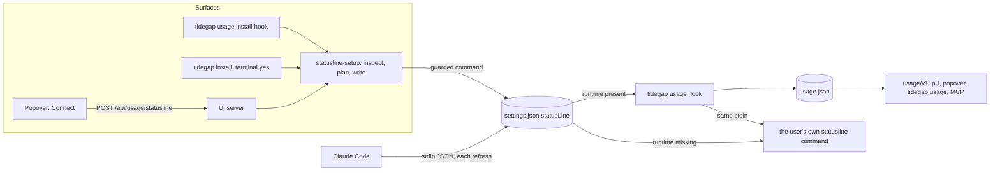

# Usage Popover Layout and Statusline Hook (Batch 28) - Plan

## Goal Capsule

- **Objective:** A user who opens Usage in the Mac app or the local page reads the Claude spend and the Codex state at a glance. A user whose Claude limits do not show learns in one sentence what is missing and fixes it with one click or one command, and their own Claude Code status line keeps working, before and after, even when Tidegap is later moved or removed.
- **Means:** two PRs, in order (Sequencing).
  - PR A `fix/usage-popover-layout`: the spend table and the stale Codex line (KTD1-KTD3).
  - PR B `feat/usage-statusline-connect`: one registration module, a guarded hook command, `tidegap usage install-hook`, a Connect button in the popover, and honest next-step text on every surface (KTD4-KTD10). It starts from `main` after PR A merges.
- **Authority:** the Product Contract decides what; the Planning Contract decides how. Binding repo rules:
  - `CLAUDE.md` (gate, generated files, hard rules, git conventions).
  - `docs/solutions/tooling-decisions/claude-usage-limits-source-and-deferral.md` (statusline first, OAuth opt-in, how `~/.claude/settings.json` is written). PR B changes its consent rule (KTD8) and updates it.
  - `docs/solutions/best-practices/loopback-web-ui-hardening.md` (auth classes, POST only, body-less routes, generic error bodies).
  - `docs/solutions/best-practices/dependency-free-task-ui-patterns.md` (text nodes only, no inline style, one press one action, show the server's reason on 409).
  - `docs/spec/ui-client-api.md` (the UI HTTP contract; PR B adds two routes).
  - `docs/solutions/workflow-issues/public-repo-hygiene.md`, `docs/solutions/workflow-issues/generated-test-counts-merge-conflict.md`, `docs/solutions/developer-experience/folding-review-fixes-into-commits.md`.
- **Execution profile:** one Opus `ce-work` agent per PR, in its own worktree under `.worktrees/<branch>`. Sequential: PR B starts after PR A merges, because both edit `packages/cli/ui/usage.js`, `packages/cli/ui/app.css`, `packages/cli/test/ui-usage.test.ts`, `packages/cli/src/commands/usage.ts`, `packages/cli/test/usage-command.test.ts` and `scripts/qa/ui-flows.mjs`. Each PR runs `pnpm qa ui` once, at its end, with nothing else running. Simplify runs on both PRs. One `ce-code-review` per PR at its end.
- **Who ships:** each PR ends green, with its review done and the diff reviewed. Agents do not merge. No PR bumps a version, cuts a release or publishes.
- **Stop conditions:** stop and report in these cases:
  - A PR must edit a file that open PR #205 or draft #203 owns: `packages/core-ts/src/scheduler.ts`, `packages/core-py/src/tidegap/scheduler.py`, `packages/cli/ui/region-card.js`, the Mac `Connection`, `ServerLauncher` or `LaunchAtLogin` sources, any `tsconfig.test.json`, `CHANGELOG.md`.
  - A test or check needs the real `HOME`, `~/.tidegap`, `~/.claude` or `~/.config/tidegap`.
  - The guarded command (KTD5) cannot be parsed back exactly for a quoted user command: report the failing input, do not fall back to the unguarded shape.
  - A gate fails the same way twice.
  - Evidence shows a Key Technical Decision cannot work.
- **Open decisions:** seven, each with a recommended default that this plan follows. The orchestrator confirms or flips them before `ce-work` starts.
  - D1 (R1, R2). Spend layout. Recommended: one aligned grid with a single header row, and a stacked row when the block is narrower than 360 px (KTD1). Alternative: two lines per row (label and cost, then a muted breakdown); simpler CSS, but the columns do not line up across rows, so models cannot be compared at a glance.
  - D2 (R3). A Codex reading older than every window. Recommended: one line under the plan name, "No reading for 162 days." (KTD3). Alternative: hide the Codex section; quieter, but a user who stopped Codex sees nothing and cannot tell "no logs" from "old logs".
  - D3 (R5). The popover action. Recommended: a Connect Claude Code button that asks the local server to register the hook, with a copyable command as the fallback (KTD6). Alternative: only a copyable command. An app install has no `tidegap` on `PATH`, so that command must carry the runtime's absolute node and script paths; the server already knows them.
  - D4 (R6). The stored statusLine command. Recommended: a POSIX `sh` guard that runs the user's command directly when the Tidegap runtime is gone (KTD5). Alternative: today's plain `<launcher> usage hook -- sh -c '<old>'`; after a node upgrade or an uninstall it blanks the user's status line in every Claude Code session.
  - D5 (R8). `tidegap install` without a terminal. Recommended: print the state and the exact `usage install-hook` command, write nothing (KTD8). Alternative: register without asking; it breaks the 2026-10-17 consent rule, and an agent running the install would edit Claude Code's settings without the user's yes.
  - D6 (R4). The pill with no reading. Recommended: "Claude limits · no reading" with an amber dot (KTD7). Alternative: keep "Claude limits ?" with the red dot.
  - D7 (R9). The OAuth read in the UI. Recommended: one muted line naming `TIDEGAP_USAGE_OAUTH=1` in `~/.tidegap/config`, no toggle (KTD9). Alternative: a toggle; it makes the use of the Claude Code login outside Claude Code look endorsed, which the 2026-10-17 decision rejected.

---

## Product Contract

### Summary

PR A rebuilds the "Claude spend" block of the Usage popover as one aligned grid: a header row once (in, out, cache w, cache r, cost), then Total, each model and each recent session on one line each, with compact numbers. When the block is narrower than 360 px, each row stacks its label over its numbers. A Codex reading older than both windows becomes one line, in the popover and in `tidegap usage`.

PR B makes the missing Claude limits fixable from where the user sees them. One module inspects and edits the `statusLine` of `~/.claude/settings.json`. It wraps an existing command, never replaces it, and stores a guarded command that still runs the user's own status line when the Tidegap runtime is gone. `tidegap usage install-hook` (with `--dry-run` and `--remove`), `tidegap install`, and a new page route share it. The popover says what is missing in one sentence and offers Connect Claude Code. `tidegap usage`, MCP `tidegap_usage` and the `after_limit_reset` refusal name the same next step.

### Problem Frame

The owner reported two defects in the Usage popover on 2026-10-30, with screenshots.

Defect 1, layout. In "Claude spend since 16:24 (trailing 5 h)", each row's right column wraps "27k in · 5.5M out · 25.2M cache write · 1026.2M cache read" onto five lines, with the dollar amount under it. Cause: `.usage-spend` in `packages/cli/ui/app.css` is a two-column grid, `minmax(64px, auto) minmax(0, 1fr)`. The `auto` column grows to the longest label, which is a session's project name, and leaves the value column about 60 px. The Codex block under it reads "Codex plus · seen 162 days ago", then "5h reset since seen" and "7d reset since seen": two rows that say nothing. `tidegap usage` prints the same reading as "as of Thu 17:51", which reads as this week.

Defect 2, no limits. The pill reads "Claude limits ?". The Claude section shows the raw cause text: "no statusline reading yet; register `tidegap usage hook` as the Claude Code statusLine (tidegap install), or set TIDEGAP_USAGE_OAUTH=1". The owner runs Claude Code heavily on this Mac.

Diagnosis on the reporting Mac (read-only, limited to the statusLine key, the names of the usage files and the installed CLI's own commands):

- The `statusLine` key holds the owner's own status line script, not wrapped by the Tidegap hook.
- `~/.tidegap/usage.json` does not exist, so `tidegap usage hook` has never run.
- The installed CLI is 0.19.0 in the app runtime (`~/.tidegap/runtime/cli`). `tidegap` is not on `PATH` and not at any path the Mac app probes. `tidegap usage` prints the same no-reading cause.

Root cause in the code:

- `tidegap install` offers the wrap only when stdin and stdout are a terminal (`offerStatuslineInteractive` in `packages/cli/src/commands/statusline-setup.ts`). The app runtime and agent-run installs have no terminal.
- Without a terminal it prints a snippet (`statuslineSnippet`) that names a bare `tidegap`, which is not on `PATH` for an app install. Pasted as shown, the snippet also replaces the user's statusLine instead of wrapping it.
- Nothing else registers the hook. The popover shows the instruction as a string with backticks and offers no action.
- The wrap itself already exists and works (`runStatuslineHook` in `packages/cli/src/usage/statusline.ts`). It hands Claude Code's stdin to the wrapped command and passes its output through.

### Requirements

- R1. The spend block shows one header row (in, out, cache w, cache r, cost) and one line per row (Total, each model, each recent session). Values sit in right-aligned columns that line up across rows. No value cell wraps at any width; at a 440 px dialog (content about 392 px) each row fits one line.
- R2. Counts use a compact form of at most four characters plus a unit (999, 9.9k, 27k, 5.5M, 25M, 1.0B); a value that rounds to 1,000 of a unit moves to the next unit (999,500 is 1.0M). The exact count is the cell's hover title. A label too long for its column ends in an ellipsis and carries its full text as the title. When the spend block is narrower than 360 px (a 390 px viewport leaves about 308 px), each row stacks its label over its five values, under the one header row, with no horizontal scroll. Light and dark themes use the existing theme variables only.
- R3. When every Codex window has reset since the reading, the Codex section shows its plan name and one line, and no rows. The line is "No reading for <age>.", with the age in hours under two days and in days otherwise ("No reading for 162 days."), or "No current reading." when the reading has no time. When only one window has reset, both rows stay as today. `tidegap usage` prints the same rule as one line.
- R4. With no Claude reading, the pill reads "Claude limits · no reading" in an amber state. The dialog's Claude section shows one sentence that names what is missing on this machine, and one action:
  - no statusLine: "Claude Code does not send its limits to Tidegap yet." Action: Connect Claude Code.
  - another statusLine command: the same sentence, plus "Your status line keeps working: Tidegap wraps it." Action: Connect Claude Code.
  - the hook is registered: "Connected. Limits appear after Claude Code's next reply." No action.
  - the hook is the older, unguarded Tidegap shape: "The Tidegap hook is from an older version." Action: Reconnect.
  - the hook names a runtime path that no longer exists: "The Tidegap hook points at an old install." Action: Reconnect.
  - the settings file cannot be read: "Tidegap cannot read ~/.claude/settings.json, so it cannot connect: <reason>." The reason is a fixed phrase (is not valid JSON, is not a JSON object, cannot be read), never parser text. Action: the copyable CLI command.
  - a stale statusline reading: the same block shows for every state except connected, so a hook that stopped recording after a node upgrade or a move is found too. The pill keeps its text.
- R5. Connect (or Reconnect) registers the hook through the local server. One click sends one request; the button is disabled while it runs. Success replaces the block with the "Connected" sentence. A refusal shows the server's one-line reason and the copyable CLI command. Nothing in the page or the answers shows any value of the settings file except the statusLine state.
- R6. Registering never removes the user's status line. An existing command is wrapped, and Claude Code shows its output unchanged. The stored command runs the user's command directly when the Tidegap node or script path no longer exists. With no user command it prints nothing in that case.
- R7. `tidegap usage install-hook` registers the hook and prints one line saying what it did: registered, wrapped, updated (an older hook shape or a missing path, keeping the wrapped command) or already. `--dry-run` prints the state and the command it would store and writes nothing. `--remove` restores the wrapped command exactly. When there was none, it removes the `type` and `command` fields the hook added and deletes the `statusLine` key if nothing else remains. Every other key and field stays. An unreadable file, or one that changed during the write, is left unchanged with exit 1. Every write keeps the backup, mode and symlink rules of today's writer.
- R8. `tidegap install` uses the same registration. In a terminal it asks first, as today. Without a terminal it prints the state and the exact `usage install-hook` command for this install, and writes nothing.
- R9. `tidegap usage` adds, after a no-reading line, the next step for this machine's statusLine state. The shared cause text that MCP `tidegap_usage` and the `after_limit_reset` refusal carry names `tidegap usage install-hook` and the OAuth setting, without backtick-only instructions to edit settings by hand. The popover mentions the OAuth setting in one muted line, without a toggle.
- R10. Docs match the code: `docs/spec/ui-client-api.md` documents the new routes and their auth class; the CLI docs page and the CLI README list `usage install-hook`; `apps/web/public/install.md` and the Claude Code plugin's `usage` command tell an agent to ask the user, then run `tidegap usage install-hook`; the usage learning states the new consent rule.

### Key Decisions

- **The popover action writes Claude Code's settings only on a click.** A click on Connect is the user's yes, like the terminal question. Governs R5, R8.
- **No toggle for the OAuth read.** It stays opt-in through `~/.tidegap/config`. Governs R9.

### Acceptance Examples

- AE1. Covers R1, R2. A spend document with the owner's Total (27,000 in, 5,500,000 out, 25,200,000 cache write, 1,026,200,000 cache read, $711.01) renders its Total row as 27k, 5.5M, 25M, 1.0B, $711.01 on one line, and the 1.0B cell's title is the exact count.
- AE2. Covers R3. A Codex reading 162 days old with both windows passed renders "Codex plus" and "No reading for 162 days." with no rows; `tidegap usage` prints "Codex limits (plus): no reading for 162 days".
- AE3. Covers R5, R6. With a statusLine command that runs a fixture script, Connect answers `wrapped`. Running the stored command under `sh` with a statusline JSON that carries `rate_limits` prints the fixture script's line byte for byte and writes `usage.json`.
- AE4. Covers R6. After the node path in the stored command is renamed away, the stored command still prints the fixture script's line and exits 0.
- AE5. Covers R7. `install-hook` twice: the second prints "already" and the file bytes do not change. `--remove` then restores the statusLine command to the exact original string, and every other key is unchanged.
- AE6. Covers R4, R5. A settings file that is not a JSON object: the dialog shows the reason and the command chip; the POST answers 409 with the one-line rule; the file bytes are unchanged.
- AE7. Covers R5. A POST from an extension origin, or with an extension client's bearer, gets 403; with a `macos` client's bearer it succeeds; a POST with a body gets 400.

### Scope Boundaries

- No change to the usage/v1 document, to MCP tool descriptions or to the `/api/summary` limits line.
- No change to the Mac app's Swift code. The Usage popover is the page inside the app's web window.
- No Python change: usage limits live in `@tidegap/cli` only.
- No version bump, release or publish.

Considered and not built:

- Honoring `CLAUDE_CONFIG_DIR` for the settings path. The app's UI server does not see a shell variable, so the CLI and the page would edit different files. Evidence that would change this: a user whose Claude Code settings live there.
- A project or local settings file that sets its own statusLine overrides the user file in that project, and the hook does not run there. The popover cannot see project files. Evidence that would change this: readings missing for a user whose hook is registered.
- A lean hook entry point. The installed CLI starts in 0.08-0.12 s on the reporting Mac; the hook adds that to each status line refresh. Evidence that would change this: a status line that visibly lags or is cancelled by Claude Code.
- A Settings page for the hook. The popover is where the missing state shows.

### Sources / Research

- Repo reads: `packages/cli/src/usage/statusline.ts`, `packages/cli/src/commands/statusline-setup.ts`, `packages/cli/src/commands/usage.ts`, `packages/cli/src/usage/limits.ts`, `packages/cli/src/usage/document.ts`, `packages/cli/src/index.ts` (the `install` and `usage` commands), `packages/cli/src/commands/install.ts` (`resolveLauncher`), `packages/cli/src/ui/api.ts`, `packages/cli/src/ui/server.ts`, `packages/cli/ui/usage.js`, `packages/cli/ui/app.css`, `packages/cli/test/ui-usage.test.ts`, `packages/cli/test/statusline-setup.test.ts`, `packages/cli/test/fixtures/fake-dom.ts`, `scripts/qa/ui-flows.mjs`, `scripts/qa/docs-drift.mjs` (K7, K11), `apps/macos/scripts/install.sh` (the runtime command), `apps/macos/TidegapKit/Sources/TidegapKit/ServerLauncher.swift` (read only: probed paths).
- Learnings: the three files under Authority, plus `docs/plans/2026-10-17-1530-feat-usage-limits-plan.md` (D1-D4).
- External research: none. Local patterns cover every layer (a body-less page route, settings writer, fake DOM tests, QA steps).

---

## Planning Contract

### Key Technical Decisions

- KTD1. **The spend block is a CSS grid with ARIA table roles.** Rows are `div` elements with `role="row"` inside a `role="table"`; the header cells are `columnheader`, labels are `rowheader`. Grid columns: label `minmax(0, 1fr)`, four count columns sized to their header text (about 3.6em), one cost column. A `<table>` was rejected because the stacked variant needs the label on its own line, and changing a table's `display` drops its semantics in some engines. The spend slot is a size container (`container-type: inline-size`). One `@container` rule under 360 px switches each row to a five-track grid with the label on its own full-width line, so no empty label track costs a gap. The Mac app's web view (macOS 14) and current browsers support container queries. Group headers ("By model", "Recent sessions") are full-width rows. Classes only: the UI test bans inline styles.
- KTD2. **Compact counts in the page only.** A new formatter in `packages/cli/ui/usage.js` gives at most four characters plus a unit: under 1,000 as is; one decimal under 10 of a unit; rounded otherwise (k, M, B). A value that rounds to 1,000 of a unit is formatted in the next unit. The exact value goes in the cell title with thousands separators. `tidegap usage --spend` keeps its own format.
- KTD3. **The Codex collapse keys on the windows, not on a fixed age.** The usage document already marks a passed window with `pct: null` and `state: "reset_since_seen"`. When every present window is passed, the page and the CLI print one line with the reading's age (hours under two days, days otherwise), or "No current reading." without `as_of`. The age text comes from the page's `ago` helper (`packages/cli/ui/dom.js`) without its "ago" suffix, and from the CLI's own age helper.
- KTD4. **One registration module.** `packages/cli/src/commands/statusline-setup.ts` gets three pure-or-file steps that every surface calls:
  1. Inspect: read and parse the settings file, classify the `statusLine` as `absent`, `other`, `connected`, `legacy` (today's unguarded shape), `stale` (a guarded hook whose node or script path is missing) or `unreadable`. A command that contains `usage hook` but matches no known shape counts as `connected` and is never rewritten. `unreadable` carries a fixed reason (is not valid JSON, is not a JSON object, cannot be read with its errno code), never the parser's message: `JSON.parse` messages quote file content near the error, and the file can hold secrets in `env`.
  2. Plan: for a launcher, compute the result (`registered`, `wrapped`, `updated`, `already`) and the command to store. `legacy` and `stale` keep the wrapped user command and get the current launcher.
  3. Write: the existing writer (backup to `settings.json.tidegap.bak`, mode kept, symlink target replaced, atomic rename), after a re-read shows the file unchanged since the inspect.
  The interactive offer, `usage install-hook`, and the page route call these steps. `statuslineSnippet` goes away.
- KTD5. **The stored command is guarded.** It is one `sh -c` program with the launcher paths and the user command as positional arguments, so no path or user text is spliced into the program. Directional sketch, not the final string:

  ```text
  sh -c '<guard>' tidegap-usage-hook <launcher path...> -- <user command, quoted>
  guard: if every absolute launcher path exists -> exec <launcher> usage hook -- sh -c <user command>
         else if a user command was given          -> exec sh -c <user command>
         else                                      -> exit 0
  ```

  The module both writes and parses this shape. Quoting follows the existing `shq` rule, and parsing accepts only that grammar (bare safe words, or single-quoted words with the `'\''` escape). A test round-trips user commands with quotes, `$`, backticks and spaces through wrap and remove.
- KTD6. **Two page routes, usage/v1 unchanged.** `GET /api/usage/statusline` returns `{ state, settings: "~/.claude/settings.json", command }`, where `command` is the KTD10 `usage install-hook` command built from the server's launcher; the page uses it for the fallback chip. `POST /api/usage/statusline` is body-less (a non-empty body gets 400) and returns `{ result, state }`. A refusal is 409 with the module's one-line rule; any other failure is 500 with a fixed body. Auth class: the page's bearer or a `macos` client, never an extension origin. It joins the page-or-mac condition in `packages/cli/src/ui/server.ts`, next to `isIntegrationsRoute`. The server stores the launcher it already resolves for Start dispatcher (`packages/cli/src/commands/ui.ts`). Tests inject the settings path through `UiServerOptions`. Neither route returns any other value of the settings file. Keeping the state out of usage/v1 avoids a contract change for MCP and `tidegap usage --json`.
- KTD7. **The pill keys on the cause.** `usageView` maps `unavailable` with cause `no_data` to pill text "Claude limits · no reading" and state `setup` (amber dot in `app.css`). The section carries a `setup` flag instead of the raw cause text. The flag is also set, with the pill unchanged, when the state is `ok` from source `statusline` with `stale: true`: a guarded hook whose runtime moved stops recording, and the last reading stays. The dialog fetches the statusLine state only when it opens with the flag, never on the one-minute poll, and renders the setup block for `absent`, `other`, `legacy`, `stale` and `unreadable`, not for `connected`. Other causes keep today's text and red dot.
- KTD8. **Consent rule.** A write happens only on an explicit act: the terminal yes in `tidegap install`, the `usage install-hook` command, or the Connect click. `tidegap install` without a terminal prints one line with the state and the command (KTD10) and writes nothing. The usage learning's section "Writing ~/.claude/settings.json" is rewritten to say so.
- KTD9. **OAuth stays opt-in.** The popover adds one muted line under the setup block: "Other way: set TIDEGAP_USAGE_OAUTH=1 in ~/.tidegap/config; Tidegap then reads Anthropic's usage API with your Claude Code login (off by default)." No toggle, no route.
- KTD10. **The stored and printed commands name this install.** The node path stored in the hook is the first `node` on `PATH` whose real path equals the real path of `process.execPath`, else `process.execPath`; a Homebrew-style upgrade that moves the versioned binary then leaves the stored path valid. The CLI prints `tidegap usage install-hook` when a `tidegap` found on `PATH` resolves to the running script, and the absolute launcher form otherwise. The page's fallback chip uses the server's launcher. The cause text in `packages/cli/src/usage/limits.ts` is static, because MCP and the tick share it: "no reading from Claude Code yet; run tidegap usage install-hook (it keeps your status line), or set TIDEGAP_USAGE_OAUTH=1 in ~/.tidegap/config".

### High-Level Technical Design



### Assumptions

- The Usage dialog keeps its width rule, `min(440px, 100vw - 32px)` with 24 px padding, so content is about 392 px at full width and about 308 px at a 390 px viewport.
- Claude Code passes `rate_limits` to the statusLine command for a subscription login after the first reply of a session, as the 2026-10-17 learning records. Nothing in this plan depends on more than that.
- The UI server's launcher (`process.execPath` plus the resolved entry script) is the right command for the hook, because the same launcher already starts the dispatcher and the daemon.

### Sequencing

| PR | Branch | Units | Starts | Files (beyond generated counts) |
|---|---|---|---|---|
| A | `fix/usage-popover-layout` | U1-U3 | now, from `main` | `packages/cli/ui/usage.js`, `packages/cli/ui/app.css`, `packages/cli/src/commands/usage.ts`, `packages/cli/test/ui-usage.test.ts`, `packages/cli/test/usage-command.test.ts`, `scripts/qa/ui-flows.mjs`, `docs/plans/2026-10-19-qa-matrix-checklist.md` |
| B | `feat/usage-statusline-connect` | U4-U8 | after PR A merges, from the new `main` | `packages/cli/src/commands/statusline-setup.ts`, `packages/cli/src/index.ts`, `packages/cli/src/commands/usage.ts`, `packages/cli/src/usage/limits.ts`, `packages/cli/src/ui/api.ts`, `packages/cli/src/ui/server.ts`, `packages/cli/src/commands/ui.ts`, `packages/cli/ui/usage.js`, `packages/cli/ui/api.js`, `packages/cli/ui/app.css`, four test files (units), `scripts/qa/ui-flows.mjs`, `scripts/qa/cli-flows.mjs`, `README.md` (usage section, hand edit), docs (U8) |

- Neither PR touches the files of #205 or #203. `README.md` and `apps/web/src/lib/tests.generated.ts` change only through `pnpm gen:tests`, except PR B's hand edit of the README's usage section (U8); on a conflict in a generated block, take `main`'s version and regenerate.
- `CHANGELOG.md`: no edit while #205 or #203 is open. If both have merged before PR B opens, PR B adds both batch entries under `[Unreleased]`. Otherwise the orchestrator adds them in a follow-up commit after they merge.

---

## Implementation Units

### U1. Spend table

- **Goal:** R1 and R2 in the popover.
- **Requirements:** R1, R2; KTD1, KTD2.
- **Dependencies:** none.
- **Files:** `packages/cli/ui/usage.js`, `packages/cli/ui/app.css`, `packages/cli/test/ui-usage.test.ts`.
- **Approach:**
  1. Replace `spendRows` with a pure `spendTable(spend)` that returns the header and the groups (Total; By model; Recent sessions), each row with label, label title, four counts (compact text and exact title) and cost text.
  2. Rewrite `spendBlock` to render that model as the KTD1 grid. The note line under it stays.
  3. Replace the `.usage-spend` rules in `app.css` with the grid, the header, group and Total row styles, the ellipsis label, and the container-query stacked variant (KTD1). `.usage-rows` (the limit rows) keeps its rules.
- **Patterns to follow:** `usageView` as a pure, exported view model (`ui-usage.test.ts`, "page usage panel model"); `h()` from `dom.js` with text children only; `installFakeDom` from `packages/cli/test/fixtures/fake-dom.ts` as in `ui-channel-card.test.ts`.
- **Test scenarios:**
  - Covers AE1. `spendTable` with the owner's Total: compact texts 27k, 5.5M, 25M, 1.0B and cost $711.01; the 1.0B title holds the exact count with separators.
  - Compact form boundaries: 0, 999, 1,000, 9,949, 9,950, 999,499, 999,500 (1.0M), 1,000,000, 24,600,000, 999,600,000 (1.0B), 1,026,200,000, 12,000,000,000.
  - Groups in order: Total, By model (each model), Recent sessions (each session as "project · HH:MM"); an empty `by_model` or `sessions` omits its group.
  - A model with no price shows "no price" in the cost column.
  - Fake DOM: the rendered block has one `columnheader` row with five headers, one `row` per data row with one `rowheader` and five cells, and a session label of 80 characters carries the full text as its title.
  - The existing scan in `ui-server.test.ts` still passes (no inline style, text nodes only).
- **Verification:** the unit tests pass; U3's browser step shows no wrapped value cell.

### U2. Stale Codex reading

- **Goal:** R3 in the popover and the CLI.
- **Requirements:** R3; KTD3.
- **Dependencies:** none.
- **Files:** `packages/cli/ui/usage.js`, `packages/cli/src/commands/usage.ts`, `packages/cli/test/ui-usage.test.ts`, `packages/cli/test/usage-command.test.ts`.
- **Approach:** in `usageView`, when `codex.status` is `ok` and every present window has `pct: null`, the Codex section gets no rows and the note "No reading for N days." (hours under two days, from the same rounding as `ago`). In `codexLines`, the same condition prints one line, `Codex limits (<plan>): no reading for <age>`, and no window rows.
- **Patterns to follow:** the existing Codex scenarios in both test files; `CODEX_HOME` fixtures in `usage-command.test.ts`.
- **Test scenarios:**
  - Covers AE2. Page model: a reading 162 days old with both windows passed gives sub "plus", no rows and the note "No reading for 162 days.".
  - Page model: a reading 6 hours old with only the 5h window passed keeps both rows ("reset since seen" and the 7d percent).
  - Page model: a reading with no `as_of` and both windows passed says "No current reading.".
  - CLI: a `CODEX_HOME` log 162 days old prints the one line and no "5h" or "7d" row.
- **Verification:** both suites pass; the old "Codex rows; a passed window reads reset since seen" scenario still passes for a partial reset.

### U3. Browser check of the popover layout

- **Goal:** prove R1-R3 in a real browser, in both themes and both widths.
- **Requirements:** R1, R2, R3.
- **Dependencies:** U1, U2.
- **Files:** `scripts/qa/ui-flows.mjs`, `docs/plans/2026-10-19-qa-matrix-checklist.md`.
- **Approach:** add step S2.32. The stream's server runs with usage off, so the step serves `/api/usage` and `/api/usage?spend=1` from an inline fixture through Playwright request routing: the owner's Total, three models, five sessions with long project names, a Codex reading 162 days old. The shared page loaded with usage off and fetches `/api/usage` only at load, so the step opens a fresh page, installs the routes on it before it loads the page link, and closes it at the end, as S15.11 does. It opens the pill, clicks Show spend, and checks at 1280×900 and at 390×844, light and dark. Add the S2.32 row to the QA checklist.
- **Patterns to follow:** S15.11 (a fresh page with routes set before the load); S2.31 and S2.25 (viewport change, dark mode, horizontal-scroll check, screenshots next to the log).
- **Test scenarios:**
  - At 1280 px: every value cell's height is at most 1.5 times its line height, and the header row appears once.
  - At 390 px: the dialog has no horizontal scroll, and each value cell still fits one line.
  - The Codex section shows "No reading for 162 days." and no window rows.
  - Screenshots for both widths in light and dark.
- **Verification:** `pnpm qa ui` passes once at the end of PR A, run alone.

### U4. One registration module and the guarded command

- **Goal:** R6 and the core of R7 and R8: inspect, plan, write, remove, all tested on temp files.
- **Requirements:** R6, R7; KTD4, KTD5.
- **Dependencies:** PR A merged.
- **Files:** `packages/cli/src/commands/statusline-setup.ts`, `packages/cli/test/statusline-setup.test.ts`.
- **Approach:**
  1. Add the guarded command builder and its strict parser (KTD5). It accepts a launcher of one or two absolute paths, with the node path chosen by KTD10.
  2. Add inspect, plan, register and remove (KTD4). Register re-reads the file before writing and refuses when it changed. Remove restores the parsed user command, or deletes the key when there was none, and keeps every other `statusLine` field.
  3. Keep `writeSettings` as the only writer. Rebuild `offerStatuslineHook` on these steps, so the terminal question shows what will change and handles `legacy` and `stale`.
- **Execution note:** write the round-trip and fallback tests first; they decide the command's final form.
- **Patterns to follow:** the existing tests in `statusline-setup.test.ts` (temp settings files, the backup, mode and symlink case, the changed-while-waiting case).
- **Test scenarios:**
  - Inspect returns `absent`, `other`, `connected`, `legacy`, `stale` and `unreadable` for one fixture each; a hand-edited command containing `usage hook` is `connected`.
  - Covers AE3. Register over a fixture script answers `wrapped`. Running the stored command with `sh` and a temp `HOME`, with statusline JSON on stdin, prints the script's output byte for byte and writes the temp `usage.json`.
  - Covers AE4. The same stored command with a missing node path prints the script's output and exits 0; with no user command it prints nothing and exits 0.
  - Covers AE5. Register twice: the second answers `already` and the file bytes are unchanged.
  - Register over `legacy` and `stale` answers `updated` and keeps the user command.
  - Covers AE5. Remove restores the exact original command string for commands with single quotes, double quotes, `$VAR`, backticks, spaces and a trailing `;`; other keys and `statusLine.padding` are unchanged.
  - Remove with no hook writes nothing and reports it.
  - An unreadable file and a file changed between inspect and write stay byte-identical.
  - A malformed file whose broken value is a fixture secret gives the fixed reason "is not valid JSON", and the result does not contain the secret.
  - With a temp `PATH` directory holding a `node` symlink to the running binary, the stored command uses the symlink path; without it, `process.execPath`.
  - The existing backup, mode, symlink and missing-directory cases still pass.
- **Verification:** `pnpm --filter @tidegap/cli test` passes, and every case above runs under a temp `HOME`.

### U5. CLI: `usage install-hook`, install, and the next step

- **Goal:** R7, R8 and the CLI half of R9.
- **Requirements:** R7, R8, R9; KTD8, KTD10.
- **Dependencies:** U4.
- **Files:** `packages/cli/src/index.ts`, `packages/cli/src/commands/usage.ts`, `packages/cli/src/usage/limits.ts`, `packages/cli/test/usage-command.test.ts`, `packages/cli/test/statusline-setup.test.ts`, `packages/cli/test/usage-limits.test.ts`, `scripts/qa/cli-flows.mjs`.
- **Approach:**
  1. Add `usage install-hook` with `--dry-run` and `--remove` next to `usage hook` in `index.ts`, and name it in the file's header list.
  2. Exit codes: 0 for registered, wrapped, updated, already and nothing-to-remove; 1 for unreadable or changed. Output: one line per outcome, naming the settings file and, for a wrap, the backup.
  3. `tidegap install`: in a terminal, the rebuilt offer (U4); without one, print one line with the state and the KTD10 command.
  4. `claudeLines` in `commands/usage.ts`: after the no-reading line, one line with the next step for the inspected state.
  5. Replace the `no_data` text in `CAUSE_TEXT` (KTD10).
  6. Add CLI QA step S1.32 to `cli-flows.mjs`: in the sandbox `HOME`, seed a statusLine that echoes a marker, run `usage install-hook`, run the stored command with a fixture stdin, check the marker and the new `usage.json`, then `--remove` and compare the file with the seed. The sandbox sets `TIDEGAP_USAGE=off`, which makes the hook record nothing, so that one child runs with the variable cleared; `usage hook` reads no Keychain, so the sandbox stays sealed.
- **Patterns to follow:** `runUsage` and the `usage hook` tests in `usage-command.test.ts`; `cli-flows.mjs` steps that read the sandbox `HOME`.
- **Test scenarios:**
  - `install-hook` on `absent`, `other`, `legacy` and `connected` prints registered, wrapped, updated and already, and exits 0.
  - `--dry-run` prints the state and the command it would store; the file bytes are unchanged.
  - `--remove` after a wrap restores the seed; a second `--remove` prints that there is no hook.
  - `install-hook` on an unreadable file exits 1 and leaves the file unchanged.
  - Install without a terminal prints the state and the install-hook command and does not create or change the settings file (replaces "without a terminal it prints the snippet and writes nothing").
  - `tidegap usage` with no reading and an `other` statusLine prints the cause line and then the install-hook line.
  - `usage-limits.test.ts`: the `no_data` message names `tidegap usage install-hook` and `TIDEGAP_USAGE_OAUTH=1`.
- **Verification:** unit tests pass; `pnpm qa cli` passes with S1.32.

### U6. Page routes for the statusLine state and Connect

- **Goal:** the server half of R5.
- **Requirements:** R5; KTD6.
- **Dependencies:** U4.
- **Files:** `packages/cli/src/ui/api.ts`, `packages/cli/src/ui/server.ts`, `packages/cli/src/commands/ui.ts`, `packages/cli/test/ui-usage.test.ts`.
- **Approach:**
  1. Add `statusline?: { settingsPath: string; launcher: string[] }` to the server options. The default is `claudeSettingsPath()` and the launcher `tidegap ui` already resolves.
  2. Route `usage/statusline` in `handleApi`: GET returns the state; POST registers; other methods get 405.
  3. In `server.ts`, put the route in the page-or-mac class and in the body-less set.
  4. Map `unreadable` and `changed` to 409 with the module's rule; any thrown error to 500 "could not update the Claude Code settings".
- **Patterns to follow:** `dispatcher/start` (body-less POST, launcher from options); the integrations and settings auth class and its tests.
- **Test scenarios:**
  - GET with the page's bearer and with a `macos` client: 200, the state for a seeded `other` file, and the install-hook `command` built from the injected launcher.
  - Covers AE7. GET and POST from an extension origin, and with an `extension` client's bearer: 403.
  - POST on `other`: 200 `wrapped`; the temp file now holds the guarded command; a second POST answers `already`.
  - Covers AE7. POST with a JSON body: 400; the file is unchanged.
  - Covers AE6. POST on an unreadable file: 409 with the rule; the file bytes are unchanged.
  - A seeded file with an `env` block holding a fixture secret value: no answer from either route contains it.
  - A malformed file whose broken value is the fixture secret: the 409 body says "is not valid JSON" and does not contain the secret.
- **Verification:** `ui-usage.test.ts` passes, and the auth matrix in `docs/spec/ui-client-api.md` (U8) lists the route.

### U7. Popover setup block and pill

- **Goal:** R4, R5 and the UI half of R9.
- **Requirements:** R4, R5, R9; KTD7, KTD9.
- **Dependencies:** U6.
- **Files:** `packages/cli/ui/usage.js`, `packages/cli/ui/api.js`, `packages/cli/ui/app.css`, `packages/cli/test/ui-usage.test.ts`, `scripts/qa/ui-flows.mjs`, `docs/plans/2026-10-19-qa-matrix-checklist.md`.
- **Approach:**
  1. `usageView`: the `no_data` pill and the section flag, and the flag for a stale statusline reading (KTD7).
  2. `api.js`: `statusline()` (GET) and `connectStatusline()` (POST).
  3. An exported `setupBlock(state, deps)` renders the R4 sentence, the action and the KTD9 line. `deps` injects the API calls so the fake DOM tests can drive it. The Connect button disables itself in flight. Success swaps in the connected sentence and reloads the pill. A 409 shows `err.message`, and any other failure a fixed text, each followed by a `copyChip` of the `command` from the GET.
  4. `usageDialog` renders the block when the flag is set and the GET answers with a state other than `connected`. A failed GET shows a fixed text and no chip.
  5. `app.css`: the `setup` pill dot (amber).
  6. QA step S2.33, on a fresh page with its route set before the load (as in U3). Serve only `GET /api/usage` from a `no_data` fixture. Seed the sandbox `~/.claude/settings.json` with a statusLine that echoes a marker. Click Connect, read the sandbox file, run its stored command with fixture stdin under the sandbox `HOME` and with `TIDEGAP_USAGE` cleared for that child (as in S1.32), and check the marker and `usage.json`. Add the S2.33 row to the checklist.
- **Patterns to follow:** `startDispatcher` button handling and toasts in the page; `copyChip` in `copy.js`; fake DOM click handling in `ui-channel-card.test.ts`.
- **Test scenarios:**
  - `usageView` with cause `no_data`: pill text "Claude limits · no reading", state `setup`, section flag set, no raw cause text.
  - `usageView` with cause `not_logged_in`: today's pill and note.
  - `usageView` with a statusline reading and `stale: true`: today's pill text, and the section flag set; with a fresh reading, no flag.
  - `setupBlock` for each state: `absent` and `other` show Connect Claude Code (`other` adds the wrap sentence); `connected` shows the waiting sentence and no button; `legacy` and `stale` show Reconnect with their own sentences; `unreadable` shows the reason and a copy chip.
  - Connect: two clicks during one pending call send one request; success shows "Connected. Limits appear after Claude Code's next reply."; a 409 shows the server's text and the chip; the button is enabled again after a failure.
  - Every state shows the OAuth line once, with no control.
  - QA S2.33: after the click, the sandbox file holds the guarded command, and running it prints the marker and writes `usage.json`.
- **Verification:** unit tests pass; `pnpm qa ui` passes once at the end of PR B, run alone.

### U8. Docs, contracts and the learning

- **Goal:** R10, and drift checks that stay green.
- **Requirements:** R10; KTD6, KTD8.
- **Dependencies:** U5, U6, U7.
- **Files:** `docs/spec/ui-client-api.md`, `README.md` (the usage section), `apps/web/content/docs/03-cli.md`, `packages/cli/README.md`, `apps/web/public/install.md`, `packages/claude-code-plugin/commands/usage.md`, `docs/solutions/tooling-decisions/claude-usage-limits-source-and-deferral.md`; generated: `apps/web/src/lib/docs.generated.ts`, `apps/web/public/llms-full.txt`, `README.md` test block, `apps/web/src/lib/tests.generated.ts`.
- **Approach:**
  1. `ui-client-api.md`: a section for `GET|POST /api/usage/statusline` (states, `command`, results, 400, 403, 409, 500), and a row in the auth matrix.
  2. The root README's usage section: replace the pasted JSON and the manual `-- <script>` form with `tidegap usage install-hook` (and `--dry-run` to see the stored command), and say that `tidegap install` asks only in a terminal.
  3. `03-cli.md` and the CLI README: a `tidegap usage install-hook [--dry-run] [--remove]` row; the `usage hook` row says the stored command is guarded.
  4. `install.md`: after `tidegap install`, ask the user, then run `tidegap usage install-hook`.
  5. Plugin `usage.md`: when the reading is missing, tell the user the one command and run it only after their yes.
  6. The learning: rewrite "Writing ~/.claude/settings.json" (KTD8, the guarded shape, the page route).
  7. Run `pnpm gen:docs` and `pnpm gen:tests`.
- **Test expectation:** none beyond the drift checks. K7 (every command on the CLI page), K11 (every documented flag exists), S7.3 (plugin commands name real tools and arguments) and `pnpm gen:docs:check` prove this unit.
- **Verification:** `node scripts/qa/docs-drift.mjs` prints PASS.

---

## Verification Contract

Every PR:

- The gate, from the repo root: `pnpm build && pnpm typecheck && pnpm gen:tests:check && pnpm gen:docs:check && node scripts/qa/docs-drift.mjs`. Read a failing log with `grep -nE "✘|Error|expected" <log> | head -40`.
- `pnpm check:versions` passes, and no version field changes.
- `pnpm --filter @tidegap/cli test` passes; PR B also runs `pnpm --filter @tidegap/mcp test` (the shared cause text).
- `pnpm qa ui` runs once per PR, at its end, alone: S2.32 in PR A, S2.32 and S2.33 in PR B. PR B also runs `pnpm qa cli` (S1.32).
- Generated files come only from `pnpm gen:tests` and `pnpm gen:docs`.
- Tests and QA use an isolated `HOME`; nothing reads or writes the developer's real `~/.claude`, `~/.tidegap` or `~/.config/tidegap`.
- Commits follow Conventional Commits, run git with `git -c core.editor=true -c sequence.editor=true`, and take each message from a uniquely named file through `-F`. Review fixes fold into their commits. Commit messages and PR bodies carry no session trailer or session link.
- Public-repo hygiene: no local paths, owner names, account names or scratch notes in committed files. Run the grep from `docs/solutions/workflow-issues/public-repo-hygiene.md` over the changed files and read each hit.

Per PR:

| PR | Extra checks | PR body |
|---|---|---|
| A | S2.32 screenshots attached as evidence (light and dark, 1280 and 390 px) | Before and after of the spend block and the Codex line; no API or contract change |
| B | S1.32 and S2.33 pass; `git diff origin/main -- packages/core-ts packages/core-py apps/macos` is empty | The consent rule (KTD8), the guarded command (KTD5), the new routes and their auth class; the owner step below |

### Owner step after PR B merges

The owner updates the runtime (`apps/macos/scripts/sync-runtime.sh`, then quit and reopen the app), then:

1. Open Usage. The pill reads "Claude limits · no reading", and the Claude section says Claude Code does not send its limits yet and that the status line keeps working. Click Connect Claude Code.
2. Check the key: `jq -r '.statusLine.command' ~/.claude/settings.json` shows the guarded Tidegap hook with the owner's own script as its last argument.
3. In Claude Code, send one message. The owner's own status line shows the same text as before.
4. Run the runtime CLI's `usage` command (`node ~/.tidegap/runtime/cli/dist/index.js usage`). It prints "Claude limits (source: statusline, as of HH:MM, N s ago)" with `5h` and `7d` rows.
5. Within a minute the pill reads "Claude 5h NN% · resets HH:MM" (or the 7d window when it is fuller).

If step 3 shows a blank status line, run the runtime CLI's `usage install-hook --remove` and report it. The command restores the original statusLine.

---

## Definition of Done

- R1-R10 are met by their units, or reported under a stop condition.
- AE1-AE7 hold as tests or QA steps.
- Each PR touches only its Sequencing files plus the generated files.
- The gate, `pnpm check:versions`, the unit suites and the per-PR QA steps pass on each final commit, and CI is green.
- `ce-code-review` ran once per PR, and its findings are fixed and folded into their commits.
- The usage learning states the new consent rule and the guarded command.
- No abandoned-attempt code, debug output or temporary files remain in any diff.
- No PR is merged by an agent.
- The owner step passes on the reporting Mac, or its failure is reported with the step number.
