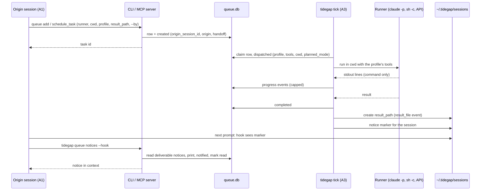
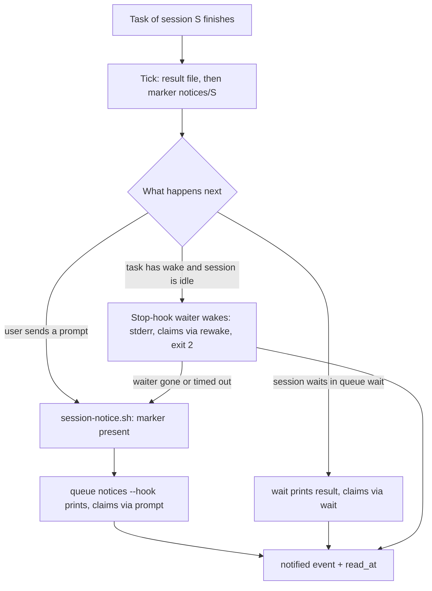
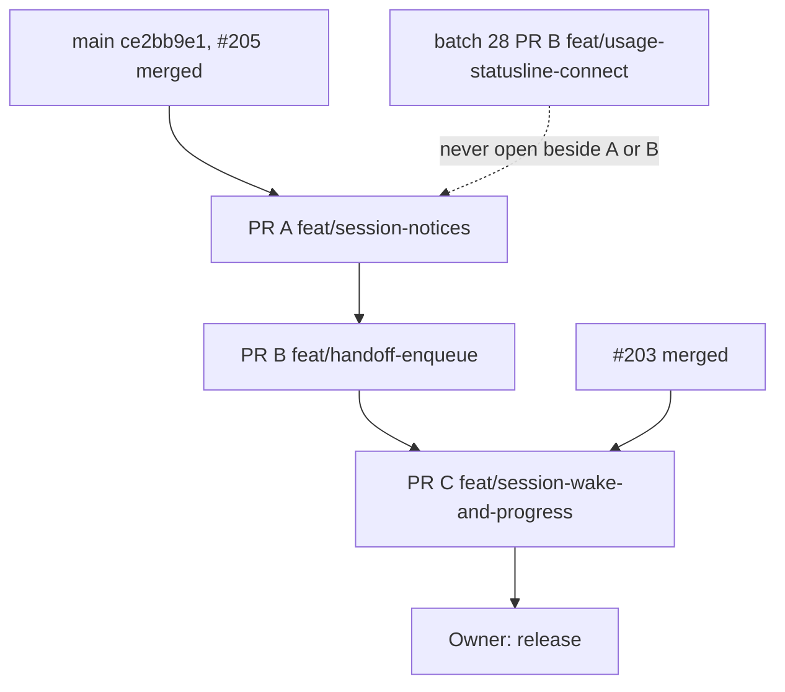

# Session Handoff and Push-Back (Batch 29) - Plan

## Goal Capsule

- **Objective:** A Claude Code session that hands work to Tidegap gets the outcome back in the same session, with nobody relaying it. The session queues the real work shape (runner, directory, prompt, tool profile, model, result file, deadline). It can watch the task and block on it in a machine-readable form. On its next turn its context holds the completion notice. On request, an idle session is woken when the task finishes.
- **Means:** three PRs in sequence (KTD16).
  - PR A `feat/session-notices`: the notice path (prompt hook, `notified` claim, marker sweep) and the watch commands `queue events`, `queue wait`, `queue list --session` (U1-U5). It starts from `main` at `ce2bb9e1` (#205 merged), subject to the batch 28 rule in KTD16.
  - PR B `feat/handoff-enqueue`: `tidegap queue add`, the one-off `command` runner, `cwd`, tool profiles and `result_path` on the CLI and on `schedule_task`, and the same path rules for `output_path` (U6-U11). It starts after PR A merges.
  - PR C `feat/session-wake-and-progress`: command-runner progress events, the opt-in wake of an idle session, and the batch CHANGELOG (U12-U14). It starts after PR B and #203 merge.
- **Authority:** the Product Contract decides what; the Planning Contract decides how. Binding repo rules:
  - `CLAUDE.md` (gate, parity, generated files, hard rules, git conventions).
  - `docs/solutions/tooling-decisions/running-claude-p-from-a-daemon.md` (tools, `dontAsk`, process group, env filter; "Bash, Write, Edit are never allowed").
  - `docs/solutions/best-practices/parity-twin-holds-what-it-cannot-run.md` (the Python tick holds what it cannot run).
  - `docs/solutions/best-practices/agent-hooks-for-scheduling-intents.md` (hook script rules: POSIX `sh`, no `jq`, no `node`, exit 0, latency budget; agents author prompt jobs only, KD10).
  - `docs/solutions/best-practices/shared-sqlite-ledger-migrations.md`, `docs/solutions/logic-errors/compare-and-set-task-transitions.md`, `docs/solutions/best-practices/signed-receipt-additive-fields.md`.
  - `docs/solutions/best-practices/channels-url-policy-and-child-process-rules.md`, `docs/solutions/best-practices/vetting-a-process-by-pid-before-signalling.md`, `docs/solutions/developer-experience/deterministic-process-kill-tests.md`, `docs/solutions/logic-errors/time-of-day-bugs-and-fake-time-sweeps.md`.
  - `docs/solutions/best-practices/generated-docs-embed-and-drift-rule-with-vacuous-pass-guards.md` (drift rules fail on an empty side).
  - `docs/solutions/workflow-issues/generated-test-counts-merge-conflict.md`, `docs/solutions/workflow-issues/public-repo-hygiene.md`, `docs/solutions/developer-experience/folding-review-fixes-into-commits.md`, `docs/solutions/developer-experience/worktree-environment-setup.md`.
  - `docs/spec/ui-client-api.md` (the client contract; clients ignore an unknown event kind).
  - Owner rules, settled: the hook is the delivery baseline (KD1); agents queue tasks and the UI, the Mac app and the extension only show and postpone (KD2); reliability over features.
- **Execution profile:** one Opus `ce-work` agent at a time, in `.worktrees/<branch>`. PR B also needs its own Python venv for `packages/core-py`. Simplify runs on every PR (each changes application code). One `ce-code-review` per PR at its end. No browser suite: nothing in the page or the Mac app changes, so `pnpm qa ui` does not run in this batch.
- **Who ships:** each PR ends green, with its review done and the diff reviewed. Agents do not merge. No PR bumps a version, cuts a release or publishes. The plugin release that `claude plugin update tidegap` picks up is an owner step after PR C (Definition of Done).
- **Stop conditions:** stop and report in these cases:
  - A PR must hand-edit a file that an open PR owns. While #203 is open: `CHANGELOG.md`, `packages/*/package.json`, `packages/*/tsconfig.test.json` and every test file it lists (among them `packages/cli/test/queue.test.ts`, `task-events.test.ts`, `tick-claude-code.test.ts`, `jobs-runner.test.ts`, `packages/mcp-server/test/tool-surface-derivation.test.ts`, `packages/core-ts/test/scheduler.test.ts`). While batch 28's PR B (`feat/usage-statusline-connect`) is open: `packages/cli/src/index.ts`, `scripts/qa/cli-flows.mjs`, `apps/web/content/docs/03-cli.md`, `packages/cli/README.md`, `docs/spec/ui-client-api.md`. The generated files (`README.md` test block, `apps/web/src/lib/tests.generated.ts`, `apps/web/src/lib/docs.generated.ts`, `apps/web/public/llms-full.txt`) are exempt: they follow `generated-test-counts-merge-conflict.md`.
  - A change needs a DDL change to `tasks` or `task_events`, or a new signed receipt field.
  - A run would get `Bash`, `Write` or `Edit`, or a synchronous or per-turn hook would start `node` on its nothing-to-do path, use `jq` or use the network.
  - A test or QA step needs the real `HOME`, `~/.tidegap`, `~/.claude` or `~/.config/tidegap`.
  - A gate fails the same way twice.
  - Evidence shows a Key Technical Decision cannot work. For KTD4 this includes either run of the owner's live check (Requester Verification Script, check 3b, on PR C's branch before it merges) failing; PR C then drops the `Stop` hook entry before it merges.
- **Open decisions:** six, each with a recommended default that this plan follows. The orchestrator confirms or flips them before `ce-work` starts.
  - D1 (R5, KD3). The brief asks `schedule_task` to accept runner `command`. Recommended: keep KD10. `schedule_task` refuses it and names the `tidegap queue add --runner command` line; the agent runs that line through Bash, where the permission flow and `cron-guard.sh` ask the user. Alternative: accept it on MCP. Then a model queues an unattended shell command with no user in the loop, and the daemon runs it outside the session's sandbox.
  - D2 (R20, KD4). The brief asks for a `result_path` "the run must write". Recommended: Tidegap writes the result text to `result_path`; runs stay read-only. The documented rule "Bash, Write, Edit are never allowed" stays true. Alternative: an `edit` profile with `Edit` and `Write` scoped to a git worktree `cwd`. It reverses a security decision and needs its own brainstorm.
  - D3 (R16, KD5). Wake an idle session: opt-in or default. Recommended: opt-in per task (`--wake`, `wake_session: true`). A wake starts a model turn that spends quota while nobody may be watching. Alternative: wake for every task queued from a session.
  - D4 (R12, KD6). The notice line names the title (brief) while the SessionStart block names none (`packages/cli/src/commands/queue.ts:247-265`). Recommended: name the title, quoted, cut to 60 characters, only for tasks this session queued; never the result or the error. Alternative: ids and status only.
  - D5 (R10). Progress for `claude-code` runs. Recommended: defer it; PR C ships progress for the `command` runner only. Claude Code prints nothing until the end in `--output-format json`, and a switch to `stream-json` changes the parse path of every run (forks, jobs, replies). Alternative: switch every `claude-code` run to `stream-json --verbose` in PR C and report tool names as progress.
  - D6 (R21, KTD12). The existing `output_path` writes JSON anywhere (`packages/core-ts/src/scheduler.ts:3546-3566`), so a model can put a result into `~/.zshrc`, and the result-file rules alone protect nothing. Recommended: PR B applies the location rules of KTD12 to `output_path` too, keeps its JSON format and its overwrite of a file it wrote before, and records a CHANGELOG "Security" line; a path outside the allowed roots is refused. Alternative: keep `output_path` as it is and document the risk.

---

## Product Contract

### Summary

PR A lets a session read its own tasks. `tidegap queue events <id> --json` prints a task's events with a cursor. `tidegap queue wait <id>` blocks until the task ends, prints the result and exits 0 or 1. `tidegap queue list --json --session <id|current>` lists only that session's tasks. A new `UserPromptSubmit` hook adds one notice to the next prompt of the session that queued a finished task, then records the notice and marks the task read. A shell check keeps the hook at a few milliseconds when there is nothing to say. The new docs page states the ledger path and the stable tables, and a drift rule checks it.

PR B lets a session queue real work. `tidegap queue add` queues a task for any runner, including a one-off shell `command`, with `--cwd`, `--profile`, `--model`, `--result-path` and the deadline forms `--by 2h`, `--by <ISO>` and `--by quota-reset`. `schedule_task` gains `runner` (an alias of `provider`), `cwd`, `permission_profile` and `result_path`. Tidegap writes the result text to a new result file inside the task's directories or the temp folder. The Python core needs no source change; tests prove that it keeps the new fields.

PR C adds `progress` events from a long `command` run's output and an opt-in wake. A task queued with wake starts a turn in its idle origin session when it finishes, through a documented Claude Code background hook. If the wake does not happen, the prompt hook still delivers the notice. The batch CHANGELOG lands here.

### Problem Frame

Each item was checked against `main` at `ce2bb9e1`. Line numbers are as of that commit.

- **Queueing the work shape (item 1).**
  - `tidegap queue add` does not exist. The queue group has `list`, `show`, `unread`, `cancel`, `reschedule`, `later`, `run-now` and `reply` (`packages/cli/src/index.ts:169-308`). The CLI can queue only a reply (`queue reply`) or a recurring job (`jobs add`).
  - `schedule_task` accepts `prompt`, `deadline`, `deadline_kind` (`absolute`, `quota_reset`), `quota_provider`, `after_limit_reset`, `not_before`, `region`, `carbon_budget_g`, `model`, `provider` (`anthropic`, `openai`, `gemini`, `ollama`, `claude-code`), `candidates`, `route_weights`, `tools`, `dry_run`, `dispatch`, `output_path`, `redact_in_receipt`, `title`, the job fields and `origin_session_id` (`packages/core-ts/src/tool-surface.ts:333-548`).
  - It has no `cwd`, no named profile and no result file. `tools` takes names from the allowlist `WebSearch`, `WebFetch`, `Read`, `Grep`, `Glob` and refuses a mix of file and web tools (`packages/core-ts/src/claude-tools.ts:18-45`).
  - A `claude-code` task from a session runs as a fork of that session in its project directory. Otherwise it runs fresh in a temporary directory (`packages/cli/src/providers/claude-code.ts:17-24`, `:440-497`). A non-job row gets a `cwd` only through the session origin (`scheduler.ts:3119-3135`, `:3188-3201`).
  - `output_path` makes Tidegap write `{ taskId, result, receipt }` as JSON. The path is not checked: `mkdir -p`, then `writeFile`, and a failure only logs (`scheduler.ts:3546-3566`).
  - A one-off shell task cannot exist. `enqueueProviderCall` refuses `provider: "command"` (`scheduler.ts:149-155`, `:677-679`), and the command adapter refuses a row with no job id (`packages/cli/src/providers/command.ts:114-118`). Agents may not create command jobs (KD10, `packages/core-ts/src/schedule-job.ts:31-45`). The `schedule_task` schema drops unknown keys, so a `runner` argument is ignored without a word today.
- **Machine-readable progress (item 2).**
  - `task_events` holds `id`, `task_id`, `at`, `kind`, `actor` and `details` (`packages/core-ts/src/storage/sqlite.ts:172-183`). The kinds are `created`, `rescheduled`, `postponed`, `expedited`, `cancelled`, `dispatched`, `completed`, `failed`, `deferred` and `replied` (`packages/core-ts/src/task-events.ts:10-21`). A reader skips a kind it does not know (`sqlite.ts:655`).
  - No event records the planned window. `created` is written, then the window is planned with no event (`scheduler.ts:731-749`).
  - No runner reports output while it runs. `claude-code` reads its whole stdout as one JSON (`--output-format json`, `providers/claude-code.ts:504`, `:661`). A command run collects stdout up to its cap (`packages/cli/src/jobs/run-shell.ts:290-300`).
  - Events are readable only inside `queue show --json` (`queue.ts:453-461`), `check_queue_status` and the page's newest 50 (`docs/spec/ui-client-api.md:249-263`). There is no `queue events` and no `queue wait`. `TaskStore.dataVersion()` already gives a cheap change check for pollers (`sqlite.ts:808-814`).
- **Push-back into the origin session (item 3).**
  - The SessionStart hook names this session's finished unread tasks, by id, with no title, and marks nothing read (`packages/claude-code-plugin/hooks/hooks.json:4-19`, `queue.ts:247-289`). It runs only when a session starts, resumes, clears or compacts. During a live session nothing tells the model that a task finished. `UserPromptSubmit` runs only the cron hint (`hooks.json:31-41`).
  - What Claude Code supports (from the `claude-code-guide` answer and the hooks reference, `code.claude.com/docs/en/hooks.md`):
    - A `UserPromptSubmit` hook's plain stdout on exit 0 is added as context next to the prompt, up to 10,000 characters. The default timeout there is 30 s, and a timed-out hook's output is dropped.
    - A command hook with `asyncRewake: true` runs in the background. When it exits with code 2 it wakes Claude, also when the session is idle, and its stderr is shown to Claude as a system reminder. Its `timeout` is enforced; no maximum is documented.
    - Cross-session `SendMessage` is supported from v2.1.224. It addresses a session by its name (`--name`, `/rename`), not by id. A receiver that bypasses permission prompts holds the message for approval, and the hold expires after 5 minutes. A process that is not a Claude Code session can reach a session's inbox socket, but the message frame is not documented.
    - Channels need `--channels` at launch, an allowlisted plugin or a development flag, and are a research preview.
- **Watching (item 4).** `queue list --json` has no session filter (`queue.ts:197-218`, `index.ts:172-206`), and `TaskListFilter` has no session field (`sqlite.ts:415-430`). The ledger is `~/.tidegap/queue.db`, or `~/.ebb/queue.sqlite` when only that one exists (`packages/cli/src/commands/tick.ts:305-310`). The docs name the file (`apps/web/content/docs/09-config.md:13`) but promise nothing about its tables.
- **Origin trust.** The MCP server stores a caller's `origin_session_id` that it cannot check against its own session, but leaves `origin` out of the body (`packages/mcp-server/src/origin.ts:45-58`, `:72-82`). So the column alone does not prove which session queued a task; the body's `origin` does.
- **Parity.** The Python core has no `claude-code` or `command` adapter and holds those rows for the Node daemon (`packages/core-py/src/tidegap/scheduler.py:1600-1634`). It keeps body keys it does not know (`_redact_body_json`, `scheduler.py:204-240`). It writes `task_events` and never reads them (`scheduler.py:738`). Its upsert leaves columns it does not name alone (`scheduler.py:1056-1120`).

### Actors

- A1. The origin session: a Claude Code session with the plugin. It queues through `schedule_task` or the CLI in its Bash tool and reads notices.
- A2. The user (owner): approves a command task when `cron-guard.sh` asks, reads results on the page, the Mac app or Telegram, and releases.
- A3. The Node daemon (`tidegap tick`): runs every task, writes events, result files and notice markers.
- A4. The Python core: a library ticker that may share the ledger and holds what it cannot run.
- A5. The page, the Mac app and the extension: show and postpone tasks; they never create one (KD2).

### Requirements

**Queue the work shape (PR B)**

- R1. `tidegap queue add [--runner <name>] --by <when> [options] <text>` queues one task and prints its task id alone on the first line. `<text>` is the prompt, or the shell command for `--runner command`; `-` reads it from stdin (at most 1 MiB; a command at most 32,000 characters). Runners: `claude-code`, `anthropic`, `openai`, `gemini`, `ollama` and `command`. The default runner is `claude-code` inside a Claude Code session, else `anthropic`, as on `schedule_task`.
- R2. Deadline forms of `queue add`: `--by <duration|ISO-8601>`, or `--by quota-reset` with `--quota-provider <label>` when more than one label is set. `--not-before <when>` or `--after-limit-reset` set the earliest start. `--by` is required.
- R3. Options of `queue add`: `--cwd <dir>` (`claude-code`, `command`), `--profile read|web|none` (`claude-code`; `read` when `--cwd` is given without one), `--model <id>`, `--result-path <file>`, `--title <text>`, `--session <id|current>`, `--command-timeout <duration>` (`command`, default 5 minutes), `--json` and `--db`. An option that does not apply to the runner is a usage error (exit 2).
- R4. `schedule_task` gains `cwd`, `permission_profile` (`read`, `web`, `none`; `read` when `cwd` is given without one) and `result_path`, with the meaning they have on `queue add`. It also accepts `runner` as an alias of `provider` for the LLM runners; a call whose `runner` and `provider` differ is refused.
- R5. A `command` task is queued only by `tidegap queue add --runner command`. `schedule_task` refuses `runner` or `provider` `command` and names the CLI line (KD3).
- R6. A task queued from a Claude Code session records that session on both paths, with a checked origin in the body. On the CLI, `--session` must name the session the CLI runs in; another id, or any id outside a session, is refused.
- R7. `tidegap queue show` and `check_queue_status` print a task's runner, `cwd`, profile, tools, `result_path` and wake setting.

**Progress and waiting (PR A, progress in PR C)**

- R8. `tidegap queue events <id> [--json] [--after <event-id>]` prints the task's events, oldest first. The JSON is one object: `task_id`, `status`, `scheduled_for`, `deadline`, `completed_at`, `result_path` and `events` (`id`, `at`, `kind`, `actor`, `details`).
- R9. `tidegap queue wait <id> [--timeout <duration>] [--json] [--events]` blocks until the task is completed, failed or cancelled. It prints the result text and a `result_path:` line. Exit codes: 0 completed (and the result file written when one was asked for), 1 failed, cancelled or result file not written, 2 usage or unknown id, 3 timeout. `--events` prints each new event to stderr while it waits.
- R10. While a `command` run lasts longer than 5 seconds, its stdout lines appear as `progress` events, scrubbed like its output (PR C, D5).
- R11. The docs map the brief's event names to the stored ones: created is `created`; scheduled is the envelope's `scheduled_for` and the `rescheduled`, `postponed` and `expedited` events; dispatched and running are `dispatched`; progress is `progress`; the ends are `completed`, `failed` and `cancelled`.

**Push-back into the origin session (PR A, wake in PR C)**

- R12. When a task queued from session S finishes, the next prompt in S carries a notice. Each finished task gets one line with its id, status, quoted title and, when a result file was asked for, `result_path` (or "result file not written"); at most 10 lines, then a count. A task with a result file is held back until its file was written or its write failed. The notice never holds the result or the error text (KD6).
- R13. A notice is delivered at least once and normally once. It is printed, then recorded as a `notified` event, and a completed or failed task is marked read then (KD1).
- R14. A person who reads the task first (page, Mac app, Telegram, `queue show`) does not cancel the session's notice.
- R15. With nothing to deliver, the prompt hook starts no Node process, prints nothing and finishes with a median under 100 ms. With no `tidegap` on `PATH`, or an older one, it prints nothing.
- R16. A task queued with wake (`--wake`, `wake_session: true`) wakes its idle origin session when it finishes, if that is within 12 hours after the session's last turn ended. Otherwise its notice waits for the next prompt (PR C, KD5).
- R17. A `queue wait` that printed a task's result counts as that task's notice.

**Watching the ledger (PR A)**

- R18. `tidegap queue list --json --session <id|current>` lists only that session's tasks, each with `status` and `scheduled_for`, and names the session at the top.
- R19. The new docs page states the ledger path, that readers open it read-only, and the stable tables, columns, status values and event kinds. A docs-drift rule fails when the page and the schema differ.

**Security**

- R20. A run never gets `Bash`, `Write` or `Edit`. The profiles map to the existing allowlist only (KD4).
- R21. Only Tidegap writes `result_path`, only as a new file at the named path inside the task's own directories or the temp folder, with mode `0600`, and only when the path passes the rules of KTD12, checked when the task is queued and again before the write. `output_path` gets the same location rules (D6).
- R22. A `claude-code` `cwd` is an absolute directory that the user owns, that is not `/` or the home folder, and that is not inside a dot folder of the home folder, `~/Library` or a protected folder of KTD12. A `command` `cwd` is an existing directory.
- R23. No task field reaches a shell. The command string runs as given through `/bin/sh -c`; `cwd` goes to the spawn option; `result_path` and the title never enter a command line. Hook scripts never pass hook input to a shell or a command line.
- R24. The `dispatched` event of a `claude-code` run records its profile, tools, `cwd` and `planned_mode` (fork or fresh). The actual mode is the run's `session.mode` on the receipt. The signed receipt keeps its fields; no signed field is added.
- R25. `cron-guard.sh` asks the user before a Bash call that runs `tidegap queue add` with any runner other than the LLM runners, including a quoted or variable `--runner` value.
- R26. Tests and QA use an isolated `HOME` and never read the real `~/.claude` or `~/.tidegap`.

**Compatibility and parity**

- R27. Telegram and the other channels, the Mac app, the extension, the page, receipts and the SessionStart hook behave as before. The page's write routes gain no handoff fields (KD2).
- R28. The Python core runs unchanged: it holds `command` and `claude-code` rows, keeps the new body keys through its writes, and is not disturbed by the new event kinds. New Python tests prove it.
- R29. No DDL change. New data lives in `body_json` (`handoff`), new `task_events` kinds, one `meta` key and files under `~/.tidegap/sessions/`.

**Docs and release**

- R30. Docs: CLI table rows, a new "Agent handoff" docs page, the `schedule_task` parameters on the tools page and in the MCP README, the plugin README and skill, the CLI README and the client API's event kinds.
- R31. One batch CHANGELOG entry under `[Unreleased]`, in PR C. No version bump.

### Key Decisions

- KD1. **The prompt hook is the delivery baseline; a push path is an enhancement that falls back to it without a word.** The hook prints the notice and marks the task read. (session-settled: user-directed — chosen over a push-first design built on cross-session `SendMessage`: the owner wants delivery that does not depend on a live peer.) Governs R12, R13, R15, R16.
- KD2. **Agents queue tasks; the page, the Mac app and the extension show and postpone only.** (session-settled: user-directed — chosen over a quick-add form in the clients: tasks come from agent sessions and run in their context.) Governs R1, R27.
- KD3. **A shell command task is the user's decision, queued only from the CLI** (D1, KD10 of the jobs plan). Governs R5, R25.
- KD4. **Runs stay read-only; Tidegap writes the result file** (D2). Governs R20, R21.
- KD5. **Wake is opt-in per task** (D3). Governs R16.
- KD6. **The notice names id, status, title and result path, never result or error text** (D4). Governs R12.

### Acceptance Examples

- AE1. Covers R1, R7. **Given** the daemon runs, **when** a session runs `tidegap queue add --runner command --cwd /tmp --by 10m "echo hello > /tmp/tg-hello.txt"`, **then** the first output line is a task id and `tidegap queue show <id>` shows it scheduled, runner `command`, cwd `/tmp`. (Brief check 1.)
- AE2. Covers R8, R9. **Given** the task of AE1, **when** the session runs `tidegap queue wait <id> --timeout 9m`, **then** it returns before the deadline with exit 0, `/tmp/tg-hello.txt` holds `hello`, and `tidegap queue events <id> --json` lists `created`, `dispatched` and `completed`. (Brief check 2.)
- AE3. Covers R12, R13. **Given** a session queued a command task due within 2 minutes and ended its turn, **when** the user sends any message 3 minutes later, **then** the context of that turn holds the notice line for the task, and the task has a `notified` event with `via: "prompt"`. (Brief check 3.)
- AE4. Covers R18, R19. **Given** two sessions each queued a task, **when** session S runs `tidegap queue list --json --session current`, **then** only S's task is listed, with `status` and `scheduled_for`, and `session_id` names S. (Brief check 4.)
- AE5. Covers R16. **Given** a session queued a command task with `--wake` and went idle, **when** the task completes, **then** the session starts a turn by itself whose context holds the notice, and the event says `via: "rewake"`.
- AE6. Covers R14. **Given** a finished session task that the user opened on the page, **when** the session's next prompt arrives, **then** the notice still names the task.
- AE7. Covers R5. **Given** an agent calls `schedule_task` with `runner: "command"`, **then** nothing is queued and the reply names `tidegap queue add --runner command`.
- AE8. Covers R21. **Given** an agent calls `schedule_task` with `result_path` or `output_path` set to `~/.zshrc` or a file under `~/Library/LaunchAgents`, **then** nothing is queued and the reply names the allowed folders.

### Scope Boundaries

- The SessionStart hook and its block stay as they are; `packages/cli/test/queue.test.ts` pins its command and text and belongs to #203.
- No `edit` profile and no tool beyond the allowlist (D2).
- `claude-code` progress lines are out (D5).
- No change to the page, the Mac app or the extension.
- The Python core gets tests and one README sentence, no source change.

#### Deferred to Follow-Up Work

- One renderer for the SessionStart block and the notice, after #203 merges (the block keeps naming ids only until then).
- Job secrets and a summarize step for one-off command tasks.
- `claude-code` progress through `stream-json` (D5).
- Page rendering for the new event kinds (today the page prints `<when> <kind> by <actor>` for them).

#### Considered and not built

- A push through `SendMessage` from the `claude-code` runner. It works only for that runner, needs the session's name (the ledger holds its id), needs `SendMessage` in the run's tools, and is held for approval in a receiver that bypasses permissions. Evidence that would change this: id addressing and delivery to bypass-mode receivers.
- A daemon post to the session's inbox socket. The frame is not documented. Evidence that would change this: a documented frame.
- A channel (`notifications/claude/channel`). It needs a launch flag and an allowlist, and is a research preview.
- A plugin monitor that tails a notice file. The docs do not say that it wakes an idle session, and `asyncRewake` does.
- An exactly-once notice. A claim before the print loses the notice when Claude Code drops a timed-out hook's output; a repeat costs one line.
- A generic dot-folder rule for `claude-code` `cwd`. It would refuse `<repo>/.worktrees/<branch>`, the usual place of a handed-off worktree.

### Sources

- Claude Code hooks reference, sections "Run hooks in the background", "UserPromptSubmit", "Stop": `https://code.claude.com/docs/en/hooks.md`.
- Cross-session messaging: `https://code.claude.com/docs/en/cross-session-messaging.md`. Channels: `https://code.claude.com/docs/en/channels.md`. CLI flags (`--plugin-dir`, `--name`): `https://code.claude.com/docs/en/cli-reference.md`.
- Plans in force: `docs/plans/2026-10-23-0925-feat-floating-recurring-jobs-plan.md` (KD10, command jobs), `docs/plans/2026-10-15-1437-feat-task-visibility-pr1-plan.md` (read markers), `docs/plans/2026-10-30-2136-fix-usage-popover-and-statusline-hook-plan.md` (batch 28, shares files with PR A and PR B).

---

## Planning Contract

### Key Technical Decisions

- KTD1. **The notice hook is a shell gate in front of the CLI.** `hooks/session-notice.sh` reads `session_id` from the hook input with the rule of `session-capture.sh:29-31`. It exits 0 at once unless `~/.tidegap/sessions/notices/<session_id>` exists and `tidegap` is on `PATH`. Only then does it pipe the input to `tidegap queue notices --hook --hook-input -`, whose plain stdout becomes context. This keeps the hook rules of `agent-hooks-for-scheduling-intents.md` on the common path. The CLI writes the ledger (the claim), which the shell scripts never do. Governs R12, R15. (session-settled: user-directed — chosen over a push-first design: delivery must not depend on a live peer.)
- KTD2. **A notice is claimed by a `notified` event, not by `read_at`.**
  - Selection: `origin_session_id = S`, a body `origin` with `agent: "claude-code"` (a checked origin; R6), status `completed`, `failed` or `cancelled`, no `notified` event, and `completed_at` at or after the `meta` key `session_notices_since` (set once, on first use, so an upgrade does not replay history) and within the last 7 days. A row with `handoff.resultPath` waits until its `result_file` event exists.
  - Order: the CLI prints first, then writes `notified` (`via`, `session_id`) with an insert-if-absent, then calls `markRead`. A person's read leaves `notified` unset (R14). A crash between print and claim repeats one line.
  - Deadline: `queue notices --hook` opens the store with a 1 s busy timeout and skips the claim and the mark-read when more than 5 s passed since it started (the hook `timeout` is 10 s), so a notice whose output Claude Code dropped is printed again on the next prompt.
  - The mark-read follows KD1. Conflict call-out: the human inbox loses the task once the session saw it; KTD14 of the visibility plan ("tasks stay unread until someone reads them") reads the session as that someone.
- KTD3. **The Node tick derives the notice markers; nobody else writes them.** After each tick pass, including the "no adapters" early return (`tick.ts:596-613`), a notice sweep creates `notices/<session_id>` (file `0600`, folder `0700`) for each session with a deliverable notice (KTD2) and removes markers that have none, or that are older than 7 days. `queue notices` removes a marker when it has claimed everything for that session. A marker removed while a new task finished comes back on the next tick (at most one minute). Tasks the Python core finished get markers when the next Node tick runs. The wake markers of KTD4 are a separate folder with their own writers.
- KTD4. **Push is an `asyncRewake` Stop hook running one waiter per session, opt-in per task** (PR C).
  - Gate: `queue add --wake` and `schedule_task` with `wake_session` create `~/.tidegap/sessions/wake/<session_id>` at enqueue (the Stop hook of that same turn fires before any tick). `hooks/session-wake.sh` exits 0 without starting `tidegap` when the marker is missing. The waiter removes it when the session has no pending wake task; the tick sweep removes one older than 12 h.
  - Waiter: with the marker present, the script pipes the hook input to `tidegap queue notices --wait --rewake --hook-input -` and exits with its code. The waiter writes its own pid to `~/.tidegap/sessions/waiters/<session_id>.pid` (a new file renamed into place), so the newest waiter wins; an older waiter that finds another pid there exits 0 at its next poll. It polls every 5 s and reads rows only when `data_version` changed. It stops when its `claude` ancestor process is gone or its 11 h 50 min limit (under the hook's 12 h `timeout`) passes.
  - Wake: when a wake task of the session finishes, the waiter prints the session's notice to stderr, claims it with `via: "rewake"` and exits 2. The insert-if-absent claim decides between a waiter and the prompt hook. Every other path exits 0 and leaves the notice to the prompt hook (KD1).
  - Rejected: `SendMessage`, the inbox socket, channels, monitors (Scope Boundaries).
- KTD5. **`queue events` and `queue wait` only read the ledger, with one exception.** `wait` polls every 2 s and reads rows only when `TaskStore.dataVersion()` changed. When the task asked for a result file, `wait` also waits for that file's event (KTD12). When it prints a result, it claims the notice (`via: "wait"`, R17) and marks the task read, as `queue show` does (`--no-mark-read` skips both). A failed claim or mark-read prints one stderr line and does not change the exit code. At start, it prints the readiness line to stderr when no tick was ever recorded. `--after <event-id>` is the cursor: `id` grows with each insert.
- KTD6. **One session resolver for the CLI.** `current`, and the origin of `queue add`, come from the capture file of the nearest ancestor `claude` process (`findAncestorPid` and `readCapture`, `packages/cli/src/session/capture.ts`), else from `CLAUDE_CODE_SESSION_ID`. A resolved session gives `queue add` a body `origin` (`agent: "claude-code"`, `via: "hook"` or `"env"`). The refusal of R6 (exit 2) applies where the session id is acted on: `queue add --session` and `queue notices` without `--peek`. `queue list --session <id>` and `queue events` accept any valid id. The MCP server keeps its own rule (`packages/mcp-server/src/origin.ts:1-15`); KTD2 trusts only a body `origin`.
- KTD7. **The ledger contract is documentation plus a drift rule; no DDL changes.** Stable: the `tasks` columns `task_id`, `status`, `enqueued_at`, `scheduled_for`, `deadline`, `completed_at`, `title`, `origin_session_id`, `origin_cwd`, `read_at`, `error`, `parent_task_id` and `job_id`; every `task_events` column; the status values (`queue.ts:62-71`); and every event kind. `body_json`, `result_json`, `receipt_json` and `routing_decision` are internal: use `queue show --json`. Columns and kinds may be added; a removal or rename is a CHANGELOG "Changed" entry. Readers use `sqlite3 -readonly`; the ledger is in WAL mode, so a reader never blocks the daemon. Docs-drift rule K19:
  - fails when a listed `tasks` column is missing from `INSERT_COLUMNS` (`sqlite.ts:299`; `job_id` is added by `ensureColumns`, not by the `CREATE TABLE`);
  - fails when the page's event kinds and `TASK_EVENT_KINDS`, or the page's `task_events` columns and the `task_events` `CREATE TABLE` (`sqlite.ts:172-183`), differ in either direction;
  - fails when any list is empty.
- KTD8. **`queue add` is the one CLI enqueue path for every runner** (PR B). For the LLM runners it builds the same `ProviderCallSpec` and `DeferOptions` that `schedule_task` builds (`packages/mcp-server/src/server.ts:803-1090`), with `originHost: "cli"` and the resolved session. `--by quota-reset` maps to `deadlineKind: "quota_reset"`. `--after-limit-reset` uses the usage reset source that `queue later` uses.
  - Guard (R25), fail-closed: `cron-guard.sh` asks on every `tidegap queue add` call that has a `--runner` value which, with quotes, `;` separators and backslashes removed, is not one of `claude-code`, `anthropic`, `openai`, `gemini` or `ollama`. A quoted, variable or substituted value therefore asks.
  - MCP: `runner` is an alias of `provider` for those five values. `commandJobRefusal` refuses `runner` or `provider` `command`, and names `tidegap queue add --runner command --cwd <dir> --by <when> '<cmd>'` (R5).
- KTD9. **A one-off command row is built by a new public `Scheduler.enqueueCommandTask`** (PR B, `scheduler.ts`). Its body is `{ type: "provider_call", provider: "command", model: "none", prompt: "", command: { run, cwd, secrets: [], origin: "cli" }, caps }`, the shape of a command job run (`packages/core-ts/src/jobs.ts:302-310`). It reuses the private planning step (`scheduler.ts:2301`). `enqueueProviderCall` still refuses `command`. The command adapter runs a row with no job id only when `command.origin` is `"cli"`. `retryTask` refuses a one-off command row, as it refuses job runs (`scheduler.ts:1786-1791`): running a shell command again is the user's call through `queue add`. Cancel, postpone and run-now work as for any task.
- KTD10. **Profiles are names for existing tool sets.** `read` is `Read`, `Grep` and `Glob`, scoped to `cwd` by the adapter's `Read(//<cwd>/**)` rule (`providers/claude-code.ts:201-205`). `web` is `WebSearch` and `WebFetch` in a fresh temporary directory; it refuses `cwd`. `none` is no tools. A `cwd` with no profile gets `read`. The body stores `tools` (enforced at enqueue and again in the adapter, as today) and `handoff.profile` (the label). The `created` and `dispatched` events' details gain `profile`, `tools`, `cwd` and `planned_mode` (the origin rule's choice) from the body (`task-events.ts:98-117`). The receipt's signed `tools` and `session` fields already record the set and the actual mode (R24).
- KTD11. **An explicit `cwd` keeps the session's context when it can.**
  - When `handoff.cwd` resolves to the session's project directory (`origin_cwd`), the run forks the session as today.
  - Another directory gets a fresh run there. `dispatchOrigin` passes the origin and `jobDispatchOptions` passes the `cwd` for these rows (`scheduler.ts:3119-3135`, `:3188-3201`). The adapter runs a dispatch that has an origin and a `cwd` other than `origin.cwd` fresh in `cwd`: it prepends `freshHeader`, scopes the tools to `cwd` and returns a `fresh` run session with `originSessionId` and the new fresh reason `other-cwd` (`packages/core-ts/src/run-session.ts:15-23`; a new value of an existing signed field, no new field).
  - Checks: `originDirCheck` (`packages/cli/src/session/plan.ts:80-93`) plus the folder rules of R22 for `claude-code`; an existing directory for `command` (`providers/command.ts:132-134`). Both are checked when the task is queued and again before the run.
  - Conflict call-out: the owner's rule says tasks run in the originating session's context; a fresh run elsewhere is the caller's explicit choice, it carries the origin header, and its result still returns to the origin session.
- KTD12. **`result_path` is written by the Node tick, after completion, by a handoff sweep** (PR B, `packages/cli/src/handoff/results.ts`). Path rules, in a core module `packages/core-ts/src/handoff.ts`:
  1. Absolute, at most 1024 characters, and equal to its `path.resolve` form (no `.` or `..` segments; symlinks are not resolved here).
  2. Allowed roots: the task's `cwd`, the origin session's project directory (`origin_cwd`), and the system temp folders (`os.tmpdir()`, `/tmp`). The real path of the parent (`fs.realpath`) must be inside the real path of a root. No path segment below that root starts with `.`.
  3. Protected folders, checked on both the given path and the parent's real path: `~/.tidegap`, `~/.config`, `~/.claude`, `~/.ssh`, `~/.gnupg`, `~/.aws`, `~/Library` and any `.git` folder.
  4. Create-only: a target that exists is refused at enqueue and again at write time.
  The write creates a temporary file in the same folder (`wx`, `0600`), writes the result text (`taskResultText`, else the result JSON), then links it to the target and removes the temporary name. A link fails when the target exists, so Tidegap never replaces or follows a file. It records `result_file` (`path`, `written`, `bytes` or `error`). A failure never fails the task: a paid run is never relabelled (`scheduler.ts:2556-2560`). The sweep covers rows that the Python core finished. `output_path` (D6) gets rules 1 to 3 at enqueue and in `writeOutputFile`; it keeps its JSON and may overwrite a regular file it owns.
- KTD13. **Progress goes through a core callback with core caps** (PR C). `DispatchOptions.onProgress` (`packages/core-ts/src/providers/base.ts:35`) is set by the scheduler's dispatch (`scheduler.ts:2566-2574`) to write a `progress` event (`line`, `seq`, actor `tick`). Caps: no event in a run's first 5 s, then at most one per 15 s and 24 per task, each line at most 200 characters with control characters removed. The command adapter scrubs each line with the secret values and the vendor key shapes before the callback, as it scrubs the output (`providers/command.ts:148-153`). The cap keeps `created` inside the page's newest 50 events. A fast run writes no progress, so no existing event-list test changes.
- KTD14. **New spec fields live in one optional body object, `ProviderCallSpec.handoff`** (`cwd`, `profile`, `resultPath`; `wake` in PR C) in `packages/core-ts/src/types.ts:418-482`. Both cores keep unknown body keys (`redactBodyJson` in `packages/core-ts/src/redact.ts:95-120`, `_redact_body_json`), so no migration is needed, and Python needs only tests.
- KTD15. **Hooks survive version skew.** The new hook commands save the input, try the new CLI command and exit 0 without output when it fails, following the SessionStart pattern (`hooks.json:9`). An older plugin with a newer CLI keeps today's behaviour. `SessionStart[0].hooks[0]` keeps its exact command (`queue.test.ts:343-397`).
- KTD16. **Three PRs in strict sequence, CHANGELOG last, and batch 28 never in parallel.**
  - PR A touches no hand-edited file of #203 or of batch 28's open PR A (#207), so it may run beside them.
  - Batch 28's PR B (`feat/usage-statusline-connect`) shares `packages/cli/src/index.ts`, `scripts/qa/cli-flows.mjs`, `apps/web/content/docs/03-cli.md`, `packages/cli/README.md` and `docs/spec/ui-client-api.md` with PR A and PR B here. Whichever of them starts second starts from `main` after the other merges. Recommended: PR A first when batch 28's PR B has not started; otherwise PR A waits.
  - PR B starts after PR A merges (both edit the CLI registry and the docs). #205 is merged, so `scheduler.ts` is free.
  - PR C edits `CHANGELOG.md`, so it starts after #203 merges, and after PR B.
  - No two PRs that share a hand-edited file are open at once. The generated files follow `generated-test-counts-merge-conflict.md`.

### High-Level Technical Design

Handoff and return:



Delivery paths of one notice:



PR order:



### Data Shapes

- Body: `handoff?: { cwd?: string; profile?: "read" | "web" | "none"; resultPath?: string; wake?: boolean }` on `ProviderCallSpec`. One-off command body: `command.origin: "cli"`. A checked session: `origin: { agent: "claude-code", via }`, as today.
- New event kinds:
  - `notified`: `via` (`prompt`, `wait`, `rewake`), `session_id`; actor `agent:claude-code` or `cli`.
  - `result_file`: `path`, `written`, then `bytes` or `error`; actor `tick`.
  - `progress`: `line`, `seq`; actor `tick` (PR C).
- `meta` key `session_notices_since` (ISO). Files under `~/.tidegap/sessions/`: `notices/<session_id>` (tick), `wake/<session_id>` (enqueue, PR C), `waiters/<session_id>.pid` (waiter, PR C).
- Notice text (plain stdout of the prompt hook, stderr of the waiter):

```text
Tidegap: 2 tasks queued from this session finished:
- t-3f2a… completed "Nightly test run" result_path: /tmp/tg-result.txt
- t-9b1c… failed "Review the API change"
Read one with: tidegap queue show <id> (or check_queue_status task_id=<id>).
```

- `queue add --json`: `{ task_id, status, runner, scheduled_for, deadline, origin_session_id, result_path }`.
- `queue wait --json`: `{ task_id, status, result, error, result_path, result_file, completed_at }`.

### Assumptions

- `--by` is required on `queue add`; `queue reply` keeps its 1 h default.
- The waiter's limit is 11 h 50 min under a 12 h hook `timeout`; Claude Code documents no maximum.
- A notice covers tasks finished in the last 7 days.
- `queue wait` uses exit code 3 for a timeout; the brief names only 0 and 1.
- A sandboxed Bash in the origin session may not write `~/.tidegap/queue.db`, which `queue add`, `queue wait` and `queue notices` need (opening the store also runs its pragmas). The docs tell such sessions to allow that folder or use `schedule_task`.
- Under `bypassPermissions`, the `ask` of `cron-guard.sh` may not stop the call; the docs say that the guard asks and is not a sandbox.

### System-Wide Impact

- **Prompt latency:** one more `UserPromptSubmit` hook on every prompt, pure `sh` on the common path (R15). The Stop hook is pure `sh` too unless a wake marker exists.
- **Context:** at most 10 notice lines plus two, each line cut to 400 characters, well under the 10,000-character hook limit.
- **Ledger:** three new event kinds and one `meta` key; old Node readers and the Python core skip or ignore them.
- **Daemon:** one sweep per tick over finished session rows (indexed by `task_events_task_idx`), and one waiter process per session with a pending wake task.
- **Clients:** the page prints new kinds as `<when> <kind> by <actor>`; the Mac app does not read task events.
- **`output_path` callers:** a path outside the task's directories and the temp folders is refused from PR B on (D6).

### Risks

- **`asyncRewake` from a plugin Stop hook is documented but untested here,** and so is a background hook that lives for hours. The owner's live check (script, check 3b, two runs) gates PR C's hook entry; the stop condition removes the entry if either run fails.
- **Two enabled plugins named `tidegap` register only one `hooks.json`.** The pre-merge check must disable the marketplace copy before `--plugin-dir`.
- **A session in a sandboxed Bash cannot use the CLI paths.** The docs name the fix; `schedule_task` is unaffected.
- **A notice can repeat once** (KTD2). The docs say so.

---

## Implementation Units

| U-ID | Title | Key files | Depends on |
| --- | --- | --- | --- |
| U1 | Notice selection, claim and session filter in the core | `task-events.ts`, `storage/sqlite.ts` | none |
| U2 | `queue events`, `queue wait`, `queue list --session` | `commands/queue-watch.ts`, `commands/queue.ts`, `handoff/session.ts` | U1 |
| U3 | `queue notices` and the notice sweep | `handoff/notices.ts`, `commands/tick.ts` | U1, U2 |
| U4 | The prompt hook | `hooks/session-notice.sh`, `hooks/hooks.json` | U3 |
| U5 | PR A docs, drift rule K19 and QA | `12-handoff.md`, `docs-drift.mjs`, `cli-flows.mjs` | U2-U4 |
| U6 | Handoff spec, path rules, one-off command enqueue | `handoff.ts`, `types.ts`, `scheduler.ts` | PR A |
| U7 | Runners honour handoff rows | `providers/command.ts`, `providers/claude-code.ts` | U6 |
| U8 | `tidegap queue add` and the guard | `commands/queue-add.ts`, `cron-guard.sh` | U6, U7 |
| U9 | `schedule_task` handoff parameters and refusals | `tool-surface.ts`, `schedule-job.ts`, `server.ts` | U6 |
| U10 | Result files and Python proof | `handoff/results.ts`, `test_handoff_rows.py` | U6 |
| U11 | PR B docs and QA | `03-cli.md`, `04-tools.md`, `mcp-tools.mjs` | U8-U10 |
| U12 | Progress events from command runs | `providers/base.ts`, `jobs/run-shell.ts` | PR B |
| U13 | Opt-in wake of an idle session | `handoff/waiter.ts`, `hooks/session-wake.sh` | PR B, #203 |
| U14 | PR C docs, CHANGELOG and QA | `CHANGELOG.md`, `12-handoff.md` | U12, U13 |

### U1. Notice selection, claim and session filter in the core

- **Goal:** the core can list a session's tasks, list its deliverable notices and claim one exactly once in the ledger.
- **Requirements:** R12, R13, R14, R18, R29; KTD2, KTD7.
- **Dependencies:** none.
- **Files:**
  - `packages/core-ts/src/task-events.ts` (kind `notified`, its summary line)
  - `packages/core-ts/src/storage/sqlite.ts` (`TaskListFilter.originSessionId`; a notice query; an insert-if-absent claim; events after an id; a busy-timeout option on `TaskStoreOptions`)
  - `packages/core-ts/src/index.ts` (exports)
  - `packages/core-ts/test/session-notices.test.ts` (new)
- **Approach:**
  1. Add `notified` to `TASK_EVENT_KINDS`; `eventSummary` prints `via`.
  2. `list({ originSessionId })` adds `origin_session_id = ?`.
  3. The notice query follows KTD2, oldest first. It reads `session_notices_since` and sets it once with an insert that ignores a present key. The body checks (`origin`, `handoff.resultPath`) read `body_json` with SQLite's JSON functions or in code after a narrow SQL filter; the implementer picks one and tests both outcomes.
  4. The claim is one statement: insert the event only when no `notified` row exists for the task; it returns whether this call wrote it.
  5. `listTaskEventsAfter(taskId, afterId)` returns events with a greater `id`.
  6. `TaskStoreOptions.busyTimeoutMs` (default 5000, `sqlite.ts:470`).
- **Patterns to follow:** `markRead` (`sqlite.ts:782-793`) for a write that reports whether it changed anything; the `meta` helpers (`sqlite.ts:816-836`).
- **Test scenarios:**
  - `lists only the tasks of the named session`
  - `a notice lists completed, failed and cancelled tasks of the session, oldest first`
  - `a row whose body has no origin (an unchecked origin_session_id) is never a notice`
  - `a row with handoff.resultPath is a notice only after its result_file event`
  - `a task finished before session_notices_since is never a notice`
  - `a task finished more than 7 days ago is not a notice`
  - Covers AE6. `a task with read_at set is still a notice`
  - `the first claim returns true, the second returns false and writes nothing`
  - `listTaskEventsAfter returns only newer events`
  - `an older reader skips a notified row` (a store whose kind list lacks it, through `listTaskEvents`)
- **Verification:** the new test file passes; existing `@tidegap/core` tests pass unchanged.

### U2. `queue events`, `queue wait`, `queue list --session`

- **Goal:** a session can read its tasks, read a task's events with a cursor and block until a task ends.
- **Requirements:** R8, R9, R11, R17, R18; KTD5, KTD6.
- **Dependencies:** U1.
- **Files:**
  - `packages/cli/src/handoff/session.ts` (new: the resolver of KTD6)
  - `packages/cli/src/commands/queue-watch.ts` (new: `runQueueEvents`, `runQueueWait`)
  - `packages/cli/src/commands/queue.ts` (`--session` in `QueueListOptions`, `buildFilter` and the JSON envelope)
  - `packages/cli/src/index.ts` (wiring)
  - `packages/cli/test/queue-watch.test.ts` (new)
- **Approach:**
  1. The resolver returns the session id and its origin, or a usage error; the capture lookup is injected for tests.
  2. `events` prints `formatTaskEvent` lines, or the JSON of R8.
  3. `wait` follows KTD5. The poll interval, the clock and the sleep are injected. The result text goes through `stripControlChars` with newlines kept, like `queue show`.
  4. Exit codes per R9 go through `process.exit` in `index.ts`, as the write commands do.
- **Patterns to follow:** `runQueueShow` (`queue.ts:440-473`); the `write` helper in `index.ts`; `parseWhen` for `--timeout`.
- **Test scenarios:**
  - Covers AE4. `queue list --json --session <id> lists only that session's tasks and names session_id`
  - `--session current resolves through the ancestor capture file, then CLAUDE_CODE_SESSION_ID`
  - `--session current outside a Claude Code session exits 2 and names --session <id>`
  - `queue list --session and queue events accept the id of another session`
  - `queue events --json prints the envelope with scheduled_for and events oldest first`
  - `queue events --after <id> prints only newer events`
  - `queue events on an unknown id exits 2`
  - Covers AE2. `queue wait returns 0 and prints the result once the task completes` (fake clock, a second store completes the row)
  - `queue wait returns 1 for failed and for cancelled`
  - `queue wait returns 3 at --timeout and leaves the task unchanged`
  - `queue wait claims the notice via wait and marks the task read; --no-mark-read does neither`
  - `queue wait keeps its exit code when the claim fails` (a read-only store)
  - `queue wait --events prints each new event to stderr once`
  - `queue wait prints the readiness line when no tick was ever recorded`
  - `queue wait reads no rows while data_version is unchanged` (a counting store)
- **Verification:** new tests pass; `pnpm --filter @tidegap/cli test` passes with `queue.test.ts` untouched.

### U3. `queue notices` and the notice sweep

- **Goal:** the CLI prints and claims a session's notices, and the tick keeps the notice markers true.
- **Requirements:** R12, R13, R15, R29; KTD1, KTD2, KTD3, KD6.
- **Dependencies:** U1, U2.
- **Files:**
  - `packages/cli/src/handoff/notices.ts` (new: marker paths, `renderNotices`, `noticeSweep`)
  - `packages/cli/src/commands/queue-watch.ts` (`runQueueNotices`)
  - `packages/cli/src/commands/tick.ts` (one sweep call per pass, early return included)
  - `packages/cli/src/index.ts` (`queue notices [--session] [--hook] [--hook-input] [--peek]`)
  - `packages/cli/test/handoff-notices.test.ts` (new)
- **Approach:**
  1. `renderNotices` writes the text of Data Shapes: title quoted and cut to 60 characters, every line through `stripControlChars` and cut to 400.
  2. `--hook` never fails and never prints anything but the notice; it takes the session from `--hook-input` and follows the deadline of KTD2. `--peek` prints without claiming.
  3. After the print, claim each printed task (U1), call `markRead`, and remove the marker when nothing is left.
  4. `noticeSweep` takes the store, the sessions folder and the clock. It creates and removes markers per KTD3, with modes `0700` and `0600`, and never throws.
- **Patterns to follow:** `renderSessionHookBlock` (`queue.ts:252-265`) for caps; `session-capture.sh` for the folder modes; `sweepJobs` for a sweep that never throws.
- **Test scenarios:**
  - Covers AE3. `notices --hook prints this session's finished tasks with title and result_path, then claims them`
  - `a second notices --hook prints nothing`
  - `a task whose result file failed prints "result file not written"`
  - `a title with control characters and 300 characters prints one quoted line of at most 60 title characters`
  - `the notice never contains the result text or the error text`
  - `twelve finished tasks print 10 lines and "and 2 more"`
  - `notices --hook with input that is not JSON, or names no session, prints nothing and exits 0`
  - `notices --hook past its 5 s deadline prints and claims nothing` (fake clock)
  - `notices --session <another session> without --peek exits 2`
  - `notices --peek prints and claims nothing`
  - `noticeSweep creates a marker for a session with a deliverable notice and removes it when claimed`
  - `noticeSweep never writes a marker for a session id that fails the id rule`
  - `noticeSweep removes markers older than 7 days`
  - `a tick with no adapters still runs the sweep` (the early-return path)
  - `a task completed by another writer gets its marker on the next sweep` (a row written with raw SQL, as the Python core writes it)
- **Verification:** new tests pass; the tick tests in files owned by #203 are untouched and pass.

### U4. The prompt hook

- **Goal:** the next prompt of the origin session carries the notice, and a prompt with nothing to say costs a few milliseconds.
- **Requirements:** R12, R15, R23, R27; KTD1, KTD15.
- **Dependencies:** U3.
- **Files:**
  - `packages/claude-code-plugin/hooks/session-notice.sh` (new)
  - `packages/claude-code-plugin/hooks/hooks.json` (second `UserPromptSubmit` entry, `timeout` 10; the description line)
  - `packages/claude-code-plugin/README.md` (Session hooks)
  - `packages/claude-code-plugin/skills/tidegap/SKILL.md` (how a session waits for and reads a handed-off task; a `queue wait` call passes a `--timeout` under its Bash call's limit, 2 minutes by default and at most 10 when the call sets its own, or runs in the background)
  - `scripts/plugin-hooks.test.mjs`
- **Approach:**
  1. The script reads at most 256 KiB, extracts `session_id`, checks the marker and `command -v tidegap`, then pipes the saved input to the CLI (KTD1). It discards stderr and exits 0 on every path.
  2. `SessionStart[0].hooks[0]` stays as it is (KTD15).
- **Patterns to follow:** `prompt-hint.sh` (input cap, `LC_ALL=C`), `session-capture.sh` (session id rule).
- **Test scenarios** (`scripts/plugin-hooks.test.mjs`, isolated `HOME`, a stub `tidegap` on `PATH`):
  - `session-notice.sh prints nothing and never starts tidegap without a marker`
  - `with a marker it passes the hook input to tidegap queue notices --hook --hook-input - and prints its stdout`
  - `an older tidegap that rejects the command leaves the hook silent with exit 0`
  - `a session id with a slash or dots never reaches a path`
  - `session-notice.sh finishes inside the latency budget (median of 5 runs under 100 ms) without a marker`
  - `hooks.json registers prompt-hint.sh and session-notice.sh on UserPromptSubmit and keeps the SessionStart command`
  - `session-notice.sh contains no "deny", curl, wget or nc` (the existing rule)
- **Verification:** `node --test scripts/plugin-hooks.test.mjs` passes; `queue.test.ts` passes unchanged.

### U5. PR A docs, drift rule K19 and QA

- **Goal:** the watch commands, the hook and the ledger contract are documented and checked.
- **Requirements:** R11, R19, R30; KTD7.
- **Dependencies:** U2, U3, U4.
- **Files:**
  - `apps/web/content/docs/12-handoff.md` (new, `id: handoff`, `label: Agent handoff`: notices, `queue events`, `queue wait` and the Bash time limits, `queue list --session`, the event name map of R11, the ledger contract of KTD7, the sandboxed-Bash note)
  - `apps/web/content/docs/03-cli.md` (rows for `queue events`, `queue wait`, `queue notices`; `--session` on `queue list`)
  - `apps/web/content/docs/09-config.md` (a `~/.tidegap/sessions/` row in Paths)
  - `docs/spec/ui-client-api.md` (`notified` in the kind list)
  - `packages/cli/README.md` (command list)
  - `scripts/qa/docs-drift.mjs` (K19)
  - `scripts/qa/cli-flows.mjs` (S29.1 to S29.4)
  - Generated: `README.md` test block, `apps/web/src/lib/tests.generated.ts`, `apps/web/src/lib/docs.generated.ts`, `apps/web/public/llms-full.txt`
- **Approach:** K19 parses the page's lists (fenced blocks under `{#handoff-ledger}`) and checks them per KTD7, reading `INSERT_COLUMNS`, the `task_events` table text and `TASK_EVENT_KINDS` from the built core.
- **Test scenarios** (QA steps, isolated `HOME`):
  - `S29.1 queue list --json --session filters a seeded two-session ledger`
  - `S29.2 queue events --json and --after on a seeded task`
  - `S29.3 queue wait returns 0 after tick --once completes a fake-claude task`
  - `S29.4 tick writes the notice marker; queue notices --hook prints once, claims, removes the marker`
  - `K19 fails on a tasks column missing from INSERT_COLUMNS, on a kind missing from the page, and on an empty list` (run once by hand against a changed copy; the committed page passes)
- **Verification:** `node scripts/qa/docs-drift.mjs`, `pnpm gen:docs:check`, `pnpm gen:tests:check` and `pnpm qa cli` pass.

### U6. Handoff spec, path rules, one-off command enqueue

- **Goal:** the core accepts the handoff fields, checks them, queues a one-off command row and dispatches handoff rows in the right directory with the right tools.
- **Requirements:** R1, R4, R6, R20, R21, R22, R24, R29; KTD9, KTD10, KTD11, KTD12, KTD14; D6.
- **Dependencies:** PR A merged.
- **Files:**
  - `packages/core-ts/src/handoff.ts` (new: `resultPathError`, `outputPathError`, `profileTools`, the `cwd` checks shared with the CLI)
  - `packages/core-ts/src/types.ts` (`ProviderCallSpec.handoff`, `command.origin`)
  - `packages/core-ts/src/run-session.ts` (fresh reason `other-cwd` and its text)
  - `packages/core-ts/src/scheduler.ts` (`enqueueCommandTask`; `handoff` and `outputPath` checks in `enqueueProviderCall`; `writeOutputFile` checks again; `jobDispatchOptions` and `dispatchOrigin` per KTD11; the `retryTask` guard)
  - `packages/core-ts/src/task-events.ts` (`created` and `dispatched` details per KTD10; kind `result_file`)
  - `packages/core-ts/src/index.ts`
  - `packages/core-ts/test/handoff-spec.test.ts` (new), `packages/core-ts/test/handoff-enqueue.test.ts` (new)
- **Approach:**
  1. `handoff.ts` holds pure functions with injected file-system reads (`realpath`, `lstat`, owner, mode), so tests need no real paths; one test per rule also runs against a real temporary folder with a symlink.
  2. `enqueueCommandTask` validates `run` (non-empty, at most 32,000 characters), the `cwd` and the caps, then builds the row of KTD9 and plans it.
  3. `profileTools` turns a profile into `tools`, `read` when only `cwd` is given. A body with both a profile and tools that differ is refused.
  4. The planned mode reaches the events through the body and the origin rule; no new signed field.
- **Patterns to follow:** `materializeOccurrence` (`scheduler.ts:536-590`) for a row built outside `enqueueProviderCall`; `claudeCodeToolsError` for refusal texts.
- **Test scenarios:**
  - `resultPathError accepts a new file under the task cwd, under the origin project dir and under the temp folder`
  - `resultPathError accepts /tmp/x on a system where /tmp is a symlink to /private/tmp`
  - `resultPathError refuses a relative path, .. segments, a missing parent, a dot segment below the root, and an existing target`
  - `resultPathError refuses ~/.zshrc, ~/Library/LaunchAgents/x.plist and a path outside every root`
  - `resultPathError refuses a parent whose real path is inside ~/.ssh` (a symlinked folder)
  - `outputPathError applies rules 1 to 3 and allows overwriting a regular file the user owns`
  - `profileTools maps read, web and none; cwd alone means read; web with cwd is refused`
  - `a claude-code cwd inside ~/.aws, ~/.config or ~/Library is refused; <repo>/.worktrees/<branch> is accepted`
  - `enqueueProviderCall still refuses provider command`
  - `enqueueCommandTask writes a scheduled row with command.origin cli, model none and the caps`
  - `enqueueCommandTask refuses an empty command, a 32,001-character command, a missing cwd and a file as cwd`
  - `a claude-code handoff row whose cwd is the origin project dir dispatches with origin (fork)`
  - `a claude-code handoff row with another cwd dispatches with origin and that cwd`
  - `the created and dispatched events of a handoff row name profile, tools, cwd and planned_mode`
  - `retryTask refuses a failed one-off command row and names queue add`
- **Verification:** new tests pass; `pnpm --filter @tidegap/core test` passes; the receipt vectors are unchanged.

### U7. Runners honour handoff rows

- **Goal:** the command adapter runs a CLI one-off and nothing else, and the claude-code adapter runs a handoff row in its directory with the origin header.
- **Requirements:** R20, R22, R23, R24; KTD9, KTD11.
- **Dependencies:** U6.
- **Files:**
  - `packages/cli/src/providers/command.ts` (accept a row with no job id only when `command.origin` is `"cli"`; skip the job-runner check then)
  - `packages/cli/src/providers/claude-code.ts` (a dispatch with an origin and another `cwd` runs fresh in `cwd` with `freshHeader` and returns the `other-cwd` run session)
  - `packages/cli/test/handoff-runners.test.ts` (new)
- **Approach:** the new branch sits before `planRun` in `dispatch` (`providers/claude-code.ts:440-497`) and reuses `runInDir` and `freshHeader`. The `cwd` is checked again before the spawn. Tests use the fake `claude` fixture (`packages/cli/test/fixtures/fake-claude`).
- **Test scenarios:**
  - `a one-off command row runs in its cwd with the minimal environment and returns its scrubbed stdout`
  - `a command row with no job id and no origin cli is refused before anything runs`
  - `the command text reaches /bin/sh -c as one argument; cwd and result_path never appear in argv`
  - `a claude-code handoff run in another cwd gets --tools Read,Grep,Glob, Read(//<cwd>/**), dontAsk, no --resume, the origin header on stdin, and session fresh other-cwd`
  - `a claude-code handoff run with profile web gets the web tools in a fresh temporary directory`
  - `a claude-code handoff run never gets Bash, Write or Edit even when the stored tools name them` (a hand-edited body)
  - `a claude-code handoff run whose cwd was removed after enqueue fails with the path`
- **Verification:** new tests pass; existing adapter tests pass unchanged.

### U8. `tidegap queue add` and the guard

- **Goal:** a session queues any runner from its Bash tool, and a shell command task asks the user first.
- **Requirements:** R1, R2, R3, R6, R7, R25; KTD6, KTD8, KD3.
- **Dependencies:** U6, U7.
- **Files:**
  - `packages/cli/src/commands/queue-add.ts` (new: `runQueueAdd`)
  - `packages/cli/src/commands/queue.ts` (`renderTask` and the show JSON: runner, `cwd`, profile, tools, `result_path`)
  - `packages/cli/src/index.ts` (wiring)
  - `packages/claude-code-plugin/hooks/cron-guard.sh` (the fail-closed `queue add` rule of KTD8)
  - `packages/cli/test/queue-add.test.ts` (new)
  - `scripts/plugin-hooks.test.mjs` (guard cases)
- **Approach:**
  1. Parse the flags of R1 to R3 and refuse options that do not apply (exit 2).
  2. Resolve the session (U2) and set the body `origin` from it.
  3. Build the spec and call `enqueueProviderCall` or `enqueueCommandTask` through `actionScheduler` (`queue.ts:532-546`), so the CLI never dispatches.
  4. Print the id line, then the `writeResult` lines, or the JSON of Data Shapes.
- **Patterns to follow:** `runQueueReply` (`queue.ts:688-710`); `parseLaterUntil` for error texts that list the accepted forms.
- **Test scenarios:**
  - Covers AE1. `queue add --runner command --cwd /tmp --by 10m prints a task id first and show prints runner command and cwd /tmp`
  - `queue add with no --by exits 2 and lists the forms`
  - `--by 2h, --by <ISO> and --by quota-reset set deadline and deadline_kind`
  - `--by quota-reset with two labels and no --quota-provider exits 2`
  - `--after-limit-reset sets not_before from the reset source`
  - `--profile on runner anthropic and --cwd on runner openai exit 2`
  - `--cwd without --profile on claude-code stores the read tools`
  - `text - reads stdin, refuses more than 1 MiB, and refuses a command over 32,000 characters`
  - `inside a session the task records origin_session_id and a body origin; --session with another id exits 2`
  - `outside a session, --session <id> exits 2; without it the task has no origin and the output says notices are off`
  - `--json prints task_id, status, runner, scheduled_for, deadline, origin_session_id and result_path`
  - `cron-guard asks on --runner command, --runner=command, --runner 'command', --runner "command" and --runner $R`
  - `cron-guard stays silent on --runner claude-code and on queue add with no --runner`
- **Verification:** new tests pass; the guard keeps its latency budget.

### U9. `schedule_task` handoff parameters and refusals

- **Goal:** an agent queues the same work shape through MCP, except a shell command.
- **Requirements:** R4, R5, R7, R21; KTD8, KTD10, KTD11, KTD12, KD3; D6.
- **Dependencies:** U6.
- **Files:**
  - `packages/core-ts/src/tool-surface.ts` (MCP-only `runner`, `cwd`, `permission_profile`, `result_path`; the description stays within 900 characters)
  - `packages/core-ts/src/schedule-job.ts` (`commandJobRefusal` per KTD8)
  - `packages/mcp-server/src/server.ts` (build `handoff`; the `runner` alias; reply lines `cwd:`, `profile:`, `result_path:`; `check_queue_status` fields)
  - `packages/core-ts/test/handoff-tool-surface.test.ts` (new)
  - `packages/mcp-server/test/server.handoff.test.ts` (new)
- **Approach:** the parameters are MCP-only, so the OpenClaw surface and the derivation tests are untouched. `dry_run` previews the handoff fields too.
- **Test scenarios:**
  - `schedule_task with cwd, permission_profile read and result_path queues a claude-code task with handoff and tools`
  - `schedule_task with runner claude-code queues like provider claude-code; runner and provider that differ are refused`
  - Covers AE7. `schedule_task with runner command or provider command queues nothing and names tidegap queue add`
  - `schedule_task with permission_profile web and cwd is refused`
  - Covers AE8. `schedule_task with result_path or output_path at ~/.zshrc, under ~/Library or inside ~/.tidegap is refused`
  - `check_queue_status task_id shows cwd, profile, tools and result_path`
  - `the schedule_task description fits its 900-character budget` (the new parameters do not grow it)
  - `the OpenClaw schedule_task surface has none of the new parameters`
- **Verification:** new tests pass; `pnpm --filter @tidegap/mcp test` passes.

### U10. Result files and Python proof

- **Goal:** a completed task with `result_path` gets its new file once, and the Python core is proven to keep everything this batch adds.
- **Requirements:** R9, R21, R28; KTD12, KTD14.
- **Dependencies:** U6.
- **Files:**
  - `packages/cli/src/handoff/results.ts` (new: the result-file sweep)
  - `packages/cli/src/commands/tick.ts` (call it before the notice sweep)
  - `packages/cli/src/commands/queue-watch.ts` (`wait` waits for `result_file` and exits per R9)
  - `packages/cli/test/handoff-results.test.ts` (new)
  - `packages/core-py/tests/test_handoff_rows.py` (new)
  - `packages/core-py/README.md` (one sentence in "Jobs run on the Node daemon")
- **Approach:** the sweep selects completed rows with `handoff.resultPath` and no `result_file` event, checks the path again, writes per KTD12 and records the event. A failed or cancelled task gets no file and is not held back by KTD2.
- **Test scenarios:**
  - `a completed task's result text lands at result_path with mode 0600 and a result_file event`
  - `a second sweep writes nothing`
  - `a target created by someone else after enqueue is left untouched and recorded with written false`
  - `a target replaced by a symlink after enqueue is refused and recorded with written false; the link target is untouched`
  - `a failed task gets no file and no event`
  - `queue wait on a completed task whose file failed exits 1 and names the error`
  - Python `test_a_one_off_command_row_is_held_for_node`
  - Python `test_handoff_keys_survive_a_python_terminal_write` (an `anthropic` row completed through a fake adapter keeps `handoff` and `origin` in `body_json`)
  - Python `test_ts_written_notice_and_result_events_leave_python_writes_working`
- **Verification:** new tests pass; `.venv/bin/python -m pytest` and `.venv/bin/ruff check .` pass in `packages/core-py`.

### U11. PR B docs and QA

- **Goal:** the enqueue side is documented, and the QA flows prove the brief's checks 1 to 3 end to end with a fake runner.
- **Requirements:** R11, R30.
- **Dependencies:** U8, U9, U10.
- **Files:**
  - `apps/web/content/docs/03-cli.md` (`queue add` row)
  - `apps/web/content/docs/04-tools.md` (`runner`, `cwd`, `permission_profile`, `result_path`, the `output_path` rules, the `command` refusal)
  - `apps/web/content/docs/12-handoff.md` (queueing, profiles, result files and their folders, the guard, the bypass-mode note)
  - `docs/spec/ui-client-api.md` (`result_file` kind)
  - `packages/mcp-server/README.md` (the `schedule_task` row)
  - `packages/cli/README.md`
  - `packages/claude-code-plugin/README.md`, `packages/claude-code-plugin/skills/tidegap/SKILL.md`
  - `scripts/qa/cli-flows.mjs` (S29.5 to S29.8), `scripts/qa/mcp-tools.mjs` (S6.18, S6.19)
  - Generated: as in U5
- **Test scenarios** (QA steps, isolated `HOME`):
  - `S29.5 queue add --runner command, tick --once, wait exit 0, the file exists, events list created, dispatched, completed`
  - `S29.6 queue add --runner claude-code --cwd <tmp repo> --profile read --result-path <new file> with the fake claude: the argv and the file`
  - `S29.7 the notice of S29.5 prints once through the hook script with a stub HOME`
  - `S29.8 queue add refusals: no --by, a protected or existing result path, --profile on anthropic`
  - `S6.18 schedule_task with cwd, permission_profile and result_path; check_queue_status shows them`
  - `S6.19 schedule_task runner command is refused and names the CLI line; output_path at a protected path is refused`
- **Verification:** `pnpm qa cli`, `pnpm qa mcp`, `node scripts/qa/docs-drift.mjs` and the generator checks pass.

### U12. Progress events from command runs

- **Goal:** a long command run reports its output lines while it runs.
- **Requirements:** R10, R23; KTD13, D5.
- **Dependencies:** PR B merged.
- **Files:**
  - `packages/core-ts/src/providers/base.ts` (`onProgress`)
  - `packages/core-ts/src/scheduler.ts` (set it in the sync dispatch)
  - `packages/core-ts/src/task-events.ts` (kind `progress`, the caps)
  - `packages/cli/src/jobs/run-shell.ts` (a line callback on stdout)
  - `packages/cli/src/providers/command.ts` (scrub and forward)
  - `packages/core-ts/test/handoff-progress.test.ts` (new), `packages/cli/test/handoff-progress.test.ts` (new)
- **Approach:** the caps live in the core so every adapter gets them. `run-shell.ts` splits on newlines across chunks and forwards whole lines only. A line cut by the output cap is not forwarded.
- **Test scenarios:**
  - `a run that ends within 5 s writes no progress event`
  - `a 40 s run that prints a line per second writes at most 3 progress events, 15 s apart` (fake time)
  - `a task never gets more than 24 progress events`
  - `a progress line holding a job secret value or a vendor key shape is scrubbed`
  - `a line longer than 200 characters is cut; control characters are removed`
  - `a command job run reports progress too, and its outcome is recorded as before`
- **Verification:** new tests pass; the command job tests (in #203's files, free after it merges) pass unchanged.

### U13. Opt-in wake of an idle session

- **Goal:** a task queued with wake wakes its idle origin session when it finishes, and every failure leaves the notice to the prompt hook.
- **Requirements:** R7, R13, R16; KTD4, KD5, D3.
- **Dependencies:** PR B merged; #203 merged.
- **Files:**
  - `packages/core-ts/src/types.ts` (`handoff.wake`)
  - `packages/core-ts/src/tool-surface.ts` (MCP-only `wake_session`)
  - `packages/core-ts/src/handoff.ts` (wake needs a checked session origin; the wake marker path)
  - `packages/mcp-server/src/server.ts`, `packages/mcp-server/test/server.handoff.test.ts` (`wake_session` and its marker)
  - `packages/cli/src/commands/queue-add.ts` (`--wake` and its marker)
  - `packages/cli/src/commands/queue.ts` (`renderTask` and the show JSON: wake)
  - `packages/cli/src/handoff/waiter.ts` (new: pid file, poll, ancestor check, limit)
  - `packages/cli/src/handoff/notices.ts` (the sweep removes wake markers older than 12 h)
  - `packages/cli/src/commands/queue-watch.ts` (`notices --wait --rewake`)
  - `packages/cli/src/index.ts`
  - `packages/claude-code-plugin/hooks/session-wake.sh` (new)
  - `packages/claude-code-plugin/hooks/hooks.json` (`Stop` entry with `asyncRewake: true`, `timeout` 43200)
  - `packages/cli/test/handoff-wake.test.ts` (new)
  - `scripts/plugin-hooks.test.mjs` (exempt the `asyncRewake` entry from the 10 s and `exit 0` rules and pin its own)
- **Approach:**
  1. `queue add --wake` and `wake_session` are refused for a task with no checked session origin; on success they create the wake marker (KTD4).
  2. The waiter follows KTD4. The pid file is written to a temporary name and renamed into place; the waiter removes it on every exit path when it still names itself.
  3. `session-wake.sh` reads the input, checks the wake marker and `command -v tidegap`, pipes the input to the CLI and exits with its code: 2 or 0.
- **Patterns to follow:** `vetting-a-process-by-pid-before-signalling.md` for pid checks; `deterministic-process-kill-tests.md` for process tests.
- **Test scenarios:**
  - `session-wake.sh never starts tidegap without a wake marker` and `finishes inside the latency budget without one`
  - `the waiter exits 0 at once when the session has no pending wake task, and removes the wake marker`
  - Covers AE5. `the waiter prints the notice to stderr, claims via rewake and exits 2 when a wake task completes` (fake clock, a second store completes the row)
  - `a waiter from a later Stop replaces the earlier one, which exits 0 at its next poll; the new one gets a fresh limit`
  - `the waiter exits 0 when its claude ancestor is gone`
  - `the waiter exits 0 at its limit and leaves the notice unclaimed for the prompt hook`
  - `a notice claimed by the prompt hook first makes the waiter exit 0`
  - `queue add --wake outside a session exits 2`
  - `queue show and check_queue_status name the wake setting of a wake task`
  - `session-wake.sh passes exit code 2 through and prints nothing on stdout`
  - `hooks.json has exactly one asyncRewake entry, on Stop, with a timeout of at least 3600`
- **Verification:** new tests pass; both runs of the owner's check 3b pass on this branch before PR C merges (Definition of Done).

### U14. PR C docs, CHANGELOG and QA

- **Goal:** progress and wake are documented, and the batch has its CHANGELOG entry.
- **Requirements:** R10, R16, R30, R31.
- **Dependencies:** U12, U13.
- **Files:**
  - `CHANGELOG.md` (one "Added" entry for the batch under `[Unreleased]`, and a "Security" entry for the `output_path` rules, the `retry_task` refusal of command rows and the guard)
  - `apps/web/content/docs/12-handoff.md` (progress caps, wake, the 12 h limit, the fallback)
  - `apps/web/content/docs/03-cli.md` (`--wake`), `apps/web/content/docs/04-tools.md` (`wake_session`)
  - `docs/spec/ui-client-api.md` (`progress` kind)
  - `packages/claude-code-plugin/README.md`, `packages/claude-code-plugin/skills/tidegap/SKILL.md`, `packages/mcp-server/README.md`
  - `scripts/qa/cli-flows.mjs` (S29.9, S29.10), `scripts/qa/mcp-tools.mjs` (S6.20)
  - Generated: as in U5
- **Test scenarios** (QA steps, isolated `HOME`):
  - `S29.9 a 20 s command task reports progress events and queue wait --events prints them`
  - `S29.10 queue notices --wait --rewake exits 2 with the notice on stderr after tick --once completes a wake task`
  - `S6.20 schedule_task wake_session without a session origin is refused`
- **Verification:** `pnpm qa cli`, `pnpm qa mcp`, docs drift and the generator checks pass; `pnpm check:versions` passes with no version change.

---

## Verification Contract

| When | Command | Proves |
| --- | --- | --- |
| Every PR, before review | `pnpm build && pnpm typecheck && pnpm gen:tests:check && pnpm gen:docs:check && node scripts/qa/docs-drift.mjs` | the repo gate |
| Every PR | `pnpm --filter @tidegap/core test`, `pnpm --filter @tidegap/cli test` | unit tests of U1-U14 |
| PR B, PR C | `pnpm --filter @tidegap/mcp test` | U9, U13 |
| Every PR | `node --test scripts/plugin-hooks.test.mjs` | hook rules and budgets (U4, U8, U13) |
| PR B | `cd packages/core-py && .venv/bin/python -m pytest && .venv/bin/ruff check .` | Python parity (U10) |
| Every PR | `pnpm check:versions` | no version change |
| Every PR, once, after the unit tests | `pnpm qa cli` | S29.x |
| PR B, PR C, once | `pnpm qa mcp` | S6.18-S6.20 |
| Every PR | the local-path and owner-name grep of `docs/solutions/workflow-issues/public-repo-hygiene.md` over the changed files prints nothing | public-repo hygiene |

- No `pnpm qa ui` run: nothing in the page or the Mac app changes.
- A gate that fails the same way twice is a finding, not a retry loop.
- Generated files are regenerated after each rebase on `main`, never edited by hand.
- New test files are written type-clean: once #203 merges, `pnpm typecheck` covers test files, and an error in a test that PR A or PR B added would fail that gate.

---

## Requester Verification Script

For the session that sent the brief, after the owner releases the version that holds PR A to PR C. Run every step in that session's Bash tool; the session must have the plugin installed and the daemon running. Give each Bash call that waits a 10-minute timeout; the default is 2 minutes.

Setup:

```bash
claude plugin update tidegap          # then /reload-plugins in the session
npm install -g @tidegap/cli@latest    # or the package manager the CLI came from
tidegap --version                     # the released version
tidegap status; echo "status exit=$?" # exit 0: the daemon ticks and the runners are ready
```

Check 1 (AE1). Queue a command task and show it. `cron-guard.sh` asks the user to approve the `queue add` call; that ask is by design.

```bash
rm -f /tmp/tg-hello.txt
id=$(tidegap queue add --runner command --cwd /tmp --by 10m "echo hello > /tmp/tg-hello.txt" | head -n 1)
echo "$id"                            # t-...
tidegap queue show "$id" --no-mark-read
# expect: status scheduled, runner command, cwd /tmp
```

Check 2 (AE2). Move the task to the next tick, wait for it and read its events. Run the wait in a Bash call with a 10-minute timeout.

```bash
tidegap queue run-now "$id"           # runs on the next tick, within a minute
tidegap queue wait "$id" --timeout 9m; echo "wait exit=$?"
# expect: wait exit=0
cat /tmp/tg-hello.txt                 # hello
tidegap queue events "$id" --json
# expect: created, dispatched, completed in that order; progress only for output
```

Check 3 (AE3). The notice reaches the session on its next turn.

```bash
id3=$(tidegap queue add --runner command --cwd /tmp --by 2m --title "tg check 3" "sleep 30; echo done > /tmp/tg-check3.txt" | head -n 1)
echo "$id3"
```

End the turn. After 3 minutes, the user sends any message, for example "status?". Expected: that turn's context holds a line that starts with `Tidegap: 1 task queued from this session finished:` and names `$id3`, `completed` and `"tg check 3"`. Ask the model to quote it. Then:

```bash
tidegap queue events "$id3" --json
# expect: a notified event with details.via "prompt"
```

Check 3b (AE5, PR C). The wake of an idle session, in two runs.

```bash
id4=$(tidegap queue add --runner command --cwd /tmp --by 2m --wake --title "tg wake" "sleep 30; echo woke > /tmp/tg-wake.txt" | head -n 1)
```

End the turn and send nothing. Expected: within about 3 minutes the session starts a turn by itself, and its context holds the notice for `$id4`. Afterwards `tidegap queue events "$id4" --json` shows `notified` with `via` `rewake`. If nothing happens within 5 minutes, send any message: the notice must then arrive through the prompt hook (`via` `prompt`), and the wake run counts as failed.

Second run, for a wake hours after the turn: queue with `--wake --not-before 70m --by 3h`, end the turn and send nothing. Expected: about 70 minutes later the session starts a turn by itself with `via` `rewake`.

The owner runs both runs once on PR C's branch before it merges, with the marketplace copy of the plugin disabled and `claude --plugin-dir packages/claude-code-plugin` from that checkout.

Check 4 (AE4). The session's own list and the ledger.

```bash
tidegap queue list --json --session current
# expect: session_id is this session; every task in tasks has its status and scheduled_for
sid=$(tidegap queue list --json --session current | node -e 'let s="";process.stdin.on("data",d=>s+=d).on("end",()=>console.log(JSON.parse(s).session_id))')
sqlite3 -readonly ~/.tidegap/queue.db "SELECT task_id, status, scheduled_for FROM tasks WHERE origin_session_id = '$sid' ORDER BY enqueued_at"
sqlite3 -readonly ~/.tidegap/queue.db "SELECT id, at, kind FROM task_events WHERE task_id = '$id' ORDER BY id"
```

MCP variant of check 1: call `schedule_task` with `runner: "claude-code"`, `cwd` (a repo or worktree path), `permission_profile: "read"`, `result_path` (a file that does not exist yet, inside that `cwd` or under `/tmp`) and a `deadline`. Expected: a `task_id`; `check_queue_status task_id=<id>` shows the `cwd`, profile, tools and `result_path`. After it completes, the file holds the answer and the next prompt's notice names the path.

---

## Definition of Done

- **PR A:** U1-U5 merged. Every gate row in the Verification Contract passes, CI is green, and one `ce-code-review` is done with its findings fixed.
- **PR B:** U6-U11 merged on top of PR A, with the same gates. Checks 1, 2, 3 and 4 pass in the QA flows with fake runners.
- **PR C:** U12-U14 merged on top of #203 and PR B, with the same gates, and the batch CHANGELOG entry is under `[Unreleased]`.
- **Every PR:** no version bump and no release; no hand edit of a file an open PR owns; no new signed receipt field; no DDL change. Abandoned code from attempts that did not work is removed. The hygiene grep prints nothing.
- **Owner steps:** run both runs of check 3b once on PR C's branch with `--plugin-dir`, before PR C merges. If either fails, PR C drops the `Stop` entry first (stop condition). Then cut the release (version lockstep, CHANGELOG heading dated, tag, `release.yml` approvals) when the owner says so. After the release, the requester runs the Requester Verification Script.
