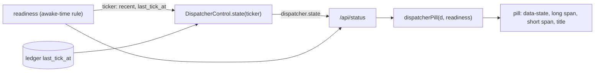

# Local Page at Narrow Widths and UI Residuals (Batch 30) - Plan

## Goal Capsule

- **Objective:** A user who opens the local page (`tidegap ui`, or the Mac app's web window) narrower than 720 px sees every header control inside the window. Each status pill (the Claude limit and the dispatcher) reads on one line. After the machine wakes from sleep, the dispatcher pill tells the truth about the tick daemon. A browser step fails when the header grows past the window again.
- **Means:** one PR, `fix/ui-narrow-widths` (Sequencing).
  - Short pill texts and shrink rules under 720 px, and the brand mark alone under 480 px (KTD1-KTD4).
  - A pure dispatcher pill model (KTD5) and the server's dispatcher state on awake time (KTD6).
  - Two browser steps, S2.34 and S2.35, and an assertion in S2.32 (KTD7, KTD8).
- **Authority:** the Product Contract decides what; the Planning Contract decides how. Binding repo rules:
  - `CLAUDE.md` (gate, generated files, hard rules, git conventions).
  - `docs/solutions/best-practices/dependency-free-task-ui-patterns.md` (text nodes only, no inline style; "A QA step must fail when the fix is missing").
  - `docs/solutions/best-practices/loopback-web-ui-hardening.md` (CSP without inline style; this batch adds no route).
  - `docs/solutions/logic-errors/sleep-gap-is-not-a-dead-daemon.md` (count missed ticks on awake time; `sleepReadNeeded`; a sleep reading counts only for the tick it was taken with).
  - `docs/spec/ui-client-api.md` (unchanged: the `dispatcher` field of `/api/status` "serves the page and can change with it").
  - `docs/solutions/workflow-issues/public-repo-hygiene.md`, `docs/solutions/workflow-issues/generated-test-counts-merge-conflict.md`, `docs/solutions/developer-experience/folding-review-fixes-into-commits.md`.
- **Execution profile:** one Opus `ce-work` agent in `.worktrees/fix/ui-narrow-widths`, units in order U1-U5. Simplify runs, because the PR changes application code. `pnpm qa ui` runs once, at the end, with nothing else running. One `ce-code-review` at the end.
- **Who ships:** the PR ends green, with its review done and the diff reviewed. The agent does not merge. No version bump, release or publish.
- **Stop conditions:** stop and report in these cases:
  - A change needs a file outside the Sequencing list, apart from the generated files.
  - A test or QA step needs the real `HOME`, `~/.tidegap`, `~/.claude` or `~/.config/tidegap`.
  - At 390 px the QA browser cuts a short text of the S2.34 fixture. Report the measured widths. Do not make fonts or paddings smaller (D1 and D3 decide).
  - S2.35 finds an element past the window edge outside the header, and its fix is not a rule in `packages/cli/ui/app.css` under the 720 px query. Report the selector and the width.
  - A gate fails the same way twice.
  - Evidence shows that a Key Technical Decision cannot work.
- **Decisions for the owner:** five, each with a recommendation that this plan follows. The orchestrator confirms or flips them before `ce-work` starts.
  - D1 (R1, R4). The narrow header. Recommended: one row. The status pills show short texts, shrink first and end in an ellipsis only as a last resort; under 480 px the brand shows its mark only (KTD1-KTD4). Alternative: under 480 px the two status pills move to a second header row, and the brand and the long texts stay. The sticky header then grows from 56 px to about 96 px, and `--header-h` (the connection notice and the drop dock use it) must change with it.
  - D2 (R2). Short text or a two-line pill, and from which width. Recommended: short text under 720 px, the page's one narrow breakpoint. The usage text is capped at 9em there (`packages/cli/ui/app.css:894`), so "Claude limits · no…" shows at every width under 720 px, not only at 390 px. This changes pill text at 500-719 px and no layout. Alternative A: short text under 480 px only; at 480-719 px the long text then ends in an ellipsis. Alternative B: a two-line pill. It keeps every word, but the rounded pill becomes a block about 40 px high.
  - D3 (R2). The short texts (KTD2). Recommended: "Blocked" for "Running · nothing can run", and "Running" with no age for a running dispatcher. Both fit at 360 px beside "No reading"; the title keeps the long text, or the readiness line when blocked, and the dialog keeps the age. Alternative: "Nothing can run" and "Ran 3 min ago". They are parts of the long text, but at 390 px they fit with only a few pixels to spare, and at 360 px they end in an ellipsis.
  - D4 (R5). The dispatcher after a sleep (brief item 4). The age part is fixed already; the state part is in the server. Recommended: fix the state in this PR (U3, KTD6). It is small, it reuses the readiness ticker that is already sleep-aware, and no open PR touches its files. Alternative: close item 4 as fixed and leave the state for a later batch.
  - D5 (scope). The header at 720 px and wider. The estimate that predicts the 474 px at 390 px (KTD4) also says that with usage on and Apps shown, the header needs about 1,100 px for the long texts. Below about 1,000 px it overflows, and in between the dispatcher text wraps. Recommended: no change at 720 px and wider in this PR; S2.34 logs the header width at 900 and 1,024 px as data for a later batch. Alternative: apply the shrink rules at every width now. The header then never overflows, but at 800 px both pills shrink to a few letters.

---

## Product Contract

### Summary

Under 720 px, each status pill shows a short text ("5h 72%", "No reading", "Running", "Blocked", "Idle · 2 h") on one line. Its title holds the long text. The status pills shrink before any other header control, and under 480 px the brand shows its mark only. The header no longer grows past the window, so Apps and Settings stay on screen. At 720 px and wider nothing changes.

The UI server's dispatcher state follows the readiness ticker. After a sleep, the pill no longer turns to "idle" while the daemon is on time, and Start dispatcher no longer adds a second ticker in that window.

S2.34 checks the header at 360, 390 and 480 px with usage on, a blocked dispatcher, Apps and Settings. S2.35 checks every view at 390 px with the same header. S2.32 asserts the page width that it now only logs.

### Problem Frame

Each brief item was checked on `main` at `2da3a0d5`.

- **Item 1, the header is 474 px wide at 390 px: confirmed.** `.top` is one flex row (`packages/cli/ui/app.css:51-58`). A flex item does not shrink below its min-content width. Under 720 px, `#usage-text` is `nowrap` with `max-width: 9em` (`app.css:111`, `:894`), so the usage pill's minimum is its whole capped text. The dispatcher text wraps at each space, so its minimum is its longest word. The sum is about 480 px: brand about 106 px, usage pill about 142 px, dispatcher pill about 92 px, Apps about 45 px, Settings 32 px, gaps and the 32 px padding. That matches the measured 474 px. With usage off the sum is about 335 px, so S2.25 passes. S2.32 logs the page width as a note only (`scripts/qa/ui-flows.mjs:610-611`).
- **Item 2, "Claude limits · no reading" is cut: confirmed, and wider than reported.** The text has 26 characters and needs about 150 px at 12 px; the cap is 9em, 108 px. The cap applies at every width under 720 px, so "Claude 5h 72% · resets 16:30" is cut there too. The amber dot stays (`app.css:110`).
- **Item 3, the dispatcher pill wraps to three lines: confirmed.** `.pill` has a fixed height (30 px under 720 px) and no `white-space` rule (`app.css:93-100`, `:893`). The dispatcher text shrinks with the row and wraps; three lines of 16 px do not fit in 30 px.
- **Item 4, the dispatcher age goes stale after sleep: half fixed.** There is no `packages/cli/ui/dispatcher.js`. The age is sleep-aware since `7ab93395` (2026-10-22): the pill, the banner and the dialog use `agoAwake` (`packages/cli/ui/app.js:303-305`, `:344`, `:382`; `packages/cli/ui/dom.js:152-156`), and `packages/cli/test/ui-dispatcher-age.test.ts` tests it. `sleepReadNeeded` is the core helper behind readiness. What is left is the state. `DispatcherControl.state()` calls a tick recent only within two wall-clock intervals (`packages/cli/src/ui/dispatcher.ts:119-141`). After a sleep the pill turns amber and reads "Dispatcher idle · 2 min ago" (an awake age) while readiness says the ticker is on time. `start()` uses the same rule (`dispatcher.ts:149-160`), so Start dispatcher is allowed in that window and starts a second ticker beside the daemon that just woke.
- **Item 5, caption contrast: already fixed, and outside this scope.** `--type-caption`, `#5b6577` and `#07090c` are tokens of the website (`apps/web/src/app/globals.css`). `e98f7159` (2026-10-20) raised `--color-fg-dim` to `#7a8291`: 5.15:1 on `#07090c`, 4.6:1 on the darkest panel. The local page's caption colour is `--fg-muted`: 5.28-6.07:1 in light and 6.31-7.50:1 in dark on `--bg`, `--surface` and `--surface-2`. `packages/cli/test/ui-server.test.ts:683-712` asserts `fg-muted` on `surface` in both themes.
- **Item 6, the search box breaks IME composition: already fixed.** The page's only search box is the grid region search. Since #196 (`a43a30dd`, `fbd47366`, `b5e88fc9`), `regionForm` builds it once and patches it, and `draw` waits while an IME composes (`packages/cli/ui/region-card.js:190-253`, `:337-362`). No other text input is rebuilt by its own input handler: the job form updates only its error and preview slots (`packages/cli/ui/job-form.js:752-773`), and a channel card rebuilds only when its view model changes (`packages/cli/ui/integrations.js:376-400`).
- **Item 7, no browser step for the narrow header: confirmed.** No step loads the page under 720 px with usage on. S2.25 runs with usage off; S2.31 and S14.2 check one view each; S2.32 and S2.33 check the dialog. The highest step id on `main` is S2.33.

### Requirements

- R1. Under 720 px the header is never wider than the window, at every width from 360 px, with every control the token allows: the usage pill, the dispatcher pill, Apps and Settings. No control sits past the right edge, and the page has no horizontal scroll from the header.
- R2. Under 720 px each status pill shows its short text (KTD2). At 720 px and wider it shows today's long text. The pill's title is the long text; a blocked dispatcher keeps the readiness line as its title, as today. The dot keeps its size and colour in every state, including the amber dot of "No reading". At 390 px and wider the short texts of the S2.34 fixture show in full. At 360 px a short text may end in an ellipsis.
- R3. Under 720 px a status pill's text stays on one line and never draws outside the pill's border.
- R4. Under 480 px the brand shows its mark only. The link keeps its name, "Tidegap, Agenda".
- R5. When the readiness ticker says the last tick is on time on awake time (`recent: true`) for the same tick the ledger shows, `/api/status` reports the dispatcher as `running`, and `POST /api/dispatcher/start` refuses with today's 409 "a dispatcher is already ticking this ledger". Without readiness, or with a reading of another tick, today's wall-clock rule applies.
- R6. S2.34 loads the page with usage on, a blocked dispatcher, Apps and Settings. At 360, 390 and 480 px it asserts R1-R4. At 1280 px it asserts the long texts. S2.32 asserts the page width behind its dialog instead of logging it.
- R7. S2.35 loads every view (Agenda, Timeline, Journal, Jobs, Settings) at 390 px in dark mode with the S2.34 header. It asserts no horizontal scroll and no rendered element past the window edge.

### Acceptance Examples

- AE1. Covers R1, R2, R3, R6. At 390 × 844 with the no-reading usage fixture, the blocked dispatcher fixture, Apps and Settings: `header.scrollWidth` is at most 390. The pills read "No reading" and "Blocked", each on one line and not cut. Their titles are "Claude limits · no reading" and the fixture's readiness line.
- AE2. Covers R2. At 1280 px the same page shows "Claude limits · no reading" and "Running · nothing can run" in full, and no short text.
- AE3. Covers R4. At 360 and 390 px the brand word is not displayed and the brand link's accessible name is "Tidegap, Agenda". At 480 px the word shows.
- AE4. Covers R5. With the ledger's last tick 20 minutes ago, no daemon (60 s interval) and a readiness ticker `{ recent: true, last_tick_at: <the same instant>, slept_s: 1150 }`, `/api/status` gives `dispatcher.state: "running"`, and `POST /api/dispatcher/start` answers 409 and spawns nothing.
- AE5. Covers R5. The same, with the ticker's `last_tick_at` one minute before the ledger's: `stale`, and start answers 201.
- AE6. Covers R6, R7. On `main`, S2.34 and S2.35 fail at 390 px: the header measures about 474 px. Each step checks a value that differs with and without the fix.

### Scope Boundaries

- No change at 720 px and wider (D5): tabs stay inline, the pills keep their long texts, and today's wrap and overflow there stay.
- No API, contract or Mac app change. The `dispatcher` field keeps its shape; only its `state` value changes after a sleep.
- No change to the website, the browser extension or `packages/core-*`.
- No version bump, release or publish.

#### Dropped from the brief

- Item 5 (caption contrast): fixed in `e98f7159`, and it is the website, which is out of scope. The local page's muted text passes AA in both themes (Problem Frame).
- Item 6 (search box and IME): fixed in #196 (Problem Frame).
- Item 4, its age half: fixed in `7ab93395`. Its state half stays as R5 (D4).

#### Deferred to Follow-Up Work

- The header at 720-1,100 px with usage on (D5). S2.34 logs its width at 900 and 1,024 px for that batch.

#### Considered and not built

- One text span per pill and JS `matchMedia` to pick the text (KTD1).
- A second header row under 480 px (D1).
- A page-side override of the pill state from `readiness.ticker.recent`. The dialog's state row, Start dispatcher, `nextTickHint` and the agenda's overdue rule read the server's `dispatcher.state`, so the pill would disagree with them.
- Smaller fonts or paddings in the pills. The short texts fit at 390 px without them (KTD4).

### Sources / Research

- Repo reads: `packages/cli/ui/index.html`, `packages/cli/ui/app.css`, `packages/cli/ui/tokens.css`, `packages/cli/ui/app.js` (`renderDispatcher`, `dispatcherDialog`), `packages/cli/ui/usage.js` (`usageView`, `renderPill`), `packages/cli/ui/dom.js` (`agoAwake`), `packages/cli/ui/region-card.js`, `packages/cli/ui/job-form.js`, `packages/cli/ui/integrations.js`, `packages/cli/ui/clients.js`, `packages/cli/src/ui/dispatcher.ts`, `packages/cli/src/ui/api.ts` (`status`, the start route), `packages/cli/src/ui/server.ts` (`UI_MODULES`), `packages/core-ts/src/readiness.ts` (`assessReadiness`, `sleepReadNeeded`), `packages/cli/test/ui-usage.test.ts`, `packages/cli/test/ui-dispatcher-age.test.ts`, `packages/cli/test/ui-actions.test.ts`, `packages/cli/test/ui-server.test.ts`, `scripts/qa/ui-flows.mjs` (S2.25, S2.31-S2.33), `scripts/build-brand.mjs`, `apps/web/src/app/globals.css`.
- Git history: `7ab93395`, `e98f7159`, `a43a30dd`, `fbd47366`, `b5e88fc9`; open #211 (its files: `CHANGELOG.md` Security and Added, `packages/cli/ui/dom.js`, the generated test counts).
- Learnings: the files under Authority.
- External research: none. Local patterns cover every layer.

---

## Planning Contract

### Key Technical Decisions

- KTD1. **Two text spans per status pill; CSS picks one.** `#usage-text` and `#dispatcher-text` keep the long text, so S2.33's check of `#usage-text` stays true. New spans `#usage-short` and `#dispatcher-short` hold the short text. Both carry `pill-text`; the long one also carries `pill-long`, the short one `pill-short`. Under 720 px `.pill-long` is `display: none` and `.pill-short` shows; at 720 px and wider the reverse. A `display: none` span is not part of the button's accessible name, so a screen reader reads the text that shows. A window resize switches the text with no redraw. Rejected: one span and JS `matchMedia`, which needs a listener and a redraw path, and the fake DOM has no `matchMedia`.
- KTD2. **The view models own both texts.** `usageView` (`packages/cli/ui/usage.js`) gives its pill a `short` next to `text`. The new `dispatcherPill` (KTD5) returns `{ state, text, short, title }`. Every short text has at most 15 characters.

  | Pill state | Long text (720 px and wider, unchanged) | Short text (under 720 px) |
  |---|---|---|
  | Usage with a current window (`ok`, `high`, `stale`) | Claude 5h 72% · resets 16:30 | 5h 72% |
  | Usage, every window reset | Claude limits reset | Limits reset |
  | Usage, no reading (`setup`) | Claude limits · no reading | No reading |
  | Usage unavailable | Claude limits ? | Limits ? |
  | Dispatcher not loaded yet | Dispatcher | Dispatcher |
  | Running, recent tick | Dispatcher ran 3 min ago | Running |
  | Running, the page's child, no recent tick | Dispatcher running · PID 4242 | Running |
  | Running, readiness not ready (`blocked`) | Running · nothing can run | Blocked |
  | Idle (`stale`) | Dispatcher idle · 2 h ago | Idle · 2 h |
  | Never ran | No dispatcher | No dispatcher |

  The idle short text is `Idle · ` plus the `agoAwake` age without its " ago" suffix. The usage pill's title is its long text; today it has none. The dispatcher pill's title is the readiness line when blocked, as today, and its long text in every other state; today's fixed title "Dispatcher status" goes, so a short text always has its long text on hover.
- KTD3. **Shrink rules under 720 px.** In the existing `@media (max-width: 719px)` block:
  - `.top-end { min-width: 0; }`, and the two status pills get `min-width: 0`, so they shrink first.
  - `.pill-text { min-width: 0; overflow: hidden; white-space: nowrap; text-overflow: ellipsis; }`.
  - `.pill-dot`, `.brand`, `#apps-btn` and `.settings-link` get `flex: none`. The 8 px dot is an empty flex item whose automatic minimum width is 0, so without `flex: none` it shrinks away before the text.
  - The `#usage-text { max-width: 9em; }` rule goes; the short text needs no cap.

  Classes only: the UI tests ban inline styles, and the CSP has no `style-src 'unsafe-inline'`. Nothing changes at 720 px and wider (D5).
- KTD4. **Width budget, and the brand word.** At 12 px in the system font, the estimate used in the Problem Frame (within about 2% of the measured 474 px) gives these budgets for the two short texts together: about 145 px at 390 px and about 115 px at 360 px, with the mark alone. With the brand word they get about 71 px at 390 px, too little for any pair, so the word hides under 480 px. "No reading" plus "Blocked" needs about 105 px. "Tidegap" becomes `Tidegap` after the `<!-- brand-mark:end -->` marker. `scripts/build-brand.mjs` rewrites only the text between the markers, so `pnpm gen:brand:check` stays clean. A new `@media (max-width: 479px)` rule sets `.brand-word { display: none; }`. The link keeps `aria-label="Tidegap, Agenda"`.
- KTD5. **The dispatcher pill model is a page module.** New `packages/cli/ui/dispatcher.js` exports a pure `dispatcherPill(d, readiness, now = Date.now())`. It takes today's text and title rules from `renderDispatcher` (`app.js:279-310`) and adds the KTD2 short texts and the new title rule. It imports `agoAwake` from `dom.js` and does not edit `dom.js`, which open #211 edits. It joins `UI_MODULES` in `packages/cli/src/ui/server.ts`; the asset test requires that for every page module. `renderDispatcher` keeps the banner logic and writes the model to the pill: `data-state`, both spans and `title`. `renderPill` in `usage.js` writes both spans and `title`.
- KTD6. **The server's dispatcher state follows the readiness ticker (D4).** `DispatcherControl.state(ticker?)` and `start(ticker?)` take readiness's `ticker` (`recent`, `last_tick_at`). A tick is recent when the wall gap is at most two intervals (today), or when `ticker.recent` is true and `ticker.last_tick_at` is the same instant as the ledger's `last_tick_at`. That is the pairing rule `agoAwake` uses. `recent` also gates the child's `alive` check, as today. In `api.ts`, `status()` awaits readiness first and passes its ticker to `state()`. `status()` keeps today's behaviour when readiness throws: the request fails as it does now. The start route also awaits readiness when `ctx.readiness` exists; a failure there counts as no ticker, so start falls back to the wall rule. Readiness already reads the sleep counter only for a gap over two intervals (`sleepReadNeeded`), so this adds no `sysctl` spawn. The header comment of `dispatcher.ts` states the new rule.
- KTD7. **QA fixtures on a fresh page.** As S2.32 and S2.33 do, a new helper in `scripts/qa/ui-flows.mjs` opens a fresh page and sets its routes before it loads the page link:
  - `GET /api/usage` answers the no-reading document (cause `no_data`), so the usage pill shows "Claude limits · no reading".
  - `GET /api/status` answers the real response with two fields replaced: `route.fetch()`, then `route.fulfill({ json })` (playwright-core 1.64.1). `dispatcher` becomes `{ state: "running", last_tick_at: <one minute ago>, interval_s: 60, ui_child: null }`. `readiness` becomes not ready, with one `no_runner` problem, a fixed `line`, and a ticker for the same tick. The pill then shows the blocked state, and every other field stays real.
  - The page token shows Apps and Settings.
- KTD8. **What the steps measure.** In one `page.evaluate` per width:
  - The header's `scrollWidth`, and the right edge of each rendered header descendant, against `innerWidth`.
  - `document.scrollingElement.scrollWidth` against `innerWidth`.
  - For each shown pill: the shown text span's height against 1.5 times its line height (one line); the pill's `scrollHeight` against its `clientHeight` (nothing draws outside); the span's `scrollWidth` against its `clientWidth` (cut or not); the dot's width.
  - S2.35 only: every rendered element (`getClientRects().length > 0`, not `visibility: hidden`) whose box passes the left or right window edge by more than 1 px, unless an ancestor below `body` clips it (`overflow-x` other than `visible`). The step reports up to five as `tag#id.class` with their right edge.

### High-Level Technical Design

| Window width | Brand | Status pills | Other header controls |
|---|---|---|---|
| 720 px and wider | mark and word | long text, today's rules | tabs inline, Apps, Settings with its label, `?` |
| 480-719 px | mark and word | short text; shrink first; ellipsis as a last resort | tabs in the bottom bar, Apps, Settings gear |
| under 480 px | mark only | as above | as above |

### Assumptions

- Text widths use 12 px system-font metrics. The estimate matched the measured 474 px within about 2%. The QA browser decides the final fit (stop conditions).
- The Mac app's web view and current browsers support flex `min-width: 0` and `text-overflow: ellipsis` on a flex item.
- The readiness ticker and the dispatcher state read the same ledger key, `last_tick_at`, so the same tick has the same instant in both.

### Sequencing

One PR, `fix/ui-narrow-widths`, from `main`. Units in order U1-U5.

| Unit | Files |
|---|---|
| U1 | `packages/cli/ui/usage.js`, `packages/cli/ui/dispatcher.js` (new), `packages/cli/src/ui/server.ts` (`UI_MODULES`), `packages/cli/test/ui-usage.test.ts`, `packages/cli/test/ui-dispatcher-age.test.ts` |
| U2 | `packages/cli/ui/index.html`, `packages/cli/ui/app.css`, `packages/cli/ui/usage.js`, `packages/cli/ui/app.js`, `packages/cli/test/ui-server.test.ts` |
| U3 | `packages/cli/src/ui/dispatcher.ts`, `packages/cli/src/ui/api.ts`, `packages/cli/test/ui-actions.test.ts` |
| U4 | `scripts/qa/ui-flows.mjs`, `docs/plans/2026-10-19-qa-matrix-checklist.md` |
| U5 | `CHANGELOG.md`; generated: the `README.md` test block, `apps/web/src/lib/tests.generated.ts` |

- Open #211 also edits `CHANGELOG.md` (Security and Added), `packages/cli/ui/dom.js` and the generated test counts. This PR adds its CHANGELOG entry at the end of `### Fixed` and does not edit `dom.js`. On a conflict in a generated block, take `main`'s version and run `pnpm gen:tests`.
- If #211 merges first, merge `main` into the branch before the final gate and regenerate the counts.

### Risks

- Font metrics in the QA browser can differ from the estimate. AE1's pair has about 40 px of slack at 390 px. The worst pair, "Limits reset" with "No dispatcher" (about 148 px), ends in an ellipsis at 360 px and can at 390 px. R2 promises a full short text at 390 px for the fixture pair only; for any other pair the title holds the long text.
- After a sleep, Start dispatcher is refused for up to three awake intervals while the daemon has not yet ticked. That is the readiness rule, and a dead daemon still frees Start after that time.

---

## Implementation Units

### U1. Pill texts in the view models

- **Goal:** both status pills have a long text, a short text and a title from pure functions.
- **Requirements:** R2; KTD2, KTD5.
- **Dependencies:** none.
- **Files:** `packages/cli/ui/usage.js`, `packages/cli/ui/dispatcher.js` (new), `packages/cli/src/ui/server.ts`, `packages/cli/test/ui-usage.test.ts`, `packages/cli/test/ui-dispatcher-age.test.ts`.
- **Approach:**
  1. `usageView`: add `short` to each pill per the KTD2 table. `text` and `state` stay.
  2. Add `packages/cli/ui/dispatcher.js` with `dispatcherPill(d, readiness, now)`. Move the text rules from `renderDispatcher` without change, and add `short` and `title`. `d` is the `dispatcherInfo()` value or null; `readiness` is the `readinessInfo()` value or null.
  3. Add `"dispatcher.js"` to `UI_MODULES`.
- **Patterns to follow:** `usageView` as an exported pure model ("page usage panel model" in `ui-usage.test.ts`); the `agoAwake` cases in `ui-dispatcher-age.test.ts`.
- **Test scenarios:**
  - `usageView`, every pill state: `ok` gives `{ text: "Claude 5h 72% · resets 16:30", short: "5h 72%", state: "ok" }`; `high` and `stale` keep "5h 72%"; all windows reset gives "Limits reset"; `no_data` gives "No reading" with state `setup`; another cause gives "Limits ?"; `disabled` gives no pill. Update the existing `toEqual` checks to include `short`.
  - `dispatcherPill`: null gives `unknown`, "Dispatcher", "Dispatcher".
  - Running with a tick 5 minutes ago: "Dispatcher ran 5 min ago", "Running".
  - Running with the page's live child and no recent tick: "Dispatcher running · PID 4242", "Running".
  - Running with readiness not ready: state `blocked`, "Running · nothing can run", "Blocked", title the readiness line; with a null line, the title is the long text.
  - Idle, 60 minutes after the tick with 55 minutes of sleep for that tick: "Dispatcher idle · 5 min ago" and "Idle · 5 min".
  - Never ran: "No dispatcher" for both texts.
  - Each short text above has at most 15 characters.
  - The title of every state above: the readiness line when blocked with a line, else the long text; never "Dispatcher status".
  - The existing `agoAwake` cases and the asset tests in `ui-server.test.ts` pass.
- **Verification:** `pnpm --filter @tidegap/cli test` passes.

### U2. Header markup and narrow rules

- **Goal:** R1-R4 in the page.
- **Requirements:** R1, R2, R3, R4; KTD1, KTD3, KTD4, KTD5.
- **Dependencies:** U1.
- **Files:** `packages/cli/ui/index.html`, `packages/cli/ui/app.css`, `packages/cli/ui/usage.js`, `packages/cli/ui/app.js`, `packages/cli/test/ui-server.test.ts`.
- **Approach:**
  1. `index.html`: two text spans in each status pill (KTD1); the brand word in its span after the brand-mark block (KTD4).
  2. `app.css`: `.pill-short { display: none; }` at full width. In the 719 px block: the KTD1 swap, the KTD3 rules, and the removal of the 9em cap. A new 479 px block hides `.brand-word`.
  3. `renderPill` (`usage.js`): write `#usage-text`, `#usage-short` and the pill's `title`.
  4. `renderDispatcher` (`app.js`): use `dispatcherPill`, and write `data-state`, `#dispatcher-text`, `#dispatcher-short` and `title`. The banner code stays.
- **Patterns to follow:** the asset tests in `ui-server.test.ts` ("the header carries the generated brand mark", "index.html references only relative asset paths").
- **Test scenarios:**
  - `index.html`: `#usage-pill` and `#dispatcher-pill` each hold one `pill-long` span and one `pill-short` span, with the ids from KTD1.
  - `index.html`: the brand link holds a `brand-word` span after `<!-- brand-mark:end -->`, and the brand link's `aria-label` is "Tidegap, Agenda".
  - The existing scans pass: no inline style, relative asset paths only, the static map equals the `ui` directory, the brand block is style-free.
  - Layout is proven in U4: no unit test parses CSS rules.
- **Verification:** unit tests pass; `pnpm gen:brand:check` passes; U4's steps pass.

### U3. Dispatcher state after a sleep

- **Goal:** R5 in the UI server.
- **Requirements:** R5; KTD6.
- **Dependencies:** none.
- **Files:** `packages/cli/src/ui/dispatcher.ts`, `packages/cli/src/ui/api.ts`, `packages/cli/test/ui-actions.test.ts`.
- **Approach:**
  1. `state(ticker?)`: the KTD6 rule. `start(ticker?)` passes its ticker to `state`.
  2. `status()` in `api.ts`: compute readiness once, before `dispatcher`, and pass `readiness?.ticker`. The response keys and their order stay.
  3. The start route: await `ctx.readiness()` when it exists, and catch a failure as no ticker.
  4. Update the header comment of `dispatcher.ts`.
- **Patterns to follow:** the "Start dispatcher (KTD13)" tests in `ui-actions.test.ts`. `startUiServer` takes `readiness` once, at construction (`ui-actions.test.ts:117`), so the harness passes `readiness: () => readinessImpl()` and each test sets the `let readinessImpl`; `beforeEach` resets it to today's `assessReadiness` call.
- **Test scenarios:**
  - Covers AE4. Last tick 20 minutes ago, a ticker that is recent for the same instant: `/api/status` gives `running`; `POST /api/dispatcher/start` answers 409 with "already ticking", and nothing is spawned.
  - Covers AE5. The ticker names an instant one minute earlier: `stale`; start answers 201.
  - A ticker with `recent: false`: `stale`, as today.
  - The default harness readiness (no `last_tick_at`): the four existing Start dispatcher tests pass unchanged.
  - A readiness function that throws on the start route: start follows the wall rule and answers 201 for an old tick.
- **Verification:** `pnpm --filter @tidegap/cli test` passes.

### U4. Browser steps for the narrow header

- **Goal:** R6 and R7 in a real browser.
- **Requirements:** R1-R4, R6, R7; KTD7, KTD8.
- **Dependencies:** U1, U2. U3 is not needed: the fixture sets the dispatcher state.
- **Files:** `scripts/qa/ui-flows.mjs`, `docs/plans/2026-10-19-qa-matrix-checklist.md`.
- **Approach:**
  1. Add the KTD7 helper. It opens a fresh page, sets the routes, loads `server.link`, and waits until the usage pill, Apps and Settings show and the dispatcher pill has `data-state="blocked"`.
  2. S2.34, "the header under 720 px with usage on, a blocked dispatcher, Apps and Settings":
     - At 360, 390 and 480 px (height 844) in light, and at 390 px in dark: the KTD8 header checks. At 390 and 480 px a cut short text fails the step; at 360 px it is a note.
     - Shown texts "No reading" and "Blocked"; titles "Claude limits · no reading" and the fixture's readiness line. The brand word is hidden at 360 and 390 px and shown at 480 px.
     - At 1280 px: the long texts in full and the short spans hidden.
     - At 900 and 1,024 px: log the header's `scrollWidth` and the page width as a note (D5 data), with no assertion.
     - Screenshots `header-<width>-<scheme>`.
  3. S2.35, "every view at 390 px in dark with the S2.34 header": on its own fresh page from the helper, visit `#/agenda`, `#/timeline`, `#/journal`, `#/jobs` and `#/settings` by hash navigation, as S2.25 does. S2.25 skips Jobs; S2.35 adds it. Apply the KTD8 page checks. Screenshots `narrow-usage-<view>`.
  4. S2.32: replace the page-width `s.note` with a failure entry in `bad`, and update its comment.
  5. Add the S2.34 and S2.35 rows to the QA checklist after the S2.33 row, in the same format (`- [ ] S2.3x <what it checks> — pw:ui-flows.mjs — Haiku`).
- **Patterns to follow:** S2.32 and S2.33 (a fresh page with routes set before the load; widths and schemes in a loop; `bad` collects failures; the page closes in `finally`); S2.25 (hash navigation and the width check).
- **Test scenarios:**
  - Covers AE1. S2.34 at 390 px: header and page at most 390 px; both pills on one line, nothing outside their border, not cut; the dot 8 px wide.
  - Covers AE2. S2.34 at 1280 px: the long texts.
  - Covers AE3. S2.34: the brand word at 360, 390 and 480 px.
  - Covers AE6. On `main`, S2.34 fails on the header width at 390 px, and S2.35 on the page width.
  - S2.35: no offender in any of the five views.
  - S2.32: passes at 390 px with its own page-width check.
- **Verification:** `pnpm qa ui` passes once at the end of the PR, run alone.

### U5. CHANGELOG and generated counts

- **Goal:** the user-facing record and generated files that match the tests.
- **Requirements:** R1-R5.
- **Dependencies:** U1-U4.
- **Files:** `CHANGELOG.md`; generated: the `README.md` test block, `apps/web/src/lib/tests.generated.ts`.
- **Approach:**
  1. Add one entry at the end of `### Fixed` under `[Unreleased]`, before `### Docs`. It says what the user sees: under 720 px the pills show a short text with the full text on hover, under 480 px the brand shows its mark, and nothing in the header sits past the window edge. At 390 px with usage on, the header was 474 px wide, Apps and Settings sat past the edge, the usage text read "Claude limits · no…", and "Running · nothing can run" wrapped onto three lines outside its pill. After a sleep, the dispatcher pill no longer reads idle while the tick daemon is on time, and Start dispatcher is refused in that window.
  2. Run `pnpm gen:tests`.
- **Test expectation:** none beyond `pnpm gen:tests:check`.
- **Verification:** the gate passes.

---

## Verification Contract

- The gate, from the repo root: `pnpm build && pnpm typecheck && pnpm gen:tests:check && pnpm gen:docs:check && node scripts/qa/docs-drift.mjs`. Read a failing log with `grep -nE "✘|Error|expected" <log> | head -40`.
- `pnpm --filter @tidegap/cli test` passes.
- `pnpm gen:brand:check` passes (`index.html` is in its diff set).
- `pnpm check:versions` passes, and no version field changes.
- `pnpm check:hygiene` prints PASS. A grep for session trailers, session links, local home paths and owner names over the added lines prints nothing.
- `pnpm qa ui` runs once, at the end, alone. S2.32, S2.34 and S2.35 pass, and every earlier ui step still passes.
- Generated files change only through `pnpm gen:tests`.
- Tests and QA use an isolated `HOME`. Nothing reads or writes the developer's real `~/.claude`, `~/.tidegap` or `~/.config/tidegap`.
- `git diff origin/main --stat` lists only the Sequencing files and the generated files.
- Commits follow Conventional Commits (`fix(ui): …`, `test(ui): …`), run git with `git -c core.editor=true -c sequence.editor=true`, and take each message from a uniquely named file through `-F`. Review fixes fold into their commits. Commit messages and the PR body carry no session trailer or session link.
- The PR body names the S2.34 screenshots at 390 px (light and dark) and at 1280 px as evidence, the D1-D5 outcomes, and the D5 widths that S2.34 logged at 900 and 1,024 px.

### Owner check after merge

1. Open `tidegap ui` in a browser window about 390 px wide with usage on. The header fits; the pills read a short text, such as "5h 72%" and "Running"; hovering a pill shows its long text.
2. Widen the window past 720 px. The long texts come back.
3. After the Mac sleeps for longer than ten minutes, wake it and open the page. The dispatcher pill does not turn amber while the daemon is on time.

---

## Definition of Done

- R1-R7 are met by their units, or reported under a stop condition.
- AE1-AE6 hold as unit tests or QA steps.
- The PR touches only its Sequencing files and the generated files.
- The gate, `pnpm --filter @tidegap/cli test`, `pnpm gen:brand:check`, `pnpm check:versions`, `pnpm check:hygiene` and one `pnpm qa ui` run pass on the final commit, and CI is green.
- `ce-code-review` ran once, and its findings are fixed and folded into their commits.
- No abandoned-attempt code, debug output or temporary files remain in the diff.
- The agent does not merge the PR.
