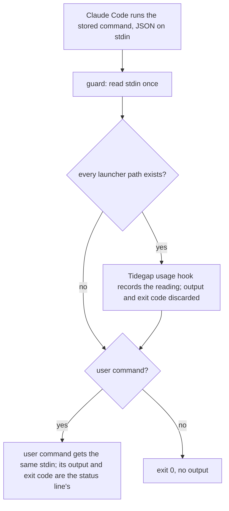
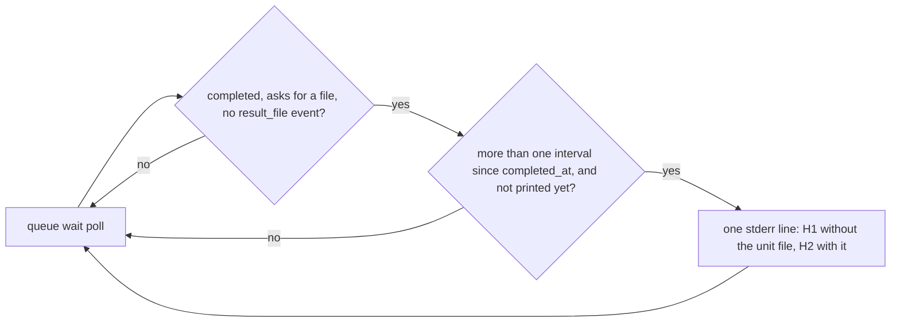

# Residuals Sweep after Batches 27-30 (Batch 31) - Plan

## Goal Capsule

- **Objective:** The local page header fits the window at every width, also at 720-1,279 px with usage on, where the Mac app opens its web window. No status pill shows a state by colour alone. A user's own Claude Code status line keeps its output when the Tidegap runtime fails. Three CLI paths stop failing silently: Ctrl-D at the `tidegap install` question, a `queue wait` on a result file that only a Node tick writes, and docs that drift from the protected-folder list and the `queue add --json` keys.
- **Means:** two PRs (Sequencing).
  - PR A, `fix/header-mid-widths`, starts now: header rules for every width below 1,280 px (KTD1-KTD4), the stale usage cue (KTD5), the Python task-event note (KTD6), and browser steps S2.34, S2.36 and S2.37 (KTD7).
  - PR B, `fix/handoff-and-statusline-residuals`, starts after #211 merges: the install question at end of input (KTD8), the statusLine guard (KTD9), the `queue wait` hint (KTD10), and docs-drift K20 and K21 (KTD11).
- **Authority:** the Product Contract decides what; the Planning Contract decides how. Binding repo rules:
  - `CLAUDE.md` (gate, generated files, hard rules, git conventions).
  - `docs/solutions/best-practices/dependency-free-task-ui-patterns.md` (text nodes only, no inline style, two text spans per status pill, label in name, "A QA step must fail when the fix is missing").
  - `docs/solutions/best-practices/loopback-web-ui-hardening.md` (CSP without inline style; no route changes here).
  - `docs/solutions/tooling-decisions/claude-usage-limits-source-and-deferral.md` (the guarded statusLine command, the consent rule: only an explicit user act writes `~/.claude/settings.json`).
  - `docs/solutions/logic-errors/sleep-gap-is-not-a-dead-daemon.md` (corrected in U5).
  - `docs/solutions/workflow-issues/public-repo-hygiene.md`, `docs/solutions/workflow-issues/generated-test-counts-merge-conflict.md`, `docs/solutions/developer-experience/folding-review-fixes-into-commits.md`, `docs/solutions/developer-experience/worktree-environment-setup.md` (a new worktree needs its own Python venv for U4).
- **Execution profile:**
  - PR A: one Opus `ce-work` agent in `.worktrees/fix/header-mid-widths`, units U1-U5 in order. Simplify runs (application code). `pnpm qa ui` runs once, at the end, with nothing else running. One `ce-code-review` at the end.
  - PR B: one Opus `ce-work` agent in `.worktrees/fix/handoff-and-statusline-residuals`, branched from `main` after #211 merges, units U6-U10 in order (U6 and U7 share `statusline-setup.ts`). Simplify runs. `pnpm qa cli` and `pnpm qa docs` run once each, at the end. No `pnpm qa ui`: PR B changes no page file. One `ce-code-review` at the end.
- **Who ships:** each PR ends green, with its review done and the diff reviewed. The agent does not merge. No version bump, release or publish.
- **Stop conditions:** stop and report in these cases:
  - A change needs a file outside its unit lists, apart from the generated files.
  - A test or QA step needs the real `HOME`, `~/.tidegap`, `~/.claude` or `~/.config/tidegap`.
  - PR A: at 720-1,099 px the QA browser cuts a short text of the S2.34 fixture, or a header control passes the window edge. Report the measured widths per tier. Do not use sizes outside `tokens.css` (D2 decides the next step).
  - PR A: at 1,280 or 1,440 px a header box differs from `main` for any pill state other than the stale usage text (R6).
  - PR B: #211 is not merged. Do not start.
  - PR B: S1.32 or S2.33 fails after the guard change.
  - PR B: S1.33 cannot answer the install question through a pseudo-terminal in a deterministic way. Report it; keep the unit test.
  - A gate fails the same way twice.
  - Evidence shows that a Key Technical Decision cannot work.
- **Decisions for the owner:** eight, each with a recommendation that this plan follows. The orchestrator confirms or flips them before `ce-work` starts.
  - D1 (R2). Where the status pills switch to the short text. Recommended: below 1,100 px. The Mac app opens its web window at 1,100 px, and the S2.34 fixture's long pair fits there (about 1,078 px). At 1,100-1,279 px the shrink rules apply, so a longer pair (up to about 1,190 px) ends in an ellipsis instead of wrapping outside its pill. Alternative: below 1,280 px. No long text ever ends in an ellipsis, but the Mac app's default window shows "5h 72%" instead of "Claude 5h 72% · resets 16:30".
  - D2 (R3). How 720-959 px makes room. Recommended: compact chrome (today's under-720 header padding, gaps and pill size, the Settings gear, no `?` button) and 8 px tab padding; the brand word stays. The fixture fits at 720 px with about 42 px to spare; the widest short pair can end in an ellipsis at 720-725 px. Alternative: also hide the brand word below 960 px. That gives 74 px more, and every pair fits, but the word then also hides at 480-719 px, where it fits today.
  - D3 (R5). The widest short pair at 360 px (brief item 2). Recommended: tighter header spacing below 400 px, from the spacing tokens; no text change. Alternative A: shorter copy, such as "Reset" and "Not set up". Alternative B: keep the ellipsis and drop the item; the title and the button name keep the full text.
  - D4 (R6). The stale usage cue (brief item 3). Recommended: the word "old" at the end of both texts: "Claude 5h 72% · resets 16:30 · old" and "5h 72% · old". The dialog already says "it may be old". Alternative A: a hollow dot. It costs no width, but a screen reader, the title and the button name get nothing. Alternative B: "5h 72%?". The "?" already means unavailable ("Limits ?").
  - D5 (R9). Ctrl-C at the install question. Recommended: Ctrl-C answers "N" as Ctrl-D does, and the exit code stays the install's own. The install finished before the question, so a non-zero code would read as a failed install, and `packages/cli/src/index.ts` does not change. Alternative: exit 130, the shell's code for an interrupt; it needs an `index.ts` change.
  - D6 (R10). The statusLine guard (brief item 8). Recommended: the guard runs Tidegap only to record the reading, with its output and exit code discarded, and then runs the user's command itself with the same stdin bytes (KTD9). Alternative (the brief's): run the user's command alone when Tidegap exits non-zero. The hook passes the user's exit code through, so that fallback runs the user's command a second time whenever the user's own command fails, and it also needs a copy of stdin.
  - D7 (R8). `planned_mode` in the Python core (brief item 9). Recommended: document it. The Python core writes no `created` event at all, and it holds every `claude-code` row for the Node tick, so Node writes those rows' events. A README section and a pytest record that. Alternative: Python writes `created` events and `planned_mode`. That is new event-writing parity work in the Python store, beyond this sweep.
  - D8 (scope). The PR split. Recommended: PR A now with the five units whose files #211 does not touch; PR B after #211 merges. Alternative: build PR B now, stacked on #211's branch, and retarget it after #211 merges. That is faster, but a stacked base needs `docs/solutions/workflow-issues/stacked-prs-and-delete-branch.md` and a rebase each time #211 changes in review.

---

## Product Contract

### Summary

At 720-1,279 px the header now fits with usage on. Below 1,100 px the status pills show their short texts; below 960 px the header uses the compact chrome of the narrow layout while the tabs stay inline. At 1,280 px and wider nothing changes. Below 400 px the header spacing tightens, so the widest short pair reads in full at 360 px. A stale usage reading says "old" in its pill. The Python README states which task events the Python core writes.

After #211 merges, PR B fixes four CLI paths. Ctrl-D or Ctrl-C at the `tidegap install` question answers "N" and prints the follow-up line. The stored statusLine command runs the user's command itself, so a crashed Tidegap runtime no longer blanks the status line. `queue wait` says when a result file waits for a Node tick. Two docs-drift rules keep the protected-folder list and the `queue add --json` keys in the docs equal to the code.

### Problem Frame

Each brief item was checked on `main` at `15acb411`.

- **Item 1, the header at 720-1,100 px: confirmed, and the brief's fix is not enough.** The narrow rules live only in `@media (max-width: 719px)` (`packages/cli/ui/app.css:874-944`). At 720 px and wider the status pills keep their automatic minimum width, the dispatcher text wraps at spaces, and the usage text has a 22em cap (`app.css:93-113`). #216's S2.34 logged 966 px at 900 px and 1,024 px at 1,024 px, with the dispatcher text wrapped (`scripts/qa/ui-flows.mjs:824-830`). From those numbers, the whole header needs about 1,078 px, and about 760 px without the two pill texts. So the batch 30 shrink rules alone do not fit: below about 760 px the header overflows with empty pills, and at 800-900 px each pill keeps a few letters. The Mac app opens its web window at 1,100 × 760 px and allows 720 px (`apps/macos/Tidegap/StatusItemController.swift:299`, `apps/macos/Tidegap/WebPageWindow.swift:24`).
- **Item 2, the widest short pair at 360 px: confirmed.** Under 480 px the header without the pill texts is about 245 px, so at 360 px the two short texts get about 115 px. "Limits reset" with "No dispatcher" needs about 144 px. "5h 72% · old" (R6) and "Idle · 59 min" (`packages/cli/ui/dispatcher.js:28`) are as wide.
- **Item 3, the stale usage pill: confirmed.** `usageView` gives a stale reading the texts of an ok reading and the state `stale` (`packages/cli/ui/usage.js:81-88`). Only the dot changes, from `--accent` to `--warn` (`app.css:104`, `:107`). `packages/cli/test/ui-usage.test.ts:443-459` pins today's texts. The other pills name every state in text: "Blocked", "Idle · 2 h", "No reading", "Limits ?".
- **Item 4, the probe cache: not a bug.** Both sides pick the interval from the unit file on disk, and both read it on every call. Readiness checks `daemonStatus` first and returns at once when the file is absent (`probeDaemon`, `packages/cli/src/readiness.ts:91-123`), and every on-disk fact gives 300 s (`tickIntervalFor`, `packages/core-ts/src/readiness.ts:191-198`). The dispatcher uses `daemonStatus() === "installed"` (`packages/cli/src/ui/dispatcher.ts:131-132`). The 30 s cache holds only "loaded" or "not loaded", and that does not pick the interval. The "Open" line of `docs/solutions/logic-errors/sleep-gap-is-not-a-dead-daemon.md:67` is wrong.
- **Item 5, Ctrl-D at the install question: confirmed, and a failed install exits 0 too.** At end of input readline closes, and the pending `rl.question` promise never settles (Node 26 `node:readline/promises`, checked with a closed pipe). So `offerStatuslineInteractive` never returns (`packages/cli/src/commands/statusline-setup.ts:419-449`), and the install action never sets `process.exitCode = result.exitCode` (`packages/cli/src/index.ts:154-158`). Node exits 0 when its event loop is empty: no follow-up line, whatever the install's result was. Ctrl-C does the same: in a terminal, readline closes the interface on Ctrl-C when nothing listens for its `SIGINT` event.
- **Item 6, docs-drift for the handoff lists: confirmed.** `PROTECTED_HOME_DIRS` (`packages/core-ts/src/handoff.ts:107`, not exported) is copied into `apps/web/content/docs/12-handoff.md:43` and `apps/web/content/docs/04-tools.md:32`. No rule compares them (`scripts/qa/docs-drift.mjs` ends at K19, `:321-368`). The `queue add --json` keys (`packages/cli/src/commands/queue-add.ts:262-279`) are on no page: `12-handoff.md:21` says only that `--json` works "as on the other commands". #211 adds `wake` and `wake_armed` to that object and edits all four files.
- **Item 7, `queue wait` on a Python-completed row: confirmed.** Only the Node tick writes result files, also for rows the Python core completed (`packages/cli/src/handoff/results.ts:108-130`, `packages/core-py/README.md:268-271`). `runQueueWait` loops until the `result_file` event exists and prints nothing meanwhile (`packages/cli/src/commands/queue-watch.ts:222-243`). `queue-watch.ts` is not in #211; the page that documents `wait` is.
- **Item 8, the statusLine guard: confirmed, in another file.** The guard is the `GUARD` program in `packages/cli/src/commands/statusline-setup.ts:85-89`, not `cron-guard.sh` (the plugin's Bash `PreToolUse` hook has no statusLine code). It checks that the launcher paths exist and then `exec`s `<launcher> usage hook -- sh -c <user command>`. The hook passes the user's exit code through (`packages/cli/src/usage/statusline.ts:77-99`). When the runtime exists but crashes, nothing prints, and the status line is blank in every session. An exit-code fallback cannot tell that crash from the user's own command failing.
- **Item 9, `planned_mode` in the Python core: confirmed, and the gap is wider.** The Python core writes `dispatched` and the terminal events with `provider`, `model` and the first error line only (`packages/core-py/src/tidegap/scheduler.py:718-732`, `:1117-1122`, `:1381-1382`). It writes no `created` event. It holds every `claude-code` row that no adapter serves for the Node tick (`scheduler.py:1611`). No code reads `planned_mode`; only `docs/spec/ui-client-api.md:263` names it. The Python README does not describe task events.

### Requirements

**PR A**

- R1. At every width from 720 to 1,279 px, the header with usage on, a blocked dispatcher, Apps, Settings and `?` is never wider than the window. No control sits past the right edge. Each status pill's text stays on one line inside its border.
- R2. Below 1,100 px each status pill shows its short text; at 1,100 px and wider, its long text (D1). A text ends in an ellipsis only when it does not fit. Titles and button names follow today's rules.
- R3. Below 960 px the header uses compact chrome: today's under-720 padding, gaps and pill size, the Settings gear, and no `?` button. From 720 px the tabs stay inline, with 8 px tab padding below 960 px. The brand word stays at 480 px and wider (D2). The `?` key still opens the shortcuts.
- R4. At 1,280 px and wider every header box equals `main` for every pill state except the stale usage text (R6).
- R5. Below 400 px the header spacing tightens, so that two short texts of 25 characters together, such as "Limits reset" and "No dispatcher", show in full at 360 px (D3). Font sizes, pill heights and the dot do not change.
- R6. A stale usage pill names its state in text at every width: "Claude 5h 72% · resets 16:30 · old" and "5h 72% · old" (D4). The dot stays amber, and the title is the long text. The other usage states keep their texts.
- R7. S2.34 asserts R1-R4 from 720 to 1,440 px, where it now only logs 900 and 1,024 px. At 360 px a cut fixture text now fails. S2.36 asserts R5, and S2.37 asserts R6.
- R8. `packages/core-py/README.md` states which task events the Python core writes, and that they carry no `planned_mode` or handoff details (D7). A pytest pins this for a `claude-code` row.

**PR B**

- R9. At the `tidegap install` statusLine question, end of input (Ctrl-D) and Ctrl-C answer "N". The next line, on a line of its own, is "Skipped. To connect later, run: <command>". Nothing is written, and the exit code is the install's own (D5).
- R10. The stored statusLine command records the reading through Tidegap and then runs the user's command itself, with the same stdin bytes. Tidegap's output, exit code or crash never reach the status line. The user's command runs once, and its exit code passes through. A hook stored by an earlier version reads as `legacy`, so `tidegap install`, `tidegap usage install-hook` and Reconnect offer the update (D6).
- R11. `queue wait` prints one stderr line when its task is completed, asked for a result file, and still has no `result_file` event one tick interval after it completed (KTD10 gives the texts). Its other output, exit codes and timing do not change.
- R12. docs-drift K20 fails when the protected-folder list on the handoff page or the tools page differs from the core's list. K21 fails when the `queue add --json` keys on the handoff page differ from the keys the command prints.

### Acceptance Examples

- AE1. Covers R1, R2, R3. At 900 × 900 px with the S2.34 fixture: the header is at most 900 px wide; the pills read "No reading" and "Blocked", on one line and not cut; Settings shows the gear; `?` is hidden; the brand word shows. On `main` the header is 966 px wide.
- AE2. Covers R1, R3. At 720 px, the same: the header fits and both short texts show in full.
- AE3. Covers R2, R4. At 1,100 px the pills read "Claude limits · no reading" and "Running · nothing can run", each on one line. At 1,280 and 1,440 px every header box equals `main`'s.
- AE4. Covers R5. At 360 px with every Claude window reset and a dispatcher that never ran: the pills read "Limits reset" and "No dispatcher", not cut, and the header fits. On `main` a text is cut.
- AE5. Covers R6. A stale reading at 72% of the 5-hour window: at 1,280 px the pill reads "Claude 5h 72% · resets <HH:MM> · old"; at 390 px, "5h 72% · old". The same reading without `stale` has no "old".
- AE6. Covers R9. `tidegap install --no-load` in a pseudo-terminal, Ctrl-D at `[y/N]`: the output ends with "Skipped. To connect later, run: …" on its own line, the exit code is 0, and the sandbox `settings.json` is unchanged.
- AE7. Covers R10. A stored command whose launcher script exists but exits 1 without output, wrapping `printf 'marker\n'`: it prints "marker" once and exits 0. With a user command that prints "marker" and exits 3: "marker" once, exit 3.
- AE8. Covers R11. A completed row with a result path, completed 10 minutes ago, with no `result_file` event and no unit file on disk: `queue wait <id> --timeout 5s` prints the first KTD10 text once on stderr and exits 3. After `tidegap tick --once` writes the file, `queue wait <id>` exits 0.
- AE9. Covers R12. With `~/.aws` removed from the handoff page, K20 fails and names `.aws`. With `wake_armed` removed from the documented key list, K21 fails and names `wake_armed`.

### Scope Boundaries

- At 1,280 px and wider nothing changes, apart from the stale usage text (R6).
- Under 720 px nothing changes above 399 px; the moved rules keep their effect there.
- No API, contract, Mac app or browser extension change. No Python source change. No version bump, release or publish.
- PR A does not edit `packages/cli/ui/dom.js` (#211 edits it).
- PR B rewrites no settings file on its own. An installed hook changes only on the user's explicit act, as today.

#### Dropped from the brief

- Item 4 (the probe cache): not a bug (Problem Frame). U5 corrects the learning's "Open" line.

#### Deferred to Follow-Up Work

- A `created` event and `planned_mode` in the Python core (D7, alternative).
- The Mac app's default web window width stays 1,100 px.

#### Considered and not built

- The batch 30 shrink rules alone at 720-1,279 px: they overflow below about 760 px and leave a few letters per pill at 800-900 px.
- The bottom tab bar up to 960 px: it changes every view's layout at 720-959 px, not only the header.
- JavaScript that measures the header to pick a text: batch 30 rejected it (KTD1 there); CSS picks the span with no redraw.
- An exit-code fallback in the statusLine guard (D6, alternative).
- A Ctrl-C exit code of 130 (D5, alternative).
- A new `docs-drift-handoff.mjs` module with its own test file: K19 is inline, and a new test file would also need `ci.yml` and `preflight`.

### Sources / Research

- Repo reads: `packages/cli/ui/app.css`, `packages/cli/ui/index.html` (header), `packages/cli/ui/tokens.css`, `packages/cli/ui/usage.js`, `packages/cli/ui/dispatcher.js`, `packages/cli/ui/keys.js`, `scripts/qa/ui-flows.mjs` (S2.32-S2.35), `scripts/qa/cli-flows.mjs` (S1.5, S1.32, S29.x), `scripts/qa/docs-drift.mjs` (K19), `packages/cli/src/readiness.ts`, `packages/core-ts/src/readiness.ts`, `packages/cli/src/ui/dispatcher.ts`, `packages/cli/src/platform/index.ts`, `packages/cli/src/commands/statusline-setup.ts`, `packages/cli/src/commands/usage.ts`, `packages/cli/src/usage/statusline.ts`, `packages/cli/src/index.ts` (install), `packages/cli/src/commands/queue-watch.ts`, `packages/cli/src/commands/queue-add.ts`, `packages/cli/src/handoff/results.ts`, `packages/core-ts/src/handoff.ts`, `packages/core-ts/src/task-events.ts`, `packages/core-py/src/tidegap/scheduler.py`, `packages/core-py/README.md`, `packages/core-py/tests/test_task_events.py`, `apps/web/content/docs/03-cli.md`, `04-tools.md`, `12-handoff.md`, `docs/spec/ui-client-api.md`, `docs/plans/2026-10-19-qa-matrix-checklist.md`, `apps/macos/Tidegap/StatusItemController.swift`, `.github/workflows/ci.yml`.
- Tests read: `packages/cli/test/ui-usage.test.ts`, `statusline-setup.test.ts`, `queue-watch.test.ts`, `handoff-results.test.ts`.
- Git history: #210 (review residual: docs-drift for the protected-folder list), #211 (open; its files below; its review residuals: `planned_mode` in Python, `queue wait` on a Python-completed row), #213 (residual: the guard checks paths, not that they run), #216 (S2.34 widths: 966 px at 900 px, 1,024 px at 1,024 px; residual: the stale pill by colour only).
- External: one check of Node 26 `readline/promises` behaviour at end of input. No other external research; local patterns cover every layer.

---

## Planning Contract

### Key Technical Decisions

- KTD1. **Width tiers in `app.css`, widest first, so a narrower block overrides a wider one.** Each moved rule keeps its effect under 720 px, because every new block also covers those widths.
  - `@media (max-width: 1279px)`: the shrink rules, moved from the 719 px block. `.top-end`, `#usage-pill` and `#dispatcher-pill` get `min-width: 0`; `.pill-text` gets `nowrap`, `overflow: hidden` and the ellipsis; `.pill-dot`, `.brand`, `#apps-btn` and `.settings-link` get `flex: none`. `.tabs` and `#help-btn` get `flex: none` too, because both show at 720 px and wider and would otherwise shrink with the pills.
  - `@media (max-width: 1099px)`: the `.pill-long` / `.pill-short` swap, moved from the 719 px block (D1).
  - `@media (max-width: 959px)`: the `.top` padding and gap, the `.pill` height, font size and padding, `#help-btn { display: none; }` and the three Settings gear rules, all moved from the 719 px block (D2).
  - `@media (min-width: 720px) and (max-width: 959px)`: `.tab { padding: 0 var(--sp-2); }`. The lower bound keeps the bottom tab bar under 720 px as it is.
  - `@media (max-width: 719px)`: today's rules without the moved ones. `@media (max-width: 479px)`: unchanged.
  - `@media (max-width: 399px)`: KTD3.

  Classes and tokens only: the UI tests ban inline styles, and the CSP has no `style-src 'unsafe-inline'`.
- KTD2. **The width budget.** Estimates use 5.8 px per character at 12 px and 6.25 px at 13 px in the system font, calibrated on #216's measurements; batch 30's estimate matched within about 3%. "Chrome" is the header without the two pill texts.

  | Window | Pill text | Chrome | S2.34 fixture pair | Widest pair |
  |---|---|---|---|---|
  | 1,100-1,279 px | long, 13 px | about 760 px | +319 = 1,078 px | about +426 = 1,186 px (ellipsis below that) |
  | 960-1,099 px | short, 13 px | about 760 px | +106 = 866 px | +156 = 916 px |
  | 720-959 px | short, 12 px | about 580 px | +98 = 678 px | +144 = 724 px |
  | 360 px (KTD3) | short, 12 px | about 197 px | +98 = 295 px | +144 = 341 px |

  Compact chrome saves about 180 px: padding 32, gaps 8, the Settings label 44, the `?` button 40, pill padding 24, tab padding 32. The widest long pair is the stale "Claude 7d 45% · resets Mon 16:30 · old" with "Dispatcher running · PID 42424".
- KTD3. **Below 400 px, tighter spacing (D3).** `.top` padding `var(--sp-3)` and gap `var(--sp-2)`; `.top-end` gap `var(--sp-1)`; `#usage-pill` and `#dispatcher-pill` padding `0 var(--sp-1)` and gap `var(--sp-1)`. That saves about 48 px. Font sizes, the 30 px pill height and the 8 px dot stay. Every short text keeps at most 15 characters (batch 30 KTD2).
- KTD4. **What S2.34 measures where.** The KTD8 measure of batch 30 (`measureHeader`, `narrowHeaderBad`) runs at each width, light, with 900 px also in dark:
  - 360, 390 and 480 px: as today. A cut fixture text now fails at 360 px too.
  - 720, 800, 900, 959, 960, 1,024 and 1,099 px: the short texts, not cut, one line, inside the pill, dot 8 px, the header and the page at most the window, nothing past the edge, the brand word shown. Below 960 px Settings shows its gear and `?` is hidden; from 960 px both show as today.
  - 1,100, 1,200 and 1,279 px: the long texts on one line, inside the pill, the header fits. A cut long text is a note (D1).
  - 1,280 and 1,440 px: today's 1,280 px checks (long texts in full, button names, brand word).
  - Each button is named by the text it shows, at every width.
- KTD5. **The stale cue is a word (D4).** In `usageView`, a stale pill with a current window gets `text: "Claude 5h 72% · resets 16:30 · old"` and `short: "5h 72% · old"`. "Limits reset", also `stale`, keeps its texts: they name the state already. The longest stale long text ("Claude 7d 45% · resets Mon 16:30 · old", 38 characters, about 240 px) fits the 22em cap (286 px). The dot rule does not change.
- KTD6. **The Python task-event note (D7).** A short "Task events" section in `packages/core-py/README.md`, after "Jobs run on the Node daemon". It says that the Python core writes `dispatched` when its tick claims a row and `completed`, `failed` or `cancelled` on a terminal write. Their details hold `provider`, `model` and, on `failed`, the first error line. It writes no `created` event, and no `planned_mode`, `profile`, `tools` or `cwd`. The Node core writes those, and it also runs every `claude-code` and `command` row that no adapter here serves. The existing pytest pins the `anthropic` case (`test_task_events.py:78-91`); U4 adds the `claude-code` case.
- KTD7. **QA fixtures from one helper.** `narrowHeaderPage` takes the usage document and the `dispatcher` and `readiness` fields it puts into the real `/api/status` answer. S2.34 keeps today's fixture. S2.36: every Claude window reset (both `resets_at` in the past), and `dispatcher: { state: "never", last_tick_at: null, interval_s: 60, ui_child: null }` with a ready readiness. S2.37: a reading with `stale: true` and the 5-hour window at 72% resetting in two hours, then the same reading with `stale: false`.
- KTD8. **End of input at the install question (PR B).** `offerStatuslineInteractive` races `rl.question` with the interface's `close` event. Ctrl-D and Ctrl-C both close the interface in a terminal, so both give the answer "" (D5); no `SIGINT` listener is added. After such an answer, the follow-up line starts on a new line. The input and output streams become options (default `process.stdin` and `process.stdout`), and the TTY checks read those streams, so a test can drive a fake terminal. `index.ts` does not change: the function now returns, and the action sets the install's exit code as today.
- KTD9. **The guard, second text (D6).** Directional only; the implementer pins the exact text.
  1. Read the arguments as today: the launcher paths, `--`, then the user's command.
  2. Read stdin once and keep it byte-exact (`i=$(cat; echo x); i=${i%x}`).
  3. When every launcher path exists, feed `$i` to `"$@" usage hook` with no wrapped command, stdout and stderr to `/dev/null`, and ignore its exit status. `usage hook` with no wrapped command records and prints nothing (`statusline.ts:87-88`).
  4. With a user command, feed `$i` to `sh -c "$c"` and exit with its status; without one, exit 0.

  The parser keeps today's text as `GUARD_V1` and classifies it as `legacy`. `planHook` then returns `updated`, and `removeHook` restores the user's command from either text. A test pins both texts. The stored shape keeps the `sh -c '` prefix and the user's command as the last word, so the S1.32 and S2.33 checks hold.
- KTD10. **The wait hint.** The condition: the record is `completed`, `needsResultFile(record)` is true, no `result_file` event exists, and more than one tick interval has passed since `completed_at`. Without `completed_at`, the time counts from the first poll that saw `completed`. The interval is `tickIntervalFor(daemonStatus())` (300 s with the unit file on disk, else 60 s), read once per wait. The check runs on every poll, also when `data_version` did not change, and the line prints once. `runQueueWait` gets a `daemon` option for tests. The texts, exact, with `<id>` through `stripControlChars`:
  - No unit file on disk: ``queue wait: <id> is completed, but its result file waits for a Node tick. Run `tidegap tick --once`, or `tidegap install` to start the tick daemon.``
  - A unit file on disk: ``queue wait: <id> is completed, but its result file waits for a Node tick. Run `tidegap tick --once` and check the error.``

  The same applies with `--timeout` and with `--json` (stderr only).
- KTD11. **K20 and K21, inline after K19, reading built code as K19 does.**
  - The core exports `PROTECTED_HOME_DIRS` (read-only) from `handoff.ts` through `index.ts`. K20 reads the bullet that holds `` `~/.tidegap` `` in the `{#handoff-results}` section of the handoff page, and the bullet that starts with `` `result_path` `` on the tools page. A section ends at the next heading of any level. Their `` `~/<name>` `` spans must equal the list, both ways. Zero or more than one matching bullet fails, and so does an empty side.
  - `queue-add.ts` exports `QUEUE_ADD_JSON_KEYS` and builds the `--json` object in that order; a unit test asserts that the printed keys equal it. The `{#handoff-queue}` section gets one bullet: "`--json` prints one object: `task_id`, `status`, `runner`, `scheduled_for`, `deadline`, `origin_session_id`, `result_path`, `wake` and `wake_armed`." K21 takes the one bullet in `{#handoff-queue}` that starts with "`--json` prints one object:", with the section ending at the next heading of any level (`#### Tool profiles`). Zero or more than one such bullet fails. It compares that bullet's code spans with `QUEUE_ADD_JSON_KEYS` from `packages/cli/dist/commands/queue-add.js`, both ways.

  Rejected: reading the TypeScript source text, which breaks on formatting.

### High-Level Technical Design

| Window width | Brand | Status pill text | Header chrome | Tabs |
|---|---|---|---|---|
| 1,280 px and wider | mark and word | long, today's rules | today's | inline |
| 1,100-1,279 px | mark and word | long; shrink first, ellipsis as a last resort | today's | inline |
| 960-1,099 px | mark and word | short | today's | inline |
| 720-959 px | mark and word | short | compact: 16 px padding, 30 px pills, Settings gear, no `?` | inline, 8 px padding |
| 480-719 px | mark and word | short | compact | bottom bar |
| 400-479 px | mark only | short | compact | bottom bar |
| under 400 px | mark only | short | compact, tighter spacing (KTD3) | bottom bar |

### Assumptions

- Text widths follow KTD2. The QA browser decides the final fit (stop conditions).
- Claude Code's statusLine JSON holds no NUL byte; a shell variable cannot hold one.
- #211 merges with its current `queue add --json` keys. If they change in review, the K21 bullet follows the merged code.
- macOS `script -q /dev/null <command>` gives `tidegap install` a terminal in S1.33, and a `\x04` written after the question appears reaches readline as Ctrl-D.

### Sequencing

Two PRs. The split follows the files of open #211 (`feat/session-wake-and-progress`, 44 files). This table lists, per brief item, the files that collide with #211.

| Item | Units | Files #211 also edits | PR |
|---|---|---|---|
| 1, 2 header | U1, U3 | none | A |
| 3 stale cue | U2, U3 | none | A |
| 9 Python events | U4 | none | A |
| 4 probe cache (dropped) | U5 | none | A |
| 5 install question | U6 | `scripts/qa/cli-flows.mjs` (S1.33) | B |
| 8 statusLine guard | U7 | `apps/web/content/docs/03-cli.md`, `docs/spec/ui-client-api.md`, `scripts/qa/cli-flows.mjs` (S1.34). The guard is in `statusline-setup.ts`, which #211 does not touch; `cron-guard.sh` is not involved. | B |
| 7 wait hint | U8 | `apps/web/content/docs/12-handoff.md`, `scripts/qa/cli-flows.mjs` (S29.11). `queue-watch.ts` is not in #211. | B |
| 6 docs-drift | U9 | `packages/core-ts/src/handoff.ts`, `packages/core-ts/src/index.ts`, `packages/cli/src/commands/queue-add.ts`, `packages/cli/test/queue-add.test.ts`, `apps/web/content/docs/12-handoff.md`, `04-tools.md`; K21 must list #211's `wake` and `wake_armed` | B |
| all | U5, U10 | `CHANGELOG.md`, the `README.md` test block, `apps/web/src/lib/tests.generated.ts` (both PRs) | A, B |

- QA ids continue each family: S2.36 and S2.37 after S2.35; S1.33 and S1.34 after S1.32; S29.11 after #211's S29.9 and S29.10; S10.7 after S10.6; K20 and K21 after K19.
- CHANGELOG: each PR adds its entries at the end of `### Fixed` under `[Unreleased]`. #211 edits `Security` and `Added`.
- Generated files: on a conflict, take `main`'s version and run the generator (`pnpm gen:tests`; in PR B also `pnpm gen:docs`).
- PR A merges in any order with #211. If #211 merges first, merge `main` into PR A before its final gate and regenerate the counts.
- PR B branches from `main` after #211 merges. If PR A is still open then, PR B merges `main` again after PR A merges.

### Risks

- Font metrics can differ from KTD2. The fixture has about 42 px of slack at 720 px; the widest short pair can end in an ellipsis at 720-725 px. The title and the button name keep its full text.
- At 960-1,099 px the pills lose the reset time and the word "Claude" (D1). Hover and the dialog keep them.
- Hooks stored by an earlier version keep the first guard text until the user reconnects. Until then a crashed runtime still blanks their status line. `tidegap install`, which runs on every update, offers the change.
- The second guard runs Tidegap and then the user's command, in sequence, as today. A Tidegap that hangs still delays the status line.
- S1.33 depends on `script`. On a machine without it, the step is skipped with a note, and the unit test is the proof.

---

## Implementation Units

### PR A: `fix/header-mid-widths`

Waits on: nothing to start. Merge order only with #211 and PR B (`CHANGELOG.md`, the QA checklist and the generated test counts).

#### U1. Header width tiers

- **Goal:** R1-R5 in CSS.
- **Requirements:** R1, R2, R3, R4, R5; KTD1, KTD2, KTD3.
- **Dependencies:** none.
- **Files:** `packages/cli/ui/app.css`.
- **Approach:**
  1. Move the shrink rules, the text swap, the compact chrome rules and the Settings gear rules out of the 719 px block into the KTD1 blocks, and add `.tabs` and `#help-btn` to the `flex: none` rule.
  2. Add the 720-959 px tab padding block and the 399 px block (KTD3).
  3. Leave the rules at 1,280 px and wider as they are.
- **Patterns to follow:** the batch 30 rules and comments in the 719 px block; tokens from `packages/cli/ui/tokens.css` only.
- **Test expectation:** none in unit tests: no unit test parses CSS rules. U3's S2.34 and S2.36 prove the layout. The asset scans in `packages/cli/test/ui-server.test.ts` (no inline style, relative paths, the brand block) still pass.
- **QA:** S2.34, S2.36 (U3).
- **Verification:** `pnpm --filter @tidegap/cli test` passes; `pnpm gen:brand:check` passes.

#### U2. The stale usage cue

- **Goal:** R6.
- **Requirements:** R6; KTD5.
- **Dependencies:** none.
- **Files:** `packages/cli/ui/usage.js`, `packages/cli/test/ui-usage.test.ts`.
- **Approach:** in `usageView`, add " · old" to the long text and to the short text of a stale pill with a current window. Update the header comment of `usage.js`.
- **Patterns to follow:** the "page usage panel model" tests in `ui-usage.test.ts`.
- **Test scenarios:**
  - Stale with a rate-limit error (`ui-usage.test.ts:443-446`): `{ text: "Claude 5h 72% · resets 16:30 · old", short: "5h 72% · old", state: "stale" }`.
  - A stale statusline reading (`:457-459`): the same texts, and the section's `setup` is still `"stale"`.
  - A stale reading where the 7-day window is the fullest and resets on another day: "Claude 7d 45% · resets Mon 16:30 · old" and "7d 45% · old".
  - `ok` and `high`: today's texts, no "old".
  - Every window reset: "Claude limits reset" and "Limits reset", state `stale`, as today.
  - Every short text above has at most 15 characters.
- **QA:** S2.37 (U3).
- **Verification:** `pnpm --filter @tidegap/cli test` passes.

#### U3. Browser steps

- **Goal:** R7 in a real browser.
- **Requirements:** R1-R7; KTD4, KTD7.
- **Dependencies:** U1, U2.
- **Files:** `scripts/qa/ui-flows.mjs`, `docs/plans/2026-10-19-qa-matrix-checklist.md`.
- **Approach:**
  1. Give `narrowHeaderPage` the KTD7 parameters; S2.34 and S2.35 keep today's fixture.
  2. S2.34: the KTD4 widths and checks. Replace the 900 and 1,024 px note loop with assertions. A long-text variant of `narrowHeaderBad` serves 1,100-1,279 px. Screenshots `header-<width>-<scheme>` at 360, 720, 900, 1,099, 1,100 and 1,280 px.
  3. S2.36, "the widest short pair at 360 and 390 px": the KTD7 fixture. Both texts in full, one line, inside the pill; the header and the page fit. At 720 px a cut text is a note; at 800 px it fails.
  4. S2.37, "the stale usage pill says old": the KTD7 stale reading at 390 px (short text) and 1,280 px (long text, title equal to it), then the same reading with `stale: false` (no "old"). Screenshots `stale-usage-390`, `stale-usage-1280`.
  5. Checklist: update the S2.34 row with its new widths, and add S2.36 and S2.37 rows after S2.35 in the same format.
- **Patterns to follow:** S2.32-S2.35 (a fresh page with routes set before the load, widths in a loop, `bad` collects failures, the page closes in `finally`).
- **Test scenarios:**
  - Covers AE1, AE2. S2.34 at 720 and 900 px: header at most the window, "No reading" and "Blocked" in full, gear shown, `?` hidden.
  - Covers AE3. S2.34 at 1,100 px: the long texts on one line; at 1,280 and 1,440 px: today's checks.
  - Covers AE4. S2.36 at 360 px: "Limits reset" and "No dispatcher" not cut.
  - Covers AE5. S2.37 at 390 and 1,280 px.
  - With `main`'s `packages/cli/ui` files, S2.34 fails at 720-1,099 px, S2.36 at 360 px and S2.37 at both widths. Run this once and record it in the PR.
- **QA:** S2.34, S2.36, S2.37.
- **Verification:** `pnpm qa ui` passes once at the end of the PR, run alone; every earlier ui step still passes.

#### U4. The Python task-event note

- **Goal:** R8.
- **Requirements:** R8; KTD6.
- **Dependencies:** none.
- **Files:** `packages/core-py/README.md`, `packages/core-py/tests/test_task_events.py`, `docs/plans/2026-10-19-qa-matrix-checklist.md` (S10.7 row).
- **Approach:** add the KTD6 section; add one pytest; add the S10.7 row after S10.6 (`auto:test_task_events.py`).
- **Patterns to follow:** `test_tick_records_dispatched_then_completed` (`test_task_events.py:78-91`); the README's "Jobs run on the Node daemon" section.
- **Test scenarios:**
  - A `claude-code` row with an origin session, an origin folder and a `handoff` body, seeded with SQL as the Node core writes it (the Python API cannot set those fields; `test_handoff_rows.py:67` seeds rows this way), then ticked with no `claude-code` adapter: no event.
  - The same row ticked with an adapter named `claude-code`: `dispatched` and `completed` with exactly `provider` and `model` in their details; no `planned_mode`.
  - The existing `anthropic` and `failed` cases pass unchanged.
- **QA:** S10.7 (pytest).
- **Verification:** `cd packages/core-py && .venv/bin/python -m pytest` and `.venv/bin/ruff check .` pass; `node scripts/qa/docs-drift.mjs` prints PASS.

#### U5. CHANGELOG, the learning line and the counts

- **Goal:** the user-facing record, a correct learning, and generated files that match the tests.
- **Requirements:** R1-R8.
- **Dependencies:** U1-U4.
- **Files:** `CHANGELOG.md`, `docs/solutions/logic-errors/sleep-gap-is-not-a-dead-daemon.md`; generated: the `README.md` test block, `apps/web/src/lib/tests.generated.ts`.
- **Approach:**
  1. Four entries at the end of `### Fixed` under `[Unreleased]`:
     - At 720-1,279 px with usage on, the header no longer passes the window edge. At 900 px it was 966 px wide, and the dispatcher text wrapped outside its pill. Below 1,100 px the pills show their short texts; below 960 px the header uses the compact controls of a narrow window.
     - At 360 px the widest pair of short pill texts shows in full.
     - A stale Claude limit reading says "old" in its pill; before, only the dot colour told it apart.
     - The Python package README says which task events the Python core writes.
  2. In the learning, replace the "Open" line (`:67`) with the Problem Frame's item 4 result, in one sentence.
  3. Run `pnpm gen:tests`.
- **Test expectation:** none beyond `pnpm gen:tests:check`.
- **QA:** none; no behaviour changes.
- **Verification:** the gate passes.

### PR B: `fix/handoff-and-statusline-residuals`

Waits on: #211 merged, needed before this group starts. Its units edit and check text that #211 changes: `12-handoff.md`, `04-tools.md`, `03-cli.md`, `docs/spec/ui-client-api.md`, `handoff.ts`, `core-ts/src/index.ts`, `queue-add.ts`, `cli-flows.mjs`, and the `wake` and `wake_armed` keys. PR A: merge order only.

#### U6. The install question at end of input

- **Goal:** R9.
- **Requirements:** R9; KTD8; D5.
- **Dependencies:** none.
- **Files:** `packages/cli/src/commands/statusline-setup.ts`, `packages/cli/test/statusline-setup.test.ts`, `scripts/qa/cli-flows.mjs`.
- **Approach:**
  1. KTD8 in `offerStatuslineInteractive`.
  2. S1.33 after S1.32, "install in a terminal: Ctrl-D at the statusLine question answers no": spawn `script -q /dev/null <node> <cli> install --no-load` in the sandbox with a stdin pipe, wait until its output shows `[y/N]`, then write `\x04`. Writing it earlier reaches the terminal before readline does, and the step would not test the readline path. Expect exit 0, the "Skipped. To connect later, run:" line after the question, and an unchanged `settings.json`. Without `script` on `PATH`, skip with a note.
- **Patterns to follow:** "without a terminal it prints the state and the install-hook command" (`statusline-setup.test.ts:401-423`); S1.5 and S1.32 in `cli-flows.mjs`.
- **Test scenarios:**
  - A fake terminal that ends at the question: the function returns; the output has the question, a new line, then "Skipped. To connect later, run: <command>"; the settings file's bytes are unchanged.
  - `\x03` in terminal mode at the question: the same.
  - The install action with `runInstall` stubbed to exit 1 and a terminal that ends at the question (through `buildProgram()`, as `queue.test.ts` drives commands): `process.exitCode` is 1, and the "Skipped" line prints.
  - `y` and Enter: the hook is registered, and the registered line prints, as today.
  - Enter alone: "Skipped. …", as today.
  - No terminal: today's test passes unchanged.
- **QA:** S1.33. With `main`'s CLI the step fails: no "Skipped" line.
- **Verification:** `pnpm --filter @tidegap/cli test` passes; `pnpm qa cli` passes once at the end of the PR.

#### U7. The statusLine guard runs the user's command itself

- **Goal:** R10.
- **Requirements:** R10; KTD9; D6.
- **Dependencies:** U6 (same source file).
- **Files:** `packages/cli/src/commands/statusline-setup.ts`, `packages/cli/test/statusline-setup.test.ts`, `packages/cli/test/usage-command.test.ts` (only if a guard case there changes), `apps/web/content/docs/03-cli.md`, `docs/spec/ui-client-api.md`, `docs/solutions/tooling-decisions/claude-usage-limits-source-and-deferral.md`, `scripts/qa/cli-flows.mjs`.
- **Approach:**
  1. The second guard text (KTD9). `inspectStatusline` gets a branch that returns `legacy` for `GUARD_V1`; `parseLegacyCommand` does not match it, because the guard is one shell word. `planHook` and `removeHook` handle both texts. The `legacy` texts ("the Tidegap hook is from an older version") already fit; update the `StatuslineState` comment (`:129`), the file's header comment and the comment above `GUARD`.
  2. Docs: `03-cli.md:47` and `ui-client-api.md:429` add that a Tidegap that fails never changes the user's status line; the learning (`:40`) describes the second text.
  3. S1.34 after S1.33, "the stored statusLine command prints the user's line when the Tidegap launcher fails": build the stored command with the built `guardedCommand([process.execPath, <sandbox script that exits 1>], <marker command>)` and run it under `/bin/sh` with the fixture JSON on stdin. Expect the marker once and exit 0.
- **Patterns to follow:** the real-`sh` cases at `statusline-setup.test.ts:455-475` (a moved node, a bare hook, the real entry); the "guarded command" tests at `:76-118` (pinned text, round trip).
- **Test scenarios:**
  - Covers AE7. A launcher script that exits 1 without output: the user's marker once, exit 0.
  - A launcher script that prints "junk" to stdout and stderr: the output is only the user's marker.
  - A user command that prints the marker and exits 3: the marker once, exit 3.
  - Stdin byte-exact: the user's command gets the fixture bytes unchanged, with and without a trailing newline.
  - The real entry: `usage.json` gets the reading, and the user's marker prints, as today.
  - A missing launcher path: the user's command alone, as today. No user command: no output, exit 0.
  - The first text in `settings.json`: `inspectStatusline` gives `legacy`; `usage install-hook` writes the second text and keeps the user's command; `--remove` restores the user's command exactly.
  - Both texts are pinned; the round trip with quotes, `$`, backticks, spaces, a trailing `;` and newlines passes for the second text.
- **QA:** S1.34; S1.32 still passes. With `main`'s CLI, S1.34 fails: exit 1, no output.
- **Verification:** `pnpm --filter @tidegap/cli test` passes; `pnpm qa cli` passes.

#### U8. The `queue wait` hint

- **Goal:** R11.
- **Requirements:** R11; KTD10.
- **Dependencies:** none.
- **Files:** `packages/cli/src/commands/queue-watch.ts`, `packages/cli/test/handoff-results.test.ts`, `apps/web/content/docs/12-handoff.md`, `scripts/qa/cli-flows.mjs`.
- **Approach:**
  1. KTD10 in `runQueueWait`, with the `daemon` option and today's injected clock.
  2. One bullet in `{#handoff-watch}`: when the task is completed and its result file is still not written after one tick interval, `wait` prints one line on stderr that says how to run a Node tick.
  3. S29.11 after S29.10, "queue wait on a completed row whose result file waits for a Node tick": queue a task with `--result-path` in the sandbox, then mark it completed as the Python core does (status, `completed_at` 10 minutes ago, a result, no `result_file` event) through `node:sqlite`. `queue wait <id> --timeout 5s` prints the hint once and exits 3. Then `tick --once` writes the file, and `queue wait <id>` exits 0. Accept either KTD10 text, because S1.5 may have left a unit file in the sandbox.
- **Patterns to follow:** the result-file waits in `handoff-results.test.ts:245-290` (fake time, injected stderr).
- **Test scenarios:**
  - Covers AE8. Completed two intervals ago, no file event, no unit file: the first text once; the wait goes on (exit 3 at its timeout; exit 0 when the file event arrives later).
  - A unit file on disk: the second text, with a 300 s interval: no line at 200 s, the line at 301 s.
  - No `completed_at`: the interval counts from the first poll that saw `completed`.
  - The file event arrives within one interval: no line.
  - A failed task that asked for a file: no line.
  - `--json`: the line on stderr; stdout is today's JSON.
  - Many polls after the condition: the line prints once.
- **QA:** S29.11. With `main`'s CLI the step fails: no hint.
- **Verification:** `pnpm --filter @tidegap/cli test` passes; `pnpm qa cli` passes.

#### U9. docs-drift K20 and K21

- **Goal:** R12.
- **Requirements:** R12; KTD11.
- **Dependencies:** none.
- **Files:** `packages/core-ts/src/handoff.ts`, `packages/core-ts/src/index.ts`, `packages/cli/src/commands/queue-add.ts`, `packages/cli/test/queue-add.test.ts`, `apps/web/content/docs/12-handoff.md`, `scripts/qa/docs-drift.mjs`.
- **Approach:**
  1. Export `PROTECTED_HOME_DIRS` and `QUEUE_ADD_JSON_KEYS` (KTD11); build the `--json` object from the key order.
  2. Add the `--json` bullet to `{#handoff-queue}`.
  3. Add K20 and K21 after K19, and name them in the file's header comment.
- **Patterns to follow:** K19 (`docs-drift.mjs:321-368`): built code, a section split by its anchor, both-way comparison, an empty side fails.
- **Test scenarios:**
  - `queue add --json`, with and without `--wake`: the printed keys equal `QUEUE_ADD_JSON_KEYS`, in order.
  - The existing protected-folder refusal tests pass with the exported list.
  - K20 and K21 pass on the branch.
  - Covers AE9. Once, by hand: remove `~/.aws` from the handoff page, and K20 fails naming `.aws`; remove `wake_armed` from the new bullet, and K21 fails naming it. Revert both, and record the run in the PR.
- **QA:** K20, K21 (`pnpm qa docs`).
- **Verification:** `node scripts/qa/docs-drift.mjs` prints PASS; `pnpm --filter @tidegap/core test` and `pnpm --filter @tidegap/cli test` pass.

#### U10. CHANGELOG, checklist and generated files

- **Goal:** the user-facing record and generated files that match the tests and the docs.
- **Requirements:** R9-R12.
- **Dependencies:** U6-U9.
- **Files:** `CHANGELOG.md`, `docs/plans/2026-10-19-qa-matrix-checklist.md`; generated: the `README.md` test block, `apps/web/src/lib/tests.generated.ts`, `apps/web/src/lib/docs.generated.ts`, `apps/web/public/llms-full.txt`.
- **Approach:**
  1. Three entries at the end of `### Fixed`:
     - Ctrl-D or Ctrl-C at the `tidegap install` statusLine question now answers no and prints how to connect later. Before, the command ended silently with exit 0, also after a failed install.
     - The stored statusLine command runs your own command itself, so a Tidegap runtime that crashes no longer blanks your Claude Code status line. An older hook is offered the update by `tidegap install` and Reconnect.
     - `queue wait` says when a completed task's result file waits for a Node tick, for example after the Python core completed it.
  2. Checklist rows for S1.33 and S1.34 after S1.32. S29.11, K20 and K21 get no row: the checklist has no S29 rows, and its K rows are another list.
  3. Run `pnpm gen:docs` and `pnpm gen:tests`.
- **Test expectation:** none beyond `pnpm gen:tests:check` and `pnpm gen:docs:check`.
- **QA:** none; no behaviour changes.
- **Verification:** the gate passes.

---

## Verification Contract

- The gate, from the repo root, on each PR's final commit: `pnpm build && pnpm typecheck && pnpm gen:tests:check && pnpm gen:docs:check && node scripts/qa/docs-drift.mjs`. Read a failing log with `grep -nE "✘|Error|expected" <log> | head -40`.
- PR A: `pnpm --filter @tidegap/cli test`, `pnpm gen:brand:check`, the Python tests and ruff in `packages/core-py`, and `pnpm qa ui` once, alone, at the end.
- PR B: `pnpm --filter @tidegap/core test`, `pnpm --filter @tidegap/cli test`, `pnpm qa cli` and `pnpm qa docs` once each at the end. No `pnpm qa ui`.
- `pnpm check:versions` passes, and no version field changes.
- `pnpm check:hygiene` prints PASS. A grep for session trailers, session links, local home paths and owner names over the added lines prints nothing.
- Generated files change only through their generators.
- Tests and QA use an isolated `HOME`. Nothing reads or writes the developer's real `~/.claude`, `~/.tidegap` or `~/.config/tidegap`.
- `git diff origin/main --stat` lists only the PR's unit files and the generated files.
- Commits follow Conventional Commits (`fix(ui): …`, `test(ui): …`, `docs(core-py): …`, `fix(cli): …`, `test(docs): …`, `docs(changelog): …`, `docs(solutions): …`). Git runs with `git -c core.editor=true -c sequence.editor=true`, each message from a uniquely named file through `-F`. Review fixes fold into their commits. Commit messages and PR bodies carry no session trailer or session link.
- PR A's body names the S2.34 screenshots at 720, 900, 1,100 and 1,280 px, the S2.36 screenshot at 360 px and the S2.37 screenshots, the D1-D4 and D7 outcomes, and the one-time run of the steps against `main`'s page files.
- PR B's body names the D5, D6 and D8 outcomes, the S1.33, S1.34 and S29.11 runs, and the one-time K20 and K21 failure check.

### Owner check after merge

1. PR A: open the Mac app's web window at its default size (1,100 px) with usage on. The pills read their long texts on one line. Narrow the window to 720 px: the header fits, and the pills read "5h 72%" (or another short text) and "Running".
2. PR A: with an old Claude reading, the pill ends in "old".
3. PR B: run `tidegap install` in a terminal, and press Ctrl-D at `[y/N]`. The "Skipped" line prints.
4. PR B: after `tidegap install` offers the hook update and you accept it, your Claude Code status line shows the same text as before.

---

## Definition of Done

- R1-R12 are met by their units, or reported under a stop condition.
- AE1-AE9 hold as unit tests, QA steps or the recorded one-time checks.
- Each PR touches only its unit files and the generated files.
- On each PR's final commit, the gate, its unit tests, `pnpm check:versions`, `pnpm check:hygiene` and its QA areas pass, and CI is green.
- `ce-code-review` ran once per PR, and its findings are fixed and folded into their commits.
- No abandoned-attempt code, debug output or temporary files remain in the diff.
- The agent does not merge either PR.
