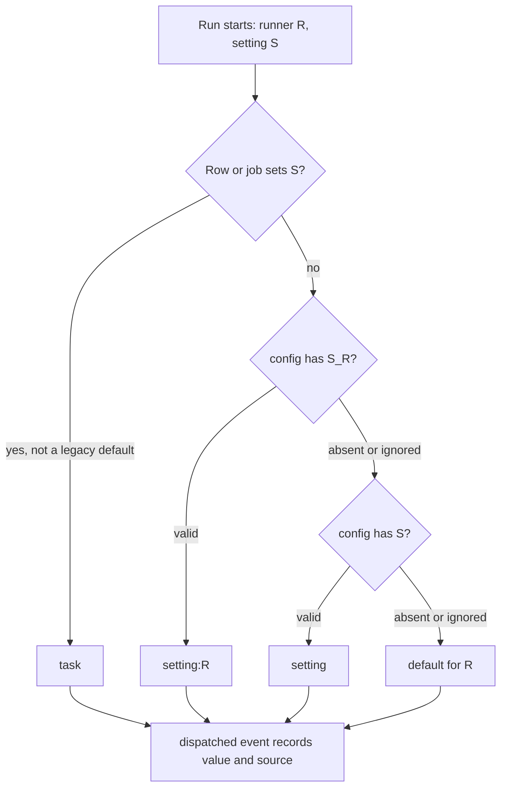
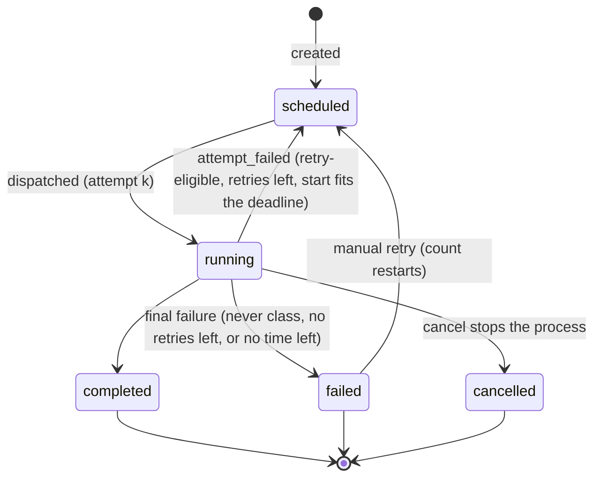
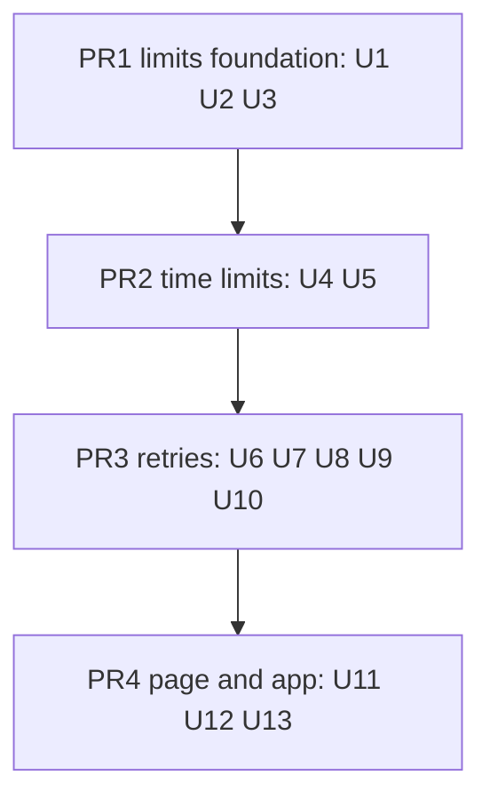

# Configurable Run Limits and Retries (Batch 33) - Plan

## Goal Capsule

- **Objective:** A user decides how long a deferred task or job run may take and how often Tidegap tries it again. Every time limit and retry policy is a setting with a generous default, any time limit can be switched off with `none`, and a failed task, a one-off shell command included, is retried by the policy or by one action on any surface.
- **Means:** four PRs in order (Sequencing).
  - One run-limits registry per core, with shared test vectors, owns names, grammar, defaults and precedence (KTD1-KTD4).
  - Guards land before `none` can be reached: cancel stops a running run, a dead tick's running rows are freed, readiness names a run that holds the tick (KTD5).
  - Runners resolve their limits when a run starts (KTD4).
  - One failure classifier and one retry funnel serve one-off tasks and jobs (KTD6, KTD7, KTD8).
  - Manual retry reaches every surface (KTD9).
- **Authority:** the Product Contract decides what; the Planning Contract decides how; the Settings Reference below is the single source for names, units and defaults. Binding repo rules:
  - `CLAUDE.md` (gate, generated files, hard rules, git conventions, Python parity sentence).
  - `docs/solutions/best-practices/parity-twin-holds-what-it-cannot-run.md` (the Python tick holds and reports what it cannot run).
  - `docs/solutions/logic-errors/compare-and-set-task-transitions.md` (every cross-process write is a compare-and-set through `writeIf`).
  - `docs/solutions/best-practices/grid-region-setting-resolver-and-live-reads.md` and `docs/solutions/best-practices/shared-setup-module-for-cli-and-local-settings-api.md` (a setting in `~/.tidegap/config`, one module for the CLI and the settings API, live reads per surface).
  - `docs/solutions/best-practices/agent-facing-text-is-a-contract.md` and `docs/solutions/tooling-decisions/tool-surface-shared-descriptions.md` (one fact on every surface in the same PR; tool text budgets).
  - `docs/solutions/best-practices/generated-docs-embed-and-drift-rule-with-vacuous-pass-guards.md` (drift rules read built code and fail on empty input).
  - `docs/solutions/developer-experience/deterministic-process-kill-tests.md`, `docs/solutions/logic-errors/sleep-gap-is-not-a-dead-daemon.md`, `docs/solutions/logic-errors/time-of-day-bugs-and-fake-time-sweeps.md`.
  - `docs/solutions/best-practices/loopback-web-ui-hardening.md` and `docs/spec/ui-client-api.md` (route classes, rate limits, the client contract).
  - `docs/solutions/workflow-issues/public-repo-hygiene.md`, `docs/solutions/workflow-issues/generated-test-counts-merge-conflict.md`, `docs/solutions/developer-experience/folding-review-fixes-into-commits.md`.
- **Execution profile:** sequential. One Opus `ce-work` agent per PR in `.worktrees/<branch>`, units in the order listed. A PR starts after the previous one merged (each later PR edits files the earlier one changed). Simplify runs on the code files of each PR and skips markdown. One `ce-code-review` per PR, at its end. The full gate and `pnpm qa` runs are a Haiku job, once per PR; `pnpm qa ui` runs alone. At most three agents at once across the batch. A new worktree needs its own Python venv (`docs/solutions/developer-experience/worktree-environment-setup.md`).
- **Who ships:** each PR ends green, with its review done and the diff reviewed. The agent does not merge. No version bump, release or publish.
- **Stop conditions:** stop and report in these cases:
  - `none` becomes reachable on `main` (a surface accepts it, or the settings file is read for it) before PR1's guards are merged.
  - A failure site cannot reach the retry funnel without a new compare-and-set status beyond `running → scheduled` and `failed → scheduled`.
  - The Python suite cannot read `run-limits-vectors.json`, or a vector passes in one core and fails in the other.
  - A tool text or `SERVER_INSTRUCTIONS` cannot hold its new fact inside its budget. Keep the fact in the parameter text and report the measured length.
  - The OpenClaw runtime adapters cannot take a time limit. Leave `llm_timeout` off the OpenClaw host and report it.
  - A change needs a file outside its PR's unit lists, apart from the generated files.
  - A test or QA step needs the real `HOME`, `~/.tidegap`, `~/.claude` or `~/.config/tidegap`.
  - The same check fails the same way twice.

---

## Product Contract

### Summary

Every timeout and retry value that governs a task or job run becomes a setting. Four settings cover it: the command time limit, the LLM time limit, retries and retry delay. Each has a per-task value, a per-runner and an all-runners entry in `~/.tidegap/config`, and a built-in default, resolved in that order. `none` switches a time limit off. Failed runs of every runner, one-off shell commands included, retry by the policy, and a failed task can be retried by hand from the CLI, MCP, OpenClaw, the plugin, the page and the Mac app.

### Problem Frame

A one-off `command` task (a deploy check script) was stopped at the fixed 5-minute command limit and written `failed`. Nothing could run it again:

- The scheduler retries no one-off failure; every error from the command adapter is a `NonRetryableError` (`packages/cli/src/providers/command.ts:166`, `:197-202`), and a failed one-off stays failed (`packages/core-ts/src/scheduler.ts:2706-2719`).
- `retryTask` refuses command tasks by rule (`scheduler.ts:1909-1914`).
- The UI API has no retry route, `taskActions` has no `retry` key (`packages/core-ts/src/history.ts:183-197`), and the Mac app's Retry buttons only reload data.

The 5-minute limit was not the only fixed number. A `claude-code` one-off stops at a hard-coded 10 minutes (`packages/cli/src/providers/claude-code.ts:116`) with no flag or setting. One-off API calls get no limit from Tidegap at all: the Anthropic and OpenAI SDKs end them at their own 10 minutes, the Node Gemini and Ollama adapters never end them, and the Python twin ends Gemini at 60 seconds and Ollama at 300 (`packages/core-py/src/tidegap/providers/gemini.py:74`, `ollama.py:74`). Jobs retry once after 30 minutes (`packages/core-ts/src/jobs.ts:170`, `:480`), one-off tasks never. The two CLI duration parsers accept different forms (`packages/cli/src/commands/queue-add.ts:124-131`, `packages/cli/src/commands/jobs.ts:120-125`).

The owner's request: remove the limits and make them configurable.

### Requirements

**Limits**

- R1. No time limit or retry value that governs a task or job run stays a constant: each is a setting from the Settings Reference, and each limit the Limits Sweep keeps carries its reason.
- R2. `none` switches a time limit off on every surface. `0` is refused for a duration with an error that names `none`. `retries 0` means no automatic retry.
- R3. One precedence rule on every surface: the task's or job's own value, then the per-runner setting, then the all-runners setting, then the built-in default for the runner (KTD3).
- R4. The built-in defaults are the ones in the Settings Reference.
- R5. Every run shows its effective limits and where each came from: the `dispatched` event, `tidegap queue show`, `check_queue_status`, the job view and the page detail.
- R6. A run with no time limit can be stopped and cannot hide: cancel stops a running run's process, a run a dead tick left `running` is freed, and readiness names a run that has held the tick for more than two tick intervals.

**Retries**

- R7. A failed run of any runner retries automatically when its failure class allows it (HTD, failure classes), its retries are not used up, and the retry starts no later than the deadline.
- R8. A run never retries automatically when it was cancelled, its retries are `0`, its error is permanent, a forced stop interrupted its Batch submit, or it is a job run whose LLM step failed after its command ran.
- R9. Each failed attempt is recorded with its attempt number, failure class, first error line and the next attempt's time. The final failure says how many attempts ran. Notices, the session wake, result files and series successors happen on the final outcome only.
- R10. A failed one-off task, a `command` task included, can be retried by hand with `tidegap queue retry`, MCP and OpenClaw `retry_task`, `/tidegap:retry`, `POST /api/tasks/<id>/retry`, the page and the Mac app. A manual retry starts a new attempt count.

**Surfaces, parity and docs**

- R11. Settings are stored in `~/.tidegap/config`, set with `tidegap limits` and the page's Settings card, and apply on the next tick, request or tool call without a restart.
- R12. Per-task values can be set on `tidegap queue add`, `tidegap jobs add|edit`, MCP and OpenClaw `schedule_task`, `/tidegap:defer`, `POST /api/tasks` and the job form.
- R13. The Python core reads the same keys, honours the LLM time limit and the retry policy for the rows it runs, writes the same events, and refuses what it cannot run with a command that works.
- R14. The Settings Reference is stated once, in `apps/web/content/docs/09-config.md`; every other page, README, skill, command and tool text names only the facts its surface needs and links there; drift rules check the reference and the job-limit claims against the registry.

### Settings Reference

The single source for names, units and defaults. Later units cite rows by name.

| Setting | `~/.tidegap/config` keys | Per-task flag and field | Value | Built-in default | `none` and `0` |
| --- | --- | --- | --- | --- | --- |
| Command time limit | `TIDEGAP_COMMAND_TIMEOUT` | `--command-timeout` (`queue add`, `jobs`); HTTP `command_timeout_s` | duration | `30m` | `none`: no limit. `0`: refused. |
| LLM time limit | `TIDEGAP_LLM_TIMEOUT`, `TIDEGAP_LLM_TIMEOUT_<RUNNER>` | `--llm-timeout`; MCP and OpenClaw `llm_timeout`; HTTP `llm_timeout_s` | duration | `claude-code` `30m`; `anthropic`, `openai`, `gemini`, `ollama` `10m` | `none`: no limit. `0`: refused. |
| Retries | `TIDEGAP_RETRIES`, `TIDEGAP_RETRIES_<RUNNER>` | `--retries`; MCP and OpenClaw `retries`; HTTP `retries` | whole number 0-10 | `1` | `0`: no automatic retry. `none`: refused. |
| Retry delay | `TIDEGAP_RETRY_DELAY`, `TIDEGAP_RETRY_DELAY_<RUNNER>` | `--retry-delay`; MCP and OpenClaw `retry_delay`; HTTP `retry_delay_s` | duration; retry k waits delay × 2^(k−1) | `30m` | Both refused. |

- **Duration:** a number and a unit, `s`, `m` (or `min`), `h` or `d`, case-insensitive (`90s`, `30m`, `1.5h`, `2d`); a bare number is seconds. From 1 second to 7 days. Longer limits use `none`.
- **`<RUNNER>`:** `COMMAND`, `CLAUDE_CODE`, `ANTHROPIC`, `OPENAI`, `GEMINI`, `OLLAMA`. The LLM time limit takes the five model runners; retries and retry delay take all six. A command job's summarize step uses the LLM time limit of its provider.
- **Precedence:** task or job value > `<KEY>_<RUNNER>` > `<KEY>` > built-in default. The source names are `task`, `setting:<runner>`, `setting` and `default`.
- **Machine form:** HTTP JSON carries durations as seconds in `_s` keys, or the string `"none"`; `null` in an input means "use the next layer". The CLI setting names are the flag names: `command-timeout`, `llm-timeout`, `retries`, `retry-delay`.

### Key Decisions

- **Defaults: 30 minutes for local runs, 10 minutes for API calls, one retry after 30 minutes.** Governs R4.
  - Command `30m`: a fetch, build or test of a large repo takes minutes, and 5 did not fit one real check. Thirty minutes still stops a hang within half an hour, and the due sweep is sequential (`scheduler.ts:954-985`), so the limit is also how long one run can hold every other due task.
  - `claude-code` `30m`: a Claude Code run reads files and calls tools, and the per-run budget (1 USD, `TIDEGAP_CLAUDE_CODE_MAX_BUDGET_USD`) already guards spend. The time limit only has to catch a hang, and one number for both local runners is easier to remember.
  - API `10m`: equal to the Anthropic and OpenAI SDKs' own request timeout, so no call changes behaviour; a call that needs longer belongs on the Batch API.
  - Retries `1` after `30m`: the policy command and prompt jobs have had since jobs shipped (`jobs.ts:170`, `:480`). One-off tasks get it too. Thirty minutes outlasts a short provider outage or rate-limit window.
- **One-off `command` tasks retry by default, like command jobs.** The old rule "a shell command runs again only when the user queues it again" (`scheduler.ts:1909-1914`) ends. A run-once command takes `--retries 0`, or the user sets `TIDEGAP_RETRIES_COMMAND=0`. Governs R7, R10.
- **`none` is the one word for "no limit".** Governs R2.
- **A cap stored before this change that equals the old default follows the settings.** Jobs and queued command tasks stored every cap, the defaults included, so on those rows a stored `300000` ms command limit or `600000` ms LLM limit counts as unset. A value a user gives after the change, `5m` included, stays the task's value. Governs R3.
- **Notices on the final outcome only.** A failed attempt that will be retried sends nothing; the page and `queue show` show the pending retry. Governs R9. Open question OQ1.

### Acceptance Examples

- AE1. **Covers R7, R9.** Given a command task with no flags and default settings, its first run stops at the 30-minute limit 3 hours before its deadline. Then the task is `scheduled` again with an `attempt_failed` event (`attempt: 1`, `failure_class: timeout`, `retry_at` 30 minutes after the stop), and the next run plans at the cleanest hour between `retry_at` and the deadline. When the second run also stops, the task is `failed`, its error ends with `(after 2 attempts)`, and exactly one notice goes out.
- AE2. **Covers R2, R5, R6.** Given `TIDEGAP_COMMAND_TIMEOUT=none` in `~/.tidegap/config`, a command task that sleeps forever runs with no timer, and its `dispatched` event records `command_timeout: none` from `setting`. `tidegap queue cancel <id>` stops its process group within 15 seconds, and the next due task runs on the next tick.
- AE3. **Covers R3.** Given `TIDEGAP_LLM_TIMEOUT=20m` and `TIDEGAP_LLM_TIMEOUT_CLAUDE_CODE=1h`: a `claude-code` task queued with `--llm-timeout 5m` gets 5 minutes from `task`; one without the flag gets 1 hour from `setting:claude-code`; an `anthropic` task gets 20 minutes from `setting`. With an empty settings file, the `anthropic` task gets 10 minutes from `default`.
- AE4. **Covers R2.** `tidegap queue add --runner command --command-timeout 0 --by 2h 'make'` exits 2 with an error that says to use `none` for no time limit. A settings file line `TIDEGAP_COMMAND_TIMEOUT=0` is ignored, `tidegap limits` reports it as ignored, and the default applies.
- AE5. **Covers R10.** For a failed `command` task, `tidegap queue retry <id>` writes `scheduled` due now with a `rescheduled` event (`reason: retry`) and prints that the next tick runs it. MCP `retry_task` on the same task answers `scheduled` with the same sentence. The next tick runs it as attempt 1 of a new count.
- AE6. **Covers R7.** A run fails 20 minutes before its deadline with a 30-minute retry delay. The task is `failed` at once, and its error ends with `(no time left before the deadline for a retry)`.
- AE7. **Covers R8.** A command job run whose secret is missing fails once with no `attempt_failed` event; the job counts the failed slot and makes no retry run.
- AE8. **Covers R6, R7.** A tick is killed with SIGKILL during a one-off command run with no time limit. The next tick that takes the tick lock fails the row as interrupted, writes `attempt_failed` with `failure_class: interrupted`, and schedules the retry.
- AE9. **Covers R3.** A job created before this change stored `commandTimeoutMs: 300000`. With `TIDEGAP_COMMAND_TIMEOUT=1h`, its next run gets 1 hour from `setting`.

### Scope Boundaries

- Budgets (`maxBudgetUsd`, `TIDEGAP_CLAUDE_CODE_MAX_BUDGET_USD`, the resume budget) stay as they are: they are spend guards, already configurable, and `none` would remove the only cap on cost.
- Output caps stay per job (`output_cap_bytes`) and are not settings: the tick holds the output in memory, and a cut output is truncated, not failed.
- The in-call retry of `retryWithBackoff` (three waits of 1, 4 and 16 seconds for errors that are safe to send again) stays fixed in both cores; the retry policy is the user-facing layer.
- No change to signed receipts: attempts live in task events, and the receipt describes the run that completed.

#### Deferred to Follow-Up Work

- The Files and Folders (TCC) hint on a silent command timeout whatever path the script names (`command.ts:69-70`, `:198`), with a next step in the failure notice.
- The Mac app Reload that loses the page token (`apps/macos/Tidegap/WebPageWindow.swift:153-164`).
- Moving the budget variables into `~/.tidegap/config` beside the run limits.
- `JOB_AUTO_PAUSE_FAILURES` (3) as a setting.

#### Considered and not built

- **An environment-variable layer over the settings file** (as `TIDEGAP_DEFAULT_REGION` has): it would make four layers where the request asks for three, and the region learning shows a setting loaded into `process.env` looks like an override. Evidence that would change this: a host that cannot read `~/.tidegap/config`.
- **A notice for each failed attempt:** the final notice names the attempt count, and the queue shows a pending retry. Evidence that would change this: the owner wants them (OQ1).
- **An attempt count in the signed receipt:** a receipt format change across both cores and `tidegap verify` for a fact the events already hold.
- **Running a long command beside the tick instead of inside it:** it would remove the reason a long run holds other tasks, but it changes the dispatcher's process model. The readiness line (R6) makes the cost visible instead.

### Open Questions

- OQ1 (deferred, owner): should each failed attempt that will be retried send a notice? The plan sends one notice at the final outcome (KTD10). A yes adds a notice kind and its channel text.
- OQ2 (deferred, owner): should one-off `command` tasks default to `0` retries while every other runner defaults to `1`? The plan uses `1` for all (Key Decisions). A yes changes one registry default, its vectors and the docs.

### Sources / Research

- Retry and failure paths: `scheduler.ts:2706-2719` (dispatch failure), `:1875-1940` (`retryTask`), `:3687-3749` (`retryWithBackoff`, `isRetryable`), `:2111-2127` (`failHeldRuns`), `:2898-2930` (`deferTask`, the `running → scheduled` precedent), `:3253-3274` (`jobDispatchOptions`: only job caps set `timeoutMs`); `jobs.ts:168-183`, `:465-545`, `:630-660`; `history.ts:183-197`.
- Limits: `packages/core-ts/src/types.ts:691-706` (`JobCaps`, `DEFAULT_JOB_CAPS`); `queue-add.ts:46-49`, `:124-131`, `:179`, `:256`; `packages/cli/src/commands/jobs.ts:120-125`, `:205-212`; `packages/cli/src/ui/jobs-api.ts:115-120`, `:377-384`; `packages/cli/ui/job-form.js:22`; `packages/cli/src/index.ts:385`, `:835-836`; `packages/core-ts/src/providers/timeout.ts:14-43`.
- Settings file: `packages/core-ts/src/budget.ts:79-81`, `:276-307` (`~/.tidegap/config`, KEY=VALUE, host-supplied overrides); `packages/cli/src/region.ts:74-129` (`storeRegion` through `setEnvFileKey`); `packages/cli/src/ui/settings.ts` (the settings route and its rate limit).
- Tick model: `scheduler.ts:929-987` (sequential due sweep); `packages/cli/src/commands/tick.ts:508-560` (tick lock, touched every 10 s, stale after 60 s); `packages/core-ts/src/readiness.ts:156-294`.
- Python: `packages/core-py/src/tidegap/scheduler.py:281-370` (backoff), `:1609-1650` (held providers), `:2147-2380` (tick), `:3027-3082` (`retry_task`).
- Prior plan: `docs/plans/2026-10-28-1750-fix-reliability-residuals-plan.md` (R8, R9, KTD4, KTD5: interrupted rows and the Batch submit marker).

---

## Planning Contract

### Limits Sweep

Found: 36 limits that govern a task or job run. Made configurable or removed: 14. Kept: 22.

| # | Limit | Where | Today | Decision |
| --- | --- | --- | --- | --- |
| 1 | `DEFAULT_JOB_CAPS.commandTimeoutMs` | `packages/core-ts/src/types.ts:701` | 300 000 ms | Command time limit |
| 2 | `DEFAULT_COMMAND_TIMEOUT_MS` | `packages/cli/src/commands/queue-add.ts:47` | 5 min | Removed; the flag falls back to the resolver |
| 3 | `MAX_COMMAND_TIMEOUT_MS` | `queue-add.ts:49` | 24 h | Removed; the shared grammar allows up to 7 days or `none` |
| 4 | `DEFAULT_JOB_CAPS.llmTimeoutMs` | `types.ts:702` | 600 000 ms | LLM time limit |
| 5 | `DEFAULT_TIMEOUT_MS` (claude-code) | `packages/cli/src/providers/claude-code.ts:116` | 10 min | LLM time limit, `claude-code` |
| 6 | One-off API call limit | `packages/core-ts/src/scheduler.ts:3257-3260` (set only from job caps) | SDK 10 min (Anthropic, OpenAI); none (Node Gemini, Ollama) | LLM time limit, API runners |
| 7 | Python Gemini `timeout_s` | `packages/core-py/src/tidegap/providers/gemini.py:74` | 60 s | LLM time limit |
| 8 | Python Ollama `timeout_s` | `packages/core-py/src/tidegap/providers/ollama.py:74` | 300 s | LLM time limit |
| 9 | `JOB_RETRY_DELAY_MS` | `packages/core-ts/src/jobs.ts:170` | 30 min | Retry delay |
| 10 | Job retry count (`retryUsed` boolean) | `jobs.ts:480`, `:526-542` | 1 | Retries |
| 11 | One-off retry count | `scheduler.ts:2706-2719` | 0 | Retries |
| 12 | Command-task retry refusal | `scheduler.ts:1909-1914`; Python `scheduler.py:3061-3065` | refused | Removed (Node); Python names `tidegap queue retry` |
| 13 | Job form default caps | `packages/cli/ui/job-form.js:22` | 300 s, 600 s, 1 USD | Read from the server |
| 14 | Help-text defaults | `packages/cli/src/index.ts:385`, `:835-836` | "default 5m", "default 10m" | From the registry |
| 15 | `retryWithBackoff` waits | `scheduler.ts:3700`; Python `scheduler.py:284` | 1, 4, 16 s | Kept: in-call resend of safe errors only |
| 16 | `INTERRUPT_GRACE_MS` | `jobs.ts:182` | 5 min | Kept: margin of the time rule; `none` uses the lock rule (KTD5) |
| 17 | `JOB_AUTO_PAUSE_FAILURES` | `jobs.ts:172` | 3 | Kept: stops a broken schedule, not a run; follow-up |
| 18 | `DEFER_CAP_MS` | `scheduler.ts:3530` | 8 days | Kept: guards a usage-limit deferral loop; every provider window resets within 7 days |
| 19 | `NOT_BEFORE_SPAN_MS` | `scheduler.ts:3528` | 2 h | Kept: planning window after a deferral |
| 20 | `STRANDED_POLL_GRACE_MS` | `scheduler.ts:3526` | 5 min | Kept: Batch poll recovery margin |
| 21 | `LIMIT_FALLBACK_MS`, `LIMIT_FLOOR_MS` | `claude-code.ts:101`, `:103` | 1 h, 5 min | Kept: deferral timing after a usage limit |
| 22 | `KILL_GRACE_MS` | `packages/cli/src/jobs/run-shell.ts:61`; `claude-code.ts:117` | 5 s | Kept: SIGTERM to SIGKILL grace |
| 23 | `FORCED_STOP_GAP_MS`, `PIPE_GRACE_MS` | `run-shell.ts:64`, `:67` | 1 s, 250 ms | Kept: process mechanics |
| 24 | `STDERR_TAIL_BYTES`, timeout stderr caps | `run-shell.ts:70`; `claude-code.ts:120-121` | 4 KiB; 20 lines, 2000 chars | Kept: error text size |
| 25 | `outputCapBytes` | `types.ts:704` | 10 MiB | Kept: tick memory bound; per job already |
| 26 | `summarizeInputCapBytes` | `types.ts:705` | 200 KiB | Kept: model input bound |
| 27 | Budgets | `types.ts:703`; `claude-code.ts:107`, `:109` | 1 USD; resume 3 USD | Kept: spend guards, already configurable |
| 28 | `COMMAND_MAX_CHARS` | `scheduler.ts:3436` | 32 000 | Kept: input size |
| 29 | `MAX_STDIN_BYTES` | `claude-code.ts:115` | 10 MB | Kept: Claude Code's own limit |
| 30 | `LOGIN_SHELL_TIMEOUT_MS` | `packages/cli/src/claude-code.ts:27` | 5 s | Kept: finds `claude`, not a run |
| 31 | `TICK_LOCK_STALE_MS`, touch | `packages/cli/src/commands/tick.ts:509-510` | 60 s, 10 s | Kept: lock liveness |
| 32 | `MAX_TIMER_MS` | `packages/core-ts/src/providers/timeout.ts:14` | 2^31 − 1 ms | Kept: platform timer ceiling; 7 days stays below it |
| 33 | `WAITER_LIMIT_MS`, `WAKE_MARKER_MAX_AGE_MS` | `packages/cli/src/handoff/waiter.ts:48`; `packages/core-ts/src/handoff.ts:445` | 11 h 50 min; 12 h | Kept: session wake, not a run |
| 34 | `NOTIFY_TIMEOUT_MS` | `tick.ts:147` | 5 s | Kept: notifier |
| 35 | Batch threshold | `scheduler.ts:1072` | 24 h | Kept: routing rule |
| 36 | `MAX_HORIZON_HOURS` | `scheduler.ts:130` | 72 h | Kept: forecast horizon |

### Key Technical Decisions

- KTD1. **One registry per core, one set of vectors.** `packages/core-ts/src/run-limits.ts` owns each setting's name, keys, per-runner defaults, the duration grammar, parsing and printing, the settings-file read and the resolver; `packages/core-py/src/tidegap/run_limits.py` mirrors it. `packages/core-ts/test/fixtures/run-limits-vectors.json` drives both suites, as the select-window and transition-guard vectors do. Every surface parses and prints through the registry, and no surface keeps its own default. Each PR adds only the registry entries that its code honours: PR1 the two time limits, PR3 retries and retry delay.
- KTD2. **`none`, and never `0`, means no limit.** `0` already means "no retry" for the count; letting it also mean "unlimited" for a duration would give one character two opposite meanings on one screen. The grammar unifies today's two parsers: number plus optional unit, 1 second to 7 days.
- KTD3. **Settings in `~/.tidegap/config`, read fresh, no environment layer.** Hosts read the file at each tick, request or tool call through the core reader, so a change needs no restart and no cache stamp. An invalid line is ignored, reported once per process on stderr and in `tidegap limits` and the settings API, and the next layer applies (the region rule). The CLI and the settings API write through `setEnvFileKey` from one module, `packages/cli/src/limits.ts`.
- KTD4. **Resolve when the run starts; store only explicit values.** The row's spec `caps` and a job's `caps` keep only the keys the caller set (`commandTimeoutMs`, `llmTimeoutMs`, and from PR3 `retries`, `retryDelayMs`; ms or `"none"`), plus `capsVersion: 2`, which every writer adds from PR2 on. On caps without that marker, a stored `commandTimeoutMs` of 300 000 or `llmTimeoutMs` of 600 000 counts as unset (Key Decisions); on caps with it, every stored value is `task`. The `dispatched` event records each effective value and its source. Rejected: resolving at enqueue, because a queued task would keep a limit the user has since removed.
- KTD5. **`none` is no timer, behind three guards (PR1).** The due sweep runs one row at a time (`scheduler.ts:954-985`), so a hung run with no limit holds every other task, and today a cancel only drops the late result.
  - Cancel stops a running run. While a row is held, the scheduler reads its status at most every 10 seconds and aborts a `signal` in `DispatchOptions` when it is `cancelled`. `runShell` and the Claude Code adapter stop the process group as at a timeout; API adapters abort the request.
  - A dead tick's rows are freed by liveness. Each locked Node tick records a random tick id, its pid and its process start time on its `dispatched` events. A tick that holds the lock fails a `running` row dispatched under another tick id as interrupted (a Batch row with a batch id goes back to `submitted`) only when that process is gone, checked by pid and start time as in `docs/solutions/best-practices/vetting-a-process-by-pid-before-signalling.md`. Holding the lock is not proof enough: after a sleep longer than 60 seconds the old tick's lock looks stale (`TICK_LOCK_STALE_MS`) and a new tick can take it while the old run is still alive. The rule covers one-off rows, which nothing frees today, and job rows, where it replaces the time rule for rows that carry the id; rows without an id keep the time rule.
  - Readiness gains a `long_run` problem when a Node-dispatched row has run for more than two tick intervals. It names the task, how long it has run, its time limit and the cancel command.
- KTD6. **One failure classifier.** `classifyFailure` in the registry module maps an error and its `details` to `timeout`, `exit`, `transient`, `interrupted` (retry-eligible) or `permanent`, `after_command`, `batch_submit_interrupted` (never). Adapters mark permanent errors with `permanent: true` on `NonRetryableError`; `nonRetryable` keeps its in-call meaning, so `retryWithBackoff` is unchanged. An unmarked unknown error is `transient`: one more attempt costs less than a lost task. The HTD table lists the mapping.
- KTD7. **One-off retries reuse the row; job retries stay new rows.**
  - One-off: the funnel writes `running → scheduled` (compare-and-set on `running`, as `deferTask` does) with a new event kind `attempt_failed`. `not_before` becomes the failure time plus delay × 2^(k−1), the window picker plans the cleanest hour up to the unchanged deadline, and the expedited mark is cleared. The attempt count is the number of `attempt_failed` events since the newest `created` event or manual retry. Rejected: a new `attempt` column, which needs a migration in both cores for a fact the events hold. Rejected: a new row per retry, which changes the task id that agents and notices hold.
  - Job: the job sweep keeps its retry row per slot. `retry_used` becomes the number of retries used in the slot (0 to N, same column), and retry ids are `<occurrence>r`, `<occurrence>r2`, and on. The sweep uses the classifier, so a permanent failure no longer gets a retry run.
  - Both: a retry is planned only when its start fits before the deadline; otherwise the failure is final with the reason in the error.
- KTD8. **Command tasks retry like every runner.** This ends the one-off rule in `scheduler.ts:1909-1914` and the command adapter's header comment. `queue add --runner command` prints the effective retry line with its source, so a user sees before the first run that the command may run twice.
- KTD9. **Manual retry: run now where possible, else due on the next tick.** `retryTask` keeps its synchronous path when the caller holds a ready adapter for the task's provider. Otherwise, and always for `command` and `claude-code` rows, `retryLater` writes `failed → scheduled` due now with a `rescheduled` event (`reason: retry`), and the next Node tick runs it. The UI server and `tidegap queue retry` always use `retryLater`, since neither dispatches. A manual retry ignores the deadline, because the user asked for it, and starts a new attempt count. Job runs, rows without a body and rows with the Batch submit marker are still refused.
- KTD10. **`attempt_failed` is not terminal.** It sets no `completed_at`, so session notices, the wake, result files, channel notices and `rollSeries` wait for the final outcome. The final `failed` event carries `attempts` and `failure_class`, and the error gains `(after N attempts)` when N > 1.
- KTD11. **Python parity, scoped to what the Python tick runs.** Python reads the same keys and vectors, gives its four API adapters the LLM time limit (replacing the 60 s and 300 s per-request values), runs the same retry funnel for rows it dispatches and writes `attempt_failed`. Its `retry_task` keeps refusing `command` rows, now naming `tidegap queue retry <id>`, and refuses `claude-code` rows the same way. Cancel-stops-run and the lock rule stay Node-only: Python runs no shell and takes no Node lock.
- KTD12. **HTTP keeps seconds.** JSON keys use the `_s` suffix the job caps already use; `"none"` is the same word; `null` in an input means "use the next layer". The Job view keeps `caps` as effective values and adds `caps_set`, the keys the job sets itself. Rejected: duration strings in JSON, which would break the shipped `Job` contract.
- KTD13. **Every view shows value and source.** `tidegap limits`, `queue show`, `check_queue_status`, the job view, the task detail and the Settings card print the effective value with its source name (Settings Reference).
- KTD14. **The reference is checked.** New drift rule K23 compares the `09-config.md#limits` table with the registry: every setting, key, default and the duration range, with no empty-input pass. K16 reads the time-limit and retry-delay defaults from the registry instead of `DEFAULT_JOB_CAPS` and `JOB_RETRY_DELAY_MS`.

### High-Level Technical Design

Precedence, at run start (KTD3, KTD4):

A one-off task's attempts (KTD7, KTD9, KTD10):

Failure classes (KTD6):

| Source | Example | Class | Retried |
| --- | --- | --- | --- |
| Command or Claude Code run at its time limit | `stopped_by: command_timeout`, `llm_timeout` | `timeout` | yes |
| Command exit or signal | exit 1, exit 127, SIGKILL | `exit` | yes |
| Claude Code exit | non-zero exit, no usage limit | `exit` | yes |
| API call after the in-call retries | 429, 5xx, ECONNREFUSED, ENOTFOUND, EAI_AGAIN, ETIMEDOUT, ECONNRESET | `transient` | yes |
| Batch submit failure, errored or expired Batch result | provider error | `transient` | yes |
| A tick stopped the run | forced stop, lock rule | `interrupted` | yes |
| Refusal or missing setup | refused origin, no command, missing secret, folder or key, summarize provider not set, no ready routing candidate | `permanent` | no |
| Request the provider rejects | 4xx other than 429, content refusal | `permanent` | no |
| Cap that a retry would hit again | `stopped_by: budget`, no window under the carbon budget, the 8-day deferral cap | `permanent` | no |
| Job LLM step after the command ran | summarize failure | `after_command` | no |
| Batch submit cut by a forced stop | `BATCH_SUBMIT_INTERRUPTED_ERROR` | `batch_submit_interrupted` | no |
| Unmarked unknown error | anything else | `transient` | yes |

PR order (Sequencing):

### Assumptions

- AS1. "Remove the limits" means the user can switch any limit off; limits stay on by default with generous values (the brief's interpretation).
- AS2. The retry default is `1` after `30m` for every runner, `command` included (OQ2).
- AS3. Each attempt resolves its limits again, so a settings change between attempts applies to the next attempt.
- AS4. A per-task value may raise a limit above the user's setting, `none` included; that follows the precedence rule, and the R6 guards make such a run stoppable.
- AS5. The 10-second status read during a held run is cheap enough on the shared SQLite ledger; one indexed read per held row.
- AS6. A retry of an API call after `ETIMEDOUT`, `ECONNRESET` or an LLM timeout may bill a second call. Jobs already retry these today; the risk is named in the docs.
- AS7. The Python tick claims a retry-scheduled API row like any due row and counts attempts from the shared events.

### Sequencing

| PR | Branch | Units | Waits on |
| --- | --- | --- | --- |
| PR1 | `feat/limits-foundation` | U1, U2, U3 | none |
| PR2 | `feat/configurable-time-limits` | U4, U5 | PR1, needed before start (U4 uses U1 and U3) |
| PR3 | `feat/automatic-retries` | U6, U7, U8, U9, U10 | PR2, needed before start (the funnel uses the resolved limits) |
| PR4 | `feat/limits-ui-and-app` | U11, U12, U13 | PR3, needed before start (the route calls `retryLater`) |

- Safe after every merge: after PR1 nothing reads a run-limit setting yet, and cancel and liveness are fixes on their own. PR2 makes `none` reachable with PR1's guards already live. PR3 retries with the funnel, the classifier and every agent text in one PR. PR4 adds the page and app surfaces of what is already live. `taskActions.retry` lands in PR4 with its route, so no client sees a `retry` action without a route behind it.
- Splits allowed inside the plan: U3 can ship as its own PR before U1 and U2 if it adds no export to `packages/core-ts/src/index.ts`. U13 (Mac app) can ship as its own PR after PR4 merges, merge order only, because the app hides Retry when `actions.retry` is absent. U9 (Python retries) never splits from U7: a Node-only funnel would leave Python-dispatched rows on the old rule with no signal. U5 never splits from U4: every surface states the new defaults in the PR that changes them.
- Generated files are the one shared set; each PR runs `pnpm gen:tests` and `pnpm gen:docs`, and a conflict takes `main`'s version and reruns the generator.
- Parity line for each PR body: PR1 adds the Python registry in step; PR2 changes the Python adapters' time limits in step; PR3 changes the Python tick's failure path in step; PR4 changes no core.

### Risks

| Risk | Mitigation |
| --- | --- |
| A long run, now allowed by default (30 minutes) or by `none`, holds every other due task | `long_run` readiness problem; cancel stops the run (KTD5); the docs state it next to the setting |
| A one-off command runs twice | `queue add` prints the retry line; `--retries 0` and `TIDEGAP_RETRIES_COMMAND=0`; OQ2 |
| A retried API call is billed twice | AS6; classes and docs name it; the deadline bounds the count |
| The lock rule frees a live row | A row is freed only when its dispatching process is gone, checked by pid and start time; a stale-looking lock after a sleep does not count (KTD5); tests with a live and a dead foreign tick |
| A failure site is missed by the funnel and stays on the old rule | U7 lists each `failed` write; a test per site class; the stop condition |
| Two cores drift | One vectors file for parse, resolve, classify and retry planning |
| A job edited in the page pins the old defaults | PR2 changes the job form to send only typed caps (U5) |

---

## Implementation Units

| U-ID | Title | Key files | Depends on |
| --- | --- | --- | --- |
| U1 | Run-limits registry, Node | `packages/core-ts/src/run-limits.ts` | none |
| U2 | Run-limits registry, Python | `packages/core-py/src/tidegap/run_limits.py` | U1 |
| U3 | Guards for runs without a limit | `scheduler.ts`, `jobs.ts`, `readiness.ts`, `run-shell.ts`, `tick.ts` | none |
| U4 | Runners use resolved time limits | `scheduler.ts`, `command.ts`, `claude-code.ts`, providers, Python providers | U1, U2, U3 |
| U5 | Time-limit surfaces and docs | `queue-add.ts`, `commands/limits.ts`, `jobs-api.ts`, `tool-surface.ts`, `09-config.md` | U4 |
| U6 | Retry settings and the classifier | `run-limits.ts`, `run_limits.py`, vectors | U4 |
| U7 | Automatic retries, Node | `scheduler.ts`, `jobs.ts`, `task-events.ts`, adapters | U6 |
| U8 | Manual retry and `queue retry` | `scheduler.ts`, `commands/queue.ts`, `index.ts` | U7 |
| U9 | Automatic retries, Python | `packages/core-py/src/tidegap/scheduler.py` | U6, U7 |
| U10 | Retry surfaces and docs | `tool-surface.ts`, `server.ts`, plugin, docs | U7, U8, U9 |
| U11 | UI API and spec | `packages/cli/src/ui/*.ts`, `history.ts`, `docs/spec/ui-client-api.md` | U8 |
| U12 | Page | `packages/cli/ui/*.js` | U11 |
| U13 | Mac app | `apps/macos/TidegapKit`, `apps/macos/Tidegap` | U11 |

### PR1: `feat/limits-foundation`

Waits on: none.

### U1. Run-limits registry, Node

- **Goal:** the single Node source for the two time limits: names, keys, defaults, grammar, settings read and precedence.
- **Requirements:** R1, R2, R3, R4; KTD1-KTD4.
- **Dependencies:** none.
- **Files:** `packages/core-ts/src/run-limits.ts` (new), `packages/core-ts/src/index.ts`, `packages/core-ts/test/run-limits.test.ts` (new), `packages/core-ts/test/fixtures/run-limits-vectors.json` (new).
- **Approach:**
  1. Registry entries `command_timeout` and `llm_timeout` with keys, per-runner defaults and CLI names from the Settings Reference.
  2. `parseDuration` and `formatDuration` for the grammar (KTD2); errors are fixed sentences that name `none`.
  3. A settings read of `~/.tidegap/config` through `parseKeyValues` and `carbonBudgetConfigPath`, returning values and an `ignored` list with each bad key and its reason. The core reads no environment.
  4. `resolveRunLimits(rowCaps, settings, runner)` returns each value with its source, applying the legacy-default rule only to caps without `capsVersion: 2` (KTD4).
  5. The vectors file has `parse`, `resolve` and `legacy` sections, which the Node and Python tests both read.
- **Patterns to follow:** `packages/core-ts/src/budget.ts` (`loadCarbonBudgetConfig`), `packages/core-ts/src/region.ts` (`resolveRegion` and its `source` names), `packages/core-ts/test/fixtures/select-window-vectors.json`.
- **Test scenarios:**
  - Vectors: `90s`, `30m`, `30min`, `1.5h`, `2d`, `300` and `NONE` parse; `0`, `0s`, `-5m`, `8d`, `5x` and the empty string fail with the sentence for each.
  - Resolve: the four sources of AE3, in each order of presence.
  - A key with a runner suffix that the setting does not take (`TIDEGAP_LLM_TIMEOUT_COMMAND`) is ignored and reported.
  - A file with an invalid line keeps every valid line.
  - A missing or unreadable file gives the defaults and no throw.
  - Legacy: on caps without `capsVersion`, `commandTimeoutMs: 300000` and `llmTimeoutMs: 600000` resolve from the next layer and `300001` stays `task`; on caps with `capsVersion: 2`, `300000` stays `task`.
  - Environment purity: the module reads no `process.env` (`environment-purity.test.ts` covers the package).
- **Verification:** every vector passes; `formatDuration(parseDuration(x))` round-trips each valid vector to its canonical form.

### U2. Run-limits registry, Python

- **Goal:** the Python twin of U1, proven by the same vectors.
- **Requirements:** R13; KTD1, KTD11.
- **Dependencies:** U1.
- **Files:** `packages/core-py/src/tidegap/run_limits.py` (new), `packages/core-py/src/tidegap/__init__.py`, `packages/core-py/tests/test_run_limits.py` (new), `packages/core-py/README.md`.
- **Approach:** port the grammar, the settings read (through `carbon_budget_config_path` and `_parse_key_values` in `budget.py`), the resolver and the legacy rule. The test loads `packages/core-ts/test/fixtures/run-limits-vectors.json` as the existing parity tests do. The README gets one line on the shared keys and a link to the reference.
- **Patterns to follow:** `packages/core-py/tests/test_select_window.py` (fixture path), `packages/core-py/src/tidegap/budget.py`.
- **Test scenarios:**
  - Every `parse`, `resolve` and `legacy` vector gives the same result as in Node.
  - A config file with an invalid line logs one warning and keeps the valid lines.
- **Verification:** `pytest` and `ruff` pass in the worktree venv.

### U3. Guards for runs without a limit

- **Goal:** a running run can be stopped by cancel, a dead tick's running rows are freed, and a long run shows in readiness (R6).
- **Requirements:** R6; KTD5.
- **Dependencies:** none.
- **Files:** `packages/core-ts/src/scheduler.ts` (`holding`, `dispatchProviderCall`, a stranded-running sweep, scheduler options for the tick id), `packages/core-ts/src/providers/base.ts` (`signal` in `DispatchOptions`), `packages/core-ts/src/providers/timeout.ts` (join the caller's signal), `packages/core-ts/src/jobs.ts` (`interrupted`), `packages/core-ts/src/readiness.ts`, `packages/core-ts/src/tool-surface.ts` (`cancel_task`: a cancel stops a running command or Claude Code run), `packages/cli/src/jobs/run-shell.ts`, `packages/cli/src/providers/command.ts`, `packages/cli/src/providers/claude-code.ts`, `packages/cli/src/commands/tick.ts`, `packages/cli/src/readiness.ts`, `packages/core-ts/test/scheduler.test.ts`, `packages/core-ts/test/tool-surface.test.ts`, `packages/core-ts/test/jobs-sweep.test.ts`, `packages/core-ts/test/readiness.test.ts`, `packages/cli/test/jobs-runner.test.ts`, `packages/cli/test/claude-code-adapter.test.ts`, `packages/cli/test/tick.test.ts`, `packages/cli/test/readiness.test.ts`, `apps/web/content/docs/10-jobs.md`, `apps/web/content/docs/04-tools.md`, `CHANGELOG.md`.
- **Approach:**
  1. The status watcher and the `signal` (KTD5). A stopped run returns as cancelled; the scheduler keeps today's late-result drop and adds `stopped_run: true` to the details of the existing `cancelled` event.
  2. `runTickOnce` makes a tick id per locked tick, and the scheduler writes it with the tick's pid and process start time as `tick` details on `dispatched` events, only when it runs under the lock.
  3. The stranded-running sweep runs in a locked tick before the due sweep, compare-and-set on `running`. It frees a row only when the recorded process is gone (KTD5). One-off and job rows use the same rule; `interrupted()` checks the tick details first and keeps its time rule for rows without them.
  4. Readiness `long_run`: the host passes the oldest Node-dispatched `running` row and its start; core decides against two tick intervals (`DAEMON_INTERVAL_S` or the no-daemon interval).
  5. Docs: the forced-stop and stranded-row bullets of `10-jobs.md` (lines 47-48) and the cancel row of `04-tools.md` say that a cancel stops the run and that a locked tick frees a dead tick's rows. The `cancel_task` text gets the same fact inside its budget. CHANGELOG under `[Unreleased]`.
- **Execution note:** write the process tests first, following `deterministic-process-kill-tests.md`: a real child, a fake clock only where the test controls time.
- **Patterns to follow:** `failHeldRuns` (`scheduler.ts:2111-2127`) for the interrupted write; `freeStrandedPolls` (`scheduler.ts:1121-1150`) for a sweep that skips a row it cannot write; `docs/solutions/best-practices/vetting-a-process-by-pid-before-signalling.md`.
- **Test scenarios:**
  - A command run that sleeps is cancelled from another scheduler on the same ledger; its process group is gone within 15 seconds, the row stays `cancelled`, the next due row is dispatched.
  - A Claude Code run is cancelled the same way (fake binary that sleeps).
  - An API adapter call with a signal that aborts rejects at once; the row stays `cancelled`.
  - A `running` one-off row whose `dispatched` event carries another tick id and a pid that no longer runs is failed as interrupted by a locked tick; a row with this tick's id is left alone; a row with no tick id is left alone.
  - A row of another tick whose process still runs (a stale-looking lock after a sleep, simulated with an old lock mtime and a live child pid) is left alone, and its run is not started twice.
  - A recorded pid that now belongs to another process (start time differs) counts as gone.
  - The same for a job row, with no wait for the job's caps; a job row with a batch id goes back to `submitted`.
  - A row dispatched by the MCP server (no tick id) is never freed by the lock rule.
  - Readiness: a row running for 11 minutes under a 300 s daemon gives `long_run` with the task id; 9 minutes gives none; no row gives none.
- **Verification:** AE2's cancel half holds in a test; `tidegap status` prints the `long_run` line in a CLI test.

### PR2: `feat/configurable-time-limits`

Waits on: PR1, needed before start.

### U4. Runners use resolved time limits

- **Goal:** every run gets its time limits from the resolver when it starts, and `none` runs with no timer.
- **Requirements:** R1-R5, R13; KTD3, KTD4, KTD11.
- **Dependencies:** U1, U2, U3.
- **Files:** `packages/core-ts/src/scheduler.ts` (`jobDispatchOptions`, the `dispatched` event, `enqueueCommandTask`, a `limits` reader option), `packages/core-ts/src/jobs.ts` (`validCaps`, materialized caps, the interrupt time rule), `packages/core-ts/src/types.ts` (`JobCaps` time keys become optional `number | "none"`, `DEFAULT_JOB_CAPS` keeps the budget and output caps), `packages/core-ts/src/storage/sqlite.ts` (job caps read keeps only stored keys), `packages/core-ts/src/providers/timeout.ts` (`none` sends the longest timer the SDKs take), `packages/cli/src/providers/command.ts`, `packages/cli/src/providers/claude-code.ts` (no `DEFAULT_TIMEOUT_MS`), `packages/cli/src/jobs/run-shell.ts` (no timer for `none`), `packages/cli/src/commands/tick.ts`, `packages/mcp-server/src/server.ts` and `packages/openclaw-plugin/src/index.ts` (pass the reader to their schedulers), `packages/openclaw-plugin/src/dispatch.ts` (wrap runtime calls in `withLlmTimeout`), `packages/core-py/src/tidegap/providers/gemini.py`, `packages/core-py/src/tidegap/providers/ollama.py`, `packages/core-py/src/tidegap/providers/anthropic.py`, `packages/core-py/src/tidegap/providers/openai.py`, `packages/core-py/src/tidegap/scheduler.py` (pass the limit per dispatch), tests: `packages/core-ts/test/job-dispatch.test.ts`, `packages/core-ts/test/jobs-store.test.ts`, `packages/core-ts/test/providers.test.ts`, `packages/core-ts/test/providers-gemini-ollama.test.ts`, `packages/core-ts/test/handoff-enqueue.test.ts`, `packages/cli/test/jobs-runner.test.ts`, `packages/cli/test/claude-code-adapter.test.ts`, `packages/cli/test/tick-claude-code.test.ts`, `packages/openclaw-plugin/test/plugin.test.ts`, `packages/core-py/tests/test_providers.py`, `packages/core-py/tests/test_providers_gemini_ollama.py`, `packages/core-py/tests/test_tick.py`.
- **Approach:**
  1. Hosts read settings fresh per tick or call and hand the scheduler a reader (KTD3); the scheduler resolves per run and passes `timeoutMs` to every adapter, one-off API calls included.
  2. The `dispatched` event gains `limits` with each effective value (seconds or `none`) and its source.
  3. `enqueueCommandTask`, `enqueueProviderCall` and the job create and edit paths store only the caps the caller set, with `capsVersion: 2` (KTD4).
  4. The job interrupt time rule uses the limits recorded on the run's `dispatched` event; when either is `none`, only the U3 lock rule frees the row.
  5. Python adapters take the limit per dispatch, with `None` for `none`; the constructor values become the fallback for direct library use only.
- **Patterns to follow:** `withLlmTimeout` (`timeout.ts:22-43`); `jobDispatchOptions` (`scheduler.ts:3253-3274`); the region reader handed to hosts in `packages/core-ts/src/region-host.ts`.
- **Test scenarios:**
  - A command one-off with no caps and no settings stops at 30 minutes (fake timer at the `runShell` seam); with `TIDEGAP_COMMAND_TIMEOUT=2m` at 2 minutes; with `none` no timer is set.
  - A `claude-code` one-off gets 30 minutes; with `TIDEGAP_LLM_TIMEOUT_CLAUDE_CODE=none` no timer.
  - An `anthropic` one-off now gets `timeoutMs` 600 000; a Gemini one-off gets a limit for the first time.
  - Covers AE3: the four sources, read from the `dispatched` event.
  - Covers AE9: a job row stored with `commandTimeoutMs: 300000` and no `capsVersion` follows `TIDEGAP_COMMAND_TIMEOUT=1h`.
  - A task queued after the change with `--command-timeout 5m` keeps 5 minutes from `task` under the same setting.
  - A settings change between two ticks applies to the second run with no restart.
  - Job interrupt rule: with limits 30 and 10 minutes recorded, a row older than 45 minutes of awake time is freed; with `none`, a row older than a day is not freed by time.
  - OpenClaw: a runtime call that never answers rejects at its LLM limit.
  - Python: a Gemini call gets 600 s instead of 60 s; `none` passes `None`; a settings file read gives the same values as Node for the AE3 vectors.
- **Verification:** core, CLI, MCP, OpenClaw and Python suites pass; no source file outside the registry holds 300 000, 600 000 or 10 × 60 × 1000 as a run limit.

### U5. Time-limit surfaces and docs

- **Goal:** users and agents set and read the two time limits everywhere, in one spelling, and the docs state them once.
- **Requirements:** R2, R5, R11, R12, R14; KTD2, KTD3, KTD12-KTD14.
- **Dependencies:** U4.
- **Files:** `packages/cli/src/limits.ts` (new, shared with U11), `packages/cli/src/commands/limits.ts` (new), `packages/cli/src/index.ts` (`limits` group, help defaults from the registry, `--llm-timeout` on `queue add`), `packages/cli/src/commands/queue-add.ts`, `packages/cli/src/commands/jobs.ts` (`parseDurationSeconds` replaced by the core parser), `packages/cli/src/commands/queue.ts` (`queue show` limits lines), `packages/cli/src/ui/jobs-api.ts` (cap keys take `"none"` and `null`, `caps_set`), `packages/cli/ui/job-form.js` (send only typed caps; placeholders show the effective value), `packages/core-ts/src/tool-surface.ts` (`schedule_task` `llm_timeout`), `packages/mcp-server/src/server.ts`, `packages/openclaw-plugin/src/index.ts`, `packages/openclaw-plugin/src/tool-schemas.ts`, `packages/claude-code-plugin/commands/defer.md`, `packages/claude-code-plugin/skills/tidegap/SKILL.md`, `docs/spec/ui-client-api.md` (Job caps and `JobInput` caps), `apps/web/content/docs/09-config.md` (new `### Run limits {#limits}` with the reference table), `apps/web/content/docs/03-cli.md`, `apps/web/content/docs/10-jobs.md`, `apps/web/content/docs/12-handoff.md`, `apps/web/content/docs/04-tools.md`, `packages/cli/README.md`, `packages/mcp-server/README.md`, `packages/openclaw-plugin/README.md`, `packages/claude-code-plugin/README.md`, `scripts/qa/docs-drift.mjs`, `scripts/qa/docs-drift-jobs.mjs`, `scripts/qa/docs-drift-jobs.test.mjs`, `scripts/qa/cli-flows.mjs`, `scripts/qa/mcp-tools.mjs`, `CHANGELOG.md`, tests: `packages/cli/test/queue-add.test.ts`, `packages/cli/test/jobs-cli.test.ts`, `packages/cli/test/queue.test.ts`, `packages/cli/test/limits-command.test.ts` (new), `packages/cli/test/ui-jobs-api.test.ts`, `packages/cli/test/ui-job-form.test.ts`, `packages/core-ts/test/tool-surface.test.ts`, `packages/mcp-server/test/server.smoke.test.ts`, `packages/mcp-server/test/server.jobs.test.ts`, `packages/mcp-server/test/server.task-events.test.ts`, `packages/openclaw-plugin/test/tool-surface-derivation.test.ts`, `packages/openclaw-plugin/test/plugin.test.ts`.
- **Approach:**
  1. `tidegap limits` prints every setting per runner with value and source and lists ignored lines; `tidegap limits set <name> <value> [--runner <r>]` and `tidegap limits reset <name> [--runner <r>]` write through `packages/cli/src/limits.ts`. Names are the CLI names in the Settings Reference; the PR2 registry offers only the two time limits.
  2. `set ... none` prints one line: the run holds other due tasks while it runs, and `tidegap queue cancel <id>` stops it.
  3. `queue add` and `jobs` flags parse through the core grammar; `queue add` prints `time limit: 30 min (default)` or the source that applies now.
  4. MCP and OpenClaw `schedule_task` take `llm_timeout` (string, the grammar), for one-offs and jobs; a parse error names the grammar and `none`. `check_queue_status` with a `task_id` returns each time limit with its source, read from the task's `dispatched` event or, before its first run, resolved now (R5, KTD13).
  5. Docs: the reference section owns the table; `10-jobs.md` keeps its K16 sentences with the new values and links to it; `12-handoff.md` line 21 and `03-cli.md` line 34 name the flags and link there.
  6. K16 reads defaults from the registry; K23 checks the reference table (KTD14), with a one-time failure run recorded in the PR.
- **Patterns to follow:** `packages/cli/src/commands/region.ts` and `packages/cli/src/region.ts` (show, set, reset over one module); `docs/solutions/tooling-decisions/tool-surface-shared-descriptions.md` (text budgets); K20 and K21 in `scripts/qa/docs-drift.mjs` (a docs list of a code constant).
- **Test scenarios:**
  - Covers AE4: `--command-timeout 0` exits 2 with the `none` sentence; `--command-timeout none` stores `"none"`; `--command-timeout 8d` exits 2.
  - `tidegap limits set llm-timeout 1h --runner claude-code` writes `TIDEGAP_LLM_TIMEOUT_CLAUDE_CODE=1h` and keeps every other line of the file byte for byte.
  - `tidegap limits reset command-timeout` removes the key; `tidegap limits` then shows `30m (default)`.
  - `tidegap limits` lists `TIDEGAP_COMMAND_TIMEOUT=0` as ignored with its reason.
  - `jobs add --llm-timeout none` stores `"none"`; `jobs edit` with no cap flag leaves `caps_set` unchanged.
  - Job form: creating a job without touching caps sends no `caps`; the form shows the effective values from the server.
  - `schedule_task` with `llm_timeout: "45m"` stores 2 700 000 ms; with `"0"` it is rejected with the sentence.
  - `check_queue_status` for that task shows `llm_timeout` 45 minutes from `task`; for a task with no value, the current setting or default with its source.
  - K23 fails when a reference row's default differs from the registry, and when the table is missing.
- **Verification:** the gate passes; `pnpm qa cli`, `pnpm qa mcp` and `pnpm qa docs` pass once; `pnpm qa ui` passes alone for the job form.

### PR3: `feat/automatic-retries`

Waits on: PR2, needed before start.

### U6. Retry settings and the classifier

- **Goal:** `retries` and `retry_delay` join both registries, with the classifier and the retry planner, proven by shared vectors.
- **Requirements:** R1, R4, R7, R8, R13; KTD1, KTD6, KTD7.
- **Dependencies:** U4.
- **Files:** `packages/core-ts/src/run-limits.ts`, `packages/core-ts/src/providers/base.ts` (`permanent` on `NonRetryableError`), `packages/core-ts/test/run-limits.test.ts`, `packages/core-ts/test/fixtures/run-limits-vectors.json`, `packages/core-py/src/tidegap/run_limits.py`, `packages/core-py/src/tidegap/errors.py`, `packages/core-py/tests/test_run_limits.py`.
- **Approach:**
  1. Registry entries `retries` (0-10) and `retry_delay` (duration) with the Settings Reference defaults.
  2. `classifyFailure` per the HTD table, over a plain error description (status, code, `stopped_by`, `permanent`, marker text) so both cores share vectors.
  3. `planRetry(attempt, retries, delay, failedAt, deadline, notBefore)` returns a retry start or the final reason (`no retries left`, `no time left before the deadline for a retry`).
- **Test scenarios:**
  - Classify vectors, one per HTD row, in both cores.
  - Plan vectors: attempt 1 of 1 at delay 30m gives failure + 30 min; attempt 2 of 3 gives failure + 60 min; covers AE6; a user `not_before` later than the retry start wins.
  - `retries 11`, `retries -1`, `retries none` and `retry-delay 0` are rejected with their sentences.
- **Verification:** the vectors pass in both cores.

### U7. Automatic retries, Node

- **Goal:** every failure write goes through one funnel that retries or fails by the policy, for one-off tasks and job runs.
- **Requirements:** R7, R8, R9; KTD6-KTD8, KTD10.
- **Dependencies:** U6.
- **Files:** `packages/core-ts/src/scheduler.ts`, `packages/core-ts/src/jobs.ts`, `packages/core-ts/src/task-events.ts` (`attempt_failed`), `packages/core-ts/src/storage/sqlite.ts` (`retry_used` as a count), `packages/core-ts/src/types.ts` (`retryUsed` becomes a number), `packages/cli/src/providers/command.ts` and `packages/cli/src/providers/claude-code.ts` (mark permanent errors), `packages/core-ts/src/providers/anthropic.ts`, `openai.ts`, `gemini.ts`, `ollama.ts` (mark 4xx and refusals), `packages/core-ts/test/fixtures/task-transition-guards.json` (a `retry` write entry accepting `running`), `packages/core-ts/test/scheduler.test.ts`, `packages/core-ts/test/jobs-sweep.test.ts`, `packages/core-ts/test/batch.test.ts`, `packages/core-ts/test/series.test.ts`, `packages/core-ts/test/session-notices.test.ts`, `packages/core-ts/test/task-transition-guards.test.ts`, `packages/cli/test/jobs-runner.test.ts`, `packages/cli/test/handoff-wake.test.ts`, `packages/cli/test/handoff-results.test.ts`.
- **Approach:**
  1. One funnel replaces each `failed` write of a provider-call row: the dispatch failure (`scheduler.ts:2706-2719`), the Batch submit failure (`:3017-3023`), the Batch poll failures, the pre-dispatch refusals (`:2595-2646`, permanent), the deferral cap (`:2903-2909`, permanent), `failHeldRuns` (`:2111-2127`) and the U3 lock sweep (interrupted).
  2. For a one-off it either writes `running → scheduled` with `attempt_failed` and plans the window (KTD7), or writes the final failure; `rollSeries` moves into the final branch.
  3. The job sweep counts retries per slot, uses the classifier and the job's or the settings' retry values, and builds the next retry id.
  4. The final failure adds `attempts` and `failure_class` to the `failed` event and `(after N attempts)` to the error.
  5. Adapters mark the permanent causes of the HTD table; anything unmarked stays `transient`.
- **Execution note:** pin today's behaviour first: a test that a first failure of a one-off is final with `retries 0`, and that a job's single retry still happens at 30 minutes, then change the funnel.
- **Patterns to follow:** `deferTask` (`scheduler.ts:2898-2930`); the job successor decision (`jobs.ts:465-545`); `docs/solutions/logic-errors/repeat-series-and-replies.md` for `rollSeries`.
- **Test scenarios:**
  - Covers AE1: two timeouts give one `attempt_failed`, one final `failed` with `(after 2 attempts)`, one channel notice, one wake, one result file.
  - Covers AE7: a missing secret is final at once; the job makes no retry run.
  - Covers AE8: the lock sweep writes `attempt_failed` with `interrupted` and plans the retry.
  - A 429 after the in-call retries, a Batch result that expired and a non-zero Claude Code exit each retry once.
  - A content refusal, a 401 and a budget stop never retry.
  - A repeating one-off rolls its series once, at the final outcome.
  - A cancel between attempts ends the task `cancelled` with no further attempt.
  - Run now on a retry-scheduled row runs it now and counts the attempt.
  - Jobs: `retries 3` gives retry rows `r`, `r2`, `r3`, then the slot fails; a legacy job row with `retry_used = 1` reads as one retry used.
  - A retry row of a job with `--retries 0` is never made.
  - Transition guards: the `retry` write accepts only `running`; a row cancelled during the call keeps `cancelled`.
- **Verification:** core and CLI suites pass; `grep` finds no `status: "failed"` write of a provider-call row outside the funnel.

### U8. Manual retry and `queue retry`

- **Goal:** a failed one-off task, a command task included, can be retried from the CLI and every agent tool (R10).
- **Requirements:** R10; KTD9.
- **Dependencies:** U7.
- **Files:** `packages/core-ts/src/scheduler.ts` (`retryTask`, `retryLater`), `packages/cli/src/commands/queue.ts`, `packages/cli/src/index.ts` (`queue retry <task-id>`), `packages/mcp-server/src/server.ts` (`retry_task` handler: command and `claude-code` rows go to `retryLater`), `packages/openclaw-plugin/src/index.ts`, `packages/core-ts/test/scheduler.test.ts`, `packages/core-ts/test/task-transition-guards.test.ts`, `packages/core-ts/test/fixtures/task-transition-guards.json` (`retry_later` action accepting `failed`), `packages/cli/test/queue.test.ts`, `packages/mcp-server/test/server.smoke.test.ts`, `packages/openclaw-plugin/test/plugin.test.ts`.
- **Approach:** `retryLater` writes `failed → scheduled`, `scheduled_for` now, `not_before` cleared, with `rescheduled` (`reason: retry`, actor); `retryTask` routes to it when the caller has no ready adapter. The refusals for job runs, closure rows and the Batch submit marker stay, in that order. `queue retry` prints the id, `scheduled` and "the next tick runs it".
- **Test scenarios:**
  - Covers AE5 on the CLI and MCP paths.
  - A failed `anthropic` row with a key in the MCP env still runs at once and answers `completed` or `failed`.
  - A failed row whose deadline passed is retried and runs; its result is `late`.
  - A job run, a closure row and a Batch-submit-marker row are refused with today's sentences.
  - Two `queue retry` calls race: one wins, the other gets the "just claimed" refusal.
  - A manual retry after two attempts starts at attempt 1 (count reset).
- **Verification:** AE5 holds; the transition-guard fixture passes in both cores.

### U9. Automatic retries, Python

- **Goal:** the Python tick follows the same policy for the rows it runs (R13).
- **Requirements:** R7-R9, R13; KTD7, KTD10, KTD11.
- **Dependencies:** U6, U7.
- **Files:** `packages/core-py/src/tidegap/scheduler.py` (failure funnel, `attempt_failed`, attempt count from events, `retry_task` refusals), `packages/core-py/src/tidegap/providers/anthropic.py`, `openai.py`, `gemini.py`, `ollama.py` (mark permanent errors), `packages/core-py/tests/test_tick.py`, `packages/core-py/tests/test_scheduler.py`, `packages/core-py/tests/test_task_events.py`, `packages/core-py/tests/test_task_transitions.py`, `packages/core-py/tests/test_batch.py`, `packages/core-py/README.md`.
- **Approach:** port the funnel for the Python failure sites (sync dispatch, Batch submit, Batch poll); the attempt count and the plan come from `run_limits.py`; `_TERMINAL_EVENT_KINDS` stays as it is, so `attempt_failed` is not terminal. `retry_task` refuses `command` and `claude-code` rows with `tidegap queue retry <id>`.
- **Test scenarios:**
  - A 503 after the in-call waits gives `attempt_failed` and a `scheduled` row with the same `not_before` Node would plan (vector).
  - A row that Node retry-scheduled is claimed by the Python tick and its attempt counts as 2.
  - A 401 fails at once.
  - `retry_task` on a command row raises with the `tidegap queue retry` command in the message.
- **Verification:** `pytest` and `ruff` pass; the core-py README section "Jobs run on the Node daemon" still holds.

### U10. Retry surfaces and docs

- **Goal:** retry values can be set and read on every surface, and every agent text states the new retry facts in this PR.
- **Requirements:** R5, R9-R12, R14; KTD12-KTD14.
- **Dependencies:** U7, U8, U9.
- **Files:** `packages/cli/src/commands/queue-add.ts` and `packages/cli/src/commands/jobs.ts` (`--retries`, `--retry-delay`; the command retry line), `packages/cli/src/commands/queue.ts` (attempt lines in `queue show`), `packages/cli/src/limits.ts` (retry names), `packages/cli/src/ui/jobs-api.ts` (`retries`, `retry_delay_s` caps), `packages/core-ts/src/tool-surface.ts` (`schedule_task` `retries`, `retry_delay`; `retry_task` description: command tasks accepted, `claude-code` and command tasks run on the next tick), `packages/mcp-server/src/server.ts` (`SERVER_INSTRUCTIONS` retry fact; `check_queue_status` attempts), `packages/openclaw-plugin/src/index.ts`, `packages/openclaw-plugin/src/tool-schemas.ts`, `packages/claude-code-plugin/commands/retry.md`, `packages/claude-code-plugin/commands/defer.md`, `packages/claude-code-plugin/skills/tidegap/SKILL.md` (lines 185-190: the command rule now names retries), `docs/spec/ui-client-api.md` (event kind `attempt_failed` and its details keys), `apps/web/content/docs/09-config.md` (retry rows), `apps/web/content/docs/10-jobs.md` (line 68), `apps/web/content/docs/12-handoff.md` (ledger event kinds, K19), `apps/web/content/docs/03-cli.md` (line 21 and the `queue retry` row), `apps/web/content/docs/04-tools.md`, `packages/cli/README.md`, `packages/mcp-server/README.md`, `packages/openclaw-plugin/README.md`, `packages/claude-code-plugin/README.md`, `scripts/qa/docs-drift.mjs`, `scripts/qa/docs-drift-jobs.mjs`, `scripts/qa/cli-flows.mjs`, `scripts/qa/mcp-tools.mjs`, `CHANGELOG.md`, tests: `packages/cli/test/queue-add.test.ts`, `packages/cli/test/jobs-cli.test.ts`, `packages/cli/test/limits-command.test.ts`, `packages/cli/test/ui-jobs-api.test.ts`, `packages/core-ts/test/tool-surface.test.ts`, `packages/mcp-server/test/server.protocol.test.ts`, `packages/mcp-server/test/server.task-events.test.ts`.
- **Approach:** the flags and fields of the Settings Reference; `queue add --runner command` prints `retries: 1 after 30 min (default); --retries 0 runs it once`; `queue show` prints one line per failed attempt. Each changed fact is checked against its defining line, cited in the PR (`agent-facing-text-is-a-contract.md`, rule 1), and one reviewer reads the agent texts with the claims lens.
- **Test scenarios:**
  - `--retries 2 --retry-delay 10m` stores both; `--retries none` exits 2.
  - `schedule_task` with `retries: 0` stores `0`; `retry_delay: "0"` is rejected.
  - The `retry_task` text names command tasks and the next tick, inside its 600-character budget; `SERVER_INSTRUCTIONS` stays at most 1 000 characters.
  - K19 passes with `attempt_failed` in the handoff page's event list; it fails when the kind is missing.
  - K16 reads the retry delay from the registry; K23 checks the retry rows.
- **Verification:** the gate passes; `pnpm qa cli`, `pnpm qa mcp` and `pnpm qa docs` pass once each.

### PR4: `feat/limits-ui-and-app`

Waits on: PR3, needed before start.

### U11. UI API and spec

- **Goal:** the page and the Mac app can read and set the run limits and retry a failed task over the client API.
- **Requirements:** R5, R10-R12; KTD9, KTD12, KTD13.
- **Dependencies:** U8.
- **Files:** `packages/core-ts/src/history.ts` (`taskActions.retry`), `packages/cli/src/ui/settings.ts` (`GET|POST /api/settings/limits`), `packages/cli/src/limits.ts`, `packages/cli/src/ui/api.ts` (`POST /api/tasks/<id>/retry`; detail `limits`, `attempt`, `retries`, `next_attempt_at`; `POST /api/tasks` per-task fields), `packages/cli/src/ui/server.ts` (route classes), `docs/spec/ui-client-api.md`, `packages/core-ts/test/task-actions.test.ts`, `packages/cli/test/ui-settings-limits.test.ts` (new), `packages/cli/test/ui-actions.test.ts`, `packages/cli/test/ui-server.test.ts`.
- **Approach:**
  1. `actions.retry` is true for a failed provider-call one-off row with a body, no job id and no Batch submit marker.
  2. The retry route calls `retryLater` (KTD9): 200 with the list item, 409 with the refusal line, under the page and client token like `run-now`.
  3. The limits routes sit in the settings route class (page token or a `macos` client token, never an extension origin), 30 writes a minute, JSON per KTD12, fixed error sentences.
  4. The spec gains the routes, the action and the fields, with "Available from the release after 0.20.0" and the 404 fallback for older servers.
- **Patterns to follow:** `packages/cli/src/ui/settings.ts` (region route); the `run-now` route (`api.ts:953-954`); `docs/solutions/best-practices/client-tokens-and-extension-origins.md`.
- **Test scenarios:**
  - `POST /api/tasks/<id>/retry` on a failed command task answers 200 `scheduled`; on a completed task 409; on a job run 409; from an extension client token 200 (as `run-now`).
  - `POST /api/settings/limits` `{"setting": "command_timeout", "runner": null, "value_s": "none"}` writes `TIDEGAP_COMMAND_TIMEOUT=none`; `value_s: 0` answers 400 with the `none` sentence; `null` clears the key; an extension origin gets 403; the 31st write in a minute gets 429.
  - `GET /api/settings/limits` lists each setting per runner with value, source and ignored lines.
  - The detail of a retry-scheduled task shows `attempt: 2`, `retries: 1` and `next_attempt_at`.
- **Verification:** the CLI suite passes; the spec examples parse as JSON.

### U12. Page

- **Goal:** the page shows and edits the run limits, retries a failed task, and shows attempts.
- **Requirements:** R5, R10-R12; KTD13.
- **Dependencies:** U11.
- **Files:** `packages/cli/ui/limits-card.js` (new), `packages/cli/ui/integrations.js` (mount the card under Settings), `packages/cli/ui/api.js`, `packages/cli/ui/detail.js` (Retry button from `actions.retry`, attempt line, `attempt_failed` events), `packages/cli/ui/job-form.js` (retry fields, `none` and "use setting" for each cap), `packages/cli/ui/app.css`, `scripts/qa/ui-flows.mjs`, `apps/web/content/docs/05-apps.md`, `packages/cli/test/ui-limits-card.test.ts` (new), `packages/cli/test/ui-job-form.test.ts`, `packages/cli/test/ui-job-form-controller.test.ts`, `CHANGELOG.md`.
- **Approach:** the card lists one row per runner plus "All runners", each cell the value and its source, edited in place with a "No limit" choice for durations; the `none` warning line from U5 shows under a cell set to `none`. The Retry button asks for no confirm on provider tasks and shows the command text with a confirm step on command tasks. One `role="status"` per view (region learning).
- **Patterns to follow:** `packages/cli/ui/region-card.js` and its tests; `docs/solutions/best-practices/dependency-free-task-ui-patterns.md`.
- **Test scenarios:**
  - The card renders AE3's settings with the right sources; saving `none` shows the warning line; a 400 shows the server's sentence next to the cell.
  - Retry on a failed command task shows the command and sends only after the confirm; the row then shows `scheduled`.
  - A detail with two `attempt_failed` events shows both attempts and the next attempt time.
  - The job form sends `null` for a cap set back to "use setting".
  - UI flow (`scripts/qa/ui-flows.mjs`): set the command limit to `none` and back; retry a failed command task.
- **Verification:** `pnpm qa ui` passes alone; the narrow-width checks of the existing flows still pass.

### U13. Mac app

- **Goal:** the Mac app can retry a failed task natively, beside the page it embeds.
- **Requirements:** R10; KTD9.
- **Dependencies:** U11.
- **Files:** `apps/macos/TidegapKit/Sources/TidegapKit/Models.swift` (`TaskActions.retry`, optional for older servers), `apps/macos/TidegapKit/Sources/TidegapKit/APIClient.swift` (`retry(_:)`), `apps/macos/TidegapKit/Sources/TidegapKit/Events.swift` (the failed-task notification offers Retry when `actions.retry` is true), `apps/macos/Tidegap/LocalNotificationChannel.swift` (register the category and handle the action), `apps/macos/TidegapKit/Tests/TidegapKitTests/ModelsTests.swift`, `apps/macos/TidegapKit/Tests/TidegapKitTests/APIClientTests.swift`, `apps/macos/TidegapKit/Tests/TidegapKitTests/EventsTests.swift`, `apps/macos/README.md`, `apps/web/content/docs/05-apps.md`.
- **Approach:** decode `retry` as optional; the client posts `POST /api/tasks/<id>/retry` with no body; the notification action appears only for a failed one-off with `actions.retry`. The window's page already carries the U12 button.
- **Test scenarios:**
  - A list item without `retry` decodes with `retry == nil`; with `true` decodes.
  - `retry` posts to the right path with the bearer header and maps 409 to the refusal line.
  - The failed-task notification content offers Retry only when `actions.retry` is true.
- **Verification:** `swift test` reports `Test run with N tests ... passed`; the app builds.

---

## Verification Contract

| Check | When | Pass signal |
| --- | --- | --- |
| Gate (command below the table) | every PR, final commit | exit 0 |
| Unit tests: `pnpm --filter @tidegap/core test`, `pnpm --filter @tidegap/cli test`, `pnpm --filter @tidegap/mcp test`, `pnpm --filter @vitalini/tidegap test` | every PR | pass |
| Drift tests: `node --test scripts/qa/docs-drift-jobs.test.mjs` | PR1-PR3 | pass, K16 and K23 cases included |
| Python: `cd packages/core-py && .venv/bin/python -m pytest` and `.venv/bin/ruff check .` | PR1-PR3 | pass |
| Swift: `cd apps/macos/TidegapKit && swift test` | PR4 | `Test run with N tests ... passed` |
| QA: `pnpm qa cli`, `pnpm qa mcp`, `pnpm qa docs` | PR2, PR3, once each | pass |
| QA: `pnpm qa ui`, alone | PR2 (job form), PR4 | pass |
| `pnpm check:versions`, `pnpm check:hygiene` | every PR | pass; no version field changes |
| Hygiene grep of the added lines for session trailers, session links, local home paths and owner names | every PR | prints nothing |
| Vectors: every `run-limits-vectors.json` case passes in both cores | PR1, PR3 | same results |
| Sweep check: no run-limit constant from rows 1-14 of the Limits Sweep remains outside the registry | PR2, PR3 | the PR lists the grep and its empty result |
| AE check: AE1-AE9 each map to a named test | final PR | the PR4 body lists test names per AE |

- The gate, from the repo root: `pnpm build && pnpm typecheck && pnpm gen:tests:check && pnpm gen:docs:check && node scripts/qa/docs-drift.mjs`. Read a failing log with `grep -nE "✘|Error|expected" <log> | head -40`, never whole.
- Commits follow Conventional Commits (`feat(core): …`, `feat(cli): …`, `feat(py): …`, `feat(ui): …`, `feat(macos): …`, `docs(…): …`, `test(docs): …`). Git runs with `git -c core.editor=true -c sequence.editor=true`, each message from a uniquely named file through `-F`. Review fixes fold into their commits. Commit messages and PR bodies carry no session trailer or session link.
- Each PR body carries its parity line (Sequencing) and its CHANGELOG lines under `[Unreleased]`.

### Owner check after PR4

1. `tidegap limits set command-timeout none`, then queue `sleep 4000` with `--runner command --by 3h`. `tidegap status` shows the `long_run` line after two tick intervals; `tidegap queue cancel <id>` stops it within 15 seconds.
2. Queue `exit 1` with `--runner command --by 3h`. After the first failure the page shows attempt 1 failed and the next attempt time; after the second, one notice says `after 2 attempts`; Retry in the page queues it again.

---

## Definition of Done

- R1-R14 are met by their units, or reported under a stop condition.
- AE1-AE9 hold as named tests.
- Each PR touches only its unit files and the generated files.
- On each PR's final commit the gate, the unit tests, the Python and Swift suites that apply, the `pnpm qa` areas of the Verification Contract, `pnpm check:versions` and `pnpm check:hygiene` pass, and CI is green.
- `ce-code-review` ran once per PR, and its findings are fixed and folded into their commits.
- No abandoned-attempt code, debug output or temporary files remain in any diff.
- The Settings Reference in `09-config.md` and both registries agree (K23), and the Limits Sweep's kept rows are unchanged in code.
- The agent does not merge any PR.

---

## Deferred / Open Questions

These entries are review items left for the author; they do not block implementation.

### From 2026-11-05 review

- **One-off shell commands rerun automatically before the owner decides the default** — Key Decisions and Open Questions, the second open question on command retries (P2, scope-guardian, confidence 75)

  A one-off command can be a deploy script that is not safe to run twice, and a run stopped at its time limit may already have done part of its work. With one retry by default, Tidegap would run it again 30 minutes later with nobody watching, and changing the default after users rely on it is a public behaviour change. The review recommends a default of 0 retries for one-off commands and 1 for the model runners until the owner answers the open question; manual retry stays available for command tasks either way.
