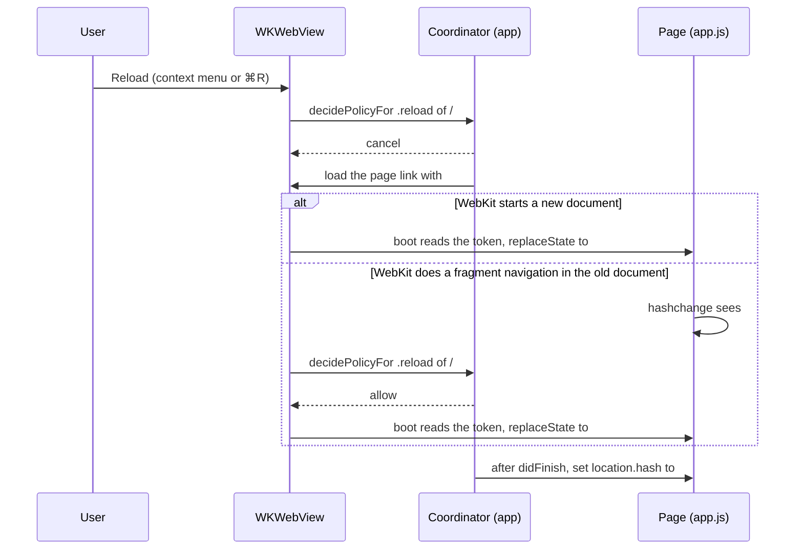
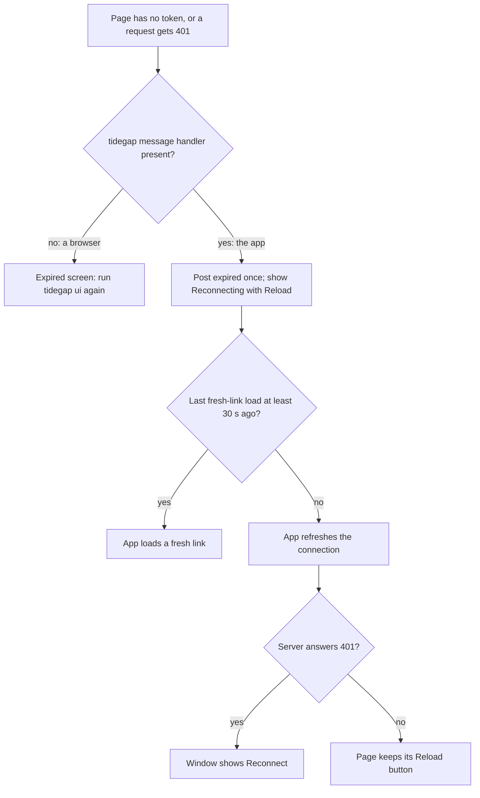
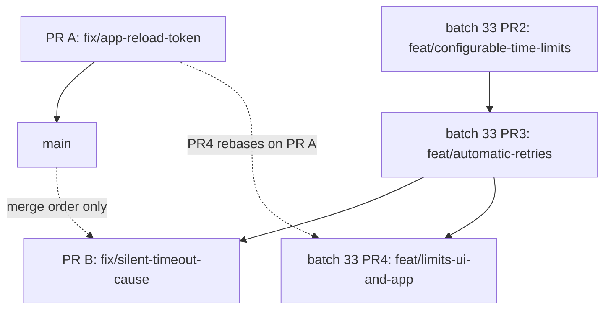

# App Reload Token and Silent Timeout Cause (Batch 34) - Plan

## Goal Capsule

- **Objective:** A Mac app user who reloads the Tidegap window keeps a working page. A user whose shell command stops silently at its time limit on macOS reads the likely cause and the fix on every surface that reports the failure.
- **Means:** two PRs (Sequencing and Overlap with Batch 33).
  - PR A, now: the app turns every reload into a load of a fresh link with its client token (KTD1, KTD2), the page tells the app when its token is gone (KTD3, KTD4), and the app's failure notification shows the failure reason (KTD5).
  - PR B, after batch 33 PR3 is merged: a silent command timeout on macOS gets the Files & Folders hint and the next step, whatever folder the script opens (KTD6-KTD8).
- **Authority:** the Product Contract decides what; the Planning Contract decides how. Binding repo rules:
  - `CLAUDE.md` (gate, generated files, hard rules, git conventions).
  - `docs/solutions/best-practices/loopback-web-ui-hardening.md` and `docs/spec/ui-client-api.md` (the token travels only in the fragment and lives only in memory; route classes; the client contract).
  - `docs/solutions/best-practices/dependency-free-task-ui-patterns.md` (text-only rendering, the banned page APIs in `ui-server.test.ts`).
  - `docs/solutions/best-practices/agent-facing-text-is-a-contract.md` (one fact on every surface, in the same PR).
  - `docs/solutions/developer-experience/deterministic-process-kill-tests.md` (fake `Date` only, wait on files, not sleeps).
  - `docs/solutions/workflow-issues/public-repo-hygiene.md`, `docs/solutions/workflow-issues/generated-test-counts-merge-conflict.md`, `docs/solutions/developer-experience/folding-review-fixes-into-commits.md`.
  - `docs/plans/2026-11-05-1452-feat-configurable-limits-and-retries-plan.md` (batch 33: owns the time limits, the retry funnel and the app's Retry action).
- **Execution profile:** two PRs, one Opus `ce-work` agent per PR in `.worktrees/<branch>`, units in the listed order. PR A branches from `main` now. PR B branches from `main` only after batch 33 PR3 (`feat/automatic-retries`) is merged; it never starts from a batch 33 branch. Simplify runs on the code files of each PR and skips markdown. One `ce-code-review` per PR, at its end. The gate and the `pnpm qa` areas run once per PR; `pnpm qa ui` runs alone.
- **Who ships:** each PR ends green, with its review done and the diff reviewed. The agent does not merge. No version bump, release or publish.
- **Stop conditions:** stop and report in these cases:
  - A reload path (context menu, ⌘R, `location.reload()`) reaches neither the KTD1 intercept nor the KTD3 message.
  - A change would put the token into the address the page keeps, the history, a log line, a script message or storage.
  - After the rebase on batch 33 PR3, the hint and its short next step no longer fit in the first 140 characters of the reason's first line (R8).
  - A change needs a file outside its PR's unit lists, apart from generated files.
  - A test or QA step needs the real `HOME`, `~/.tidegap`, `~/.claude` or `~/.config/tidegap`.
  - The same check fails the same way twice.

---

## Product Contract

### Summary

The Mac app stops showing "This link expired" after a reload. Every reload of the app window becomes a load of a fresh link that carries the app's client token, and the page reports a lost token to the app instead of showing the browser's dead end. The app's "Task failed" notification shows the first line of the failure reason. On macOS, a shell command that stops at its time limit after a quiet stretch gets the Files & Folders hint and the next step in its failure reason, whatever folder its script opens.

### Problem Frame

Two faults hid one failure from the user.

A one-off `command` task ran a script that called `git fetch` on a repository under `~/Documents`. macOS held that file access on a Files & Folders (privacy) check for the daemon's `node`. The command printed nothing more, and the tick stopped it at the 5-minute limit. The failure reason read only `stopped: command time limit 5 min`. The command runner adds the privacy hint only when the working directory or the command text names `~/Documents`, `~/Desktop` or `~/Downloads` (`packages/cli/src/providers/command.ts:71`, `:200-205`). Here only the script body named the folder. `apps/web/content/docs/10-jobs.md:110` says "A failed run names this cause", so the code breaks the docs. The Mac app notification shows only "Task failed" and the task title (`apps/macos/TidegapKit/Sources/TidegapKit/Events.swift:87-89`), so a named cause would not have reached it either.

The user then pressed Reload in the app window and saw "This link expired. Run `tidegap ui` again." The page reads the token from the `#token=` fragment and removes it from the address (`packages/cli/ui/app.js:641-647`). WebKit's Reload then loads the address without the token, and boot shows the expired screen (`app.js:648-651`). The app allows every navigation to the server (`apps/macos/Tidegap/WebPageWindow.swift:152-164`), and the page gives the app no signal. The menu bar kept working, because it sends the long-lived client token on each native request. "Run `tidegap ui` again" does not apply inside the app.

### Requirements

**App window reload**

- R1. A reload of the app window (the context menu's Reload, ⌘R, or the page's own reload) shows the page again, signed in, on the view it showed before.
- R2. When the page in the app has no token or the server refuses it, the page tells the app and does not show the browser instruction to run `tidegap ui`.
- R3. When the server refuses the app's client token, the window shows the existing Reconnect state, and the app never reloads in a loop.
- R4. The token stays out of the address the page keeps, the history, logs, script messages and storage, as the loopback hardening rules require.
- R5. In a browser, the page keeps today's expired screen, and an expired tab comes back when its address gets a new `#token=` link.

**Failure reason on every surface**

- R6. The app's "Task failed" notification shows the first line of the failure reason, the same line the channel notices show.
- R7. On macOS, a command that stops at its time limit after printing nothing on stdout or stderr during the final quiet window (KTD6) gets the Files & Folders hint and the next step in its failure reason, whatever paths its script opens.
- R8. The hint and a short next step fit in the first 140 characters of the reason's first line, so every surface that shows one line shows them: CLI, page, app notification, channel notices, MCP and plugin text.
- R9. Tidegap never opens the user's protected folders to decide on the hint.
- R10. The docs and the Claude Code plugin text say what the hint means and what to do.

### Scope Boundaries

- No change to retry policy or to the failure classifier; batch 33 owns both.
- No new route. The UI API gains one optional summary field (KTD5).
- Only macOS gets the hint; other platforms have no Files & Folders check.
- The browser extension's notifications do not change.
- No Python change: the command and `claude-code` runners run only on the Node daemon, and the Python tick holds their rows.

#### Deferred to Follow-Up Work

- A readiness hint for a run with the time limit `none` that has printed nothing for a long time. With no timer, R7 never fires for it.
- The extension's finished-task notification showing `error` (the field exists after PR A).
- A fresh-link reload after the WebKit content process ends (`webViewWebContentProcessDidTerminate`).

#### Considered and not built

- **The app hands the token to the page in a reply to a script message.** Every reload would work without a URL step, but any script in the page could call that channel, a second token transport beside the fragment. Evidence that would change this: a reload path that neither the intercept nor the `expired` message recovers.
- **A structured cause field on the failed event** (for example `details.cause: "macos_privacy"`). The text already reaches every surface, and no client branches on the cause today. Evidence that would change this: a client that wants a button or link for the fix.
- **A probe that opens a protected folder to test access.** It raises the same prompt the hint warns about (R9).

---

## Planning Contract

### Key Technical Decisions

- KTD1. **Intercept `.reload` in the navigation delegate; the fragment link stays the only token transport.** `decidePolicyFor` cancels a `.reload` of a server URL whose fragment does not start with `token=`. It then loads the coordinator's current page link (`Format.pageURL`, client token in the fragment) and sets the previous `#/<view>` after the load finishes. A `.reload` whose URL carries `#token=` is allowed: that is the page's own reload after it received a new link (`app.js:97-100`). Rejected: replacing the context menu item in `willOpenMenu`, because it needs a `WKWebView` subclass and misses ⌘R and `location.reload()`. Governs R1, R4.
- KTD2. **⌘R is a View › Reload menu item with the action `reload(_:)` and a nil target.** The responder chain delivers it to the `WKWebView`, so the menu, the key and the context menu all become `.reload` navigation actions that KTD1 handles. The item joins `addMissingEditMenus` (`apps/macos/Tidegap/TidegapApp.swift:61-80`) under the same "only when missing" rule. Governs R1.
- KTD3. **The page reports a lost token with a fixed message; the app answers with a guarded reload.** In the app, `showExpired()` posts the string `expired` to the `tidegap` script message handler, once per document, and shows "Reconnecting to Tidegap…" with a Reload button that calls `location.reload()`. The app accepts only that exact string, only from the main frame of the server origin. It reloads with a fresh link when its last fresh-link load is at least 30 seconds old. Otherwise it asks the connection to refresh; a 401 there moves the app to the Reconnect state (`apps/macos/TidegapKit/Sources/TidegapKit/Connection.swift:276-282`, `dropToken`). The message carries no data and gets no reply. Governs R2, R3, R4.
- KTD4. **An expired page still listens for a `#token=` hash.** `boot()` registers the `#token=` → `location.reload()` check before it returns on a missing token. A fresh link then revives the page whether WebKit treats the app's load as a fragment navigation or as a full load, and a browser tab revives when a new link is pasted into it. Governs R1, R5.
- KTD5. **The summary's `finished[]` items carry `error` for failed tasks.** The value is the first non-empty line of the error, made one line and cut to 140 characters. That rule lives inline in the channel notice today (`taskNotificationContent`, `packages/core-ts/src/notify.ts:139-158`), so it moves into an exported helper that both the notice and the summary call. The field is optional: a completed task and an empty error have none, older servers never send it, and the Kit decodes it as optional. The notification body is the task title, then that line. Governs R6, R8.
- KTD6. **Quiet time triggers the hint; today's path rule stays as a second trigger.** `runShell` reports `quietMs`, the time from the last stdout or stderr byte (or from the spawn, when there was none) to the stop. On `darwin`, a timed-out run gets the hint when its `quietMs` is at least `min(2 minutes, the time limit)`, or when today's path rule holds (no stderr, and the cwd or the command text names a protected folder, `PROTECTED_DIRS`). The path rule moves into the hint module unchanged, so no run that gets the hint today loses it. Two minutes is a diagnostic threshold, not a run limit, so it stays a constant outside the batch 33 registry. Governs R7, R9.
- KTD7. **One hint module for both runners.** `packages/cli/src/providers/macos-privacy.ts` owns the hint text, the next step and both triggers. The command runner and the `claude-code` runner use the same text. The `claude-code` runner keeps its own trigger (no stderr, `claude-code.ts` `timeoutMessage`), because `claude -p` writes stdout only at the end. Governs R7, R8.
- KTD8. **The first line carries the cause and a short next step, as a condition; the second line carries the full next step.** Many commands are quiet by design, so the hint says what to do if the script reads a protected folder, and never claims that it does. First line, within 140 characters, for example: `stopped: command time limit 5 min; no output for 4 min 30 s (macOS: if it reads a protected folder, allow node in Files & Folders)`. Second line, for example: `System Settings › Privacy & Security › Files & Folders: allow <node path>, or keep the folder outside ~/Documents, ~/Desktop and ~/Downloads.` The node path is `process.execPath` with the home folder written as `~`. The stderr tail follows, as today. The exact words are the implementer's, inside these limits. Governs R7, R8.

### High-Level Technical Design

Reload in the app (KTD1, KTD4). Both WebKit outcomes end in one full load that reads the token and removes it from the address.

A page that has lost its token (KTD3):

The hint on a stopped command (KTD6):

| Platform | How the run ended | Quiet for the final `min(2 min, limit)` | Failure reason |
|---|---|---|---|
| `darwin` | time limit | yes | time limit, quiet time, hint and next step |
| `darwin` | time limit | no, but today's path rule holds | time limit, hint and next step |
| `darwin` | time limit | no | time limit only |
| other | time limit | any | time limit only |
| any | exit code, signal or cancel | any | unchanged |

### Assumptions

- The quiet threshold is 2 minutes (KTD6). With the default 5-minute limit, a command that printed during its first 3 minutes and then hung gets the hint.
- The failure reason may name the daemon's `node` path (KTD8). The reason stays on the user's machine and in the user's own channels.
- 30 seconds separates a refused token from a lost one (KTD3).
- U3 (the notification reason) ships in PR A. It touches no file that batch 33 PR2 or PR3 changes. In PR B it would run beside batch 33 PR4, which changes the same failed-task notification in `Events.swift`.
- Batch 33 PR3 adds `(after N attempts)` to a final failure. U4 confirms after the rebase that R8 still holds for the final reason and for each `attempt_failed` event.

### Sequencing and Overlap with Batch 33

PR A touches no file that batch 33 PR2 or PR3 changes, except the core export list and two documents. In `packages/core-ts/src/index.ts`, PR2 adds run-limit exports and U3 adds one export. In `docs/spec/ui-client-api.md`, batch 33 PR2 (U5) edits the job caps sections and PR3 (U10) adds the `attempt_failed` event kind; PR A adds a new section and one field to the summary section. In `CHANGELOG.md`, all add entries under `[Unreleased]`. Batch 33 PR4 (U11-U13) later edits files PR A also changes: `packages/cli/ui/api.js`, `docs/spec/ui-client-api.md`, `scripts/qa/ui-flows.mjs`, `Models.swift`, `Events.swift`, `ModelsTests.swift`, `EventsTests.swift` and `apps/macos/README.md`. PR4 rebases on PR A.

PR B rewrites lines that batch 33 PR2 and PR3 change. It starts from `main` after PR3 is merged, so it builds on these edits and rebases instead of conflicting:

- `packages/cli/src/providers/command.ts`: PR2 changes `shellFailure` to take `timeoutMs: number | "none"` instead of `caps`, replaces `durationLabel` with the core's `formatDuration`, and edits the timed-out branch that U4 rewrites. PR3 (U7) marks permanent errors in the same adapter.
- `packages/cli/src/jobs/run-shell.ts`: PR2 makes the timer optional (`timeoutMs: "none"`). U4 adds `quietMs` beside that timer.
- `packages/cli/src/providers/claude-code.ts`: PR2 removes `DEFAULT_TIMEOUT_MS`; PR3 marks permanent errors. U4 swaps the hint constant.
- `packages/cli/test/jobs-runner.test.ts`, `packages/cli/test/claude-code-adapter.test.ts`: both batches add cases.
- `apps/web/content/docs/10-jobs.md`: PR2 (U5) and PR3 (U10) edit the time-limit sentences and the retry line. U5 edits the `#jobs-macos` section.
- `packages/claude-code-plugin/skills/tidegap/SKILL.md`: PR2 (U5) and PR3 (U10) add the limit and retry facts. U5 adds one sentence to "When tasks do not run".
- `CHANGELOG.md`.

### Risks

| Risk | Mitigation |
|---|---|
| A WebKit reload path does not reach `decidePolicyFor` as `.reload` | KTD3 recovers it; U2's execution note checks each path in the built app |
| A refused token makes the app reload in a loop | the 30-second guard and the connection refresh (KTD3) |
| The script message handler keeps the coordinator alive | a weak proxy as the handler; remove the handler when the view goes away |
| A command that is quiet by design gets the hint | only on macOS, only on a time-limit stop; the hint is a condition ("if it reads a protected folder"), never a claim (KTD8) |
| PR B starts before batch 33 PR3 is merged | its `Waits on:` line and the execution profile |

---

## Implementation Units

### PR A: fix/app-reload-token

Waits on: nothing.

### U1. Page: report a lost token to the app, revive on a new link

- **Goal:** the page in the app hands a lost token to the app; a browser tab revives on a new link.
- **Requirements:** R2, R4, R5; KTD3, KTD4.
- **Dependencies:** none.
- **Files:** `packages/cli/ui/app.js` (`showExpired`, `boot`), `packages/cli/ui/api.js` (helper that finds the `tidegap` handler and posts `expired` at most once), `packages/cli/test/ui-embed.test.ts` (new), `scripts/qa/ui-flows.mjs` (new steps), `docs/solutions/best-practices/dependency-free-task-ui-patterns.md` (the reload sentence, line 37).
- **Approach:**
  1. The helper takes a window object, so a test can pass a fake one.
  2. `showExpired()` in the app: post through the helper and show "Reconnecting to Tidegap…" with a Reload button. In a browser: today's text.
  3. `boot()`: register the `#token=` hash check before the early return on a missing token (KTD4).
- **Patterns to follow:** `h()` text-only rendering; the ban list in `packages/cli/test/ui-server.test.ts`; `parseFragment` tests in `packages/cli/test/ui-jobs.test.ts`.
- **Test scenarios:**
  - A fake window with `webkit.messageHandlers.tidegap.postMessage`: two calls post `"expired"` once.
  - A fake window without `webkit`: nothing is posted, and the helper reports a browser.
  - The posted value is exactly the string `expired`.
  - QA, page in the app (an init script records `postMessage` calls): opening the page without a token posts `expired` once, shows "Reconnecting", and shows no `tidegap ui` text.
  - QA, browser: an expired tab whose hash is set to a valid `#token=` link shows the Agenda, and the token leaves the address.
  - QA S2.3 and S2.4 still pass with the browser's expired text.
- **Verification:** the unit test passes; `pnpm qa ui` passes alone.

### U2. App: reload with a fresh link

- **Goal:** every reload of the app window shows the page, signed in, on its previous view; a refused token ends at Reconnect.
- **Requirements:** R1, R3, R4; KTD1, KTD2, KTD3.
- **Dependencies:** U1.
- **Files:** `apps/macos/TidegapKit/Sources/TidegapKit/PageReload.swift` (new), `apps/macos/TidegapKit/Tests/TidegapKitTests/PageReloadTests.swift` (new), `apps/macos/Tidegap/WebPageWindow.swift`, `apps/macos/Tidegap/TidegapApp.swift`, `apps/macos/Tidegap/AppModel.swift`, `apps/macos/README.md`, `docs/spec/ui-client-api.md` (new section "Embedding the page", after "Authentication"), `CHANGELOG.md`.
- **Approach:**
  1. `PageReload.swift` holds the logic the Kit can test: the server-URL match (moved from the coordinator's `isServer`), the reload decision, the view to restore, the message filter, and the 30-second guard with an injected clock.
  2. The view to restore comes from `#/<view>` and passes an allow-list of letters, digits and `/ _ ~ . - ? = & ,`, with a length cap. Anything else restores nothing, so the page opens the Agenda. The value goes into `evaluateJavaScript`, as in `setHash`.
  3. The coordinator records the time of each fresh-link load (first load, port change, intercept, guarded reload) and sets the restored view on the next `didFinish`. A pending view request wins over the restored view.
  4. The coordinator registers the `tidegap` handler through a weak proxy and removes it in `dismantleNSView`. A refused-token answer calls a closure that `WebPageWindow` wires to `model.refresh()`.
  5. The spec section states the link format, the reload rule, and the `expired` message: handler name, exact body, main frame of the server origin only, no reply, no data. A page without the handler shows the browser text.
- **Execution note:** before relying on the intercept, run the built app with `-home <temp dir>` and confirm that the context menu's Reload, ⌘R and `location.reload()` each reach `decidePolicyFor` as `.reload`. If one does not, KTD3 covers it; say so in the PR body.
- **Patterns to follow:** `PageLoad.swift` and `PageLoadTests.swift`; `Format.pageURL` and the `Format.jobView` allow-list; the coordinator's `pending` view request.
- **Test scenarios:**
  - A `.reload` of `http://127.0.0.1:47821/#/journal`, server port 47821: replaced, view `journal` restored.
  - A `.reload` of `http://127.0.0.1:47821/#token=tgc_x`: allowed.
  - A non-reload navigation to the server: allowed.
  - A `.reload` of another port or host: not a server URL.
  - Restore: `#/task/t-1` gives `task/t-1`; `#/journal?status=failed` is kept; a value with a quote, a backslash or an angle bracket gives nil; an empty hash gives nil; a value over the cap gives nil.
  - Filter: `"expired"` from the main frame, `http`, `127.0.0.1`, server port: accepted. The same from a subframe, from another port, with body `{}` or with body `"expired "`: rejected.
  - Guard: an expiry 40 s after the last fresh-link load gives a reload; one 5 s after gives a connection refresh; a later expiry 40 s after the last load gives a reload again.
- **Verification:** `swift test` reports `Test run with N tests ... passed`; `apps/macos/scripts/build.sh` builds the app.

### U3. App notification shows the failure reason

- **Goal:** the app's failed-task notification carries the first line of the failure reason.
- **Requirements:** R6, R8; KTD5.
- **Dependencies:** none.
- **Files:** `packages/core-ts/src/notify.ts` (export the first-error-line helper; `taskNotificationContent` calls it), `packages/core-ts/src/index.ts` (export), `packages/core-ts/test/notify.test.ts`, `packages/cli/src/ui/summary.ts`, `packages/cli/test/ui-summary.test.ts`, `docs/spec/ui-client-api.md` (the `finished` item, its example and an availability note), `apps/macos/TidegapKit/Sources/TidegapKit/Models.swift` (`FinishedTask.error`), `apps/macos/TidegapKit/Sources/TidegapKit/Events.swift` (`NotificationText.content`), `apps/macos/TidegapKit/Tests/TidegapKitTests/ModelsTests.swift`, `apps/macos/TidegapKit/Tests/TidegapKitTests/EventsTests.swift`, `apps/macos/README.md` (Notifications), `CHANGELOG.md`.
- **Approach:** the helper returns nothing for an empty error; the channel notice keeps its "unknown error" text for that case. The summary calls the same helper, so the app and the channels show the same line. A completed task's notification does not change. No Python change: the helper serves only the Node UI server.
- **Patterns to follow:** `brief()` in `summary.ts`; `NotificationText.truncate`.
- **Test scenarios:**
  - A summary with `since` lists a failed task with a two-line error, and `error` is its first line.
  - A completed task, and a failed task with an empty error, have no `error` key.
  - A first line of 300 characters is cut to 140 with `…`, the same as `taskNotificationContent`.
  - The channel notice for a failed task keeps its current body, "unknown error" for an empty error included (existing `notify.test.ts` cases).
  - The Kit decodes a `finished` item with and without `error`.
  - A failed task with `error` gives the body "title, newline, error line"; without `error`, the body is the title only.
- **Verification:** `pnpm --filter @tidegap/cli test` and `swift test` pass.

### PR B: fix/silent-timeout-cause

Waits on: batch 33 PR3 (`feat/automatic-retries`), needed before start, because U4 rewrites lines of `command.ts`, `run-shell.ts` and `claude-code.ts` that batch 33 PR2 and PR3 change. PR A, merge order only.

This group is its own PR because it cannot start before batch 33 PR3 is merged, while PR A ships now.

### U4. Name the cause of a silent timeout

- **Goal:** a silent command timeout on macOS names the likely cause and the fix, whatever folder the script opens.
- **Requirements:** R7, R8, R9; KTD6, KTD7, KTD8.
- **Dependencies:** batch 33 PR3 on `main`.
- **Files:** `packages/cli/src/providers/macos-privacy.ts` (new), `packages/cli/src/jobs/run-shell.ts` (`quietMs`), `packages/cli/src/providers/command.ts` (rule, message; `PROTECTED_DIRS` moves to the hint module), `packages/cli/src/providers/claude-code.ts` (shared text), `packages/cli/test/macos-privacy.test.ts` (new), `packages/cli/test/jobs-runner.test.ts`, `packages/cli/test/claude-code-adapter.test.ts`.
- **Approach:**
  1. `runShell` records the time of each stdout and stderr chunk and returns `quietMs`. Only the timed-out branch reads it.
  2. `macos-privacy.ts` holds the pure rule (platform, timed out, `quietMs`, limit, and today's path rule) and the texts.
  3. The command runner writes the first line, then the next-step line, then the stderr tail.
  4. After the rebase, read where batch 33 PR3 adds `(after N attempts)`, and keep R8 true for the final reason and for each `attempt_failed` event.
- **Execution note:** pin today's reasons for an exit code, a signal and a cancel before the change, so only the timed-out branch moves.
- **Patterns to follow:** `docs/solutions/developer-experience/deterministic-process-kill-tests.md` (fake only `Date`; a command waits on a file the test controls, not on a sleep); the existing hint test at `jobs-runner.test.ts:719`.
- **Test scenarios:**
  - Rule: `darwin`, time limit, quiet 150 s of a 300 s limit: hint. Quiet 90 s: no hint. A 60 s limit, quiet 60 s: hint. `linux`, quiet 300 s: no hint. Exit code 1: no hint.
  - Rule: `darwin`, quiet 90 s, no stderr, cwd under `~/Documents`: hint (today's path rule); the existing test at `jobs-runner.test.ts:719` passes with the new wording.
  - Covers the incident: on `darwin`, a command whose cwd and text name no protected folder, silent for the whole limit, gets the hint and the next step.
  - A command that prints one line, then waits on a file the test never writes, with `Date` moved past the quiet window: hint.
  - A command that prints until the stop: no hint.
  - stderr early, then quiet: hint, and the stderr tail still follows.
  - The first line is at most 140 characters for a 5-minute and a 2-hour limit, contains `Files & Folders`, and states the hint as a condition (KTD8).
  - The next-step line names the node path with `~` for the home folder.
  - A silent `claude-code` timeout keeps the hint on its first line; the test at `claude-code-adapter.test.ts:350` still passes.
- **Verification:** `pnpm --filter @tidegap/cli test` passes; `grep` finds `MACOS_PRIVACY_HINT` and `PROTECTED_DIRS` only in `macos-privacy.ts`.

### U5. Docs and plugin text

- **Goal:** the docs and the plugin say what the hint means and what to do.
- **Requirements:** R10; KTD8.
- **Dependencies:** U4.
- **Files:** `apps/web/content/docs/10-jobs.md` (`#jobs-macos`), `packages/claude-code-plugin/skills/tidegap/SKILL.md` (one sentence in "When tasks do not run"), `packages/claude-code-plugin/commands/check.md` (line 42: for `failed`, the first line and its next step), `docs/solutions/tooling-decisions/running-claude-p-from-a-daemon.md` (line 41 cites the hint code), `CHANGELOG.md`; generated by `pnpm gen:docs`: `apps/web/src/lib/docs.generated.ts`, `apps/web/public/llms-full.txt`.
- **Approach:**
  1. `10-jobs.md` states the rule (macOS, a time-limit stop, quiet for the final 2 minutes or the whole run, or a cwd in a protected folder) and the fix, as a condition, as the reason does.
  2. The skill sentence tells the agent to pass the next step to the user, and that a retry before access is allowed hangs again.
  3. MCP tool texts do not change: `check_queue_status` returns the reason as it is. OpenClaw texts do not change: the command runner runs only on the Node daemon. The PR body says so.
- **Test expectation:** none -- documentation; `node scripts/qa/docs-drift.mjs` and `pnpm qa docs` check it.
- **Verification:** the drift check passes; `pnpm gen:docs:check` is clean.

---

## Verification Contract

| Check | PR | Pass signal |
|---|---|---|
| Gate: `pnpm build && pnpm typecheck && pnpm gen:tests:check && pnpm gen:docs:check && node scripts/qa/docs-drift.mjs` | A, B | all pass |
| `pnpm --filter @tidegap/cli test` | A, B | pass |
| `cd apps/macos/TidegapKit && swift test` | A | `Test run with N tests ... passed` |
| `apps/macos/scripts/build.sh` | A | the app builds |
| `pnpm qa ui`, alone | A | `PASS`, new steps included |
| `pnpm qa cli`, `pnpm qa docs` | B | `PASS` |
| `pnpm check:hygiene` | A, B | pass |
| `pnpm gen:tests` after new tests, `pnpm gen:docs` after doc edits | A, B | generated files match; never edited by hand |
| Owner check after PR A | A | In the installed app: ⌘R and the context menu's Reload keep the page and its view. After the app's client is revoked from a browser page, Reload in the app ends at Reconnect, with no loop. A failed task's notification shows its reason. |

---

## Definition of Done

- PR A: R1-R6 hold; U1-U3 pass their verification; the spec has the "Embedding the page" section and the `finished[].error` field; `CHANGELOG.md` has entries under `[Unreleased]`.
- PR B: R7-R10 hold; U4-U5 pass their verification; the hint text and both triggers live only in the hint module; the generated docs are current.
- Each PR is green with its review done. Nothing is merged; no version bump.
- No abandoned-attempt code, debug output or temporary files remain in any diff.
- No local paths, owner or account names, session links or attribution trailers in committed files.

---

## Sources

- `packages/cli/ui/app.js:97-100` (`route` reloads on a `#token=` hash), `:242-254` (`showExpired`), `:641-651` (`boot`); `packages/cli/ui/api.js:1-48` (token in memory, `SessionExpired`), `:174-178` (`parseFragment`).
- `apps/macos/Tidegap/WebPageWindow.swift:104-176` (coordinator), `apps/macos/Tidegap/TidegapApp.swift:61-80` (menus), `apps/macos/Tidegap/AppModel.swift:198-205` (`pageURL`), `apps/macos/TidegapKit/Sources/TidegapKit/Format.swift:7-9`.
- `packages/cli/src/providers/command.ts:70-72`, `:189-213`; `packages/cli/src/providers/claude-code.ts:124-129` and `timeoutMessage`; `packages/cli/src/jobs/run-shell.ts:223-242`.
- `packages/core-ts/src/notify.ts:110`, `:139-158`; `packages/cli/src/ui/summary.ts:139-149`; `apps/macos/TidegapKit/Sources/TidegapKit/Models.swift:80-92`.
- `apps/web/content/docs/10-jobs.md:108-110`; `docs/solutions/tooling-decisions/running-claude-p-from-a-daemon.md:33-41`.
- `scripts/qa/ui-flows.mjs` S2.3 and S2.4 (the browser's expired state).
