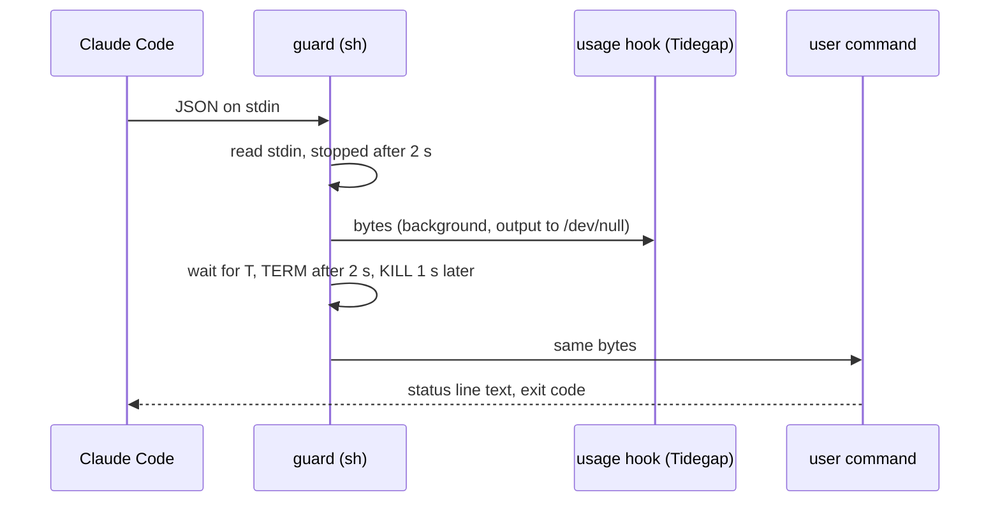
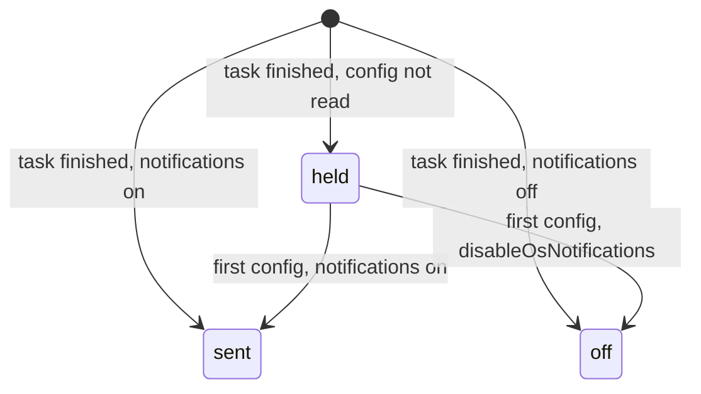

# User-Visible Reliability Residuals (Batch 36) - Plan

## Goal Capsule

- **Objective:** A daily user stops meeting the residuals that batch 35 left open. A notice reaches the session that queued the task and is not lost or sent twice: ticking another ledger keeps this ledger's notice markers, `queue wait` records a notice only after the user saw it, and a recovered tick daemon is announced once. The Claude Code status line and the local page never hang on a stuck Tidegap, a busy settings file or a settings file linked into a folder macOS guards. The Mac app stops asking the login shell every minute and two app instances stop replacing each other's server. An OpenClaw user who switched desktop notifications off gets none, also right after the gateway starts. The Python core, the CLI and the page say the same thing about cancelled tasks and usage ages.
- **Means:** four PRs of at most three units, with no shared source file (Sequencing). PR A, notice delivery (KTD1-KTD3). PR B, status line and page server stalls (KTD4-KTD6). PR C, the Mac app server launcher (KTD7, KTD8). PR D, OpenClaw notifications and parity texts (KTD9-KTD11).
- **Authority:** the Product Contract decides what; the Planning Contract decides how. Binding repo rules:
  - `CLAUDE.md` (the gate, generated files, hard rules, git conventions).
  - `docs/solutions/best-practices/session-notices-claim-once-per-finish.md` (PR A).
  - `docs/solutions/logic-errors/compare-and-set-task-transitions.md` (a cross-process write is compare-and-set; PR A).
  - `docs/solutions/tooling-decisions/claude-usage-limits-source-and-deferral.md` (the guard and its legacy texts; PR B).
  - `docs/solutions/best-practices/loopback-web-ui-hardening.md`, `docs/solutions/best-practices/channels-one-step-connect-secrets-file-and-atomic-lock.md`, `docs/solutions/tooling-decisions/running-claude-p-from-a-daemon.md` (guarded folders; PR B).
  - `docs/solutions/logic-errors/login-shell-query-that-ignores-sigterm.md`, `docs/solutions/best-practices/vetting-a-process-by-pid-before-signalling.md` (PR C).
  - `docs/solutions/best-practices/safe-os-notifications-from-a-daemon.md`, `docs/solutions/best-practices/parity-twin-holds-what-it-cannot-run.md` (PR D).
  - `docs/solutions/workflow-issues/public-repo-hygiene.md`, `docs/solutions/workflow-issues/generated-test-counts-merge-conflict.md`, `docs/solutions/developer-experience/folding-review-fixes-into-commits.md`, `docs/solutions/developer-experience/worktree-environment-setup.md`.
- **Owner decisions already taken (do not reopen):** reliability over features; no silent partial paths; honest receipts; notifications go out on the final outcome only; jobs run on the Node daemon only; an interrupted run is failed; no Rust or Go rewrite; the UI, the Mac app and the extension show and postpone or retry tasks, with no quick add; a feature PR never bumps versions. Out of scope: a Codex adapter, a `/tidegap:reply` command, any receipt schema or signed-field change, any DB schema change, anything that needs a browser reproduction first. Release 0.21.0 (PR #248) is separate: no PR here touches version fields, the README status line or the CHANGELOG heading.
- **Execution profile:** one Opus `ce-work` agent per PR in `.worktrees/<branch>`, units in order. Simplify runs inside each PR on its code. One `ce-code-review` per PR at the end, Sonnet reviewers by risk: 2 for PR A (cross-process writes), 2 for PR B (a stored shell program, the page server), 1 for PR C, 1 for PR D. No `pnpm qa ui` in this batch: no PR changes the page. PR A and PR B each run `pnpm qa cli` once, never at the same time.
- **Who ships:** each PR ends green, with its review done and the diff reviewed. The agent does not merge. No version bump, release or publish.
- **Stop conditions:** stop and report in these cases.
  - A change needs a file outside its unit lists, apart from `CHANGELOG.md` and the generated files.
  - A test or QA step needs the real `HOME`, `~/.tidegap`, `~/.claude` or `~/.config/tidegap`.
  - PR A: the compare-and-set of KTD3 needs a change to the meta table's shape (no DB schema change in this batch).
  - PR B: the bounded guard (KTD4) cannot be written in POSIX `sh` without a helper binary, or the current guard text cannot be kept readable as `legacy`.
  - PR B: on macOS, reading the link itself (`lstat`, `readlink`) of a settings file in `~/.tidegap` that points into `~/Documents` shows a privacy prompt (KTD6 depends on it not doing so).
  - PR D: the OpenClaw SDK in use gives the plugin its config before the first tool call; then KTD9 is not needed and the unit uses that source instead.
  - A gate fails the same way twice.
  - Evidence shows that a Key Technical Decision cannot work.

---

## Product Contract

### Summary

PR A keeps the session notice path honest: the marker sweeps and `queue notices` touch the default ledger's markers only when they read the default ledger, `queue wait` prints before it claims, and the "running again" message goes out once when the tick and the channel listener see the recovery together.

PR B bounds the stored statusLine program, so a hanging Tidegap or a stdin that never closes cannot hold the user's status line, and fixes the "Updated" text for a hook with no user command. It caps how long the page server waits for a settings file lock, and the page server refuses a settings file that links into a folder macOS guards instead of hanging on its privacy prompt.

PR C makes the Mac app keep a login-shell answer that is enough for a command override, and stops two app instances from replacing each other's server on every poll.

PR D holds OpenClaw desktop notifications until the plugin has read its config, makes Python `cancelled` events carry the details Node's carry, and words a usage age the same way in the CLI and on the page.

### Problem Frame

Each item was checked on `main` at `f8722690`. The source list is "Not in this batch" of `docs/plans/2026-11-09-0905-fix-todo-residuals-sweep-plan.md` (48 lines, checked true on `8ed525c1`). This plan takes 12 lines, finds one already fixed, and carries the other 35 over.

- **A tick on another ledger removes this ledger's markers.** `sweepNoticeMarkers(dbPath)` runs `noticeSweep(store)` and `wakeSweep(store)` with the default folders under `~/.tidegap/sessions` for any `--db` (`packages/cli/src/commands/tick.ts:496-508`). The sweep removes every marker whose session has no notice in the ledger it read (`packages/cli/src/handoff/notices.ts:147-188`). `tidegap tick --once --db <other>` with the real `HOME` therefore deletes the default ledger's notice markers, and the plugin's prompt hook stays silent until the next default tick. `queue notices --db <other>` has the same reach: with nothing to say for that ledger it removes the session's default marker (`packages/cli/src/commands/queue-watch.ts:374-377`).
- **`queue wait` claims before it prints.** `runQueueWait` calls `claimNotice` and `markRead` and then returns the text (`queue-watch.ts:285-295`); `index.ts:291-299` prints it after. A wait whose stdout is gone (a closed pipe, a killed shell) records `notified` with `via: "wait"` for an outcome nobody saw, and the prompt hook never names that task. `queue notices` already prints first (`queue-watch.ts:378-388`).
- **"Running again" can go out twice.** The tick (`packages/cli/src/channels/emit.ts:543`) and the channel listener (`packages/cli/src/channels/serve.ts:251-262`) both call `notReadyEvent`, which reads `notified:not_ready`, decides, and writes it in separate statements (`emit.ts:362-393`). Two processes that read the same sent ticker mark both return `recovered` and both send "Tidegap: the tick daemon is running again."
- **The statusLine guard has no time bound.** The stored program reads stdin with `cat` to its end and waits for `<launcher> usage hook` before it runs the user's command (`packages/cli/src/commands/statusline-setup.ts:92-96`). A Tidegap that hangs (for example on a macOS privacy prompt) delays every status line refresh; the docs say so (`apps/web/content/docs/03-cli.md:48`, `claude-usage-limits-source-and-deferral.md:41`).
- **"Your own command is kept" without one.** The `updated` text always ends with "your own command is kept" (`statusline-setup.ts:432`), also for a hook that wraps no user command.
- **The page server can stall on a settings file.** The settings routes write through `setEnvFileKey` and the secrets writers, which wait for `withFileLock` with `Atomics.wait` up to 5 s on the server's only thread (`packages/cli/src/atomic-file.ts:31-60`; `packages/cli/src/ui/settings.ts:47-80`). They read the env file with `readFileSync` (`packages/cli/src/limits.ts:63-71`). An env or secrets file that is a link into `~/Documents`, `~/Desktop`, `~/Downloads` or iCloud Drive makes that read wait on a macOS privacy prompt, and every page request waits with it.
- **The Mac app asks the login shell every minute with a command override.** `shellInfo` keeps an answer only when it has a `tidegap` path, and marks any answer without one as failed for 60 s (`apps/macos/TidegapKit/Sources/TidegapKit/ServerLauncher.swift:146-161`). With a command override such as `node /path/to/index.js` the user has no `tidegap` on the login `PATH`, so every resolve after 60 s spawns a login shell again.
- **Two app instances replace each other's server.** `adoptableServer` terminates a `tidegap ui` whose version differs from the one the app would launch (`ServerLauncher.swift:285-310`, `ServerVetting.swift:102-120`). Two instances that launch different runtimes (an app build and a dev build, or two overrides) each see the other's server as old and replace it on their next poll, without end. No test covers more than one poll.
- **OpenClaw notifications before the first tool call.** The plugin learns `disableOsNotifications` only from a tool call's config (`packages/openclaw-plugin/src/index.ts:616-618`, `:250-266`). The startup dispatcher starts at module load with an empty config (`index.ts:669-685`), so a task it finishes before the first tool call posts a desktop notification for a user who switched them off.
- **Python `cancelled` events carry provider and model.** `_event_details` adds `provider` and `model` for every kind it is given (`packages/core-py/src/tidegap/scheduler.py:753-767`), and the terminal path passes `cancelled` (`scheduler.py:1152-1157`). Node adds them only for `created`, `dispatched`, `completed`, `failed` and `attempt_failed` (`packages/core-ts/src/task-events.ts:141`, `:165`).
- **Ages under 90 minutes read differently.** The CLI says "45 s ago" and "80 min ago" (`packages/cli/src/commands/usage.ts:54-60`); the page says "just now" under a minute and "1 h ago" from 60 minutes (`packages/cli/ui/dom.js:135-145`).
- **Already fixed on `main`:** "The 400-character notice line can cut a long `result_path`." `noticeLine` keeps the path whole and cuts or drops the title first (`notices.ts:73-86`, since `04e0b302`), tested by `packages/cli/test/handoff-results.test.ts:427-434`. Dropped from the list.

### Requirements

**PR A: notice delivery**

- R1. A tick pass, `queue notices` and the wake sweep create or remove notice and wake markers only when they read the default ledger. A tick on any other ledger leaves them as they are.
- R2. `queue wait` records a notice as delivered and the task as read only after its output was written. A wait that cannot write its output records neither.
- R3. One recovery of the tick daemon after a sent alert gives one "running again" message, also when the tick and the channel listener see it at the same time.

**PR B: status line and page server stalls**

- R4. The stored statusLine program shows the user's own status line within a bounded time when Tidegap hangs or stdin does not close. The Tidegap run it starts never outlives that bound. Hooks stored by older versions stay readable and Reconnect updates them.
- R5. The register answer says "your own command is kept" only when the hook wraps a user command.
- R6. A page settings request waits at most a short, fixed time for a settings file lock; on contention it answers with an error that says to try again, and the page server holds other requests no longer than that wait.
- R7. On macOS the page server does not read or write a settings or secrets file that links into `~/Documents`, `~/Desktop`, `~/Downloads` or iCloud Drive. The request answers with an error that names the folder and the fix, and other requests are not delayed.

**PR C: the Mac app server launcher**

- R8. With a command override, a login-shell answer that has a `PATH` is kept, and the app does not spawn a login shell again on every resolve.
- R9. Two app instances that launch different runtimes settle on one server: each replaces a server at most once in a bounded time, and a Swift test drives several polls of two launchers.

**PR D: OpenClaw notifications and parity texts**

- R10. An OpenClaw task that finishes before the plugin has read its config posts no desktop notification until the config is read; then it posts it, or records that notifications are off. A held notification shows as held in the task's delivery outcome.
- R11. A Python `cancelled` event has the details a Node `cancelled` event has, and no `provider` or `model`.
- R12. The CLI and the page give the same age text for the same age.

### Key Decisions

- KD1. **Markers belong to the default ledger.** The plugin's prompt hook reads `~/.tidegap/sessions/notices` and the default ledger only. A marker for another ledger could not be read by any hook, so a sweep over another ledger has nothing to do there. Governs R1.
- KD2. **The page's age words win.** The page is what the Mac app and the extension show, and the CLI already copies its day rule (`usage.ts:57`). Governs R12.

### Acceptance Examples

- AE1. Covers R1. Given the default ledger has a finished task for session S1 and its marker exists, when `tidegap tick --once --db <other>` runs with the same `HOME`, then the marker of S1 is still there.
- AE2. Covers R2. Given task `t-1` completed for session S1, when `queue wait t-1` runs and its output write fails, then `t-1` has no `notified` event and stays unread; the next prompt hook names it.
- AE3. Covers R3. Given a sent `ticker_stale` alert, when the tick and the listener both run `notReadyEvent` on the recovered daemon from the same stored mark, then exactly one of them gets a `recovered` event.
- AE4. Covers R4. Given a launcher that sleeps forever and a user command `echo ok`, the stored program prints `ok` and exits within the bound, and no Tidegap process from it is left running after the bound.
- AE5. Covers R6. Given another process holds the env file lock, a page `POST /api/settings/region` answers today's "Try again" error within the short wait, and a `GET /api/status` sent at the same time is answered within about 250 ms more.
- AE6. Covers R12. 45 s is "just now" in both; 80 minutes is "1 h ago" in both; 47.6 h is "2 days ago" in both.

### Scope Boundaries

#### Not in this batch

Each line was checked true on `8ed525c1`; the lines are carried over unchanged from batch 35. Batch 36 took 12 lines and found one fixed (Problem Frame).

- No `/tidegap:reply` slash command; MCP `reply_task` serves agents.
- Three site lint warnings (`apps/web/src/app/plan/page.tsx:57`, `apps/web/src/components/best-window.tsx:30`, `apps/web/src/components/deadline-field.tsx:35`).
- A Codex adapter: a feature, not a residual.
- `tidegap ui` builds the grid feed from the env file once (`packages/cli/src/commands/ui.ts:104-109`).
- The hidden page window keeps its web view; closing it already dismantles the view.
- The URL policy reads the UI port from the ledger folder only (`packages/cli/src/channels/emit.ts:212`).
- A URL secret's hint shows its host (`packages/cli/src/channels/channel-setup.ts:179`).
- S2.21 has no step for the Change-token confirm (`scripts/qa/ui-flows.mjs:379`).
- A second rate limiter in `packages/cli/src/ui/settings.ts`; the name `isIntegrationsRoute` also covers `/api/settings`.
- The 31-zone count in two tests.
- No browser test for the site video's preload and the 390 px layout.
- `WEBHOOK_PATH_HOSTS` lacks four shared hosts (`packages/core-ts/src/channels/kinds/webhook.ts:102-113`); the keep rule lives in the core and the card.
- Untested: an invalid ntfy server URL, Slack 5xx and padded bodies, an empty K13 code list, a duplicate docs page.
- Command jobs: background children, `setsid`, one output cap for stdout and stderr, the group kill in three places, the soft 1 USD cap (documented on the jobs page).
- Job pause, resume and run-now routes have no rate limit; the redacted preview logic has three copies.
- Test-tool minors: Ctrl-C in `build-test-count`, `ui-seed --serve` cleanup order, the `*.lock` guard, the `macos.yml` paths filter.
- Command jobs: a stop-signalled command fails its occurrence for good; the process-group id reuse window.
- `run-shell` keeps its stop state for the worker's lifetime.
- `jobs-runner.test.ts:348` failed once on the `TZ=Pacific/Kiritimati` leg; a second failure gets a fix brief.
- TS and Python order models with ids outside the Basic Multilingual Plane differently.
- No drift rule for the receipts page `{#receipt-models}` facts.
- `energySource` can say "measured" when a typical count was billed (needs a new signed field).
- Adapters still compute `total = input + output`; TS and Python differ when both counts arrive without a total; the unreported-count marker text has three copies.
- The usage popover and the header room are measured in Chromium only, not in the Mac app's web view.
- The notice query has no index (no schema change in a sweep).
- The MCP "outside every allowed folder" refusal is tested only in the core.
- The OpenClaw plugin tests see the plugin as `any`.
- The session waiter: it polls on after its hook shell is gone, a millisecond marker race with `queue add --wake`, synchronous progress writes, no test with a real signal.
- `check-hygiene` knows only the values it lists.
- The usage `fillSetup` dialog has no unit test.
- Fractional widths between 719 and 720 px (zoom) match no header tier.
- At 720 px the Agenda row badges overlap the provider text; it needs a browser reproduction first.
- K20 and K21 do not check order.
- The local `v0.8.2` tag differs from origin; origin is canonical (a local `git fetch --tags --force`, no repo change).
- A quick in-call resend of 408 and 425 (`isRetryable`, `packages/core-ts/src/scheduler.ts:4101-4116`). The task retry covers them; a resend inside the call would add a third retry layer for two rare codes.
- OpenClaw `deliveryStorePath` has the same first-tool-call limit as `disableOsNotifications`: a task the startup dispatcher finishes before the first tool call reads its delivery preference from the default store (`packages/openclaw-plugin/src/index.ts:259-266`). Found during batch 36 planning; KTD9 records the held outcome in the default store and does not move it.

Owner-only rows (23) need the owner's accounts, devices or decisions; they are not repo work.

#### Considered and not built

- **Async settings I/O in the page server.** Moving every settings read and write to `fs.promises` would free the event loop on a hung read, but a hung read still holds a libuv thread (four by default), so four hung requests stop all file I/O. R7 refuses the guarded link before any read; R6 bounds the lock wait. A hang on a file outside the guarded folders has not been seen; that evidence would change the call.
- **Adapters `total = input + output` and the unreported-count marker copies.** The token total feeds `totalTokens` on the signed receipt (`packages/core-ts/src/energy.ts:420-463`, `packages/core-py/src/tidegap/energy.py:388-402`). Changing when it is present changes signed receipt content, which this batch excludes. The line stays under "Not in this batch".
- **A time bound inside `usage hook` itself.** A Node process that hangs before its first line (a privacy prompt on `open()`) cannot time itself out; the bound must sit in the `sh` program (KTD4).

### Assumptions

- The bound values (2 s for the Tidegap run, 2 s for stdin in the status line program, 250 ms for the page server's lock wait, 10 minutes between two replaces by one Mac app instance) are planning defaults. Claude Code writes the statusLine JSON at once and closes stdin, so 2 s only matters on a fault.
- On contention the page keeps today's answer (`500`, "Tidegap could not save the change. Try again."). A guarded link answers `409` with a new `code`, added to `docs/spec/ui-client-api.md`.

### Sources / Research

- `docs/plans/2026-11-09-0905-fix-todo-residuals-sweep-plan.md` (the source list, batch 35 structure).
- `packages/cli/test/handoff-notices.test.ts:368-412` (tick passes that expect markers in the sandbox home; U1 changes their ledger to the sandbox default).
- `packages/cli/src/commands/install.ts:157-180` (`MACOS_GUARDED_DIRS` and the real-path comparison from #245).
- `apps/macos/TidegapKit/Tests/TidegapKitTests/LoginShellRetryTests.swift`, `ServerLauncherTests.swift` (fakes for the shell, the clock, discovery and the inspector).
- `packages/core-ts/src/storage/sqlite.ts:1038-1059` (`getMeta`, `setMeta`, `deleteMeta`: one statement each, no compare-and-set).

---

## Planning Contract

### Key Technical Decisions

- KTD1. **One test for "the default ledger".** A helper in `tick.ts` compares the real path of `dbPath` with the real path of `defaultDbPath()` (a missing file compares by its absolute path). `sweepNoticeMarkers` and the marker removal in `runQueueNotices` run only when it is true. `sweepResultFiles` still runs for every ledger: a result file goes to the path its task chose. Tests that tick a ledger and expect markers use the sandbox default ledger (`$HOME/.tidegap/queue.db` under the test `HOME`). Governs R1 (KD1).
- KTD2. **`queue wait` takes an awaited `print` callback.** `runQueueWait` gets `print?: (text: string) => Promise<void>`, awaits it with the rendered text, and claims and marks read only after it resolved. The default writes to `process.stdout` and resolves in the write callback, rejecting on its error: `console.log` ignores stream errors (EPIPE on a closed pipe), so it cannot be the default. The write stays asynchronous, so a long result on a pipe is not cut (`docs/solutions/logic-errors/process-exit-cuts-piped-stdout.md`). `index.ts` passes no printer and no longer prints `res.rendered` itself. A `print` that rejects leaves the task unclaimed and unread, and the command exits 2 with a stderr line. `--json` goes through the same callback. Governs R2.
- KTD3. **The not-ready mark is compare-and-set.** A new `TaskStore.setMetaIf(key, expected, next)` in `packages/core-ts/src/storage/sqlite.ts` writes `next` (or deletes the key when `next` is undefined) only while the stored value equals `expected` (absent counts as a value), in one statement or one `tx`, and returns whether it wrote. No schema change. `notReadyEvent` writes through it and returns `null` when the write lost: the other process owns that event. `restoreMeta` for `not_ready` restores only while the value is still the one this process wrote. The Python core does not send channel events, so it gets no twin. Governs R3.
- KTD4. **A bounded guard text, the current one kept as legacy.** A new `GUARD` (the current text becomes `GUARD_V2`, read as `legacy` like `GUARD_V1`):
  1. Reads stdin as today, but a background watchdog stops the read after 2 s; the watchdog's output goes to `/dev/null`, so it cannot hold the command substitution open.
  2. Starts `<launcher> usage hook` in the background with all output to `/dev/null` (the launcher is the `node` binary and the script, so the background pid is the Tidegap process itself), and a second watchdog sends it `TERM` after 2 s and `KILL` 1 s later. The guard waits for it or the watchdog, whichever ends first.
  3. Runs the user's command with the bytes read, as today; its output and exit code are the guard's.
  POSIX `sh` only (macOS `/bin/sh`, Linux `dash`); no `timeout` binary. A guard whose stdin read was stopped skips the Tidegap run (partial JSON is no reading). Governs R4.
- KTD5. **The page server's lock wait is a process setting.** `atomic-file.ts` gets a module-level wait budget (default today's 5 s) and a setter. `tidegap ui` sets 250 ms at start, before it serves. Every settings write path in the page server goes through `withFileLock` from several modules, so one setting covers them without new parameters through `storeRegion`, `storeLimitJson`, `ChannelSetup` and `setJobSecret`. The CLI keeps 5 s. A stale lock (3 s) is still taken over by the next request after it turns stale. Governs R6.
- KTD6. **A guarded link is found without touching its target.** `MACOS_GUARDED_DIRS` moves from `install.ts` to `packages/cli/src/providers/macos-privacy.ts`, with a helper that follows a path's symlinks by `lstat` and `readlink` only and returns the guarded folder its target lies in, or undefined. It never opens, stats through or lists the target. The page server checks the env file (`~/.tidegap/config`), `channel-secrets.json` and the job secrets file before each read or write it makes of them (settings routes, the region getter of `ui/server.ts`, the integrations routes, the job secret routes), on `darwin` only. A guarded link answers `409` with `code: "guarded_folder"` and a message that names the folder and the fix (move the file back to `~/.tidegap` or remove the link); the region getter skips a guarded stored setting and uses the next source (env, then auto), and `GET /api/settings/region` names the folder. Governs R7.
- KTD7. **An override needs only a `PATH`.** `shellInfo` keeps an answer with a `PATH` for the app's lifetime when `commandOverride` is set, and does not mark it failed for a missing `tidegap`. Without an override the rule is unchanged. Governs R8.
- KTD8. **A server another live app instance started is not replaced.** `ServerVetting.verdict` gets one more input: whether the server's parent is a live process, other than this app, whose argv runs the Tidegap app executable (`inspector.parent` and `inspector.arguments`, the calls `adoptableServer` already makes). Such a server is `.reuse`, whatever its version: the other instance owns it and retires it itself. As a backstop, `ServerLauncher` records when it last replaced a server, and within 10 minutes of that a `.replace` verdict is treated as `.reuse` and logged once. A server with no live app parent (a terminal `tidegap ui`, an orphan) is replaced on a version mismatch as today. Governs R9.
- KTD9. **OpenClaw holds desktop notifications until it has its config.** The plugin marks its config as read when `effectiveConfig` runs for a tool call or the captured gateway config is present. Until then, `deliverOs` records the outcome `held: the plugin has not read its config yet` in the delivery store and queues the task in memory. The first config releases the queue: each held task posts its notification, or records "os notifications are off (disableOsNotifications)". A gateway that stops first leaves the held outcome, which `check_queue_status` shows. Other delivery modes are unchanged. Governs R10.
- KTD10. **Python event details follow Node's kind set.** `_event_details` adds `provider` and `model` only for `created`, `dispatched`, `completed`, `failed` and `attempt_failed` (Node's `SPEC_KINDS`). Governs R11.
- KTD11. **The CLI uses the page's age rule.** `ago` in `usage.ts` returns "just now" under 1 minute, minutes under 60, hours under 48, then days, each rounded as `dom.js` rounds them. The caller at `usage.ts:102` keeps its own 60 s floor. Governs R12 (KD2).

### High-Level Technical Design

The status line program after KTD4 (directional):

The held OpenClaw desktop notification after KTD9:

### Sequencing

The four PRs share no source file. They share `CHANGELOG.md` and the generated test-count files (README markers, `apps/web/src/lib/tests.generated.ts`); PR B also changes a docs page and so the generated docs (`apps/web/src/lib/docs.generated.ts`, `apps/web/public/llms-full.txt`). On a conflict there, take `main`'s version, run the generator and commit (`generated-test-counts-merge-conflict.md`). There is no shared foundation: no unit uses what another PR creates.

| Order | PR | Branch | Units | Value | Waits on |
|---|---|---|---|---|---|
| 1 | PR A | `fix/notice-delivery-residuals` | U1-U3 | Notices reach the right session once | none |
| 2 | PR B | `fix/statusline-and-page-server-stalls` | U4-U6 | Status line and page never hang | none |
| 3 | PR C | `fix/macos-server-launcher` | U7-U8 | Mac app shell and server churn | none |
| 4 | PR D | `fix/openclaw-notify-and-parity` | U9-U11 | OpenClaw opt-out, parity texts | none |

PR A goes first: a lost or doubled notice reaches the user in every session. PR B follows: the status line runs in every Claude Code session and the page is a daily surface. PR C and PR D are smaller. At most three agents at once and at most two heavy builds: PR A, PR B and PR C start together; PR D starts when one finishes. `pnpm qa cli` runs once per PR A and PR B, never at the same time. Merge in the order above. The split follows the batch rule of at most three units per PR (owner decision).

### Risks

- **A guard text change asks every user to Reconnect.** The current guard becomes `legacy`, which the page and `tidegap install` already offer to update; until then the old guard keeps working. U4 tests that both old texts parse.
- **`sh` differences.** `dash` and macOS `sh` differ on `kill` of a background job and on `wait` with a pid. U4's tests run the stored program under `/bin/sh` on the CI runners (Linux and macOS).
- **The compare-and-set changes who sends.** The loser of the race sends nothing; if the winner's send fails, `restoreMeta` puts the mark back and the next check sends again. U3 tests that path.
- **Holding a notification could hide it.** KTD9 records the held outcome at once, so the queue shows it even if the gateway stops before the first tool call.

---

## Implementation Units

### PR A: `fix/notice-delivery-residuals`

Waits on: none.

### U1. Marker sweeps only for the default ledger

- **Goal:** ticking or reading another ledger leaves the default ledger's notice and wake markers alone.
- **Requirements:** R1; KTD1.
- **Files:** `packages/cli/src/commands/tick.ts`, `packages/cli/src/commands/queue-watch.ts`, `packages/cli/test/handoff-notices.test.ts`.
- **Approach:** the default-ledger helper in `tick.ts`; `sweepNoticeMarkers` returns early for another ledger; `runQueueNotices` removes the marker only for the default ledger. Move the two tick-pass tests to the sandbox default ledger.
- **Test scenarios:**
  - Covers AE1. A marker for S1 exists, the default ledger has its notice; `runTickOnce({ db: other })` leaves it.
  - A tick on the default ledger still creates and removes markers (today's tests, on the sandbox default ledger).
  - `runQueueNotices({ db: other })` with no notice there leaves S1's marker.
  - A wake marker older than 12 h with a wake task pending in the default ledger survives a tick on another ledger.
- **Verification:** `pnpm --filter @tidegap/cli test` passes.

### U2. `queue wait` prints, then claims

- **Goal:** a wait records a notice only for output that was written.
- **Requirements:** R2; KTD2.
- **Dependencies:** U1 (same file `queue-watch.ts`).
- **Files:** `packages/cli/src/commands/queue-watch.ts`, `packages/cli/src/index.ts`, `packages/cli/test/queue-watch.test.ts`.
- **Patterns to follow:** `runQueueNotices` (`print` before `claimNotice`).
- **Test scenarios:**
  - A completed task: `print` is awaited once with the outcome text, then the task has a `notified` event with `via: "wait"` and is read.
  - Covers AE2. A `print` that rejects: no `notified` event, the task stays unread, exit code 2, one stderr line.
  - The default printer on a real pipe whose reader closed first: the task stays unclaimed and unread.
  - `--json` goes through `print`, then claims.
  - `--no-mark-read` prints and claims nothing (today's behaviour).
  - A timed-out wait prints its JSON when asked and claims nothing (today's behaviour).
- **Verification:** `pnpm --filter @tidegap/cli test` passes.

### U3. "Running again" once, and CHANGELOG

- **Goal:** one recovery gives one message across the tick and the listener.
- **Requirements:** R3; KTD3.
- **Files:** `packages/core-ts/src/storage/sqlite.ts`, `packages/core-ts/test/storage-meta-if.test.ts` (new), `packages/cli/src/channels/emit.ts`, `packages/cli/src/channels/serve.ts`, `packages/cli/test/channels-emit.test.ts`, `packages/cli/test/channels-serve.test.ts`, `CHANGELOG.md`.
- **Approach:** `setMetaIf` in the store; `notReadyEvent` writes through it; the `not_ready` undo restores through it. Two `TaskStore` handles on one file stand in for the two processes.
- **Test scenarios:**
  - `setMetaIf`: writes when the value matches, refuses when it changed, treats absent as a value, deletes on `next` undefined.
  - Covers AE3. Two handles read the same sent `ticker_stale` mark; both call `notReadyEvent` on a ready ticker; exactly one returns `recovered`.
  - A send that failed restores the mark only while it is still this handle's value; the next check sends again.
  - A new problem set after a sent one is still sent once (today's behaviour).
- **Verification:** `pnpm --filter @tidegap/core test` and `pnpm --filter @tidegap/cli test` pass; `pnpm qa cli` once. CHANGELOG `[Unreleased]` `### Fixed`: markers on another ledger, `queue wait` claim order, one "running again".

### PR B: `fix/statusline-and-page-server-stalls`

Waits on: none. A separate PR under the batch rule of at most three units per PR.

### U4. The bounded statusLine guard and the "Updated" text

- **Goal:** a hanging Tidegap or an open stdin never holds the user's status line, and the register answer is true.
- **Requirements:** R4, R5; KTD4.
- **Files:** `packages/cli/src/commands/statusline-setup.ts`, `packages/cli/test/statusline-setup.test.ts`, `apps/web/content/docs/03-cli.md`, `docs/solutions/tooling-decisions/claude-usage-limits-source-and-deferral.md`.
- **Approach:**
  1. New `GUARD`; today's text becomes `GUARD_V2`, parsed as `legacy`.
  2. `DONE.updated` takes whether a user command is wrapped and words the answer for each case. Both texts still start with "Updated the Tidegap usage hook", so `usage-command.test.ts` (PR D's file) needs no change.
  3. The docs line "one that hangs still delays it" and the learning's "no time bound" sentence state the new bound.
- **Execution note:** write the hang tests first against today's guard; they must fail on it.
- **Test scenarios:**
  - Covers AE4. A launcher script that `exec`s `sleep 60`, user command `echo ok`: output `ok`, exit 0, within 4 s; no child of the guard is alive after it.
  - A stdin that stays open (a pipe nobody closes): the user command runs within 3 s with what was read, and Tidegap is not started.
  - A fast launcher gets the exact stdin bytes (trailing newlines kept), as today.
  - The user command's exit code is the guard's.
  - Round trip: the new text, `GUARD_V2` and `GUARD_V1` all parse; the last two as `legacy`.
  - The `updated` answer for a hook with no user command does not say "your own command is kept"; with one, it does.
- **Verification:** `pnpm --filter @tidegap/cli test` passes on Linux and macOS CI; `pnpm gen:docs` committed.

### U5. The page server's lock wait

- **Goal:** a busy settings file holds the page server at most 250 ms per contended write.
- **Requirements:** R6; KTD5.
- **Files:** `packages/cli/src/atomic-file.ts`, `packages/cli/src/commands/ui.ts`, `packages/cli/test/atomic-file.test.ts`, `packages/cli/test/ui-settings-region.test.ts`.
- **Test scenarios:**
  - With a 250 ms budget and a lock held by another file handle, `withFileLock` throws the "try again" error after 250 ms to 400 ms.
  - The default budget is still 5 s, and a stale lock is still taken over.
  - Covers AE5. A page region write against a held lock answers `500` with today's message; a `GET /api/status` issued during the wait is answered within 400 ms of its send.
- **Verification:** `pnpm --filter @tidegap/cli test` passes.

### U6. Refuse a settings file linked into a guarded folder, and CHANGELOG

- **Goal:** the page server never waits on a macOS privacy prompt for its settings files.
- **Requirements:** R7; KTD6.
- **Dependencies:** U5 (same module family; `commands/ui.ts`).
- **Files:** `packages/cli/src/providers/macos-privacy.ts`, `packages/cli/src/commands/install.ts`, `packages/cli/src/ui/settings.ts`, `packages/cli/src/ui/server.ts`, `packages/cli/src/ui/api.ts`, `packages/cli/src/ui/integrations.ts`, `packages/cli/src/ui/jobs-api.ts`, `packages/cli/src/channels/channel-setup.ts`, `packages/cli/src/channels/telegram-setup.ts`, `packages/cli/src/commands/ui.ts`, `packages/cli/src/region.ts`, `packages/cli/test/macos-privacy.test.ts`, `packages/cli/test/ui-settings-guarded.test.ts` (new), `docs/spec/ui-client-api.md`, `CHANGELOG.md`.
- **Approach:** the helper takes `home` and `platform` arguments for tests; the page routes call it before each read or write of the three files; the region getter skips the stored setting when it is guarded. The test builds a fake home with a `Documents` folder and a link to it; on Linux it passes `platform: "darwin"`.
- **Test scenarios:**
  - A link chain `~/.tidegap/config` -> `~/Documents/tg/config` returns `Documents`; a link to `~/notes/config` returns undefined; a plain file returns undefined; a home behind a symlink still matches (as `install.ts` does).
  - The helper does not open the target: a target that does not exist still returns `Documents`.
  - `GET /api/settings/region` with a guarded env file answers `409`, `code: "guarded_folder"`, and the message names `~/Documents`.
  - A job secret write with a guarded secrets file answers `409` and writes nothing.
  - An integrations route that reads or writes `channel-secrets.json` (a channel connect, a Telegram token save) with a guarded secrets or env file answers `409` and writes nothing.
  - On `linux` (real platform) nothing is refused.
  - `install.ts` still warns as before (its tests pass unchanged).
- **Verification:** `pnpm --filter @tidegap/cli test` passes; `node scripts/qa/docs-drift.mjs` prints `PASS`; `pnpm qa cli` once. CHANGELOG `### Fixed`: the bounded status line, the "Updated" text, the page server's lock wait and guarded settings links.

### PR C: `fix/macos-server-launcher`

Waits on: none. A separate PR under the batch rule of at most three units per PR.

### U7. Keep the login-shell answer with a command override

- **Goal:** the app asks the login shell once when a command override is set.
- **Requirements:** R8; KTD7.
- **Files:** `apps/macos/TidegapKit/Sources/TidegapKit/ServerLauncher.swift`, `apps/macos/TidegapKit/Tests/TidegapKitTests/LoginShellRetryTests.swift`.
- **Test scenarios:**
  - Override set, the shell answers a `PATH` and no `tidegap`: five resolves over 10 minutes of fake time call the shell once.
  - No override, same answer: the shell is asked again after 60 s (today's behaviour).
  - Override set, the shell times out: asked again after 60 s.
- **Verification:** `cd apps/macos/TidegapKit && swift test` passes (`Test run with N tests ... passed`).

### U8. Leave another app instance's server alone, and CHANGELOG

- **Goal:** two app instances stop replacing each other's server.
- **Requirements:** R9; KTD8.
- **Dependencies:** U7 (same file).
- **Files:** `apps/macos/TidegapKit/Sources/TidegapKit/ServerLauncher.swift`, `apps/macos/TidegapKit/Sources/TidegapKit/ServerVetting.swift`, `apps/macos/TidegapKit/Tests/TidegapKitTests/ServerLauncherTests.swift`, `CHANGELOG.md`.
- **Approach:** the verdict's new app-parent input; the launcher keeps its last replace time from its injected clock, and `adoptableServer` reads it before it acts on `.replace`.
- **Test scenarios:**
  - Two launchers on one fake discovery and inspector, versions `1.0` and `1.1`, polling every 30 s over 30 minutes of fake time, interleaved: at most one `SIGTERM` in all, and both end on the same pid.
  - A server whose parent is another live app instance: `.reuse` on a version mismatch, no signal.
  - One launcher, a server with an old version, no replace in the last 10 minutes: replaced once (today's behaviour).
  - A second old server within 10 minutes of a replace: reused, no signal.
  - After 10 minutes of fake time a version mismatch of a server with no live app parent replaces again.
- **Verification:** `swift test` passes; `apps/macos/scripts/build.sh` builds the app. CHANGELOG `### Fixed`: login-shell retries with an override, two app instances.

### PR D: `fix/openclaw-notify-and-parity`

Waits on: none. A separate PR under the batch rule of at most three units per PR.

### U9. OpenClaw holds desktop notifications until its config is read

- **Goal:** a user who switched desktop notifications off gets none after a gateway start.
- **Requirements:** R10; KTD9.
- **Files:** `packages/openclaw-plugin/src/index.ts`, `packages/openclaw-plugin/src/delivery.ts`, `packages/openclaw-plugin/test/plugin.test.ts`, `packages/openclaw-plugin/README.md`.
- **Approach:** a config-read flag set by `effectiveConfig` and by a present captured gateway config; `deliverOs` holds while it is false; the first config releases the queue. The README's `disableOsNotifications` row says notifications wait for the first config.
- **Test scenarios:**
  - A task finishes through the startup dispatcher before any tool call: no notifier spawn; the delivery outcome says held.
  - Then a tool call with `disableOsNotifications: true`: still no spawn; the outcome says notifications are off.
  - Then, in a fresh module state, a tool call with no such flag: one spawn for the held task; the outcome says notified.
  - A task that finishes after the first config is delivered at once (today's behaviour).
- **Verification:** `pnpm --filter @vitalini/tidegap test` passes.

### U10. Python `cancelled` events without provider and model

- **Goal:** both cores write the same details on a cancelled task's event.
- **Requirements:** R11; KTD10.
- **Files:** `packages/core-py/src/tidegap/scheduler.py`, `packages/core-py/tests/test_task_events.py`.
- **Test scenarios:**
  - A cancelled task whose body names `provider` and `model`: its `cancelled` event has neither.
  - `completed`, `failed`, `dispatched` and `attempt_failed` events still carry them.
- **Verification:** `cd packages/core-py && .venv/bin/python -m pytest` and `.venv/bin/ruff check .` pass.

### U11. One age rule in the CLI and the page, and CHANGELOG

- **Goal:** the CLI and the page say the same age for the same reading.
- **Requirements:** R12; KTD11.
- **Files:** `packages/cli/src/commands/usage.ts`, `packages/cli/test/usage-command.test.ts`, `CHANGELOG.md`.
- **Test scenarios:**
  - Covers AE6. 45 s, 80 minutes and 47.6 h give "just now", "1 h ago" and "2 days ago".
  - 59 minutes gives "59 min ago"; 59.9 h gives "3 days ago" (today's day rule).
  - The 60 s floor at `usage.ts:102` still hides an age under a minute there.
- **Verification:** `pnpm --filter @tidegap/cli test` passes. CHANGELOG `### Fixed`: OpenClaw notifications before the first tool call, Python cancelled event details, CLI age words.

---

## Verification Contract

| Check | PR A | PR B | PR C | PR D |
|---|---|---|---|---|
| `pnpm build && pnpm typecheck && pnpm gen:tests:check && pnpm gen:docs:check && node scripts/qa/docs-drift.mjs` | yes | yes | yes | yes |
| `pnpm --filter <package> test` for each package touched | core, cli | cli | - | cli, `@vitalini/tidegap` |
| `cd apps/macos/TidegapKit && swift test`; `apps/macos/scripts/build.sh` | - | - | yes | - |
| Python: `.venv/bin/python -m pytest`, `.venv/bin/ruff check .` | - | - | - | yes |
| `pnpm qa cli` (once, nothing else running) | yes | yes | - | - |
| `pnpm check:hygiene` | yes | yes | yes | yes |

### Owner check after merge

- PR B: after Reconnect on the page, `~/.claude/settings.json` holds the new guard; the status line still shows your own command's text.
- PR C: with two app builds open, the menu bar status stays connected for 15 minutes and `ps` shows one `tidegap ui`.

---

## Definition of Done

- Every unit's verification passed at the end of its PR, with the command output quoted in the PR body.
- Each PR has CHANGELOG lines under `[Unreleased]` in its last unit, and its generated files regenerated.
- No version bump, release, publish or merge by the agent; no change to version fields, the README status line or the CHANGELOG heading.
- No receipt field, signed field or DB schema change.
- No dead-end or experimental code from abandoned approaches is left in the diff.
- Each PR's `ce-code-review` has no open P0 or P1.
