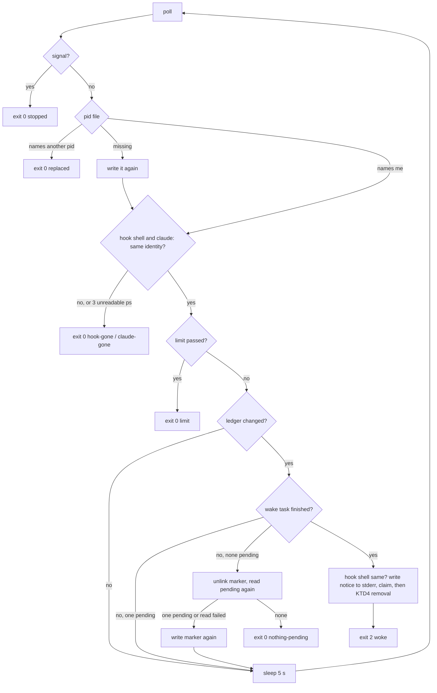

# Session Waiter Reliability (Batch 38) - Plan

## Goal Capsule

- **Objective:** A user who queues tasks with `--wake` every day can trust the waiter. A waiter ends when its hook shell ends, so no `tidegap` process polls for hours after Claude Code dropped the hook. A `queue add --wake` never loses its marker to a waiter or a sweep that removes it at the same moment. A wake is refused, not silently lost, when the task goes to a ledger that the Stop hook never reads. A progress line of a running command never blocks the tick for seconds while another process writes to the ledger. Real processes and real signals prove each stop path.
- **Means:** three PRs (Sequencing). PR A, the waiter's lifetime and real-signal tests (KTD1, KTD2). PR B, the wake marker races and the ledger rule (KTD3-KTD5). PR C, bounded progress writes (KTD6).
- **Authority:** the Product Contract decides what; the Planning Contract decides how. Binding repo rules:
  - `CLAUDE.md` (the gate, generated files, hard rules, git conventions).
  - `docs/solutions/best-practices/wake-an-idle-session-from-a-stop-hook.md` (the five waiter rules; PR A, PR B).
  - `docs/solutions/best-practices/session-notices-claim-once-per-finish.md` (print first, then claim; at-least-once; PR A, PR B).
  - `docs/solutions/best-practices/vetting-a-process-by-pid-before-signalling.md` (pid identity; PR A).
  - `docs/solutions/developer-experience/deterministic-process-kill-tests.md` (process tests; PR A).
  - `docs/solutions/best-practices/channels-url-policy-and-child-process-rules.md` (progress lines and their caps; PR C).
  - `docs/solutions/workflow-issues/public-repo-hygiene.md`, `docs/solutions/workflow-issues/generated-test-counts-merge-conflict.md`, `docs/solutions/developer-experience/folding-review-fixes-into-commits.md`, `docs/solutions/developer-experience/worktree-environment-setup.md`.
- **Owner decisions already taken (do not reopen):** reliability over features; no silent partial paths; notifications on the final outcome only; an interrupted run is failed; at-least-once for session notices (a duplicate is better than a lost notice); nothing enters the session except task ids, status, fork or fresh, and the open command (no task text, no reply). Out of scope: new features (a reply command, UI quick add), DB schema changes, receipt changes, and any acceptance that needs the owner's live session (Owner check after merge only). Release 0.21.0 (PR #248) is separate: no PR here touches version fields, the README status line or the CHANGELOG heading.
- **Execution profile:** one Opus `ce-work` agent per PR in `.worktrees/<branch>`, units in order. Simplify runs inside each PR on its code. One `ce-code-review` per PR at the end, Sonnet reviewers by risk: 2 for PR A (process lifetime, signals), 2 for PR B (races, refusals on two surfaces), 1 for PR C. No `pnpm qa ui`: no PR changes the page. `pnpm qa cli` once in PR A and once in PR B; `pnpm qa mcp` once in PR B; never two at the same time.
- **Who ships:** each PR ends green, with its review done and the diff reviewed. The agent does not merge. No version bump, release or publish.
- **Stop conditions:** stop and report in these cases.
  - A change needs a file outside its unit lists, apart from `CHANGELOG.md`, `packages/core-ts/src/index.ts` (exports) and the generated files.
  - A test or QA step needs the real `HOME`, `~/.tidegap`, `~/.claude` or `~/.config/tidegap`, or a live Claude Code session.
  - PR A: neither a copy nor a link of the Node binary named `claude` makes `ps -o comm=` end in `claude` on macOS (KTD2 needs a real `claude` ancestor).
  - PR A: Claude Code starts the Stop hook so that `$$` in `session-wake.sh` is not the hook's own shell (for example, it sources the script). The repo shows `sh "${CLAUDE_PLUGIN_ROOT}/hooks/session-wake.sh"`, so `$$` is the script's shell.
  - PR B: a writer of wake markers other than `queue add --wake` and `schedule_task` exists, or a remover other than the waiter and `wakeSweep`.
  - PR C: the Python core records `progress` events (KTD6 assumes it does not).
  - A gate fails the same way twice.
  - Evidence shows that a Key Technical Decision cannot work.

---

## Product Contract

### Summary

PR A binds the waiter to the shell of the Stop hook that started it. When that shell ends, or its parent ends, the waiter exits 0 at its next poll and claims nothing; the prompt hook keeps the notice. Real-process tests kill the hook shell, the fake `claude` process and the waiter itself with real signals.

PR B makes the waiter's pid file the only rule for "which waiter is newest", so the marker's modification time no longer decides anything; a missing pid file is written again. A waiter or the tick sweep that removes a wake marker looks at the ledger once more after the removal and puts the marker back when a wake task appeared. A wake marker is written and removed only for the default ledger: `queue add --wake` and `schedule_task` with `wake_session` refuse a task for another ledger, and a waiter on another ledger leaves the markers alone.

PR C bounds each progress write of a running command to a short lock wait. A busy ledger costs that line, not seconds of the tick's time.

### Problem Frame

Each item was checked on `main` at `9f50050f`. The source list is "Not in this batch" of `docs/plans/2026-11-12-2230-fix-command-job-reliability-and-last-residuals-plan.md` (30 lines). This plan takes 1 line (the session waiter, four parts), adds three review findings on the same path, and carries 29 lines over. Two lines of the list touch the handoff code but stay out: the `/tidegap:reply` command (a feature) and the notice query index (a DB schema change).

- **The waiter polls on after its hook shell is gone.** `session-wake.sh:37` runs `tidegap queue notices --wait --rewake` as a plain child of the hook's shell. The waiter stops on a signal, a newer waiter, its `claude` ancestor ending or changing session, or its 11 h 50 min limit (`packages/cli/src/handoff/waiter.ts:286-325`). Nothing binds it to the hook shell: no parent check, no pipe check while it polls. A write to a dead pipe at wake time claims nothing (`waiter.ts:132-144`, `:371-377`), so no notice is lost, but the process lives on. The learning states the gap and that what Claude Code signals at the hook timeout, `/clear` and exit is not proven (`wake-an-idle-session-from-a-stop-hook.md:47`).
- **The marker's modification time decides two things.** At start the waiter sets the marker's time and keeps it (`waiter.ts:272-277`). When its pid file is gone, a later time means "a newer waiter came, exit" (`:289-295`). But `queue add --wake` on an existing marker sets the time too (`packages/core-ts/src/handoff.ts:476`). So a wake enqueue while the pid file is missing makes the only waiter exit as "replaced", and an enqueue in the same millisecond as the waiter's own refresh compares equal. This is the "millisecond marker race". The pid file goes missing because an exiting waiter unlinks it after a read (`waiter.ts:330-336`), a read-then-unlink that can remove a newer waiter's file.
- **A marker removal can lose a new wake task.** The waiter reads the pending wake tasks, then unlinks the marker (`waiter.ts:353`, `:360-363`, `:402-403`). The enqueue commits the row, then writes the marker (`packages/cli/src/commands/queue-add.ts:304-312`; `packages/mcp-server/src/server.ts:1099-1107`). A row committed after the read and a marker refresh before the unlink leave a pending wake task with no marker: the next Stop starts no waiter. `wakeSweep` has the same read-then-unlink shape (`packages/cli/src/handoff/notices.ts:224-243`).
- **Markers are not scoped by ledger.** A marker is keyed by session id only (`handoff.ts:453`). A waiter started with `--db <other>` that finds nothing pending there removes the default ledger's marker (`waiter.ts:256`, `:362`, `:403`). `queue add --db <other> --wake` writes the marker for a task the Stop hook's waiter never sees (`queue-add.ts:273`, `:312`); that waiter then removes the marker, and the wake is lost with no word. The MCP server takes its ledger from `TIDEGAP_DB_PATH` (`server.ts:206-214`) and writes the marker the same way (`server.ts:1901-1903`).
- **Progress writes are synchronous and wait up to 5 s.** The tick records each progress line with `store.recordEvent` from the run's output callback (`packages/core-ts/src/scheduler.ts:1344-1361`), on the tick's event loop. Every disk ledger connection waits up to 5 s for the write lock (`packages/core-ts/src/storage/sqlite.ts:512-514`). While the waiter, a hook, `queue wait` or the page writes, one progress line can stop the tick's timers and pipes for seconds. The comment "a busy ledger costs this line, not the run" (`packages/core-ts/src/task-events.ts:348`) is true only for the result, not for the time. The recorder's first count reads all events of the task (`scheduler.ts:1360`).
- **No test with a real signal.** `packages/cli/test/handoff-wake.test.ts` uses fakes and an `AbortController` (`:551`). Its only real process is a `spawnSync` of the built CLI with no marker (`:626-631`). `scripts/plugin-hooks.test.mjs` uses a stub `tidegap` that exits at once.
- **Accepted, not changed:** `queue wait` prints the outcome, then claims the notice (`packages/cli/src/commands/queue-watch.ts:323-331`). A stop between the two shows the outcome again with the next prompt. This is the owner's at-least-once rule (`session-notices-claim-once-per-finish.md:26`). The handoff page says it for the prompt hook only (`apps/web/content/docs/12-handoff.md:73`); U3 adds the `queue wait` case.
- **Already fixed on `main`:** the tick's notice sweep and `queue notices` touch markers only for the default ledger (`isDefaultLedger`, `packages/cli/src/commands/tick.ts:328`, used at `:521` and `queue-watch.ts:417`; commit `a7af4b9f`). The waiter and the enqueue paths do not use it yet. Also already true: the pid file is written to a temporary name and renamed (`waiter.ts:199-205`), and the marker's content is never parsed, so its non-atomic `wx` create is harmless (`handoff.ts:477`; readers only test that it exists).
- **Not true on `main`:** "the waiter writes progress". The waiter writes no progress; its writes are the pid file, the marker's time and unlinks. The line's "synchronous progress writes" is the tick's progress events of PR C (Assumptions).

### Requirements

**PR A: the waiter's lifetime**

- R1. A waiter started by the Stop hook ends within one poll (5 s) plus slack when the hook's shell ends, when the shell's parent ends, or when the shell's pid names another process. It exits 0, claims nothing and leaves the notice to the prompt hook. A waiter started without the hook (by hand, or by an older plugin) keeps today's rules.
- R2. Real-process tests cover: the hook shell killed, the `claude` process killed, the waiter sent SIGTERM, and a wake task that completes (the hook shell exits 2 with the notice on stderr).
- R3. The handoff page and the wake learning state the lifetime as the code applies it, and the page says that `queue wait` can show an outcome once more.

**PR B: wake markers**

- R4. Only the pid file decides which waiter is newest. A missing pid file is written again. A wake enqueue never makes a waiter exit.
- R5. After a waiter or the tick sweep removes a wake marker, a wake task that a concurrent enqueue added still gets a marker.
- R6. Wake markers belong to the default ledger. `queue add --wake` and `schedule_task` with `wake_session: true` refuse, before they enqueue, a task whose ledger is not the default one. A waiter on another ledger removes no marker.

**PR C: progress writes**

- R7. A progress write waits at most 100 ms for the ledger's write lock. A line that does not get it is dropped with the existing one warning per task; the run and the caps are unchanged.

### Acceptance Examples

- AE1. Covers R1. Given a fake `claude` process that runs `session-wake.sh` with a wake marker and a pending wake task, when the hook shell gets SIGKILL, then the waiter process is gone within 12 s, the task has no `notified` event and the marker is still there.
- AE2. Covers R4. Given a waiter whose pid file was removed, when `queue add --wake` refreshes the marker, then the waiter writes its pid file again and keeps waiting.
- AE3. Covers R5. Given a waiter whose pending read found nothing, when a wake task is committed between that read and the marker's removal, then the marker exists after the waiter's step and the waiter keeps waiting.
- AE4. Covers R6. Given `tidegap queue add --db <tmp>/other.db --wake ...` inside a session, then it exits 2, queues nothing and writes no marker.
- AE5. Covers R7. Given a second connection that holds the ledger's write lock, when the tick records a progress line, then the call returns within 300 ms and the line is not in the ledger.

### Scope Boundaries

#### Not in this batch

Each line was checked true on `fbc9fd9c` and on `9f50050f`; the lines are carried over unchanged from batch 37, without the session-waiter line that this batch takes.

- No `/tidegap:reply` slash command; MCP `reply_task` serves agents.
- Three site lint warnings (`apps/web/src/app/plan/page.tsx:57`, `apps/web/src/components/best-window.tsx:30`, `apps/web/src/components/deadline-field.tsx:35`).
- A Codex adapter: a feature, not a residual.
- `tidegap ui` builds the grid feed from the env file once (`packages/cli/src/commands/ui.ts:104-109`).
- The hidden page window keeps its web view; closing it already dismantles the view.
- The URL policy reads the UI port from the ledger folder only (`packages/cli/src/channels/emit.ts:212`).
- A URL secret's hint shows its host (`packages/cli/src/channels/channel-setup.ts:179`).
- S2.21 has no step for the Change-token confirm (`scripts/qa/ui-flows.mjs:379`).
- A second rate limiter in `packages/cli/src/ui/settings.ts`; the name `isIntegrationsRoute` also covers `/api/settings`.
- No browser test for the site video's preload and the 390 px layout.
- Untested: an invalid ntfy server URL, Slack 5xx and padded bodies, an empty K13 code list, a duplicate docs page.
- Command jobs: background children, `setsid` (rest of the line; see Considered and not built).
- Test-tool minors: Ctrl-C in `build-test-count`, `ui-seed --serve` cleanup order, the `*.lock` guard, the `macos.yml` paths filter.
- `run-shell` keeps its stop state for the worker's lifetime.
- `jobs-runner.test.ts:348` failed once on the `TZ=Pacific/Kiritimati` leg; a second failure gets a fix brief.
- No drift rule for the receipts page `{#receipt-models}` facts.
- `energySource` can say "measured" when a typical count was billed (needs a new signed field).
- Adapters still compute `total = input + output`; TS and Python differ when both counts arrive without a total (rest of the line).
- The usage popover and the header room are measured in Chromium only, not in the Mac app's web view.
- The notice query has no index (no schema change in a sweep).
- The MCP "outside every allowed folder" refusal is tested only in the core.
- The OpenClaw plugin tests see the plugin as `any`.
- `check-hygiene` knows only the values it lists.
- The usage `fillSetup` dialog has no unit test.
- Fractional widths between 719 and 720 px (zoom) match no header tier.
- At 720 px the Agenda row badges overlap the provider text; it needs a browser reproduction first.
- K20 and K21 do not check order.
- A quick in-call resend of 408 and 425 (`isRetryable`, `packages/core-ts/src/scheduler.ts:4101-4116`). The task retry covers them; a resend inside the call would add a third retry layer for two rare codes.
- OpenClaw `deliveryStorePath` has the same first-tool-call limit as `disableOsNotifications`: a task the startup dispatcher finishes before the first tool call reads its delivery preference from the default store (`packages/openclaw-plugin/src/index.ts:259-266`). Found during batch 36 planning; KTD9 records the held outcome in the default store and does not move it.

Owner-only rows (23) need the owner's accounts, devices or decisions; they are not repo work.

#### Considered and not built

- **Detach the waiter (`nohup`, a new session) so it outlives the hook.** The opposite of R1. The hook's own shell must stay alive for Claude Code to read its exit 2 and stderr (`session-wake.sh:37-45`), so a detached waiter could not wake anybody.
- **A sequence number in the marker instead of its time.** It would fix the equal-millisecond case only. The marker would still serve two purposes (arm the hook, rank the waiters) with two writers, and the read-then-unlink of the pid file would remain. KTD3 takes the marker out of the ranking.
- **One marker per ledger (`wake/<ledger-hash>/<session_id>`).** It would let another ledger wake a session, but the Stop hook and the prompt hook read the default ledger only (`tick.ts:321-327`). It needs a hook change and a second ledger path in the hook for a case nobody uses. KTD5 refuses it instead.
- **Progress writes in a worker thread or a queue flushed later.** `node:sqlite` and `better-sqlite3` are synchronous; a worker needs its own connection and shutdown order for 24 lines per task at most. A short lock wait bounds the cost with no new moving part (KTD6).
- **Leave the pid file on exit and sweep it later.** It would close the guarded unlink's race, but KTD3's "missing: write it again" already makes that race harmless, and it would add a sweep rule and change QA step S29.10.
- **Make `queue wait` claim before it prints.** It reverses the owner's at-least-once rule: a crash after the claim would lose the outcome.

### Assumptions

- "Synchronous progress writes" in the source line means the tick's `progress` events (`scheduler.ts:1344-1361`). The waiter writes no progress. The line came from the batch 29 PR C review, which held both the waiter and the progress events (`docs/plans/2026-10-30-2156-feat-session-handoff-and-push-back-plan.md`, U12 and U13).
- A copy or link of the Node binary named `claude` makes `ps -o comm=` end in `claude` (stop condition).
- `$$` in `session-wake.sh` is the hook's shell. The hook's run 2 lasted 2 h 48 min with the shell alive (`wake-an-idle-session-from-a-stop-hook.md:45`), so binding the waiter to it does not shorten a normal wait.
- Setting `PRAGMA busy_timeout` before one statement and restoring it after is safe: both drivers are synchronous, so no other statement runs on that connection in between.
- The Python core records no `progress` events (stop condition).

### Sources / Research

- `docs/plans/2026-11-12-2230-fix-command-job-reliability-and-last-residuals-plan.md` (the source list, the batch structure; this plan follows it).
- `docs/plans/2026-10-30-2156-feat-session-handoff-and-push-back-plan.md` (KTD4: the waiter design; U12, U13).
- `docs/solutions/best-practices/wake-an-idle-session-from-a-stop-hook.md`, `docs/solutions/best-practices/session-notices-claim-once-per-finish.md`.
- `packages/cli/test/jobs-runner.test.ts:317-360` (the child process harness for signal tests).
- Research ran as one code map of `packages/cli/src/handoff/`, the plugin hooks and the enqueue paths, plus bounded reads of the cited lines; no external research.

---

## Planning Contract

### Key Technical Decisions

- KTD1. **The waiter lives no longer than its hook shell.** `session-wake.sh` starts the CLI with `TIDEGAP_HOOK_PID=$$`. The waiter reads it once (digits only, above 1). At start it takes the shell's identity: `ps -o ppid=,uid=,lstart=,comm=`, the pid file rule of `vetting-a-process-by-pid-before-signalling.md` plus the parent pid. At each poll, and right before the stderr write of a wake, the identity must be the same. A missing process, another identity or a new parent (the shell was reparented because its parent ended) ends the waiter with `idle("hook-gone")`: exit 0, nothing claimed, markers untouched. The `ps` call reads the hook shell and the `claude` ancestor together, so a poll still spawns one process. One unreadable `ps` is not "gone": the existing three-polls rule (`waiter.ts:52`) applies to both. Without the variable (a waiter started by hand, an older plugin) the waiter keeps today's rules; an older CLI ignores the variable. The waiter's lifetime is then the shortest of: the hook shell, the `claude` ancestor and its session, the newest-waiter rule, the 11 h 50 min limit and a signal. Governs R1.
- KTD2. **Real processes, real signals.** A new test file starts, in an isolated `HOME`, a fake `claude`: a copy or link of the Node binary named `claude` that runs a fixture script (`packages/cli/test/fixtures/fake-claude-session.mjs`). The fixture runs `sh packages/claude-code-plugin/hooks/session-wake.sh` with the hook input on stdin and a `PATH` whose `tidegap` runs the built CLI (`packages/cli/dist/index.js`, as `handoff-wake.test.ts:626-631` does). The fixture writes the pids it knows (hook shell, waiter) to files in the temp folder. The tests follow `deterministic-process-kill-tests.md`: wait for each pid file, assert pids above 1 before a signal, poll liveness every 50 ms, and never assert "gone" from one check. The poll stays 5 s (no test-only knob), so a "gone" bound is 12 s; the file runs alone in its own worker and kills every process it started in `afterEach`. Governs R2.
- KTD3. **The pid file alone ranks the waiters.** Each waiter writes its pid at start, as today (temporary name, rename), and removes it on exit only when it still names itself, as today (`waiter.ts:330-336`). At each poll: the file names another pid, so exit `replaced`; the file is missing, so write it again; nothing else. The marker's time no longer takes part (`refreshed` and the comparison at `:289-295` go). The waiter still sets the marker's time at start; that time is only the marker's age for `wakeSweep`. The guarded unlink can still remove a newer waiter's file (read, then the newer rename, then the unlink); that waiter writes it again at its next poll, so the race costs nothing. When a newer waiter ends, an older one still running finds the file missing and takes over; it serves the same session, with its own hook shell (KTD1) and the limit counted from its older start. A newer waiter that wrote its file before an older one's slower rename loses to it, with the same result. Governs R4.
- KTD4. **Remove, then look again.** At each place that removes a wake marker because no wake task is pending (`waiter.ts:360-363`, `:402-403`, and `wakeSweep`), the code unlinks the marker, then reads the session's pending wake tasks once more. When one is pending, or the read fails, it writes the marker again (`writeWakeMarker`). At `:360-363` the waiter then keeps waiting; at `:402-403` it still exits 2 (the wake happened) and the next Stop starts a waiter for the new task. Because the enqueue commits the row before it writes the marker, a concurrent task is either seen by the second read or writes its marker after the unlink. Governs R5.
- KTD5. **Wake markers belong to the default ledger.** `defaultDbPath` and `isDefaultLedger` move from `packages/cli/src/commands/tick.ts` to the core (`packages/core-ts/src/handoff.ts`), and `tick.ts` re-exports them, so the CLI and the MCP server use one rule. `queue add --wake` with a `--db` that is not the default ledger exits 2 before it enqueues, as `--wake` outside a session already does, with one line: the plugin's Stop hook reads only the default ledger, so the wake could never fire. `schedule_task` with `wake_session: true` refuses the same way, among the existing wake refusals and before the enqueue, when the server's ledger (`TIDEGAP_DB_PATH`, `:memory:` included) is not the default one. The waiter removes wake and notice markers only when `isDefaultLedger(dbPath)`, the pattern of `queue-watch.ts:417`; on another ledger it may wake but touches no marker. Governs R6.
- KTD6. **A progress write waits 100 ms at most.** `TaskStore.recordEvent(taskId, event, opts?)` takes `busyMs`. With it, the store sets `PRAGMA busy_timeout` to that value for the insert and restores the connection's own value in `finally`. The scheduler's progress recorder passes `PROGRESS_BUSY_MS` (100, exported next to the other progress caps in `task-events.ts`). The recorder's first count uses a new `countTaskEvents(taskId, kind)` (one `COUNT(*)`) instead of listing every event. A line that cannot get the lock is dropped, with the existing one warning per task. No schema change and no new event field. Governs R7.

### High-Level Technical Design

The waiter after KTD1, KTD3 and KTD4, one poll (directional):

Marker removal in the waiter and `wakeSweep` happens only for the default ledger (KTD5). A waiter removes the pid file only when it still names itself (KTD3).

### Sequencing

PR A and PR C share no source file. PR B changes `waiter.ts` and `handoff-wake.test.ts` after PR A, so it starts from `main` once PR A is merged. All three share `CHANGELOG.md` and the generated files (README test markers, `apps/web/src/lib/tests.generated.ts`, `apps/web/src/lib/docs.generated.ts`, `apps/web/public/llms-full.txt`). On a conflict in a generated file, take `main`'s version, run the generator and commit (`generated-test-counts-merge-conflict.md`). PR A and PR B both edit `12-handoff.md` and the wake learning, in that order.

| Order | PR | Branch | Units | Value | Waits on |
|---|---|---|---|---|---|
| 1 | PR A | `fix/session-waiter-lifetime` | U1-U3 | No waiter outlives its hook; real-signal proof | none |
| 2 | PR C | `fix/bounded-progress-writes` | U7 | A busy ledger never stalls the tick | none |
| 3 | PR B | `fix/wake-marker-races` | U4-U6 | No lost or silently dropped wake | PR A merged |

PR A and PR C start together (two agents, two builds). PR B starts when PR A is merged. `pnpm qa cli` runs once in PR A and once in PR B, never at the same time. Merge in the order above.

### Risks

- **A false "hook gone" ends a good waiter.** Then the session gets no wake, and the prompt hook still delivers. The identity check uses the existing three-polls rule for an unreadable `ps`, and U1 tests a `ps` that fails once. The parent pid in the identity changes only when the hook shell's parent ends.
- **Real-process tests are slow and load-sensitive.** The 5 s poll makes each "gone" case take up to 12 s. KTD2 keeps the cases few (five), runs the file alone, and kills every started process in `afterEach`.
- **An older waiter takes over when a newer one ends.** It can wait until its own limit, which started at an earlier turn's end. It is bound to its own hook shell and `claude` process (KTD1), so it never outlives them.
- **The new refusal breaks a script that used `--db` with `--wake`.** Such a script never got a wake (Problem Frame). The refusal names the reason, and the CHANGELOG says it.
- **The restored busy timeout is wrong after an error.** The `finally` restores it; U7 tests that a normal write after a failed bounded write still waits for the lock.

---

## Implementation Units

### PR A: `fix/session-waiter-lifetime`

Waits on: none.

### U1. The waiter ends with its hook shell

- **Goal:** no waiter polls after the hook that started it is gone.
- **Requirements:** R1; KTD1.
- **Files:** `packages/cli/src/handoff/waiter.ts`, `packages/cli/src/index.ts` (pass the variable), `packages/claude-code-plugin/hooks/session-wake.sh`, `packages/cli/test/handoff-wake.test.ts`, `scripts/plugin-hooks.test.mjs`.
- **Approach:** the variable is read in `index.ts` and passed as an option, so `waiter.ts` stays testable with its fake `proc`; `proc.identity` takes the extra `ppid` field for the hook shell. The waiter's header comment lists the new stop reason.
- **Test scenarios:**
  - With a hook pid whose identity changes at the third poll (fake `proc`): the waiter returns `hook-gone`, exit 0, claims nothing, and the wake marker and the notice remain.
  - The hook shell's parent pid changes: `hook-gone`.
  - One failed `ps` for the hook shell: the waiter keeps waiting; three in a row: `hook-gone`.
  - The hook shell is gone when a wake task completes: no stderr write, no claim, `hook-gone`.
  - No hook pid (option absent), and an invalid value (`0`, `1`, `abc`): today's behaviour; the existing cases pass unchanged.
  - `plugin-hooks.test.mjs`: `session-wake.sh` passes `TIDEGAP_HOOK_PID` equal to its own `$$` to the stub `tidegap` (the stub records its environment), and still finishes inside its latency budget without a marker.
- **Verification:** `pnpm --filter @tidegap/cli test` passes; `node --test scripts/plugin-hooks.test.mjs` passes.

### U2. Real-process tests with real signals

- **Goal:** each stop path of the waiter is proven with real processes.
- **Requirements:** R2; KTD2.
- **Dependencies:** U1.
- **Files:** `packages/cli/test/handoff-wake-process.test.ts` (new), `packages/cli/test/fixtures/fake-claude-session.mjs` (new). The existing `packages/cli/test/fixtures/fake-claude/` is the adapter's fake (a shell script, whose `ps -o comm=` is the shell) and stays as it is.
- **Execution note:** write the hook-shell case first with the fixture's `TIDEGAP_HOOK_PID` left out (today's rule): it must show the waiter alive 12 s after the shell's SIGKILL. Then pass the variable, as `session-wake.sh` does after U1: the case must pass.
- **Test scenarios:**
  - Covers AE1. SIGKILL to the hook shell: the waiter is gone within 12 s; no `notified` event; the wake marker remains.
  - SIGTERM to the fake `claude` (which exits on it): the waiter is gone within 12 s, no ledger row changed, and the marker remains.
  - The hook started through a wrapper that stays alive (`sh -c 'sh session-wake.sh'`, as a runner may start it): the waiter is still alive after 12 s (no false `hook-gone`).
  - SIGTERM to the waiter: it exits at once (within 2 s), and the hook shell exits 0 with nothing on stderr.
  - A second store completes the wake task: the hook shell exits 2 with a stderr text that starts with `Tidegap: ` and names the task id; the task has a `notified` event with `via` `rewake`.
- **Verification:** `pnpm build && pnpm --filter @tidegap/cli test` passes twice in a row.

### U3. The lifetime in the docs, and CHANGELOG

- **Goal:** the page and the learning say how long a waiter lives.
- **Requirements:** R3.
- **Dependencies:** U1, U2.
- **Files:** `apps/web/content/docs/12-handoff.md`, `docs/solutions/best-practices/wake-an-idle-session-from-a-stop-hook.md`, `CHANGELOG.md`.
- **Approach:** the page's waiter line (`12-handoff.md:86`) adds "when the hook's shell ends". The `queue wait` section (`:100`) adds one sentence: a `queue wait` stopped right after it printed can show the same outcome once more with the next prompt. The learning's "Not proven yet" paragraph (`:47`) keeps the open question about Claude Code's signals and replaces "it polls on" with the new rule and the test file.
- **Test scenarios:**
  - Test expectation: none -- docs; the drift rules still pass.
- **Verification:** `node scripts/qa/docs-drift.mjs` prints `PASS`; `pnpm gen:docs` committed; `pnpm qa cli` once. CHANGELOG `[Unreleased]` `### Fixed`: the waiter ends when its hook's shell ends; real-signal tests.

### PR B: `fix/wake-marker-races`

Waits on: PR A merged (same `waiter.ts` and `handoff-wake.test.ts`).

### U4. The pid file alone ranks the waiters

- **Goal:** a wake enqueue never makes a waiter exit, and no waiter removes another's pid file.
- **Requirements:** R4; KTD3.
- **Files:** `packages/cli/src/handoff/waiter.ts`, `packages/cli/test/handoff-wake.test.ts`.
- **Test scenarios:**
  - Covers AE2. Pid file removed, then `writeWakeMarker` refreshes the marker with a later time: the waiter writes its pid file again and keeps waiting.
  - The marker's time set in the same millisecond as the waiter's start: no effect on the waiter (fake clock).
  - A newer waiter writes its pid: the older one exits `replaced` at its next poll and leaves the newer one's file.
  - The newer waiter ends and removes its own file: the older one writes the file again and keeps waiting (the old rule made it exit when the marker was newer).
  - QA step S29.10 (`scripts/qa/cli-flows.mjs:844`, pid file gone after a wake) passes unchanged.
- **Verification:** `pnpm --filter @tidegap/cli test` passes.

### U5. Remove, then look again; markers only for the default ledger

- **Goal:** a concurrent wake task always keeps its marker, and another ledger never removes it.
- **Requirements:** R5, R6 (the waiter part); KTD4, KTD5.
- **Dependencies:** U4.
- **Files:** `packages/cli/src/handoff/waiter.ts`, `packages/cli/src/handoff/notices.ts`, `packages/cli/test/handoff-wake.test.ts`, `packages/cli/test/handoff-notices.test.ts`.
- **Test scenarios:**
  - Covers AE3. A fake store whose first pending read is empty and whose second read holds a wake task: after the step the marker exists and the waiter keeps waiting.
  - The second read throws: the marker is written again and the waiter keeps waiting.
  - After a wake with a wake task that appeared during the claim: exit 2, and the marker exists.
  - `wakeSweep` with a task that appears between its read and its unlink: the marker exists after the sweep.
  - A waiter with `--db` on another ledger and nothing pending there: exit 0 `nothing-pending`, and the default ledger's wake and notice markers remain.
- **Verification:** `pnpm --filter @tidegap/cli test` passes.

### U6. A wake needs the default ledger, docs, and CHANGELOG

- **Goal:** a wake that could never fire is refused, not lost.
- **Requirements:** R6; KTD5.
- **Dependencies:** U5.
- **Files:** `packages/core-ts/src/handoff.ts`, `packages/core-ts/src/index.ts`, `packages/cli/src/commands/tick.ts`, `packages/cli/src/commands/queue-add.ts`, `packages/mcp-server/src/server.ts`, `packages/core-ts/test/handoff-enqueue.test.ts`, `packages/cli/test/handoff-wake.test.ts`, `packages/mcp-server/test/server.handoff.test.ts`, `apps/web/content/docs/03-cli.md`, `apps/web/content/docs/04-tools.md`, `apps/web/content/docs/12-handoff.md`, `docs/solutions/best-practices/wake-an-idle-session-from-a-stop-hook.md`, `CHANGELOG.md`.
- **Approach:** move the two functions; `tick.ts` re-exports them, so the other CLI imports do not change. The core test file that covers `writeWakeMarker` (`handoff-enqueue.test.ts`) gets the real-path cases; the CLI's `isDefaultLedger` tests in `packages/cli/test/handoff-notices.test.ts` stay and run through the re-export. The refusal text names the default ledger path form (`~/.tidegap/queue.db`), not the user's real path. The docs say: `--wake` and `wake_session` need the default ledger. The learning gets the pid-file rule, the remove-then-look-again rule and the ledger rule.
- **Test scenarios:**
  - Covers AE4. `queue add --db <tmp>/other.db --wake` in a session: exit 2, no task in either ledger, no marker.
  - `queue add --wake` on the default ledger (isolated `HOME`): as today, the marker is written.
  - `--db` naming the default ledger through a symlinked folder: accepted (the real-path rule).
  - MCP `schedule_task` with `wake_session: true` and a server on another ledger: refused with the wake refusal shape, nothing queued, no marker; with `TIDEGAP_DB_PATH=:memory:`: refused.
  - MCP on the default ledger: as today.
  - The core `isDefaultLedger` cases pass; the CLI's existing `isDefaultLedger` and notice sweep tests pass unchanged.
- **Verification:** `pnpm --filter @tidegap/core test`, `pnpm --filter @tidegap/cli test` and `pnpm --filter @tidegap/mcp test` pass; `node scripts/qa/docs-drift.mjs` prints `PASS`; `pnpm gen:docs` committed; `pnpm qa cli` and `pnpm qa mcp` once each. CHANGELOG `[Unreleased]` `### Fixed`: no waiter exits for a wake enqueue; a concurrent wake task keeps its marker; `--wake` and `wake_session` refuse a ledger the Stop hook does not read.

### PR C: `fix/bounded-progress-writes`

Waits on: none. A separate PR: it touches no handoff file.

### U7. A progress write waits 100 ms at most, and CHANGELOG

- **Goal:** a busy ledger never stalls the tick for a progress line.
- **Requirements:** R7; KTD6.
- **Files:** `packages/core-ts/src/storage/sqlite.ts`, `packages/core-ts/src/task-events.ts`, `packages/core-ts/src/scheduler.ts`, `packages/core-ts/src/index.ts`, `packages/core-ts/test/task-events.test.ts`, `packages/cli/test/handoff-progress.test.ts`, `docs/solutions/best-practices/channels-url-policy-and-child-process-rules.md`, `CHANGELOG.md`.
- **Approach:** the store option and the count query; the scheduler's `progressFor` uses both. The learning's progress section (`channels-url-policy-and-child-process-rules.md:91`) adds the lock bound.
- **Test scenarios:**
  - Covers AE5. A disk ledger in a temp folder; a second connection runs `BEGIN IMMEDIATE` and holds it. A bounded `recordEvent` returns within 300 ms, throws `SQLITE_BUSY` to the recorder, and the line is not stored; after `COMMIT` the next line is stored.
  - After a bounded write failed, an unbounded write on the same connection still waits for the lock (the busy timeout was restored).
  - `countTaskEvents(taskId, "progress")` equals the number of progress events, and ignores other kinds and other tasks.
  - The progress caps (5 s quiet, 15 s gap, 24 per task) pass unchanged; `handoff-progress.test.ts` passes.
- **Verification:** `pnpm --filter @tidegap/core test` and `pnpm --filter @tidegap/cli test` pass. CHANGELOG `[Unreleased]` `### Fixed`: a progress line waits at most 100 ms for a busy ledger.

---

## Verification Contract

| Check | PR A | PR B | PR C |
|---|---|---|---|
| `pnpm build && pnpm typecheck && pnpm gen:tests:check && pnpm gen:docs:check && node scripts/qa/docs-drift.mjs` | yes | yes | yes |
| `pnpm --filter <package> test` for each package touched | cli | core, cli, mcp | core, cli |
| `node --test scripts/plugin-hooks.test.mjs` | yes | yes | - |
| `pnpm qa cli` (once, nothing else running) | yes | yes | - |
| `pnpm qa mcp` (once) | - | yes | - |
| `pnpm check:hygiene` | yes | yes | yes |

### Owner check after merge

- PR A, the wake still works: in an idle session queue `--runner command --by 30m --wake "sleep 60; echo done"`. At 20 s `pgrep -fl "queue notices --wait"` lists the session's waiter, and the session wakes by itself within about 10 s after the task finishes. A waiter that is gone at 20 s means KTD1 misreads the real hook shell: report it before PR B starts.
- PR A, no waiter outlives its hook: queue a task with `--not-before 30m --by 2h --wake` in a session, then run `/clear`, and in another session exit Claude Code with a pending wake task. After 10 s, `pgrep -fl "queue notices --wait"` lists no waiter of those sessions. This also answers the learning's open question (what Claude Code signals at `/clear` and exit); record both results in the learning.
- PR B: none beyond the daily use of `--wake`.

---

## Definition of Done

- Every unit's verification passed at the end of its PR, with the command output quoted in the PR body.
- Each PR has CHANGELOG lines under `[Unreleased]` in its last unit, and its generated files regenerated.
- No version bump, release, publish or merge by the agent; no change to version fields, the README status line or the CHANGELOG heading.
- No DB schema change, no receipt change, nothing new enters the session's context.
- No dead-end or experimental code from abandoned approaches is left in the diff.
- Each PR's `ce-code-review` has no open P0 or P1.
