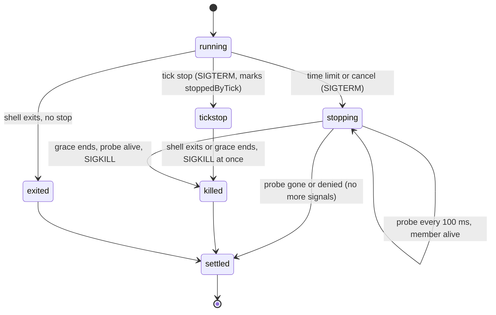

# Command-Job Reliability and Last Residuals (Batch 37) - Plan

## Goal Capsule

- **Objective:** A user who runs command jobs every day can trust how a run ends. A stopped run never signals a process group that is no longer its own, a timed-out run settles as soon as its group is gone, and a run that a stopping tick ended says "interrupted", not "stopped by signal SIGTERM". The job routes of the page cannot be flooded with pause, resume and run-now calls, and a run reads the same on the page and in the digest. The jobs page states the budget rule that the code applies. The two cores order a multi-model receipt the same way, the "token counts: partial" text never differs between surfaces, and a webhook secret does not follow a new path on the shared hosts that KTD10 confirms.
- **Means:** three PRs of three units each (Sequencing). PR A, the command runner (KTD1-KTD4). PR B, the job routes and the preview rule (KTD5-KTD7). PR C, parity and shared hosts (KTD8-KTD10).
- **Authority:** the Product Contract decides what; the Planning Contract decides how. Binding repo rules:
  - `CLAUDE.md` (the gate, generated files, hard rules, git conventions).
  - `docs/solutions/best-practices/channels-url-policy-and-child-process-rules.md` (process groups, the runner's stop rules; PR A).
  - `docs/solutions/developer-experience/deterministic-process-kill-tests.md` (stop tests run in a child process; PR A).
  - `docs/solutions/best-practices/loopback-web-ui-hardening.md` (rate limits and token kinds; PR B).
  - `docs/solutions/logic-errors/multi-model-receipt-billing.md`, `docs/solutions/best-practices/parity-twin-holds-what-it-cannot-run.md`, `docs/solutions/best-practices/channels-one-step-connect-secrets-file-and-atomic-lock.md` (PR C).
  - `docs/solutions/workflow-issues/public-repo-hygiene.md`, `docs/solutions/workflow-issues/generated-test-counts-merge-conflict.md`, `docs/solutions/developer-experience/folding-review-fixes-into-commits.md`, `docs/solutions/developer-experience/worktree-environment-setup.md`.
- **Owner decisions already taken (do not reopen):** reliability over features; no silent partial paths; honest receipts; notifications go out on the final outcome only; jobs run on the Node daemon only; an interrupted run is failed; no Rust or Go rewrite; the UI, the Mac app and the extension show and postpone or retry tasks only; a feature PR never bumps versions. Out of scope: a Codex adapter, a `/tidegap:reply` command, any receipt schema or signed-field change (the `energySource` "measured" item stays out), any DB schema change (the notice index), anything that needs a browser reproduction first, site lint warnings outside a web unit. Release 0.21.0 (PR #248) is separate: no PR here touches version fields, the README status line or the CHANGELOG heading.
- **Execution profile:** one Opus `ce-work` agent per PR in `.worktrees/<branch>`, units in order. Simplify runs inside each PR on its code. One `ce-code-review` per PR at the end, Sonnet reviewers by risk: 2 for PR A (process signals), 1 for PR B, 1 for PR C. No `pnpm qa ui`: no PR changes the page's look. PR A runs `pnpm qa cli` once; PR B runs `pnpm qa cli` once, never at the same time as PR A.
- **Who ships:** each PR ends green, with its review done and the diff reviewed. The agent does not merge. No version bump, release or publish.
- **Stop conditions:** stop and report in these cases.
  - A change needs a file outside its unit lists, apart from `CHANGELOG.md`, `packages/core-ts/src/index.ts` (exports) and the generated files.
  - A test or QA step needs the real `HOME`, `~/.tidegap`, `~/.claude` or `~/.config/tidegap`.
  - PR A: on macOS or Linux, `process.kill(-pgid, 0)` succeeds for a group whose only members have exited and been reaped (KTD2 depends on `ESRCH` then).
  - PR A: a host other than `tidegap tick --once` and `tidegap tick --daemon` calls `runShell` (KTD3 reads the tick's stop as the only stop).
  - PR A: the `TZ=Pacific/Kiritimati` leg of `jobs-runner.test.ts` fails a second time. Stop and report with the failure output; the fix brief that follows lands in PR A with its own test, as the carried-over line asks.
  - PR C: fewer than two of the candidate hosts in KTD10 can be confirmed from the provider's own documentation.
  - A gate fails the same way twice.
  - Evidence shows that a Key Technical Decision cannot work.

---

## Product Contract

### Summary

PR A puts the process-group signal in one helper with one safety rule, so no caller can signal group 0 or 1. A command that its time limit or a cancel stopped has its group probed while the grace runs: once the group is empty, the runner sends no more signals and the run settles. A command that the tick's own stop ended fails as interrupted, with the same text and failure class as a run a dead tick left behind.

PR B counts pause, resume and run-now in the job write limit of the page server. It builds the page's run preview and the digest's run line from one core rule; the OS notification keeps its local text, built from the same parts. It corrects the jobs page sentence about the budget.

PR C makes the Python core order multi-model receipt entries as the Node core does, gives the "token counts: partial" text one source, and adds the confirmed shared webhook hosts to the keep rule.

### Problem Frame

Each item was checked on `main` at `fbc9fd9c`. The source list is "Not in this batch" of `docs/plans/2026-11-11-1936-fix-user-visible-reliability-residuals-plan.md` (36 lines; checked true on `8ed525c1` and again on 2026-11-11). This plan takes 9 items from 7 lines, finds one already fixed, drops one that is done, and carries 30 lines over.

- **The process-group signal has four copies.** `run-shell.ts` has `signalGroup` (no fallback, `packages/cli/src/jobs/run-shell.ts:101-107`) and a per-run `killGroup` (falls back to `child.kill`, `:295-306`). The Claude Code adapter has its own (`packages/cli/src/providers/claude-code.ts:733-739`), and it has no guard for a pid of 0 or 1. The channel command driver has a fourth, with the same `child.kill` fallback (`packages/cli/src/channels/drivers/child.ts:52-63`).
- **A stopped group can be signalled after its id is free.** A timed-out or cancelled run sends SIGTERM, then SIGKILL after the grace (5 s), even when the shell exited and the group emptied before that (`run-shell.ts:308-320`; the comment at `:312-313` keeps the timer on purpose). The tick-stop path does not have this gap: when the shell exits, `untrackGroup` clears its SIGKILL timer and kills the rest of the group at once (`:197-201`). If the id is reused inside the per-run grace, the SIGKILL reaches another group. The header states the gap (`:35-37`). The run also waits the full grace before it settles, though nothing is left to stop.
- **A command the tick stopped reads as a signal exit.** On SIGTERM or SIGINT to the tick, the runner stops each group (`run-shell.ts:144-153`). The shell then ends by SIGTERM, and the adapter reports `command stopped by signal SIGTERM` with `steps: ["command"]` (`packages/cli/src/providers/command.ts:217-219`), which `classifyFailure` files as `exit` (`packages/core-ts/src/run-limits.ts:632`). A run that a dead tick left gets `interrupted: the tick stopped during the run` and class `interrupted` (`packages/core-ts/src/scheduler.ts:2398`, `packages/core-ts/src/jobs.ts:214`). The source line says the run "fails its occurrence for good"; that part is not true on `main`: `exit` is retryable, and the job sweep makes the slot's retry row (`jobs.ts:421-431`). What is wrong is the cause the user reads and the class on the event.
- **Pause, resume and run-now have no rate limit.** The page server applies the job write limiter only to job author routes (`packages/cli/src/ui/server.ts:399-411`); `isJobAuthorRoute` covers create, preview, secrets, update and remove (`packages/cli/src/ui/jobs-api.ts:778-784`). Any token, the extension's too, can call the three actions without bound.
- **The run preview rule has three copies.** `preview` in `jobs-api.ts:359-368`, `runPreview` in `packages/cli/src/channels/emit.ts:486-495`, and `oneLine` with `firstErrorLine` in `packages/core-ts/src/notify.ts:112-136`. Each picks the first error line or the result, redacts it and removes control characters; they differ in whitespace, the cut and the ellipsis.
- **The jobs page names the wrong cause for an over-budget run.** It says "a model with costly output can go a little over it" (`apps/web/content/docs/10-jobs.md:66`). The code sets the output ceiling from the output price, so output cannot exceed what the budget leaves. The real causes are the input estimate (4 characters per token at list prices) and a model with no price in the table, which gets no cap and one log line (`packages/core-ts/src/providers/budget.ts:1-9`, `:46-56`).
- **The cores order receipt models differently outside the BMP.** On equal output tokens, Node compares model ids by UTF-16 code unit (`packages/core-ts/src/energy.ts:452`), Python by code point (`packages/core-py/src/tidegap/energy.py:432-435`). The learning notes the edge (`multi-model-receipt-billing.md:62`).
- **One marker text has three copies.** "partial (a token count was not reported; billed at the typical count)" is in `packages/cli/src/commands/verify.ts:46`, `packages/cli/ui/detail.js:372` and `packages/mcp-server/src/server.ts:1727`. The 31-zone count is a literal in the CLI test `packages/cli/test/ui-settings-region.test.ts:60`, besides the core pins `packages/core-ts/test/region.test.ts:224` and `packages/core-py/tests/test_grid.py:158`.
- **The webhook keep rule misses shared hosts.** `WEBHOOK_PATH_HOSTS` (`packages/core-ts/src/channels/kinds/webhook.ts:102-113`) lists ten hosts where the path names the receiver. Hosts of receivers that the card names (Home Assistant, Teams) are not on it, so on those hosts a stored signing secret follows a new path. The card reads the same list from the descriptor (`packages/cli/ui/channel-card.js:114`), and a shared table test runs both rules.
- **Already fixed on `main`:** "one output cap for stdout and stderr". Standard error keeps its own 4 KiB tail, whatever standard output used (`run-shell.ts:41-44`, `:371-378`; KTD12 of `docs/plans/2026-10-27-1747-fix-jobs-follow-ups-plan.md`), and the adapter scrubs that tail by its own cut (`command.ts:165-166`). Dropped from the list.
- **Done outside the repo:** the local `v0.8.2` tag row (owner decision). Dropped from the list.

### Requirements

**PR A: the command runner**

- R1. Every process-group signal in the CLI goes through one helper. The helper never signals a pid of 0 or 1 and tells the caller whether the group was signalled, gone, or not its own.
- R2. A group that a time limit or a cancel stopped gets no signal after a probe found it empty, and the run settles within a short probe interval after that. A group with a live member still gets SIGKILL at the end of its grace, as today.
- R3. A command run that the tick's own stop ended, and that did not exit 0, fails with `interrupted: the tick stopped during the run` and failure class `interrupted`. A cancel and a time limit keep their own texts. The slot's retry follows the retry policy, as for any interrupted run.

**PR B: the job routes and the preview rule**

- R4. Pause, resume and run-now count in the job write limit (60 per minute per token), with create, update and remove. Over it they answer 429 `rate_limited` with `retry_after_s`.
- R5. The page's run preview and the digest's run line take their text from one core rule: the first error line with visible text for a failed run, the one-line result for a completed run that is not redacted, nothing otherwise; the cut, ellipsis included, stays within the caller's limit. The OS notification body keeps its local text (its record has no body to test redaction, and it never leaves the machine), built from the same parts.
- R6. The jobs page states the budget rule as the code applies it.

**PR C: parity and shared hosts**

- R7. Both cores order a multi-model receipt's entries the same way for any model ids, the BMP edge included.
- R8. The "token counts: partial" text has one source in code; the page's copy is checked against it. The CLI test reads the zone count from the core catalog.
- R9. On every confirmed shared webhook host, the path-host keep rule applies, on the server and on the card: a URL field left empty keeps the stored signing secret and headers; any typed URL on that host, the same one included, drops them.

### Acceptance Examples

- AE1. Covers R2. Given a command `sleep 30` with a 1 s time limit and a 5 s grace, when the time limit stops it and the shell exits on SIGTERM, then the run settles within 500 ms of the stop, and no SIGKILL is sent to its group.
- AE2. Covers R3. Given a tick that runs `sleep 30` as a job's run, when the tick gets SIGTERM, then the run's `failed` event has `failure_class: "interrupted"` and the error `interrupted: the tick stopped during the run`, and the job sweep makes the slot's retry row.
- AE3. Covers R4. Given 60 job actions from one token in a minute, the 61st `POST /api/jobs/<id>/pause` answers 429 with `retry_after_s`; a preview from that token still answers 200.
- AE4. Covers R7. Given two models with equal output tokens and ids `"\u{1F600}-a"` and `"\u{FF5E}-b"`, both cores list `"\u{1F600}-a"` first.

### Scope Boundaries

#### Not in this batch

Each line was checked true on `8ed525c1` and again on 2026-11-11; the lines are carried over unchanged from batch 36, except the two marked "rest of the line", which keep the parts this batch does not take. Batch 37 took 9 items, found one fixed and dropped one done (Problem Frame).

- No `/tidegap:reply` slash command; MCP `reply_task` serves agents.
- Three site lint warnings (`apps/web/src/app/plan/page.tsx:57`, `apps/web/src/components/best-window.tsx:30`, `apps/web/src/components/deadline-field.tsx:35`).
- A Codex adapter: a feature, not a residual.
- `tidegap ui` builds the grid feed from the env file once (`packages/cli/src/commands/ui.ts:104-109`).
- The hidden page window keeps its web view; closing it already dismantles the view.
- The URL policy reads the UI port from the ledger folder only (`packages/cli/src/channels/emit.ts:212`).
- A URL secret's hint shows its host (`packages/cli/src/channels/channel-setup.ts:179`).
- S2.21 has no step for the Change-token confirm (`scripts/qa/ui-flows.mjs:379`).
- A second rate limiter in `packages/cli/src/ui/settings.ts`; the name `isIntegrationsRoute` also covers `/api/settings`.
- No browser test for the site video's preload and the 390 px layout.
- Untested: an invalid ntfy server URL, Slack 5xx and padded bodies, an empty K13 code list, a duplicate docs page.
- Command jobs: background children, `setsid` (rest of the line; see Considered and not built).
- Test-tool minors: Ctrl-C in `build-test-count`, `ui-seed --serve` cleanup order, the `*.lock` guard, the `macos.yml` paths filter.
- `run-shell` keeps its stop state for the worker's lifetime.
- `jobs-runner.test.ts:348` failed once on the `TZ=Pacific/Kiritimati` leg; a second failure gets a fix brief.
- No drift rule for the receipts page `{#receipt-models}` facts.
- `energySource` can say "measured" when a typical count was billed (needs a new signed field).
- Adapters still compute `total = input + output`; TS and Python differ when both counts arrive without a total (rest of the line).
- The usage popover and the header room are measured in Chromium only, not in the Mac app's web view.
- The notice query has no index (no schema change in a sweep).
- The MCP "outside every allowed folder" refusal is tested only in the core.
- The OpenClaw plugin tests see the plugin as `any`.
- The session waiter: it polls on after its hook shell is gone, a millisecond marker race with `queue add --wake`, synchronous progress writes, no test with a real signal.
- `check-hygiene` knows only the values it lists.
- The usage `fillSetup` dialog has no unit test.
- Fractional widths between 719 and 720 px (zoom) match no header tier.
- At 720 px the Agenda row badges overlap the provider text; it needs a browser reproduction first.
- K20 and K21 do not check order.
- A quick in-call resend of 408 and 425 (`isRetryable`, `packages/core-ts/src/scheduler.ts:4101-4116`). The task retry covers them; a resend inside the call would add a third retry layer for two rare codes.
- OpenClaw `deliveryStorePath` has the same first-tool-call limit as `disableOsNotifications`: a task the startup dispatcher finishes before the first tool call reads its delivery preference from the default store (`packages/openclaw-plugin/src/index.ts:259-266`). Found during batch 36 planning; KTD9 records the held outcome in the default store and does not move it.

Owner-only rows (23) need the owner's accounts, devices or decisions; they are not repo work.

#### Considered and not built

- **Stop a command's leftover background children at a normal exit.** It would close the "background children" half of the line, but it reverses the jobs decision that a normal exit leaves the group alone (B1 of `docs/plans/2026-10-27-1747-fix-jobs-follow-ups-plan.md`; `run-shell.ts:15-17`). On macOS there is no `setsid` binary, so a user who starts a process on purpose would have no plain way to keep it. The jobs page states both limits (`10-jobs.md:48`). An owner decision to stop leftovers would change the call. `setsid` itself cannot be caught on macOS without root (B2 of the same plan).
- **A stop state per stop instead of per process.** Clearing `stop` once the last stopped group settles would end the test-worker leak, but `stop` is also the backstop for a run whose dispatch began before the daemon's abort and whose shell starts after it (`run-shell.ts:94-99`, `:192-195`). The daemon passes no stop signal into `runShell`, so nothing else would stop that run. The rule in `deterministic-process-kill-tests.md:51` (stop tests in a child process) covers the tests. The line stays under "Not in this batch".
- **Adapters `total = input + output`.** It feeds `totalTokens` on the signed receipt (`packages/core-ts/src/energy.ts:415-427`, `packages/core-py/src/tidegap/energy.py:388-402`); a change there changes signed receipt content, which the owner excluded. The line's remainder stays.
- **A probe-free pin process in each command group.** A member that Tidegap holds alive (a `read` on a pipe) would keep the group id from reuse for the whole run. It changes the spawn of every command job and the exit code path; the probe of KTD2 narrows the window to one probe interval with no change to what runs.

### Assumptions

- The probe interval (100 ms) is a planning default. It bounds both the extra wait after a group empties and the window in which a freed id could be reused.
- `ESRCH` from `kill(-pgid, 0)` means the group has no member on macOS and Linux: Node reaps the shell before it emits `exit`, and an orphaned member is reaped by its new parent.
- The KTD10 candidate hosts come from the receivers the webhook card names (`webhook.ts:118`: "n8n, Home Assistant, Teams, Google Chat") and from older Make and Teams URLs. The implementer confirms each one from the provider's own documentation.

### Sources / Research

- `docs/plans/2026-11-11-1936-fix-user-visible-reliability-residuals-plan.md` (the source list, batch 36 structure).
- `docs/plans/2026-10-27-1747-fix-jobs-follow-ups-plan.md` (rows B1, B2, B6, B7, B10: the earlier calls on these items).
- `docs/plans/2026-10-27-2300-fix-jobs-runner-leftovers-plan.md` (rows [1] and [7]: the stop state and the id reuse note).
- `packages/cli/test/jobs-runner.test.ts:317-360` (the child tick harness for stop tests).
- `packages/core-ts/test/fixtures/cross-lang-receipt-vectors.json` (vectors both cores check).
- Research ran as bounded reads of the named lines; no external research: the repo has the patterns.

---

## Planning Contract

### Key Technical Decisions

- KTD1. **One process-group helper with a safety floor.** A new `packages/cli/src/process-group.ts` exports `signalGroup(pgid, signal)`, which returns `"sent"`, `"gone"` (`ESRCH`) or `"denied"` (`EPERM`), and refuses a `pgid` below 2 without a system call. A probe is `signalGroup(pgid, 0)`. Callers keep their own fallback: the per-run stop of `run-shell.ts`, the Claude Code adapter and the channel driver call `child.kill` when the result is not `"sent"`, as today; the module stop of `run-shell.ts` has none. The helper takes an injectable `kill` for tests. Governs R1.
- KTD2. **A stopped group is probed until it is empty.** While a group waits for its per-run SIGKILL (`killTimer`, after a time limit or a cancel), the runner probes it every 100 ms and once more right before the SIGKILL. On `"gone"` or `"denied"` it clears the timer, sends nothing more and the run settles. The module `stopping` path stays as it is (apart from U1's helper): it already clears its timer and kills at once when the shell exits. `"denied"` means the id now names a group of another user, so it is not ours either. A run that settles early keeps today's result fields (`timedOut`, `cancelled`). The header's reuse note states the bound. Governs R2.
- KTD3. **The tick's stop marks the run.** `RunShellResult` gets `stoppedByTick: true` when the module stop sent SIGTERM to the run's group while its shell was still running (`exitCode` and `signalCode` both null at that moment; the group sits in `liveGroups` until `finish`, up to 250 ms after the exit). In `command.ts`, an exit 0 is a success whatever the flag; for any other end the failure order is: cancelled, then time limit, then `stoppedByTick`, then the exit code. A tick-stopped run throws `NonRetryableError(JOB_INTERRUPTED_ERROR, { steps: ["command"] }, { interrupted: "run" })`. Governs R3.
- KTD4. **The core reads the mark.** `NonRetryableError` takes `interrupted?: "run" | "batch_submit"` in its options and keeps it as a property, and `failureFactsOf` copies it, so `classifyFailure` returns `interrupted` (`run-limits.ts:627`). No new class, event kind or field: `failure_class: "interrupted"` already exists. The Python core runs no command job and needs no twin (`parity-twin-holds-what-it-cannot-run.md`). A tick stop during the summarize step stays `after_command` (no retry), as `classifyFailure` orders it. Governs R3.
- KTD5. **One predicate for a job write.** `jobs-api.ts` gets `isJobWriteRoute(method, route)`: `POST` on `/api/jobs`, and on `/api/jobs/<id>/` + `update`, `remove`, `pause`, `resume` or `run-now`. `server.ts` picks the job limiter by it; previews keep their own limiter, and the 403 rule for author routes is unchanged (an extension may still pause, but within the limit). Governs R4.
- KTD6. **One preview rule in the core.** `packages/core-ts/src/channels/format.ts` exports `runPreview(record, maxChars)`. A failed task gives its first error line with visible text; a completed task that is not redacted gives `oneLine(result text)`; any other gives undefined. The result, ellipsis included, never exceeds `maxChars`: a longer text is cut to `maxChars - 1` code points plus "…", as the page cuts today (`clip` alone returns `max` + 1 characters, so it is not called with `maxChars` directly). `notify.ts` exports `oneLine` for it. `jobs-api.ts` calls it with `RUN_PREVIEW_CHARS` (300, the bound in `docs/spec/ui-client-api.md:356`), `emit.ts` with 200, and `notify.ts` keeps its own two call sites on the same building blocks. Two outputs change on purpose: the digest line now joins whitespace runs and ends a cut with "…", and the page cuts by code point, not by UTF-16 unit. Governs R5.
- KTD7. **The doc follows the code.** The code's rule stands (an output ceiling from list prices). The jobs page sentence says it: for an API provider Tidegap estimates the input at 4 characters per token at list prices and lets the answer use what the budget leaves; text that takes more tokens than the estimate can go over; a model with no price in the table runs with no budget cap and the tick logs one line; a `claude-code` run passes the budget to Claude Code's `--max-budget-usd`. The drift rule for "LLM budget (1 USD)" keeps its anchor. Governs R6.
- KTD8. **Python follows Node's order.** The tie-break key in `energy.py:434` becomes the UTF-16 code units of the model id (`model.encode("utf-16-be")`). Node's order stays, so no Node receipt changes; a Python receipt changes only for model ids with characters outside the BMP. This is no schema or field change: the `models` entries and their keys are the same. A new cross-language vector pins the order in both cores. Governs R7.
- KTD9. **Copies read their source.** The core exports `TOKEN_COUNTS_PARTIAL_TEXT`; `verify.ts` and the MCP server import it. The page cannot import the core (plain JS), so `packages/cli/test/ui-receipt-tokens.test.ts` reads `packages/cli/ui/detail.js` and expects the constant's text in it. The CLI region test expects `Object.keys(REGION_CATALOG).length`; the core and Python tests keep their pins, one per core. Governs R8.
- KTD10. **Add the confirmed shared hosts.** Candidates: `hooks.nabu.casa` (Home Assistant Cloud), `*.api.powerplatform.com` (Teams workflows), `outlook.office.com` (older Teams connectors), `*.integromat.com` (older Make), `hooks.airtable.com`. The implementer adds a host only when the provider's documentation shows one host serving many receivers with the receiver in the path. The card needs no change: it reads `keepPathHosts` from the descriptor. The keep rule itself is unchanged (`keepsSecret`, `packages/core-ts/src/channels/registry.ts:95-102`: on a path host a typed secret URL always drops the stored secret, because the card sees only the hint). The shared table test gains a row per new host. Governs R9.

### High-Level Technical Design

The stop of one group after KTD1-KTD3 (directional):

The failure text a stopped command gets after KTD3 (an exit 0 is a success; otherwise first match wins): cancelled -> `command: stopped: the task was cancelled`; time limit -> `stopped: command time limit ...`; tick stop -> `interrupted: the tick stopped during the run`; exit code or signal -> today's texts.

### Sequencing

The three PRs share no source file except `packages/core-ts/src/index.ts` (PR B and PR C each add one export, in different blocks) and `apps/web/content/docs/10-jobs.md` (PR A changes the stop paragraph at line 47; PR B the caps paragraph at line 66 and the limits line at line 106). They also share `CHANGELOG.md` and the generated files (README test markers, `apps/web/src/lib/tests.generated.ts`, `apps/web/src/lib/docs.generated.ts`, `apps/web/public/llms-full.txt`). On a conflict in a generated file, take `main`'s version, run the generator and commit (`generated-test-counts-merge-conflict.md`). On a conflict in `index.ts` or `10-jobs.md`, keep both sides. Inside PR A, U1 is the foundation of U2 and U3.

| Order | PR | Branch | Units | Value | Waits on |
|---|---|---|---|---|---|
| 1 | PR A | `fix/command-runner-stops` | U1-U3 | Command runs end safely and honestly | none |
| 2 | PR B | `fix/job-routes-and-preview` | U4-U6 | Bounded job actions, one preview rule | none |
| 3 | PR C | `fix/parity-and-shared-hosts` | U7-U9 | Same receipts, one text, safer secrets | none |

PR A goes first: the owner runs command jobs every day. PR B and PR C are smaller. At most three agents at once and at most two heavy builds: PR A and PR B start together; PR C starts when one finishes. `pnpm qa cli` runs once per PR A and PR B, never at the same time. Merge in the order above.

### Risks

- **A probe that lies keeps a run waiting, or ends a stop early.** If `kill(-pgid, 0)` answered `ESRCH` while a member lived, the member would miss its SIGKILL. U2 tests a member that ignores SIGTERM in its own background process: it must still die at the end of the grace. The stop condition covers the reverse case.
- **Faster settling changes test timing.** Tests that expect a run to take the full grace (`jobs-runner.test.ts`, `claude-code-adapter.test.ts`) need their bounds checked. U2 changes only `run-shell.ts` timing; the Claude Code adapter keeps its grace and gets the helper only.
- **The digest text changes.** KTD6 changes two preview details on purpose. U5 updates the digest tests to the new text and names the change in the CHANGELOG.
- **A shared host added in error drops a secret on edit.** The user then types the secret again; nothing is sent to a wrong receiver. KTD10 adds only documented hosts.

---

## Implementation Units

### PR A: `fix/command-runner-stops`

Waits on: none.

### U1. One process-group helper

- **Goal:** every group signal in the CLI goes through one function with one guard.
- **Requirements:** R1; KTD1.
- **Files:** `packages/cli/src/process-group.ts` (new), `packages/cli/src/jobs/run-shell.ts`, `packages/cli/src/providers/claude-code.ts`, `packages/cli/src/channels/drivers/child.ts`, `packages/cli/test/process-group.test.ts` (new).
- **Approach:** the helper wraps `process.kill(-pgid, signal)` and maps `ESRCH` and `EPERM`; the four call sites use it and keep their fallback rule. No timing changes in this unit.
- **Test scenarios:**
  - A fake `kill` that throws `ESRCH` gives `"gone"`, `EPERM` gives `"denied"`, no throw gives `"sent"`; it was called with `-pgid`.
  - `pgid` 0, 1 and `undefined` give `"gone"` and make no call.
  - A real group (`sh -c 'sleep 30 & wait'`, detached): `"sent"` for SIGTERM, then `"gone"` for signal 0 once both processes ended.
  - The existing timeout, cancel and tick-stop tests of `jobs-runner.test.ts`, the Claude Code adapter's timeout tests and `channel-driver-command.test.ts` pass unchanged.
- **Verification:** `pnpm --filter @tidegap/cli test` passes.

### U2. Probe a stopped group until it is empty

- **Goal:** no signal reaches a freed group id, and a stopped run settles once its group is gone.
- **Requirements:** R2; KTD2.
- **Dependencies:** U1.
- **Files:** `packages/cli/src/jobs/run-shell.ts`, `packages/cli/test/jobs-runner.test.ts`, `docs/solutions/best-practices/channels-url-policy-and-child-process-rules.md`.
- **Approach:** one probe timer per run stopped by its time limit or a cancel, cleared with the per-run SIGKILL timer; the probe before the SIGKILL uses the same helper. The module `stopping` path keeps its logic. The header's reuse paragraph and the learning's runner section state the new bound.
- **Execution note:** write AE1's test first against today's runner; it must fail on the settle time.
- **Test scenarios:**
  - Covers AE1. `sleep 30`, 1 s limit, 5 s grace: the run resolves within 500 ms of the stop with `timedOut: true`, and a `process.kill` spy sees no SIGKILL to the group.
  - A command that traps SIGTERM: SIGKILL at the end of the grace, as today.
  - A shell that exits on SIGTERM while its background child ignores it: the child is killed at the end of the grace (the probe sees it alive).
  - A cancel (`signal` aborted) settles early the same way, with `cancelled: true`.
  - Tick stop, in the child harness (regression): the stop path behaves as today; with no other listener the tick still exits with the signal.
  - A probe that answers `"denied"` (injected) ends the stop with no further signal.
- **Verification:** `pnpm --filter @tidegap/cli test` passes, twice under `TZ=Pacific/Kiritimati`.

### U3. A tick-stopped command fails as interrupted, and CHANGELOG

- **Goal:** the user reads the true cause, and the event has the true class.
- **Requirements:** R3; KTD3, KTD4.
- **Dependencies:** U2 (same file `run-shell.ts`).
- **Files:** `packages/cli/src/jobs/run-shell.ts`, `packages/cli/src/providers/command.ts`, `packages/core-ts/src/providers/base.ts`, `packages/core-ts/src/run-limits.ts`, `packages/cli/test/jobs-runner.test.ts`, `packages/cli/test/jobs-tick.test.ts`, `packages/core-ts/test/run-limits.test.ts`, `apps/web/content/docs/10-jobs.md`, `CHANGELOG.md`.
- **Approach:** the result flag in `run-shell.ts`; the failure order in `shellFailure`; the error option and `failureFactsOf` in the core. The stop paragraph of the jobs page (`10-jobs.md:47`) says a command the stop ended fails as interrupted and gets its slot's retry.
- **Test scenarios:**
  - The child harness: a tick stopped by SIGTERM gives a result with `stoppedByTick: true`; a run that exits by itself, times out or is cancelled gives `false`; a run whose shell had already exited when the stop came (inside the 250 ms pipe grace) gives `false`.
  - A command that traps SIGTERM and exits 0 when the tick stops: the run is a success, not interrupted.
  - `shellFailure` order: `cancelled` and `stoppedByTick` both set gives the cancel text; `timedOut` and `stoppedByTick` gives the time-limit text; `stoppedByTick` alone gives `interrupted: the tick stopped during the run`.
  - `failureFactsOf` of that error has `interrupted: "run"`, and `classifyFailure` returns `interrupted`; an error with `steps: ["command", "prompt"]` and the mark still returns `after_command`.
  - Covers AE2. A daemon tick (`jobs-tick.test.ts` harness) with a job running `sleep 30` gets SIGTERM: the occurrence's `failed` event has `failure_class: "interrupted"` and the interrupted error; the next sweep makes the retry row.
  - A command killed by an outside `kill -TERM $$` (no tick stop) still reads `command stopped by signal SIGTERM`.
- **Verification:** `pnpm --filter @tidegap/core test` and `pnpm --filter @tidegap/cli test` pass; `node scripts/qa/docs-drift.mjs` prints `PASS`; `pnpm gen:docs` committed; `pnpm qa cli` once. CHANGELOG `[Unreleased]` `### Fixed`: one group helper, early settle and no signal to a freed group, tick-stopped commands fail as interrupted.

### PR B: `fix/job-routes-and-preview`

Waits on: none. A separate PR under the batch rule of at most three units per PR.

### U4. Job actions count in the job write limit

- **Goal:** no token can flood pause, resume and run-now.
- **Requirements:** R4; KTD5.
- **Files:** `packages/cli/src/ui/jobs-api.ts`, `packages/cli/src/ui/server.ts`, `packages/cli/test/ui-jobs-actions.test.ts`, `apps/web/content/docs/10-jobs.md`, `docs/spec/ui-client-api.md`.
- **Approach:** the predicate; the limiter choice in `server.ts`. The jobs page line 106 lists "create, edit, remove, pause, resume, run now" and keeps "at most 60 job writes" (the K-rule anchor in `scripts/qa/docs-drift-jobs.mjs:130`); `ui-client-api.md:367` lists the same set.
- **Test scenarios:**
  - Covers AE3. 60 mixed calls (create, pause, resume, run-now) from one token in a minute pass; the 61st pause answers 429 with `retry_after_s`.
  - A preview from that token still answers 200 (its own limiter).
  - Another token is not limited.
  - An extension token can still pause and resume (no 403), within the same limit.
  - `isJobWriteRoute` is false for `GET /api/jobs`, `POST /api/jobs/preview` and `/api/jobs/secrets`.
- **Verification:** `pnpm --filter @tidegap/cli test` passes; `node scripts/qa/docs-drift.mjs` prints `PASS`.

### U5. One run preview rule

- **Goal:** the page and the digest show a run the same way.
- **Requirements:** R5; KTD6.
- **Files:** `packages/core-ts/src/channels/format.ts`, `packages/core-ts/src/notify.ts`, `packages/core-ts/src/index.ts`, `packages/cli/src/ui/jobs-api.ts`, `packages/cli/src/channels/emit.ts`, `packages/core-ts/test/channels-format.test.ts`, `packages/cli/test/ui-jobs-api.test.ts`, `packages/cli/test/channels-emit.test.ts`.
- **Test scenarios:**
  - A failed task whose error starts with a blank line and a line of control characters: the preview is the next line with text, redacted.
  - A completed task with a key-shaped string and newlines: one line, redacted; a 400-character text gives exactly 300 code points on the page (299 plus "…") and 200 in the digest.
  - A redacted completed task and a cancelled task: undefined (the page shows null).
  - The page's job list preview and the digest's job line give today's text for today's test inputs, except the two changes KTD6 names; those tests change to the new text.
  - `notifyOs` bodies are unchanged (`notify` tests pass as they are).
- **Verification:** `pnpm --filter @tidegap/core test` and `pnpm --filter @tidegap/cli test` pass.

### U6. The budget sentence, and CHANGELOG

- **Goal:** the jobs page says why a run can go over its budget.
- **Requirements:** R6; KTD7.
- **Files:** `apps/web/content/docs/10-jobs.md`, `CHANGELOG.md`.
- **Test scenarios:**
  - Test expectation: none -- a docs sentence; the drift rule for the 1 USD claim still passes.
- **Verification:** `node scripts/qa/docs-drift.mjs` prints `PASS`; `pnpm gen:docs` committed; `pnpm qa cli` once. CHANGELOG `### Fixed`: the job action rate limit, one preview rule (and the digest's new cut), the budget sentence.

### PR C: `fix/parity-and-shared-hosts`

Waits on: none. A separate PR under the batch rule of at most three units per PR.

### U7. Python orders receipt models as Node does

- **Goal:** both cores sign the same `models` order for any ids.
- **Requirements:** R7; KTD8.
- **Files:** `packages/core-py/src/tidegap/energy.py`, `packages/core-py/tests/test_receipt_models.py`, `packages/core-ts/test/receipt-models.test.ts`, `packages/core-ts/test/fixtures/cross-lang-receipt-vectors.json`, `docs/solutions/logic-errors/multi-model-receipt-billing.md`.
- **Approach:** the key change; one new vector with two models of equal output tokens and AE4's ids, checked by both test files. The learning's "Open edge" line becomes the rule.
- **Test scenarios:**
  - Covers AE4. Both cores bill the two models and list `"\u{1F600}-a"` first; the vector's canonical text matches in both.
  - Ids in the BMP keep today's order in Python (the existing vectors pass unchanged).
- **Verification:** `cd packages/core-py && .venv/bin/python -m pytest` and `.venv/bin/ruff check .` pass; `pnpm --filter @tidegap/core test` passes.

### U8. One source for the marker text and the zone count

- **Goal:** a text change or a new zone is made in one place.
- **Requirements:** R8; KTD9.
- **Files:** `packages/core-ts/src/energy.ts`, `packages/core-ts/src/index.ts`, `packages/cli/src/commands/verify.ts`, `packages/mcp-server/src/server.ts`, `packages/cli/test/ui-receipt-tokens.test.ts`, `packages/cli/test/ui-settings-region.test.ts`.
- **Test scenarios:**
  - `verify` and the MCP receipt text print the constant (their current tests pass unchanged).
  - The `detail.js` check fails when one word of the page's copy changes, and passes as it is.
  - The region test passes with the count read from the core catalog.
- **Verification:** `pnpm --filter @tidegap/cli test` and `pnpm --filter @tidegap/mcp test` pass.

### U9. Confirmed shared webhook hosts, and CHANGELOG

- **Goal:** a stored webhook secret never follows a new path on a shared host.
- **Requirements:** R9; KTD10.
- **Files:** `packages/core-ts/src/channels/kinds/webhook.ts`, `packages/core-ts/test/channels-kind-webhook.test.ts`, `packages/cli/test/ui-channel-card.test.ts`, `CHANGELOG.md`.
- **Approach:** confirm each candidate host from the provider's documentation, add the confirmed ones, and add a row per host to the shared table; the PR body names the source for each host.
- **Test scenarios:**
  - For each new host, in core `keepsSecret` and in the card's `keepsStored`: the URL field left empty keeps the stored secret; the same URL typed again drops it; another path on the host drops it (the rows of `channels-kind-webhook.test.ts:98-103` are the model).
  - A host not on the list keeps today's origin rule.
- **Verification:** `pnpm --filter @tidegap/core test` and `pnpm --filter @tidegap/cli test` pass. CHANGELOG `### Fixed`: Python receipt model order, the shared webhook hosts.

---

## Verification Contract

| Check | PR A | PR B | PR C |
|---|---|---|---|
| `pnpm build && pnpm typecheck && pnpm gen:tests:check && pnpm gen:docs:check && node scripts/qa/docs-drift.mjs` | yes | yes | yes |
| `pnpm --filter <package> test` for each package touched | core, cli | core, cli | core, cli, mcp |
| Python: `.venv/bin/python -m pytest`, `.venv/bin/ruff check .` | - | - | yes |
| `pnpm qa cli` (once, nothing else running) | yes | yes | - |
| `pnpm check:hygiene` | yes | yes | yes |

### Owner check after merge

- PR A: stop the tick daemon while a command job runs (for example after `tidegap install`); the run shows "interrupted: the tick stopped during the run" and its retry appears on the page.

---

## Definition of Done

- Every unit's verification passed at the end of its PR, with the command output quoted in the PR body.
- Each PR has CHANGELOG lines under `[Unreleased]` in its last unit, and its generated files regenerated.
- No version bump, release, publish or merge by the agent; no change to version fields, the README status line or the CHANGELOG heading.
- No receipt field, signed field or DB schema change.
- No dead-end or experimental code from abandoned approaches is left in the diff.
- Each PR's `ce-code-review` has no open P0 or P1.
