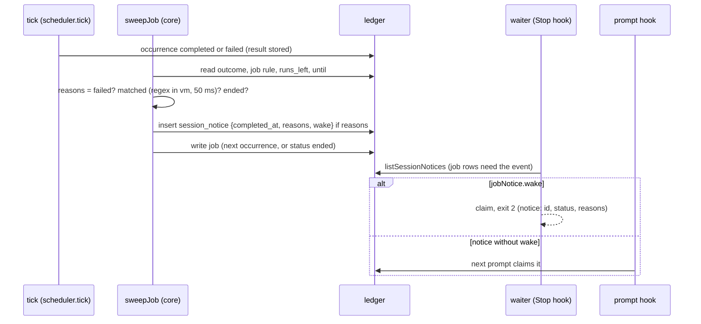

# Job Lifetime, Wake for Jobs and the Hooks' CLI Path (Batch 39) - Plan

## Goal Capsule

- **Objective:** A user who watches something with a recurring job can say when the job stops, and can let the job wake the Claude Code session that set it up only when a run needs attention. A job ends itself after a date or a number of runs and sends one final notice. A job bound to a session wakes it on a failed run or on a run whose output matches a pattern, and never passes the output into the session. A wake marker goes away when nothing is left to wait for. The plugin's hooks find the CLI in the installed runtime when `tidegap` is not on `PATH`, and say once when they find nothing. The "no EIA API key" line no longer follows every CLI command.
- **Means:** three PRs of three units each (Sequencing). PR A, job lifetime (KTD1-KTD6). PR B, wake for jobs and marker hygiene (KTD7-KTD12). PR C, the hooks' CLI path (KTD13-KTD15).
- **Authority:** the Product Contract decides what; the Planning Contract decides how. Binding repo rules:
  - `CLAUDE.md` (the gate, generated files, hard rules, git conventions).
  - `docs/solutions/best-practices/wake-an-idle-session-from-a-stop-hook.md` (the Stop hook contract, marker rules, the live-proof steps; PR B, PR C).
  - `docs/solutions/logic-errors/floating-jobs-occurrence-sweep.md` and `docs/solutions/best-practices/agent-hooks-for-scheduling-intents.md` (one live occurrence, KD10: agents author prompt jobs only; PR A, PR B).
  - `docs/solutions/best-practices/parity-twin-holds-what-it-cannot-run.md` (jobs are Node-only; all PRs).
  - `docs/solutions/best-practices/loopback-web-ui-hardening.md` (the UI API; PR A U2, PR B U6).
  - `docs/solutions/workflow-issues/public-repo-hygiene.md`, `docs/solutions/workflow-issues/generated-test-counts-merge-conflict.md`, `docs/solutions/developer-experience/folding-review-fixes-into-commits.md`, `docs/solutions/developer-experience/worktree-environment-setup.md`, `docs/solutions/workflow-issues/stacked-prs-and-delete-branch.md`.
- **Owner decisions already taken (do not reopen):** reliability over features; no silent partial paths; notifications go out on the final outcome only, and a job's final notice is one message; jobs run on the Node daemon only; an interrupted run is failed; retries default 1, `command` included; the UI, the Mac app and the extension show and postpone or retry only (no quick add; showing the new fields is fine); nothing but task ids, status, the fork and the open command enters a session (a wake carries the run id and status, never the output); the plugin explains itself (no notes in memory or `CLAUDE.md`); MCP never queues a shell command (KD10). A wake needs a Claude Code origin (`wakeError`, `packages/core-ts/src/handoff.ts:435-442`); the waiter stays `queue notices --wait --rewake`; the Stop hook contract of the wake learning is unchanged. Out of scope: MCP command jobs with approval (request 3, held by the orchestrator), any receipt or signed-field change, a version bump or release.
- **Execution profile:** one Opus `ce-work` agent per PR in `.worktrees/<branch>`, units in order. Simplify runs inside each PR on its code. One `ce-code-review` per PR at the end, Sonnet reviewers by risk: 2 for PR A (a schema migration and a notice path), 2 for PR B (session wake, marker races), 1 for PR C (shell hooks). No `pnpm qa ui`: the page only gains text lines, checked by unit tests. `pnpm qa cli` runs once per PR, never two at the same time.
- **Who ships:** each PR ends green, with its review done and the diff reviewed. The agent does not merge. No version bump, release or publish.
- **Stop conditions:** stop and report in these cases.
  - A change needs a file outside its unit lists, apart from `CHANGELOG.md`, `packages/core-ts/src/index.ts` (exports) and the generated files.
  - A test or QA step needs the real `HOME`, `~/.tidegap`, `~/.claude`, `~/.config/tidegap`, the installed app, a LaunchAgent or the live job `job-8963bc7f`.
  - PR A: an existing ledger fails to open after the jobs column migration, or the Python suite fails on a ledger that the new Node code wrote.
  - PR B: `vm.runInContext` with a `timeout` does not stop a catastrophic pattern (`(a+)+$` over 30 `a` and a `b`) within 500 ms on Node 20 or 22 (KTD9 depends on it).
  - PR B: U5's first test shows that a Stop after a cancelled wake task starts a waiter that does not exit at its first look. Report the outcome the test saw and continue with the rest of U5 (the residual says 11 h 50 min; the code reading below says the waiter exits at once).
  - A gate fails the same way twice.
  - Evidence shows that a Key Technical Decision cannot work.

---

## Product Contract

### Summary

PR A gives a job an end: `--until <date>` and `--count <N>` on `tidegap jobs add` and `jobs edit`, the same keys in the job JSON (`--file`, the page's API) and `until` and `count` on MCP `schedule_task` with a job `repeat`. When the end condition is met, the job moves to a new status, `ended`, and sends one final notice on the channels and the OS toast, whatever its notify level. The page and `jobs show` show the end condition. The EIA warning prints at most once per process, and a one-shot CLI command prints it only with `TIDEGAP_VERBOSE=1`.

PR B binds a job to the Claude Code session that sets `--wake failures` or `--wake match=<pattern>`. The job sweep decides after each run, from the stored result, whether the run is a session notice and whether it wakes the session. `never` (the default) binds nothing. A wake marker goes away at the next tick once the session has nothing left to wait for, and at once when the agent cancels its last wake task or job.

PR C gives the plugin's hooks one CLI finder: `tidegap` on `PATH`, else `node` with the runtime CLI under `~/.tidegap/runtime`. A session whose hooks find neither gets one SessionStart line that says what to install.

### Problem Frame

Each item was checked on `main` at `720eca79`. Sources: the owner's other session (the daily command job `job-8963bc7f`, which watches a production deploy for 5 days and should wake its session only when its output starts with `ALERT`), the scout findings of 2026-11-12, and the residuals of the 2026-11-12 live tests.

- **A job never ends by itself.** `JobInput` and `JobPatch` have no end field (`packages/core-ts/src/jobs.ts:89-118`); `JobStatus` is `active | paused | removed` (`packages/core-ts/src/types.ts:730`). A job stops only by `jobs remove`, `cancel_task series=true` or the auto-pause after three failed slots (`jobs.ts:203`, `:567-576`). The `jobs` table has no end columns (`packages/core-ts/src/storage/sqlite.ts:189-219`), and the core has no column migration for that table (only `ensureColumns` for `tasks`, `sqlite.ts:239-260`).
- **A final notice has one model already.** The auto-pause notice is a `task_failed` event with `jobPaused`, claimed once by a compare-and-set on `pause_notified_at`, sent whatever the notify level, and it replaces the plain failure of the run that paused the job (`packages/cli/src/channels/emit.ts:291-333`, `:586-597`; OS toast `packages/cli/src/commands/tick.ts:181-186`).
- **A job run cannot reach a session.** Notices are keyed on the task's `origin_session_id` and a checked `origin.agent` in the body (`sqlite.ts:467-479`, `:792-827`). A job occurrence gets no session and a plain body (`jobs.ts:324-349`, `:677-699`; `materializeOccurrence`, `packages/core-ts/src/scheduler.ts:667-710`). `wake_session` is refused with a job repeat (`packages/core-ts/src/schedule-job.ts:86-104`). A job run never forks a session (`dispatchOrigin` returns no origin for a row with `jobId`, `scheduler.ts:3641-3653`).
- **The waiter wakes on any finish of a wake task.** `isWakeTask` reads `handoff.wake` (`packages/core-ts/src/handoff.ts:412`, `packages/cli/src/handoff/notices.ts:194-196`); the waiter wakes on every completed or failed wake notice (`packages/cli/src/handoff/waiter.ts:402-404`). A job needs the decision after the run, from its stored result.
- **A wake marker outlives a cancel.** `wakeSweep` removes a marker with nothing to wait for only when it is older than 12 h (`notices.ts:288-317`, `WAKE_MARKER_MAX_AGE_MS`, `handoff.ts:484`). The 12 h grace also keeps a marker for a wake task that finished during a turn, before the Stop hook starts its waiter, so it cannot simply go. A waiter that finds nothing removes the marker and exits at its first look (`waiter.ts:405-411`); the live note "idle waiter for up to 11 h 50 min" is not what this code reads, so U5 tests it first.
- **The hooks are silent without `tidegap` on `PATH`.** `session-wake.sh:34` and `session-notice.sh:32` run `command -v tidegap || exit 0`; the SessionStart command in `hooks.json` does the same with an `ebb` fallback. On the owner's Mac neither the login shell nor Claude Code had `tidegap` on `PATH`, so wakes and notices never ran, and nothing said why. The runtime CLI is at `~/.tidegap/runtime/cli/dist/index.js` (`apps/macos/scripts/sync-runtime.sh:19`, `apps/macos/scripts/install.sh:32`).
- **The EIA line follows every command.** `eiaFeed` without a key warns on every `fetchForecast` (`packages/core-ts/src/grid.ts:450-462`). It is wired only for the US zones (`grid.ts:1230-1236`), so it already appears only when a region needs EIA, but a US user sees it on every CLI command that builds a scheduler (`packages/cli/src/commands/queue.ts:608`).

### Requirements

**PR A: job lifetime**

- R1. A job may carry an end date (`until`), a run count (`count`), both, or neither. Add and edit set them; edit can clear them.
- R2. When the end condition is met the job ends: status `ended`, no pending occurrence, no further run. An ended job refuses edit, pause, resume and run now; it can be removed.
- R3. An ended job sends one final notice on the channels and the OS toast, whatever its notify level. It replaces the plain notice of the last run, as the auto-pause notice does.
- R4. `jobs show`, `jobs list`, the client API `Job` and the page's job row show the end condition and, for an ended job, when and why it ended.
- R5. The EIA warning prints at most once per process; a one-shot CLI command prints it only with `TIDEGAP_VERBOSE=1`.

**PR B: wake for jobs**

- R6. `--wake never|failures|match=<pattern>` on `jobs add` and `jobs edit`, and `wake_session` / `wake_match` on MCP `schedule_task` with a job repeat, bind the job to the Claude Code session that set it. The same `wakeError` rule and default-ledger rule as a one-off wake apply.
- R7. After each run of a bound job, the sweep decides from the stored result: under `failures`, a run whose slot failed for good is a session notice and wakes the session; under `match`, a completed run whose result text matches is a session notice and wakes it, and a run whose slot failed for good is a session notice that does not wake. No other run of the job is a session notice. A bound job's end is a session notice that does not wake.
- R8. A notice or wake for a job run names the run id, its status, the job title and the reason (`failed`, `matched`, `ended`), never the output.
- R9. A wake marker goes when the session has nothing left to wait for: at the next tick, and at once after the agent's own cancel of its last wake task, removal of its last bound job, or `--wake never`.

**PR C: the hooks' CLI path**

- R10. Every plugin hook that runs the CLI uses `tidegap` from `PATH`, else `node` with the runtime CLI.
- R11. When a session starts and the hooks find neither, the session gets one line that says notices and wakes are off and how to fix it.

### Acceptance Examples

- AE1. Covers R1, R2, R3. Given a daily command job made with `--count 2`, when its second slot completes, then the job's status is `ended` with `end_reason: "count"`, it has no pending run, and the tick sends one `task_done` event with `jobEnded` and no plain `task_done` for that run.
- AE2. Covers R1, R2. Given a daily job in `Europe/Berlin` with `--until 2026-11-17` and a window `22:00-08:00`, the slot that starts on 17 November at 22:00 runs, and no slot that starts on 18 November is made; the job ends when that last slot finishes.
- AE3. Covers R6, R7, R8. Given a command job `echo ALERT disk 91%` made from a session with `--wake match=^ALERT`, when a run completes, then `queue notices --wait --rewake` for that session exits 2 with a notice line naming the run id, `completed` and `matched`, and the output text is not in the notice.
- AE4. Covers R7. Given the same job with the command `echo ok`, a completed run makes no session notice, and the waiter keeps waiting.
- AE5. Covers R9. Given a session whose only wake task is cancelled with `tidegap queue cancel`, the marker `~/.tidegap/sessions/wake/<session>` is gone when the command returns.
- AE6. Covers R10. Given a sandbox `HOME` with no `tidegap` on `PATH` and the runtime CLI under `$HOME/.tidegap/runtime/cli/dist/index.js`, `session-notice.sh` with a notice marker prints the notice.

### Scope Boundaries

#### Not in this batch

- MCP command jobs with approval (request 3): held by the orchestrator for the owner's word; it touches KD10 and the show-only rule for the UI.
- `until` and `count` on the OpenClaw host of `schedule_task`: the core argument type takes them, but this batch registers them on the `mcp` host only.
- A wake for an idle session older than the waiter's limit: a waiter lives at most 11 h 50 min after the session's last turn (`waiter.ts:56`). A matching run after that reaches the session with its next prompt, not as a wake. Changing that changes the Stop hook contract.
- A session notice for a paused job that ends because its end date passed: no run happened, so no task row carries it. The channels and the OS toast still get the final notice.
- Reviving an ended job. A new job is the path.
- Everything carried over in "Not in this batch" of `docs/plans/2026-11-12-2230-fix-command-job-reliability-and-last-residuals-plan.md` and the batch-38 residual lines stays there unchanged.

#### Considered and not built

- **Reuse `removed` for a job that ran out.** One status less, but `removed` means the user's act; the page, `jobs list --all` and the history could no longer tell "I removed it" from "it finished". A new status costs one value in every status filter.
- **Count runs since the job was created.** It reads naturally ("5 runs in all"), but every job made before this batch has no counter, and a back-fill from the task rows would have to replay retries and skips. "Runs left from now" needs no history.
- **Put the wake rule in each occurrence body and decide in the waiter.** The waiter would need the regex and the result text, and a second reader (the prompt hook, the tick sweep) would have to repeat the decision. One decision in the job sweep, written as an event, serves every reader.
- **Copy the session `origin` into the occurrence body.** It would make the existing notice check pass unchanged, but `origin` is also the claude-code adapter's fork input; `dispatchOrigin` guards job rows today, and a second guard in the body costs nothing.
- **A `job_ended` channel event kind.** Every channel kind, card and subscription list would learn a new kind. The auto-pause notice already rides on `task_done` / `task_failed`.

### Assumptions

- A date in `--until` is a calendar day in the job's zone, inclusive. The zone is read when the sweep evaluates it, so a later `--tz` edit moves the bound with it.
- `count` is capped at 1000 runs and a pattern at 200 characters. Both are planning defaults.
- The SessionStart line is printed on `startup` and when the hook input has no `source` field; `resume`, `clear` and `compact` print nothing. That is once per session without a file write.
- A `node` that the hooks find on `PATH` is new enough for the runtime CLI. If it is not, the CLI fails, and the hook stays silent as it is today.

### Sources / Research

- Scout findings of 2026-11-12 (file:line for every landing site), checked again on `720eca79`.
- `docs/plans/2026-11-12-2230-fix-command-job-reliability-and-last-residuals-plan.md` (plan shape, carried-over lines).
- `docs/plans/2026-10-27-1747-fix-jobs-follow-ups-plan.md` (the jobs data shapes and KTD10, the auto-pause notice).
- `scripts/qa/cli-flows.mjs:765-845` (S29.10: a scripted wake through `session-wake.sh` under a stand-in `claude` in the sandbox `HOME`).
- `scripts/plugin-hooks.test.mjs` (hook tests with a fake `tidegap` on a test `PATH`).
- No external research: the repo has the patterns.

---

## Planning Contract

### Key Technical Decisions

- KTD1. **The terminal status is `ended`.** `JobStatus` becomes `active | paused | removed | ended`. An ended job keeps its history, has no pending occurrence, and refuses edit, pause, resume and run now with `job ended (<reason>); add a new job` (`requireEditable`); `remove` moves it to `removed`. `jobs list` shows active and paused jobs, `--all` adds removed and ended ones; `GET /api/jobs?status=` accepts `ended`, and its default stays `active,paused`, so the Mac app and the extension see no new status. The Python core counts `status = 'active'` only (`packages/core-py/src/tidegap/scheduler.py:1415-1430`), so an ended job is not an active job there either. Governs R2.
- KTD2. **`until` is a day or an instant, kept as given.** `--until YYYY-MM-DD` is the last calendar day in the job's zone on which a slot may start, inclusive; `--until <ISO instant with Z or an offset>` is the instant before which a slot must start. The job stores the given string (`until` column) and the sweep turns it into a bound when it plans: for a day, the next local midnight after it in the job's current zone (`localToUtcMs`, `packages/core-ts/src/zone-time.ts:63`). A regular occurrence is made only when its `earliest` is before the bound; otherwise the job ends. A retry of the last slot still runs after the bound: it belongs to its slot. On add and edit, a day before today in the job's zone or an instant in the past is refused. Governs R1, R2.
- KTD3. **`count` is runs left from now.** `--count N` (1 to 1000) stores `runs_left = N`. The sweep takes one off when a slot ends for good: completed, or failed with no retry left (the moment `consecutiveFailures` would count it). A retry is part of its slot; a skipped slot (a plain cancel of an occurrence), a slot an action cancelled (edit, pause), and a failed slot whose retry an edit replaced (the sweep then makes a regular occurrence and does not count the failure, `jobs.ts:605`) take nothing off. `jobs edit --count N` sets the runs left again from now; `--count none` and `--until none` clear the bound. At 0 the job ends instead of making the next occurrence. Governs R1, R2.
- KTD4. **The end is decided in `sweepJob`, where the successor is chosen.** When `successor` is `next` and the end condition holds, the job is written with `status: "ended"`, `endedAt`, `endReason` (`"until"` or `"count"`), no pending occurrence, and `endNotifiedAt` unset. The end wins over the auto-pause: a third failed slot that is also the last one ends the job, and its one final notice says the last run failed. A paused job whose `until` bound has passed is ended by the sweep with no run (`sweepJobs` already lists paused jobs, `jobs.ts:829`); a paused job keeps its `runs_left`. `sweepJobs` skips ended jobs. An edit of an active job writes the new bound and re-makes the pending occurrence as today (`updateJob`, `jobs.ts:948-975`), so an edit whose bound excludes the next slot ends the job at once. Governs R1, R2.
- KTD5. **One final notice, claimed like the pause notice.** `ChannelEvent` `task_done` / `task_failed` gain `jobEnded?: { jobId, title, reason, lastOutcome }`; the event kind follows the last run's outcome. The claim generalizes `jobPauseEvents` to also read ended jobs with `endNotifiedAt` unset: one compare-and-set per job on `end_notified_at`, the same `now / later / never` reach rule, the same undo, and the notice replaces the plain event of its run (`emit.ts:586-597`). A job with no last run (ended before its first) is marked notified with no event. `channels/plan.ts:37` keeps a final notice out of the digest fold, as for `jobPaused`. The tick runs `sweepJobs` before `emit` (`packages/cli/src/commands/tick.ts:791-792`), so the end and the run's plain event meet in one emit, as the pause notice does today. Texts: title `Job ended: "<title>"`; body `"<title>" ended: its end date (<until>) passed` or `... ended: its runs are done`, then `Last run: <task id> <ok|failed>.`; OS toast title `Tidegap: job ended`. Governs R3.
- KTD6. **The EIA line: once per process, and quiet in one-shot commands.** `buildDefaultGridFeed(credentials, { quiet?: boolean })` passes the option to `eiaFeed`; `eiaFeed` warns through one module-level flag, so a process prints the line at most once. The CLI's `actionScheduler` (`packages/cli/src/commands/queue.ts:608`, the scheduler of `queue add`, `queue later`, the `jobs` commands and the other one-shot commands) passes `quiet: true` unless `TIDEGAP_VERBOSE` is `1`. The tick, the page server, the listener, the MCP server and the OpenClaw plugin keep the once-per-process line in their logs. A mock forecast stays visible where it counts: a receipt already says `mock (SYNTHETIC grid data, not a measurement)` (`queue.ts:457-458`). Governs R5.
- KTD7. **The job stores the wake rule and the session; the occurrence carries a flag.** New job fields `wake?: { on: "failures" | "match"; pattern?: string; boundAt: string }` (`wake_json` column; `boundAt` is when this session bound the job) and `originSessionId?: string` (`origin_session_id` column). A job is bound only when both are set; `--wake never` clears both. Each occurrence of a bound job gets `originSessionId` on its task row (`materializeOccurrence` takes it and calls `startSessionNotices`, as the enqueue does, `scheduler.ts:934`) and `jobWake: { on, session }` in its body, never `origin` (the adapter's fork input). The pattern stays on the job. `runFields` includes `jobWake`, so a pending occurrence made before a wake edit or a rebind to another session is never adopted as current (an edit already cancels the pending one, `jobs.ts:972`; the `runFields` check also covers an orphan row the sweep would adopt). Governs R6.
- KTD8. **The hosts bind the session they run in.** CLI `jobs add|edit --wake failures|match=<pattern>` finds the session as `queue add` does (`currentSession`, `packages/cli/src/commands/queue-add.ts:169-174`), refuses without a session (`--wake needs a Claude Code session: it wakes the session that set it`) and with a non-default `--db`, and writes the wake marker after the write (`writeWakeMarker`), with `wake` and `wake_armed` in `--json`. `jobs edit --wake` from another session rebinds the job to that session. MCP `schedule_task` with a job repeat: `wake_session: true` means `failures`; the new string `wake_match: "<pattern>"` means `match` (with `wake_session` omitted or `true`; `false` with `wake_match` is refused); `wake_match` without a job repeat is refused. `wake_session` leaves `JOB_UNSUPPORTED_PARAMS` (`schedule-job.ts:86-104`), and the session comes from `resolveOrigin` as for a one-off (`packages/mcp-server/src/server.ts:707`). The core checks the binding with `wakeError(true, { agent }, sessionId)` in `createJob` and `updateJob`. The page cannot set a wake: `wake` is not a `JobInput` JSON key, and a page edit keeps the binding. Governs R6.
- KTD9. **The decision is made once, in the job sweep, after the run.** When `sweepJob` records the outcome of a tracked occurrence of a bound job, it computes the reasons: `failed` when the slot failed with no retry left (under `failures` and under `match`); `matched` when the job is under `match`, the run completed and the pattern matches its result text (`taskResultText`, `packages/core-ts/src/history.ts:73`); `ended` when this outcome also ends the job (KTD4). `wake` is true for `failed` under `failures` and for `matched`. With at least one reason, it inserts a `session_notice` event on the occurrence, `{ completed_at, reasons, wake }`, insert-if-absent per `completed_at` (the `claimNotice` pattern, `sqlite.ts:837-852`), before the job row write, so a reader never sees the job ended without its notice. The pattern is a JavaScript regular expression with the `m` flag (`^` and `$` match at each line), tested against the first 64 KiB of the result text in `vm.runInContext` with a 50 ms timeout; a timeout counts as `matched`, with a tick log line, so a broken pattern wakes once rather than missing an alert. On add and edit the pattern must compile, be at most 200 characters and not match the empty string (it would wake on every run). Governs R7.
- KTD10. **Readers follow the event.** `listSessionNotices` lists a job row (`job_id` set) only when it has a `session_notice` event for its `completed_at`, and returns the event's details as `SessionNotice.jobNotice`; a row without `job_id` is unchanged. `noticeBody.checked` also accepts a body with `jobWake`. The waiter wakes on a notice when `jobNotice.wake` is true, or, for a row without `jobNotice`, by today's rule (`waiter.ts:402`). The notice line of a job row ends with ` (job: <reason>[, <reason>])`, for example `- job-3f9a1c2e~5 completed "Deploy monitor" (job: matched)`; never the output or the pattern. The SessionStart block (`runQueueHook`, `packages/cli/src/commands/queue.ts:284-301`) puts a job row in the session's own block only when it has a `session_notice` event; the bound job's other runs stay in the "N unread Tidegap tasks" count line, where every job run is today (job rows had no `origin_session_id`). So a run that is not a session notice is not named to the session on any surface. Governs R7, R8.
- KTD11. **"Nothing left to wait for" has one definition, in the core.** `pendingWakeTasks`, `isWakeTask` and `removeWakeMarkerUnlessPending` move from `packages/cli/src/handoff/notices.ts` to `packages/core-ts/src/handoff.ts` (the CLI module re-exports them), so the MCP server can call them. `pendingWakeTasks` keeps its row shape; a new boolean predicate `sessionHasWaitWork(store, sessionId, now, since?)` combines it with the two terms that are not task rows. With `since`, a row counts when its `enqueuedAt` is after `since` and a bound job when its `wake.boundAt` is after `since` (the same race rule); an unclaimed wake notice counts whatever its time. The waiter (`waiter.ts:405-411`), `removeWakeMarkerUnlessPending`, `wakeSweep` and `restoreWakeMarkers` call the predicate. A session has something left when it has: an open wake task (a row with `handoff.wake` or `jobWake`), a wake task waiting for its result file, an unclaimed wake notice (a completed or failed wake task, or a job notice with `wake: true`), or an active job bound to it. The active job counts so the waiter does not exit between a run's finish and the sweep's decision. `restoreWakeMarkers` also writes back the marker of a session with an active bound job, at the job's `wake.boundAt` (not `updatedAt`, which every run rewrites), so the 7-day rule still ends the marker of a session that never stops again. Governs R9.
- KTD12. **The marker goes without the 12 h wait.** `wakeSweep` removes a marker at its next pass when the session has nothing left by KTD11, through `removeWakeMarkerUnlessPending` (remove, then look again); the 7-day rule stays. The unclaimed-wake-notice term keeps what the 12 h grace protected (a wake task that finished during a turn). The agent's own paths remove it at once on the default ledger: CLI `queue cancel` of a wake task, MCP `cancel_task` (a series cancel included), CLI `jobs remove` and `jobs pause` of a bound job, and `jobs edit --wake never`. Other paths (the page, a job that ends) wait for the next tick. CLI `jobs resume` of a bound job writes the marker of its session again (on the default ledger); a page resume gets it back at the next tick through `restoreWakeMarkers`. Governs R9.
- KTD13. **One CLI finder for the hooks.** A new `packages/claude-code-plugin/hooks/find-cli.sh` (POSIX sh, no file writes) defines `tidegap_cli()`: run `tidegap "$@"` when `command -v tidegap` finds it; else, when `${TIDEGAP_RUNTIME_DIR:-$HOME/.tidegap/runtime}/cli/dist/index.js` is a file, run it with the first `node` found: `node` on `PATH`, else on macOS the node that `tidegap install` pinned for the tick unit (read-only: `plutil -extract ProgramArguments.0 raw ~/Library/LaunchAgents/com.tidegap.tick.plist`, label `LAUNCHD_LABEL`, `packages/cli/src/platform/macos.ts:101`; that program is `process.execPath` for a pinned-node install, `macos.ts:110`), used only when it is an executable named `node`; else return 127. The hooks never write or load a LaunchAgent. It passes stdin and the exit code through, so `session-wake.sh` still gets exit 2. `session-wake.sh` and `session-notice.sh` source it from their own folder (`. "${0%/*}/find-cli.sh"`; `hooks.json` always runs them by the absolute `${CLAUDE_PLUGIN_ROOT}/hooks/...` path) and replace `command -v tidegap || exit 0` with a `tidegap_cli_found` check. Governs R10.
- KTD14. **SessionStart moves into a script.** The inline SessionStart command of `hooks.json` becomes `sh "${CLAUDE_PLUGIN_ROOT}/hooks/session-start.sh"; exit 0`. The script keeps today's behaviour (`queue list --unread --hook --hook-input -`, then the form without `--hook-input`, then the `ebb` fallback) through the finder. When neither the finder nor `ebb` finds a CLI and the input's `source` is `startup` or absent, it prints one line: `Tidegap: no tidegap CLI found (not on this session's PATH, and no runtime at ~/.tidegap/runtime with a node to run it), so task notices and wakes are off. Install it (npm install -g @tidegap/cli) or add the folders of tidegap and node to the PATH that starts claude.` The `hooks.json` description says the same. Governs R11.
- KTD15. **The hook tests own the proof.** `scripts/plugin-hooks.test.mjs` runs each hook with a test `PATH` and a sandbox `HOME`: a fake `tidegap`, a fake `node` plus a stub runtime file, both, or neither. `pnpm qa cli` gets one step that runs `session-notice.sh` in its sandbox with no `tidegap` on `PATH` and a runtime file that loads the repo build. Governs R10, R11.

### High-Level Technical Design

The decision path of one run of a bound job (directional):



Where the end is decided in `sweepJob` (directional):

```
outcome recorded -> if successor == "next":
    runs_left -= 1 when the slot ended for good
    if runs_left == 0 or next earliest >= until bound: status = ended, no occurrence
    else: make the next occurrence (today's path)
paused job and until bound passed -> status = ended, no run
```

### Data shapes

- `jobs` table, PR A: `until TEXT`, `runs_left INTEGER`, `ended_at TEXT`, `end_reason TEXT`, `end_notified_at TEXT`. PR B: `wake_json TEXT`, `origin_session_id TEXT`. All nullable. A new `ensureJobColumns` adds them to an existing ledger the way `ensureColumns` does for `tasks` (check `pragma_table_info('jobs')`, swallow "duplicate column name"); `CREATE TABLE` lists them for a new ledger.
- `JobRecord`: `until?`, `runsLeft?`, `endedAt?`, `endReason?: "until" | "count"`, `endNotifiedAt?` (PR A); `wake?`, `originSessionId?` (PR B).
- Job JSON (`JobInput`, `--file`, the client API): `until` (string or `null`), `count` (integer or `null`). `Job` view: `ends: { "until": "2026-11-17" | null, "runs_left": 3 | null } | null`, `ended_at`, `end_reason` (PR A); `wake: { "on": "failures" | "match", "pattern": "^ALERT" | null, "session_id": "…" } | null` (PR B).
- `task_events` kind `session_notice` (TS only): `{ completed_at, reasons: ["failed" | "matched" | "ended"], wake: boolean }`.
- Occurrence body: `jobWake: { on: "failures" | "match", session: "<id>" }` on a bound job's occurrences.

### Python twin

No source change in `packages/core-py`. The Python core never creates or writes the `jobs` table, and reads it only to count `status = 'active'`; an ended job is not counted, which is right. It holds every job row (`job_id` set), so the new body key `jobWake` and the `origin_session_id` on job rows never reach it. It writes no `session_notice` events and has no session notices; `task_events.kind` has no CHECK constraint, and the Python core only inserts events (`packages/core-py/src/tidegap/scheduler.py:789`). The new `jobs` columns are nullable and do not touch `tasks`. PR A adds one pytest case: a `jobs` row with status `ended` is not an active job.

### Sequencing

PR A and PR B share the job core (`jobs.ts`, `types.ts`, `sqlite.ts`), the job hosts (`commands/jobs.ts`, `index.ts`, `jobs-api.ts`, `schedule-job.ts`, `tool-surface.ts`, `server.ts`) and the jobs docs, so PR B starts from `main` after PR A is merged. PR C touches only the plugin, its tests, one QA step and docs; it runs beside PR A. PR C and PR B both edit `scripts/qa/cli-flows.mjs`, `apps/web/content/docs/12-handoff.md` and `docs/solutions/best-practices/wake-an-idle-session-from-a-stop-hook.md`, so PR B starts after PR A and PR C are both merged. All three share `CHANGELOG.md` and the generated files (README test markers, `apps/web/src/lib/tests.generated.ts`, `apps/web/src/lib/docs.generated.ts`, `apps/web/public/llms-full.txt`): on a conflict, take `main`'s version, run the generator and commit. Inside PR A, U1 is the foundation of U2. Inside PR B, U4 is the foundation of U5 and U6.

| Order | PR | Branch | Units | Value | Waits on |
|---|---|---|---|---|---|
| 1 | PR A | `feat/jobs-lifetime` | U1-U3 | A job ends itself, with one final notice | none |
| 1 | PR C | `fix/plugin-hooks-path` | U7-U9 | Notices and wakes work without `tidegap` on `PATH` | none |
| 2 | PR B | `feat/jobs-wake` | U4-U6 | A job wakes its session only when needed | PR A and PR C merged |

At most three agents at once and at most two heavy builds: PR A and PR C start together; PR B starts when both are merged. `pnpm qa cli` runs once per PR, never at the same time: PR C's run waits for PR A's. Merge A and C in either order, then B.

### Risks

- **A migration on a ledger the user lives in.** `ensureJobColumns` runs at every open, from every process (tick, page, CLI, MCP). U1 tests a ledger made by `main`'s schema, opened by the new code, then by the Python core.
- **A notice that never comes.** If the event were written after the job row, a waiter could see the job ended and no notice and remove the marker. KTD9 orders the event first; KTD11 counts an active bound job as something left. U5 tests the window between the run's finish and the sweep.
- **A pattern that blocks the tick.** KTD9 caps the text, the pattern length and the run time. The stop condition covers a `vm` timeout that does not stop a regex.
- **A wake per run of a noisy job.** `failures` and `match` wake only on their reason, and a session wakes at most once per finished run (the claim). A pattern that matches every run is the user's choice; the empty-match check catches the plain mistake.
- **A hook that starts an old `node`.** The fallback runs a `node` the hook did not choose. A failing CLI is silent, as today; KTD14's line covers only the case where nothing was found.

---

## Implementation Units

### PR A: `feat/jobs-lifetime`

Waits on: none.

### U1. Job lifetime in the core, the CLI and MCP, and the final notice

- **Goal:** a job ends after its date or its runs and says so once.
- **Requirements:** R1, R2, R3; KTD1-KTD5.
- **Files:** `packages/core-ts/src/types.ts`, `packages/core-ts/src/jobs.ts`, `packages/core-ts/src/job-cadence.ts` (the `until` bound), `packages/core-ts/src/storage/sqlite.ts`, `packages/core-ts/src/schedule-job.ts`, `packages/core-ts/src/tool-surface.ts`, `packages/core-ts/src/channels/types.ts`, `packages/core-ts/src/channels/format.ts`, `packages/core-ts/src/channels/payload.ts`, `packages/core-ts/src/channels/plan.ts`, `packages/core-ts/src/index.ts`, `packages/mcp-server/src/server.ts`, `packages/cli/src/index.ts` (flags), `packages/cli/src/commands/jobs.ts`, `packages/cli/src/ui/jobs-api.ts` (`jobInputFromJson`, `jobPatchFromJson`, `JOB_INPUT_KEYS`, the `status` filter), `packages/cli/src/channels/emit.ts`, `packages/cli/src/commands/tick.ts` (OS toast); tests `packages/core-ts/test/jobs-sweep.test.ts`, `packages/core-ts/test/jobs-store.test.ts`, `packages/core-ts/test/jobs.test.ts`, `packages/core-ts/test/schedule-job.test.ts`, `packages/core-ts/test/tool-surface.test.ts`, `packages/core-ts/test/channels-format.test.ts`, `packages/core-ts/test/channels-plan.test.ts`, `packages/cli/test/jobs-cli.test.ts`, `packages/cli/test/channels-emit.test.ts`, `packages/cli/test/jobs-tick.test.ts`, `packages/mcp-server/test/server.jobs.test.ts`, `packages/core-py/tests/test_jobs_ledger.py`.
- **Approach:** the store first (columns, migration, row mapping, the status filter), then the input rules (`until`, `count`, validation in `createJob` and `updateJob`), then the sweep (KTD3, KTD4), then the hosts: flags `--until <YYYY-MM-DD|ISO>` and `--count <N|none>` on `add` and `edit` map to the JSON keys `until` and `count` in `jobBodyFromFlags`; MCP `until` (string) and `count` (integer 1 to 1000) on the `mcp` host of `schedule_task`, added to `JOB_ONLY_PARAMS` so a one-off refuses them. Then the notice (KTD5). Two commits: the lifetime, then the notice.
- **Execution note:** write AE1's sweep test first; it must fail on `main` (the job makes a third occurrence).
- **Test scenarios:**
  - Covers AE1. `--count 2` daily job: after the second completed slot, status `ended`, `end_reason: "count"`, no pending row; `emitEvents` sends one `task_done` with `jobEnded` and drops the plain `task_done` of that run.
  - Covers AE2. `until: "2026-11-17"` in `Europe/Berlin`, window `22:00-08:00`, fake time: the 17 November slot is made, the 18 November slot is not, and the job ends when the 17 November slot finishes. The same with `TZ=Pacific/Kiritimati` on the host.
  - An ISO instant `until`: a slot whose `earliest` equals the instant is not made.
  - A failed slot with a retry left takes nothing off `runs_left`; the retry's final failure takes one off. A skipped slot, an edit's cancel, and a failed slot whose retry an edit replaced take nothing off.
  - The third failed slot is also the last one: status `ended`, not `paused`; one `task_failed` with `jobEnded`, no `jobPaused`.
  - A paused job whose `until` day has passed: the next sweep ends it with no run; with no last run the notice is marked sent and no event goes out.
  - `jobs edit --until` with a day before the pending slot ends the job at once; `--until none` and `--count none` clear the bound; `--count 0`, `--count 1001`, a past day and an instant in the past are refused with exit 2.
  - An ended job: edit, pause, resume and run now are refused with `job ended (...)`; remove works; `sweepJobs` does not touch it.
  - A ledger made by `main`'s `CREATE TABLE` (no new columns) opens, migrates and lists its jobs; a second open is a no-op.
  - MCP: `until` and `count` with `repeat: "daily"` create the bounded job and the answer names the end; with no job repeat they are refused; the OpenClaw host does not list them.
  - Notify `summary`: the final notice still goes out (as the pause notice does).
  - Python: a `jobs` row with status `ended` is not counted in `active_job_count`.
- **Verification:** `pnpm --filter @tidegap/core test`, `pnpm --filter @tidegap/cli test`, `pnpm --filter @tidegap/mcp test` pass; `cd packages/core-py && .venv/bin/python -m pytest` and `.venv/bin/ruff check .` pass.

### U2. The end on the page, in the client API, the docs and the skill

- **Goal:** a user sees when a job will end and why it ended.
- **Requirements:** R4; KTD1-KTD3.
- **Dependencies:** U1.
- **Files:** `packages/cli/src/ui/jobs-api.ts` (`jobView`: `ends`, `ended_at`, `end_reason`, `actions` for an ended job), `packages/cli/src/commands/jobs.ts` (`jobs show` and `jobs list` lines), `packages/cli/ui/jobs.js` (row and detail line), `packages/cli/test/ui-jobs-api.test.ts`, `packages/cli/test/ui-jobs.test.ts`, `packages/cli/test/jobs-cli.test.ts`, `docs/spec/ui-client-api.md` (`Job`, `JobInput`, the status list), `apps/web/content/docs/10-jobs.md` (a section "Ending a job" and two rows in the `schedule_task` parameter table), `apps/web/content/docs/03-cli.md:64-66`, `packages/cli/README.md` (the `jobs` line), `packages/claude-code-plugin/skills/tidegap/SKILL.md` (the recurring-work section: `--until`, `--count`).
- **Approach:** the view adds the keys; `actions` of an ended job are all `false` except `remove`. The page's row line adds `· ends 17 Nov` or `· 3 runs left`; an ended job (reached through its detail route) reads `ended 17 Nov: its runs are done`. `jobs list --all` labels ended jobs. The `jobs remove` help says "Remove the job; its history stays", so "end" means one thing.
- **Test scenarios:**
  - `GET /api/jobs` lists active and paused only; `?status=ended` lists the ended job with `ended_at`, `end_reason` and `actions.remove: true`, every other action `false`.
  - The `Job` view of a bounded job has `ends: {"until": "2026-11-17", "runs_left": null}`; of an unbounded job `ends: null`.
  - `POST /api/jobs` with `until` and `count` creates the bounded job; `POST /api/jobs/<id>/update` with `count: null` clears it; a bad value answers 400 with the rule.
  - The page's row line for each of: a date bound, a count bound, both, an ended job.
  - `jobs show` prints `ends: after 2026-11-17 (Europe/Berlin)` and `runs left: 3`.
- **Verification:** `pnpm --filter @tidegap/cli test` passes; `node scripts/qa/docs-drift.mjs` prints `PASS` (K15 reads the parameter table, S7.4 the skill's flags); `pnpm gen:docs` committed.

### U3. The EIA line once per process, and CHANGELOG

- **Goal:** a US user no longer sees the warning on every command.
- **Requirements:** R5; KTD6.
- **Files:** `packages/core-ts/src/grid.ts`, `packages/cli/src/commands/queue.ts` (`actionScheduler`), `packages/cli/src/env.ts` (read `TIDEGAP_VERBOSE` next to the other keys, `:160`), `packages/core-ts/test/grid.test.ts`, `packages/cli/test/queue.test.ts`, `apps/web/content/docs/03-cli.md` (the environment section), `CHANGELOG.md`.
- **Test scenarios:**
  - Two `fetchForecast` calls for `US-CAL-CISO` on one keyless feed, and a second feed built in the same process: one warning line in all.
  - `buildDefaultGridFeed({}, { quiet: true })`: no warning; the forecast is the mock as before.
  - `actionScheduler` builds a quiet feed without `TIDEGAP_VERBOSE` and a loud one with `TIDEGAP_VERBOSE=1`.
- **Verification:** `pnpm --filter @tidegap/core test` and `pnpm --filter @tidegap/cli test` pass; `node scripts/qa/docs-drift.mjs` prints `PASS`; `pnpm gen:docs` and `pnpm gen:tests` committed; `pnpm qa cli` once. CHANGELOG `[Unreleased]` `### Added`: job lifetime (`--until`, `--count`, `ended`, one final notice); `### Changed`: the EIA line.

### PR C: `fix/plugin-hooks-path`

Waits on: none. Runs beside PR A.

### U7. The hooks find the CLI in the runtime

- **Goal:** notices and wakes work on a machine where only the runtime has the CLI.
- **Requirements:** R10; KTD13.
- **Files:** `packages/claude-code-plugin/hooks/find-cli.sh` (new), `packages/claude-code-plugin/hooks/session-wake.sh`, `packages/claude-code-plugin/hooks/session-notice.sh`.
- **Approach:** the finder, then the two hooks call `tidegap_cli` where they called `tidegap`. Their header comments name the fallback. `cron-guard.sh`, `prompt-hint.sh` and `session-capture.sh` run no CLI and stay as they are.
- **Test scenarios:** in U9.
- **Verification:** `node --test scripts/plugin-hooks.test.mjs` passes.

### U8. One SessionStart line when no CLI is found

- **Goal:** the user learns why notices and wakes are off.
- **Requirements:** R11; KTD14.
- **Dependencies:** U7.
- **Files:** `packages/claude-code-plugin/hooks/session-start.sh` (new), `packages/claude-code-plugin/hooks/hooks.json` (the SessionStart entry and the description), `packages/claude-code-plugin/README.md`.
- **Approach:** the script reads at most 256 KiB of input as the other hooks do, extracts `source` with the same `sed` style, and runs the list command through the finder; it always exits 0.
- **Test scenarios:** in U9.
- **Verification:** `node --test scripts/plugin-hooks.test.mjs` passes.

### U9. Hook tests, a QA step, docs, and CHANGELOG

- **Goal:** the fallback and the line are proven without a real session.
- **Requirements:** R10, R11; KTD15.
- **Dependencies:** U7, U8.
- **Files:** `scripts/plugin-hooks.test.mjs`, `scripts/qa/cli-flows.mjs` (one step after S29.10), `docs/solutions/best-practices/wake-an-idle-session-from-a-stop-hook.md` (the section "The hooks need `tidegap` on PATH" becomes the rule as built), `apps/web/content/docs/12-handoff.md` (the plugin hooks paragraph), `CHANGELOG.md`.
- **Test scenarios:**
  - Covers AE6. `session-notice.sh` with a marker, `PATH` without `tidegap` but with a fake `node`, and a stub runtime file: the fake `node` gets the runtime path and `queue notices --hook --hook-input -`, and the hook prints its stdout.
  - `session-wake.sh` through the fallback passes exit 2 and the notice through.
  - Both on `PATH`: `tidegap` wins and `node` is not started.
  - `TIDEGAP_RUNTIME_DIR` names another runtime: the hook uses it.
  - No `node` on `PATH` and a sandbox `HOME` whose `Library/LaunchAgents/com.tidegap.tick.plist` names a fake `node` (macOS only; `plutil` present): the hook runs the runtime with it. A plist whose first argument is not named `node`: nothing runs.
  - Neither: `session-notice.sh` and `session-wake.sh` exit 0 with no output, as today.
  - `session-start.sh`: with a CLI, today's unread line and session block; with neither and `"source":"startup"` (or no `source`), exactly the KTD14 line; with `"source":"resume"`, `"clear"` or `"compact"`, nothing; with only `ebb`, today's `ebb` line.
  - Each hook stays inside the 100 ms median budget with no marker; `hooks.json` registers `session-start.sh` on SessionStart and keeps the single `asyncRewake` Stop entry.
  - QA step: in the `pnpm qa cli` sandbox, a notice task finishes; `session-notice.sh` with no `tidegap` on `PATH` and `$HOME/.tidegap/runtime/cli/dist/index.js` that imports the repo build prints the notice line.
- **Verification:** `node --test scripts/plugin-hooks.test.mjs scripts/qa/docs-drift-plugin.test.mjs` passes; `node scripts/qa/docs-drift.mjs` prints `PASS`; `pnpm gen:docs` committed; `pnpm qa cli` once (not while PR A's runs). CHANGELOG `### Fixed`: the hooks' runtime fallback and the SessionStart line.

### PR B: `feat/jobs-wake`

Waits on: PR A and PR C merged. Branch from `main` after both merges.

### U4. Wake rules for jobs, decided in the sweep

- **Goal:** a bound job wakes its session on the runs that need it, and on no other.
- **Requirements:** R6, R7, R8; KTD7-KTD10.
- **Files:** `packages/core-ts/src/types.ts`, `packages/core-ts/src/jobs.ts` (input, `occurrenceBody`, `runFields`, the decision in `sweepJob`), `packages/core-ts/src/job-wake.ts` (new: rule parsing, the pattern checks, the bounded match), `packages/core-ts/src/storage/sqlite.ts` (columns, `listSessionNotices`, `noticeBody`, `SessionNotice.jobNotice`, insert-if-absent of the event), `packages/core-ts/src/scheduler.ts` (`materializeOccurrence` takes `originSessionId`), `packages/core-ts/src/task-events.ts` (`session_notice` kind and its summary), `packages/core-ts/src/handoff.ts` (`taskWorkShape` reads `jobWake`), `packages/core-ts/src/schedule-job.ts`, `packages/core-ts/src/tool-surface.ts` (`wake_match`; `wake_session` text for jobs), `packages/core-ts/src/index.ts`, `packages/mcp-server/src/server.ts`, `packages/cli/src/index.ts` (`--wake`), `packages/cli/src/commands/jobs.ts` (session through `currentSession`, exported from `packages/cli/src/handoff/session.ts:58`; marker; `--json` keys), `packages/cli/src/commands/queue.ts` (`runQueueHook` gate, KTD10), `packages/cli/src/handoff/notices.ts` (the job line), `packages/cli/src/handoff/waiter.ts` (`wakes`); tests `packages/core-ts/test/job-wake.test.ts` (new), `packages/core-ts/test/jobs-sweep.test.ts`, `packages/core-ts/test/session-notices.test.ts`, `packages/core-ts/test/schedule-job.test.ts`, `packages/cli/test/jobs-cli.test.ts`, `packages/cli/test/handoff-notices.test.ts`, `packages/cli/test/handoff-wake.test.ts`, `packages/cli/test/queue.test.ts`, `packages/mcp-server/test/server.jobs.test.ts`.
- **Approach:** rule and checks first (`job-wake.ts`), then storage, then the sweep decision (event before the job write), then the readers, then the hosts.
- **Execution note:** write AE3 and AE4 as a sweep-plus-waiter test first (a fake clock and a second store that completes the row, as `handoff-wake.test.ts` does today).
- **Test scenarios:**
  - Covers AE3. `match` `^ALERT`, run text `ALERT disk 91%`: one `session_notice` event `{reasons: ["matched"], wake: true}`; the waiter exits 2; the notice line is `- <id> completed "<title>" (job: matched)` and does not contain `disk`.
  - Covers AE4. Run text `ok`: no event, no notice, the waiter keeps waiting; the next prompt hook says nothing.
  - The pattern matches a later line (`ok\nALERT x`) because of the `m` flag; text past 64 KiB is not tested.
  - `failures`: a completed run makes no event; a failed run with a retry left makes none; the retry's final failure makes `{reasons: ["failed"], wake: true}`.
  - `match`: a slot that failed for good makes `{reasons: ["failed"], wake: false}`; the prompt hook shows it; the waiter does not wake on it.
  - The last run of a `--count 1` bound job that matched: one event `{reasons: ["matched", "ended"], wake: true}`, written before the job row says `ended`; a non-matching last run: `{reasons: ["ended"], wake: false}`.
  - A catastrophic pattern over a long text times out inside 500 ms and counts as `matched`, with one tick log line.
  - Refused on add and edit: a pattern that does not compile, one over 200 characters, one that matches `""`; `--wake` outside a Claude Code session; `--wake` with a non-default `--db`.
  - SessionStart (`queue list --unread --hook`) for the bound session: a matched run is in the session block; a non-matching run is only in the count line.
  - `jobs edit --wake` from a second session: the re-made occurrence carries the second session; the first gets no notice of later runs.
  - `jobs edit --wake never` clears `wake` and `origin_session_id`; the re-made occurrence has no `jobWake` and no session.
  - The occurrence body of a bound prompt job has no `origin`, and `dispatchOrigin` gives no origin (no fork).
  - MCP: `repeat: "daily"` with `wake_session: true` binds `failures`; with `wake_match` binds `match`; `wake_match` with `wake_session: false`, or without a job repeat, is refused; outside a Claude Code session it is refused with the `wakeError` text.
  - `jobs add --json` has `wake` and `wake_armed`; a marker write that fails gives `wake_armed: false` and the text line `wake: not armed (...)`.
- **Verification:** `pnpm --filter @tidegap/core test`, `pnpm --filter @tidegap/cli test`, `pnpm --filter @tidegap/mcp test` pass.

### U5. Marker hygiene

- **Goal:** a session's wake marker lives exactly as long as there is something to wait for.
- **Requirements:** R9; KTD11, KTD12.
- **Dependencies:** U4.
- **Files:** `packages/core-ts/src/handoff.ts` (`isWakeTask`, `pendingWakeTasks`, `removeWakeMarkerUnlessPending` moved here, extended per KTD11), `packages/cli/src/handoff/notices.ts` (re-exports; `wakeSweep` and `restoreWakeMarkers` per KTD11, KTD12), `packages/cli/src/handoff/waiter.ts`, `packages/cli/src/commands/queue.ts` (`runQueueCancel`), `packages/cli/src/commands/jobs.ts` (remove, pause, `--wake never`), `packages/mcp-server/src/server.ts` (`cancel_task`), `packages/core-ts/src/index.ts`; tests `packages/cli/test/handoff-wake.test.ts`, `packages/cli/test/handoff-notices.test.ts`, `packages/cli/test/queue.test.ts`, `packages/mcp-server/test/server.jobs.test.ts`.
- **Execution note:** first a test that runs the waiter for a session whose only wake task was cancelled, with the marker still there. Record what it shows in the PR body (expected: `nothing-pending` at the first look, marker removed). Then the changes.
- **Test scenarios:**
  - Covers AE5. `queue cancel` of a session's only wake task removes its marker before the command returns; a second wake task of that session keeps it.
  - MCP `cancel_task` of a wake task, and `cancel_task series=true` of a bound job, remove the marker; on a non-default ledger nothing is removed.
  - `wakeSweep`: a marker 1 minute old whose session has nothing left goes at this pass; one whose session has an active bound job, an open wake task, a wake task waiting for its result file, or an unclaimed wake notice stays.
  - The window: a bound job's run is completed and the sweep has not run yet; the waiter's look finds the active job and keeps waiting; after the sweep's event it wakes.
  - A job that ends: the next `wakeSweep` removes the marker once the end notice is claimed or is not a wake.
  - `restoreWakeMarkers` writes back the marker of a session with an active bound job and none for a paused one.
  - The 7-day rule still removes a marker of a session that queued nothing for 7 days, and of a session bound to a job more than 7 days ago that never stopped since.
  - `jobs resume` of a bound job writes the marker again; `jobs pause` removes it.
- **Verification:** `pnpm --filter @tidegap/cli test` and `pnpm --filter @tidegap/mcp test` pass.

### U6. The wake on the page and in the docs, a QA step, and CHANGELOG

- **Goal:** the user and the agent can see which session a job wakes and on what.
- **Requirements:** R6-R9; KTD7-KTD12.
- **Dependencies:** U4, U5.
- **Files:** `packages/cli/src/ui/jobs-api.ts` (`wake` in the `Job` view), `packages/cli/ui/jobs.js` (detail line `wakes session <first 8 characters>… on a match` / `on a failure`), `packages/cli/test/ui-jobs-api.test.ts`, `packages/cli/test/ui-jobs.test.ts`, `scripts/qa/cli-flows.mjs` (S39 steps), `docs/spec/ui-client-api.md` (`Job.wake`; the event kind list gains `session_notice`, which docs-drift compares with `TASK_EVENT_KINDS`), `apps/web/content/docs/10-jobs.md` (a section "Waking the session"), `apps/web/content/docs/12-handoff.md` (job notices), `packages/claude-code-plugin/skills/tidegap/SKILL.md` (`--wake` for jobs), `docs/solutions/best-practices/wake-an-idle-session-from-a-stop-hook.md` (a section "Jobs: decide after the run"; the 12 h rule replaced by KTD12), `CHANGELOG.md`.
- **Approach:** the QA steps follow S29.10 (`scripts/qa/cli-flows.mjs:791-845`): sandbox `HOME`, the session capture of a stand-in `claude`, the real `session-wake.sh`, `tick --once`. No real session.
- **Test scenarios:**
  - `Job.wake` is `null` for an unbound job and `{"on": "match", "pattern": "^ALERT", "session_id": "…"}` for a bound one; the page shows the detail line.
  - S39.1: `jobs add --command 'echo ALERT disk 91%' --every 24h --wake 'match=^ALERT' --count 1` from the stand-in session; `jobs run`; `tick --once`; `session-wake.sh` exits 2 with a notice line naming the run, `completed` and `matched`, and not `disk`; `jobs show --json` has `status: "ended"`; the marker is gone after the next `tick --once`.
  - S39.2: the same with `echo ok` and no `--count`: `session-wake.sh` under a 5 s harness timeout does not exit 2; the ledger has no `session_notice` event.
  - S39.3: `queue add --wake` then `queue cancel`: the marker is gone at once (AE5).
- **Verification:** `pnpm --filter @tidegap/cli test` passes; `node scripts/qa/docs-drift.mjs` prints `PASS`; `pnpm gen:docs` and `pnpm gen:tests` committed; `pnpm qa cli` once, with S39 passing. CHANGELOG `### Added`: wake for jobs (`--wake`, `wake_match`); `### Fixed`: the wake marker after a cancel.

---

## Verification Contract

| Check | PR A | PR B | PR C |
|---|---|---|---|
| `pnpm build && pnpm typecheck && pnpm gen:tests:check && pnpm gen:docs:check && node scripts/qa/docs-drift.mjs` | yes | yes | yes |
| `pnpm check:hygiene` | yes | yes | yes |
| `pnpm --filter <package> test` for each package touched | core, cli, mcp | core, cli, mcp | - |
| Python: `.venv/bin/python -m pytest`, `.venv/bin/ruff check .` | yes | yes (no change expected) | - |
| `node --test scripts/plugin-hooks.test.mjs scripts/qa/docs-drift-plugin.test.mjs scripts/qa/docs-drift-jobs.test.mjs` | yes | yes | yes |
| `pnpm qa cli` (once, nothing else running; sandbox `HOME` from `scripts/qa/env.mjs`) | yes | yes, with S39 (the scripted wake check) | yes, with the fallback step |

Every check runs in the PR's worktree with the sandbox `HOME` the harness builds. No check reads or writes the real `~/.tidegap`, `~/.claude` or `~/.config/tidegap`, starts a real Claude Code session, or touches `job-8963bc7f`.

### Owner check after merge

- PR B: in a real session, `tidegap jobs edit job-8963bc7f --wake 'match=^ALERT' --until <last day>` (the owner's own command; no agent touches that job). End the turn. A run that prints `ALERT` wakes the idle session with the run id; other runs do not.
- PR C: on a Mac with no `tidegap` on `PATH`, a new session shows no "CLI not found" line, and a queued task's notice arrives on the next prompt.

---

## Definition of Done

- Every unit's verification passed at the end of its PR, with the command output quoted in the PR body.
- Each PR has CHANGELOG lines under `[Unreleased]` in its last unit, and its generated files regenerated.
- No version bump, release, publish or merge by the agent; no change to version fields, the README status line or the CHANGELOG heading.
- No receipt field or signed-field change. The only schema change is the nullable `jobs` columns of PR A and PR B.
- No source change in `packages/core-py` beyond the one test case of U1.
- No dead-end or experimental code from abandoned approaches is left in the diff.
- Each PR's `ce-code-review` has no open P0 or P1.
