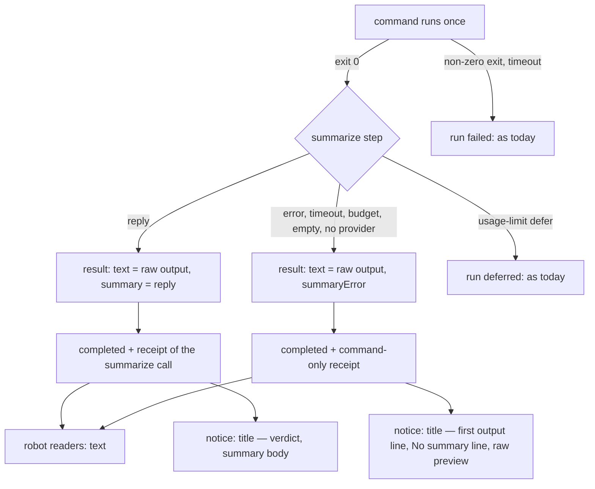

# Human-Readable Job Notices (Batch 40) - Plan

## Goal Capsule

- **Objective:** a person who gets a job's notice on a channel understands it at a glance. A run keeps two texts: the raw output, for the robot (the agent that reads the result, `--wake match`, the Result button, `queue show`), and an optional summary written by the job's LLM step, for the human. The notice leads with `<job title> — <verdict>`, says when the next run is, and shows the summary instead of a block of raw output. A summary that fails never fails the run: the run completes with the raw output and the notice says, in one line, that the summary failed.
- **Means:** one PR, three units (Sequencing). U1 stores both texts (KTD1-KTD5). U2 builds the notice, the digest line and the final notice from them (KTD6-KTD9). U3 gives the CLI a default summarize prompt and `--no-summarize`, and documents it (KTD10-KTD12).
- **Authority:** the Product Contract decides what; the Planning Contract decides how. Binding repo rules:
  - `CLAUDE.md` (the gate, generated files, hard rules, git conventions).
  - `docs/solutions/best-practices/channels-url-policy-and-child-process-rules.md` (never run the command twice by accident; the summarize call retries inside the adapter).
  - `docs/solutions/logic-errors/floating-jobs-occurrence-sweep.md` (retry classes, `after_command`).
  - `docs/solutions/best-practices/parity-twin-holds-what-it-cannot-run.md` (jobs are Node-only).
  - `docs/solutions/best-practices/loopback-web-ui-hardening.md` and `docs/spec/ui-client-api.md` (the client API).
  - `docs/solutions/workflow-issues/public-repo-hygiene.md`, `docs/solutions/workflow-issues/generated-test-counts-merge-conflict.md`, `docs/solutions/developer-experience/folding-review-fixes-into-commits.md`, `docs/solutions/developer-experience/worktree-environment-setup.md`.
- **Owner decisions already taken (do not reopen):** reliability over features; no silent partial paths; notifications on the final outcome only; jobs run on the Node daemon only (the Python core holds job rows); nothing but task ids, status, the fork and the open command enters a session, so the summary is channel text and never session-notice text; the plugin explains itself; MCP never queues a shell command (KD10), so `--summarize` stays CLI and page only; summarize stays opt-in (a model call costs the user money per run); the Result button keeps the raw output; feature PRs never bump versions; no attribution or session trailers (`pnpm check:hygiene`).
- **Execution profile:** one Opus `ce-work` agent in `.worktrees/feat/readable-job-notices`, units in order, simplify inside the PR on its code. One `ce-code-review` at the end with 2 Sonnet reviewers (the adapter's failure path, the notice text path). No `pnpm qa ui`: the page gains one text block, checked by unit tests. `pnpm qa cli` and `pnpm qa channels` run once each, never beside another browser or QA run.
- **Who ships:** the PR ends green, with its review done and the diff reviewed. The agent does not merge. No version bump, release or publish.
- **Stop conditions:** stop and report in these cases.
  - A change needs a file outside the unit lists, apart from `CHANGELOG.md`, `packages/core-ts/src/index.ts` (exports) and the generated files.
  - A test or QA step needs the real `HOME`, `~/.tidegap`, `~/.claude`, `~/.config/tidegap`, the installed app, a LaunchAgent or the live job `job-8963bc7f`.
  - A receipt field, a signed field or a ledger column would have to change (KTD1 says none does).
  - `node scripts/qa/docs-drift.mjs` needs a claim rule changed, rather than a doc sentence, to pass.
  - The plugin skill cannot stay at or under 260 lines (K25) with the U3 edit.
  - A gate fails the same way twice.
  - Evidence shows that a Key Technical Decision cannot work.

---

## Product Contract

### Summary

A command job with `--summarize` keeps its raw output as the run's result and stores the LLM step's reply beside it as the run's summary. The channel notice of a job run reads `<job title> — <verdict>`, then `Finished HH:MM · next <day HH:MM>`, then the summary (or, with no summary, the raw preview as today), then the Result button with the raw output. The daily summary's job line and a job's final notice quote the same verdict. `tidegap jobs add --summarize` with no text uses a default prompt that asks for a verdict line and two to three plain sentences; `jobs edit --no-summarize` removes the step. A summarize step that fails, times out, runs over its budget or has no configured provider no longer fails the run.

### Problem Frame

Each item was checked on `main` at `8c6333ab`.

- **The notice is raw output.** `taskDoneMessage` leads a job run with `<job title>: <first 200 characters of the result, whitespace joined>`, adds `Finished HH:MM`, and then a 600-character clip of the same result (`packages/core-ts/src/channels/format.ts:164-181`, `TELEGRAM_PREVIEW_CHARS` `:35`). A machine report (metric names, baselines, pipes) reaches the person's phone as-is. Every channel kind takes this text through `eventMessage` (`format.ts:249-263`, `packages/core-ts/src/channels/payload.ts:53`).
- **A summary replaces the output.** The `command` adapter's summarize step returns the model's reply as the run's `text` (`packages/cli/src/providers/command.ts:226-262`), so a job with `--summarize` loses its raw output: `--wake match` (`packages/core-ts/src/jobs.ts:806`, `taskResultText`), `queue show` (`packages/cli/src/commands/queue.ts:438`), the Result button (`format.ts:426-442`), `check_queue_status` (`packages/mcp-server/src/server.ts:1789-1796`) and the result file (`packages/cli/src/handoff/results.ts:35`) all see the model's reply, not the command's output.
- **A summary failure fails the run.** Any summarize error becomes a `NonRetryableError` (`command.ts:248-259`), and an unconfigured summarize provider fails the run before the command starts (`command.ts:136-139`). The slot gets no retry (`after_command`, `jobs.ts:500-515`), and three such slots pause the job. A monitor whose summarizer is down stops monitoring.
- **The summarize prompt is mandatory and undocumented.** `--summarize <prompt>` takes a required value (`packages/cli/src/index.ts:897`; parse `packages/cli/src/commands/jobs.ts:225-230`); there is no way to remove the step from the CLI; `10-jobs.md`, `03-cli.md:64` and `packages/cli/README.md` say only "an LLM step over the output".
- **The digest and the final notice quote raw output too.** The digest job line quotes `runPreview` cut to 60 characters (`packages/cli/src/channels/emit.ts:545`, `packages/core-ts/src/channels/digest.ts:111-119`); the final notice says only `Last run: <task id> ok.` (`format.ts:216-219`).

### Requirements

- R1. A run of a command job with a summarize step stores the raw output as its result text and the summary as a separate field. Every reader that reads the result text today keeps reading the raw output.
- R2. A summarize step that fails (an error, a timeout, the budget, an empty reply, an unconfigured provider) completes the run with the raw output and a stored summary error. Budget and caps are unchanged.
- R3. The done notice of a job run leads with `<job title> — <verdict>`, says when it finished and when the next run is, shows the summary (at most 600 characters) when there is one and the raw preview otherwise, and keeps the raw Result button. A run whose summary failed says so in one line.
- R4. The daily summary's job line and a job's final notice quote the verdict. The failed notice is unchanged.
- R5. `jobs add --summarize` with no text uses a default prompt; `jobs edit --summarize [text]` sets or resets the step; `jobs edit --no-summarize` removes it. `jobs show` names the step's provider and model, and says when the prompt is the default.
- R6. The page, the client API and `queue show` show the summary beside the raw output; `--wake match` tests the raw output only.
- R7. Docs (`10-jobs.md`, `03-cli.md`, the CLI README, the plugin skill) explain the summary, the default prompt and the failure line; CHANGELOG under `[Unreleased]`.

### Acceptance Examples

The examples use one invented daily monitor, titled `Signup funnel monitor`, whose command prints this report (7 lines, about 420 characters):

```
[monitor] signup-funnel 2026-11-14T10:04:51Z env=prod window=24h baseline=7d
visits|18911|base 18204|d +3.9%|thr 15%|OK
signup_rate|4.18%|base 4.21%|d -0.7%|thr 10%|OK
referral_share|9.1%|base 11.8%|d -22.9%|thr 15%|WARN
coupon_redeemed|305|base 312|d -2.2%|thr 20%|OK
api_5xx|12|base 14|d -14.3%|thr 50%|OK
summary: 1 WARN, 4 OK
```

- AE1. Covers R1, R3. Given the job with `--summarize` (the default prompt) and a model reply of `Referral share dropped; the rest is normal.` + a blank line + `Referral share fell to 9.1% from its 7-day level of 11.8%, past the 15% alert limit. Visits, signups, coupons and server errors are in their usual range. Check the referral widget on the checkout page.`, when the run completes at 10:05 and the next run is planned for Sunday 10:05, then the channel text is:

  ```
  Signup funnel monitor — Referral share dropped; the rest is normal.
  Finished 10:05 · next Sun 10:05

  Referral share fell to 9.1% from its 7-day level of 11.8%, past the 15% alert limit. Visits, signups, coupons and server errors are in their usual range. Check the referral widget on the checkout page.
  ```

  with one `Result` button. The button's reply, `queue show` and `check_queue_status` give the 7-line report.

  For contrast, `main` sends: `Signup funnel monitor: [monitor] signup-funnel 2026-11-14T10:04:51Z env=prod window=24h baseline=7d visits|18911|base 18204|d +3.9%|thr 15%|OK signup_rate|4.18%|base…`, then `Finished 10:05`, then the report again in full.

- AE2. Covers R3. Given the same job without `--summarize`, the channel text is:

  ```
  Signup funnel monitor — [monitor] signup-funnel 2026-11-14T10:04:51Z env=prod window=24h baseline=7d
  Finished 10:05 · next Sun 10:05

  [monitor] signup-funnel 2026-11-14T10:04:51Z env=prod window=24h baseline=7d
  visits|18911|base 18204|d +3.9%|thr 15%|OK
  …(the report, at most 600 characters)
  ```

- AE3. Covers R2, R3. Given the job with `--summarize` and a summarize step stopped by its 1 USD budget, the run is `completed`, its result text is the report, and the channel text is AE2's with one more line after `Finished`: `No summary: <first line of the stored summary error, at most 120 characters>` (for example `No summary: summarize: stopped: budget 1.00 USD reached`).
- AE4. Covers R4. Given AE1's run in a day with notify `summary`, the digest line is `Signup funnel monitor: ok 10:05, "Referral share dropped; the rest is normal." - next Sun 10:05`. Given AE1's run as the last run of a job made with `--count 1`, the final notice is `Job ended: "Signup funnel monitor"`, `"Signup funnel monitor" ended: its runs are done.`, `Last run: job-3f9a1c2e~1 ok: Referral share dropped; the rest is normal.`
- AE5. Covers R6. Given AE1's job bound with `--wake 'match=^summary: [1-9]+ WARN'` (matches the report) and a second job bound with `--wake 'match=^Referral'` (matches only the summary), the first run wakes its session and the second does not.

### Scope Boundaries

#### Not in this batch

- A model call on every job by default. The summary stays opt-in, per job.
- Any MCP path to command jobs, or a summarize step on prompt jobs (a prompt job's result is already the model's reply).
- The Result button showing the summary.
- A "use the default prompt" control on the page's job form. A page user writes the prompt; the CLI's default text is visible in `jobs show --json` and can be pasted.
- `run N` in the notice's second line. An occurrence id's sequence skips numbers after edits (`jobs.ts:698-735`), so it is not a run count, and a true count needs a ledger scan per notice.
- The OpenClaw plugin's own delivery text (`packages/openclaw-plugin/src/delivery.ts:291-621`): it formats tasks it delivers itself; job runs reach channels through the Node tick only.
- The Python core: no source change (see Python twin).

#### Considered and not built

- **A usage-limit defer in the summarize step completes the run without a summary.** It would stop the command from running again on the deferred dispatch. `10-jobs.md:50` documents today's behaviour ("the run goes back to the queue and the command runs again"), and a defer is not a failure. Kept as today; a candidate for its own decision.
- **A `summary` column on `tasks`.** A column needs a migration in both cores and a Python tolerance check; the result JSON already carries extra keys (`stopReason`, `tools`, `session`) with no migration.
- **Summarize a prompt job's reply again.** It is already model text; its first line is its verdict.
- **Strip the summary out of `check_queue_status`.** The owner rule governs what Tidegap pushes into a session; `check_queue_status` is a read the agent asks for and already prints the whole stored result. Hiding one key would make the stored result and the tool's answer differ.

### Assumptions

- The verdict cut (120 characters), the summary cut (600, the existing `TELEGRAM_PREVIEW_CHARS`) and the digest quote cut (100, up from 60) are planning defaults.
- The default prompt is English; it tells the model to answer in the language of the job title, which the summarize input now carries. A user who wants another language writes their own prompt, or titles the job in that language.
- The `next` label uses the job's zone, as `/jobs` and the digest do (`zoneTimeLabel`, `format.ts:316-325`); `Finished` keeps the host's local time, as today.

### Sources / Research

- Scout facts of 2026-11-14 (file:line on `8c6333ab`), checked again while writing this plan.
- `docs/plans/2026-10-23-0925-feat-floating-recurring-jobs-plan.md` KTD6-KTD8 (the `command` pseudo-provider, receipt shape, summarize input cap) and `docs/plans/2026-11-13-1830-feat-jobs-lifetime-and-wake-plan.md` (plan shape, `jobEnded`, `matchWake`).
- `packages/cli/test/jobs-runner.test.ts:1069-1145` (the summarize tests with a fake adapter), `packages/cli/test/fixtures/fake-claude/claude` (canned modes), `scripts/qa/channels-flows.mjs:79-150` (webhook QA through `tick --once`).
- No external research: the repo has the patterns.

---

## Planning Contract

### Key Technical Decisions

- KTD1. **The summary lives in the stored result, beside the raw text.** `DispatchResult` (`packages/core-ts/src/providers/base.ts:153`) gains two optional fields: `summary?: string` (the scrubbed, trimmed reply of the summarize step) and `summaryError?: string` (the scrubbed error text of a failed step). `text` is always the command's output. The scheduler already stores the whole result as the task's `result` JSON (`packages/core-ts/src/scheduler.ts:3172-3180`), so no column, migration or event changes. Two readers in `packages/core-ts/src/history.ts`, beside `taskResultText`: `taskSummaryText(record)` and `taskSummaryError(record)`, each a string or undefined. The receipt is unchanged: a run with a summary records the summarize call (provider, model, tokens, `tools: []`) as today; a run whose summary failed records a command-only run (provider `command`, model `none`, zero tokens). The tokens a failed summarize call spent are not on that receipt; on `main` that run failed and had no receipt at all. Governs R1, R2.
- KTD2. **Every robot reader keeps reading `text`.** `--wake match` (`matchWake` over `taskResultText`, `jobs.ts:806`), the Result button and `/result` (`resultMessages`), the result file and output file (`results.ts:35`, `writeOutputFile`), `queue watch` and `check_queue_status` read `text`, which is now always raw. None of them changes code. `check_queue_status` prints the stored result JSON, so it also shows the `summary` and `summaryError` keys (see "Considered and not built"). The session notice line, the wake and the SessionStart block never carry the summary: they carry no result text today (`(job: matched)`), and this batch adds none. Governs R1, R6.
- KTD3. **A summary problem never fails the run.** In `CommandAdapter.summarize` (`command.ts:226-262`), an error after the command ran, other than `ProviderDeferError`, returns the command-only result with `summaryError: scrub("summarize: <message>")` and `details: { steps: ["command", "prompt"], ...truncated }`, instead of throwing. An empty reply (blank after trim) is the error `summarize: the reply was empty`. The pre-check `summarize provider <p> is not configured` (`command.ts:136-139`) no longer throws: the command runs, and the run completes with that text as its `summaryError`. `ProviderDeferError` still propagates (KTD in "Considered and not built"). The in-adapter `retryWithBackoff` of the summarize call, the budget, the time limit and the 200 KiB input cap are unchanged. Since no summarize error leaves the adapter any more, a slot never fails `after_command` from the summarize step; `failureClassOf` keeps the class for old rows. Governs R2.
- KTD4. **The summarize input names the job.** `summarizeInput(prompt, output, capBytes, title?)` adds `Job title: <title>` between the prompt and `Command output:` when a title is given. `CommandAdapterOptions` gains `jobTitle: (jobId) => string | undefined`, built in the tick next to `jobRunner` (`packages/cli/src/commands/tick.ts:701`) from the live job row, with control characters stripped. Reason: the default prompt picks its language from the title, and any prompt reads better with it. Governs R5.
- KTD5. **The page, the client API and `queue show` show both texts.** `GET /api/tasks/<id>` gains `summary_text` and `summary_error` (string or `null`) beside `result_text` (`packages/cli/src/ui/api.ts:392`), which stays raw. `Run.preview` and `Job.last_run.preview` come from `runPreview`, which uses the summary when there is one (KTD7). The page's task detail (`packages/cli/ui/detail.js:255`) shows a "Summary" block above "Result" when `summary_text` is set, and the line `No summary: <error>` when `summary_error` is set. `queue show` prints `Summary:` before `Result:`, or `summary failed: <first line>`. `docs/spec/ui-client-api.md` documents the two keys and the new `preview` rule. The Mac app and the extension read `preview` and get the summary with no change. Governs R6.
- KTD6. **The verdict rule.** A new `runVerdict(record, maxChars = 120)` in `format.ts`: for a completed run that does not redact its receipt, the first non-blank line of the summary when there is one, else the first non-blank line of the result text; default-redacted, control characters removed, whitespace runs joined, cut by `cutPreview`; undefined when both are empty. A failed run's verdict is its first error line (`firstErrorLine`), so callers that need one rule for both get it. Governs R3, R4.
- KTD7. **The notice text of a job run.** `taskDoneMessage(record, now, jobTitle, jobNext?)` for a job occurrence (`jobTitle` set):
  - Line 1: `<job title> — <verdict>`, or `<job title> — done` when the verdict is undefined.
  - Line 2: `Finished HH:MM` as today, plus ` · next <label>` when `jobNext` is set; the label is `jobNextLabel` (`format.ts:335-342`), so a floating plan reads `next ~Sun 10:05`. `running now` and no pending run give no `next` part.
  - The run-session line as today (`runSessionLine`).
  - When the run has a `summaryError`: `No summary: <its first line, at most 120 characters>`.
  - A blank line, then the body: with a summary, the summary minus its verdict line, trimmed, clipped to 600; when the verdict line was cut (the summary is one long line), the whole summary, clipped to 600. Without a summary, today's raw preview (`clip(safeResult, 600)`) when the text has more than its first line or that line was cut. No body when it would be empty.
  - The `Result` button as today, on the raw text.

  A redacted task keeps today's text with `— done`. A task that is not a job occurrence (`Done: <title>`) keeps today's text. A prompt job's run follows the same rules with no summary, so its first reply line becomes its verdict. `runPreview` (the page and `jobs show`) uses `oneLine(summary)` when there is one, else today's text. Governs R3, R6.
- KTD8. **`jobNext` comes from the tick, where the next run already exists.** The tick runs `sweepJobs` before `emitEvents` (`tick.ts:791-792`), so when the done event is built, the job's `pendingTaskId` names the next run. `tickResultEvents(store, results, now)` (`emit.ts:279-291`) sets `jobNext: jobNextLabel(job, store.get(job.pendingTaskId), now)` on a job's `task_done`. `ChannelEvent` `task_done` gains `jobNext?: string` (`packages/core-ts/src/channels/types.ts:81-93`); `eventMessage` passes it through. A held or folded event keeps the label it was built with. Governs R3.
- KTD9. **The digest line and the final notice quote the verdict.** `jobDigestLines` (`emit.ts:520-560`) sets `last.preview` from `runVerdict(last)`, and `JOB_PREVIEW_CHARS` (`digest.ts:111`) becomes 100. `jobEndedBody` takes the last run: `Last run: <task id> ok: <verdict>` or `Last run: <task id> failed: <first error line, at most 120>`; `eventMessage` passes `event.task`. `taskFailedMessage` is unchanged. Governs R4.
- KTD10. **The default prompt is a stored text.** `DEFAULT_SUMMARIZE_PROMPT` is a constant in `packages/core-ts/src/jobs.ts`, exported. `jobs add --summarize` with no value stores that text as the job's summarize prompt, so `jobs show --json` and the page form show it, and a later change of the constant does not change existing jobs. The exact text:

  ```
  You write the message a person reads on their phone when this scheduled job finishes. The job title and the command output follow.
  Line 1: the verdict in one short sentence: all fine, or what needs attention.
  Then a blank line and one to three short sentences: only what changed or what to do next. Give a number only when it changed or crossed a limit. Name a metric only when the reader needs the name to act.
  Plain text only: no headings, lists, tables, markdown or code. Do not repeat the output.
  Write in the language of the job title.
  If the output is empty or you cannot tell what it means, say so on line 1.
  ```

  Governs R5.
- KTD11. **The CLI flags.** `--summarize [prompt]` (optional value) and `--no-summarize` on `jobs add` and `jobs edit` (`packages/cli/src/index.ts:897`). In `jobBodyFromFlags`: `true` (no value) sets `prompt` to `DEFAULT_SUMMARIZE_PROMPT`; a string sets it as today; `false` sets `prompt: null` on a command job, which the template overlay already reads as "no LLM step" (`jobs-api.ts:268`, `:309`), and is refused on `add` (`--no-summarize is for jobs edit`) and on a prompt job (`--no-summarize needs a command job`). `--provider` and `--model` keep their meaning. `jobs show` prints `summarize (<provider> <model>, no tools): default prompt (verdict first, then 1 to 3 plain sentences)` when the stored prompt equals the constant, else today's line (`jobs.ts:351`). Governs R5.
- KTD12. **Docs say what each reader sees.** `10-jobs.md` gets a section "Readable notices" (`{#jobs-summary}`) after "Commands": the two texts, who reads which, the default prompt (quoted), the failure line, the cost note (one model call per run, within the job's budget). The retry sentence at `10-jobs.md:68` changes to "A run whose LLM step fails completes with the raw output and a `No summary` line; it gets no retry, so the command does not run twice in one slot." The `200 KiB` sentence at `:50` keeps its `(the last 200 KiB)` wording (drift claim K16). `03-cli.md:64` and the CLI README's `jobs` line name `--summarize [prompt]` and `--no-summarize`. The plugin skill's step 4 (`packages/claude-code-plugin/skills/tidegap/SKILL.md:86-89`) shows `--summarize` with no text and says the user can give their own prompt, with the file at or under 260 lines (K25). Governs R7.

### High-Level Technical Design

One run of a command job with a summarize step (directional):



Robot readers: `--wake match`, Result button, `queue show` Result block, `check_queue_status`, result and output files. Human readers: channel notice, digest line, final notice, page preview, `queue show` Summary block.

### Data shapes

- Task `result` JSON (no schema change): `{ "text": "<raw output>", "summary": "<reply>" | absent, "summaryError": "summarize: …" | absent, … }`.
- `GET /api/tasks/<id>`: `summary_text`, `summary_error` (string or `null`).
- `ChannelEvent` `task_done`: `jobNext?: string`.
- No `jobs` or `tasks` column, no `task_events` kind, no receipt field.

### Python twin

No source change in `packages/core-py`. The new keys live inside the `result` JSON of job rows, which only the Node daemon writes; the Python core holds every job row (`job_id` set) and never runs a `command` row. No column is added, so the Python ledger code has nothing to tolerate. The Python suite runs once as a guard.

### Sequencing

One PR, `feat/readable-job-notices`, from `main`. U1 is the foundation of U2 (the readers and the stored fields); U3 needs U1's constant and U2's text for its docs and QA. Shared with nothing else in flight; on a conflict in a generated file (README test markers, `apps/web/src/lib/tests.generated.ts`, `apps/web/src/lib/docs.generated.ts`, `apps/web/public/llms-full.txt`), take `main`'s version, run the generator and commit.

| Order | PR | Branch | Units | Value | Waits on |
|---|---|---|---|---|---|
| 1 | PR A | `feat/readable-job-notices` | U1-U3 | Job notices a person can read; raw output kept for the robot | none |

### Risks

- **A changed notice for every job.** Prompt jobs and command jobs without `--summarize` also get the `— <verdict>` line and the `next` part. U2's tests pin the text for both, and AE2 shows the change is the first line only.
- **A run that completes with no summary, every day.** A broken summarizer no longer pauses the job; the `No summary` line is the only sign. That is the intent (the monitor keeps running), and the line is on every notice and on the page.
- **Receipt tokens of a failed summarize call.** They are not counted (KTD1). On `main` the same run had no receipt at all.
- **A model that ignores "Line 1".** The verdict is then the first line, cut at 120, and the body is the whole summary (KTD7), so nothing is lost.

---

## Implementation Units

### PR A: `feat/readable-job-notices`

Waits on: none.

### U1. A run keeps the raw output and the summary

- **Goal:** the summary is stored beside the raw output, a summary failure completes the run, and every reader sees the right text.
- **Requirements:** R1, R2, R6; KTD1-KTD5.
- **Files:** `packages/core-ts/src/providers/base.ts` (`DispatchResult`), `packages/core-ts/src/history.ts` (`taskSummaryText`, `taskSummaryError`), `packages/core-ts/src/jobs.ts` (`DEFAULT_SUMMARIZE_PROMPT`), `packages/core-ts/src/index.ts`, `packages/cli/src/providers/command.ts`, `packages/cli/src/commands/tick.ts` (`jobTitle`), `packages/cli/src/commands/queue.ts` (`queue show`), `packages/cli/src/ui/api.ts` (task detail keys), `packages/cli/ui/detail.js` (Summary block), `docs/spec/ui-client-api.md`; tests `packages/cli/test/jobs-runner.test.ts`, `packages/cli/test/jobs-tick.test.ts`, `packages/core-ts/test/history.test.ts`, `packages/core-ts/test/job-wake.test.ts`, `packages/cli/test/ui-server.test.ts` (task detail keys), `packages/cli/test/ui-detail-attempts.test.ts` (the page's task detail render), `packages/cli/test/queue.test.ts` (`queue show`).
- **Approach:** the adapter first (KTD3, KTD4), with the fake summarize adapter at `jobs-runner.test.ts:120`; then the readers (`history.ts`), then the surfaces (`queue show`, API, page, spec). Change the existing tests that assert a failure ("an unconfigured summarize provider fails before the command runs", the budget and timeout cases at `jobs-runner.test.ts:1118-1145`) to assert a completed result with `summaryError`; keep their `stopped_by` evidence in the error text.
- **Execution note:** write the first test scenario first; it must fail on `main` (the result text is the reply).
- **Test scenarios:**
  - Covers AE1. Fake summarize answers `Line one.\n\nMore.`: the result has `text` = the command output, `summary` = `Line one.\n\nMore.`, `details.steps` = `["command", "prompt"]`, the receipt fields of the summarize call.
  - A summarize error, a timeout, an over-budget input and an empty reply: each gives a completed result with the raw `text` and a `summaryError` that starts `summarize: `; the command ran once (counter file).
  - An unconfigured summarize provider: the command runs once, the result is completed with `summaryError: "summarize provider anthropic is not configured"`.
  - A `ProviderDeferError` from the summarize step still propagates (today's defer).
  - A secret value in the output is scrubbed from `text`, `summary` and `summaryError`.
  - `summarizeInput` with a title puts `Job title: <title>` before `Command output:`; without a title it is today's string.
  - Through the tick (`jobs-tick.test.ts`): a command job with `--summarize` completes; `taskResultText` is raw, `taskSummaryText` is the reply.
  - Covers AE5. `matchWake` over a run whose summary matches and whose text does not: no match; the reverse: a match.
  - `GET /api/tasks/<id>`: `result_text` raw, `summary_text` the reply, `summary_error` `null`; for a failed summary, `summary_text` `null` and `summary_error` set. `Run.preview` is the summary, one line.
  - `queue show`: `Summary:` block before `Result:`; with a failed summary, `summary failed: <first line>`.
  - The page's task detail renders the Summary block above the Result block, and the `No summary` line.
- **Verification:** `pnpm --filter @tidegap/core test` and `pnpm --filter @tidegap/cli test` pass.

### U2. The notice, the digest line and the final notice read like a person wrote them

- **Goal:** AE1-AE4 are the channel texts.
- **Requirements:** R3, R4; KTD6-KTD9.
- **Dependencies:** U1.
- **Files:** `packages/core-ts/src/channels/format.ts` (`runVerdict`, `taskDoneMessage`, `runPreview`, `jobEndedBody`, `jobEndedMessage`, `eventMessage`), `packages/core-ts/src/channels/types.ts` (`jobNext`), `packages/core-ts/src/channels/digest.ts` (`JOB_PREVIEW_CHARS`), `packages/cli/src/channels/emit.ts` (`tickResultEvents` with `now` and `jobNext`, `jobDigestLines`); tests `packages/core-ts/test/channels-format.test.ts`, `packages/core-ts/test/channels-digest.test.ts`, `packages/core-ts/test/channels-payload.test.ts`, `packages/cli/test/channels-emit.test.ts`.
- **Approach:** `runVerdict` and the body rule as pure functions, then `taskDoneMessage`, then the event field and the emitter, then the digest and the final notice. Keep `TELEGRAM_PREVIEW_CHARS`, `RESULT_MAX_PARTS` and `resultMessages` unchanged.
- **Test scenarios:**
  - Covers AE1. The exact four-part text of AE1 for a record with AE1's report and summary, `jobTitle` `Signup funnel monitor`, `jobNext` `Sun 10:05`; one `Result` button with `r:<task id>`.
  - Covers AE2. The exact text of AE2 for the record without a summary.
  - Covers AE3. The `No summary: …` line after `Finished`, cut at 120, and the raw preview body.
  - A one-line summary longer than 120: line 1 ends with `…`, the body is the whole summary clipped to 600.
  - A one-line result of 50 characters with no summary: line 1 holds it, no body.
  - A redacted job run: `<title> — done` and today's redaction note; no summary text anywhere.
  - A one-off task (no `jobTitle`): today's `Done: <title>` text, byte for byte.
  - `jobNext` `running now` or unset: no `· next` part.
  - `tickResultEvents` after a sweep made the next occurrence: `jobNext` is that occurrence's label in the job's zone; notify `failures` and `summary` still drop the event.
  - Covers AE4. The digest job line quotes the verdict, cut at 100. The final notice's last line for an ok run and for a failed run.
  - A webhook payload (`channels-payload.test.ts`) carries the same text as Telegram.
  - `resultMessages` for a run with a summary: the raw report, unchanged.
- **Verification:** `pnpm --filter @tidegap/core test` and `pnpm --filter @tidegap/cli test` pass.

### U3. The default prompt, `--no-summarize`, docs, a QA step and CHANGELOG

- **Goal:** a user can turn the summary on with one flag, off with another, and read what it does.
- **Requirements:** R5, R7; KTD10-KTD12.
- **Dependencies:** U1, U2.
- **Files:** `packages/cli/src/index.ts` (flags), `packages/cli/src/commands/jobs.ts` (`JobFlags.summarize: string | boolean`, `jobBodyFromFlags`, `renderJob`), `packages/cli/test/jobs-cli.test.ts`, `apps/web/content/docs/10-jobs.md`, `apps/web/content/docs/03-cli.md`, `packages/cli/README.md`, `packages/claude-code-plugin/skills/tidegap/SKILL.md`, `packages/cli/test/fixtures/fake-claude/claude` and a new `packages/cli/test/fixtures/fake-claude/notice.json` (mode `notice`: AE1's two-part reply), `scripts/qa/channels-flows.mjs`, `CHANGELOG.md`; generated: `apps/web/src/lib/docs.generated.ts`, `apps/web/public/llms-full.txt`, the README test markers, `apps/web/src/lib/tests.generated.ts`.
- **Approach:** flags and their tests, then `jobs show`, then the fixture and the QA steps, then the docs and the skill, then `pnpm gen:docs` and `pnpm gen:tests`, then CHANGELOG lines under `[Unreleased]` ("Added": readable job notices, default summarize prompt, `--no-summarize`; "Changed": a summarize failure completes the run). QA: `pnpm qa telegram` has no step for a job's done notice (S5.6 covers `/result` only), and Telegram and the webhook take the same text from `eventMessage`, so the new steps go in `pnpm qa channels` on the webhook fake, where `transport-1` already runs a done event through `tick --once`:
  - S40.1: `jobs add --title "qa s40 monitor" --command "printf '…AE1 report…'" --summarize --every 24h --notify every`, `jobs run`, `tick --once` with `FAKE_CLAUDE_MODE=notice`: the webhook body's `text` starts `qa s40 monitor — Referral share dropped; the rest is normal.` and holds no `|`; `queue show <run>` holds the report under `Result:`.
  - S40.2: the same job, `tick --once` with `FAKE_CLAUDE_MODE=budget`: the run is `completed`; the text holds `No summary: summarize:` and the report's first line.
- **Test scenarios:**
  - `jobs add --command c --summarize --daily`: the stored prompt is `DEFAULT_SUMMARIZE_PROMPT`, provider `claude-code`.
  - `jobs add --summarize 'Say if disk > 90%'`: today's behaviour.
  - `jobs edit <id> --no-summarize` on a command job: the job has no LLM step; `jobs show` has no summarize line.
  - `jobs edit <id> --summarize` on a command job with a custom prompt: back to the default.
  - `jobs add --no-summarize` exits 2 with `--no-summarize is for jobs edit`; `jobs edit <prompt job> --no-summarize` exits 2 with `--no-summarize needs a command job`; `--summarize` on a prompt job keeps its usage line.
  - `jobs show` with the default prompt prints `summarize (claude-code, no tools): default prompt (verdict first, then 1 to 3 plain sentences)`; `--json` holds the full text.
- **Verification:** `pnpm --filter @tidegap/cli test` passes; `node scripts/qa/docs-drift.mjs` prints `PASS`; `pnpm gen:docs:check` and `pnpm gen:tests:check` pass; `wc -l packages/claude-code-plugin/skills/tidegap/SKILL.md` is at most 260; `pnpm qa channels` prints `PASS` with S40.1 and S40.2.

---

## Verification Contract

| Check | PR A |
|---|---|
| `pnpm build && pnpm typecheck && pnpm gen:tests:check && pnpm gen:docs:check && node scripts/qa/docs-drift.mjs` | yes |
| `pnpm check:hygiene` | yes |
| `pnpm --filter @tidegap/core test`, `pnpm --filter @tidegap/cli test`, `pnpm --filter @tidegap/mcp test` (no change expected; `check_queue_status` prints the stored result) | yes |
| Python: `cd packages/core-py && .venv/bin/python -m pytest` and `.venv/bin/ruff check .` (no change expected) | yes |
| `node --test scripts/qa/docs-drift-jobs.test.mjs scripts/qa/docs-drift-plugin.test.mjs` | yes |
| `pnpm qa cli` (once, nothing else running; sandbox `HOME` from `scripts/qa/env.mjs`) | yes |
| `pnpm qa channels` (once, after `qa cli`; S40.1, S40.2 added) | yes |
| `pnpm qa telegram` | not needed: no job-notice step, and the text path is shared (U3) |
| `pnpm qa ui` | no (the page gains one text block, covered by unit tests) |

Every check runs in the PR's worktree with the sandbox `HOME` the harness builds. No check reads or writes the real `~/.tidegap`, `~/.claude` or `~/.config/tidegap`, makes a real model call, or touches `job-8963bc7f`.

### Owner check after merge

- On the owner's own monitor job, the owner runs `tidegap jobs edit <job id> --summarize` (no agent touches that job). The next notice on Telegram reads `<title> — <verdict>`, a `next` time and two to four plain sentences; the Result button gives the raw report; a `--wake match` rule on that job still fires on the raw report.

---

## Definition of Done

- Every unit's verification passed at the end of the PR, with the command output quoted in the PR body.
- CHANGELOG lines under `[Unreleased]` in U3; generated files regenerated.
- No version bump, release, publish or merge by the agent; no change to version fields, the README status line or the CHANGELOG heading.
- No receipt field, signed field, ledger column or event kind change.
- No source change in `packages/core-py`.
- No dead-end or experimental code from abandoned approaches is left in the diff.
- The PR's `ce-code-review` has no open P0 or P1.

## Deferred / Open Questions

- `ce-doc-review` did not run on this plan: the brief capped the plan stage at one research subagent. That is not a pass; the PR's `ce-code-review` and the orchestrator's read of this plan cover it.
- Whether a usage-limit defer in the summarize step should complete the run without a summary instead of running the command again ("Considered and not built"). It changes a documented behaviour, so it waits for the owner's word.
